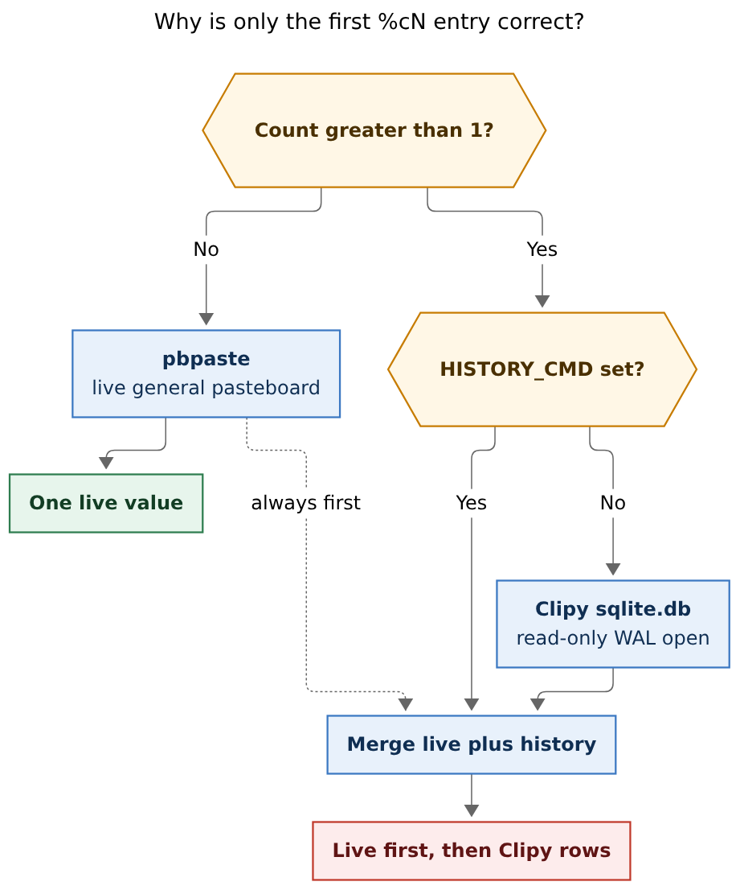
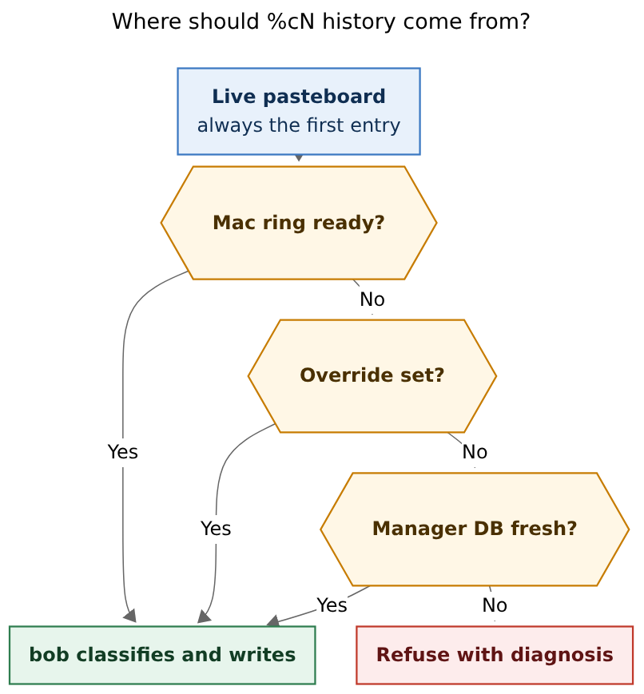

# Counted `%c` history should refuse stale managers and own recent copies

> **Research query:** `%c` works for the live clipboard, but `%c<N>` (N > 1)
> only ever seems to get the first entry right. Diagnose whether bob-cli
> integrated with the wrong macOS clipboard manager, then recommend how to
> make counted clipboard capture resilient. Critique the plan, adjust
> requirements where justified, and recommend a solution.

Researcher: **grk**. Independent of the other swarm reports.

Figures rendered with Mermaid CLI **12.0.0** (PDF-mirroring config, DejaVu
Sans, `useMaxWidth: false`). Measured fit against a 652.8 × 892.8 px text
box:

| Figure | Size | Fit |
| --- | --- | --- |
| Current `%cN` path | 613.166 × 738 px | 100.0% |
| Recommended providers | 536.06 × 580 px | 100.0% |

Live Mac checks ran over Tailscale SSH to `mac` (`kellys-macbook-pro`, user
`bbugyi`) on 2026-11-05 around 09:13 EST. Clipboard *contents* are omitted
from this report; only timestamps, type names, lengths, and process names
are used.

## Bottom line

**The first `%c` / `%c1` value is the live pasteboard (`pbpaste`). Every
later `%c<N>` value is a row from Clipy's on-disk SQLite database, with no
check that Clipy is running or that those rows are recent.** On the Mac
host today that database is sixteen days stale, Clipy is not running, and
Alfred 5 is the live clipboard historian. Counted capture therefore
succeeds and files the wrong older clips.

This is a bad failure mode: the grammar, the classifier, and the Clip card
all work. The user sees a plausible `%c3` block whose second and third
children are from 20 October.

Resilience is a good goal. Swapping the hardcoded Clipy path for a
hardcoded Alfred path is the same design with a different bundle ID. The
durable fix is a freshness-gated provider chain whose first source is a
short in-memory ring inside Bob Mac Capture, which is already a login-item
process and already watches `NSPasteboard.general.changeCount` during `%c`
preview.

## Verdict

The instinct is right: `%c<N>` is a real workflow (`docs/capture.md` uses
`bob capture research links %c3` as the example) and it is unreliable on
the machine that matters. The informal plan to "integrate with the right
manager, and otherwise make `%c` resilient" needs a sharper requirement.

**Treat silent success on stale history as a bug.** A missing Clipy
database already errors. A present but abandoned database of 10,000 rows
does not. That is the reported symptom.

**Keep `%c` (count 1) on the live pasteboard.** That path is already
correct. Do not route a single clip through any manager database.

**Give Bob Mac Capture a recent-copy ring, and keep classification in
bob.** The thin-client decision already allows the app to collect bytes and
hand them to `bob capture`. A ring of the last few dozen plain-text
snapshots is process orchestration, not a second grammar.

**Read Alfred and Clipy only as freshness-gated fallbacks.** Alfred's
`clipboard.alfdb` is live on this host. Clipy's `sqlite.db` matches the
schema bob already speaks, and will be useful again if Clipy is running.
Neither private database is a supported API. Both need a "newest row is
fresh, or the live pasteboard appears in the top rows" gate so a dead
login item cannot poison `%c3`.

## What already exists

Verified against bob-cli `src/native/capture_clip/`, `docs/capture.md`,
plan `plan:202607/clipboard_history_count.md`, Clipy `develop` (SQLiteData
schema), Bob Mac Capture clip preview, and the live Mac host. Nothing in
this section is a proposal.

### Grammar and classifier

`%c` reads one live clipboard value into child bullets. `%c<N>` for N ≥ 2
is specified as "live clipboard first, then N − 1 newer-to-older history
values." `%c1` is an alias for `%c` and does not open a history provider
(`read_clipboard_history` returns after `pbpaste` when `count == 1`).
Templates refuse `%c` because it would repeat once per row.

Each value is classified independently: inline text (≤ 1,000 characters),
flat lines (≤ 10), attachments (≤ 10 paths), or a snippet file. History
mode flattens those children with no `**CLIP:**` headers. Exact N is
required; insufficient history aborts the whole capture.

`--clip` injects a live-clipboard request. `--no-clip` forbids reading.
Bob Mac Capture live preview omits clipboard data unless the accepted
parse reports a `directive: "clip"` span
(`docs/reference/mac-capture/capture-panel.md`).

### Live value versus history value

`src/native/capture_clip/clipboard.rs` resolves the live value as:

1. `BOB_CLIPBOARD_CMD`, if set.
2. Else `pbpaste` on macOS.
3. Else Wayland `wl-paste` / X11 `xclip`/`xsel` on Linux, then tmux.

Counted history is a separate reader:

1. `BOB_CLIPBOARD_HISTORY_CMD`, if set: the command receives the requested
   count as its last argument and must print a newest-first JSON array of
   strings.
2. Else, on macOS only, a hardcoded read of
   `~/Library/Application Support/com.clipy-app.Clipy/sqlite.db`.
3. Else an error that names the override.

There is no Maccy, Alfred, Paste, or "is this process running?" probe.
`BOB_CLIPBOARD_HISTORY_CMD` is unset in the Mac app's environment.

`merge_history_candidates` always prepends the live `pbpaste` string, then
drops at most the first history candidate that equals it, then takes
`N − 1` remaining candidates. That merge is why entry 1 agrees with `%c`
even when the history manager has not seen the latest copy — and why
entries 2+ are entirely at the mercy of whatever the history reader
returned.

### The Clipy adapter matches current Clipy, and that is not sufficient

The July 2026 plan (`plan:202607/clipboard_history_count.md`) said the
configured Mac environment uses Clipy, that Clipy has no CLI, and that a
read-only schema-checked SQLite adapter was the way to avoid UI
automation. That description still matches *installed* Clipy:

- Clipy 1.3+ migrated pasteboard history from Realm to SQLiteData
  ([Clipy#615](https://github.com/Clipy/Clipy/pull/615),
  [Clipy#620](https://github.com/Clipy/Clipy/pull/620)).
- Production path is `Application Support/<bundleIdentifier>/sqlite.db`
  (`SQLiteDataDatabase.swift`).
- Tables `pasteboardHistories` / `pasteboardHistoryAssets` with
  `updateAt`, `pasteboardType`, and `data` match
  `SQLiteDataMigrator+V1.swift`.
- The live database on the Mac is `STRICT`, in WAL mode, with the later
  `createdAt` and `ocrText` columns. bob's `PRAGMA table_info` check
  accepts it.

bob then does three things Clipy itself does not do when presenting a
clip:

1. **Sorts by `updateAt`, then by `id`.** Clipy's default
   `reordersClipsAfterPasting` is `true` (`AppStorageValues.swift`), so
   `updateAt` is last-used time. `id` is a SHA-256 of concatenated
   assets, not a sequence number. Several copies in the same Unix second
   therefore sort by hash.
2. **Joins every supported asset with newlines.** Clipy's `stringValue`
   is the `public.utf8-plain-text` / `NSStringPboardType` flavor only
   (`PasteboardContent.swift`). bob also appends `public.url`,
   `NSURLPboardType`, `public.file-url`, and `NSFilenamesPboardType`.
   One Safari URL copy becomes two lines, which then fails to equal
   `pbpaste`, so merge keeps a garbled duplicate of the live clip and
   drops an older distinct clip.
3. **Opens the database `SQLITE_OPEN_READ_ONLY`.** The live file reports
   `PRAGMA journal_mode=wal`. SQLite's WAL documentation requires write
   access to the directory (or a pre-existing `*-shm`) for a reader to
   see the latest frames. A logically read-only `READWRITE` connection
   plus `PRAGMA query_only=ON` is the usual concurrent-reader pattern.

The adapter also copies **concealed** pasteboards when Clipy stored them.
`org.nspasteboard.ConcealedType` is treated as an unsupported extra
flavor; if a `public.utf8-plain-text` asset exists, bob still returns
that text. [nspasteboard.org](http://nspasteboard.org/) asks historians
to skip transient and concealed markers. Eight of Clipy's newest fifty
rows on this host carry `ConcealedType`.

Unit tests cover the fixture schema and the JSON override. They never
open a real user database, never assert freshness, and never require
Clipy to be running.

### Bob Mac Capture already watches the pasteboard, and does not keep history

`ClipCardView` renders only bob's `clip` JSON. Swift does not read
history there.

`CapturePanelModel` polls `NSPasteboard.general.changeCount` once per
second **while the panel is visible, key, and the accepted parse has a
`%c` span**. A moved counter re-runs `bob capture --dry-run` without
`--no-clip`. Closing the panel, losing key focus, or dropping `%c` stops
the ticker. There is no always-on ring, and a 1-second poll would miss
rapid copies even if there were.

The app is a login item and was running during the check
(`/Users/bbugyi/Applications/Bob Mac Capture.app/.../BobMacCapture`).

## Live Mac evidence

Observed 2026-11-05 ~09:13 EST on `mac`. This is the host `%c` actually
runs on.

| Source | Present | Running | Newest row (local) | Notes |
| --- | --- | --- | --- | --- |
| Live pasteboard (`pbpaste`) | yes | n/a | now (8 bytes) | `%c` / entry 1 |
| Clipy.app | `/Applications/Clipy.app`; login item enabled | **no process** | **2026-10-20 13:21:09** | 10,000 rows (capped); WAL; `sqlite.db` 681 MiB |
| Alfred 5 | `/Applications/Alfred 5.app`; login item | **yes** | **2026-11-05 09:03:04** | `clipboard.alfdb`, 8,337 rows, all `dataType = 0` (text); newest apps were `kitty` |
| Maccy | no | no | n/a | |
| Bob Mac Capture | login item | yes | n/a | no history ring |
| `BOB_CLIPBOARD_HISTORY_CMD` | unset | n/a | n/a | |

Clipy's on-disk newest types were `public.utf8-plain-text` plus, on some
rows, `public.html` or `org.nspasteboard.ConcealedType`. The WAL file
last changed 20 October; the `-shm` file had been touched the morning of
the check (consistent with a later read-only open).

Alfred timestamps are **Mac absolute time** (seconds since 2001-01-01
00:00:00 UTC), which Andrew confirmed on the Alfred forum. Adding
978307200 recovers Unix time. `datetime(ts, 'unixepoch')` on the raw
column prints 1995. Any Alfred adapter that forgets the epoch offset
will look "correct" in SQL and still be wrong.

Login items from System Events: Alfred 5, Bob Mac Capture, Tailscale,
Clipy, Hammerspoon. Clipy is supposed to start at login and is not
running. No Clipy crash report was in `DiagnosticReports` at check time.
Hammerspoon's `init.lua` mentions clipboard only in a comment; it is not
a historian.

So the July 2026 claim "the configured environment uses Clipy" is still
true as an *installed* app and a *login item*, and false as a *live
history source*. bob will happily open the abandoned SQLite file because
the schema check passes and 10,000 rows is more than `%c3` needs.

## Why the first entry is always right

**Caption:** A single `%c` read uses `pbpaste`. A count above one
prepends that live value to Clipy SQLite rows with no check that Clipy
is running or that those rows are recent.

Walk `%c3` on this host:

1. `pbpaste` returns today's live clip. That becomes entry 1. It is
   correct by construction.
2. `read_history_candidates(3)` opens Clipy's WAL database read-only and
   returns the three rows with the largest `updateAt`. Those rows are
   from 20 October 2026 13:21.
3. The live kitty clip is not among those three strings, so merge does
   not drop anything.
4. The result is `[live, october_1, october_2]`. Classification,
   preview, and the note write all succeed.

That is exactly "only the first seems to ever be correct." It does not
require a decode bug. It requires only a history file that still exists
after the historian has stopped.

If Clipy were running, a second, independent failure still waits: joining
plain text and URL flavors of one paste makes the newest history string
unequal to `pbpaste`, so merge keeps a duplicate of the live clip and
never reaches the previous distinct copy. The newest fifty Clipy rows on
this host did not currently combine two bob-supported flavors (HTML is
ignored), so that bug is latent here. It will show up the moment Clipy
is capturing Safari links again.

## Critique of the plan

Making `%c` resilient is a good idea. The feature is already in the
grammar, the docs, the Clip card, and the Mac preview path. Leaving
`%c<N>` as "best-effort Clipy scrape" means counted capture is a trap:
it looks like `%c` with more values, and it files the wrong values
without a refusal.

The plan as stated is too narrow in one place and too vague in another.

**Too narrow: "we integrated with the wrong manager."** On this host that
sentence is descriptively true (Alfred is live, Clipy is not). Replacing
the Clipy path with an Alfred path would make `%c3` work *this morning*
and would fail the same way the first time Alfred is quit, Powerpack
clipboard history is turned off, or the database moves. That is how the
current code failed after Clipy stopped writing on 20 October.

**Too vague: "make `%c` much more resilient."** Resilience that still
returns *some* N strings will keep filing stale or concatenated rows.
The contract that matters is: **either N recent copies in copy order, or
a refusal that names the provider and why it was skipped.**

The original 202607 design was reasonable *then*: Clipy had just grown a
stable SQLite schema, there is no Clipy CLI, and a JSON override keeps
tests off the real database. The missing requirement was liveness. Schema
validity is not freshness.

A first-party clipboard daemon inside `bob` would also be the wrong
shape. `bob capture` is a one-shot process. It cannot see copies that
happened before it started. The process that *can* see them is already
running: Bob Mac Capture.

## Requirement adjustments

These change the implied plan. Each is a requirement, not an
implementation detail.

1. **Stale history must refuse.** If the chosen provider's newest row is
   older than a freshness window (minutes, not days) *and* the live
   pasteboard is not among its top rows, `%c<N>` fails with a diagnostic
   that names the provider, the age of its newest row, and the next
   thing to try (`BOB_CLIPBOARD_HISTORY_CMD`, start Clipy, enable Alfred
   history). Silent success with old clips is out of spec.
2. **`%c` / `%c1` stay on the live pasteboard.** History providers are
   for N ≥ 2 only. Do not destabilize the path that already works.
3. **Exact N, or fail.** Do not pad with duplicates of the live clip, do
   not silently shorten, do not invent empty bullets. The current
   exact-count rule is the right honesty.
4. **One paste = one history entry.** Reconstruct a single canonical
   text, matching `pbpaste`: plain UTF-8 first, then filenames / file
   URLs as a path list, then a URL. Do not join different flavors of the
   same paste with newlines. Multiple file URLs of the same type may
   still be one entry with several lines.
5. **Skip transient and concealed pasteboards.** Honor
   `org.nspasteboard.TransientType` and
   `org.nspasteboard.ConcealedType`. Password-manager copies must not
   become vault notes because Clipy happened to store them.
6. **Prefer copy order.** When a provider has `createdAt` (Clipy V3
   does), sort with that for `%c<N>`. Last-used order is a menu feature,
   not a capture feature.
7. **The Mac app may supply recent snapshots; bob remains the
   classifier.** This is compatible with
   `decisions:mac-capture-is-a-thin-client`. The app must not parse `%c`,
   classify Markdown, or write the vault. It may hand bob a newest-first
   JSON array of strings through the existing history-command contract
   or a sibling `BOB_CLIPBOARD_HISTORY_JSON` env. Do not put clipboard
   bytes on `argv` (`ps` can see it).
8. **Do not persist clipboard text into the vault's `.bob/` by default.**
   An in-memory ring in the already-running menu-bar app is enough for
   `%c<N>`. Disk copies of clipboard history already exist in Alfred and
   Clipy; bob should not add a third store of secrets.
9. **Linux stays override-only** unless a later tale adds cliphist /
   `wl-paste` history. This tale is the Mac `%c<N>` path.

## Alternatives considered

| Approach | Why it loses |
| --- | --- |
| Hardcode Alfred instead of Clipy | Repeats the abandoned-login-item failure; Alfred's schema is also private; `ts` is Mac epoch, easy to mis-parse |
| Keep Clipy-only and ask Bryan to launch Clipy | The login item is already enabled and the process is still absent; bob would keep filing October rows until someone notices |
| `bob` clipboard daemon / on-disk journal | Duplicates Alfred/Clipy, stores secrets, and still misses copies from before the daemon started unless it is yet another login item |
| Classify clipboard in Swift | Violates the thin-client decision; every new classifier rule would land twice |
| UI-scrape Clipy or Alfred | Fragile, changes the pasteboard, out of scope in the 202607 plan for good reasons |
| Drop `%c<N>` and keep `%c` only | Throws away a documented workflow; the live-first merge is the right product once the provider is live |
| Pad with the live clip when history is short | Teaches the user that `%c3` sometimes means "the same clip three times" |

Alfred as a *detected, freshness-gated* fallback is still worth doing.
It is the live historian on this host, its `item` column is already
canonical text (no flavor join), all 8,337 current rows are `dataType =
0`, and the schema has been stable since at least 2020
([rmoff, 2020](https://rmoff.net/2020/05/18/searching-alfreds-clipboard-history-programatically/);
confirmed on disk 2026-11-05). It is a fallback, not the architecture.

## Recommended solution

**Caption:** Take recent copies from the capture app's ring or from a
manager whose newest row is fresh. Refuse a stale database rather than
mixing it with the live pasteboard. Converging arrows mean any one
source is enough.

Ship this in three layers. Layer A is enough to stop filing October
clips. Layers B and C make `%c<N>` boring.

### A. Honesty in bob-cli (smallest, highest leverage)

In `read_history_candidates`:

- After opening Clipy (or any later DB), read the provider's newest
  timestamp. If it is older than a short freshness window **and** none
  of the returned candidates normalize to the live `pbpaste` string,
  return an error that names the path, the newest timestamp, and that
  Clipy does not appear to be running.
- Open SQLite as a WAL-safe reader (`READWRITE` + `query_only`, or an
  equivalent URI). Keep application writes forbidden.
- Canonicalize each Clipy entry to one `pbpaste`-shaped string. Skip
  concealed and transient rows. Prefer `createdAt` when the column
  exists.
- Keep `BOB_CLIPBOARD_HISTORY_CMD` as the test hook and power-user
  override; it continues to win when set.

This layer turns today's silent wrong `%c3` into a loud, actionable
refusal. That is already a product improvement.

### B. Detect a live manager before giving up

If Clipy fails the freshness gate, try Alfred's
`~/Library/Application Support/Alfred/Databases/clipboard.alfdb` with
the same gate:

- `SELECT item FROM clipboard WHERE dataType = 0 ORDER BY ts DESC LIMIT ?`
- Convert `ts` from Mac epoch (`+ 978307200`) before judging freshness.
- Read-only, schema-checked, never written.

Optional third: Maccy, only if its container DB exists and is fresh. Do
not search the disk for arbitrary clipboard apps.

Pick the provider whose newest row is freshest and that can fulfill N
after merge. If none can, refuse. Do not mix three rows from three
managers.

### C. Bob Mac Capture owns the last few dozen copies

This is the resilient source for the path Bryan actually uses (the
capture panel).

- While the menu-bar app is running, poll `changeCount` at Clipy's 500 ms
  interval (the current 1 s panel ticker is too slow for a historian).
- On each change, snapshot plain text with the same rules as
  `PlainTextPaste` (the real `public.utf8-plain-text` flavor, not RTF
  synthesized into HTML). Skip transient and concealed.
- Keep an in-memory newest-first ring (on the order of 50 entries, with
  a modest per-entry size cap). Identical consecutive snapshots collapse.
- When spawning `bob capture` / `--dry-run` for a draft whose parse
  reported `%c` with N ≥ 2, inject that ring through
  `BOB_CLIPBOARD_HISTORY_CMD` or `BOB_CLIPBOARD_HISTORY_JSON`.
- Cold start (app just launched, ring shorter than N) falls through to
  layer B.

bob still classifies, plans attachments, writes the vault, and rolls
back. The app still does not parse `%c`. Preview and Capture keep using
one `bob capture` call.

Tests: fixture Clipy DBs with a stale `updateAt` must refuse when the
live value is absent; a fresh fixture plus a matching live value must
merge as today; an Alfred-shaped fixture with Mac-epoch `ts` must
convert the epoch; Mac Capture unit tests cover ring collapse,
concealed skip, and env injection without reading the real pasteboard
in CI.

## What this does not change

- `%c` / `%c1` live-clipboard behavior, classification limits, snippet
  and attachment planning, headerless history layout, or `--no-clip`.
- The JSON `clip.entries` shape the Mac Clip card already decodes.
- The portable `BOB_CLIPBOARD_HISTORY_CMD` protocol (newest-first JSON
  array of strings).
- Linux, other than still documenting the override.

## Sources

- `src/native/capture_clip/clipboard.rs`, `clipy.rs`, `plan.rs`,
  `tests.rs` (bob-cli)
- `docs/capture.md` § Clipboard; `docs/reference/configuration.md`
  (`BOB_CLIPBOARD_*`)
- `plan:202607/clipboard_history_count.md` (original `%N` / Clipy
  adapter tale)
- `decisions:mac-capture-is-a-thin-client`
- Bob Mac Capture `CapturePanelModel` clipboard poll,
  `CaptureClipPresentation`, `ClipCardView`, `PlainTextPaste`
- Clipy `develop`: `SQLiteDataDatabase.swift`,
  `SQLiteDataMigrator+V1.swift`, `PasteboardHistoryRepository.swift`,
  `PasteboardContent.swift`, `PasteboardAvailableType.swift`,
  `ClipService.swift` (500 ms `changeCount` poll),
  `AppStorageValues.swift`
- [Clipy#615](https://github.com/Clipy/Clipy/pull/615),
  [Clipy#620](https://github.com/Clipy/Clipy/pull/620), Clipy 1.3.0
  release notes (Realm → SQLite)
- Live Mac, 2026-11-05: processes, login items, Clipy
  `PRAGMA journal_mode` / newest `updateAt`, Alfred `clipboard.alfdb`
  schema and newest `ts`
- [nspasteboard.org](http://nspasteboard.org/)
- [SQLite WAL](https://www.sqlite.org/wal.html) (read-only readers and
  `*-shm`)
- Alfred forum (Andrew): `ts` is seconds since 2001-01-01 UTC;
  [rmoff 2020](https://rmoff.net/2020/05/18/searching-alfreds-clipboard-history-programatically/)
  for the still-current `clipboard(item, ts, app, apppath, dataType,
  dataHash)` schema
- Alfred `{clipboard:N}` placeholders: workflow/snippet interpolation,
  not a bob API
  ([Alfred help](https://www.alfredapp.com/help/workflows/advanced/placeholders/))
