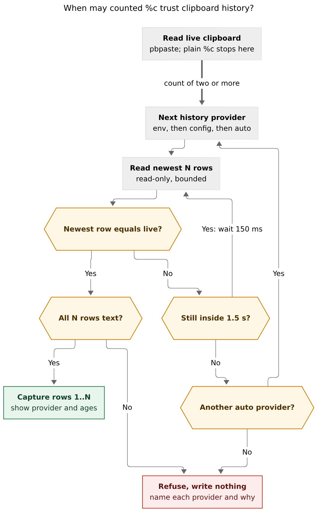

# `%c<N>` should read Alfred and trust clipboard history only when it agrees with the live clipboard

*Consolidated report · 2026-11-05 · lead researcher, merging the five independent reports
in this directory (`__cdx`, `__cld`, `__grk`, `__mus`, `__gem`) with new checks of my own.
bob-cli `d012e782` (the clipboard code is unchanged since `7e437418`, which the
researchers examined); bob-mac-capture `d206803`. Mac checks ran read-only over Tailscale
SSH (`mac`, user `bbugyi`) between 09:03 and 09:45 EST. No clipboard contents were
printed or stored. Only schemas, counts, timestamps, file times, and equality booleans
were recorded.*

## Bottom line

**Your suspicion is right: bob reads the wrong clipboard manager.** `%c` and `%c1` read
the live pasteboard through `pbpaste`, so they always work. `%c<N>` takes entry 1 from
`pbpaste` too, but takes entries 2..N from **Clipy's** SQLite database. Clipy has **not
run since 2026-10-20 13:21**. The manager that is actually running, and that you open with
⌥C, is **Alfred 5**. Its newest entry equals `pbpaste` right now. Every `%c3` written since
then has been `[today's clip, Clipy's newest Oct 20 clip, its second-newest]`, which is
exactly the "only the first is right" symptom.

**Swapping Clipy's path for Alfred's would fix today and break again later.** The real
defect is that bob cannot tell a *lagging* history from a *dead* one, so it writes stale
entries into the vault without any warning. The original design (July plan) deliberately
tolerated lag and had no liveness requirement. Switching to Alfred would leave that
failure in place for the day Alfred quits, its history is turned off, or you change
managers.

**Recommendation:**

1. Add a read-only **Alfred history provider**, chosen through bob's config file
   (`capture.clipboard_history`, default `auto`, which prefers Alfred).
2. Add one provider-neutral **agreement check**: a history is trusted only when its
   newest entry equals the live clipboard, after a short bounded wait for manager lag.
   Otherwise the capture refuses and names each provider and why it failed.
3. Report **provenance**: the provider plus each entry's age, in JSON and in the Mac
   Clip card.

Do not build a Bob-owned clipboard recorder now. Details are in
[§7](#7-recommended-solution).

## 1. How `%c<N>` works today

- `read_clipboard_history(count)` (`src/native/capture_clip/clipboard.rs:15`):
  1. Reads live text through `BOB_CLIPBOARD_CMD`, otherwise `pbpaste`.
  2. Returns at once when `count == 1`.
  3. Otherwise reads `count` history candidates from `BOB_CLIPBOARD_HISTORY_CMD` or, on
     macOS, from the hard-coded `~/Library/Application Support/com.clipy-app.Clipy/sqlite.db`
     (`clipboard.rs:57-75`).
- The Clipy query is `ORDER BY updateAt DESC, id DESC LIMIT ?1`
  (`src/native/capture_clip/clipy.rs:28-31`). Every supported asset flavor is decoded
  and the flavors are joined with newlines.
- `merge_history_candidates` (`clipboard.rs:35`) removes the *first* candidate equal to
  the live value, wherever it sits. It then returns `[live] + candidates[..N-1]`.
- When the live value is missing from history, the merge assumes the manager is
  lagging, and a unit test asserts exactly that (`merges_live_clipboard_with_up_to_date_and_lagging_histories`,
  `tests.rs:74`). Nothing checks liveness or age, and nothing records where the entries
  came from.
- Callers: `read_capture_clipboard` (`src/native/capture/plan.rs:902`). Bob Mac Capture
  calls it on every debounced preview once `capture-parse` reports a `clip` span, and
  re-previews when `NSPasteboard.general.changeCount` moves (polled about once per second
  while the panel is key).

A dead history therefore looks exactly like a lagging one. It passes the schema check,
has 10,000 rows, and returns a clean, plausible capture.

## 2. Root cause: evidence from the Mac

Gathered by cdx, cld, and grk, and re-checked by me at about 09:35:

| Check | Clipy | Alfred |
| --- | --- | --- |
| Version | 1.4.0 (Realm → SQLite migration on Jul 5) | 5.8.1, Powerpack |
| Running? | **No**, though still a login item | **Yes** |
| Store | `com.clipy-app.Clipy/sqlite.db` (WAL, about 700 MB) | `Alfred/Databases/clipboard.alfdb` (`journal_mode=delete`, about 6 MB) |
| Rows | 10,000 (its cap) | 8,300 (8,337 earlier today; old rows are pruned by retention) |
| Newest entry | **2026-10-20 13:21:09** | **2026-11-05 09:32:10** at my check |
| Newest entry equals `pbpaste`? | No, for each of the top 3 (cld) | **Yes**, at 09:0x (cld) and again at 09:35 (me) |
| Non-text rows | n/a | 0 (`dataType = 0` for every row) |
| Same-second timestamp ties | 382 tied seconds | 64 tied `ts` groups; 426 rows out of `rowid` order because a re-copy bumps `ts` |

**Timeline:**

- **Jul 15.** `e6b70be4` ships counted history against Clipy, which was correct then.
- **Oct 8.** The Mac boots and Clipy starts as a login item.
- **Oct 20 13:21.** Clipy stops. No crash report exists, and unified logs from that
  window are no longer retained, so the trigger is unknown.
- **Oct 31.** `6ae5df00` adds the `%c` / `%c<N>` spelling.

Every `%c<N>` you have typed has therefore read a frozen history. The feature probably
worked from July 15 to October 20 under the old spelling. It will appear to "fix itself"
for a while after the next reboot relaunches Clipy. That intermittency is why the fix
needs a guard, not just a new path.

**Confidence:** high. All three researchers who checked the Mac independently found the
same state, and my own re-check agrees. One gap remains: nobody replayed your original
failing capture, so §7.7 lists a controlled acceptance test.

## 3. Where the reports disagreed, and how I resolved it

| Claim | Who | Resolution |
| --- | --- | --- |
| You probably run **Maccy** | mus | **Wrong.** mus did not check the Mac. Maccy is not installed; Alfred is the live manager. |
| A **"ghost" Clipy DB left over from July** | gem | **Wrong on the dates.** Clipy recorded until Oct 20, so the history was 16 days stale, not months. |
| `~/bin/paste_parts` (which runs `killall Clipy` and relaunches it from an `EXIT` trap) killed Clipy | gem (lead) | **Ruled out for Oct 20.** The script's last-access time is **May 20**. Access times are being updated (`~/bin/macscrot` shows Nov 4), so it has not run since. It is still a housekeeping item (§8). |
| Clipy is **unmaintained** | gem, mus | **Wrong.** Clipy 1.3/1.4 moved from Realm to SQLite in 2026 (PRs #615 and #620), and 1.4.0 is installed. Clipy is maintained; it just isn't running. |
| Alfred stores history in `clipboard.rubydb` | gem | **Wrong.** The file is `clipboard.alfdb`, confirmed on disk. |
| Open Clipy's WAL database read-write with `query_only` so new frames are visible | grk | **Reject.** A read-only open sees WAL frames whenever the user can write the `-shm` file or its directory, which is the case here. A read-write connection that closes last also **checkpoints and deletes the WAL in someone else's database**. That happened during this research: Clipy's `sqlite.db` mtime changed to 09:13 today and its `-wal` file is gone, consistent with an `sqlite3` session at grk's check time (rows are unchanged). Bob must keep `SQLITE_OPEN_READ_ONLY`. |
| Judge staleness by **age** (15 min to 1 h) plus `pgrep` | gem; grk (age window *and* live not in top rows) | **Use agreement, not age** (cld, cdx). A quiet history is fine: if you copied three things two hours ago, the newest entry is two hours old and still correct. Process liveness is a useful *diagnostic* but not a gate, because a running manager can still be paused or excluding an app. |
| Make a **Bob Mac Capture ring buffer** the primary source (in memory, or `~/.local/state/bob/clipboard_history.json`) | grk, gem | **Defer** (cdx, cld, mus). Evidence: the app binary was replaced at 09:22 and again at 09:39:55 this morning while agents rebuilt it, and the running process started at 09:39:57, so an in-memory ring would keep cold-starting. An on-disk ring adds a third plaintext clipboard store. Capturing from a terminal would not see the ring without that store. It also makes the app a data producer, which is in tension with `decisions:mac-capture-is-a-thin-client`. |
| Relax exact-N (partial results, "graceful" counts) | gem; mus (preview only) | **Reject for writes.** Exact-N-or-refuse is documented and correct. Per-entry status in a *failing preview* is fine. |
| `auto` falls through providers (cld) versus explicit only, where a provider failure never activates another (cdx) | cld vs cdx | **`auto` may fall through, but only to a provider that passes the agreement check, and provenance always names the provider used.** Pin `alfred` explicitly on the Mac. |
| Bind preview to submit with a selection fingerprint | cdx only | **Valid but later** (Phase 3). The Mac panel already re-previews on `changeCount`, so the remaining window between the last preview and Return is small. |

## 4. Secondary defects (independent of the root cause)

| # | Defect | Severity | Source |
| --- | --- | --- | --- |
| D1 | The merge cannot tell a lagging history from a dead one, so stale history is written silently | **High** (this bug) | all |
| D2 | `BOB_CLIPBOARD_*` overrides cannot reach the main frontend: Mac Capture launches `bob` with an allowlisted environment (`BobEnvironment.swift:56-66`) that includes `BOB_CONFIG_FILE` but not `BOB_CLIPBOARD_CMD` or `BOB_CLIPBOARD_HISTORY_CMD`. A `.zshrc` fix would repair the terminal and leave the panel broken. | Medium | cld, verified |
| D3 | Clipy's tie-break `id DESC` sorts by content hash or UUID, so copies made within one second come back in random order. The table is an ordinary rowid table, so `rowid DESC` is the right tie-break. | Medium (latent while Clipy is down) | cld, mus, gem, grk |
| D4 | Clipy flavors are joined with newlines. A Safari URL copy (text plus `public.url`) becomes two lines, no longer equals `pbpaste`, and pushes out an older distinct clip. cdx reproduced this shape with a synthetic provider. | Medium (latent) | cdx, grk, mus |
| D5 | Clipy rows marked `org.nspasteboard.ConcealedType` (password managers) are still returned. 8 of Clipy's newest 50 rows carry it. | Medium (privacy) | grk |
| D6 | No provenance: neither JSON nor the preview says which provider supplied the entries or how old they are. "16 days" would have exposed this bug on day one. | Medium (UX) | cld, mus, cdx |
| D7 | All `count` candidates are normalized *before* selection, so a bad surplus row can abort a valid request (cdx reproduced this) | Low | cdx |
| D8 | History commands are whitespace-split, with no timeout and no output cap | Low | cdx |
| D9 | Two `%c` items in one draft read the clipboard separately; reads are shared only within a fanout target run | Low | cdx |
| D10 | Preview and submit are separate reads with no binding between them | Low | cdx |

## 5. Critique of the request

**Making `%c` resilient is the right goal.** `%c<N>` writes to the vault, and the panel
hides on success, so a silent wrong write may never be noticed. Two parts of the request
need sharpening.

1. **"We integrated with the wrong manager" is true, but it is the proximate cause.**
   The underlying flaw is that bob never asks whether its history source is tracking the
   pasteboard. Treat the manager swap as necessary but not sufficient.
2. **"Resilient" must mean "correct or loud", not "always returns N values."** A fallback
   chain that tries harder to produce *something* makes silent wrongness more likely.
   Every successful history read should carry evidence that it is current, and every
   failure should explain itself before anything is written.

One terminology note (cdx): the suffix is a **count**, not an index. `%c3` means three
values (live plus two from history), not "the third entry." Keep these semantics and use
"count" consistently.

## 6. Requirement adjustments (proposed, called out)

| # | Adjustment | Why |
| --- | --- | --- |
| **R1** | **New invariant:** a history read is valid only when the provider's newest entry, normalized as bob normalizes `pbpaste`, equals the live clipboard, after a bounded wait (about 1.5 s, polled every 150 ms). This replaces the unbounded lag tolerance. | It is the one cheap, provider-neutral signal that history is tracking *this* pasteboard *now*. It catches today's bug and still absorbs real lag. |
| **R2** | **Provider selection moves to config:** `capture.clipboard_history: auto \| alfred \| clipy \| command \| off`, plus `capture.clipboard_history_command` as an argv list. `BOB_CLIPBOARD_HISTORY_CMD` stays the highest-precedence override. | D2: environment variables don't reach `bob` from the panel. `capture.*` already exists (`max_saved_templates`). |
| **R3** | **Add a built-in Alfred provider**, preferred by `auto` on macOS. Keep Clipy as a second, gated provider with the D3, D4, and D5 fixes. | Alfred is what runs and what you look at with ⌥C. The Clipy code already exists and is tested. |
| **R4** | **Order = the manager's own most-recent-first view.** For Alfred that is `ts DESC, rowid DESC`, with re-copies bumped to the top. Do not promise "the last N copy keystrokes." | Neither store records sub-second order. Matching the ⌥C viewer is a clear, checkable promise. |
| **R5** | **Expose provenance** additively: `clip.history = {provider, entries: [{age_seconds, app}]}` in JSON, one line in human output, and later in the Mac Clip card. | Makes staleness visible before Return. |
| **R6** | **Unchanged on purpose:** `%c` and `%c1` never touch history; exact-N or refuse; whole-capture atomicity; entry 1 is the live value. | These July decisions were good, and all five reports agree. |
| **R7** | **Accepted consequence:** if the live item was concealed, transient, or from an app Alfred ignores, Alfred won't record it, R1 fails, and `%c<N>` refuses. `%c` still works, and the message names the likely cause. | Refusing to batch a password into the vault is a feature. |
| **R8** | **Still out of scope:** image and file entries *from history* (a selected non-text row refuses with an indexed error, never a silent skip that shifts positions); a Bob-owned recorder; Linux history (`tmux` buffers are a natural later follow-up); Raycast/Maccy adapters. | Keeps the change to one cohesive tale. Alfred's non-text row format is unverified. |

## 7. Recommended solution



**Caption:** Proposed read path. Plain `%c` stops after the live read. A count of two or
more trusts a history provider only when its newest row equals the live clipboard within
a short wait. `auto` then tries the next provider, and the capture refuses, writing
nothing, when none agrees or a selected row is not text.

### 7.1 Provider boundary (bob-cli, `src/native/capture_clip/`)

Replace `read_history_candidates -> Vec<String>` with providers that return entries:

```rust
struct HistoryEntry { text: Option<String>, kind: EntryKind, at: Option<SystemTime>, app: Option<String> }
enum HistoryProvider { Command(Vec<String>), Alfred(PathBuf), Clipy(PathBuf) }
```

### 7.2 Alfred adapter (new `alfred.rs`, in the style of `clipy.rs`)

- **Path:** `~/Library/Application Support/Alfred/Databases/clipboard.alfdb`.
- **Open:** open it `SQLITE_OPEN_READ_ONLY | NO_MUTEX` with `busy_timeout` of about
  250 ms. Alfred uses a rollback journal, so its writes briefly lock readers. Never use
  `immutable=1`, a read-write connection, or a file copy. Map lock, hot-journal, and
  schema failures to typed refusals.
- **Schema check:** table `clipboard(item, ts decimal, app, apppath, dataType integer,
  dataHash)`, indexed on `ts`, as observed today and unchanged since at least 2020
  (rmoff). On a mismatch, fail with "unsupported Alfred clipboard database".
- **Query:** `SELECT item, ts, app, dataType FROM clipboard ORDER BY ts DESC, rowid DESC
  LIMIT ?N`. `ts` is integer seconds since 2001-01-01 UTC, so add `978_307_200` to get
  Unix time. Forgetting the offset yields dates in 1995.
- **Types:** `dataType = 0` is text. Anything else in a selected position is an indexed
  "history entry K is a file/image; counted capture supports text history" error.
- **Semantics** (verified on device): Alfred deduplicates by content and bumps `ts` on a
  re-copy, so `%c3` returns three *distinct* values in most-recently-used order. Document
  this.

### 7.3 Selection (R2)

Precedence: `BOB_CLIPBOARD_HISTORY_CMD`, then `capture.clipboard_history`, then `auto`.

- An explicit provider is the only one tried.
- `auto` on macOS tries **Alfred, then Clipy**, skips any whose store is missing, and
  takes the first that passes R1.
- `auto` elsewhere keeps today's "set a command" error.
- `off` refuses `%c<N>` cleanly.

Pin `capture.clipboard_history: alfred` in your chezmoi-managed bob config. Then a
relaunched Clipy can never be chosen, and an Alfred outage refuses instead of falling
back.

### 7.4 Agreement check (R1): the actual resilience fix

```text
live = read_clipboard()                                   # unchanged; %c / %c1 stop here
for provider in candidates(selection):
    deadline = now + 1.5 s
    loop:
        rows = provider.read(N)                           # exactly N: no surplus rows (fixes D7)
        if rows[0] is text and normalize(rows[0].text) == live:
            require len(rows) == N and every row is text  # exact-N or refuse
            return rows[0..N] + provenance                # identical to [live] + rows[1..N]
        if now >= deadline: record diagnosis(provider, rows); break
        sleep 150 ms
refuse("clipboard history doesn't match the live clipboard", diagnoses)
```

- **Applies to every provider, including commands.** Existing command-based tests that
  encode lag tolerance (`tests.rs:74` and `tests/cli/capture/clip.rs`) change
  accordingly.
- **Diagnosis per provider:** whether the store exists, the newest entry's age, "newest
  entry differs from the live clipboard", and, for the message only, whether the process
  is running (`pgrep -x`). Today's state would read: `Clipy: not running, newest entry 16
  days old, doesn't match the live clipboard`.
- **Only a capture fired within about a second of copying ever waits.** Measure Alfred's
  poll interval once and tune the constant.
- **Known limitation:** a head match proves the *head* is current, not that no gap lies
  behind it (for example, a manager that was down and then restarted). R5's per-entry
  ages make such a gap visible ("4 s · 2 min · 16 days"). Pinning `alfred` avoids most of
  it.

### 7.5 Clipy fixes, if Clipy stays a provider

1. `ORDER BY updateAt DESC, rowid DESC` (D3).
2. Decode **one canonical flavor** per entry: UTF-8 plain text first, then file paths,
   then URL. Never join flavors (D4).
3. Skip rows carrying `org.nspasteboard.ConcealedType` or `TransientType` (D5).
4. Return `updateAt` as the entry's time.

### 7.6 Provenance and docs (R5)

- **JSON:** history captures gain `clip.history`. Single `%c` JSON stays byte-identical.
  Human output adds one line, for example `from Alfred · newest 3 s · oldest 4 min`.
- **Docs to update:**
  - `docs/capture.md#clipboard`
  - `docs/reference/cli/capture.md`: the "Clipboard source order" block (lines 228-230)
    and the env table
  - `docs/reference/configuration.md`: the new `capture.*` rows and the
    `BOB_CLIPBOARD_HISTORY_CMD` row that says "Clipy … on macOS"
  - the `capture` CLI help

### 7.7 Delivery

**Phase 1: one bob-cli tale.** Includes:

- §7.1–7.6
- tests:
  - an Alfred fixture database covering ordering, ties, the epoch conversion, non-text
    rows, schema mismatch, and a locked database
  - the Clipy `rowid` tie-break and single-flavor decoding
  - the selection matrix (env > config > auto, missing stores)
  - the agreement logic with an injected clock: match, lag-then-match, stale, concealed
    live item
- **the regression test for this bug:** the live value is `new`, the provider's newest
  entry is `old` and 16 days old, and the capture must refuse and write nothing.

The commit changes documented CLI behavior (the help's history source order) and turns
some previously successful invocations into refusals. Per
`decisions:bob-cli-releases-ride-a-daily-train`, mark it `feat(capture)!`.

**Phase 2: Bob Mac Capture.** Decode `clip.history` with `decodeIfPresent` and show the
provider and ages in the Clip card header. This is presentation only, consistent with the
thin-client decision. Watch the exact-SHA macOS CI run.

**Phase 3: hardening, optional, in order of value:**

1. One clipboard snapshot per invocation, keyed by the largest count, with prefixes
   reused (D9).
2. Bounded command execution: a deadline, an output cap, child reaping, and argv from
   config (D8).
3. A read-only top-level `bob clipboard` status report (provider, health, ages; contents
   redacted by default), placed under "Integrations". The CLI rules forbid subcommands
   under `bob capture`.
4. cdx's preview→submit selection fingerprint, if mismatches are ever observed (D10).

**Acceptance on the Mac** (deliberate, because it changes the clipboard and Alfred's
history):

| Action | Expected |
| --- | --- |
| Copy A, B, C, then `%c3` | C, B, A, matching the ⌥C viewer |
| Re-copy A, then `%c3` | A, C, B |
| Quit Alfred, copy D, `%c3` | Refusal naming Alfred |
| Copy from 1Password, `%c3` | Refusal (R7) |
| Copy a file in Finder, `%c3` | Typed refusal (R8) |
| Copy, then capture immediately | Succeeds within the wait |
| Same draft in terminal and Mac panel | Same provider |

## 8. Housekeeping on the Mac (your call, no code)

- **Retire Clipy:** quit it and remove it from Login Items, or uninstall it. It keeps a
  second plaintext history of about 700 MB (including concealed items) that serves no
  purpose next to Alfred. With R1 in place, leaving it is *safe*, but it is noise.
- **Update `~/bin/paste_parts`** (chezmoi): it still runs `killall Clipy` and
  `open -a Clipy` on exit, so running it would *relaunch* a retired Clipy. Its chunked
  pastes now land in Alfred's history instead. Make it pause Alfred's clipboard history,
  or mark its writes `org.nspasteboard.TransientType`, which Alfred is reported to honor
  (unverified).

## 9. Open questions

- **Alfred's polling interval** is undocumented, so the 1.5 s wait is a guess. Measure it
  once.
- **Alfred non-text rows:** there are 0 today even though `enabledImages` and
  `enabledFiles` are on. The image and file row format (`dataHash`, the
  `clipboard.alfdb.data/` directory) is undocumented. Verify it before ever supporting
  them.
- **Does Alfred skip concealed, transient, or ignored-app copies?** This is widely
  reported but unverified here. R7 refuses safely either way.
- **Alfred 6 or an encrypted store** would break the adapter. That is the trigger to
  reopen a Bob-owned recorder (grk/gem's design; see §3), or an Alfred-workflow bridge
  through `{clipboard:N}` and External Triggers (cdx: supported but asynchronous).
- **Why Clipy quit on Oct 20** remains unknown. There was no crash report, logs had
  rotated, and `paste_parts` is excluded. It doesn't change the design.

## Sources

- **Researcher reports (this directory):**
  - `__cdx`: synthetic dry-run reproductions, preview binding, bounded reads
  - `__cld`: device timeline, agreement invariant, environment-allowlist finding
  - `__grk`: flavor-join, concealed-row, and WAL observations, plus the ring proposal;
    figures in `percent_c_clipboard_history_resilience__grk_assets/`
  - `__mus`: code walk and tie-break test gap
  - `__gem`: first-party ring proposal and the `paste_parts` lead
- **bob-cli code:** `src/native/capture_clip/{clipboard.rs,clipy.rs,tests.rs}`,
  `src/native/capture/plan.rs:902`, `docs/capture.md` §Clipboard,
  `docs/reference/cli/capture.md:228-230`, `docs/reference/configuration.md`
  (`capture`, `BOB_CLIPBOARD_*`).
- **Bob Mac Capture:** `Sources/CaptureCore/BobEnvironment.swift` (environment
  allowlist) and `Sources/BobMacCapture/CapturePanelModel.swift` (`changeCount` poll).
- **History:** commits `e6b70be4` and `6ae5df00`; `plan:202607/clipboard_history_count.md`;
  decisions `mac-capture-is-a-thin-client` and `bob-cli-releases-ride-a-daily-train`.
- **My device checks** (2026-11-05, 09:34–09:45 EST):
  - processes and login items
  - Clipy and Alfred schemas, counts, newest timestamps, and tie counts
  - Alfred head equals `pbpaste` (boolean only)
  - Alfred clipboard preference keys
  - `paste_parts` access time and its Hammerspoon binding (⌘⌥⌃V)
  - Clipy store file times
  - Bob Mac Capture binary and process start times
  - unified log search of Oct 20 13:19–13:23 (empty, rotated)
- **External:**
  - [rmoff: Alfred clipboard schema](https://rmoff.net/2020/05/18/searching-alfreds-clipboard-history-programatically/)
  - [Alfred Forum: `clipboard.alfdb` access](https://www.alfredforum.com/topic/18061-accessing-clipboard-history-inside-a-workflow/)
  - [Alfred clipboard help](https://www.alfredapp.com/help/features/clipboard/)
  - [nspasteboard.org](http://nspasteboard.org/)
  - [SQLite WAL](https://www.sqlite.org/wal.html)
  - [SQLite isolation](https://www.sqlite.org/isolation.html)
  - Clipy [#615](https://github.com/Clipy/Clipy/pull/615) and
    [#620](https://github.com/Clipy/Clipy/pull/620)
