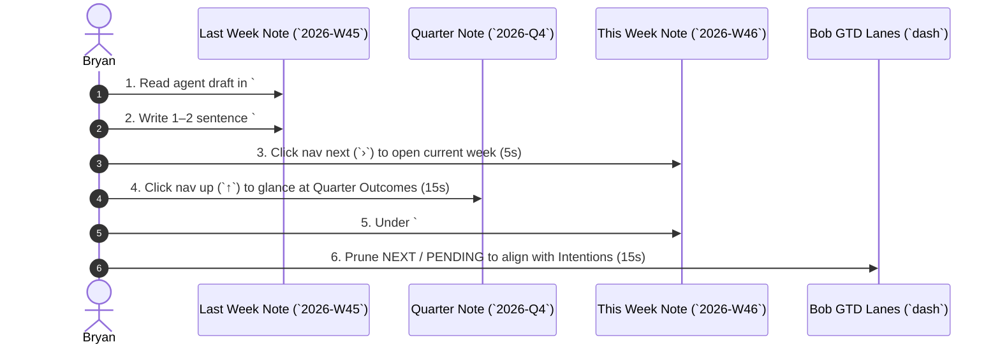

# Period Notes: Operational Guide to Intentions, Outcomes, and Themes

**Author:** Researcher gem (`research.42.gem`)  
**Date:** November 10, 2026  
**Context:** Bob-CLI Period Notes & GTD Horizons Integration (`sase/repos/research/202611/`)

---

## Executive Summary

Across the 2026 period note tree in the Bob vault, `## Intentions` in every weekly note (`2026-W01.md` through `2026-W47.md`) and `## Outcomes` in every quarterly and yearly note (`2026-Q1.md` through `2026-Q4.md`, `2026.md`) remain 100% blank. The system's execution tracking is exceptionally mature—capturing hundreds of daily Pomodoros, reconciling task states, cycling decay ladders, and synthesizing agent reviews—yet the higher-level strategic steering loop has never fired.

Bryan's diagnosis is candid: *"I am supposed to be manually setting intentions and outcomes in period notes I think, but I haven't been, mostly because I'm not sure what I'm supposed to write."*

This research investigated the codebase (`src/native/periods/`), vault documentation (`docs/periods.md`, `docs/reference/`), GTD review checklists (`gtd_daily.md`), Horizons of Focus (`horizon.md`, `h2_role.md`, `h3_goal.md`), and historical period drafts. The investigation reveals five concrete causes for this paralysis:

1. **Category Confusion:** Unclear boundaries between a **Theme** (compass), an **Outcome** (quarterly destination), an **Intention** (weekly focus bet), and a **Task** (daily execution unit).
2. **Double-Bookkeeping Anxiety:** A feeling that writing intentions duplicates the 40+ active projects already tracked in `bob projects list` and `gtd.md`.
3. **Syntax and Scaffolding Vacuum:** Period scaffolds generate a bare markdown heading (`## Intentions`) with zero placeholder text or structural hints, leaving Bryan to face a blank page.
4. **Fear of Rule Violations:** Period notes strictly enforce that **no `#task` checkbox rows may exist** (`task_rows` problem). Users instinctively reach for checkboxes to plan; when told not to, they stall.
5. **Grading Apprehension:** Knowing that the agent review evaluates intentions using rigid marks (`✓ done`, `◐ partial`, `✗ not done`, `– no evidence`) creates performance pressure if the criteria are fuzzy.

This report establishes the complete operational standard: an unambiguous taxonomy, explicit formatting rules, a 2-minute Monday morning GTD integration, fill-in-the-blank formulas, and immediate drop-in drafts for **2026-Q4** and **2026-W46**.

---

## 1. Architectural Foundation: Period Notes in Bob

### 1.1 The Temporal Hierarchy

Period notes partition time strictly in whole ISO calendar units. There are no monthly notes (months are purely reporting groupings in `bob stats`). The tree climbs without dangling links:

```mermaid
flowchart TD
    title: Period Note Temporal Hierarchy and Upward Synthesis
    accTitle: Period Note Hierarchy
    accDescr: Diagram illustrating the ISO hierarchy from daily notes up through all time.

    ALL["All Time (`all_time.md`)<br/><b>Anchor:</b> [[org]]"]
    Y["Year Note (`YYYY.md`)<br/><b>Human:</b> `## Theme`, `## Outcomes`, `## Reflection`<br/><b>Agent:</b> `## Review`"]
    Q["Quarter Note (`YYYY-Qn.md`)<br/><b>Human:</b> `## Outcomes`, `## Reflection`<br/><b>Agent:</b> `## Review` (13-14 Weeks)"]
    W["Week Note (`YYYY-Www.md`)<br/><b>Human:</b> `## Intentions`, `## Reflection`<br/><b>Agent:</b> `## Review` (Mon–Sun)"]
    D["Daily Notes (`YYYYMMDD.md`)<br/><b>Ledger:</b> `## Pomodoros`, `## Tasks`<br/><b>Human:</b> Work Log, Notes"]

    D -->|"parent link"| W
    W -->|"parent link"| Q
    Q -->|"parent link"| Y
    Y -->|"parent link"| ALL

    classDef period fill:#E8F1FB,stroke:#3B78C2,stroke-width:1.5px,color:#0F2E52;
    classDef ledger fill:#F5F5F5,stroke:#666666,stroke-width:1.5px,color:#222222;
    class ALL,Y,Q,W period;
    class D ledger;
```
*Figure 1: Period notes form an exact partition of calendar time, bridging high-level Horizons down to daily Pomodoros.*

### 1.2 Ownership Boundaries

Bob enforces rigid ownership across section types (`docs/periods.md` §Note anatomy and ownership):

| Section | Owner | Tool / Mechanism | Mutability |
|---|---|---|---|
| **Frontmatter, Nav, Day links** | `bob` | `bob periods ensure` | Write-once on creation. |
| **`bob-stats-strip` fence** | `bob-ledger-tools` | Live render in Obsidian | Dynamic, never stored in Markdown. |
| **`bob-period-parts` table** | `bob-ledger-tools` | Live render in Obsidian | Dynamic child summaries. |
| **`## Review`** | SASE Agent | `bob periods draft` | Agent writes; locked once Bryan edits/reflects. |
| **`## Theme` / `## Outcomes`** | **Bryan** | Manual authorship | Tooling/agents **NEVER** write or edit. |
| **`## Intentions`** | **Bryan** | Manual authorship | Tooling/agents **NEVER** write or edit. |
| **`## Reflection`** | **Bryan** | Manual authorship | Tooling/agents **NEVER** write or edit. |
| **`[!agent]-` callout** | `bob` | `bob periods ensure -R` | Versioned drafting instructions (v2). |

### 1.3 The Inviolable Task Row Constraint

A foundational rule of Bob period notes is: **Period notes hold no task rows.**

In `src/native/periods/problems.rs`:
```rust
fn has_task_row(contents: &str) -> bool {
    contents.lines().any(|line| {
        let trimmed = line.trim_start();
        trimmed.starts_with("- [") && trimmed.contains("#task")
    })
}
```
If Bryan types `- [ ] #task Do something` inside a period note, `bob periods list -p` raises the `task_rows` problem:
> `period notes hold no task rows; fix: move #task checkbox lines out of the period note`

**Crucial Takeaway:** Intentions and Outcomes are **not tasks**. They must never be written with checkbox syntax. They are statements of focus, commitments, or target end-states authored as standard Markdown list items (`- ...`).

---

## 2. Ontological Taxonomy: Theme vs. Outcome vs. Intention vs. Task

To eliminate the friction of *"I don't know what to write,"* we must define the precise semantic role of each level within Bryan's GTD Horizons of Focus (`horizon.md`).

```mermaid
flowchart LR
    title: GTD Horizons to Period Note Semantic Mapping
    accTitle: GTD Horizons Mapping
    accDescr: Showing how GTD Horizons map to Period Note sections and execution.

    subgraph HORIZONS["GTD Horizons of Focus"]
        H4["Horizon 4 / 3: Vision & 1-2 Yr Goals<br/>(`h4_vision.md`, `h3_goal.md`)"]
        H2["Horizon 2: Areas of Responsibility<br/>(`h2_role.md`)"]
        H1["Horizon 1: Active Projects<br/>(`prj.md`, `^prj` tasks)"]
        H0["Runway: Daily Actions & Ledger<br/>(`now`, Pomodoro Task Links)"]
    end

    subgraph PERIODS["Period Notes"]
        Y_SEC["Year Note (`YYYY.md`)<br/>`## Theme`<br/>`## Outcomes`"]
        Q_SEC["Quarter Note (`YYYY-Qn.md`)<br/>`## Outcomes`"]
        W_SEC["Week Note (`YYYY-Www.md`)<br/>`## Intentions`"]
    end

    H4 -->|"guides"| Y_SEC
    H2 -.->|"balances"| Q_SEC
    Y_SEC -->|"decomposes into"| Q_SEC
    H1 <-->|"aggregates into"| Q_SEC
    Q_SEC -->|"selects focus for"| W_SEC
    W_SEC -->|"steers weekly"| H0

    classDef hBox fill:#F9F9F9,stroke:#555,stroke-width:1.5px,color:#111;
    classDef pBox fill:#EBF3FB,stroke:#2B6CB0,stroke-width:1.5px,color:#0C2D48;
    class H4,H2,H1,H0 hBox;
    class Y_SEC,Q_SEC,W_SEC pBox;
```
*Figure 2: Period notes serve as the operational transmission gears linking high-altitude vision down to the daily Pomodoro ledger.*

### 2.1 Definitions and Distinctions

#### 1. Theme (Year Note: `## Theme`)
- **What it is:** A qualitative compass, mindset, or operating posture for the entire 52-week cycle. It answers: *"What is the guiding principle for how I allocate my energy this year?"*
- **Quantity:** Exactly 1 theme (often paired with a 1-paragraph expansion).
- **Time Horizon:** 1 Year (52–53 ISO weeks).
- **Examples:**
  - *Autonomous Engineering:* Transition from manual coding to supervising autonomous SASE multi-agent swarms.
  - *Consolidation & Health:* Stabilize infrastructure, pay down personal tech debt, and rebuild aerobic running base.
  - *Depth over Breadth:* Resist starting new side-tools; drive Bob and SASE to stable production releases.

#### 2. Outcome (Year Note & Quarter Note: `## Outcomes`)
- **What it is:** A tangible, observable end-state or systemic capability shift achieved by the end of the period. It answers: *"What will permanently exist, be shipped, or be true that is not true today?"*
- **Quantity:** Exactly 1 to 3 outcomes (never more than 3).
- **Time Horizon:**
  - *Year:* 12 months. Aligned with `h3_goal.md` (e.g., L5 promotion, major open-source launch).
  - *Quarter:* 13 weeks. Anchors 2–5 related `^prj` projects into a coherent milestone.
- **Formula:** `[State / Capability Achieved] so that [Observable Impact]`.
- **Examples (Quarterly):**
  - *Bob Period Notes & Review Automation Adopted:* Weekly reviews running every Monday with v2 agent drafts, with zero unreviewed weeks in Q4.
  - *SASE Autonomous Gate & Finalizer Architecture Shipped:* All PR/CL workflows, monitors, and verification gates migrated to provider-native finalizers.
  - *Staff / L5 Job Pipeline Active:* 10+ completed applications submitted to target tech companies with tailored CVs and initial recruiter screens completed.

#### 3. Intention (Week Note: `## Intentions`)
- **What it is:** A strategic commitment to 1 to 3 primary bets for the upcoming 7-day sprint (Monday through Sunday). It answers: *"If this week only accomplishes two or three significant things amidst inevitable firefighting, meetings, and chores, what must they be?"*
- **Quantity:** Exactly 1 to 3 items (`gtd_daily.md` explicitly specifies: `set ≤3 Intentions`).
- **Time Horizon:** 7 days.
- **What it is NOT:** It is NOT a daily checklist, NOT a routine reminder ("Brush teeth", "Clean inbox"), and NOT an exhaustive inventory of everything you will touch.
- **Formula:** `[Action Verb] [Bounded Deliverable] ([Project / Evidence Link])`.
- **Examples (Weekly):**
  - *Ship Period Review v2 Brief & Scaffold Migration* (`[[bob]]`).
  - *Complete technical screen preparation for Stripe / Databricks* (`[[job_2026]]`).
  - *Log 3 runs (≥15 miles total) and complete orthodontist checkup* (`[[body]]`).

#### 4. Task (Daily Note / GTD Ledger: `## Tasks`, `## Pomodoros`)
- **What it is:** A discrete, executable action step with status tracking (`[ ]`, `[/]`, `[x]`, `[-]`).
- **Quantity:** Many (5–25 per day).
- **Location:** Daily notes, area notes, project notes. **Never in period notes.**

### 2.2 Taxonomy Comparison Matrix

| Level | Note Location | Section | Count | Cadence | Grammatical Form | How Evidence is Verified |
|---|---|---|---|---|---|---|
| **Year** | `YYYY.md` | `## Theme` | 1 | Yearly (Jan) | Noun Phrase / Philosophy | Reflected in quarterly root-parent time shares and practices. |
| **Year** | `YYYY.md` | `## Outcomes` | 1–3 | Yearly (Jan) | Result / State achieved | Major milestone completion (e.g. `h3_goal` progress, promotion). |
| **Quarter** | `YYYY/YYYY-Qn.md` | `## Outcomes` | 1–3 | 13 Weeks | Past Participle / State | Closed `^prj` projects, shipped repos, major external milestones. |
| **Week** | `YYYY/YYYY-Www.md` | `## Intentions` | 1–3 | Weekly (Mon) | Imperative Verb + Target | Finished project tasks in `done/`, commit history, ledger links. |
| **Day** | `YYYY/YYYYMMDD.md` | `## Tasks` | 10–30 | Daily | Checkbox Task `#task` | Checked box `[x]`, Pomodoro timespan `(**0920-0950** [t:: 30m])`. |

---

## 3. How the Feedback Circuit Closes: The Agent Review Loop

Understanding how the system reads and scores intentions removes the ambiguity of authoring them.

### 3.1 The Agent Ingestion Process (`bob periods brief`)

When `bob periods brief <period> -f md` runs, it executes `src/native/periods/brief.rs`:
```rust
fn own_sections(id: PeriodId, contents: &str) -> Value {
    match id {
        PeriodId::Week { .. } => pick(&["Intentions"]),
        PeriodId::Quarter { .. } => pick(&["Outcomes"]),
        PeriodId::Year(_) => pick(&["Theme", "Outcomes"]),
        PeriodId::AllTime => Value::Object(serde_json::Map::new()),
    }
}
```

The brief prints:
1. In the **Week Brief**:
   - `### Intentions`: Bryan's authored weekly intentions.
   - `### Parent Outcomes`: The enclosing quarter's `## Outcomes`.
   - `### Previous Reflection`: The prior week's reflection.
2. In the **Quarter Brief**:
   - `### Outcomes`: Bryan's authored quarter outcomes.
   - `### Parent Theme` & `### Parent Outcomes`: The enclosing year's goals.

### 3.2 The Review Scoring Grammar

The agent instructions callout (`src/native/periods/instructions.rs`) mandates how an agent evaluates intentions:
> `` `**Intentions:**` one line each, ✓ done · ◐ partial (name the part) · ✗ not done · – no evidence, with one evidence link. ``

The agent parses each authored bullet and assigns one of four marks based on empirical evidence in the brief and vault:

```mermaid
flowchart TD
    title: Agent Review Scoring Logic for Intentions and Outcomes
    accTitle: Evaluation Flowchart
    accDescr: Decision tree for how agents evaluate intentions into four verdicts.

    I["Authored Intention / Outcome Bullet"] --> Q1{"Is there verifiable evidence in<br/>Finished, Shipped, or git?"}
    Q1 -- No evidence in ledger/vault --> V_NONE["<b>– no evidence</b><br/>Nothing logged in Pomodoros, notes, or git."]
    Q1 -- Evidence exists --> Q2{"Is the stated milestone fully complete<br/>(^prj closed, task in done/, feature shipped)?"}
    Q2 -- Yes --> V_DONE["<b>✓ done</b><br/>Linked to `done/` task or `^prj` closure."]
    Q2 -- Partial progress --> Q3{"Was meaningful work done<br/>even if the whole deliverable is open?"}
    Q3 -- Yes --> V_PART["<b>◐ partial (name the part)</b><br/>e.g. 'draft written, review pending' · linked to task."]
    Q3 -- Explicitly dropped or 0 progress --> V_NOT["<b>✗ not done</b><br/>Open with 0 minutes or moved to Carried Forward."]

    classDef decision fill:#FFF7E6,stroke:#C77C02,stroke-width:1.5px,color:#4A3000;
    classDef verdict fill:#E7F5EC,stroke:#2E7D4F,stroke-width:1.5px,color:#123D24;
    class Q1,Q2,Q3 decision;
    class V_DONE,V_PART,V_NOT,V_NONE verdict;
```
*Figure 3: How the agent evaluates each intention bullet. The evaluation is purely empirical, never judgmental.*

### 3.3 De-Stigmatizing the Scoring: The Review is a Mirror, Not an Exam

A major psychological blocker is treating the agent's evaluation as a pass/fail grade. 
- In Bryan's system, **the agent is strictly forbidden from praising, blaming, grading, or offering unsolicited advice** (`docs/periods.md` §Agent instruction callouts).
- A mark of `◐ partial` or `✗ not done` is **valuable operational data**. It flags where reality diverged from plans (e.g. an unexpected fire in SASE or an interruption at home).
- When intentions are empty, the agent is forced to ask generic filler questions (e.g., W45 Question 1: *"This week's Intentions and Q4's Outcomes are both empty; which outcomes, if any, should W46's Intentions name?"*).
- When intentions are set, the review immediately becomes high-signal: the agent verifies what shipped against what was intended.

---

## 4. Root Causes of Bryan's Friction & How to Overcome Them

| Friction Point | What Bryan Feels / Experiences | Root Cause in the System | The Practical Remedy |
|---|---|---|---|
| **1. The Blank Page** | Opens `2026-W46.md`, sees `## Intentions`, has no idea what syntax to write. | Scaffolding generates an empty heading with no prompt or template. | Use a fixed 3-bullet template with the `[Verb] [Object] ([Project])` formula. |
| **2. Double-Bookkeeping** | "I already have 40+ active projects in `bob projects list`—why re-type them?" | Confusing an *intention* with a *project list*. | You are not listing projects; you are picking the **top 1–2 projects** that get priority time this week. |
| **3. Granularity Trap** | "Should I write 'reply to Alice' or 'build SASE'?" | No rule on scoping scale. | Use the **"Pomodoro Cluster" rule**: an intention represents 4–12 Pomodoros of focused effort (2–6 hours), not a 5-minute chore or a 6-month epic. |
| **4. Checkbox Reflex** | Wants to put `- [ ] #task` so it can be checked off. | Instinctive habit from GTD daily notes. | Remember the `task_rows` prohibition. Intentions are plain list bullets (`- `). The agent checks them off in `## Review`! |
| **5. Review Disconnect** | Weekly review checklist is long and Monday morning is rushed. | The intention-setting step is buried inside line 21 of `gtd_daily.md`. | Isolate the **2-minute Period Ritual**: Reflect on last week (60s), glance at Q Outcomes (30s), type 2–3 bullets (30s). |

---

## 5. The Authoring Guide: What to Write and How to Write It

### 5.1 The "Rule of ≤3" Portfolio Heuristic

To make setting intentions effortless every Monday, use the **Three-Slot Portfolio**:

1. **Slot 1: The Main Rock (Primary Work/Project Bet)**
   - The single most critical technical or professional milestone for the week.
   - Usually tied to an active `^prj` in SASE, Bob, or Job search.
2. **Slot 2: The Enabler (Secondary Project or System Tooling)**
   - A supporting system, refactoring, research read, or dev infrastructure improvement.
3. **Slot 3: The Personal / Life Rock (Health, Home, Family)**
   - Physical health (running, workout), home maintenance, or critical administrative/family bet.

*Rule:* If a week has only 1 major intention, that is completely acceptable. Never exceed 3.

### 5.2 The Core Syntactic Formula

Every intention bullet should follow this simple pattern:

$$\text{`- [Action Verb] [Deliverable/End-State] (Context/Wikilink)`}$$

#### Syntactic Requirements:
- Use a standard Markdown bullet (`- `).
- Do **not** use brackets (`[ ]`) or tags (`#task`).
- Include a wikilink to the relevant project, area, or reference note so the agent can find evidence.

### 5.3 Good vs. Bad Examples

````carousel
```markdown
<!-- slide -->
### Weekly Intentions: Bad vs. Good Examples

❌ BAD: Too vague / process-only (Agent cannot verify completion)
- Work on sase
- Do some job hunting
- Be healthy

❌ BAD: Checklist clutter / violates task_rows constraint
- [ ] #task Reply to recruiter email
- [ ] #task Clean up desktop
- [ ] #task Review PR 123

✅ GOOD: Verifiable, bounded, linked to project context
- Ship period brief v2 and verify draft generation ([[bob]])
- Submit 3 Staff SWE applications with customized CVs ([[job_2026]])
- Log 3 running workouts (≥15 miles total) in [[body]]
```
<!-- slide -->
```markdown
### Quarterly Outcomes: Bad vs. Good Examples

❌ BAD: Open-ended aspirations / project titles
- Bob CLI improvements
- Job search
- SASE agents

❌ BAD: Massive task list
- Fix bug 1, fix bug 2, update docs, migrate repo, run tests...

✅ GOOD: Tangible capability shifts & closed milestone states
- Bob period notes & automated review loop fully adopted with zero missing weeks ([[bob]])
- SASE gate and monitor workflows migrated to native finalizers across all repos ([[sase_completion]])
- Secure and accept an L5+ / Staff SWE offer at a target tech company ([[job_2026]])
```
<!-- slide -->
```markdown
### Yearly Theme & Outcomes: Real Examples for 2026

## Theme
**Autonomous Systems & Depth**
Focus on shifting from direct manual execution to robust agent supervisor tooling, while consolidating health and family rhythms.

## Outcomes
- SASE deployed as an open, rock-solid agent orchestration engine across all personal workflows.
- Professional transition to L5 / Staff level completed.
- Running consistency restored (≥500 annual miles logged).
```
````

---

## 6. The 2-Minute Monday Morning GTD Routine

In `~/bob/gtd_daily.md`, line 21 already outlines the weekly review routine:
> `- [?] #task #gtd #post #periods **Weekly review**: close last week — from today's note open the week link, then ‹; correct the draft PRE started ... and write the Reflection · open this week's note, re-read the quarter's Outcomes (↑), and set ≤3 Intentions · prune: release NEXT to ≤15 and PENDING to ≤10 with Alt+N...`

Here is the exact step-by-step micro-flow to execute this in under 2 minutes:


*Figure 4: The 2-minute weekly review and intention-setting ritual.*

### Step-by-Step Breakdown:

1. **Step 1: Close Last Week (75 seconds)**
   - Open `last-week` (`bob periods show last-week`).
   - Read the agent's drafted `## Review`. The agent already checked your prior week's intentions and listed what shipped.
   - In `## Reflection`, write 1 or 2 sentences answering: *What did last week mean? What surprised me or needs shifting?*
2. **Step 2: Connect to the Quarter (15 seconds)**
   - Navigate to the new week (`W46`), then click `↑ 2026-Q4` (or press `gf` on the parent link).
   - Glance at the 1–3 bullet points under `## Outcomes`. This re-centers your attention on the 13-week horizon.
3. **Step 3: Author ≤3 Intentions (30 seconds)**
   - Return to the new week note.
   - Under `## Intentions`, write 2 or 3 bullets using the formula:
     ```markdown
     ## Intentions

     - [Lead Work Bet] ([[project]])
     - [Secondary / Tooling Bet] ([[project]])
     - [Personal / Health Bet] ([[area]])
     ```
4. **Step 4: Prune Daily Lanes (15 seconds)**
   - When pruning `NEXT` (down to ≤15) and `PENDING` (down to ≤10) with `Alt+N`, verify that your top `NEXT` tasks directly support this week's intentions.

---

## 7. Immediate Bootstrapping: Drop-in Drafts for Today

To break the cold-start problem immediately, Bryan does not need to wait for a new quarter or year. The current quarter (`2026-Q4`) and current week (`2026-W46`) can be seeded right now.

### 7.1 Proposed `2026-Q4.md` `## Outcomes`

Open `/home/bryan/bob/2026/2026-Q4.md` and insert under `## Outcomes`:

```markdown
## Outcomes

- Complete and adopt the Bob period notes system, with weekly reviews running every Monday and agent instructions upgraded to v2 ([[bob]]).
- Ship SASE gate and monitor finalizer migration, retiring legacy execution gates across Athena and Apollo ([[sase_completion]]).
- Submit wave 1 of senior/staff job applications (≥10 customized submissions) and advance through initial technical screens ([[job_2026]]).
```

*Why these work:*
- Each corresponds directly to active `wip` projects in `bob projects list` (`bob`, `sase_completion`, `job_2026`).
- Each represents a permanent capability or pipeline milestone by January 3, 2027.
- Every week in Q4 (W40–W53) will immediately see these in its brief under `### Parent Outcomes`.

### 7.2 Proposed `2026-W46.md` `## Intentions`

Open `/home/bryan/bob/2026/2026-W46.md` and insert under `## Intentions`:

```markdown
## Intentions

- Finalize and adopt the period intentions research, unblocking `^intentions-and-outcomes` in [[gtd]].
- Advance SASE agent recovery and monitor finalizer verification on Athena ([[sase_completion]]).
- Complete 3 gym or running workouts and maintain daily GTD review cadence ([[body]], [[gtd]]).
```

*Why these work:*
- Directly unblocks the active GTD task: `[/] #task Write good week "intentions" and quarter "outcomes”! ^intentions-and-outcomes`.
- Gives next Monday's agent drafting `2026-W46 Review` verifiable bullets to score (`✓ done`).
- Immediately eliminates Question 1 from recurring agent drafts (*"This week's Intentions and Q4's Outcomes are both empty..."*).

---

## 8. Summary of Recommendations

1. **Adopt the "Rule of ≤3" as Hard Policy:** Never write more than 3 intentions for a week or 3 outcomes for a quarter. One high-conviction intention beats a diluted laundry list.
2. **Keep Period Notes Task-Free:** Maintain the strict boundary: intentions are bullet declarations (`- `), never `#task` checkboxes. Tasks belong on the daily ledger and project files.
3. **Seed Q4 and W46 Today:** Drop the provided drafts into `2026-Q4.md` and `2026-W46.md`. Experiencing the agent score real intentions next Monday is the fastest way to build confidence in the system.
4. **Treat the Review as Data, Not a Scorecard:** When the agent reports `◐ partial` or `✗ not done`, treat it as empirical feedback on weekly friction, not personal failure. Use `## Reflection` to record why priorities shifted.
5. **Protect the 2-Minute Monday Boundary:** Keep the ritual lightweight. If intention setting takes more than 2 minutes, the scope is too detailed. Pick 2–3 big rocks and let the daily GTD ledger handle the rest.
