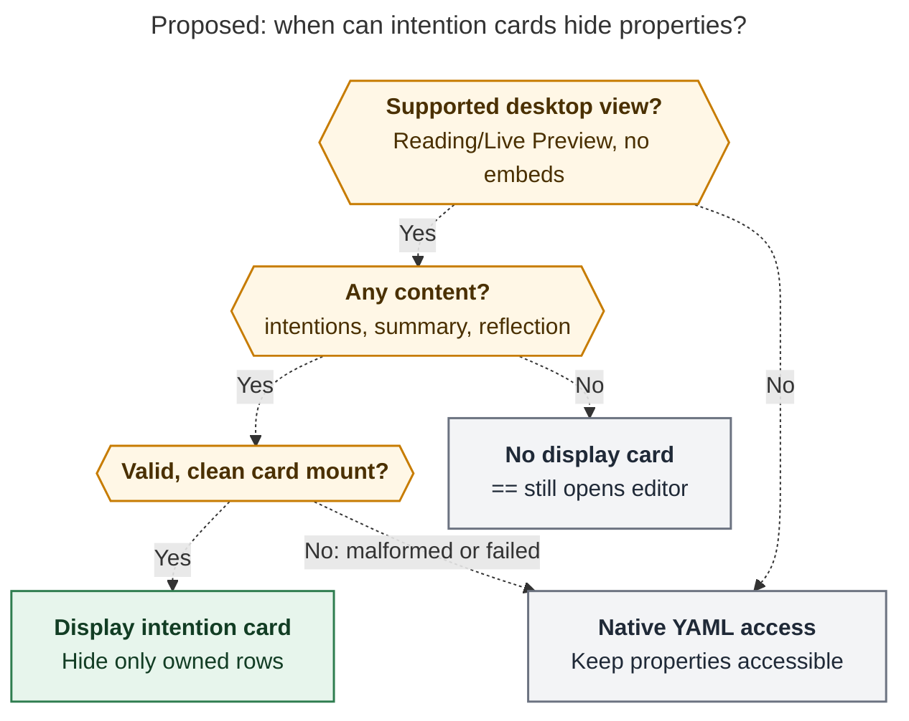
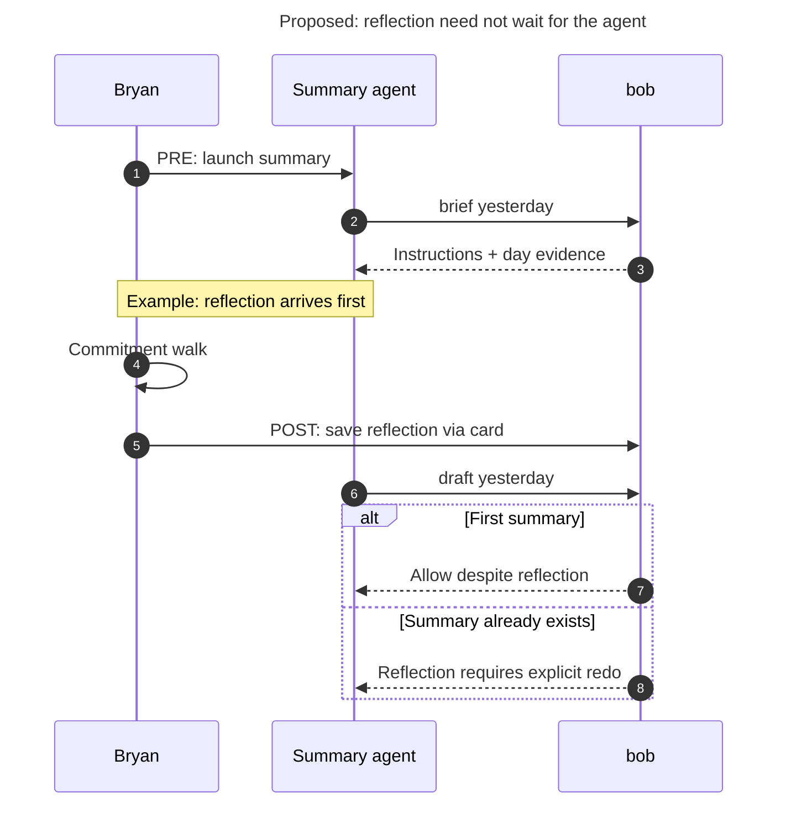

# Diagram proposals: Period intentions and property cards: consolidated design

Proposals for the swarm linker, not a report. Each diagram restates only what the source
report says.

```yaml
source: research:202611/period_intentions_card/period_intentions_card__final.md
producer: research.5f.image
check: "mmdc 12.0.0 with the PDF-mirroring config rendered 2 of 2 Mermaid diagrams; pinned CLI with --no-sandbox; broken-diagram rejection passed"
```

## property-visibility

```yaml
anchor: |-
  while the card is cleanly mounted, never in embeds or Source mode
question: |-
  When can an intention card hide native properties?
illustrates: |-
  A property card owns exactly the rows it shows and fails open, so native YAML access survives unsupported views, malformed values, or mount failure.
caption: |-
  Intention cards hide owned properties only when supported and mounted safely; empty notes remain editable, and failure preserves native access.
review: "630.449x832 px, fit 100.0%; question and visual checks passed; all nodes and edges traced to sections 3.1 and 5.5; 1 revision; eligibility branches, not runtime check order"
```



## reflection-before-summary

```yaml
anchor: |-
  PRE completes when the agent is *launched*, not when it finishes; POST reflection
question: |-
  Can Bryan reflect before the summary agent finishes?
illustrates: |-
  PRE completes when the agent is launched, so POST reflection stays available if the agent is slow and never blocks the first summary draft.
caption: |-
  Bryan can reflect before the agent finishes: reflection allows a first summary but requires explicit redo for a re-draft.
review: "789x750 px, fit 82.7%; question and visual checks passed; actors and messages traced to sections 4 item 9 and 5.3-5.5; 0 revisions; one allowed interleaving, not compulsory chronology"
```


