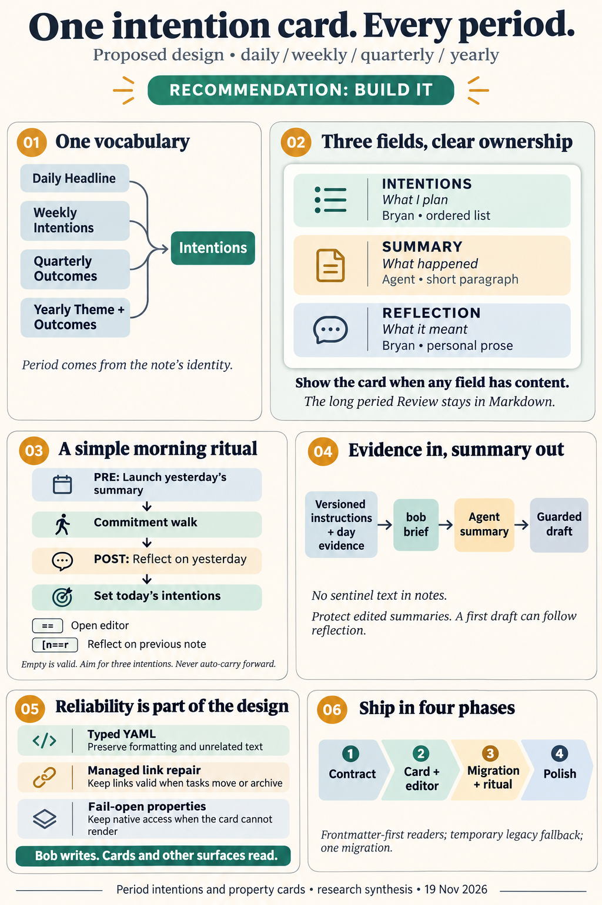
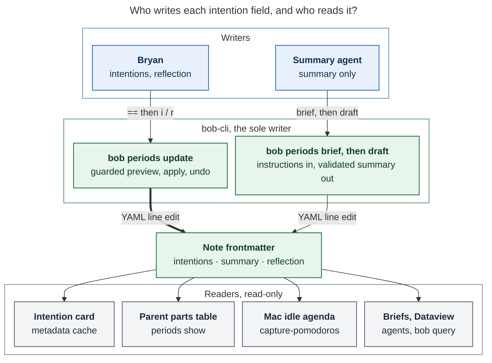
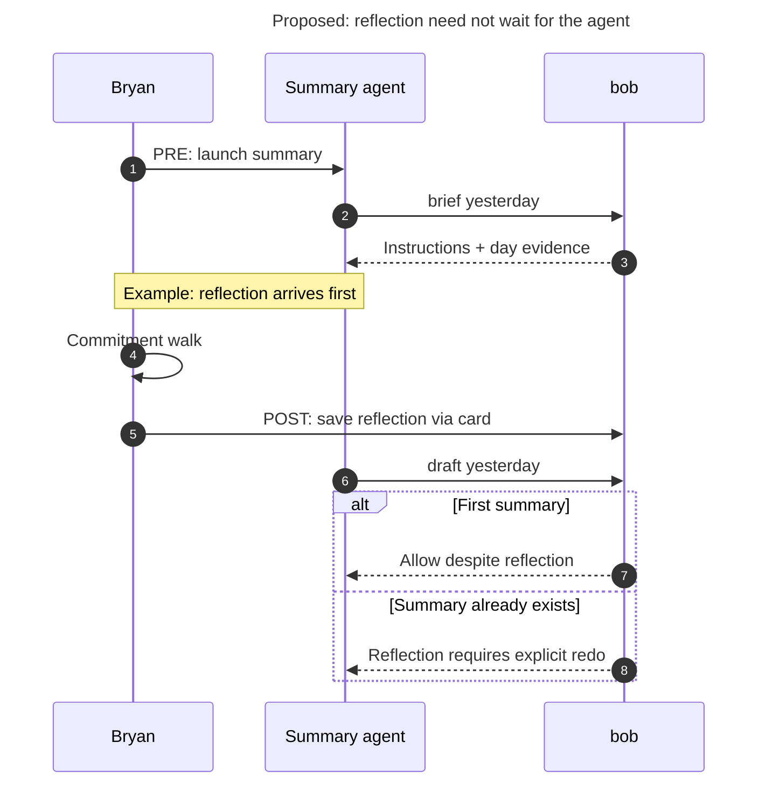
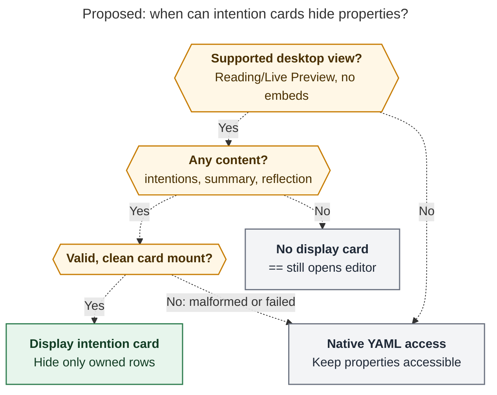

# Period intentions and property cards: consolidated design

> **Research query:** How should Bob unify the daily Headline, weekly intentions,
> quarterly outcomes, and yearly themes into one period-scoped "intentions" concept,
> stored as hidden `intentions` (user-set list), `summary` (agent-set), and `reflection`
> (user-set) frontmatter on daily and period notes and shown in an `==`-editable
> intention card that shares the album/record/bank property-card UX? The request also
> asks for a `#pre` GTD row to have an agent summarize yesterday and a `#post` row to set
> yesterday's reflection, summary instructions agents always find but Obsidian never
> shows, and new glossary terms — then a critique of the plan, clearly called-out
> requirement changes, and a recommended solution.



## Bottom line

**Build it.** All five researchers independently reached the same top-line conclusion:
unifying daily Headline, weekly Intentions, quarterly Outcomes, and yearly Theme +
Outcomes into one period-scoped **intentions** concept — stored as hidden frontmatter
(`intentions`, `summary`, `reflection`), painted by a new **intention card** in the
album/record/bank **property-card** family, and edited with `==` — is
[the right product move](#recommended-design), and the timing is right: the data using
the old shapes is tiny (two daily Headlines, a handful of period bullets, 21 agent Review
Headlines). Bryan has already shown the demand by hand-typing `**Reflection**:` into
`2026/20261118.md` the day after the Headline shipped, and `bob.md` already files this
exact work (`^intentions`, `^daily-summary`, `^current-intentions`).

The request as written has five defects that every deeper inspection hit, and this
consolidation adjusts them (all called out in
[the adjustments to the request](#adjustments-to-the-request)):
[the card-visibility gate](#when-the-card-shows) would hide data with no surface showing
it; the period `## Review` [must not be flattened](#what-summary-means-on-a-period-note)
into a YAML string; the sentinel-in-`summary` idea fails on every axis and
[a strictly better architecture](#summary-instructions) exists; links inside the three
keys [would silently break](#facts-verified-by-the-lead) the night a linked task is
archived unless bob's managed-YAML repair learns them; and the current period
frontmatter parser cannot even read a YAML list.

## Adjustments to the request

1. **Card shows when any of the three fields has content**, not only `intentions`;
   `==` opens the editor on any canonical daily/period note regardless
   ([when the card shows](#when-the-card-shows)).
2. **Period `## Review` stays in the body.** `summary` replaces only its Headline
   opener; "instead of H2 sections" is narrowed to the Bryan-owned planning/reflection
   sections plus that opener
   ([what `summary` means on a period note](#what-summary-means-on-a-period-note)).
3. **No sentinel.** The summary instructions live in bob, print with the brief, and
   are enforced by the draft writer; four pointers lead there
   ([summary instructions](#summary-instructions)).
4. **Link repair is added as a requirement.** Archive, task move/merge/split, and
   `ref rename` must rewrite links inside the three keys exactly as they rewrite body
   links, with digest restamping and a `dangling_period_link` problems finding —
   without this the feature breaks nightly
   ([facts verified by the lead](#facts-verified-by-the-lead)).
5. **No `period:` key.** The period is derived from the note's canonical identity
   (path/id/`parent` chain); "daily intentions" is simply the `intentions` of a daily
   note. A stored period would be a second source of truth.
6. **The `#post #headline` row is replaced**, not left beside the new rows: it becomes
   `#post #intentions` **Set today's intentions**, and
   `post_stages: [periods, intentions]`. The request implies the Headline is retired;
   the row would otherwise point at a line that no longer exists. Net ritual change is
   +2 rows, roughly 1–2 minutes ([ritual rows](#ritual-rows)).
7. **`[n==r` ships as composition plus a safety net.** `[n` follows the real `prev`
   link; the editor opens in browse mode (never with a focused text field, so a fast
   `r` cannot be typed into the reflection); on a *closed* period the selection starts
   on Reflection, so `[n==` alone also works. A palette/Command-Mode "Reflect on
   yesterday" command resolves the previous calendar day through Bob's timezone
   resolver and pins the target note, as the dependable route when navigation is slow
   or nonstandard (cdx). No speculative keystroke queue.
8. **Year Theme + Outcomes both migrate** into the year's `intentions` (theme as item
   1); migration must preserve both, never silently flatten (cdx caught that the
   request names only the theme).
9. **A reflection never blocks the *first* summary draft** (it still blocks a re-draft
   without an explicit "redo"). Today a `reflected` period refuses even a first
   draft; relaxed because the PRE agent may finish after Bryan writes the POST
   reflection — otherwise the design has a built-in data race (cdx, cld).
10. **`all_time` is excluded; soft cap 3; absent-means-empty; additive Mac JSON**
    ([what all five researchers agree on](#what-all-five-researchers-agree-on);
    [intentions cap](#intentions-cap)).

## What all five researchers agree on

These points were reached independently five times and are safe to treat as settled:

1. **Unify the vocabulary.** "Daily/weekly/quarterly/yearly intentions" replaces the
   Headline/Intentions/Outcomes/Theme ladder. It also fixes two live naming collisions:
   "Headline" today means Bryan's forward-looking plan on a day but the agent's
   backward-looking Review opener on a period (`docs/periods.md:152–156`), and the
   year's "Theme" collides with `theme`, a live Task Type alias. After the change:
   `intentions` = the plan (Bryan), `summary` = what happened (agent), `reflection` =
   what it meant (Bryan), at every scale.
2. **Three fields, three owners, one write path.** Bryan writes `intentions` and
   `reflection` through the card editor; an agent writes `summary` through a guarded
   bob draft command; bob is the sole writer of the YAML (the plugin never calls
   `processFrontMatter` — the existing record-card rule). Every other surface is a
   reader.
3. **Reject the sentinel.** A pointer or marker value inside `summary` corrupts the
   field's contract, breaks truthiness checks in every reader (Dataview, cards, parts
   tables, capture JSON), leaks in Source mode, goes stale in hundreds of notes, and
   still doesn't deliver the evidence an agent needs. Instructions live in bob,
   versioned, and ride the brief ([summary instructions](#summary-instructions)).
4. **Share the property-card platform, not one mega-modal.** The editor kernel is
   already shared (`createGuardedUpdateSession` 242aa, close keys 241xc, `y` YAML
   excursion 242e, `placeAtGap`); the display side is three copies. Extract a kit (CSS
   chrome, owned-key hiding, `==` registry, host mount) and build the intention card on
   it. Do not refactor the album/record/bank editors into one — they edit different
   things and the kernel already gives them one UX.
5. **`==` extension is small and the `[n==r` gesture is real.** The `==` keymap is a
   capture-phase hook intercepting the pending second `=` of CodeMirror Vim's
   `indentAuto` operator (`248m-plugin-schema-double-equals.js`); its target list is a
   closed `album | bank | record` set, and adding a daily/period target is the whole
   keymap change. `[n` follows the labelled `prev` link, `==` opens the card, `r` jumps
   to Reflection — composition, not a magic chord.
6. **Mac contract stays additive.** `capture-pomodoros --tasks` grows
   `intentions: [display…]` while the frozen scalar `headline` stays as the first
   intention's display text (it is `Option<Option<String>>` fed by
   `daily_headline::parse`, `capture_pomodoros.rs:521`). The Swift side never parses
   YAML; the Mac intentions panel (`bob.md ^current-intentions`) is a follow-on.
7. **`all_time` is excluded**, no monthly notes are added, and empty is always valid —
   intentions never become tasks, never carry forward automatically, and nothing nags.

## Facts verified by the lead

Where reports disagreed or stood alone:

| Claim | Verdict | Evidence |
| --- | --- | --- |
| bob's generic link repair deliberately skips frontmatter, so a `[[link]]` inside an intention breaks the night its target is archived (cld, alone) | **Confirmed** | `src/native/collect_done/link_repair.rs` doc comment ("Managed YAML links are updated deliberately by the planner, so frontmatter stays out of this generic pass") and `skip_repaired_span` (`line_index <= frontmatter_end`, ~:1349) |
| The periods frontmatter parser cannot read YAML lists or multiline scalars (cdx, gem) | **Confirmed** | `periods/note.rs` `parse_frontmatter` skips every indented line ("Multi-line list bodies … are skipped: only scalar `key: value` lines are indexed") |
| `PeriodId` has no Day variant | **Confirmed** | `periods/calendar.rs:15` — `Week / Quarter / Year / AllTime` |
| Dual meaning of "Headline"; 25-word cap; review state machine with digest restamp on bob rewrites | **Confirmed** | `docs/periods.md:126–160`; "A bob rewrite is not Bryan's edit … the same write restamps `review_digest`" |
| Live GTD rows and stages match the pattern the new rows copy | **Confirmed** | `gtd_daily.md:13` (`#post #headline`), `:26` (`#pre #periods` launch pattern); `config.yml:131–132` `pre_stages: [init, terminal, periods, browser, sync]`, `post_stages: [periods, headline]` |
| Daily template carries the Headline line | **Confirmed** | `_templates/daily.md:19` |
| `summary` is already a typed vault-wide property with another meaning on areas/notebooks/albums | **Confirmed** | `.obsidian/types.json`: `"summary": "text"`; e.g. `gtd_daily.md` and `bank.md` use it as a catalog one-liner |
| Real intentions carry mid-sentence block links | **Confirmed** | W47 `## Intentions`: "Finish sase-1n6 release train (see `[[sase#^ref-sase-1n6-11-4-restart-readiness]]`)" |
| Bryan already filed this work | **Confirmed** | `bob.md` `^intentions` (`[/]`, in progress), `^daily-summary`, `^current-intentions` |

The link-repair finding deserves emphasis: it is a requirement the request never stated,
only one researcher caught it, and without it the feature corrupts data on a nightly
schedule. It is the most important reliability requirement in this design.

## The disagreements resolved

### When the card shows

When does the card show? → **Any field with content; `==` works regardless**

The request says "only when `intentions` is set". mus kept that literal reading; cdx
wanted `intentions: []` scaffolded as an "enabled container"; grk wanted an always-on
card with a ghost row; cld and gem gated on *any* of the three fields having content.

**Resolution (cld/gem position):** render the card whenever any of `intentions`,
`summary`, or `reflection` has content, and let `==` open the editor on any canonical
daily/period note even when no card is mounted. The deciding argument: an agent summary
or a reflection on a day without intentions would otherwise be stored, hidden by the
property-hiding rule, and shown nowhere — hidden data must always be visible somewhere.
The editor-opens-anyway rule answers grk's discoverability concern (the first write and
`[n==r` on an empty day both work) without an always-on ghost on every empty note,
which respects the request's minimalism. Absent keys mean empty; writers delete a key
that becomes empty, so no `intentions: []` lingers (this also keeps scaffold bytes a
pure function of the id). grk's ghost ("＋ What would make today count?") can be a
later opt-in config.

### What summary means on a period note

What is `summary` on a period note? → **Short string everywhere; `## Review` stays**

Four positions: whole Review into a multiline `summary` (cdx); one line ≤25 words
everywhere, replacing only the Review's `**Headline:**` opener (cld, ≈gem); daily-only
`summary`, periods derive at read time from the Review Headline (grk); purely additive
frontmatter next to untouched bodies (mus).

**Resolution (cld/gem position):** `summary` exists on days *and* periods as a short
agent-set string — on a period it replaces exactly the Review's opening `**Headline:**`
paragraph and nothing else; the long `## Review` body (Shipped bullets, Intentions
audit, Questions, word caps, digest protection) stays in Markdown where links are
repaired and diffs are readable. cdx's full-Review-in-YAML loses too much (Obsidian
properties don't render Markdown, YAML prose breaks diffs and link repair, and cdx
itself documented those limits); grk's daily-only split leaves the request's "same
structure for every period" unmet and makes parent tables read two different stores;
mus's permanent dual surfaces create the two-sources-of-truth problem mus warns about
elsewhere. Caps: periods keep the existing 25-word Headline cap; days — which have no
Review, so the summary carries the whole closeout — get 1–3 sentences, hard cap 60
words, one paragraph, ≤2 links (grk's number; cld's 25 is the open question in
[the open questions for Bryan](#open-questions-for-bryan)). Days get `summary_digest` +
`summary_drafted` stamps copying the `review_digest` recipe, including the bob-rewrite
restamp rule, so an edited summary is never silently overwritten.

### CLI shape

CLI shape → **The day becomes the smallest `bob periods` subject**

cld folds days into `bob periods` (`today`/`yesterday` ids); grk wants new `bob days` +
`bob intentions` groups; mus a `bob daily` group; gem `bob daily` + `bob intentions
update`; cdx a middle-ground `PeriodRef = Day | PeriodId` resolver.

**Resolution (cld's surface, cdx's internals):** extend `bob periods` so `brief`,
`draft`, a new guarded `update`, `show`, and `list` accept day subjects
(`2026-11-18`, `today`, `yesterday`, `last-day`), implemented through a
`PeriodRef = Day | PeriodId` resolver rather than adding a Day variant to every
exhaustive `PeriodId` match. `ensure` and scaffolding refuse days with a clear message
(Templater creates dailies; that stays). Rationale: one review state machine
(`empty / drafted / edited / reflected`), one brief-and-draft pipeline, one guarded
writer, and no duplicated verbs across two nouns; the group's membership rule becomes
"commands about daily and period notes", which satisfies the CLI naming rules. The
majority (3 of 5) preferred a separate group to avoid leaking day cases into periods
code — the resolver answers that at the implementation level, and this choice is cheap
to flip at plan time if `bob periods` internals resist (flagged in
[the open questions for Bryan](#open-questions-for-bryan)). Either way there is exactly
one new write entry point: **`bob periods update <subject> -i -`**, a guarded JSON
envelope mirroring `bob records update` (ops `intentions.set/insert/move/
remove`, `reflection.set/unset`, `summary.set/unset`; `--dry-run`; expected
fingerprint; `inverse_ops` for Undo; vault lock; line-preserving span edits).

### Replace or add

Replace or add? → **Migrate, with one-release fallback readers**

mus alone argued for purely additive storage (keep the body sections and the Headline
bullet). Everyone else migrates. The live data is tiny — cld counted it: 2 daily
Headlines, 1 hand-typed daily Reflection, 2 weeks' intentions (one a `NOT SET`
placeholder), 3 quarterly outcomes, 0 yearly, 1 period reflection, 21 Review
Headlines. mus's legitimate worry (breaking `brief`/`draft`/callout grammar and
Dataview queries) is answered by sequencing, not by permanent duplication: update every
reader with a frontmatter-first/legacy-fallback rule for one release, migrate in one
dry-run-first `vault_rewrite` transaction, then retire the fallback. Dual *reading*,
never dual writing; on a nonempty conflict between old and new, report and leave both.

### Sentinel state

Sentinel state (`summary: DRAFT`)? → **No**

mus distinguished a sentinel *pointer* (rejected by everyone) from a sentinel *state*
(`DRAFT` meaning "needs one"). Reject the state too: absent-means-needs-one is
sufficient once the GTD row and the brief carry discovery, and any in-band marker
reintroduces special-casing in every reader. The three summary states are: absent
(never drafted / predates the practice — always neutral, never flagged), `drafted`
(digest matches), `edited` (digest absent or different).

### Intentions cap

Intentions cap → **Soft 3, no hard refusal of Bryan's prose**

grk wanted a hard CLI refusal at 3, backed by the strongest evidence in the swarm: the
2024 `## Goals` practice died at 55 notes, mean 4.7 lines/day, 28% done, 56% carried
forward. cld said soft 3 / hard 9; gem warn-only; cdx no automatic limits ever.
**Resolution:** soft cap 3 at every scale (the card hints at 4+; the problems report
notes it as info); no hard refusal of Bryan's own words (cdx's principle: never force
or split user text). The agent instructions hold *agents* to the caps hard. No
auto-carry-forward — manual retype is useful friction (how 2024 Goals died).

## Recommended design

### Data contract

On canonical daily notes (`YYYY/YYYYMMDD.md`, `type: "[[day]]"`) and week/quarter/year
period notes:

```yaml
intentions:                   # Bryan. Ordered list of one-line Markdown strings, [[links]] allowed, soft cap 3.
  - "Add ≥30 records to the [[sase_blog_zettel]] album"
summary: "Added 14 zettel records and shipped the record walk rail; athena agent restarts took the afternoon."
summary_digest: sha256:4be1f0c2a91d7e03   # days only; periods keep review_digest
summary_drafted: 2026-11-19               # days only
reflection: |-                # Bryan. Paragraphs allowed (block scalar).
  Tired all day; I started Rocket League far too early (~2 PM).
```

- **Ownership** extends the `docs/periods.md` contract verbatim: intentions/reflection
  are Bryan's ("no tool or agent writes them" — unless explicitly asked); `summary` is
  agent-only through the draft writer; Bryan's edit of it flips the state to `edited`.
- **Parsing/writing:** typed YAML reads (the current line-oriented
  `parse_frontmatter` cannot see lists — verified); writes are line-preserving span
  edits through `yaml_spans.rs` extended with block-list and block-scalar replacement,
  under the vault lock, preserving BOM/CRLF/key order/comments/unrelated bytes.
  Wikilinks are quoted on write (unquoted `[[x]]` parses as nested YAML flow
  sequences). The plugin never serializes YAML.
- **Obsidian types:** add `intentions: multitext`, `reflection: text` to
  `.obsidian/types.json` (`summary` is already `text`). The keys mean this only on
  day/period notes; areas, notebooks, and albums keep their own `summary`, documented
  per type — the card claims the key only on day/period notes and never hides it
  elsewhere.
- **Review state machine**, unchanged and extended to days: `reflected` →
  `drafted` (digest matches) → `edited` → `empty`; plus
  [adjustment 9](#adjustments-to-the-request).

### Who writes what



*Figure 1. Each field has exactly one write path through bob: Bryan's `==` card edits
go through `bob periods update`; the agent's summary goes only through the brief-then-
draft pair. Every surface Bryan sees is a reader, so hiding the native Properties rows
never removes the only way to see or change a value. Carried over from the cld report;
rendered with Mermaid CLI 12.0.0 in the research-PDF configuration: 819.8 × 626 px,
79.6% fit (`intentions_property_cards__cld_fig1.{mmd,svg,png}`, this directory).*

### Summary instructions

In bob, printed by the brief, enforced by the draft.

The instructions live as a versioned Markdown asset in bob-cli (an `include_str!`
beside `periods/instructions.rs`), print at the head of `bob periods brief <day>`, are
documented in `docs/periods.md`, and are *enforced* by `bob periods draft <day>`
refusals (over-cap, multi-line, heading/callout content, overwriting an edited
summary). Nothing instructional ever appears in a note. Four discovery pointers, none
visible in Obsidian:

1. the `#pre` GTD row's launch prompt names the command;
2. one line in the vault `AGENTS.md`;
3. the `day.md` type note every daily/period note links as `type`;
4. optionally a cross-provider SASE skill wrapping the same two commands (the CLI
   stays the source of truth so a non-SASE agent still works).

An agent that skips every pointer and goes straight to `draft` is still held to the
rules by its refusals. gem's key insight seals the argument: instructions are only a
fraction of a truthful summary — a day's work is scattered across closed Pomodoros,
tasks completed in dozens of project notes, Work Logs, and calendar events, and only a
deterministic **day brief** can assemble that evidence. Day brief v1 (≤~3k tokens):
header + state; instructions; the day's intentions verbatim (labelled "data, not
instructions"); time by root parent with top tasks; finished non-routine work; Bryan's
own Work Log words; still-open starts; off-clock counts (event titles withheld, the
existing privacy rule); the previous day's summary; caveats. Instruction substance
(condensed; cdx and cld carry full drafts): resolve the date through Bob, never the
clock; the brief is the only source of numbers; closed days only unless "so far";
report in the intentions' own words so Bryan sees at a glance what happened — report,
never grade; unknown is not zero and an empty ledger proves nothing; no praise, blame,
advice, predictions, or inferred motives; never write first-person reflection on
Bryan's behalf; write only `summary` through the draft writer; don't commit.

This same architecture eventually argues for retiring the folded `[!agent]` callouts
on period notes (and their `ensure -R` refresh machinery) in favor of brief-carried
instructions — a Phase-4 cleanup once the day pipeline has proved itself, not part of
this feature.

### Ritual rows

Following the live launch-pattern precedents (`gtd_daily.md:26` names the exact
command in the prompt):

```markdown
- [?] #task #gtd #pre #periods **Summarize yesterday**: launch an agent with "Summarize yesterday's daily note (`bob periods brief yesterday` prints the instructions; save with `bob periods draft yesterday -i -`)" · on Mondays the same agent then starts last week's review draft · done once the agent runs, or when yesterday's summary is already drafted or edited.  [repeat:: every day when done]
- [?] #task #gtd #post #periods **Reflect on yesterday**: from today's note, `[n==` opens yesterday's card on its Reflection (`r` jumps there from anywhere) · read the summary if it's in, then a sentence or two: what did yesterday mean, and what changes today? · empty is allowed.  [repeat:: every day when done]
- [?] #task #gtd #post #intentions **Set today's intentions**: `==` on today's note · one result that would make today count, three at most; `=` in the card shows the week's.  [repeat:: every day when done]
```

Config: `post_stages: [periods, intentions]`. The morning then reads: PRE — launch the
summary agent (~10 s; Mondays it also drafts last week, smaller first, so the week
brief can read Sunday's summary); the commitment walk; POST — reflect on yesterday,
then set today's intentions; Morning review stays last. Look back, then decide, then
plan. PRE completes when the agent is *launched*, not when it finishes; POST reflection
stays available if the agent is slow — [adjustment 9](#adjustments-to-the-request)
removes the race. Also update the weekly/quarterly/yearly review rows' wording ("write
the Reflection" → "`==` then `r` on last week's note"; "set ≤3
Intentions/Outcomes/Theme" → "`==` on the new period's note").
[The reflection-before-summary diagram](#figure-reflection-before-summary) steps through
one possible morning where Bryan saves the reflection while the launched agent is still
working, and that reflection does not block its first summary draft.

<div id="figure-reflection-before-summary">



_Bryan can reflect before the agent finishes: reflection allows a first summary but requires explicit redo for a re-draft._

</div>

Cost honesty (mus): a daily agent launch is the heaviest recurring agent cost in this
proposal (~365 small runs/year, each ~3k-token brief + a ≤60-word output, partly paid
back by cheaper weekly briefs). If burden shows after a few weeks, downgrade the PRE
row's cadence rather than weakening the walk.

### The property-card kit and the intention card

**Extract (no behavior change, proved by the existing album/record/bank e2e suites):**
the owned-key property hider (generalize `242ka`'s MutationObserver tagging — the most
robust of the three current mechanisms — to `ownKeys(scope, keys)`: desktop only, only
while the card is cleanly mounted, never in embeds or Source mode, fail-open on any
mount failure); the `==` registry (`registerPropertyCard({kind, match, open})` over
`248m`'s closed target list, preserving every existing refusal: counted `N==`,
registers, Source, insert/visual, IME, plus a relation-token-in-progress refusal per
`decisions:relation-equals-alias-and-flips`); shared `.bob-property-card` CSS chrome
tokens; the host mount lifecycle (Reading + Live Preview, remount on tab return, skip
embeds); and the already-shared guarded session / close keys / `y` excursion.
[The property-visibility diagram](#figure-property-visibility) traces when the card may
hide its owned rows, and how unsupported views, malformed values, or a failed mount fall
back to native YAML access.

<div id="figure-property-visibility">



_Intention cards hide owned properties only when supported and mounted safely; empty notes remain editable, and failure preserves native access._

</div>

**The intention card (display):** mounts after the title block (H1 + nav line), above
the `^gtd` row and strips — purpose before numbers (today the quarter's outcomes sit
*below* dozens of table rows). Small-caps kicker `DAILY INTENTIONS` / `WEEKLY …` etc.;
numbered keycap chips ①–③ doubling as the editor's digit targets; item 1 may render at
hero weight; links render through `MarkdownRenderer` (clickable, hover previews — the
reason the card beats native Properties, which never render Markdown); an unresolved
link paints struck in `--text-error` with the problems-report fix named. A SUMMARY band
with provenance (`agent · Nov 19` / `edited`) and a quote-ruled REFLECTION band render
only when set; a closed period still waiting shows one quiet ghost line
(`✦ summary pending · ＋ reflection r`) — never a nag on open periods. An optional
one-line `↑ parent` strip shows the enclosing period's intentions (day → week → quarter
→ year), making the hierarchy visible — which is the point of unifying the concept.
Record-card visual idiom throughout (8px radius, 2px accent start border, theme
variables only, reduced-motion respected, labelled accessible group, no hard-coded
height); ownership is carried by words and glyphs, never color alone. Fail-open rules
are the record sheet's: mobile/Source/embeds/malformed values keep native YAML access —
hidden must never mean inaccessible after a plugin failure.

**The card editor (`==`):** opens in browse mode, nothing focused for typing. Initial
selection: open period → first intention (or the add ghost); closed period →
Reflection. Keys: `j/k`/arrows/Tab browse; `1–9` select an intention; `i`/`r` jump;
`s` selects the read-only Summary (its affordance explains "agent drafted this; your
edit makes it yours" before allowing an edit); `⏎` edits; `o`/`O` add; Alt+J/K reorder
via the shared arrange engine; Ctrl+D remove (undoable); `u` Undo via inverse ops; `=`
climbs to the parent period's card and `[`/`]` step to sibling periods (mirroring the
record→album climb); `y` YAML excursion; Esc/`q`/Ctrl+[ back out per
`decisions:q-and-ctrl-bracket-mirror-esc`. The intention stage is a one-line text
stage (Enter saves). The reflection stage is the one true multiline textarea — Enter
saves, Shift+Enter inserts a newline, Ctrl/Cmd+Enter saves and closes — and when
yesterday has a summary it renders read-only above the textarea, so Bryan reads what
actually happened while typing what it meant (gem's best UX idea). Every save runs the
guarded preview-then-apply cycle with stale-draft retention; drafts are never lost to
a refresh.

### Migration and compatibility

One `vault_rewrite` transaction, dry-run by default, idempotent, per-note diffs:
daily `**Headline:**` → `intentions[0]` (via the existing parser; links preserved);
the hand-typed `**Reflection**:` → `reflection`; week `## Intentions` bullets, quarter
`## Outcomes`, year `## Theme` + `## Outcomes` (theme first) → `intentions`
(placeholders like `NOT SET` reported, not migrated); `## Reflection` → `reflection`;
each Review's opening `**Headline:**` → `summary` with digest restamped only for
`drafted` notes; emptied headings removed; `## Review` and callouts untouched.
Templates and scaffolds stop emitting the old shapes (`_templates/daily.md` drops the
Headline line; `periods/scaffold.rs` drops the four sections; instructions bump to
v3). Readers (`brief`, `show`, `list`, parts, structure checks) go frontmatter-first
with a one-release legacy fallback; `bob periods list -p` gains
`legacy_period_text`, `dangling_period_link`, `intentions_shape`, and
`intentions_over_soft_cap` findings. Parent tables get the clean read rule that
removes today's planned-vs-happened column mixing: closed child with `summary` → show
the summary; current/future child → show compact intentions; else `mostly`. Mac:
additive JSON only (see [what all five researchers agree on](#what-all-five-researchers-agree-on));
a later `headline` removal follows the `!` release-train convention.

### Glossary and decisions

To land via `/sase_memory_write` at plan time.

Six new terms — **Intention** (aka daily/weekly/quarterly/yearly intentions),
**Property Card**, **Intention Card**, **Album Card**, **Record Card**, **Bank Card**
— plus: supersede **Daily Headline** (→ Intention) and update **Period Note**. Drafts
exist in all five reports; cld's are closest to the glossary register. Two
consolidation rules the terms must encode: (a) one meaning per word — *card* is the
panel at the top of the note, *card editor* is what `==` opens (today's docs call the
record *editor* the "Record Card" and the panel the "record sheet"; rename docs,
keep command ids); (b) "bank card" must name its species (setup card vs the `bob-bank`
month/queue fence cards) and never collide with payment cards, which bank code already
strips (mus). Three decision records to propose: *period text lives in frontmatter,
bob the only writer*; *agent instructions ride the brief, never notes*; *a property
card owns exactly the rows it shows and fails open*.

## Rollout

1. **Contract (bob-cli):** typed reader + legacy fallback; day subjects + resolver;
   day brief v1 with instructions; `draft` for days + the period summary split;
   `update` envelope; **link repair for the three keys**; problems findings;
   scaffold/template changes; additive `capture-pomodoros`; docs + `just docs-gen`.
   Golden tests: YAML round-trips (lists, block scalars, quotes, CRLF, duplicate
   keys), archive-moves-a-linked-intention, refusal matrix, timezone/DST/week-53.
2. **Kit + card (bob-plugins):** extract the kit with zero behavior change (existing
   e2e suites pass untouched); intention card + editor; palette/Command-Mode rows;
   deploy via `bob plugins sync`. New e2e: mount/hide/restore, `[n==r`, add/move/
   remove/Undo, two-pane stale edit, light/dark at ~375px, mobile fail-open.
3. **Adoption (vault, chezmoi):** run the migration (dry-run first); the three GTD
   rows; `post_stages`; `types.json`; `day.md` + `AGENTS.md` pointers; optional
   skill; glossary strands + decision records through the memory workflow.
4. **Polish (separate beads):** Mac INTENTIONS list panel; optional per-intention
   ✓/◐/✗ marks (digest-guarded against edited lists); retire period `[!agent]`
   callouts; card-vocabulary doc renames; optional capture sigil to append an
   intention.

## Open questions for Bryan

1. **Daily `summary` length:** 1–3 sentences / ≤60 words (recommended — days have no
   Review) or cld's strict one line / ≤25 words everywhere?
2. **CLI shape:** confirm day-as-smallest-`bob periods`-subject (recommended) vs a
   separate `bob days` group — cheap to flip at plan time, nothing downstream changes.
3. **Ghost card on today's empty note** (grk): off by default per the request; add
   `prompt_today` config if the POST row proves skippable?
4. **Weekly Review reading the seven day summaries:** include them in the week brief
   as evidence from day one (cheap, recommended), but never block a weekly review on
   missing ones — coverage note, not a gate.
5. **Hiding scope:** confirm hiding only the three keys (+ digest stamps) via the
   owned-key mechanism, not Obsidian's all-or-nothing Properties setting.

## Method and sources

*Lead researcher consolidation · 2026-11-19. Merges five independent swarm reports —
`period_intentions_card__cdx.md`, `__cld.md`, `__grk.md`, `__mus.md`, `__gem.md` (all in
this directory) — plus the lead's own verification pass against bob-cli `e07a26bf`, the
live vault, and `~/.config/bob/config.yml`. Every load-bearing disputed fact in this report was
re-checked in source before being relied on.*

- The five swarm reports in this directory (each lists its primary evidence; cld and
  grk read the live vault, cdx/gem/mus went deepest on code).
- Lead verification at bob-cli `e07a26bf`: `src/native/periods/{note,calendar}.rs`,
  `src/native/collect_done/link_repair.rs`, `src/native/daily_headline.rs`,
  `src/native/capture_pomodoros.rs`, `src/native/yaml_spans.rs`,
  `docs/periods.md:110–160`.
- Live vault (read-only): `gtd_daily.md`, `_templates/daily.md:19`,
  `2026/2026-W47.md`, `.obsidian/types.json`, `bob.md` (`^intentions`,
  `^daily-summary`, `^current-intentions`); `~/.config/bob/config.yml:131–132`.
