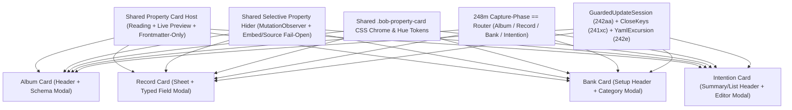

# Unifying Intentions, Property Cards, and Daily Agent Summaries

**Author:** Researcher `gem`  
**Date:** 2026-11-19  
**Scope:** Cross-repo design & critique spanning `bob-cli`, `bob-plugins` (`bob-ledger-tools`, `bob-navigation-hotkeys`), `bob-mac-capture`, `~/bob/`, and the `glossary` memory web.

---

## Executive Summary

Your instinct to unify daily **Headline**, weekly **Intentions**, quarterly **Outcomes**, and yearly **Theme + Outcomes** under one period-scoped **intentions** model — stored in hidden frontmatter (`intentions`, `summary`, `reflection`) and surfaced through a generalized **Property Card** + `==` modal editor — is fundamentally **sound and overdue**. Today's vault already shows the friction: you are manually typing `**Reflection**:` under `**Headline:**` in `2026/20261118.md`, daily notes lack an objective summary slot, yearly notes split focus between `## Theme` and `## Outcomes`, and `bob-ledger-tools` has implemented three separate versions of the same frontmatter-card + `==` editor UX (`bob-album-header`, `bob-record-sheet`, `bob-bank-setup`).

At the same time, four parts of the initial proposal break cleanly under closer inspection of the codebase and should be adjusted:

1. **Do not stuff multi-section period `## Review` prose into a YAML `summary` string.** Keep `## Review` as the rich Markdown evidence report (`bob periods draft` + `review_digest` protection) on weeks, quarters, and years, and let `summary` hold a uniform **1–3 sentence executive summary** across both daily notes (replaces having no summary at all) and period notes (replaces the period Review's opening `**Headline:**`).
2. **Do not hide `{intentions, summary, reflection}` unconditionally while gating the Intention Card solely on `intentions`.** If a user skips `intentions` on a day where an agent sets `summary` or the user writes `reflection`, both fields would become invisible. Mount the Intention Card whenever **any** of `{intentions, summary, reflection}` is non-empty, and hide only the keys owned by a cleanly mounted card.
3. **Do not use a `summary:` sentinel value to point agents at summary instructions.** Putting an instruction pointer inside `summary:` corrupts truthiness/empty checks across every reader, exposes raw pointers in Source mode / unmounted states, and goes stale across templates. Instead, pair a deterministic **`bob daily brief` + `bob daily draft`** CLI pipeline (mirroring `bob periods brief/draft`) with `~/bob/AGENTS.md` and a copyable prompt inside the `#pre #periods` daily GTD task.
4. **Generalize the *platform* (CSS tokens, property hiding, mounting host, `==` router, close-key ladder, guarded update session, `y` YAML excursion) — not one monolithic modal.** Keep each card's field schema cleanly separate underneath shared UI/session primitives.

---

## 1. Critique of the Proposal & Justified Adjustments

| Proposed Requirement | Verdict | Issue Discovered in Code/Vault | Justified Adjustment |
|---|---|---|---|
| Replace H2 sections & `**Headline:**` with `intentions`, `summary`, `reflection` frontmatter on daily + period notes | **Accept with scope split** | Period `## Review` (`docs/periods.md`, `periods/draft.rs`) is 250–600 words of structured Markdown with `**Intentions:**` audit lines, `**Shipped:**` wikilink bullets, `**Where the time went:**`, and `**Questions:**`, protected by `review_digest`. Putting that in a YAML scalar breaks readability, diffs, and link ergonomics. | Keep `## Review` on Week/Quarter/Year notes for full analysis. Define `summary` uniformly as a **1–3 sentence prose summary** (agent-set daily summary on days; executive headline/tl;dr on W/Q/Y synced with or replacing `**Headline:**` inside `## Review`). |
| Unify `Headline`, `Intentions`, `Outcomes`, and `Theme` into `intentions` (list of strings) | **Accept with convention** | Yearly notes (`2026.md`, `periods/scaffold.rs`) currently split focus across a single motto `## Theme` and concrete `## Outcomes`. Naive `parse_frontmatter()` in `periods/note.rs` also skips all indented YAML lines (which breaks YAML lists!). | Retire `Theme`, `Outcomes`, `Headline`, and body `Intentions` cleanly. Replace `periods/note.rs`'s line-by-line parser with real YAML parsing (`serde_yaml`) + `yaml_spans.rs`. Migrate yearly `Theme` as item 1 (or concise lead bullet) when short, with recommended caps: Day ≤3, Week ≤3, Quarter ≤3, Year ≤4. |
| Hide `intentions`, `summary`, `reflection` in Properties; show Intention Card only when `intentions` is set | **Adjust trigger & hiding rule** | If `intentions` is empty/unset on a day where `summary` (from `#pre` agent) or `reflection` (from `[n==r`) IS set, hiding those fields while suppressing the card makes data disappear completely. | Render the **Intention Card** whenever **any** of `intentions`, `summary`, or `reflection` is non-empty. Hide those three keys *only* when the card cleanly mounts on non-embed Live Preview / Reading views (failing open in Source mode and embeds, matching `bob-record-sheet`). Let `==` open the editor on any canonical daily/period note even when no card is rendered yet. |
| Put a sentinel value in `summary` pointing to an agent instructions file | **Reject & replace** | A string sentinel makes `summary` appear "set" to Dataview/scripts/`capture-pomodoros`/cards, pollutes git templates for 365 files/yr, cannot supply the day's cross-note evidence, and requires mass migrations if rules evolve. | Store **nothing** in `summary` until an agent drafts it. Deliver live, versioned instructions **and** grounded evidence via `bob daily brief <date>`, enforce caps/digests via `bob daily draft <date>`, document the rule in `~/bob/AGENTS.md`, and name it in the `#pre #periods` task prompt. |
| Rename & unify `album`, `record`, `bank`, and `intention` cards as **Property Cards** | **Accept with alias clarity** | Existing plugins/docs split names (`bob-album-header` vs `Schema Card`, `Record Sheet` vs `Record Card`, `Bank Setup header` vs `Bank Setup Card`). | Define **Property Card** as the umbrella UX (in-note header + `==` modal editor + `y` YAML excursion + selective property hiding), and record existing split names cleanly as aliases in the new glossary entries. |
| Add two `#periods` tasks (`#pre` agent `summary`, `#post` manual `reflection`) in `gtd_daily.md` | **Accept + update `#headline`** | Leaving `#post #headline **Write today's headline**` untouched in `gtd_daily.md` and `post_stages: [periods, headline]` in `config.yml` creates terminology drift after `**Headline:**` is retired. | Add both `#periods` tasks (`Draft yesterday's daily summary` in `#pre`; `Reflect on yesterday` via `[n==r` in `#post`) **and** migrate line 13 (`#headline` -> `#intentions`, updating `config.yml` `post_stages` or keeping alias compatibility). |

### Two Subtle Edge Cases to Decide Early

1. **`all_time.md` behavior:** Today `all_time.md` (`docs/periods.md`, `all_time.md`) has `bob-stats-strip`, `bob-period-parts` (Years table), and `## Notes`, explicitly with **no** `Intentions`, `Review`, or `Reflection`. Recommendation: **keep `all_time.md` excluded** from daily/period intentions/summaries/reflections (though if `intentions` were ever manually added to `all_time.md`, the card could mount gracefully). Confirming "Daily, Weekly, Quarterly, Yearly" as the four intention tiers keeps the model sharp.
2. **Same-day gaps with `[n==r`:** `bob-navigation-hotkeys` resolves `[n` via `openLabeledBodyLink("prev")` (`670-plugin-project-files.js:151-169`, `findFirstRenderedLink` skipping frontmatter). On daily notes, `_templates/daily.md` always puts `[[YYYY/YYYYMMDD|prev]]` for calendar yesterday. If Bryan skips creating a note on a travel/offline day (so `prev` points to a missing file), `[n` offers/creates that file via `openOrCreateLinkTarget`, or the `#pre` agent wouldn't have an uncreated note unless `bob daily brief yesterday` inspects Pomodoros/tasks or handles missing notes cleanly.Worth calling out: **`bob daily brief yesterday`** should gracefully handle (or refuse clearly on) an empty/missing daily note rather than generating an empty template stub with a bogus summary!

---

## 2. Data Model, YAML Mechanics, and Migration Architecture

### 2.1 Unified Frontmatter Schema (Daily & Period Notes)

Add three optional top-level keys on canonical daily notes (`type: "[[day]]"`) and period notes (`type: "[[week]]"`, `"[[quarter]]"`, `"[[year]]"`):

```yaml
intentions:
  - "Ship the [[bob-cli]] intentions brief parser and unit tests"
  - "Clear pending inbox items in [[sase]]"
summary: "Landed the YAML span parser and added 14 unit tests across two Pomodoros; inbox grooming slipped into tomorrow."
reflection: |-
  Morning focus held cleanly through noon. Context-switching after lunch broke momentum—next time batch Slack until 4 PM.
```

Design constraints and parser invariants:

- **`intentions` (`list[string]`, optional, omitted when empty):**
  - Order is meaningful (priority/focus order, 1-indexed when displayed).
  - Wikilinks (`[[...]]`, `[[note|alias]]`) inside items **must be YAML-quoted** on write (`"..."`) because unquoted `[[foo]]` parses in YAML as nested flow sequences `[["foo"]]`.
  - Recommended editorial soft caps (warn in `bob`, never hard-refuse user edits): Day 1–3, Week 1–3, Quarter 1–3, Year 1–4.
- **`summary` (`string`, optional, omitted when unset):**
  - **Concise 1–3 sentence factual digest** written by an agent (`bob daily draft` / `bob periods draft`), never invented without work logs/closed tasks/events.
  - Hard character/word cap for daily summaries: e.g. **≤ 75 words / ≤ 500 chars**, plain single paragraph (wikilinks allowed for note names, no Markdown headings or task checkboxes).
  - Companion digest protection: reuse the exact `review_digest` pattern from `periods/note.rs`! Maintain **`summary_digest`** (12-hex hash of `summary` after normalization, hidden alongside the card keys or stored beside `review_digest`). If Bryan edits `summary` via `==s` or YAML, the hash mismatches `summary_digest` -> future automated/agent `bob daily draft` runs **refuse to overwrite** unless `-F/--force` is passed!
- **`reflection` (`string`, optional, omitted when unset):**
  - User-authored subjective retrospective (1 sentence or short multi-paragraph YAML literal/folded block `|-`). Automation never writes or overwrites `reflection`.
  - On period notes (`week`, `quarter`, `year`), replaces `## Reflection` so the period body shrinks cleanly to: `H1` -> `prev · parent · next` -> `bob-stats-strip` -> `bob-period-parts` -> `## Review` -> `[!agent]` callout.

### 2.2 Fixing `periods/note.rs` and Writing YAML Safely

A critical finding in `src/native/periods/note.rs:363-394`: `parse_frontmatter()` currently parses with `line.split_once(':')` and executes:

```rust
if line.starts_with(' ') || line.starts_with('\t') {
    continue;
}
```

That design **silently drops every item of a YAML block list (`intentions:\n  - ...`) and every continuation line of a multiline `summary:` / `reflection:`**! Furthermore, Obsidian's `processFrontMatter` can rewrite key ordering, unquote/reformat strings, and drop comments (and `bob-cli` already avoids it in favor of `yaml_spans.rs` + guarded updates).

**Recommended write path in `bob-cli`:**
1. Parse frontmatter structurally using `serde_yaml` (already used across `bob-cli`) for reading `intentions`, `summary`, `summary_digest`, `reflection`.
2. Reuse `src/native/yaml_spans.rs` (extending it cleanly with block-list / block-scalar range replacement) to surgically update **only** `intentions`, `summary`, `summary_digest`, and `reflection` in place while preserving BOM, CRLF/LF, key order, surrounding comments, and `review_digest`.
3. Provide one guarded stdin JSON envelope command — **`bob intentions update -i -`** (or `bob daily update` / `bob periods update`, modeled directly on `bob records update -i -` in `src/native/records/cli.rs` & `records/protocol.rs` schema v1!):
   - Accepts target note path (canonical daily or period note) + `expect` preimage fingerprint + ops:
     - `intentions.set` / `intentions.unset` (full ordered array or structured item edits)
     - `summary.set` / `summary.unset` (user edit via card sets/clears `summary_digest` appropriately or stamps user-owned status)
     - `reflection.set` / `reflection.unset`
   - Supports `--dry-run -f json` for live preview & `after_fingerprint` tracking in `GuardedUpdateSession` (`242aa-plugin-guarded-update-session.js`), plus inverse-op `Undo` (`u`)!

### 2.3 Downstream Compatibility & `bob-mac-capture`

Where headlines and period goals are read today:
- **`bob capture-pomodoros --tasks`** (`src/native/capture_pomodoros.rs:522`): currently populates `"headline": Option<String>` via `daily_headline::parse(&contents)`.
  - Update payload to include `"intentions": Vec<String>` (flattened display strings via `flatten_wikilinks`) alongside `"headline": intentions.first().cloned()` during a coordinated transition window, then remove `headline` in a tracked contract bump with `bob-mac-capture`.
- **`bob-mac-capture`** (`CaptureAgendaModels.swift:133-204`, `CaptureAgendaLayout.swift:34-41`, `CaptureAgendaView.swift`):
  - Currently shows a single `HEADLINE` small-caps row clamped to 2 lines. With `intentions: [String]`, render the compact list (`1.` / `2.` / `3.`, or primary + subtle count), which also lays the exact JSON foundation for your `bob.md` follow-up (`Intentions panel` showing Day -> Week -> Quarter -> Year intentions!).
- **`bob-period-parts` & `bob periods show/brief`** (`periods/report.rs`, `periods/brief.rs`, `239-plugin-period-strip-parts.js:417-424`):
  - Look at the priority rule that becomes **far cleaner** once both `intentions` and `summary` exist:
    - If a child period/day is **closed** (past) and `summary` is non-empty -> show **`summary`** in the `Summary` column!
    - If a child is **current/planned** (today / open period) or lacks `summary` -> show **compact `intentions`** (`intentions.join(" · ")`, flattened)!
    - Otherwise -> fall back to `mostly` (top root parents)!
  - That eliminates the hack in `239-plugin-period-strip-parts.js:418-424` where planned headlines had to be overloaded into the same slot as retrospective review headlines.

### 2.4 Vault Migration (`bob periods migrate` / `bob daily`)

1. **`_templates/daily.md`:** Remove the `**Headline:**` line (`line 19`). Leave `intentions`, `summary`, `reflection` **omitted** from the template frontmatter so brand-new daily notes start zero-clutter (unless intentionally filled).
2. **`periods/scaffold.rs`:** Remove `## Intentions`, `## Outcomes`, `## Theme`, and `## Reflection` from generated period templates. Bump `INSTRUCTIONS_VERSION` in `periods/instructions.rs` (`v2 -> v3`) so period review agent instructions explain the new locations (`intentions` & `reflection` in frontmatter, `summary` 1-sentence executive summary + `## Review` body breakdown).
3. **One-time atomic vault migration (`bob intentions migrate` or `bob periods migrate` v2, dry-run by default):**
   - Scan all canonical daily notes (`YYYY/YYYYMMDD.md`):
     - Non-empty `**Headline:** <text>` -> `intentions: ["<text>"]`; remove `**Headline:**` paragraph (and empty placeholder `**Headline:**` lines!).
     - Ad-hoc `**Reflection**: <text>` (such as `2026/20261118.md:20`) -> migrate cleanly to `reflection:` (with manual dry-run review printed!).
   - Scan all canonical `Www` / `Qn` / `YYYY` period notes:
     - `## Theme` + `## Outcomes` + `## Intentions` bullets/lines -> `intentions: [...]` (only non-placeholder user text; skip empty stubs!).
     - `## Reflection` non-empty prose -> `reflection:` (preserving multiline Markdown).
     - `## Review` opening `**Headline:** <text>` -> populate `summary:` (plus `summary_digest` matching agent-drafted vs edited state).
     - Remove the retired H2 headings (`## Intentions`, `## Outcomes`, `## Theme`, `## Reflection`), keeping `## Review` and `[!agent]`.
4. **Update `daily_headline.rs` reader temporarily (optional grace period) or retire outright** once `--apply` finishes cleanly and passes `bob periods list -p`.

---

## 3. Generalizing "Property Cards" in `bob-plugins`

### 3.1 Inventory of Today's Duplication

Inspecting `plugins/bob-ledger-tools/src/` shows three independent implementations of one concept:

| Property Card | Surface Class & Mount Anchor | Property Hiding Mechanism | Modal Editor & Shortcuts | Backend Writer |
|---|---|---|---|---|
| **Album Card** | `.bob-album-header-surface` · after `h1` (`241v`) | Static CSS hides `[data-property-key="record"]` (`styles.css:8524`) | `AlbumSchemaCardModal` (`241y`): field list, arrange, `y` YAML (`242e`) | `bob albums update` |
| **Record Card** | `.bob-record-sheet-surface` + `.bob-record-sheet-hides-properties` · before `h1` / top of body (`242k`) | `MutationObserver` marks owned keys with `.bob-record-sheet-owned-property` (`242ka`) + embed-safe CSS (`styles.css:10974`) | `RecordCardModal` (`242p`): field jump keys, `=` clear, `y` YAML (`242e`), typed stages (`242r`) | `bob records update -i -` (`protocol.rs`) |
| **Bank Card** | `.bob-bank-setup-surface` · after `h1` on `bank.md` (`248c`) | Static CSS hides `[data-property-key="bank"]` (`styles.css:9850`) | `BankSetupCardModal` (`248k`): categories, emojis, subscriptions, `y` YAML (`242e`) | `bob bank config` / update |
| **Intention Card (Proposed)** | `.bob-intention-card-surface` + `.bob-property-card-hides-properties` · after nav strip / top of preamble | Reuses generalized `242ka` helper for `intentions`, `summary`, `reflection`, `summary_digest` | `IntentionCardModal`: `i` intentions, `r` reflection, `s` summary, `c` copy prompt, `y` YAML (`242e`) | `bob intentions update -i -` |

### 3.2 Clean Generalization Architecture (Shared Shell, Separate Domain Models)

Avoid forcing Album schemas, Record fields, Bank rules, and Period intentions into one bloated conditional modal. Instead, extract a thin **Property Card Platform** inside `bob-ledger-tools` that all four cards plug into:



Concrete components to generalize:

1. **Shared CSS Shell (`.bob-property-card` in `styles.css`):**
   - Consolidate the three copy-pasted card frames and hue tables (`styles.css:8527-8552`, `9855-9878`, `10989-11014`) onto `.bob-property-card` with CSS variables (`--bob-card-accent`, `--bob-card-tint`, `--bob-card-border`):
     - `border-radius: 8px`, `border-inline-start: 2px solid var(--bob-card-accent)`, `padding: 0.7em 0.9em`, `margin: 0 0 0.9em`, `font-family: var(--font-interface)`.
     - Shared header bar (`.bob-property-card-header` + `.bob-property-card-eyebrow` + `.bob-property-card-tools` with `==` Edit and `y` YAML icon buttons).
     - Default neutral slate/accent variables for notes without a root hue; for period tiers optionally vary accent subtlety (`day` neutral/primary accent, `week` aqua, `quarter` violet, `year` yellow/amber) so opening `2026-W47` vs `2026-Q4` gives instant visual hierarchy.
2. **Generalized Selective Property Hider (refactor `242ka-plugin-record-sheet-properties.js`):**
   - Today, `bob-record-sheet-properties.js` is already gold-standard: it uses a scoped `MutationObserver` on `.metadata-container`, tags matching `.metadata-property[data-property-key]` elements, leaves `.markdown-embed` / `.internal-embed` untouched, and lets CSS hide them *only* when `.bob-property-card-hides-properties` is present on `.cm-editor` or Reading view container.
   - Generalize this to `bobPropertyCardSyncHiddenProperties(scopeEl, surfaceClass, hideClass, ownedKeysSet)` so Album (`{"record"}`), Bank (`{"bank"}`), Record (schema fields), and Intention (`{"intentions", "summary", "reflection", "summary_digest"}`) all share **one tested implementation**. Note: because Obsidian shows all properties in Source mode and when a card fails to mount (mobile/corrupt/embed), the fail-open guarantee holds automatically!
   - Also remember `hide_digest`: **`summary_digest`** (or `review_digest`) must be included in `ownedKeysSet` when the card mounts so digest metadata stays tucked out of sight alongside `summary`!
3. **Unified `==` Dispatcher (`248m-plugin-schema-double-equals.js`):**
   - Extend `schemaDoubleEqualsTargetKind(file, context)` to check Album -> Bank -> Record -> **Daily / Period Note** (`type` is `day`, `week`, `quarter`, or `year`, or canonical path match).
   - **Important upgrade — Reading Mode `==` support:** Right now `248m` hooks CodeMirror Vim (`schemaDoubleEqualsVimSnapshot`). In Obsidian **Reading view**, CodeMirror isn't focused, yet `[n==r` works identically smoothly if `==` is ALSO recognized by a lightweight chord listener on active Markdown Reading views when focus is not in an input/textarea! Because `248m` already owns capture-phase key handling, adding a `500ms` two-key `=` chord fallback in Reading view prevents silent frustration when opening yesterday's note in Reading mode.
4. **Shared `Done` YAML Excursion (`242e-plugin-album-yaml-excursion.js`):**
   - Add an `"intention"` branch to `242e` alongside `"album"`, `"record"`, `"bank"`. Pressing `y` inside the Intention Card modal (or clicking the `YAML` tool icon on the in-note card) switches the view to Source mode with the cursor placed inside YAML frontmatter, showing a sticky top bar: `Editing frontmatter YAML [Done]`, and validates on `Done` via `bob intentions check <path>` (findings warn cleanly without trapping the user).

---

## 4. Designing the Intention Card & Editor (Visual & Interaction Spec)

### 4.1 In-Note Placement & Empty-State Rules

**Placement on Daily Notes (`2026/20261119.md`):**
1. YAML frontmatter (`intentions`, `summary`, `reflection`, `summary_digest` hidden when card is active)
2. `# Thursday, November 19, 2026` (H1)
3. `[[prev]] · [[W47]] · [[next]]` navigation line
4. **>>> Intention Card <<<** *(only when ≥1 of `intentions`, `summary`, `reflection` is non-empty)*
5. `- [?] #task #gtd ^gtd ...`
6. ```` ```bob-plan ```` (`bob-day-strip` + `bob-bank-badge` + Today's Agenda)
7. `## Pomodoros`

*Why here?* Placing the card right below the `prev · W47 · next` line preserves the title + date navigation at line 1–3, drops **Intentions** into the exact above-the-fold slot `**Headline:**` used to occupy, and avoids shoving `bob-plan` down unnecessarily when all three properties are empty.

**Placement on Period Notes (`2026-W47.md`, `2026-Q4.md`, `2026.md`):**
1. YAML frontmatter (card keys + `review_digest` hidden when card active)
2. `# 2026-W47` (H1)
3. `[[prev]] · [[Q4]] · [[next]]` navigation line
4. **>>> Intention Card <<<** *(whenever ≥1 of `intentions`, `summary`, `reflection` is non-empty)*
5. ```` ```bob-stats-strip ````
6. ```` ```bob-period-parts ```` (Days / Weeks / Quarters table)
7. `## Review` + `[!agent]` callout

*Why above `bob-stats-strip` & `bob-period-parts`?* Today, `2026.md` and `2026-Q4.md` bury `## Intentions` / `## Outcomes` *below* 13–52 table rows (`2026-Q4.md`, `2026.md`). Putting the Intention Card right beneath the navigation line puts the period's strategic intentions literally **at the top of the note** as a compact executive header, followed immediately by quantitative stats and child breakdown.

*(Note: Verify `bob-navigation-hotkeys`'s `openLabeledBodyLink("prev")` — because `findFirstRenderedLink` parses raw Markdown body lines rather than DOM widgets, mounting an Intention Card widget before or after the nav strip has **zero** impact on `[n` / `]n`!)*

### 4.2 Visual Anatomy of the Intention Card

```text
┌────────────────────────────────────────────────────────────────────────────┐
│ ▌ DAILY INTENTIONS · Thu, Nov 19                         [Edit ==] [YAML y]│
│ ▌                                                                          │
│ ▌  1  Finish Intention Card UX spec in bob-plugins                         │
│ ▌  2  Triage inbox items for [[bob-cli]] release                           │
│ ▌ ──────────────────────────────────────────────────────────────────────── │
│ ▌  SUMMARY  ·  agent                                                       │
│ ▌  Completed 4 Pomodoros (2h 10m) shipping the YAML span tests and fixing  │
│ ▌  record-card property hiding; one inbox task deferred to tomorrow.       │
│ ▌ ──────────────────────────────────────────────────────────────────────── │
│ ▌  REFLECTION                                                              │
│ ▌  Deep morning block worked great; lost momentum around 2 PM after lunch. │
└────────────────────────────────────────────────────────────────────────────┘
```

Visual polish details ("beautiful" without visual noise):
- **Header (`--font-ui-small`, muted ink):** Small uppercase period label (`DAILY INTENTIONS`, `WEEKLY INTENTIONS`, `QUARTERLY INTENTIONS`, `YEARLY INTENTIONS`), subtle `· edited` pill if Bryan manually adjusted an agent summary (optional), and compact hover/focus buttons `Edit (==)` and `YAML (y)` mirroring `bob-record-sheet-tools`.
- **Intentions list (primary emphasis):** Bold/clean `--font-text` body size (`1.0em`), tabular numeral badges (`1`, `2`, `3`) tinted in `--bob-card-accent` rather than heavy bullets or fake `[ ]` checkboxes (so they are never mistaken for `#task` rows). Clicking any `[[wikilink]]` inside an item navigates directly via Obsidian's workspace link opener (hover previews work too!). Double-clicking or clicking an item opens the `==i` editor straight to that row.
- **Summary band (only rendered when `summary` is non-empty):** Subtle hairline top divider, muted micro-label `SUMMARY`, quiet monospace-optional or `agent` pill to visually signal authorship, slightly softer `--text-normal` at `0.94em`.
- **Reflection band (only rendered when `reflection` is non-empty):** Subtle hairline top divider, muted micro-label `REFLECTION`, clean serif/body prose (`0.95em`), visually personal and grounded.
- **Missing-intentions edge case:** If `summary` or `reflection` is set while `intentions` is empty, omit the Intentions list cleanly (or show a subtle single muted `No intentions recorded` chip in the header/row if edited) rather than hiding the card and stranding `summary`/`reflection` in invisible YAML!

### 4.3 Keyboard-First `==` Property Card Editor (`IntentionCardModal`)

Designed specifically around **instant `[n==r`** and **zero-friction morning `==i` workflows**:

1. **Instant Launch (`==`):**
   - Capture-phase interception (`248m`) suppresses CodeMirror Vim `indentAuto` and opens `IntentionCardModal` immediately from cached frontmatter (optimistic preload while `bob intentions show --format json` fetches the preimage fingerprint in background, matching `RecordCardModal`).
   - Top of modal shows compact header (`2026/20261118 · Daily Intentions`) plus a quiet 1-line **Parent Horizon Peek** (`↑ 2026-W47: 1. Ship property cards · 2. Keep afternoon focus`). Seeing the week's intentions while setting today's morning intentions (and the quarter's while setting Monday's week!) reinforces vertical alignment effortlessly!

2. **Browse Mode (default landing on `==`):**
   - Three cleanly numbered/hotkeyed sections matching Record Card's browse-and-enter grammar (`242n` / `242p`):
     - **`i` — Intentions**: lists current items (`1..N`) or `(none)`.
     - **`s` — Summary**: shows full current `summary` (and attribution `agent` vs `edited`, plus `c` to copy a one-line agent prompt if empty).
     - **`r` — Reflection**: shows full current `reflection` or `(none)`.
   - Navigation & shortcuts:
     - `j` / `k` / `↓` / `↑` + `Enter` opens selected field; **`i`**, **`s`**, **`r`** jump directly into that field's stage!
     - **`=`** clears selected field (with undo); **`u`** undoes last committed op via inverse op (`242aa`); **`y`** jumps straight into Source YAML excursion (`242e`).
     - **`Esc` / `q` / `Ctrl+[`** follow the standard `bobCardWireCloseKeys` ladder (`241xc`): cancel active edit stage cleanly -> return to browse mode; from browse mode -> close modal.

3. **Critical UX Case: `[n==r` (Yesterday's Reflection Stage):**
   - Look at the exact keystroke cadence: `[n` opens yesterday (`2026/20261118.md`), `==` opens the modal in browse mode, **`r`** immediately enters **Reflection edit mode** with an auto-focused `<textarea>` (even if `==` landed 10ms earlier!).
   - Inside `<textarea>`:
     - If yesterday already has an agent **`summary`**, render that `summary` as a quiet **read-only reference callout directly above the Reflection `<textarea>`** inside the stage! Bryan can read what he actually accomplished yesterday *while typing his reflection*, without toggling back and forth!
     - **`Enter`** saves reflection & returns to browse mode (status pill `✓ Saved`; `Esc` or `q` exits modal).
     - **`Shift+Enter`** inserts a newline for multi-paragraph reflections; **`Ctrl+Enter` / `Cmd+Enter`** saves *and* closes the modal in one shot (`[n==r` -> type -> `Ctrl+Enter` leaves you done and looking at your rendered card!).
     - Standard `Esc` / `Ctrl+[` cancels unsaved stage edits (`q` types literal `"q"` inside `<textarea>`, per `bobCardTypesText` in `241xc`!).

4. **Dedicated Sentence-List Stage for `i` (Intentions):**
   - Unlike Record Card's short tag chips (`stageList`), intentions are full sentences (often containing `[[wikilinks]]`). Design the `i` stage as a clean **ordered row editor**:
     - Shows editable rows `1`, `2`, `3` plus an empty `"Add intention…"` input at the bottom (auto-focused if list is empty; if list already has items, focus the input or allow `1`..`9` / `↑`/`↓` to edit an existing item in place, `[[` for Bob's vault note suggester, `Alt+↑` / `Alt+↓` to reorder, `Ctrl+Backspace` or `×` to remove row).
     - `Enter` on non-empty draft appends/commits that row and focuses the next blank line; `Enter` on an untouched blank line (or `Ctrl+Enter` anywhere) commits the guarded `intentions.set` batch and returns/closes cleanly!

---

## 5. Daily GTD Tasks & Where Agent Summary Instructions Should Live

### 5.1 Evaluating Instruction-Discovery Mechanisms

How do we make sure an agent launched to summarize a daily note *always* follows rich, reliable instructions without cluttering Obsidian daily notes? Let's compare the four candidate architectures:

| Mechanism | Hidden in Obsidian? | Clean YAML / Git Diffs? | Always Up-to-Date? | Supplies Grounded Evidence? | Works Outside Vault CWD? | Verdict |
|---|---|---|---|---|---|---|
| **A. Sentinel value in `summary:` YAML** *(e.g. `summary: "AGENT: see _templates/..."`)* | Only when Intention Card mounts (fails if `intentions` unset or Source mode!) | **No** — pollutes every note's metadata & breaks truthiness (`summary != null`) checks | **No** — old notes bake in old template text/paths | **No** — agent still must hand-scrape tasks, Pomodoros, gcal, logs | Only if agent reads file first | **Reject** |
| **B. Hidden HTML/Obsidian comment `%% ... %%` or YAML `#` comment** | Reading & Live Preview yes; still visible in Source mode / Vim | Medium — pollutes 365 notes/yr with boilerplate; Obsidian UI edits strip YAML comments | **No** — stale in past notes | **No** | Only if agent reads file first | **Inferior** |
| **C. Vault `~/bob/AGENTS.md` + `docs/` (prose pointer only)** | **100% invisible** in daily notes | **Yes** — daily notes stay spotless | **Yes** | **Weak** — prose rules alone leave agents manually grepping Pomodoros, project notes, gcal | Depends on harness loading `~/bob/AGENTS.md` | **Partial (use as layer)** |
| **D. `bob daily brief <date>` + `bob daily draft <date>` + `~/bob/AGENTS.md` + GTD prompt** | **100% invisible** in daily notes | **Yes** — `summary:` stays omitted until drafted | **Yes** — instructions ship inside `bob` binary / `docs/` | **Yes** — deterministic bundle of Pomodoros, work logs, completed tasks across vault, off-clock time, events, caveats | **Yes** — GTD copy-prompt tells *any* agent `bob daily brief yesterday` | **Recommended** |

### 5.2 Why Sentinel Values Fail & How Option D Solves Everything

Look at what happened earlier in `bob-cli`'s own evolution for **Period Notes**:
- Initially, putting `> [!agent]-` instructions inside every period note caused template drift (`PROBLEMS` literally has `ProblemKind::StaleInstructions` and `bob periods ensure -R`!).
- Yet **period notes** only exist ~66 times a year (weeks + quarters + years) and only get drafted ~60 times/year. Daily notes happen **365 times a year**, inside notes Bryan opens continuously all day!
- Worse, a **sentinel inside `summary:`** mixes control-plane instructions into a data-plane field:
  - Any naive script or Obsidian Dataview query checking `WHERE summary` will treat unsummarized days as summarized.
  - Every `bob` consumer (`bob periods show`, `bob-period-parts`, `bob capture-pomodoros`, `IntentionCard` gate) must remember to compare against magic sentinel strings.
  - Worse still: **giving an agent instructions is only 20% of generating a truthful summary!** Look at how `periods/brief.rs` is built (3,360 lines!): a day's work is scattered across closed Pomodoros in `YYYYMMDD.md`, completed tasks archived or residing across dozens of project/area notes (`completed: YYYY-MM-DD` / `[x]` stamps), `Work Log` sub-bullets, `gcal` events, and off-clock sessions! An agent opening only `2026/20261118.md` misses done tasks stored in project notes unless `bob` aggregates the day!

**Recommended Solution — `bob daily brief` + `bob daily draft` + `~/bob/AGENTS.md`:**

1. **`bob daily brief <YYYY-MM-DD|yesterday|today>` (read-only JSON or Markdown):**
   - Automatically embeds the **canonical, versioned Daily Summary Authoring Spec** (truthfulness rules, never invent/pad on thin days, 1–3 sentences / ≤75 words, cite root projects/notable shipped outcomes rather than listing every Pomodoro timestamp, preserve user-set `summary_digest`, how to handle days with zero tracked work).
   - Computes and emits structured evidence for `<date>`:
     - Existing `intentions`, `summary`, `summary_digest` / `state` (`empty | drafted | edited`), `reflection`.
     - Pomodoros from `<date>.md`: on-clock & off-clock minutes, named Pomodoros, themes, work logs, linked tasks.
     - Tasks completed on `<date>` across the entire vault (resolved via root parent!).
     - Calendar events (`MEET`) and any explicit caveats (open Pomodoros, zero-minute day -> write honest short summary or skip).
2. **`bob daily draft <YYYY-MM-DD|yesterday> -i <file|->`:**
   - Validates length/format/no markdown headings/no checklist tokens/valid wikilinks.
   - Refuses cleanly (exit 3) if `summary` was already edited by Bryan (digest mismatch against `summary_digest`) unless `-F/--force` is passed; allows idempotent re-draft if state is `empty` or unedited `drafted`? Wait — even safer: refuse `edited`, allow updating unedited `drafted` or require `-F` after already drafted so re-runs don't accidentally churn good prose!
   - Writes `summary` + `summary_digest` via `yaml_spans` inside the vault maintenance lock (`vault_rewrite`).
3. **Triple-anchored discovery (zero UI footprint):**
   - **Primary (`gtd_daily.md` copyable prompt):** Just like existing weekly review task `gtd_daily.md:26` embeds `` (`bob periods show last-week` prints its path) `` directly in the launch prompt, put `` (`bob daily brief yesterday` gives context & instructions) `` right inside the `#pre #periods` GTD task!
   - **Secondary (`~/bob/AGENTS.md`):** Add a 4-line rule under `/home/bryan/bob/AGENTS.md`: *"Whenever summarizing any daily note (`YYYY/YYYYMMDD.md`), run `bob daily brief <date>` for full vault evidence and canonical formatting rules, and save via `bob daily draft <date> -i -`."* Any SASE/CLI agent launched ad-hoc inside `~/bob` sees this automatically on turn 1.
   - **Tertiary (`docs/daily-summary.md` / CLI `--help`):** Printable directly via `bob daily instructions` and referenced from `bob daily brief`.

*(If you still strongly prefer a self-contained breadcrumb inside raw `.md` files even outside `~/bob`, put it in a collapsed HTML comment `%% agent-summary: run bob daily brief YYYY-MM-DD %%` at the bottom of `_templates/daily.md` — never inside `summary:`! Though Option D alone is cleaner.)*

### 5.3 Proposed Changes to `/home/bryan/bob/gtd_daily.md` and `~/.config/bob/config.yml`

Today `gtd_daily.md` has:
- Line 13: `#post #headline **Write today's headline**...`
- Lines 25–32: `#periods` weekly/quarterly/yearly review tasks.
- `~/.config/bob/config.yml`: `pre_stages: [init, terminal, periods, browser, sync]`, `post_stages: [periods, headline]`.

Proposed daily GTD pipeline (`#pre` launches background work -> `]s` morning queue -> `#post` reflects & plans):

```markdown
- [?] #task #gtd #pre #periods **Draft yesterday's daily summary**: launch an agent with "Summarize yesterday's daily note (run `bob daily brief yesterday` for context and instructions, and save with `bob daily draft yesterday -i -`)" · done once launched or yesterday's `summary` is already set.  [repeat:: every day when done]  [created:: 2026-11-19]  [scheduled:: 2026-11-19]
```

*(Note: in `post_stages: [periods, intentions]`, `#periods` runs BEFORE `#intentions`, so Bryan reflects on yesterday BEFORE setting today's intentions!)*

```markdown
- [?] #task #gtd #post #periods **Reflect on yesterday**: from today's daily note, press `[n==r` (or open yesterday's daily note and type `==r`), review yesterday's drafted `summary`, and write a brief `reflection`.  [repeat:: every day when done]  [created:: 2026-11-19]  [scheduled:: 2026-11-19]

- [?] #task #gtd #post #intentions **Set today's intentions**: press `==i` on today's daily note to set 1–3 concrete intentions that would make today count.  [repeat:: every day when done]  [created:: 2026-11-19]  [scheduled:: 2026-11-19]
```

And update `~/.config/bob/config.yml`:
```yaml
post_stages: [periods, intentions]
```
*(Or temporarily `post_stages: [periods, intentions, headline]` during transition if any existing tasks still carry `#headline`.)*

---

## 6. Draft Glossary Terms

Written in the exact convention of `docs/reference/glossary.md` / `sase/memory/glossary/` (definition, mechanics & storage, boundaries, cross-references). *(Note: **Daily Headline** should be marked retired / superseded by **Intention**, and **Period Note** updated to reference frontmatter `intentions`, `summary`, and `reflection`.)*

### Intention {#intention}

*Aliases: daily intention, weekly intention, quarterly intention, yearly intention.*

A concise, Bryan-authored commitment or focus stored in the ordered `intentions` YAML frontmatter list of a daily note (`YYYY/YYYYMMDD.md`) or [Period Note](#period-note) (`YYYY-Www`, `YYYY-Qn`, `YYYY`), replacing the retired daily `**Headline:**` bullet and period `## Intentions`, `## Outcomes`, and `## Theme` sections. Every intention is scoped to its note's calendar period — daily, weekly, quarterly, or yearly — and appears in that note's [Intention Card](#intention-card), in parent period `bob-period-parts` tables when no `summary` exists yet, and in Bob Mac Capture's current-intentions views.

Edit intentions via the [Intention Card](#intention-card) (`==i`) or `bob intentions update`; empty is valid, and recommended soft caps keep focus sharp (Day 1–3, Week 1–3, Quarter 1–3, Year 1–4). Not a `#task`, carries no GTD status or [Task Freshness](#task-freshness) stamp, and never carries forward automatically; not an agent-authored `summary` or a user-authored `reflection`.

### Property Card {#property-card}

*Aliases: frontmatter card, property card editor.*

The shared Obsidian UX and plugin architecture that replaces selected YAML frontmatter fields at the top of a note with a rendered summary card in Live Preview and Reading view, paired with a keyboard-first `==` modal editor (`y` switches to a guarded Source YAML excursion with a `Done` bar). Whenever a Property Card mounts cleanly on a non-embedded note, Obsidian's native Properties box hides only the card's owned keys; Source mode, embeds, and degraded states fail open so native properties remain visible.

Writes go through guarded `bob` CLI update contracts with preimage fingerprints and inverse-op Undo rather than direct YAML mutation. Its concrete specializations are [Intention Card](#intention-card), [Album Card](#album-card), [Record Card](#record-card), and [Bank Card](#bank-card). Not a `#task`'s Task Card (which edits checklist-line tokens rather than note frontmatter), and not read-only metrics strips like [Day Strip](#day-strip) or [Stats Strip](#stats-strip).

### Intention Card {#intention-card}

*Aliases: intentions card.*

The [Property Card](#property-card) rendered at the top of canonical daily notes (`type: "[[day]]"`) and [Period Note](#period-note)s (`week`, `quarter`, `year`), owning the `intentions` (user list), `summary` (agent-set concise digest plus its `summary_digest` guard), and `reflection` (user retrospective) frontmatter properties. It renders below the navigation strip whenever at least one of those three properties is non-empty, hiding the owned frontmatter keys while visually separating commitments, objective summary, and reflection.

Pressing `==` anywhere on a canonical daily or period note — even before any card is visible — opens its editor (`i` intentions with parent-period peek, `s` summary, `r` reflection with the summary shown above for reference, `y` Source YAML); `[n==r` from today's daily note drops directly into editing yesterday's `reflection`. Not [Day Strip](#day-strip), [Stats Strip](#stats-strip), or a period note's long-form `## Review` body section.

### Album Card {#album-card}

*Aliases: album header, album schema card.*

The [Property Card](#property-card) rendered below the title of an [Album Note](#album-note) (`type: "[[album]]"`), owning the `record:` frontmatter schema (and hiding `record` from Obsidian's native Properties). It displays the album's owner breadcrumb chain up to its root parent alongside its ordered schema field chips, while `==` opens the schema editor for adding, configuring, reordering, and placing fields (`y` opens the YAML excursion) backed by `bob albums update`.

Not the generated `[!albums]` catalog chips rendered on an area or project note, and not a [Record Card](#record-card), which edits one item's field values rather than the collection's schema. See `docs/albums.md`.

### Record Card {#record-card}

*Aliases: record sheet.*

The [Property Card](#property-card) rendered at the top of a [Record Note](#record-note) (`type: "[[record]]"`), owning every schema-defined frontmatter field declared by its parent [Album Note](#album-note) (hiding only those schema-owned keys from Properties). Its in-note read sheet displays typed chips, clickable links, and empty-optional ghosts above the record walk rail, while `==` opens its stage-driven modal editor (`=`, `y`, typed suggesters, inverse-op undo) backed by `bob records update -i`.

Not an [Album Card](#album-card) (which edits the schema on the album note), a Task Card, or a [Bank Row](#bank-row). See `docs/record-card.md` and `docs/records.md`.

### Bank Card {#bank-card}

*Aliases: bank setup header, bank setup card.*

The [Property Card](#property-card) rendered below the title of the bank hub (`bank.md`), owning the `bank:` frontmatter configuration block (hiding `bank` from Obsidian's native Properties). It presents configured spending categories and tracked recurring subscriptions as scannable sections and pills, while `==` opens its modal editor for adding, renaming, re-keying emojis/keywords, arranging categories, and linking subscriptions (`y` opens the YAML excursion) backed by guarded `bob bank` updates.

Not the read-only [Bank Badge](#bank-badge) on daily/period strips, not a [Bank Month Note](#bank-month-note) category picker (`Ctrl+Enter` on a [Bank Row](#bank-row)), and not an [Album Card](#album-card). See `docs/bank.md`.

---

## 7. Phased Implementation Plan (Recommended Solution)

### Phase 1: Data & CLI Foundation (`bob-cli` + Vault Migration)
1. **Structural YAML & guarded update core:**
   - Replace `parse_frontmatter()` in `src/native/periods/note.rs` with `serde_yaml` reading `intentions`, `summary`, `summary_digest`, `reflection`.
   - Extend `src/native/yaml_spans.rs` cleanly for block YAML lists (`intentions:`) and literal block strings (`reflection: |-`, `summary:`).
   - Add **`bob intentions update -i -`** (preimage fingerprint, `intentions.*`, `summary.*`, `reflection.*`, `--dry-run`, JSON `after_fingerprint` + inverse ops, locking via `vault_rewrite`).
2. **Daily Brief & Draft commands (`bob daily`):**
   - Implement **`bob daily brief <date>`** (canonical built-in summary instructions + Pomodoros, completed vault tasks, off-clock minutes, calendar events, caveats) and **`bob daily draft <date> -i -`** (length/syntax validation + `summary_digest` edit guard + atomic write).
   - Add **`bob daily instructions`** (human-readable canonical summary rules).
3. **Update Period Notes & Readers:**
   - Update `periods/scaffold.rs`, `periods/instructions.rs` (`v3`), `periods/report.rs`, `periods/brief.rs`, `periods/draft.rs` (period `## Review` continues; sync executive `summary` cleanly), and `capture_pomodoros.rs` (`intentions: Vec<String>` + transition `headline`).
4. **Migrate Vault & Templates:**
   - Run dry-run + apply migration across daily notes & period notes (`**Headline:**`, manual `**Reflection**:`, `## Intentions`, `## Outcomes`, `## Theme`, `## Reflection`).
   - Update `/home/bryan/bob/_templates/daily.md`, `/home/bryan/bob/gtd_daily.md` (add `#pre #periods` summary task, `#post #periods` `[n==r` reflection task, update `#headline` -> `#intentions`), `/home/bryan/bob/AGENTS.md`, and `~/.config/bob/config.yml`.

### Phase 2: Generalized Property Card Platform & Intention Card (`bob-plugins`)
1. Extract shared `.bob-property-card` chrome CSS, generalized `bobPropertyCardSyncHiddenProperties` (`242ka`), shared host mount lifecycle, `242e` `"intention"` YAML excursion, and Reading-mode + Live-Preview `==` routing (`248m`).
2. Retrofit `bob-album-header`, `bob-bank-setup`, and `bob-record-sheet` onto the shared CSS/property-hiding primitives without breaking existing DOM classes/tests.
3. Build **Intention Card** read renderer (mounts on daily & W/Q/Y period notes whenever any of `{intentions, summary, reflection}` is non-empty) + **`IntentionCardModal`** (`i` ordered sentence-list editor with parent-period peek and `[[` autocomplete, `r` reflection textarea with live `summary` reference above and instant `[n==r` focus, `s` summary inspect/edit/prompt-copy, `u` undo, `y` YAML).

### Phase 3: Cross-Surface Polish & Glossary Docs
1. Coordinate **`bob-mac-capture`** idle agenda update (`CaptureAgendaModels.swift` / `CaptureAgendaView.swift`) from `headline: String?` to `intentions: [String]` (and optional multi-horizon Intentions Panel).
2. Add the 6 new glossary entries (`Intention`, `Property Card`, `Intention Card`, `Album Card`, `Record Card`, `Bank Card`), retire `Daily Headline`, update `Period Note` in `sase/memory/glossary/`, and regenerate `docs/reference/glossary.md`.
