# Period-note Wells Fargo checking close

> **Research query:** Show the total Wells Fargo checking balance at the end of
> a period on the corresponding period note (daily files stay out). Example:
> see what WF Checking held on 2026-11-15 somewhere in `~/bob/2026/2026-W46.md`.
> Lead the design so it is intuitive, reliable, and beautiful. Critique the
> plan, call out justified requirement adjustments, and end with a recommended
> solution.

**Researcher:** grk · 2026-11-16 · independent swarm report

Renderer: `@mermaid-js/mermaid-cli` 12.0.0 with the Highlights PDF-mirroring
config (`--no-sandbox` on this host).

---

## Bottom line

**Build it as a live closing readout on the Bank Period Charts header, not as
a number written into the week note.** The request is a good idea in a
stricter form: one posted-ledger stock figure for the default checking
account, reconstructed by bob, painted by the plugin, claimed only through
the last covered day.

On 2026-11-16 the live vault already answers the example in the honest
direction. `2026-W46.md` exists (`date: 2026-11-09`, `end: 2026-11-15`). WF
Checking is `balanced`, `$7,760.04` as of **Fri 13**, imported through
**Fri 13**, tracking since **Wed 11**. A header that said "ended Sunday at
$7,760.04" would be a lie. A header that said `$7,760.04 as of Fri 13` would
be true, and would become a quiet Sunday close once a later QFX covers
through 2026-11-15.

That is the whole design: **stock next to flow, coverage louder than hope,
bob owns every cent.**



_Daily notes keep only the Bank Badge. Period notes add a closing readout in
the existing Bank Period Charts header after the stats strip and badge._

Rendered size: 790.4 × 493 px; fit scale: 82.6%.

---

## Critique: is this a good idea?

**Yes.** Period notes are already the weekly cash-check surface, and the
dollar you actually care about is missing.

### Why it earns a place

- **Flow is shipped; stock is not.** The Bank Badge and Bank Period Charts
  already sit on week, quarter, ISO-year, and all-time notes and answer *when
  money moved* and *where Out went*. They never answer *how much checking
  held*. That is a different quantity. Badge In/Out exclude transfers; a
  checking close includes them. Paying a card from checking drops the close
  and leaves the badge untouched.
- **The dollar is almost nowhere in the UI today.** `bob bank report -p 2026-W46 -s`
  prints `WF Checking ✓ balanced · Nov 16` — status and *today*, no amount.
  The month card and setup tiles reuse the same status chips (`✓ balanced`,
  `Δ`, `stale`). The dollar appears in import CLI output (`Ledger balance $…
  on DATE`) and in JSON `accounts[].balance_cents`. A week review that never
  runs `bob bank import` has no place to see `$7,760.04`.
- **The engine already reconstructs this number.** `status.rs` derives an
  opening from the first QFX `LEDGERBAL` at or after `account.start` minus
  journaled postings through that as-of date, then checks later QFX balances
  against opening plus current journaled rows. Extending that walk to an
  arbitrary day is the same proof, clipped to coverage.
- **The host already exists and already excludes daily notes.** Bank Period
  Charts is the third child of a period `bob-stats-strip` fence. It never
  mounts on Day strips, `bob-day-stats`, `bob-period-parts`, embeds, hover
  popovers, mobile, or future periods. That is exactly the surface the
  request asked for.
- **Monday's ritual lands on this note.** The acknowledge-bank guide is a
  Monday QFX import, then two minutes of Category-card filing, then "in last
  week's note, write one line: what surprised you?" A closing on W46 is the
  number that sentence wants to sit beside.

### Where the request as written would go wrong

| Risk | Evidence | What the design does |
| --- | --- | --- |
| **Writing `$7,760.04` into `2026-W46.md`** | Period scaffolds are create-only (`docs/periods.md`). "No number is ever written into Markdown." Bank contract: "Totals are drawn when they are shown and never written into notes." `bank.md` stores no balance. A later import that covers Sat–Sun would freeze a stale Sunday. | Live readout inside the existing fence. The note bytes stay the scaffold plus Bryan's prose. |
| **Claiming Sunday 15 from Friday's QFX** | Live W46: `coverage.imported_through = 2026-11-13`, `balance_asof = 2026-11-13`, `complete: false`. Wells Fargo QFX carries one `LEDGERBAL`/`DTASOF`, never a daily close series. CSV carries none. | The as-of date is part of the claim. Quiet period-end copy only when coverage reaches `period.end`. |
| **Mixing stock into the Bank Badge** | Badge is In/Out/waiting for the strip's period, and it also follows **daily** Day strips. The request excludes daily files. Transfers are outside In/Out. | Own slot on the period-only charts header. Badge stays flow. |
| **A sixth Stats fact** | Facts are Worked, Reviewed, Done, Created, Review closed, each with a typical median. Money has no typical. `bob periods brief` is the agent's only number source, and the bank-trial privacy rule keeps bank data out of briefs, Stats, and Mac. | Stay off the facts row and off `bob periods brief`. |
| **Using the latest live QFX on an old week** | `accounts[].balance_cents` is the *latest* statement, as of 2026-11-13 today. In December that field is December. Pasting it onto W46 would rewrite history. | Closing is a function of `(account, as_of)`. W46 always wants min(2026-11-15, imported_through). |
| **A daily running-balance polyline on the week chart** | The request excludes daily files. Planned-style cash-flow guidance (already used in the period-charts research) treats day-to-day balance swings as timing. Seven points of stock on a week of five tracked days is a jitter chart. | One period-end (or last-covered) number. Child-period closing series waits for history. |
| **Net worth / every account as a hero** | Live hub has one account: `checking` / WF Checking / `kind: checking` / default. Credit balances are liabilities; cash is `untracked`. The request named Wells Fargo checking. | Hero is the default checking account. Other importable accounts ride the tooltip when they exist. |

### Would I take a different approach?

I would still put a WF Checking close on week, quarter, year, and all-time
notes, still keep daily notes badge-only, and still refuse to write the
dollar into Markdown.

I would **not** add a `## Bank` or `## Money` section, a frontmatter
`checking_close:` field, or an agent-drafted sentence in `## Review`. Those
all freeze a live quantity, and Review's callout already forbids inventing
numbers outside the brief.

I would **not** wait for `bob-cli-kv` (SimpleFIN/Teller) or for
`bob-cli-ku`'s December trial wake. A feed would make official snapshots
denser; it does not change the reconstruction. Bryan already pre-empted ku's
"week-note fence" by asking for period charts; this request pre-empts ku's
"running totals" as **one header number**. Typical comparisons, budgets, a
Stats metric, and a Mac idle line stay gated.

I would **not** paint the close on the month card as a substitute. The month
card is a statement. The question "what did checking hold when W46 ended?"
belongs on W46.

---

## Explicit requirement adjustments

Call these out as changes to the request.

| # | You asked for | I recommend | Why |
| --- | --- | --- | --- |
| **A1** | See the balance *in* `2026-W46.md` | **See it on the note, drawn live.** No new fence, no body section, no frontmatter. | Create-only period notes plus the bank "totals are drawn" rule. A written Sunday close becomes wrong the next time an import fills Sat–Sun. |
| **A2** | Balance *on 2026-11-15* | **Posted ledger as of `min(period.end, imported_through, today if so_far)`**, with the as-of date visible whenever it is short of period end. | QFX gives one `LEDGERBAL` per download (`docs/bank.md`: ledger balance, never available balance). Live W46 can only honestly claim Fri 13 today. |
| **A3** | Wells Fargo checking | **Hero = the default `checking`-kind account** (today: alias `checking`, label `WF Checking`). Additional importable accounts in the tooltip. | Matches the live hub and the request. Net worth is a different product. |
| **A4** | Skip daily files | **Keep that.** Closing mounts only where Bank Period Charts already mounts. | A day is a glance; the badge already covers daily flow. Day-to-day stock is timing. |
| **A5** | *(implied: a week-only feature)* | **Every period note:** week, quarter, ISO week-year, all-time. | The host, the calendar, and the question are the same. A quarter close is more valuable than a week close. All-time is "current, as of imported_through." |
| **A6** | *(tempting: sixth stats fact / badge token)* | **Default readout of the BANK CHARTS header.** Hover of a cashflow bucket temporarily replaces it; Escape restores it. Collapsed header still shows the number. | Zero added height when charts are open. The readout slot is empty until hover today (`.bob-bank-period-readout`). |
| **A7** | *(tempting: hide with the charts on a $0 week)* | **Header-only panel when a closing exists and In/Out/waiting are all zero.** | A quiet week still has a checking close. Transfer-only weeks are exactly when stock matters and flow hides. |
| **A8** | *(unsaid: write it into the brief / Review)* | **Keep bank data out of `bob periods brief`, `bob stats`, and Mac.** | `bob-cli-ku` privacy rule; Review callouts treat the brief as the only number source. Closing is a glance for Bryan, not a prompt for the drafter. |
| **A9** | *(unsaid: red when the close fell)* | **Body ink for the amount. Green never required. Never red or magenta.** Period change lives in the tooltip only. | Spending is not an error (`docs/bank.md`). A mortgage week *should* drop checking. |
| **A10** | *(unsaid: daily running-balance chart)* | **One number in v1.** A child-period closing series on quarters/years is a later additive chart, behind more history. | ku already parked "running totals" as a third chart. This request is the stock *sentence*, not a new plot. |
| **A11** | *(unsaid: new config key)* | **Reuse `stats.bank_period`.** | Same host. A later `stats.bank_closing` is easy if you want the number with charts off. |
| **A12** | *(unsaid: plugin reconstructs from `accounts[]`)* | **bob emits `closings[]`. The plugin formats cents and paints.** | `accounts[].balance_cents` is the latest statement, the wrong day for a past period. Plugin-side walks reopen the ISO/calendar bug the badge epic killed. |

---

## What exists today (verified 2026-11-16)

| Fact | Evidence |
| --- | --- |
| Period notes open with `bob-stats-strip`, then Intentions/Outcomes/Theme, then `bob-period-parts`. Scaffolds are written once; bob never edits a note it did not just create. | `docs/periods.md`; `src/native/periods/scaffold.rs` |
| A Bank Badge follows every stats strip (including daily). Bank Period Charts follow the badge on week/quarter/year/all-time only. | Glossary Bank Badge / Stats Strip; `docs/bank.md` Bank period charts; epic `bob-cli-lj` **closed** |
| Charts header is `▾ BANK CHARTS` + view switch + empty readout. Collapse persists under `bob-ledger-tools-bank-period-view`. | Plugin `bankPeriodRenderHeader`; CSS `.bob-bank-period-header` / `.bob-bank-period-readout` |
| QFX `LEDGERBAL`/`BALAMT`/`DTASOF` is the ledger snapshot; `AVAILBAL` is ignored; CSV has no balance. Dates keep the posted calendar day. | `docs/bank.md` Import; `source.rs` `parse_ledger_balance` |
| Opening = first QFX ledger at or after `start` minus journaled txns through that as-of. Later QFX balances are checked against opening + current journaled rows. Statuses: `balanced` / `delta` / `gap` / `stale` / `unverified`; cash is `untracked`. | `docs/bank.md` Account status; `status.rs` `proof_for` |
| Report JSON already carries `accounts[]` with `balance_cents`, `balance_asof`, `delta_cents`, plus period `coverage {tracked_since, imported_through, complete}` and `period.{start,end,so_far}`. | `docs/bank.md` JSON |
| Live hub: one account, `checking` / WF Checking / `kind: checking` / `start: 2026-11-11`. | `~/bob/bank.md` |
| Live proof: status `balanced`, `delta_cents: 0`, `balance_cents: 776004`, `balance_asof: 2026-11-13`, `last_import: 2026-11-16`. | `bob bank check -f json` |
| Live W46: Nov 9–15, `so_far: false`, Out $469.70, In $0, 11 rows (Thu 12 and Fri 13), waiting 0, `imported_through: 2026-11-13`, `complete: false`. Mon 9 / Tue 10 untracked; Sat 14 / Sun 15 empty. | `bob bank report -p 2026-W46 -f json` |
| Human report header: `🏦 Nov 9 – Nov 15, 2026  WF Checking ✓ balanced · Nov 16`. No dollar. | `bob bank report -p 2026-W46 -s`; `output.rs` `account_chips` |
| `2026-W46.md` is drafted (`review_digest`, `review_drafted: 2026-11-16`) with an empty `bob-stats-strip` fence. | vault note |
| Bank-trial follow-up `bob-cli-ku` is snoozed until 2026-12-14. lj.land already noted that period charts covered the "week-note fence"; **running totals, typicals, budgets, briefs, Stats, Mac stay gated.** | `sase bead read bob-cli-ku` |
| Privacy: charts write nothing to notes, `bob periods brief`, `bob stats`, or Mac. | `docs/bank.md` Bank period charts |

Reconstructed opening for the live account, from the same identity the code
already tests: latest QFX `$7,760.04` on Fri 13, plus $469.70 of outflows
from `start` through that as-of, implies **`$8,229.74` at the start of
tracking (Wed 11)**. W46 cannot claim a Monday-morning close; tracking
starts mid-week.

---

## Design: the Bank Closing readout

### What it is

A read-only **posted-ledger stock** for the hero checking account, covering
exactly the period note you are looking at. bob computes it. The plugin
paints it. It never writes the vault. It is not a Stats fact, not a Bank
Badge token, not a `bob-bank` card, and not a `bob-period-parts` column.

Suggested glossary keyword: **Bank Closing** (aliases *checking close*,
*period-end balance*). Link from Period Note, Bank Badge, Bank Period
Charts, Bank Row.

### Where it lives

Same host as Bank Period Charts: `div.bob-bank-period-host`, third child of
a period `bob-stats-strip` fence.

The header already lays out disclosure, view switch, and a right-aligned
readout. Put the closing in that readout as the **resting state**.

| State | Header |
| --- | --- |
| Closed week, coverage through Sunday | `▾ BANK CHARTS    $7,760.04` |
| Closed week, coverage through Friday (today's W46) | `▾ BANK CHARTS    $7,760.04 as of Fri 13` |
| Open week (`so_far`) | same amount, plus the existing `so far` language in the tooltip |
| Charts collapsed | `▸ BANK CHARTS    $7,760.04 as of Fri 13` |
| Quiet week, no In/Out/waiting, closing known | header only; plots stay omitted |
| No opening anchor, or cash-only | number hidden; charts behave as they do today |
| Future period | host stays unmounted |

Hover or focus on a cashflow bucket still fills the readout with that
bucket's In/Out. Mouseleave and Escape restore the closing. The amount is
the thing you came to see; the charts remain the thing you explore.

Click / Enter / Space on the amount opens the as-of day's heading in the
bank month note (the same read-only activation day buckets already use).
Ctrl/Cmd/middle-click opens a new leaf.

### Copy and precision

Follow the badge family's precision: **cents on weeks, whole dollars from
quarter up**, sub-$1 keeps cents, exact cents always in the tooltip.

Resting copy, one line:

- Complete through period end: tabular `$7,760.04`. Account name stays in
  the tooltip when there is only one hero.
- Short coverage: tabular `$7,760.04` plus muted `as of Fri 13`.
- Two or more importable accounts: short label stays visible
  (`WF Checking $7,760.04`).

Tooltip (words carry the meaning; color never does):

```
WF Checking · posted ledger $7,760.04
as of Fri Nov 13 · wanted Sun Nov 15
✓ matches QFX through Fri 13
−$469.70 this period
imported through Fri 13
```

`period_change_cents` is the signed journal sum for this account inside the
covered part of the period (transfers included). It is tooltip-only in v1 so
the header stays one number.

Status marks reuse the walker-footer / setup-tile language already in
people's fingers: `✓` when the as-of snapshot agrees, `Δ $X` when it does
not, muted `unverified` / `gap` / `stale` otherwise. The number still
renders on `delta` and `stale`; the mark names the disagreement. Hide only
when there is no reconstructable figure at all.

Aria spells the account, the amount, the as-of date, the wanted date when
they differ, and the status words.

### Beauty

Bob already has the chrome. Use it.

- Tabular numerals in the existing readout (`font-variant-numeric: tabular-nums`
  is already on sibling bank chrome). Right-aligned, ellipsis on overflow
  (`.bob-bank-period-readout` already has `text-align: end; text-overflow: ellipsis`).
- Small-caps `BANK CHARTS` stays the family mark; the dollar is the payload.
- Zero extra height when the panel is open. Collapsed, the close is still
  there — that is the glance that makes collapse useful.
- In ink stays for In. The close uses body ink. A falling close is still
  body ink. Amber stays waiting. Red/magenta stay errors and work-lane caps.
- Forced colors: `CanvasText` for the amount; the as-of clause remains
  visible without hue.
- Reduced motion: restoring the readout is a text swap, not an animation.
- Family resemblance with import CLI: `Ledger balance $12,345.67 as of Nov 14 · ✓ balanced`
  is the same sentence, quieter.

The beautiful version of today's W46 is not a fake Sunday. It is a calm
`$7,760.04 as of Fri 13` sitting where the empty readout is now, above the
In/Out plot that already hatches Sat and Sun as `not imported yet`.

---

## How the dollar is computed



_Clip the wanted date to coverage, walk forward from the latest QFX ledger
balance on or before that day, and add later journaled postings. The plugin
never adds cents._

Rendered size: 342.2 × 702 px; fit scale: 100%.



_The readout claims period end only when QFX coverage reaches that day.
Otherwise it names the last covered day, or hides when no opening anchor
exists._

Rendered size: 634.6 × 712 px; fit scale: 100%.

### Algorithm (bob, one place)

Reuse `status.rs`'s opening-anchor math. Do not invent a second ledger.

1. **Wanted date.** `period.end`. If `period.so_far`, also clip to `today`.
2. **As-of date.** `min(wanted, coverage.imported_through)` when
   `imported_through` is present; never past `account.start - 1`.
3. **Snapshot.** The latest `bank.import` event for this alias with both
   `balance_cents` and `balance_asof <= as_of`.
4. **Cents.**
   - If a snapshot exists: `snapshot.balance_cents + sum(journal txns for
     this alias with posted in (snapshot.as_of, as_of])`. Outcomes
     `before_start` stay out. Use **journal** cents (the bank's immutable
     amount), so a missing or edited month row cannot silently zero money.
   - If no snapshot exists yet the account has a later first QFX (as-of
     after `as_of` but on or after `start`): `opening + sum(journal txns
     from start through as_of)`, with `opening` as in `proof_for`.
   - Otherwise: omit the closing.
5. **Source.** `qfx` when a snapshot's as-of equals `as_of`;
   `reconstructed` otherwise.
6. **State.** `complete` when `as_of == wanted` and coverage through
   `as_of` has no gap; `partial` when `as_of < wanted`; `gap` /
   `unverified` / `untracked` matching today's statuses.
7. **Hero.** First account with `kind: checking`, else the default
   importable account. Cash never heroes. `hero: true` on one row.

Invariants, each a test:

- When `as_of` equals the latest QFX as-of and `delta_cents == 0`,
  `closings[].cents == accounts[].balance_cents`.
- `closing(D) - closing(D - 1 day) == sum of journal cents posted on D`
  (once D is covered).
- `as_of` is never after `period.end`, `imported_through`, or `today`.
- A past period never receives the *latest* live QFX just because it is
  latest.
- Plugin tests format `closings[].cents`; they never add two closings
  together.

Pending transactions stay out of scope, as they are for import. Posted
ledger is the quantity. Weekend US checking often equals Friday's close;
the UI still waits for coverage before calling it Sunday.

### JSON (additive, `schema_version: 1`)

Emit `closings[]` on `bob bank report` always, so the same payload the
plugin already fetches (`-p <id> -s -c`) carries the number with no extra
spawn. Nested `version` is unnecessary; this is a sibling of `totals` and
`coverage`, not a new charts dialect.

```json
"closings": [
  {
    "alias": "checking",
    "label": "WF Checking",
    "kind": "checking",
    "hero": true,
    "cents": 776004,
    "as_of": "2026-11-13",
    "wanted": "2026-11-15",
    "source": "qfx",
    "state": "partial",
    "status": "balanced",
    "delta_cents": 0,
    "period_change_cents": -46970,
    "target": { "path": "bank/2026-11.md", "line": 26 }
  }
]
```

`target` is the as-of day's heading, or `null` when that heading does not
exist. Empty array when the vault is teaching-empty or no account can
close. Human `print_report` should promote the hero into the title chips:

```text
🏦 Nov 9 – Nov 15, 2026  WF Checking $7,760.04 as of Fri 13 · ✓ balanced
```

That single CLI line is the same sentence the header paints.

No new subcommand, no new flag, no `!` contract break. Additive JSON on
schema 1 matches how `charts` shipped.

---

## Implementation sequence

1. **bob-cli.** Extract opening + as-of closing from the journal proof
   already in `status.rs`. Add `closings[]` to the report envelope. Tests
   for the invariants above, including the live-shaped case (wanted Sunday,
   imported_through Friday, cents equal Friday's QFX). Human title chips.
   Docs: `docs/bank.md` (Account status + Bank period charts + JSON),
   `docs/reference/json-outputs.md`, plugin reference one-liner.
2. **bob-plugins.** Decode `closings[]` with the existing `bankSafeCents`
   path. Resting readout, restore-on-leave, header-only visibility when
   flow is empty, click to `target`. Golden tests for complete / partial /
   unverified / quiet-week. No Chart.js, no new fence.
3. **Vocabulary.** Glossary **Bank Closing**; one sentence on Period Note
   and Bank Period Charts. No new decision record unless Bryan later wants
   the close in briefs.
4. **ku note.** Record that this request ships the stock *number* from
   "running totals"; the child-period closing series, typicals, budgets,
   briefs, Stats, and Mac remain gated until 2026-12-14.

Suggested split: a bob-cli bead for `closings[]` (the reliability work),
then a plugin bead that cannot start until the JSON is on the exact SHA
the plugin fetches. Same two-repo shape as `bob-cli-lj`.

---

## Out of scope (on purpose)

- Daily notes, `bob-day-stats`, `bob-period-parts`, mobile, embeds.
- Writing cents into period Markdown, frontmatter, Review, or Reflection.
- `bob periods brief`, `bob stats`, Bob Mac Capture idle agenda.
- Net worth, credit utilization, budgets, envelopes, savings rate.
- Available balance, pending transactions, intra-day time.
- Child-period closing sparkline (quarter/year).
- Per-account coverage object (already queued on `bob-cli-ku`).
- SimpleFIN/Teller (`bob-cli-kv`).
- A new `stats.bank_closing` key, unless charts-off-close-on becomes a
  real request.

---

## Recommended solution

Ship a **Bank Closing** as the resting readout of the Bank Period Charts
header on every period note.

For the example you gave, `~/bob/2026/2026-W46.md` would show, in the
existing `BANK CHARTS` header, **`$7,760.04 as of Fri 13`** today, and
**`$7,760.04`** once a QFX covers through Sun 15 and the reconstructed
Sunday equals that covered ledger. The note file would not change. Daily
notes would not gain it. The badge would keep answering In/Out. bob would
keep owning the cents.

That is the intuitive version (one number, where you already look on
Monday), the reliable version (as-of date, journal proof, no frozen
Markdown), and the beautiful version (tabular dollar in a slot that is
already empty, family chrome, honest weekend).
