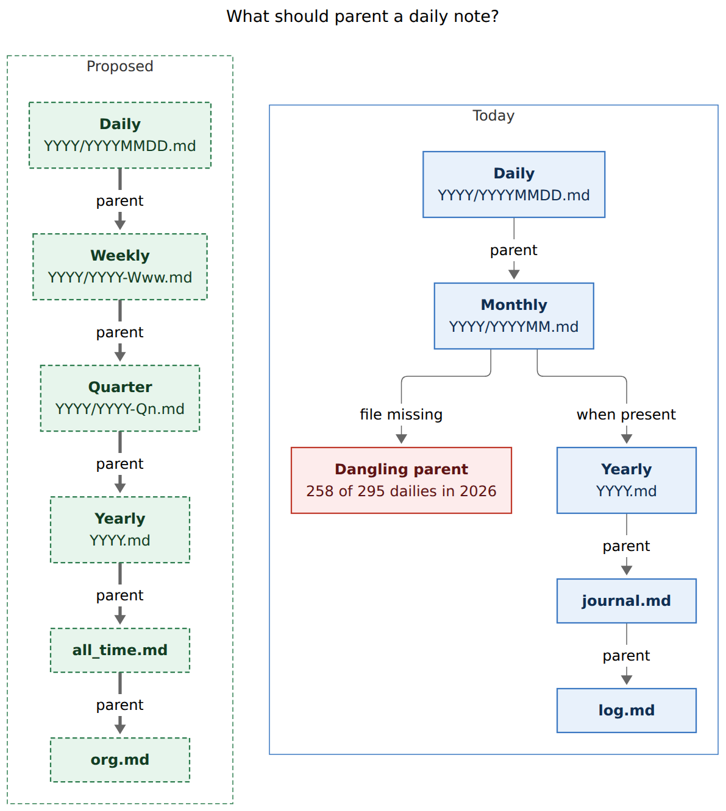
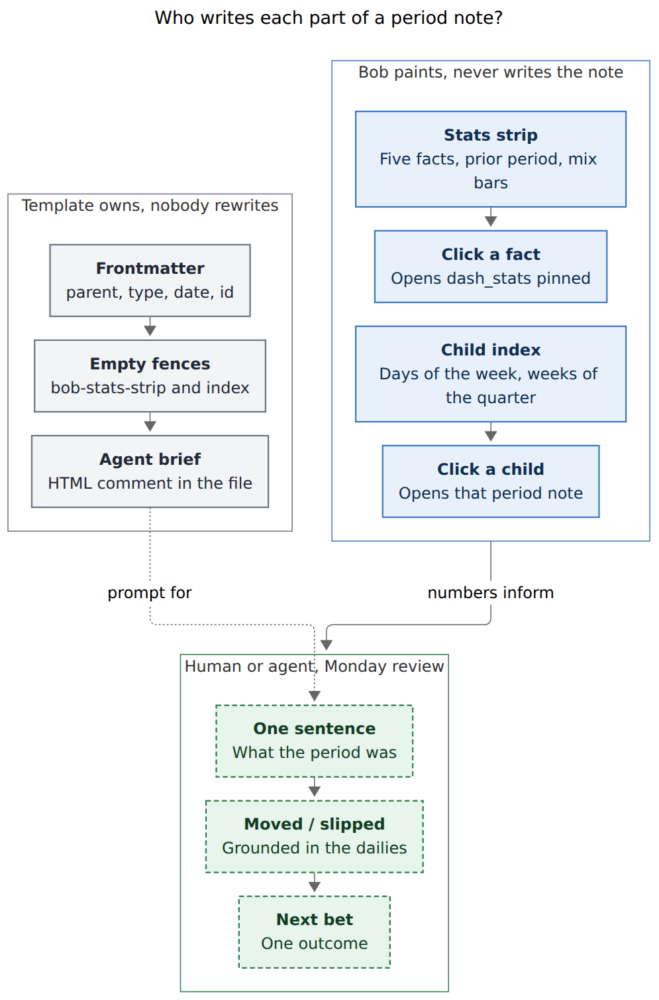

# Period notes: weekly parents, a stats-strip family, and ritual-gated enrichment

> **Research query:** Daily notes currently parent to empty monthly files. Should they parent to weekly files instead, with weekly → quarterly → yearly → `all_time.md` → `org.md`? How should those files show working-time stats, summarize their child units, and carry agent instructions for later enrichment? Critique the plan, adjust the requirements, and recommend a design.

**Researcher:** grk (independent swarm report).  
**Date:** 2026-11-03.  
**Inputs:** live vault (`~/bob`), `_templates/{daily,monthly,yearly}.md`, `gtd_daily.md`, `org.md`, `day.md`, `journal.md`, `log.md`, `horizon.md`, `bob.md#^wqy-stat-strips`, `docs/stats.md`, `docs/reference/cli/stats.md`, glossary `day-strip` / `stats-dash` / `pomodoro` / `root-parent`, bob-ledger-tools day-strip sources, `bob stats` JSON for ISO week 2026-W44, prior consolidated research `202610/bob_daily_stats` and `202610/daily_note_day_strip`. Nothing in any repo or the vault was changed except this report.

Renderer: `@mermaid-js/mermaid-cli` 12.0.0 with the Highlights PDF-mirroring config (`--no-sandbox` on this host).

---

## 0. Bottom line

**Build the time tree. Make weekly the load-bearing layer. Keep every number live.**

This is a good idea in a narrower, more reliable form than the request.

1. **Parent dailies to ISO weekly files.** The monthly parent chain is already dead: 258 of 295 canonical 2026 daily notes point at `2026/YYYYMM` files that do not exist. Weekly is the cadence you already keep (Monday POST prune). Calendar months split ISO weeks and have no template body worth keeping.
2. **Then weekly → quarter → year → `all_time.md` → `org.md`.** Create `all_time.md`. Leave `journal.md` / `log.md` as zorg-era aliases that point at the new spine. Drop months from the parent chain.
3. **One stats-strip family, painted at read time.** The Day strip is the daily member. Week, quarter, year, and all-time strips reuse its five facts, mix bars, and click-through to `dash_stats`. Bob owns every value. The note never stores a computed number.
4. **Child units are a live index, not seven nested Day strips.** A weekly note shows seven day columns from the same `daily_points` the engine already emits. A quarterly note shows ~13 week columns. An LLM may caption those units during review; it does not generate the index.
5. **Agent briefs live in the file as HTML comments.** Narrative sections stay empty until the Monday review. No cron, no nightly prose. Your 826-file habit log already ran the experiment of daily writing, and it died.

Ship templates, `bob period ensure`, and the weekly strip first. Quarterly and yearly files can exist from day one as empty, well-briefed shells; their strips and rituals wait until a few weekly notes have been lived in.

---

## 1. Is this a good idea?

**Yes, because it gives the weekly glance a vault home, and it repairs a parent tree that already does not work.**

### Why it earns a place

- **You already asked for this twice.** The original Stats research (R9) homed interpretation in the weekly prune: daily is where numbers become targets, weekly is where they inform decisions. The Day strip later earned a daily *mirror* of facts. This feature is the missing sibling: a weekly *instrument* that sits on a real note, with a parent chain you can walk.
- **`bob stats` already speaks weeks.** `bob stats` overview is "the weekly glance." `-g week` over Mon–Sun returns one bucket plus seven `daily_points`, with a prior window for free. Last complete week, 2026-W44 (26 Oct – 1 Nov), was **30h 45m worked** (prior week 25h 40m), **348 reviewed**, **124 done**, **216 created**, **review closed 7 of 7 days**. The weekly strip is a layout of a report that already exists.
- **Monday already has a ritual.** `gtd_daily.md` carries `#gtd #post Weekly prune` (`every week on Monday when done`). The Keep note behind `bob#^wqy-stat-strips` says "Review these as a part of your weekly review." The files need a home in that pass.
- **GTD wants a weekly clearing pass, and a longer look at horizons.** Allen's Weekly Review is Get Clear / Get Current / Get Creative (official one-page checklist). Horizons of Focus already live under `horizon.md` (`h2_role`, `h3_goal`, `h4_vision`). Weekly notes serve Get Current for the last seven days. Quarterly and yearly notes are where Get Creative meets H3/H2. That split is the point of a hierarchy.
- **The current monthly parent is a dangling convention.** Daily template:

  ```yaml
  parent: '[[<% moment(tp.file.title, "YYYYMMDD").format("YYYY/YYYYMM") %>]]'
  ```

  Zorg-era monthlies sit at the vault root (`202601.md`). Templater-era monthlies sit in the year folder (`2026/202606.md`, `2026/202611.md`). July–October 2026 have neither. Clicking a daily's parent often creates nothing useful.

### Where it goes wrong if built as specified

| Risk | Evidence here | What the design does |
| --- | --- | --- |
| **A second logging habit** | The zorg habit log ran 2023-10-31 → 2026-02-22 (826 daily files), then stopped. "Skipping…" grew until it was the whole log. | Numbers stay derived. Prose is optional, Monday-gated, and capped. Empty narrative is a valid weekly note. |
| **LLM slop in the vault** | Fluent stagnation: conversation mistaken for memory (Huang 2026). AuthScribe required re-expression before AI text entered a journal (Kim et al. 2026). | The file holds the brief. The agent fills marked sections only, from named sources, in first person as Bryan, with hard word caps. You edit before it counts. |
| **Scoreboard on a new surface** | R9; Etkin 2016 (quantifying can lower enjoyment). `dash_stats` already shows `▼ 17%`. | Period strips show totals and a quiet prior-period line. No targets, no streaks, no red/green. Deltas stay on `dash_stats`. |
| **Too many hops** | Daily → week → month → quarter → year → all_time → org is six climbs. You will not review months if you review weeks and quarters. | Skip months as parents. Five hops above daily, and you only *open* week / quarter / year on a ritual. |
| **ISO week confusion** | Periodic Notes uses locale `ww` by default and documents the ISO/`WW` mix-up. 2026-W01 starts 2025-12-29. 2026-W14 (Mon 30 Mar) has its Thursday in Q2. | Bob owns paths. ISO week-year folder, `GGGG-[W]WW`, Thursday picks the quarter. Templater matches bob, never the reverse. |
| **Tasks leaking onto period notes** | Freshness excludes canonical dailies (`YYYY/YYYYMMDD.md`). `YYYY/YYYY-Www.md` does not match, so a `#task` on a weekly note would enter the `]s` walk. | Period notes hold no `#task` rows. The ritual stays on `gtd_daily.md`. Agent briefs forbid creating tasks. |
| **Git churn from stored stats** | Three synced hosts; `today-is-read-from-the-ledger` retired copies of derived facts. | The strip never writes the note. Same rule as the Day strip. |
| **Nested Day strips** | Docs already mention a `bob-day-stats` fence "in a weekly note." Seven of those would be ~700 px of daily chrome. | One period strip plus a compact child spark from `daily_points`. |

### Would I take a different approach?

I would still build the full parent chain and the templates on day one — empty well-named files are cheap, and `bob period ensure` has to know the whole spine anyway.

I would **not** treat quarterly, yearly, and weekly as equal products in v1. Weekly is the only layer with a living ritual and a matching engine report. Quarterly and yearly start as shells with briefs; their strips and `gtd_daily` rows land after two to four weekly notes have been used.

I would **not** install Periodic Notes, Calendar, or Periodix. Core Daily Notes already creates dailies. Bob already owns ISO weeks in `bob stats`. A third-party week token would drift from the engine.

I would **not** auto-run an agent against these files. The Monday POST row is the trigger: you open last week's note, optionally ask an agent to draft, and you keep the pen.

---

## 2. Explicit requirement adjustments

Call these out as changes to the request.

| # | You asked for | I recommend | Why |
| --- | --- | --- | --- |
| **A1** | Daily parent = weekly | **Yes, ISO week, path `YYYY/YYYY-Www.md` in the ISO week-year folder.** | Matches `bob stats` week buckets (Monday start, year-end weeks are one bucket). |
| **A2** | Weekly → quarterly → yearly → `all_time.md` → `org.md` | **Yes.** Create `all_time.md`. Retarget yearly `parent` from `[[journal]]` to `[[all_time]]`. Keep `journal.md` / `log.md` as historical notes that link here. | `org.md` is the vault master (horizons, inbox, templates). Time is one branch. `journal.md` is a zorg leftover whose yearly children already disagree with `_templates/yearly.md` (`parent: "[[org]]"`). |
| **A3** | (implied) months remain in the chain | **Drop months as parents.** Stop creating new `YYYY/YYYYMM.md`. Existing monthlies may parent to their quarter as optional calendar sidecars. | Empty bodies, split weeks, and 258 dangling links. |
| **A4** | A "stats strip" on each period file | **One family.** Day strip is the daily member. Period strips show the *bucket total* (the grouped point's `display`), a quiet prior-period line (`--compare`), and the same two mix lanes. | Day strip already exists. Week grouping already exists. `typical` is day-only (`src/native/stats/typical.rs`); prior week is the right comparison. |
| **A5** | Automatically summarize the units of each whole | **Live child index from the same report** (`daily_points` on a week; week points on a quarter). Optional one-line captions written at review time. | Consumers must not recalculate display strings (`docs/stats.md`). Nested Day strips are the wrong density. |
| **A6** | LLM / agent enrichment, with instructions in the file | **Ritual-gated, source-bounded, first-person, hard caps.** Briefs as HTML comments so Reading view stays clean. | Empty notes that show the strip are already useful. Nightly prose would be a new habit log. |
| **A7** | Update the weekly review task; add quarterly/yearly tasks on `gtd_daily.md` | **Split prune from review.** Keep Weekly prune as lane hygiene. Add Weekly review (Monday POST, last week's note) when the weekly strip ships. Add quarterly/yearly rows when those strips ship. | Today's "Weekly prune" already mixes NEXT≤15 with "check Stats." A sub-bullet on a past occurrence asks "Re-evaluate if this is really needed?" Stats belong on the review; lanes stay on the prune. |
| **A8** | New glossary term "stats strip" | **Yes, family term.** Day strip remains the daily member and keeps its name in UI copy (`Toggle Day stats`). | See §7. |
| **A9** | (new) File creation | **`bob period ensure [--date]`**, also run from `bob nightly`. Daily template parent points at the weekly path. Do not add Periodic Notes. | Templater folder templates only match `/`. Files in `2026/` get no template when a dangling link is clicked. |
| **A10** | (new) No `#task` rows on period notes | **Hard rule.** | Freshness would walk them. Area-note rule already forbids stray tasks outside area/project notes, daily `^gtd`, and Events. |
| **A11** | (new) Forward-only parent rewrite | **Template going forward, plus ensure for the current week/quarter/year.** Optional backfill of the last 4 weeks (the default Stats window). Leave 1,179 historical dailies parenting at monthlies. | Same adoption rule as `bob-plan` and the Day strip. |
| **A12** | (new) Quarter membership | **ISO week's Thursday picks year *and* quarter.** | Same rule ISO already uses for week-year. 2026-W14 (Mon 30 Mar – Sun 5 Apr) belongs to 2026-Q2 because Thursday is 2 Apr. |

---

## 3. Verified facts

| # | Fact | How verified | Consequence |
| --- | --- | --- | --- |
| **F1** | Canonical daily path is `YYYY/YYYYMMDD.md`, created by core Daily Notes (`format: YYYY/YYYYMMDD`, template `_templates/daily`). | `.obsidian/daily-notes.json` | Keep this. Weekly/quarterly need a different creator. |
| **F2** | Daily parent is `[[YYYY/YYYYMM]]`. Monthly template parents to `[[YYYY]]`. Yearly template parents to `[[org]]`. Live `2026.md` parents to `[[journal]]`. | `_templates/{daily,monthly,yearly}.md`; `2026.md` | Three disagreeing spines. Ensure + new templates replace all three. |
| **F3** | Monthly template body is a title. Yearly template body is a title. No weekly or quarterly template exists. | `_templates/` | "Uses no template" is right about *content*. The monthly file is a stub. |
| **F4** | `all_time.md` does not exist. `org.md` is the zorg master list and has no `parent`. | `ls ~/bob/all_time.md`; `org.md` | Create `all_time.md` with `parent: "[[org]]"`. |
| **F5** | 258 of 295 canonical 2026 dailies have a missing parent file. Only `2026/202606.md` and `2026/202611.md` exist in the year folder. Root `202601.md`–`202605.md` are zorg indexes and are *different notes* from `[[2026/202601]]`. | Python over `~/bob/2026/2026????.md` | The time tree is already unreliable. Ensure is not optional. |
| **F6** | No Periodic Notes plugin. Templater folder templates apply only to `/` → `_templates/new_note.md`. | community-plugins; Templater `data.json` | Clicking a missing weekly link in `2026/` creates an empty untemplated file. |
| **F7** | `type: "[[day]]"` already means *periodic note*. `day.md`: "Use this type for daily, monthly, and yearly notes." | `day.md` | Weekly and quarterly use the same type plus `tags: [weekly]` / `[quarterly]`. Do not invent `week.md` in v1. |
| **F8** | Day strip: five facts (`worked`, `reviewed`, `done`, `created`, `review_closed`), typical of the seven days before, root-parent and type lanes, never writes the note, click opens Stats with the day pinned. Auto-mounts on `bob-plan` in canonical dailies. Fence `bob-day-stats` can embed a day elsewhere. | glossary; `docs/stats.md` § Day strip; `239-plugin-day-strip-*.js` | Period strip is a new host of the same painter, not a new engine. |
| **F9** | `typical` is computed only for `GroupName::Day`. | `src/native/stats/typical.rs` | Period strips use `prior_points` from `--compare`, which already works for weeks. |
| **F10** | `GroupName` is `Day | Week | Month`. Auto grouping: day through 91 complete days, week through 371, month beyond. Weeks start Monday; a week that spans 31 Dec / 1 Jan is one bucket. | `report.rs`; `series.rs` tests | A weekly strip needs no new group name. A yearly child-index of quarters wants `Quarter` (additive JSON). `Year` grouping helps `all_time.md`. |
| **F11** | Week report for 2026-10-26..2026-11-01, `-g week`: one point `date=2026-10-26`, `end=2026-11-01`, worked `30h 45m` / 1845 m, seven `daily_points`, parts for `root_parent` and `theme`. `--compare` prior week worked `25h 40m`. | `bob stats show … -f json` | One fetch paints the strip *and* the day spark. |
| **F12** | Changing a daily note's `parent` does not change Pomodoro root-parent attribution. Root parent walks the *task's* note chain. | glossary `root-parent`; `docs/pomodoro-homes.md` | Safe to retarget daily parents. |
| **F13** | 1,179 canonical daily notes. `bob-plan` and the Day strip are template-era only. | `ls` year folders; prior Day-strip F9 (then 1,169) | Do not mass-edit history. |
| **F14** | Weekly prune is `#gtd #post`, Monday when done, currently: NEXT≤15, PENDING≤10, promote from READY, defer with P-levels, check Stats, leftover ROTTEN. Next due 2026-11-09. | `gtd_daily.md` | Natural insertion point. Split, do not overload. |
| **F15** | Follow-up task already exists: `bob#^prev-next-links` depends on `wqy-stat-strips` ("Make sure prev/next links were added!"). | `bob.md` | Period files get prev/next like dailies. That work is already filed. |
| **F16** | Docs already imagined a weekly note as a `bob-day-stats` host. | `docs/stats.md` line ~1578 | The fence family was always meant to leave the daily note. |

---

## 4. What exists today

### Time tree

```
org.md
  └── log.md
        └── journal.md
              └── 2026.md          # zorg index of months
                    └── 2026/202611.md   # empty monthly, when it exists
                          └── 2026/20261103.md
```

Daily notes also have `alt_file: "[[dash]]"` and prev/next to adjacent dailies.

### Stats surfaces

| Surface | Question it answers | Refresh |
| --- | --- | --- |
| `bob-plan` on the daily | What is in front of me? | In-process, no `bob` spawn |
| Day strip on the daily | What has this day become? | Cache; 30 s today / 10 min past |
| Morning GTD review footer | Where am I in `]s`? | In-process |
| `dash_stats.md` / `bob stats` | How did the last weeks go? | Spawn `bob stats show -a` |
| Weekly prune row | Are lanes inside their caps? | Human, Monday |

There is no vault note whose job is "this ISO week." The terminal glance is homeless in the vault.

### Creation

Dailies: core Daily Notes + Templater `_templates/daily.md`.  
Monthlies/yearlies: whoever clicks a parent link, or a hand-applied template. No ensure. No weekly command.

---

## 5. Recommended design

### 5.1 Parent spine



*Figure 1. Today daily notes parent to monthly files that often do not exist, then yearly → journal → log. The proposal parents them to ISO weekly files, then quarter → year → all_time → org. Bob creates missing files. Rendered 793 × 889 px, fit 82.3%.*

Paths, all ISO / calendar as noted:

| Period | Path | `id` | `parent` | Span rule |
| --- | --- | --- | --- | --- |
| Daily | `YYYY/YYYYMMDD.md` | `YYYYMMDD` | `[[GGGG/GGGG-Www]]` | Calendar date. Folder is calendar year. |
| Weekly | `GGGG/GGGG-Www.md` | `GGGG-Www` | `[[YYYY/YYYY-Qn]]` of the week's Thursday | ISO week. Folder is ISO week-year. |
| Quarter | `YYYY/YYYY-Qn.md` | `YYYY-Qn` | `[[YYYY]]` | Calendar quarter of that Thursday. |
| Year | `YYYY.md` (vault root) | `YYYY` | `[[all_time]]` | Calendar year. |
| All-time | `all_time.md` | `all_time` | `[[org]]` | Entire tracked history. |

Aliases on a weekly file: `2026-W45`, `2026-W45 · Nov 2–8`. Title: `# 2026-W45 · Nov 2–8`.

Prev/next: adjacent period of the same grain (F15). Crumb in the strip meta row: `W45 · Nov 2–8 · [[2026-Q4|Q4]] · [[2026]]`, painted live so it cannot drift.

Cross-year example the design must get right: `2025/20251229.md` (Monday of 2026-W01) parents to `[[2026/2026-W01]]`. That weekly file parents to `[[2026/2026-Q1]]` because Thursday is 2026-01-01.

### 5.2 `type`, tags, tasks

- `type: "[[day]]"` on every period file (F7). Update `day.md` to name weekly and quarterly stems.
- `tags: [daily]` / `[weekly]` / `[quarterly]` / `[yearly]` / `[all-time]`.
- `template: "[[weekly]]"` etc., matching today's `template: "[[daily]]"`.
- **No `#task` rows** (A10). Review checkboxes live on `gtd_daily.md`.

### 5.3 The stats-strip family

**Stats strip** is the family. **Day strip** is the member on a canonical daily note. **Week strip**, **quarter strip**, **year strip**, **all-time strip** are the others.

Shared contract:

- Five facts, same ids and order as the Day strip.
- Big number = the grouped *point* `display` (week total `30h 45m`), never the window headline (`4h 20m /day`).
- Quiet third line = prior period of the same grain (`--compare`), with bob's `delta.display` only as a muted `vs 25h 40m`, no ▼/▲ color.
- Root-parent lane and type lane, same painter, same hues, same bars switch.
- Click a fact → `dash_stats` with that period pinned (plugin needs `openStatsForRange({ start, end, group })`; today only `openStatsForDay`).
- Click a mix segment → Stats on that panel with the period pinned.
- Never writes the note.
- Height budget: Day strip's ~132 px one-line facts, plus ~36 px for the child spark. Cap ~170 px. No card, border, or shadow.

Week strip, using last complete week's real report (F11):

```
WORKED          REVIEWED        DONE            CREATED         REVIEW CLOSED
30h 45m         348             124             216             7 of 7
vs 25h 40m      vs last week    vs last week    vs last week    vs 7 of 7

W44 · Oct 26–Nov 1 · Q4 · 2026          roots | types
[ bob ████████ gtd_daily █████ sase ██ job █ blog █ ]
M26   T27   W28   T29   F30   S31   N01
▃     ▂     █     ▂     ▃     ▁     ▅     4h20  3h20  6h25  3h40  4h25  2h55  5h40
```

Roots that week: `bob` 12h 43m, `gtd_daily` 8h 25m, `sase` 4h 07m, `job` 2h 40m, `sase_blog` 2h 20m. Types: BUILD 13h, PLAN 9h 25m, READ 3h 05m, FIX 2h 55m, MEET 1h 30m, WRITE 50m. The strip shows those as lanes; the narrative may mention that PLAN (the GTD type) was a third of the week.

In-progress week: meta reads `so far · Mon–Tue`, today hollow in the spark, facts from a partial bucket (`partial: true`). Future period: render nothing, same as a future daily.

Fetch:

| Strip | Request | Child columns |
| --- | --- | --- |
| Week | `-g week -c -r Mon..Sun` | `daily_points` (7) |
| Quarter | `-g week -c -r Qstart..Qend` | week `points` (~13) |
| Year | `-g quarter -c -r YYYY-01-01..YYYY-12-31` (needs `GroupName::Quarter`) | 4 quarter points |
| All-time | `-g year -r all` (needs `GroupName::Year`) | one column per year |

Until quarter/year grouping ships, year and all-time strips can fetch four / N explicit ranges. Weekly v1 needs **no** engine enum change.

Refresh: period notes are cold files. Reuse the Day strip's past-day policy (10 min, visibility-gated). The in-progress week uses the today policy (30 s min age).

Host: an empty fence in the template, like `bob-plan` and `bob-stats`.

```
```bob-stats-strip
```
```

Path infers the period. `bob-day-stats` remains as the day-only alias. Auto-mount on `bob-plan` stays daily-only; period notes have no plan block.

### 5.4 Child index (the "units of the whole")

The spark in the strip is the glance. Below it, a compact index, also live:

**Weekly `## Days`**

| Day | Worked | Closed | Note |
| --- | --- | --- | --- |
| [[2026/20261026\|Mon 26]] | 4h 20m | ✓ | (optional caption) |
| … |  |  |  |

The table is painted into a fence (`bob-period-index`) from `daily_points`. The caption column is the one place a review may write a clause (`<!-- fill: day-captions -->` as YAML in the fence body, or a tiny list under the fence that the painter reads). If captions are absent, the column hides.

**Quarterly `## Weeks`:** ~13 rows, each linking `YYYY/YYYY-Www.md`, showing that week's worked total and review-closed `N of 7`.  
**Yearly `## Quarters`:** four rows.  
**all_time `## Years`:** one row per `YYYY.md`.

Click a child row → that note. This is how the tree feels navigable without Dataview.

### 5.5 File anatomy (beauty)



*Figure 2. Bob paints the strip and child index at read time. Narrative sections wait for the Monday review. Frontmatter, fences, and the agent brief stay frozen. Rendered 662 × 1006 px, fit 88.7%.*

A weekly note in Reading view should feel like a one-page magazine spread of the week: title and nav, strip, day spark, then a short narrative. Source mode (vim) additionally shows the brief.

Draft `_templates/weekly.md` (bob `period ensure` writes the *rendered* form, without Templater tags):

````markdown
---
parent: "[[<% thursday.format('YYYY/[YYYY-][Q]Q') %>]]"
template: "[[weekly]]"
type: "[[day]]"
created: <% tp.file.creation_date("YYYY-MM-DD[T]HH:mm:ssZ") %>
date: <% monday.format("YYYY-MM-DD") %>
date_end: <% sunday.format("YYYY-MM-DD") %>
iso_week: "<% iso %>"
aliases:
  - <% iso %>
  - <% iso %> · <% span %>
tags:
  - weekly
id: <% iso %>
---

# <% iso %> · <% span %>

[[<% prev %>|prev]]  |  [[<% thursday.format('YYYY/[YYYY-][Q]Q') %>|<% Q %>]]  |  [[<% next %>|next]]

```bob-stats-strip
```

## Days

```bob-period-index
```

<!--
AGENT BRIEF — WEEKLY NOTE
You are writing Bryan's weekly note in the first person, as Bryan: terse,
no cheerleading, no "great week", no new system proposals.

Read first: this file's strip and Days index; the seven daily notes in
date..date_end; this week's gtd_daily completions; lane sizes only if
the Weekly prune row for this Monday mentions them.

Do not edit: YAML frontmatter, any ```bob- fence, prev/next, this brief.
Do not add #task rows, wikilinks that create notes, or lane/priority changes.

Fill only sections marked <!-- fill -->. If a section already has prose,
leave it unless Bryan asked you to revise.

Every factual sentence must be supportable from those sources. If you
cannot point to a daily note, a strip number, or a task line, omit it.
Do not re-state the five facts in prose; interpret them once, if at all.

Caps: The week ≤ 40 words; What moved ≤ 120; What slipped ≤ 80;
Next week's bet ≤ 30 words and exactly one outcome.

If date_end is still in the future, write only through yesterday and say so.

When done, append `<!-- sources: path, path, … -->` listing the daily
notes you actually opened. Leave this brief intact.
-->

## The week

<!-- fill -->

## What moved

<!-- fill -->

## What slipped

<!-- fill -->

## Next week's bet

<!-- fill -->
````

Visible cue under the title, one italic line, no callout chrome:  
`*Numbers are live. Narrative waits for Monday.*`

Quarterly and yearly notes follow the same skeleton with different briefs and index headings. `all_time.md` has the strip, the year index, a standing one-paragraph description, and **no** Monday ritual.

### 5.6 Agent briefs (the rest of the set)

**Quarterly** — you are writing a story of ~13 weeks, not 13 dumps. Read this quarter's strip and Weeks index, each week's "The week" sentence if filled, `h3_goal`, and project notes whose `^prj` opened, completed, or stayed blocked the whole quarter. Quote at most three weeks by name. Do not re-derive the strip. Sections: The quarter (≤150 words); Projects (≤10 bullets); Stop / Continue / Start (exactly three bullets, one each; Start smaller than a project). Same frozen/fill rules as weekly.

**Yearly** — identity and direction, not a changelog. Read the four quarter opening sentences, the year strip, `horizon.md` / `h2_role` / `h3_goal`, and `all_time.md` (do not rewrite it). ≤500 words total. No numeric targets for next year. Describe what this year was for, and what you want next year to be for.

**all_time** — standing description plus live year index. An agent updates the one paragraph only when asked, from yearly opening sentences. Never a scheduled task.

Shared laws for every brief:

1. First person as Bryan.
2. Named sources only.
3. Frozen regions listed by name.
4. Hard caps.
5. No tasks, no new notes, no lane edits.
6. `<!-- sources -->` audit trail.
7. Empty fill is success; invented color is failure.

That last law is the AuthScribe result, adapted: AI text enters the journal only after it has been constrained, and you still keep the pen.

### 5.7 `gtd_daily.md` rituals

**Keep, tightened — Weekly prune** (`#gtd #post`, Monday when done):

> **Weekly prune**: release [[dash#NEXT Tasks|NEXT]] to ≤15 and [[dash#PENDING Tasks|PENDING]] to ≤10 with Alt+N, promote from [[dash#READY Tasks|READY]], defer with P-levels; leftover [[rotten|ROTTEN]] or lengthen that note's task_refresh.

**Add when the weekly strip ships — Weekly review** (`#gtd #post`, Monday when done, after the prune in the file):

> **Weekly review**: open last week's note (`YYYY/YYYY-Www`); read the strip; fill The week / What moved / What slipped / Next week's bet, or ask an agent on that file and edit the draft; leave empty sections empty.

Templater cannot put a live wikilink in a repeating task, so the row names the rule. `bob period ensure` plus a command **Open last week's note** (plugin or `bob period open --last`) makes the gesture one hop.

**Add when the quarter strip ships — Quarterly review** (`every 3 months on the 1st Monday when done`, or `every 3 months on the 1st when done` if Tasks' month-day is cleaner):

> **Quarterly review**: open last quarter's note; read the strip and Weeks index; fill The quarter / Projects / Stop-Continue-Start.

**Add when the year strip ships — Yearly review** (`every year on the 1st when done`, scheduled to early January):

> **Yearly review**: open last year's note; read the four quarter sentences and the year strip; fill the year sections.

Allen's Get Clear (inboxes, Keep, SASE agents) already lives in the daily PRE chores. These new rows are Get Current (week) and Get Creative at H3/H2 (quarter, year). They do not replace the prune.

### 5.8 Creation: `bob period ensure`

New noun group. Membership: commands that create or locate calendar period notes (week, quarter, year, all-time).

```
bob period ensure [-d|--date DATE] [-n|--dry-run]
bob period path [-d|--date DATE] [--week|--quarter|--year|--all-time]
bob period open [--last|--week|--quarter|--year]
```

`ensure` writes any missing file in the spine for DATE (default today), using the same bytes the templates describe, with dates already substituted. Idempotent. Fast (a few small files). `bob nightly` runs `bob period ensure`. Plugin, on opening a daily whose weekly parent is missing, runs it once.

Bob, not moment, computes ISO week. A conformance test pins `2025-12-29 → 2026/2026-W01.md → 2026/2026-Q1.md → 2026.md → all_time.md`.

Templater copies in `_templates/` stay for hand-applied creation and must match those tests. They are not the writer on the hot path.

Do not add Periodic Notes. Core Daily Notes continues to own dailies.

### 5.9 Beauty rules (the painter)

Carry the Day strip's already-shipped language forward:

- Neutral fact tiles; hue only on mix bars (Day-strip research, metric hue vs `gtd` orange).
- Tabular numbers, small unit letters, hairline columns, fold at ~34em.
- No card, border, background, or button chrome.
- Child spark shares the bar width; weekday labels are the Day strip's short weekday words.
- Missing child: muted empty column, never a zero that looks like a rest day (`quality: missing` vs a real 0).
- `review_closed` on a week is `N of 7`, on a quarter `N of M days`, matching the bool summary.
- Vim: no `<button>`; `tabindex="0"` on facts, switch, and child columns; `mousedown preventDefault` as today.

The weekly note should be the most beautiful file in the vault after the daily: the daily is a working surface, the weekly is a spread you actually want to open on Monday.

---

## 6. Implementation sequence

**P0 — Spine (small, unblocks everything)**  
`all_time.md`; `_templates/{weekly,quarterly}.md`; yearly template `parent: "[[all_time]]"`; daily template parent → ISO week; `day.md` blurb; `bob period ensure` + nightly; plugin "ensure on daily open if parent missing"; glossary (see §7). No strip yet. Current week/quarter/year/all_time exist as structured empty files.

**P1 — Week strip (the product)**  
Generalize the Day strip painter to a period host. Fence `bob-stats-strip`. Fetch `-g week -c -r Mon..Sun`. Child spark + Days index from `daily_points`. `openStatsForRange`. Add the Weekly review row on `gtd_daily.md`. Live with it for two Mondays.

**P2 — Quarter and year**  
`GroupName::Quarter` and `GroupName::Year` (additive JSON; plugin ignores unknown groups until it learns them). Quarter/year strips and indexes. Quarterly and yearly `gtd_daily` rows. Optional: parent leftover monthlies to their quarter.

**P3 — Enrichment**  
Only after P1 has produced two or four weekly notes you actually opened. Then invite an agent onto last week's file using the in-file brief. If the drafts are generic, tighten the brief; do not add more sections.

**Out of scope for this feature:** rewriting 1,179 historical daily parents; storing stats in frontmatter; Dataview child lists; Periodic Notes; putting `#task` on period notes; auto-running agents.

`bob#^prev-next-links` stays a follow-up for nav chrome, implemented as part of P0 templates.

---

## 7. Glossary draft (for `/sase_memory_write` at implement time)

Do not write memory in this research turn. When the feature ships, add a **Stats Strip** strand and amend **Day Strip**.

**Stats Strip** (`stats-strip`, aka period stats)

The family of read-only period summaries bob-ledger-tools paints at the top of a period note, or wherever a `bob-stats-strip` fence embeds one. Bob owns every value; the strip never writes the note. Each member shows five facts — Worked, Reviewed, Done, Created, Review closed — for its span, a quiet comparison to the previous span of the same grain, and a [[root-parent]] lane plus a [[task-type]] lane. A compact child spark under the lanes is the units of that whole (days of a week, weeks of a quarter, quarters of a year, years of all-time). Clicking a fact opens the [[stats-dash]] with that span pinned; clicking a child opens that child period note. Members: the [[day-strip]] on canonical daily notes; the week, quarter, year, and all-time strips on `YYYY/YYYY-Www.md`, `YYYY/YYYY-Qn.md`, `YYYY.md`, and `all_time.md`. Not the [[morning-gtd-review-footer]], not `bob stats` terminal output, and not numbers stored in frontmatter.

**Day Strip** — add one sentence: "The daily member of the [[stats-strip]] family; UI copy keeps 'Day stats'."

---

## 8. Alternatives considered

| Approach | Verdict | Why |
| --- | --- | --- |
| Keep months in the parent chain (daily → week → month → quarter → …) | Reject | Six hops; months already dangling; weeks split across months. |
| Daily → week → month, skip quarter | Reject | Quarter is the GTD/H3 planning grain. Month is the empty one. |
| Rename `journal.md` to `all_time.md` | Reject | `journal.md` is zorg-converted with a different job. New file, old file points at it. |
| Periodic Notes plugin | Reject | Locale week tokens; no bob fences; conflicts with `bob stats` ISO weeks (F6, Periodic Notes docs). |
| Dataview list of children | Reject | Second metric implementation; slow on this vault; ugly. |
| Nightly markdown tables of stats | Reject | Git churn; stale; `#today`-tag class of bug (F, `today-is-read-from-the-ledger`). |
| Seven `bob-day-stats` fences in the weekly note | Reject | Wrong density; docs mentioned it as an embed example, not a design. |
| Plugin-only JS aggregation of daily points | Reject | "Consumers never recalculate a display string." Use the week point. |
| Auto-agent on `bob nightly` | Reject | Habit-log death; fluent stagnation; AuthScribe's re-expression requirement. |
| Equal v1 investment in week, quarter, and year strips | Defer quarters/years to P2 | Weekly is the living ritual and the matching engine report (F10–F11, F14). |

---

## 9. Recommended solution (the one paragraph)

Create a Bob-owned ISO time tree — daily → `GGGG/GGGG-Www.md` → `YYYY/YYYY-Qn.md` → `YYYY.md` → `all_time.md` → `org.md` — with `bob period ensure` so parents always exist. Drop months as parents. Paint one stats-strip family at read time, starting with a week strip that is a layout of the `-g week` report you already have (facts, prior week, mix bars, seven-day spark). Put agent briefs in HTML comments and keep narrative sections empty until the Monday POST **Weekly review**, which sits beside a tightened **Weekly prune**. Add quarterly and yearly rows once those strips exist. Never store numbers, never put tasks on period notes, never install Periodic Notes, never auto-write prose.

That is intuitive (Monday opens last week), reliable (ensure + ISO owned by bob), and beautiful (the Day strip's language, one spread per period, color only in the mix).

---

## 10. Sources

### Vault and code

- `_templates/daily.md`, `_templates/monthly.md`, `_templates/yearly.md`
- `~/bob/gtd_daily.md`, `org.md`, `day.md`, `journal.md`, `log.md`, `horizon.md`, `2026.md`, `2026/202611.md`, `2026/20261103.md`, `bob.md#^wqy-stat-strips`
- `.obsidian/daily-notes.json`, Templater `data.json`, `community-plugins.json`
- `docs/stats.md`, `docs/reference/cli/stats.md`, `docs/reference/glossary.md` (Day Strip)
- `src/native/stats/{typical.rs,report.rs,series.rs}`
- bob-ledger-tools `239-plugin-day-strip-*.js`
- `bob stats show worked reviewed done created review_closed -g week -r 2026-10-26..2026-11-01 -f json` (and `-c` for prior)

### Prior Bob research

- `research:202610/bob_daily_stats/bob_daily_stats__final.md` (R9: weekly instrument)
- `research:202610/daily_note_day_strip/daily_note_day_strip__final.md` (Day strip as a mirror of facts)

### External (none of these twelve candidates are in `ref/`)

- David Allen Company, *GTD Weekly Review* one-page checklist (Get Clear / Get Current / Get Creative). Vault already has `horizon.md`, `gtd_daily.md`, `gtd_lit_notes.md`.
- Periodic Notes (liamcain): default weekly format `gggg-[W]ww`; ISO requires `WW` / `GGGG`; documented week-number confusion.
- Vault of Josh, Obsidian periodic templates: daily links Year / Quarter / Month / Week as crumbs; filename `gggg-[W]ww`.
- Kim, Park, Lee, Lee, Kim, Lee, Kim, *AuthScribe: Supporting Agency and Authorship in LLM-Assisted Reflective Journaling*, arXiv:2610.15439 (2026): re-expression before AI text enters the journal.
- Huang, *Why Most AI-Assisted Research Fails*, SSRN 6198818 (2026): fluent stagnation.
- Harkin et al., *Psychological Bulletin* 2016 — monitoring progress, d ≈ 0.40 (cited in prior Bob Stats research).
- Etkin, *Journal of Consumer Research* 2016 — quantification and enjoyment (cited in prior Bob Stats research).

Library check: 0 of 12 candidates already in your library (0 finished). Absence from `ref/` is not proof unread; GTD is already a first-class vault concept.

---

## 11. Open questions for the lead

These are the only choices I would still want a human on before coding:

1. **Monday reviews last week** (recommended) vs writing into the in-progress week on Sunday night.
2. **Leave 1,179 historical daily parents pointing at monthlies** (recommended) vs a one-shot rewrite of 2026 only.
3. **Quarter grouping in v1 of the engine** vs four explicit fetches for the year strip until P2.

Everything else in §9 is the design I would implement.