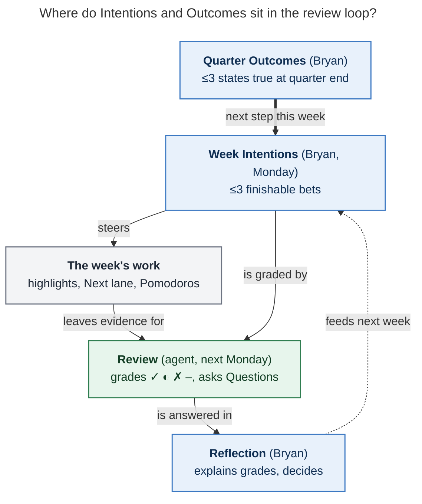

# Writing Intentions, Outcomes, and Themes in Bob period notes

*Researcher: cld · 2026-11-10 (Tue of 2026-W46) · Sources: bob-cli `docs/periods.md`, the Bob vault (read-only), two earlier period-note research reports, and the goal-setting literature (§9).*

## TL;DR

- **Each slot answers one question.** Year `## Theme`: *which direction breaks ties this year?* Quarter (and year) `## Outcomes`: *what will be true at the end that isn't true now?* Week `## Intentions`: *what will I have finished by Sunday that moves an Outcome?* Reflection: *why did it go that way, and what changes?*
- **Write them to be graded.** Next Monday an agent marks each Intention ✓ done · ◐ partial · ✗ not done · – no evidence. It can only see what the vault records. A good Intention names an **end state** you can finish this week, plus **one link** to the task or project where the evidence will appear.
- **Three is a ceiling, not a quota.** One clear Intention beats three vague ones, and a one-line week beats an empty one. Today 0 of 47 week notes have Intentions, 0 of 5 quarter and year notes have Outcomes, and 0 of 52 have a Reflection.
- **Write Q4 Outcomes now, for W46–W53.** Half the quarter is left. The higher horizons above it are stale: `h4_vision` still reads "Promoted to L5 at goog" and `h3_goal` is the Google-era "≥100 CLs" goal. Fix those in the January yearly review. Don't wait for them now.
- **Ten minutes on Monday** (§6): read last week's Review → write the Reflection → open the quarter's Outcomes → write ≤3 Intentions → check each against five tests.
- **You've done this before.** "Submit ≥100 CLs in 25Q3", with a weekly LOG line in `h3_goal`, was a quarterly Outcome with a weekly check. The period notes give that pattern a fixed home, and an agent now does the logging.

### The one-card version

> **Intention (week):** `N. <end state, finished by Sunday> → [[evidence link]] · O#`
> Tests: finishable this week · gradeable from the vault · mostly in my control · serves an Outcome (or says why) · fits in about 10–15 focused hours.
>
> **Outcome (quarter):** `N. (committed|stretch) <state of the world at quarter end> → [[^prj]]`
> Tests: a stranger could check it · links its project · I can name next week's step toward it · it would make the quarter a success even if nothing else happened.
>
> **Theme (year):** `Year of <word>`. It's a tie-breaker for choices, not a target.
>
> **Reflection:** lead with the verdict in one sentence, explain each ✗ and ◐, answer the Review's numbered Questions, and say what changes.

---

## 1. What the slots are, and what bob does with them

Bob already defines the slots, who owns them, and who reads them. You just haven't been told *what to put in them*. The facts below come from `docs/periods.md` and the vault:

| Slot | Note | Owner | Who reads it, and how |
| --- | --- | --- | --- |
| `## Intentions` | week | Bryan only; no tool or agent writes it | The week brief copies it verbatim. Next Monday the agent grades each line ✓ ◐ ✗ – with one evidence link. |
| `## Outcomes` | quarter, year | Bryan only | Every week brief under the quarter includes the quarter's Outcomes. The quarter Review grades them the same way. |
| `## Theme` | year | Bryan only | The quarter briefs include it. The year Review grades "Theme and Outcomes". |
| `## Reflection` | all | Bryan only | Writing it moves the note to `reflected`. Its first sentence (≤40 words) becomes the **Reflection lead**, which goes up a level with the Headline: the parent's brief lists it beside the child's Headline, and the `bob periods show` children rows carry it too. The next same-kind Review reads it (≤300 words). |
| `## Review` | all | agent, through `bob periods draft` | Gets Headline, Intentions, Shipped, Carried forward, and Questions. Each Question "could change next week's Intentions". |

Your own GTD checklist (`gtd_daily.md`) already places the writing:

- **Weekly review** (`#post`, Mondays): "…write the Reflection · open this week's note, re-read the quarter's Outcomes (↑), and set ≤3 Intentions · prune…"
- **Quarterly review** (first Monday of the quarter, next 2027-01-04): "…prune projects… · set ≤3 Outcomes in the new quarter's note."
- **Yearly review** (next 2027-01-11): "…revisit [[h3_goal]] and [[h4_vision]] · set the new year's Theme and ≤3 Outcomes."

The earlier design report set these limits: ≤3 Intentions set on Monday, ≤3 Outcomes, a Theme of one phrase. It argued that the order of the note follows the order you live the period: set intentions, live it, read the draft, reflect. Neither that report nor the review-instructions report said *what makes a good line*. Both noted that the human half had not started (sources in §9).

**Why this matters now:** without Intentions and Outcomes, the review loop has a sensor and no setpoint. The strip measures, the Review describes, and nothing says what the period was *for*. So the Review can only describe minutes and finished tasks. The W45 Review saw the gap itself. Its first Question was: *"This week's Intentions and Q4's Outcomes are both empty; which outcomes, if any, should W46's Intentions name?"*



*Figure 1. You write the blue boxes. The week's work leaves evidence, the agent grades your Intentions against it, and your Reflection plus the Review's Questions feed the next week's Intentions. With the blue boxes empty, the agent can only describe.*

---

## 2. Why "I'm not sure what to write" is a reasonable reaction

From the vault, I think five things make the blank heading hard. None of them is a willpower problem.

1. **Bob already has many priority mechanisms.** The Next lane (cap ~15), WIP/Pending, today's Task Links, the morning "highlight", P-levels, and the old `#now` "weekly bet", now retired. If those already say what's important, what is left for Intentions? Two things only an Intention does: (a) it states **why this week** at the project level, above individual tasks, and (b) it is **the only thing the Review grades**. The retired `#now` decision called its tag "a promise, not a footprint". Intentions take over that role at the week level, with ≤3 lines in place of a tag on up to 15 tasks.
2. **There is nothing above the week to work from.** Q4 Outcomes and 2026 Theme/Outcomes are empty. `h3_goal` (1–2 year goals) holds only the Google-era CL goal, last logged 2025-12-22. `h4_vision` (3–5 years) holds one 2024 line, "Promoted to L5 at goog". Your cover letter says you left Google in May to build sase. The horizons above the week describe a life you've left, so working top-down gives you nothing. GTD's advice, which you quoted in `lit/gtd.md`, is to work bottom-up anyway: *"Trying to create goals before you have confidence that you can keep your everyday world under control will often undermine your motivation."* Your everyday world is under control now (Review closed 33 of 42 days in Q4). That is the condition for moving up a horizon.
3. **The heading gives no prompt.** A scaffold heading with nothing under it asks you to invent the format every week. The fix is a fixed formula (§4) you can type without thinking.
4. **It's one clause in a long Monday checklist item.** "Set ≤3 Intentions" sits between reflecting and pruning NEXT/PENDING/ROTTEN, so it gets the leftover attention. Prior research found that GTD once took 49% of worked minutes in a week. Even so far in Q4, the `gtd` root is 24% of Worked. Intentions need their own two or three protected minutes, not more process.
5. **Being graded is uncomfortable.** Writing an Intention invites a public ✗. §7 explains why misses are useful information, and why stretch items should miss sometimes.

---

## 3. What the evidence says, briefly

The confidence column describes the evidence, not my opinion of the idea.

| Finding | Source | Confidence | What it means for your notes |
| --- | --- | --- | --- |
| Specific, hard goals beat "do your best" | Locke & Latham 2002, a 35-year research program | High | "Work on sase" doesn't help much. "S0 spike finished" does. |
| On **new, complex** work, a specific **learning** goal can beat a performance target, which tends to cause tunnel vision | Seijts & Latham, summarized in Locke & Latham 2006 | Medium (I read summaries, not the primary paper) | sase/bob design work is new and complex. An Intention like "memory design **decided and written**" is legitimate. Not every Intention has to be a shipped feature. |
| Combining outcome goals with process goals beats either alone | Filby, Maynard & Graydon 1999, a small sports study | Low–medium (n=40; read in summary) | Quarter Outcomes are the outcome goals and week Intentions are the process goals. Keep both. |
| If-then plans ("When X, I will Y") improve goal attainment | Gollwitzer & Sheeran 2006: d≈.65 across 94 tests. The 2024 update with 642 tests reports d from .27 to .66 by outcome type | High that the effect exists; its size is smaller than the 2006 figure suggests | Optionally add one if-then for the Intention most at risk. |
| Picturing the outcome, then the obstacle, then planning (WOOP/MCII) helps | Wang et al. 2021 meta-analysis: g≈.34, with some publication bias | Medium | Before you commit, ask "what's most likely to stop this?" (§6, step 4). |
| Making a plan for an unfinished goal reduces intrusive thoughts about it | Masicampo & Baumeister 2011 | Medium (lab studies) | Writing the plan is part of the benefit, even before the work. |
| Temporal landmarks (a new week, month, or year) raise goal-starting | Dai, Milkman & Riis 2014: archival searches, gym visits, commitments | Medium–high | Monday-morning Intentions and the Jan 4 quarter start work with you. A missed week is a clean slate, not debt. |
| Narrow numeric goals cause side effects: neglect of what isn't measured, gaming, less learning, lower intrinsic motivation | Ordóñez et al. 2009, "Goals Gone Wild" | Medium (argument plus cases) | Don't set Intentions on counts the strip already measures (Done, Worked). In W46 you finished 54 tasks in two days. A Done target would measure task granularity, not progress. |

Practitioner systems agree closely on the *form*, and several are books you've already annotated in `lit/`:

| System | Weekly | Quarterly | Yearly | What to borrow |
| --- | --- | --- | --- | --- |
| J.D. Meier, *Getting Results the Agile Way* | **Monday Vision**: "If this were Friday, what three outcomes would I want?" | Rule of 3 per horizon | Rule of 3 | The question that produces Intentions. Your note is already Monday Vision plus Friday Reflection. |
| Chris Bailey, *The Productivity Project* (your `lit/` notes: "Three Daily Tasks") | Three things to accomplish this week | — | Three things this year | Imagine the end of the week, then write three. |
| Laura Mae Martin, *Uptime* (your notes) | Weekly List drawn from the Main List; top three priorities | "Score by the quarter, not the day" | — | Two or three **power hours** a day for the top three, so the three Intentions should fit in about 10–15 hours. |
| Knapp & Zeratsky, *Make Time* (your notes) | — | — | — | "Medium-sized highlights are the best motivator." Your daily highlight should usually come *from* an Intention. |
| Ali Abdaal, *Feel-Good Productivity* (your notes) | **NICE** goals: Near-term, Input-based, Controllable, Energising | — | — | NICE is a good test for a week Intention. It's the wrong test for a quarter Outcome, which should be a result. |
| David Allen, *GTD* (your notes) | Weekly Review covers runway through areas | Higher horizons reviewed quarterly | Purpose and vision yearly | "Outcome visioning": picture wild success, then work backwards. |
| Moran & Lennington, *The 12 Week Year* | Weekly plan of tactics, scored by execution % | A 12-week goal, treated as a "year" | — | Score your *process* (about 85% is on pace), and treat a low score as a reason to change the plan, not to feel guilty. |
| OKRs (Google; Doerr; Wodtke's *Radical Focus*) | Wodtke's Four Square: 3–4 weekly priorities plus 0–10 confidence per key result | Objective plus measurable key results; **committed** (expect 1.0) vs **aspirational** (~0.7 is healthy) | — | Label each Outcome committed or stretch, so a stretch ✗ means the right thing. |
| Cal Newport, multi-scale planning | Weekly plan | Quarterly plan | Values kept in a separate document | Each level reads the one above it. Your `h5_life` note is the values document. |
| CGP Grey, yearly themes | — | Seasonal themes | **Year of ___** | A Theme gives direction and can't be failed. That's what the year's `## Theme` slot is for. |
| Josh Seiden, *Outcomes Over Output* | — | Outcome = a change in someone's behavior that creates value | — | For sase, "≥1000 stars" is a lagging metric. "Three people outside me run sase every week" is an outcome. |
| Anne-Laure Le Cunff, *Tiny Experiments* | "I will [action] for [duration]" pacts, reviewed afterwards | — | — | When you don't know what works yet (job channels, posting about sase), make the Intention an experiment. |

The systems split the same way: **quarters hold results, weeks hold finishable steps, years hold direction**. Your note scaffold already has that split. The research says to fill each level with the right *kind* of statement.

---

## 4. How to write each slot

### 4.1 Week `## Intentions`

**Definition.** Up to three things that, if true on Sunday night, would make this a good week. Each is **finishable within the week** and **moves a quarter Outcome**, or says plainly why it matters anyway.

**Formula** (one physical line each, numbered, no checkbox):

```markdown
## Intentions

1. <end state, phrased as already done> → [[note#^block]] · O1
2. <end state> → [[note#^prj]] · O2
3. <end state> → [[note#^block]]
```

**Five tests.** Read each line against them.

1. **Finishable:** it names an *end state* ("S0 spike finished", "memory design decided and written in [[sase_memory_plan]]"), not an activity ("work on", "look into", "make progress on"). An activity can't get a ✓.
2. **Gradeable from the vault:** a stranger with the week's brief could mark it ✓ ◐ ✗ without asking you. The brief sees finished tasks, linked minutes, Work Log entries, and Pomodoro notes. Off-clock events reach it only as counts by area. If the evidence will be a task completion, link that task. If it will be a decision, say where it will be written.
3. **Mostly in your control:** "Recruiter call prepped" passes. "Get an offer" doesn't belong in a week; it's a quarter Outcome. This is NICE's *Controllable*.
4. **Serves an Outcome:** add `· O#` when it does. One line per week with no Outcome is fine (a fix, an errand, family), but if none of the three serve an Outcome, either the Outcomes or the week needs a second look.
5. **Fits:** together the three should take about 10–15 focused hours, Martin's 2–3 power hours a day. Your typical week is 28h 13m Worked, and in Q4 so far about a quarter of that has gone to the `gtd` root. Three Intentions that each need 12 hours guarantee ◐.

**Bob-specific formatting:**

- **Numbered list, no checkboxes, no `#task`.** Period notes hold no task rows, and `bob periods list -p` reports a `#task` checkbox line in a period note as a `task_rows` problem. Grading is the Review's job.
- **Lead with the end state.** The agent quotes and grades from the start of the line.
- **Link to the most specific target.** Use the task's `^block` if one exists, otherwise the project's `^prj`. The link tells the agent where to look. It has no side effects, because task mentions are only computed from one task to another, and a period note has no tasks.
- **Rank them.** Number 1 is the one you protect when the week goes wrong. On a bad day, the morning review's "highlight first" should usually be Intention 1's next step.
- **If the week changes, append; don't rewrite.** Add ` — (dropped Wed: <reason>)` or ` — (changed Wed: …)`. The Review reports a reason you recorded as yours. Silently rewriting an Intention on Friday turns the grade into fiction.
- **Personal Intentions are welcome** ("two evenings offline with Abby"). The agent will probably mark them "–" because event titles never reach it, so grade those yourself in the Reflection.

**Before and after, from your own vault:**

| Weak | Why it fails | Stronger |
| --- | --- | --- |
| "Work on the sase blog post" | Activity, so the only possible grade is "–" | "S0 spike finished (2 🍅, hard stop), unblocking the four zero-drafts → [[sase_blog#^s0-spike]] · O1" |
| "Clean up sase memory" (carried at kept 3× in W44 and W45; your reason: "I still really need to clean up sase's memory") | Vague, with no end state, and it's been carried for weeks | "One memory design chosen and written as a decision in [[sase_memory_plan#^prj]], or the project explicitly paused" |
| "Job search" | Not finishable, and the result isn't in your control | "Thu recruiter call prepped (notes in the event's private note) and 3 more Wave 2 applications sent → [[job_2026_apply_29#^prj]] · O2" |
| "Close 30 tasks" / "Work 30h" | The strip already counts these; a target invites gaming | Leave counts to the strip. Write the *thing* the hours should buy. |
| "Improve bob" | Too broad to finish | "Notebooks shipped and used for one real notebook → [[bob#^notebooks]]" |
| "Be more focused" | A trait, not an end state | Put it in the year's Theme, or test it as an experiment: "Mornings until 10:00 go to Intention 1, Mon–Fri" |
| A list of five Next-lane tasks | Duplicates the Next lane; Intentions sit above tasks | Pick the one or two tasks whose completion *changes something*, and phrase the change. |

**One optional addition: an if-then line for the riskiest Intention.**

```markdown
1. S0 spike finished … → [[sase_blog#^s0-spike]] · O1
   - If it's still open after Tuesday's GTD, then Wednesday's first two 🍅 are the spike, before any bob work.
```

A sub-bullet keeps it out of the graded line. The agent reads it as your words.

### 4.2 Quarter `## Outcomes`

**Definition.** Up to three **states of the world on the quarter's last day** that aren't true now. If all three came true, the quarter was a success even if nothing else happened.

**Formula:**

```markdown
## Outcomes

1. (committed) <state at quarter end, checkable by a stranger> → [[project#^prj]]
2. (stretch) <state> → [[project#^prj]]
3. (committed) <state> → [[project#^prj]]
```

**Five tests.**

1. **A state, not a task list:** "X is live", "Y is decided and written", "Z happens every week". Your `^prj` lines are often already written this way: *"My SASE post, in my own voice, is live on sase.sh!"*, *"Failed, killed, or interrupted agents … can be recovered in one action without losing work!"*. Often an Outcome is just *"this `^prj` is done by quarter end"*, or a named milestone inside one.
2. **Committed or stretch, labeled.** A committed Outcome should get ✓. Stretch Outcomes should land ◐ about a third of the time; if every stretch gets ✓, they weren't stretches. This follows Google's OKR rule (committed expects 1.0, aspirational about 0.7).
3. **Weekly-steppable:** you can name next week's Intention for it right now. If you can't, it's either too vague or blocked. Look for the block (§5 shows one in the blog chain).
4. **Linked:** one `^prj` link each, so the quarter Review can find Finished, Started, and Stalled for it.
5. **Few and chosen:** about 40 open `^prj` lines exist. Outcomes are where you say which ≤3 matter *this quarter*. Everything else can still happen; it just isn't the plan.

**Questions that help choose Outcomes** (each one is from something you've read):

- **Regret:** on Jan 3, what would I most regret *not* having finished?
- **Leverage** (*The One Thing*'s focusing question): what result would make other things easier or unnecessary?
- **Wild success** (GTD outcome visioning): picture the quarter going extremely well. What's visibly different?
- **Allocation:** Q4 Worked so far is bob 34% · gtd 24% · sase 22% · sase_blog 6% · job_2026 4% · job 3% · job_update_cv 1%. Would you choose that split on purpose? The Review is designed never to judge allocation. Your Outcomes are the only place that can say what the split *should* be, which lets the Review show you the gap.

### 4.3 Year `## Theme` and `## Outcomes`

- **Theme:** one phrase, *Year of ___*, chosen so you can use it to break ties: *"Which option is more <theme>?"* CGP Grey's point is that a theme can't be failed, so it survives a bad February. It is not a Bob **task type**: "theme" is also the legacy name for task types like PLAN and BUILD. The year heading is unrelated.
- **Year Outcomes:** ≤3, the same form as quarter Outcomes, drawn from `h3_goal` (1–2 year goals). Quarter Outcomes should usually be the next step toward one of them.
- **2026:** the year ends Jan 3 and has no Theme. I wouldn't backfill one now. Give the year's meaning in the 2026 Reflection at the yearly review.
- **2027:** in the Jan 11 yearly review, **rewrite `h3_goal` and `h4_vision` first**. The year Review agent reads both and ties its Questions to them. As they stand, its Questions would be tied to the L5 promotion and the CL count.

### 4.4 `## Reflection`: the half that makes the grades useful

The Review describes; the Reflection decides. Keep it short. You read the Review in two minutes, and the Reflection can take two more.

1. **First sentence = your verdict** (≤40 words). It becomes the Reflection lead that the quarter brief shows beside this week's Headline, so write it to stand alone: *"Good week for the blog, bad week for focus: S0 finally closed, but bob fixes ate Thursday."*
2. **Explain each ✗ and ◐.** The agent can't infer why. That's your job, and it's the most useful record for the quarter Review.
3. **Answer the Review's Questions by number** ("Q1: …"). They exist to change next week's Intentions.
4. **Optionally, one confidence number per quarter Outcome** (Wodtke): "O1 7/10 · O2 4/10". If a number drops two weeks running, next week's Intention 1 should go there.

---

## 5. Drafts for this week and the rest of Q4 (examples to edit, not to copy)

These come from the vault as of today, to show the form. **The priorities are your call.** I picked projects that already hold most of Q4's time or are clearly marked important. You can accept, rewrite, or reject any line. Per the period-note contract, nothing is written to your notes; only you write these sections.

**Facts behind them** (vault, 2026-11-10):

- The blog chain: `^s0-spike` ("Spike S0 … wire Wave 1 (2 🍅, hard stop)", created 2026-10-23) is **in progress** and blocks the four zero-draft sections → Wave 1 review → `^v1-draft` → `sase_pre_blog#^prj` (17 open tasks, all Blocked). `Release [[sase_blog]] post!` also depends on `job_2026_apply_29#^prj`. sase_blog has 6% of Q4 time.
- Job search: `job_2026#^prj` = *"Get hired by a great, forward-thinking, AI-first company!"* Nearly all the logged application tasks were completed Oct 14–15, with one more on Oct 27. A recruiter event is on Thu 2026-11-12 (`bob#^recruiter-private-event-note` is in Next).
- bob is the largest Q4 root (34%). Its `^prj` is *"Finish MVP of `bob` and bob-plugins repo (no new commits for 30d)!"*

**Example Q4 Outcomes (W46–W53, through Jan 3):**

```markdown
## Outcomes

1. (committed) The SASE post has a complete v1 draft, Wave 1 reviewed → [[sase_blog#^v1-draft]]
2. (stretch) I'm in at least one final-round loop with an AI-first company, or holding an offer → [[job_2026#^prj]]
3. (committed) bob is feature-frozen from Dec 14: fixes only, no new commands or note types → [[bob#^prj]]
```

Some alternatives, to show other kinds of Outcome:

- Practice: *"The period-note loop ran every week W46–W52: Intentions by Tuesday, Reflection by the next Monday."* This is a reasonable Outcome while the habit is new.
- Learning (Seijts & Latham): *"sase memory: one design chosen and recorded as a decision; the Docs-as-Memory task closed or dropped."*
- Behavior (Seiden): *"Two people outside me ran sase on a real project and told me what broke."*

**Example W46 Intentions (it's Tuesday; that's fine):**

```markdown
## Intentions

1. S0 spike finished (2 🍅, hard stop), unblocking the four zero-drafts → [[sase_blog#^s0-spike]] · O1
2. Thu recruiter call prepped and held; 3 more Wave 2 applications sent → [[job_2026_apply_29#^prj]] · O2
3. Notebooks shipped and used for one real notebook → [[bob#^notebooks]]
```

Run them through §4.1. #1 is finishable and gradeable (the task closes), in your control, and serves O1. It's also the step that unblocks the rest of the blog chain. #2 mixes a fixed event with an input count. Its evidence is the event row plus application tasks, so create those tasks or the agent will mark it "–". #3 serves no Outcome, which is fine for one line out of three, and it's already your largest open item this week (43m).

---

## 6. The Monday routine (about 10 minutes, after the agent's draft exists)

The weekly review row already contains all of this. The point is to do it in this order, with the formula ready.

1. **Close last week (2 min).** Open last week's note. Read the Headline, the Intentions grades, Carried forward, and the numbered Questions. Correct the draft only if it's wrong.
2. **Reflect (3 min).** Verdict sentence, why for each ✗ and ◐, answers to the Questions, optional Outcome confidence numbers (§4.4).
3. **Look up (30 s).** ↑ to the quarter note and read the Outcomes. If there are none, write them first (§4.2); that takes 15 minutes, once.
4. **Draft (3 min).** In this week's note, for each Outcome ask: *"What's the next thing I can **finish** by Sunday that moves this?"* Check the calendar for fixed commitments. Write ≤3 lines using the formula, and rank them.
5. **Test (1 min).** Check the five tests. For Intention 1, ask the WOOP question *"what's most likely to stop this?"*, and if the answer is real, add a one-line if-then under it.
6. **Connect (30 s).** Make sure each Intention's task is in Next, or create it. From then on, each morning's highlight should usually come from Intention 1. That's the only link to daily work you need.

**Quarter start (first Monday, next 2027-01-04, about 30 min):** finish the last week of the quarter as above, read the quarter Review, write the quarter Reflection, prune projects (already on your row), then write ≤3 Outcomes with labels, then write week 1's Intentions from them.

**Year start (2027-01-11):** rewrite `h3_goal` and `h4_vision` from where your life is now, choose the Theme, write ≤3 year Outcomes, and make sure Q1's Outcomes are their first steps.

---

## 7. Failure modes and fixes

| Failure | What it looks like | Fix |
| --- | --- | --- |
| Activity Intentions | Grades come back "–" | Rewrite as an end state plus a link (test 1). |
| Too big | ◐ every week for the same line | Slice to the next milestone you can finish. The blog went from "post live" to "S0 spike finished". |
| Duplicating the Next lane | Five task links | Pick the one or two whose completion *changes something*. |
| Counting what the strip counts | "Close 40 tasks" | Name the thing the hours buy (Ordóñez et al.). |
| All tooling | Every Intention is a bob feature | Allowed, but if no Outcome is about bob, the Review will show the mismatch. That's the loop working. |
| Rewriting to pass | Friday edits | Append "(dropped Wed: reason)" instead. |
| Skipping chaotic weeks | Empty heading | Write one line. "1. Survive the week: only Intention-1 work after 10:00" is still a bet you can grade. |
| Fear of ✗ | Only safe Intentions | Label stretches. In 12 Week Year terms, about 85% execution is on pace. A Monday is a fresh start (Dai et al.), so last week's ✗ isn't carried forward unless you choose to carry it. |
| Handing it to an agent | A drafted menu you rubber-stamp | Write the lines yourself. If you want help, ask an agent to **check** your draft against §4's tests. The prior review-instructions report flagged reduced critical thinking from over-trusting AI drafts (Lee et al., CHI 2025), and it kept Intentions human-only on purpose. |

---

## 8. Optional support in bob and the vault (smallest first)

The cheapest fix is a habit, not a feature: so far in Q4, bob plus gtd account for 58% of Worked. I'd run the routine for 3–4 weeks before building anything.

1. **No code, in the vault:** add the one-card version (top of this report) to the Weekly review row, or link a short `periods_howto` note from it. You own both.
2. **Small, bob-cli:** two info-level problems in `bob periods list -p`. `missing_intentions` for the current week after Tuesday, and `missing_outcomes` for the current quarter after its first week. It would print in the nightly step that already runs `list -p`.
3. **Small, callout v3:** tell the review agent that dated "(dropped …)/(changed …)" suffixes are Bryan's recorded reasons, that personal Intentions without vault evidence are graded "–" without comment, and that `· O#` suffixes map Intentions to Outcomes for the Outcomes line. Bump `INSTRUCTIONS_VERSION` and run `ensure -R`, as `docs/periods.md` requires.
4. **Medium, only if 1–3 aren't enough:** a read-only Monday "planning pack" (for example `bob periods plan`). It would print the quarter Outcomes, last week's Carried forward and Questions, the Next lane, Blocked `^prj` lines, this week's fixed calendar events, and the typical-week hours, so step 4 of §6 has everything on one screen. An agent could check your draft against it, but must never write the section.

I would **not** put prompt text inside `## Intentions` in the scaffold. The section body is copied verbatim into the brief, so the agent would read and grade the prompt.

---

## 9. Sources

**Bob and vault (read-only):**

- bob-cli `docs/periods.md`: §Note anatomy and ownership, §Review state and Headline (Reflection lead), §Agent instruction callouts (v2), §Agent briefs item 10 (human sections copied verbatim; parent Outcomes/Theme; h3/h4 in the year brief); `## Problems` (`task_rows`).
- Vault: `2026/2026-W45.md` (Review, Questions 1–2), `2026/2026-Q4.md`, `2026.md`, `gtd_daily.md` (Weekly/Quarterly/Yearly review rows), `gtd.md#^intentions-and-outcomes`, `h3_goal.md`, `h4_vision.md`, `h2_role.md`, `horizon.md`, `job_2026.md`, `job_2026_apply_29.md` and its done file, `sase_blog.md`, `sase_pre_blog.md`, `lit/{gtd,uptime,make_time,feel_good_productivity,productivity_project,one_thing}.md`; `bob periods list`, `bob periods show 2026-Q4`, `bob periods brief 2026-W46 -f md` (run 2026-11-10). Section counts come from a scan of all 55 period notes.
- SASE decision `now-tag-is-user-owned` (superseded; "a promise, not a footprint").
- Prior research (unrelated earlier swarms): `research:202611/period_note_tree_and_stats_strips/period_note_tree_and_stats_strips__final.md`; `research:202611/period_review_instructions_v2/period_review_instructions_v2__final.md`.

**Research literature:**

- Locke & Latham (2002), "Building a practically useful theory of goal setting and task motivation," *American Psychologist*. [PDF](https://goal-lab.psych.umn.edu/orgpsych/2020/readings/5.%20Motivation/Locke%20&%20Latham%20(2002).pdf)
- Locke & Latham (2006), "New directions in goal-setting theory," *Current Directions in Psychological Science* (learning goals on complex tasks). [PDF](https://home.ubalt.edu/tmitch/642/Articles%20syllabus/locke%20latham%20new%20dir%20GS%20curr%20dir%20psy%20sci%202006.pdf)
- Gollwitzer & Sheeran (2006), "Implementation intentions and goal achievement: A meta-analysis." [record](https://kops.uni-konstanz.de/entities/publication/2e749bfb-8533-437c-8203-7e788c910c5f)
- Sheeran, Listrom & Gollwitzer (2024), "The when and how of planning: Meta-analysis of … implementation intentions in 642 tests," *European Review of Social Psychology*. [doi](https://doi.org/10.1080/10463283.2024.2334563)
- Wang, Wang & Gai (2021), "A meta-analysis of the effects of mental contrasting with implementation intentions on goal attainment," *Frontiers in Psychology*. [PMC](https://pmc.ncbi.nlm.nih.gov/articles/PMC8149892/)
- Dai, Milkman & Riis (2014), "The fresh start effect," *Management Science*. [PDF](https://faculty.wharton.upenn.edu/wp-content/uploads/2014/06/Dai_Fresh_Start_2014_Mgmt_Sci.pdf)
- Masicampo & Baumeister (2011), "Consider it done! Plan making can eliminate the cognitive effects of unfulfilled goals," *JPSP*. [PubMed](https://pubmed.ncbi.nlm.nih.gov/21688924/)
- Ordóñez, Schweitzer, Galinsky & Bazerman (2009), "Goals gone wild," *Academy of Management Perspectives*. [HKS](https://www.hks.harvard.edu/publications/goals-gone-wild-systematic-side-effects-overprescribing-goal-setting)
- Filby, Maynard & Graydon (1999), "The effect of multiple-goal strategies on performance outcomes," *Journal of Applied Sport Psychology*. [summary](https://coachsci.sdsu.edu/csa/vol93/filby.htm)

**Practitioner sources:**

- J.D. Meier, ["Monday Vision, Daily Outcomes, Friday Reflection"](https://learn.microsoft.com/en-us/archive/blogs/jmeier/monday-vision-daily-outcomes-friday-reflection)
- Chris Bailey, ["The Rule of 3"](https://chrisbailey.com/rule-of-three/)
- Google OKR playbook (committed vs aspirational grading), [PDF mirror](https://awe-hnu.github.io/lectures/IPS/23WT/OKRs/assets/googles-OKR-playbook.pdf); [What Matters: committed vs aspirational](https://www.whatmatters.com/faqs/committed-aspirational-okrs-examples-difference)
- Christina Wodtke's Four Square, [summary](https://davidcummings.org/2016/05/09/the-4-quadrant-weekly-alignment-doc-from-radical-focus/)
- *The 12 Week Year*, [concept summary](https://concepts.dsebastien.net/concept/12-week-year/) (secondary; execution-score claims vary between summaries)
- Cal Newport, multi-scale planning, [episode transcript](https://lawwu.github.io/transcripts/transcript_ZHjK2XxcjQk.html)
- CGP Grey, yearly themes, [summary](https://rosetta.to/u/cgpgrey/why-resolutions-fail-and-what-works-instead) (secondary)
- Josh Seiden, ["User outcomes and business outcomes"](https://medium.com/@jseiden/whats-the-difference-between-user-outcomes-and-business-outcomes-588952071552)
- Anne-Laure Le Cunff on tiny experiments, [podcast transcript](https://podcast.linkingyourthinking.com/episodes/anne-laure-le-cunff-how-to-design-tiny-experiments-like-a-scientist/transcript)
- David Allen Company, "Levels of your work" (Horizons of Focus), [PDF](https://www.gatheringinlight.com/content/files/wp-content/uploads/2014/10/2016-levels-of-your-work.pdf)

**If you want to read further** (two short pieces before the next Monday, one before January):

```bash
bob ref create https://learn.microsoft.com/en-us/archive/blogs/jmeier/monday-vision-daily-outcomes-friday-reflection
bob ref create https://chrisbailey.com/rule-of-three/
bob ref create https://rosetta.to/u/cgpgrey/why-resolutions-fail-and-what-works-instead
```

Library check: 0 of 14 candidates already in your library (0 finished). Your zorg-era `lit/` notes show you've read GTD, *Uptime*, *Make Time*, *The Productivity Project*, *Feel-Good Productivity*, *The One Thing*, and *7 Habits*. Those notes are outside `ref/`, which is why they don't show in the library check.

---

## 10. Open questions for Bryan

1. **Scope:** are Intentions work-only, or whole-life? Either works, but personal ones will be graded "–" by the agent unless the vault records them.
2. **The blog/job dependency:** `Release [[sase_blog]] post!` depends on `job_2026_apply_29#^prj`. Is "applications before the post goes live" deliberate? Your Q4 Outcomes will have to take a position on it.
3. **Help level:** do you want the review callout (v3) to understand `· O#` tags and "(dropped …)" suffixes, and should a Monday agent check your Intentions draft, without ever writing it?
