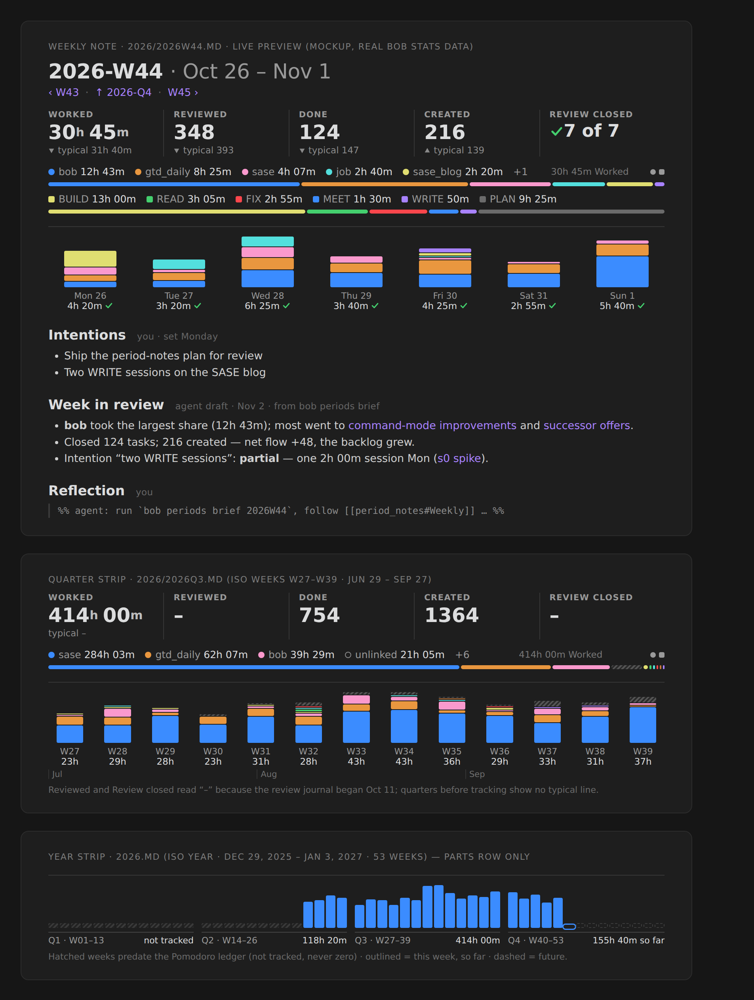

# Weekly, quarterly, and yearly notes with stats strips

*Researcher **cld** · 2026-11-03 · scope: bob-cli, bob-plugins (bob-ledger-tools), and the Bob vault (`~/bob`)*

## Summary

**Verdict: build it.** It works best as three parts working together, not as "three more
Templater templates":

1. **A period calendar.**
2. **A stats-strip renderer.**
3. **A review ritual**, which an agent can draft.

The vault itself shows why a template-only approach fails. Monthly notes are created only
when someone clicks a dangling `parent` link. As a result, **258 of the 295 canonical 2026
daily notes (87%) point at a monthly parent that does not exist** (§1).

The six decisions that matter most:

1. **Use the ISO week calendar, with fixed 13-week quarters.** Weeks do not nest inside
   months or calendar quarters, which is the core design problem. So:
   - a week is an ISO week;
   - a quarter is a fixed block of 13 ISO weeks: W01–13, W14–26, W27–39, and W40–52/53;
   - a year is the ISO week-year.

   Every period is then a whole number of weeks, so days add up exactly to weeks, weeks to
   quarters, and quarters to years. Each quarter starts within 4 days of the calendar
   quarter; I checked every year from 2000 to 2100. The cost is that "2026" runs from
   Dec 29, 2025 to Jan 3, 2027. Every strip labels its real dates, so nobody has to know
   the ISO rules.
2. **bob creates period notes; Templater does not.** `bob periods ensure` creates any
   missing week, quarter, year, or all-time note. It only ever creates, never overwrites,
   and its output bytes depend only on the period id. bob-ledger-tools runs it whenever
   Obsidian creates a daily note, using the hook that already runs `bob gcal sync`. The
   daily template changes only its `parent` line and its nav line.
3. **One stats-strip family.** The existing Day strip becomes the day member of the family.
   A period strip has three tiers:
   - **Facts:** period totals, each with a typical line comparing it to earlier periods of
     the same kind.
   - **Lanes:** the existing root-parent and type lanes.
   - **A new parts row:** one column per child period, each linking to that child's note.

   bob owns every number, and nothing numeric is ever written into a note.
4. **Agent enrichment is a draft with hard boundaries.**
   - bob supplies a deterministic fact bundle, `bob periods brief <PERIOD>`.
   - The agent writes only between `bob:review` markers.
   - Every draft opens with a one-line **Headline**, which the parent period's draft
     reuses.
   - The agent asks questions; it does not offer insights or scores.
   - The draft is locked once you write your Reflection.
5. **Review tasks in `gtd_daily.md`:**
   - *Weekly prune* becomes a Monday **Weekly review** (still `#gtd #post`).
   - **Quarterly review** repeats `every 3 months on the 5th`.
   - **Yearly review** repeats `every January on the 5th`.
   - Both new ones are ordinary recurring tasks, not `#post` checklist rows.
6. **New glossary terms:** **Stats Strip** (with the Day strip as its day member) and
   **Period Note**.



*Figure 1. Mockup built from real `bob stats show -a -f json` output for 2026-W44 and the ISO
13-week Q3 2026. Top: a weekly note with its strip: facts, roots lane, types lane, and seven
day columns stacked by root parent, followed by the human and agent sections. Middle: the
quarter strip, with 13 week columns and month ticks. Bottom: the year strip's parts row, with
53 week columns under quarter labels; weeks before the Pomodoro ledger existed are hatched,
never drawn as zero. The typical lines use the rule proposed in §4.5. The type lane uses the
current six-type vocabulary.*

---

## 1. What exists today (verified)

| Fact | Evidence | Why it matters |
| --- | --- | --- |
| Daily notes are created by Obsidian's core Daily Notes plugin with Templater, format `YYYY/YYYYMMDD`. The parent is computed as `YYYY/YYYYMM`. | `~/bob/.obsidian/daily-notes.json`, `~/bob/_templates/daily.md` | Changing the parent is a one-line template change: `GGGG/GGGG[W]WW`. |
| **bob never creates daily notes.** The Mac is the single writer for today's note. Ledger Tools runs `bob gcal sync` when Obsidian creates the daily note. | `docs/gcal.md` §Sync, §Where it runs; `291-plugin-gcal-events.js` `setupGcalSyncOnCreate` | A create hook already exists to attach `bob periods ensure` to. |
| Monthly notes are created by hand. Only `2026/202606.md` and `2026/202611.md` exist; the November one was made today at 08:46. | `ls ~/bob/2026/2026??.md` | Click-to-create does not happen. |
| **Dangling parents:** 258 of 295 canonical 2026 dailies point at a missing monthly file. Jan–May point at `2026/2026MM`, but those files live at the root as `2026MM.md`. Jul–Oct files were never created. All 365 2025 dailies dangle too; 2023 dailies have no parent at all. | Script over `~/bob/{2023..2026}/YYYYMMDD.md` | Breaks the vault rule "New Markdown notes must include a `parent`…" (memory `obsidian.md`). Creation must be automatic. |
| The year note `2026.md` was generated from zorg, has `parent: [[journal]]`, and lists monthly links. `_templates/yearly.md` points `parent` at `[[org]]`. `all_time.md` does not exist. | `~/bob/2026.md`, `_templates/yearly.md` | The year note must be re-parented and keep its legacy links. |
| `type: "[[day]]"` is used for daily, monthly, and yearly notes. No code in bob-cli or bob-plugins reads it. | `~/bob/day.md`; grep of both repos | Per-kind types (`[[week]]`, `[[quarter]]`, `[[year]]`) are free to add. |
| The Day strip already exists. A `bob-day-stats` fence embeds it elsewhere, and its contract names this exact use: "*such as a weekly note*". The Stats page's **Window bars** reuse the Day strip's lanes for any window, through shared builders in `239-plugin-time-lanes-model.js`. | `docs/stats.md` §Day strip, §Window bars | The renderer family already exists; period strips are an extension. |
| `bob stats` already does ISO-Monday weeks, calendar months, partial-edge buckets, `parts_summary` by root parent and type, prior-period deltas, and a `typical` object (day grouping only). There is no quarter grouping. | `docs/stats.md` §Ranges, grouping | Needs period-id ranges, a quarter group, and period-level `typical`. |
| **Measured `bob stats show -a -f json` times on apollo:** a week (`-g day`) 0.59 s, a quarter (`-g week`) 0.74 s, year-to-date (`-g month`) 1.29 s. | Timed runs (§4.6) | Live rendering is affordable, given the Day strip's caching. |
| Ledger data starts **2026-05-28** (160 daily notes with `## Pomodoros`). Before that, Stats reports `missing`. The review journal starts 2026-10-11. | `grep -l '^## Pomodoros'`; year JSON | Pre-tracking periods must read "not tracked", never 0. |
| **Type history before the October vocabulary is messy.** Q3 2026's type lane is 65% `(unnamed)` plus about 60 ad-hoc names (SHIT, REMOTE, TOOL…). | Q3 JSON `parts_summary.theme` | Long-period type lanes must fold labels and the long tail. Roots are the honest headline lane for history. |
| The Stats design explicitly **rejected** "productivity score, tasks per hour, automated 'insights'". The reason: "they imply causality the data can't support, and they invite gaming." It also chose to home Stats in the weekly prune, not the daily note. | `docs/stats.md` §Later and rejected; `research:202610/bob_daily_stats/bob_daily_stats__final.md` §4–5 | The LLM part must stay grounded, clearly separate, and ask questions rather than draw conclusions. |
| `gtd_daily.md` holds one weekly row: the `#gtd #post` **Weekly prune**, every Monday. Its last instance carries your note "*Re-evaluate if this is really needed?*" | `~/bob/gtd_daily.md` | The prune gains a purpose by becoming the weekly review. |
| The vault's `AGENTS.md` is 13 lines. It requires agents to check `git status`, commit only their own files, and run `/sase_git_commit`. It still says "synced by Obsidian Sync", which is stale. | `~/bob/AGENTS.md` | Agents editing period notes already have a commit rule to follow. |
| A matching task is already open: `bob#^wqy-stat-strips` "Create weekly/quarterly/yearly file templates!" ("Review these as a part of your weekly review."), plus `bob#^prev-next-links`. | `~/bob/bob.md` | Prev/next links belong in the scaffold. |

---

## 2. Critique: is this a good idea?

### 2.1 Why it is worth doing

- **It fixes a broken hierarchy.** The `parent` chain is the vault's spine, and today it is
  87% dangling for 2026. A generated chain (day → week → quarter → year → all time → org)
  makes every daily note reachable, and makes backlinks and the graph meaningful again.
- **Weekly is where numbers turn into decisions.** The Stats research already concluded
  this ("Home it in the weekly prune, not the daily note"). A weekly note with a strip is
  that home, and it opens without a range picker.
- **Rendering is mostly built.** The Day strip, Window bars, shared lane builders, `bob
  stats` buckets, and the `bob-day-stats` fence already cover most of the renderer.
- **It gives reflection a place to live.** Daily notes are ledgers: Pomodoro rows and task
  links, with almost no prose (see `2026/20261030.md`). Nothing in the vault records what a
  week or quarter *meant*. Period notes add that layer, and the people who have done GTD
  reviews longest say this is the habit that keeps the system trusted. David Allen calls the
  weekly review GTD's "critical success factor".

### 2.2 Risks, and how the design answers them

| Risk | How it shows up | Design answer |
| --- | --- | --- |
| **Calendar mismatch** | Weeks straddle month and quarter edges. With calendar quarters, a week's own note says 30h but its row in the quarter shows 15h. | ISO weeks with 13-week quarters (§4.1). Everything adds up exactly. |
| **Notes never get created** | The monthly experience: 87% dangling. | bob creates them on the daily-note create hook (§4.3). Migration fixes 2026. |
| **Numbers go stale or disagree** | Any number pasted into Markdown drifts from Stats after late ledger edits or note-tree changes. | Numbers live only in the rendered strip. Markdown holds links and prose. Agent prose quotes only the brief, with a timestamp. |
| **LLM "insights" break the Stats ethic** | The model invents causes ("you were less productive because…"), nudges toward metrics, praises or scolds. | Questions instead of conclusions. No scores, no grades, no advice. Every bullet links its evidence. The draft is locked once you write your Reflection (§4.7). |
| **Reviewing crowds out doing** | The Stats research measured GTD at up to 49% of worked minutes in one week. A 60-note ritual could balloon. | Hard caps: weekly review ≤ 30 min, agent output ≤ 250 words, ≤ 3 intentions. The agent draft exists to shorten the review. |
| **Instruction drift** | 52 weekly notes, each with a long prompt, can't be updated together. | Each note gets a short, bob-owned, versioned contract that bob can refresh. The details live in one guide note (§4.7, Appendices A–B). |
| **Personal data in summaries** | Off-clock events (family, medical) end up in an LLM prompt and in prose. | By default the brief summarizes off-clock Event Tasks by root and count, not by title (configurable). |
| **Losing months** | "What did I do in October?" is a natural question. | The quarter and year strips label months under the week columns, and the Stats Dash still groups by month. Months stay a lens, not a level. |
| **Mobile** | Strips need to spawn `bob`, which is desktop-only. | The scaffold carries static child-link rows, so navigation works on mobile and in plain Markdown. |

### 2.3 What I would do differently from the request as written

- **Make it calendar-first.** The request reads like a template project. The hard, permanent
  decision is how periods nest (§4.1); templates follow from that.
- **Split numbers from words.** "Summarize the parts that make up the whole" has two halves.
  The numeric half belongs to the strip's live parts row. The narrative half belongs to the
  agent, in the form of child Headlines.
- **Make the human sections first-class.** Without Intentions/Outcomes set at the start of a
  period and a Reflection at the end, an agent summary is a report nobody acts on. The agent
  then grades follow-through on *your* stated intentions, not its own idea of productivity.
- **Ground agents in a bob-made brief.** Asking an LLM to scrape seven daily notes and chase
  around 100 block links is slow, expensive, and error-prone. `bob periods brief` makes the
  inputs deterministic and testable, and keeps the instructions short.

---

## 3. Requirement adjustments (called out explicitly)

| # | You asked | I recommend | Why |
| --- | --- | --- | --- |
| **A1** | Weekly, quarterly, and yearly notes, with the calendar unspecified | **ISO 8601 week-numbering calendar with 13-week quarters:** Q1 = W01–13, Q2 = W14–26, Q3 = W27–39, Q4 = W40–52/53. The year is the ISO week-year. | Exact additivity. Quarters are always 13 weeks (14 for Q4 in 53-week years: 2026, 2032, 2037, 2043, 2048). Starts are within 4 days of the calendar quarter. |
| **A2** | Daily notes link to weekly instead of monthly | Also **retire monthly notes**: stop creating them and delete `_templates/monthly.md`. Delete the two empty 2026 monthly scaffolds after a backlink check. Leave the zorg-era root `YYYYMM.md` notes as archives. | Months don't nest weeks. Keeping them as a second parent tree would recreate the dangling problem. |
| **A3** | A stats strip that breaks down working time | Strip = **facts + lanes + parts row**, rendered live. **No numbers are written into the note.** | Keeps the "bob owns every value, never writes the note" contract the Day strip already follows. |
| **A4** | Summarize the units/parts of each period | Numeric parts: the strip's parts row. Narrative parts: every agent draft starts with a one-line **Headline**, and the parent period's draft tabulates its children's Headlines. | Recursive summarization: each layer summarizes the layer below, not raw days. |
| **A5** | Files pre-generated with agent instructions | Each note gets a **short, versioned, bob-owned instruction block** (about 15 lines, refreshable with `bob periods ensure --refresh-instructions`). It points to a single **guide note** (`period_notes.md`) and a **brief command**. | Inline enough that "update this note" is a complete prompt. Centralized enough that changing a rule means editing one note, not 60. |
| **A6** | An LLM enriches the files | Add **human-owned sections**: Intentions (week), Outcomes (quarter), Theme and Outcomes (year), plus Reflection. The agent never writes them, and its draft locks once Reflection has content. | Human feedback at each level is what makes the summaries worth reading, and it keeps you the author. |
| **A7** | (implicit) | The agent writes **questions, not insights**: no scores, grades, advice, or praise. | Matches the Stats design's rejected list and its reasons. |
| **A8** | Update the weekly review task; add quarterly and yearly tasks | Weekly stays `#gtd #post` on Mondays. **Quarterly and yearly are ordinary recurring `#gtd` tasks** (RECURRING tier), dated **the 5th** of Jan/Apr/Jul/Oct and **January 5th**. | A 1–2 h review shouldn't block the morning POST closeout. The 5th is always 1–9 days after an ISO quarter ends (verified 2000–2100). |
| **A9** | A glossary term for "stats strip" | Add **Stats Strip** *and* **Period Note**, and amend **Day Strip** to "the stats strip of a daily note". Write three decision records (§4.9). | The strip's definition needs a noun for the notes it heads. The calendar and ownership choices are long-lived policy. |
| **A10** | `all_time.md`, with parent `org.md` | As asked, plus: no agent section at first; bob maintains its years row. Re-parent `2024.md` and `2025.md` to `[[all_time]]` as well. | All year notes hang off one root, and the legacy `journal` chain stays readable. |
| **A11** | (implicit) migration | Migrate **2026 only**: re-parent all 295 canonical 2026 dailies and create 2026-W01…W45 plus Q1–Q4. Leave 2023–2025 for an opt-in `--since` run. | 2026 is where the ledger lives. Pre-tracking weeks render "not tracked", so the tree stays complete without fake zeros. |
| **A12** | Yearly file | **Keep the year note at `YYYY.md` in the vault root.** | Preserves every existing `[[2026]]` link. |

---

## 4. Design

### 4.1 The period calendar

| Period | Id | Days | Parent | Children |
| --- | --- | --- | --- | --- |
| Day | `20261103` | 1 | the ISO week containing it | none |
| Week | `2026W45` | Mon–Sun | `2026Q{⌈w/13⌉, capped at 4}` | 7 days |
| Quarter | `2026Q4` | 13 weeks (14 for Q4 of a 53-week year) | `2026` (ISO week-year) | 13–14 weeks |
| Year | `2026` | 52 or 53 weeks | `all_time` | 4 quarters |
| All time | `all` | from the first tracked week | `org` | years |

Concrete boundaries, computed with Python's `isocalendar` and `fromisocalendar`:

| ISO year | Weeks | Range | Q1 | Q2 | Q3 | Q4 |
| --- | --- | --- | --- | --- | --- | --- |
| 2026 | **53** | Dec 29, 2025 – Jan 3, 2027 | Dec 29 – Mar 29 | Mar 30 – Jun 28 | Jun 29 – Sep 27 | Sep 28 – Jan 3 (**14 wk**) |
| 2027 | 52 | Jan 4, 2027 – Jan 2, 2028 | Jan 4 – Apr 4 | Apr 5 – Jul 4 | Jul 5 – Oct 3 | Oct 4 – Jan 2 |

**Why fixed 13-week blocks rather than the "Thursday rule"?** Assigning each week to the
calendar quarter that holds its Thursday sounds more ISO-like, but it gives **12-, 13-, and
14-week quarters**. For example, 2027 Q1 would be 12 weeks and Q3 14. Quarters of unequal
length make "typical quarter" comparisons dishonest. Fixed blocks are always 13 weeks
(except Q4 of a 53-week year) and never start more than 4 days from the calendar quarter
(worst case −4 days, 2004 Q4).

**Why not calendar quarters with clipped weeks?** The engine supports it (`partial: true`
buckets). But then a week's own note and its row in the quarter disagree, and the parent tree
needs a tie-break rule anyway. Anyone who needs calendar-exact numbers (taxes, an employer's
quarter) still has `bob stats -r 2026-10-01..2026-12-31` and the Stats Dash.

### 4.2 Files, names, and frontmatter

| Kind | Path | Title | Aliases | `type` |
| --- | --- | --- | --- | --- |
| Week | `2026/2026W45.md` (folder = ISO week-year) | `2026-W45 · Nov 2 – 8` | `2026-W45`, `W45 · Nov 2 – 8` | `"[[week]]"` |
| Quarter | `2026/2026Q4.md` | `2026-Q4 · Sep 28 – Jan 3` | `2026-Q4` | `"[[quarter]]"` |
| Year | `2026.md` (root, existing) | `2026 · Dec 29, 2025 – Jan 3, 2027` | `2026` | `"[[year]]"` |
| All time | `all_time.md` | `All time` | `All time` | (none; it's a singleton) |

- **Week ids use the ISO 8601 basic form** (`2026W45`), matching the basic-form daily stems
  (`20261103`). Names sort naturally in the file explorer: digits come before `Q` and `W`, so
  `2026Q*` and `2026W*` group after the dailies.
- **Folder and Moment format.** A week lives in its ISO week-year's folder (`2026/2026W01.md`
  covers Dec 29, 2025). The Moment format must be `GGGG/GGGG[W]WW`, never `YYYY…ww`. That
  exact mistake quietly writes wrong filenames every January in Periodic-Notes setups.
- **Type notes.** Add `week.md`, `quarter.md`, and `year.md` next to `day.md`, each with
  `parent: "[[type]]"`. Update `day.md`'s sentence about monthly and yearly notes.

Weekly frontmatter (quarter and year notes follow the same pattern):

```yaml
---
parent: "[[2026/2026Q4]]"
type: "[[week]]"
id: 2026W45
start: 2026-11-02
end: 2026-11-08
aliases:
  - 2026-W45
  - "W45 · Nov 2 – 8"
tags:
  - weekly
---
```

There is no `created:` timestamp, on purpose. The bytes are a pure function of the period id
(§4.3).

### 4.3 Creation, triggers, and migration

**`bob periods ensure [-d DATE] [-n]`** creates whichever of week, quarter, year, and
`all_time` are missing for DATE (default today):

- It is **create-only**: an existing file is never rewritten, except the bob-owned
  instruction block, and only with `--refresh-instructions`.
- It is **atomic**: it writes a temp file and renames it.
- It is **idempotent**.
- It is **deterministic**: the same id always yields the same bytes. If two hosts ever create
  the same note, git sees an identical add on both sides and should merge cleanly; confirm
  this in vault-sync tests.
- It also appends the new year's link inside `all_time.md`'s bob-owned years block. This is
  the only time `ensure` writes into an existing file.

**Triggers:**

1. **Primary.** bob-ledger-tools' existing `vault.on("create")` daily-note hook (Mac, single
   writer) runs `bob periods ensure -q -f json` before `bob gcal sync`. When a Monday's daily
   note is born, its week (and on quarter boundaries, its quarter) is born with it. The
   daily note's `parent` link resolves immediately.
2. **Safety net.** `bob periods list` on athena after `bob nightly` reports missing notes and
   dangling daily parents. It reports only, so athena never races the Mac's writes.

**Daily template change** (`_templates/daily.md`):

```text
parent: '[[<% moment(tp.file.title, "YYYYMMDD").format("GGGG/GGGG[W]WW") %>]]'
…
[[<prev>|prev]]  | [[<% moment(tp.file.title, "YYYYMMDD").format("GGGG/GGGG[W]WW") %>|W<% moment(tp.file.title, "YYYYMMDD").format("WW") %>]] | [[<next>|next]]
```

The nav line gains a middle `W45` link. One click goes up to the week, which closes the loop
for `bob#^prev-next-links`.

**Migration** (`bob periods migrate`, dry-run by default, `--apply` to write; run once on the
Mac with vault-sync paused, as one commit):

1. Create `all_time.md`, 2026-W01…current, and 2026-Q1…Q4.
2. Re-parent `2026.md`, `2024.md`, and `2025.md` to `[[all_time]]`. Move `2026.md`'s zorg
   "Related notes" list under an `## Archive` heading.
3. Rewrite `parent:` in the 295 canonical 2026 dailies to their week, and add the `W` link to
   the nav line where the standard nav line exists.
4. Delete `_templates/monthly.md` and the empty `2026/202606.md` and `2026/202611.md`, after
   showing their backlinks, which are expected to be only the dailies being migrated.
5. Leave 2023–2025 alone. `--since 2023-01-01` can extend the migration later.

### 4.4 Note anatomy

**Weekly note: the complete scaffold `ensure` writes** (`2026/2026W45.md`):

````markdown
---
(frontmatter from §4.2)
---

# 2026-W45 · Nov 2 – 8

[[2026/2026W44|‹ W44]] · [[2026/2026Q4|↑ 2026-Q4]] · [[2026/2026W46|W46 ›]]
[[2026/20261102|Mon 2]] · [[2026/20261103|Tue 3]] · [[2026/20261104|Wed 4]] · [[2026/20261105|Thu 5]] · [[2026/20261106|Fri 6]] · [[2026/20261107|Sat 7]] · [[2026/20261108|Sun 8]]

```bob-stats-strip
```

## Intentions
%% Up to 3, written during Monday's weekly review. Plain bullets; link a task or project if one exists. %%

## Week in review
%% bob:review begin %%
%% bob:review end %%

## Reflection
%% Yours alone. Writing here also locks the review draft above. %%

%% bob:instructions weekly v1
(Appendix A.1 — bob owns this block; edit [[period_notes]] instead)
bob:instructions end %%
````

The other kinds differ only in their slots:

| Kind | Nav row | Children row | Human (before) | Agent | Human (after) | Extra |
| --- | --- | --- | --- | --- | --- | --- |
| Week | ‹ W44 · ↑ 2026-Q4 · W46 › | 7 day links | **Intentions** (≤3) | **Week in review** | **Reflection** | — |
| Quarter | ‹ 2026-Q3 · ↑ 2026 · 2027-Q1 › | 13–14 week links | **Outcomes** (≤3) | **Quarter in review** | **Reflection** | — |
| Year | ‹ 2025 · ↑ All time · 2027 › | 4 quarter links | **Theme** (one phrase) and **Outcomes** (≤3) | **Year in review** | **Reflection** | `## Archive` for legacy links |
| All time | ↑ [[org]] | years row (bob-maintained between `%% bob:years %%` markers) | — | none yet | **Notes** | — |

In every kind the human "before" section sits *above* the agent section. That is the order
the period is lived in: set intentions, live the week, read the draft, reflect.

### 4.5 The stats strip family

**The rule:** every stats strip answers *how much, compared with usual, where it went, and
how it was spread*, in the same three tiers, typography, hues, and interactions as the Day
strip.

| Kind | Facts (value) | Typical line | Lanes | Parts row | Column opens |
| --- | --- | --- | --- | --- | --- |
| Day (Day strip, unchanged) | the day's value | median of the 7 days before (≥4 usable) | roots and types | none | none |
| Week | week totals; Review closed `N of 7 days` | median of the **4 weeks before** (≥2). This equals the existing weekly rolling median, so `typical(W) == rolling_median(W−1)` holds just as it does for days. | roots and types | 7 day columns stacked by root parent, with a ✓/✕/◐ review mark | the daily note |
| Quarter | quarter totals | median of the **4 quarters before** (≥2) | roots; types folded | 13–14 week columns plus month ticks | the weekly note |
| Year | year totals | median of the **3 years before** (≥2); shows `typical –` until 2029 | roots; types folded | 52–53 week columns grouped under 4 quarter labels with totals | the weekly note (column) or quarterly note (label) |
| All time | all-time totals | none | roots | quarter columns grouped by year | the quarterly or yearly note |

**Facts.** Use the same five as the Day strip, in the same order: Worked, Reviewed, Done,
Created, Review closed. Values are period totals. A fact's tooltip adds bob's per-day median
(`4h 20m/day`). The quiet off-clock hint (`◌ +Xh off-clock`) carries over unchanged.

**Lanes.** Reuse `timeLaneRootSegments` and the type builder. Two rules are new for long
periods:

- One hue mapping per strip: the parts columns use the roots lane's colors, so a root keeps
  one color everywhere in the strip.
- Fold the type tail. Labels, `(unnamed)`, and anything under 2% go into a gray `other`,
  because Q3 2026 has about 60 ad-hoc names.

**Parts row.** This is the one new visual. Columns share a baseline and a peak scale. Their
states:

- **Not tracked:** a hatched stub, never a zero bar.
- **Future:** a dashed outline.
- **Current:** an outline with "so far".
- **Partial:** a quiet `6 of 7 days` note.

Each column's label reads, for example, `Mon 26` or `W33`, with bob's `display` beneath.
Keyboard behavior: the row is one roving-tabindex group, so ←/→ moves between columns and
Enter opens the child note (Ctrl/Cmd opens a new leaf; Alt opens Stats pinned to that
bucket). Its `aria-label` reads `Worked by day, Oct 26 – Nov 1: Mon 4h 20m, …`.

**Interactions** extend the Day strip's:

- A fact opens the Stats Dash with that metric focused and the window set to the period
  (`openStatsForPeriod({period, metric})`, setting the dash's custom range).
- The lanes open *Where the time went* for the period.
- The bars switch (● / ■) is shared.

**Height budget at 16 px:**

| Strip | One-line facts | Wrapped facts |
| --- | --- | --- |
| Week | ≤ 230 px | ≤ 300 px |
| Quarter and year | ≤ 250 px | — |

**Fence.** `bob-stats-strip`, with an optional body `period: 2026W45`, inferred from the
note's path in canonical period notes. `bob-day-stats` stays as a permanent alias for
`period: <day>`. The scaffold writes the fence explicitly instead of injecting a hidden host,
so it is obvious, portable (embed `period: 2026Q3` in a project note), and `stats.day_strip`
stays about days.

**Refresh.** Identical to the Day strip:

- Fetches only when visible.
- Reuses the shared cache.
- The current period refreshes at a minimum age of 30 s; closed periods refresh after a vault
  change or 10 minutes.
- Nothing appears on mobile, where the static link rows still work.
- Opening a strip never writes the note or appends journal events.

### 4.6 Data contract (bob-cli)

Extend `bob stats` additively instead of inventing a parallel model:

- **`-r/--range` accepts period ids:** `2026-11-03`, `2026W45`, `2026Q4`, `2026`, `all`.
  Explicit ranges still work.
- **`-g/--group` gains `quarter`** (13-week ISO quarters). For a period range, `auto` picks
  the child grain: week → day, quarter → week, year → week, all → quarter.
- **A period range adds an additive `period` object:**

  ```json
  "period": {
    "id": "2026W45", "kind": "week", "label": "2026-W45 · Nov 2 – 8",
    "start": "2026-11-02", "end": "2026-11-08", "complete": false,
    "note": "2026/2026W45.md", "exists": true,
    "parent": {"id": "2026Q4", "note": "2026/2026Q4.md"},
    "prev": "2026W44", "next": "2026W46",
    "children": [{"id": "20261102", "note": "2026/20261102.md", "exists": true}]
  }
  ```

  `children` lists all seven days; one is shown.
- **Each count or minutes metric adds `summary.period_typical`**, shaped like today's
  `typical`: `value`, `display`, `relation`, `words`, `detail`, plus a `window` naming the
  prior period ids it used. Bools keep `N of M days`; ratios stay pooled.

Schema 1 stays valid: everything above is additive, and older plugins ignore it.

### 4.7 Agent enrichment

**Who writes what:**

| Region | Owner | Rule |
| --- | --- | --- |
| Frontmatter, title, nav and children rows, fence, instruction block, all-time years block | **bob** | Written at creation. Only the instruction block can be refreshed, and only by bob. |
| The strip | **bob-ledger-tools** | Rendered live from bob's JSON. Never stored. |
| `%% bob:review begin %%` … `%% bob:review end %%` | **Agent** | Replaced wholesale on each run, until it is locked. |
| Intentions / Outcomes / Theme, Reflection, Notes | **Bryan** | The agent never edits these. |

**Lock rule:** once Reflection has any non-comment text, the review draft is accepted. A
re-run stops unless you explicitly say "redo the draft". No extra gesture, field, or plugin
command is needed, because reflecting already implies you read the draft.

**Inputs: one level down, never raw history.** This is recursive summarization (Wu et al.
2021). Each layer summarizes the layer below it, and a human checks each layer. Here, *your*
Reflection at each level is that check.

| Agent for | Reads | Never reads |
| --- | --- | --- |
| Week | `bob periods brief 2026W45` (days, tasks, logs, numbers), this note's Intentions, last week's Reflection, the quarter's Outcomes | other weeks' daily notes |
| Quarter | `bob periods brief 2026Q4` (week rows, projects, numbers), **each weekly note's Headline and Reflection**, this note's Outcomes, last quarter's Reflection, the year's Theme | daily notes |
| Year | `bob periods brief 2026` (quarter rows, projects, numbers), **each quarterly note's Headline and Reflection**, Theme and Outcomes, `[[h3_goal]]` / `[[h4_vision]]` | weekly or daily notes |

**What the brief contains** (deterministic; `-f md` for agents, `-f json` for tools):

1. Period header: id, dates, complete or in progress, `generated_at`, brief schema.
2. The strip's numbers with bob's displays and words: facts with typical, root and type
   shares, and child rows.
3. **Time → work:** per root parent, its top tasks by linked minutes (task text, block link,
   minutes, sessions, current status).
4. **Finished:** `^prj` completions first, then notable done tasks ranked by linked minutes,
   Work Log presence, and relations (cap 25), plus counts by root. Dropped: counts plus up to
   5 notable drops.
5. **Started:** new `^prj` projects and created counts by root.
6. **Your own words:** Work Log entries and ledger sub-bullet notes dated in the period, and
   Rotten Log reasons and decay-card answers.
7. **Stuck signals:** Next/WIP tasks with zero minutes in the period, newly Blocked projects,
   and tasks kept 3+ times.
8. Calendar: on-clock meetings by root. Off-clock events appear as **counts only** by
   default.
9. Context: the human sections of this note, the previous same-kind note, and the parent
   note. For quarter and year: each child's Headline and Reflection.
10. Data caveats: unlinked minutes, review-journal gaps, clock drift, not-tracked days.

**What each agent writes.** The full text is in Appendices A and B. The essentials:

- **Week in review** (≤ 250 words):
  - **Headline**: one sentence, ≤ 25 words.
  - **Intentions check**: ✓ / ◐ / ✗ / –, each with one evidence link.
  - **Where the time went**: one bullet per root ≥ 10%, naming what the time bought.
  - **Finished**: projects first, ≤ 7 tasks, then `+N more`.
  - **Still open**: ≤ 5 items, no advice.
  - **In your words**: ≤ 3 verbatim quotes, optional.
  - **Questions**: 2–3, for the Reflection.
- **Quarter in review** (≤ 400 words):
  - Headline.
  - **Weeks table**: week link | that week's Headline | first sentence of its Reflection.
  - Outcomes check.
  - **Arcs**: 2–4 threads spanning ≥ 2 weeks, each with a week range.
  - **Projects**: finished, started, stalled.
  - **Time shift** vs the previous quarter (bob's displays only).
  - Questions.
- **Year in review** (≤ 600 words):
  - Headline.
  - **Quarters table**.
  - Theme and Outcomes check.
  - **What got finished** (by area, ≤ 10).
  - **Where the year went**.
  - **Changes in practice**: routines started or stopped, review-closed rate by quarter.
  - Questions tied to `h3_goal` and `h4_vision`.

**How the "parts" story composes.** Each week's Headline becomes a row in the quarter's
Weeks table, and each quarter's Headline becomes a row in the year's Quarters table. The
numeric parts row and the narrative table line up period by period. Neither ever needs
re-deriving from raw days.

**Guardrails** (repeated in the instruction block, so a bare "update this note" is enough):

- Only bob's brief supplies numbers, quoted exactly as displayed.
- **No link, no bullet.**
- No scores, grades, praise, blame, advice, predictions, or causal claims. Patterns become
  *questions*.
- Write only inside the review markers; never touch tasks or other notes. Commit only this
  file, following `~/bob/AGENTS.md`.
- Don't draft a period that hasn't ended unless asked.
- Stop if the draft is locked.
- Record provenance on the region's first line, for example
  `*Draft · 2026-11-09 · bob periods brief v1*`.

**Triggering: start manually, then automate.**

- **Phase A (manual).** The Monday Weekly review row says to launch an agent on last week's
  note if the draft is missing, for example a SASE agent in `~/bob` with the prompt
  "Update 2026/2026W44.md". That one sentence is a complete prompt, because the note holds
  its own contract.
- **Phase B, after a 4-week pilot.** A timer on athena after Monday's `bob nightly` launches
  the same prompt for any ended period whose review region is empty. Closed periods are not
  the Mac's live writing surface, so the single-writer risk is small. On the 5th it also
  covers the quarter, and on Jan 5 the year.

**Pilot test.** For each of four drafts, note one verdict in your Reflection:
`kept / edited / rewrote`. If you rewrite more than half, fix the guide or drop the routine.
Model choice: a mid-tier model is enough for week briefs (about 5–15k tokens in, about 400
out). Quarter and year runs read 4–14 short child notes plus a brief.

### 4.8 `gtd_daily.md` tasks (proposed exact lines)

Replace **Weekly prune** with:

```markdown
- [ ] #task #gtd #post **Weekly review**: open last week via this week's ‹ link · no draft yet? launch an agent on it ("Update 2026/2026Wnn.md") · read the draft, correct anything wrong, write the Reflection · set ≤3 Intentions in this week's note · prune: release [[dash#NEXT Tasks|NEXT]] to ≤15 and [[dash#PENDING Tasks|PENDING]] to ≤10 with Alt+N, promote from [[dash#READY Tasks|READY]], defer with P-levels, clear leftover [[rotten|ROTTEN]] or lengthen that note's task_refresh.  [repeat:: every week on Monday when done]  [scheduled:: 2026-11-09]
```

Add (not `#post`; they walk in RECURRING when due, and you link them to Today and do them in
a PLAN Pomodoro):

```markdown
- [ ] #task #gtd **Quarterly review**: on the quarter that just ended — every week has a Reflection? · launch the agent on the quarter note, read and correct its draft, write the Reflection · prune [[prj|projects]]: close, pause (P-level), or recommit each open ^prj · set ≤3 Outcomes in the new quarter's note ([[period_notes#Quarterly]]).  [repeat:: every 3 months on the 5th]  [scheduled:: 2027-01-05]
- [ ] #task #gtd **Yearly review**: after the Q4 review — launch the agent on the year note, read and correct its draft, write the Reflection · revisit [[h3_goal]] and [[h4_vision]] · set the new year's Theme and ≤3 Outcomes ([[period_notes#Yearly]]).  [repeat:: every January on the 5th]  [scheduled:: 2027-01-05]
```

- `gtd_daily` has `theme: PLAN`, so both inherit PLAN, and their minutes count in
  `review_time`, which is intended.
- The Tasks docs show `every January on the 15th` and `every N months on the …` forms.
  **Test `every 3 months on the 5th` in Tasks before relying on it.** If it fails, use
  `every month on the 5th` with an Apr/Jul/Oct/Jan check in the text.
- Optional one-time task: draft **2026-Q3 (Jun 29 – Sep 27)** as the pilot quarter, since it
  is complete and has 414h of ledger data.

### 4.9 Glossary and decision records (to write through `/sase_memory_write`)

**New glossary strand: Stats Strip** (aliases: period strip, week strip, quarter strip, year
strip)

> The read-only Stats summary that heads a period note — a day, week, quarter, year, or all
> time — drawn by bob-ledger-tools from bob's period report; bob owns every value and it
> never writes the note. Every stats strip has the same tiers: facts (Worked, Reviewed, Done,
> Created, Review closed for the whole period, each numeric one over a quiet `typical` line —
> the median of the same-kind periods just before it), the [[root-parent]] and [[task-type]]
> lanes, and, for every period longer than a day, a parts row with one column per child
> period (the days of a week, the weeks of a quarter, a year's weeks grouped by quarter, all
> time's quarters grouped by year) that opens that child's note. The [[day-strip]] is the
> stats strip of a daily note: it has no parts row and lives in `bob-plan`; other strips
> render from a `bob-stats-strip` fence (`bob-day-stats` is the day alias). Facts and lanes
> open the [[stats-dash]] with the period selected. Not the Stats Dash, not the Stats page's
> window bars (lanes for any chosen window, built from the same lane builders), and not the
> [[morning-gtd-review-footer]].

**New glossary strand: Period Note** (aliases: weekly note, quarterly note, yearly note, all
time)

> A Bob vault note for one ISO-calendar period above the day: `YYYY/YYYYWww.md` (a Monday–
> Sunday ISO week), `YYYY/YYYYQn.md` (13 ISO weeks: W01–13, W14–26, W27–39, W40–52/53),
> `YYYY.md` (an ISO week-year), and `all_time.md`. Each `parent` is the next period up (all
> time's is `org`), so every daily note reaches `org` through its week. bob creates them once
> with `bob periods ensure`, never Templater. Each holds a [[stats-strip]], your
> Intentions/Outcomes and Reflection, and an agent-drafted review between `bob:review`
> markers that locks once the Reflection has text. Monthly notes are retired; months are a
> Stats grouping, not a note level.

**Day Strip amendment:** add to the first sentence: "the [[stats-strip]] of a daily note."

**Decision records:**

1. `periods-follow-iso-weeks`: ISO weeks, 13-week quarters, ISO week-years. Records the
   rejected Thursday rule and calendar-quarter alternatives.
2. `period-notes-are-bob-scaffolded`: create-only, deterministic bytes, triggered on
   daily-note creation; monthly notes retired.
3. `period-reviews-are-locked-drafts`: grounded in the brief; questions, not insights; locked
   by your Reflection. Cites the Stats rejected list.

Also update `docs/stats.md` (the strip family, period ranges, the quarter group), add a
`docs/periods.md` contract, and update the ledger-tools reference (`bob-stats-strip`).

### 4.10 CLI surface (following `cli_rules.md`)

| Command | Kind | Notes |
| --- | --- | --- |
| `bob stats [show] -r 2026W45` | additive | Period ids in the existing range parser; `-g quarter`. |
| `bob periods` | read-only group | Membership rule: "commands about period notes". Bare runs `list`. Lives in the **Vault** help section. |
| `bob periods list [-f human\|json] [-y YEAR]` | read-only | Periods with note status and problems: missing notes, dangling daily parents, broken markers, review state (empty / draft / locked). |
| `bob periods ensure [-d DATE] [-n] [-q] [-f …] [-R/--refresh-instructions]` | writes | Create-only. `-R` rewrites only bob-owned instruction blocks. |
| `bob periods brief <PERIOD> [-f md\|json]` | read-only | The agent bundle (§4.7). |
| `bob periods migrate [-a/--apply] [-s/--since DATE]` | writes | Dry-run by default; one-time migration. |

Every long option gets a short alias, options are sorted, and the help includes examples
(`bob periods brief 2026W44`).

---

## 5. Alternatives considered

| Alternative | Verdict | Reason |
| --- | --- | --- |
| Periodic Notes and Calendar community plugins with Templater templates | ✗ | Lazy creation (the monthly failure again), calendar quarters, the documented Moment `YYYY`/`ww` year-boundary trap, timestamped and non-deterministic bytes, and no tie-in to bob's numbers. |
| DataviewJS period notes that compute their own totals | ✗ | Duplicates bob's stats engine in JS, would disagree with Stats, and is slow across 600+ notes. |
| No period files; use the Stats Dash ranges plus an LLM "digest" note | ✗ | No hierarchy fix, no home for intentions or reflection, and digests pile up unparented. |
| Keep months as daily parents and add weeks as siblings | ✗ | Two overlapping trees, and weeks still straddle months. |
| Calendar quarters and years, with clipped edge weeks | ◐ fallback | Familiar dates, but parts never add up and week rows disagree with week notes. Pick it only if exact calendar alignment matters more to you than exact totals. |
| Thursday-rule quarters | ✗ | 12- to 14-week quarters (verified), which break "typical quarter". |
| Let the agent write the whole note, numbers included | ✗ | Stale numbers, breaks "bob owns every value", and the human text gets overwritten. |
| Hidden automatic strip host (like `bob-plan`) instead of an explicit fence | ✗ | Magic. The scaffold can write the fence, which is visible, portable, and embeddable. |

---

## 6. Rollout (each phase is useful on its own)

| Phase | Repo | Deliverable | Acceptance check |
| --- | --- | --- | --- |
| **P0** | memory | Three decision records; Stats Strip and Period Note glossary entries; Day Strip amendment | Bryan approves wording. |
| **P1** | bob-cli | Period calendar module; `-r <period>`, `-g quarter`, `period` and `period_typical` in stats JSON; `bob periods list\|ensure` | Golden tests: 20251229 → 2026W01; 2026W53 = Dec 28 – Jan 3 → 2026Q4 → 2026; 2027W01 starts Jan 4; Q4 2026 has 14 weeks; byte-identical `ensure` output on a re-run; `ensure` never touches an existing note. |
| **P2** | vault and plugins | Daily template parent and nav; create hook runs `ensure`; `bob periods migrate --apply` for 2026; `all_time.md`; re-parent year notes | `bob periods list` reports 0 dangling parents for 2026; tomorrow's daily note resolves its week. |
| **P3** | bob-plugins | `bob-stats-strip` fence; week, quarter, year, and all-time strips; parts row; `openStatsForPeriod`; browser-preview fixtures | Matches the Figure 1 layout; height budget met; not-tracked weeks hatched; Day strip unchanged. |
| **P4** | bob-cli and vault | `bob periods brief`; `period_notes.md` guide; instruction blocks (`ensure -R`); `gtd_daily` rows | A manual agent run on 2026W44 and 2026Q3 produces drafts within the word caps, with every bullet linked. |
| **P5** | ops (optional) | Monday-morning athena timer that launches the agent | Four pilot weeks with ≥ 50% "kept / edited" verdicts. |

Rough size: P1 is about 1.5–2.5k lines of Rust with tests, and P3 about 1–1.5k lines of
plugin JS, mostly generalizing the Day strip model.

---

## 7. Open questions for Bryan

1. **The ISO calendar.** Is it fine that "2026" means Dec 29, 2025 – Jan 3, 2027, and that
   Q4 2026 has 14 weeks? (I recommend yes. The fallback is calendar quarters with clipped
   weeks.)
2. **Backfill depth.** Create W01–W21 of 2026, which predate the ledger and would render
   "not tracked", or start the tree at W22, with Jan–May dailies parented straight to
   `2026`? (I recommend creating all of them, for one uniform tree.)
3. **Monthly scaffolds.** OK to delete the empty `2026/202606.md` and `2026/202611.md`?
4. **Agent routine.** Manual only, or graduate to the Monday athena timer after the pilot?
5. **Off-clock event titles in briefs.** Counts only (my default), or titles too?
6. **Review day.** Is Monday morning right for the weekly review, given the morning review
   already runs about 1h?

---

## 8. Recommended solution

1. **Adopt one period calendar:** ISO weeks, 13-week quarters (W01–13, W14–26, W27–39,
   W40–52/53), ISO week-years, and an `all_time` root under `org`. Every period is whole
   weeks, so every number adds up exactly. Quarters start within 4 days of the calendar
   quarter, and every strip labels its real dates.
2. **Let bob create period notes, deterministically and create-only.** `bob periods ensure`
   runs from bob-ledger-tools' existing daily-note-create hook on the Mac. The daily template
   changes only its `parent` (`GGGG/GGGG[W]WW`) and gains a `W45` nav link.
   `bob periods migrate` fixes all 295 canonical 2026 dailies in one commit. Monthly notes
   are retired.
3. **Use the same note shape at every level.** Nav and children link rows; a
   `bob-stats-strip` fence; your **Intentions / Outcomes / Theme**; an agent-drafted
   **review** between `bob:review` markers; your **Reflection**; and a short, versioned,
   bob-owned instruction block pointing to `period_notes.md` and `bob periods brief`.
4. **Generalize the Day strip into the stats-strip family.** Facts are period totals with a
   typical line from earlier periods of the same kind. The roots and types lanes come from
   the shared lane builders. A new **parts row** has one column per child period, stacked by
   root parent and linking to the child's note. Numbers are always live from
   `bob stats -r <period>` and never written into Markdown.
5. **Make agent enrichment a grounded, locked draft.**
   - It summarizes one level down, from bob's brief plus the child notes' Headlines and your
     Reflections.
   - It opens with a one-line Headline, which the parent period reuses.
   - It writes questions instead of insights, and every bullet links its evidence.
   - It stops once you have reflected.
   - Start manual, from the Monday task; automate on athena only after a 4-week pilot shows
     the drafts are worth keeping.
6. **Make it a habit in `gtd_daily.md`:**
   - **Weekly review** (Monday `#post`; replaces Weekly prune).
   - **Quarterly review** (`every 3 months on the 5th`).
   - **Yearly review** (`every January on the 5th`).
   - Pilot the quarter ritual on 2026-Q3.
7. **Record the vocabulary and policy:** the Stats Strip and Period Note glossary entries,
   the Day Strip amendment, and the three decision records, before any code lands.

---

## Appendix A: per-note instruction blocks (bob-owned, versioned)

These sit at the end of each note inside an Obsidian comment, so they are invisible in
Reading view and Live Preview. bob fills in the `{…}` placeholders when it creates the note.

### A.1 Weekly (`bob:instructions weekly v1`)

```text
%% bob:instructions weekly v1 — bob owns this block (refresh: bob periods ensure -R); edit [[period_notes]] instead.
AGENT: you were asked to update this weekly note, {2026-W45} ({Mon 2026-11-02} → {Sun 2026-11-08}).
1. If the week has not ended and Bryan did not ask for a mid-week draft, stop and say so.
2. If "## Reflection" has text and Bryan did not say "redo the draft", stop: the draft is locked.
3. Run `bob periods brief {2026W45} -f md` and read all of it. It is your only source of numbers.
4. Read [[period_notes#Shared rules]] and [[period_notes#Weekly]], and follow them exactly.
5. Read this note's "## Intentions", the Reflection in [[{2026/2026W44}]], and the Outcomes in [[{2026/2026Q4}]].
6. Replace everything between `%% bob:review begin %%` and `%% bob:review end %%` with:
   Headline · Intentions check · Where the time went · Finished · Still open · In Bryan's words (optional) · Questions.
   250 words at most. The first line is `*Draft · <today> · bob periods brief v<schema>*`.
7. Every bullet links its evidence. Quote numbers exactly as the brief shows them. No scores, grades, praise, blame, advice, predictions, or causal claims.
8. Edit nothing outside the markers (no tasks, no other notes). Commit only this file, following ~/bob/AGENTS.md.
bob:instructions end %%
```

### A.2 Quarterly (`bob:instructions quarterly v1`)

```text
%% bob:instructions quarterly v1 — bob owns this block; edit [[period_notes]] instead.
AGENT: you were asked to update this quarterly note, {2026-Q4} ({W40–W53} · {2026-09-28} → {2027-01-03}).
1. Stop if the quarter has not ended (unless asked), or if "## Reflection" has text (unless told "redo the draft").
2. Run `bob periods brief {2026Q4} -f md`. Its numbers are the only numbers you may use.
3. Read [[period_notes#Shared rules]] and [[period_notes#Quarterly]].
4. Open each weekly note listed in the brief and read only its "Headline" line and its "## Reflection". Do NOT read daily notes.
   A week with no draft is "— not reviewed"; never invent its headline.
5. Read this note's "## Outcomes", the Reflection in [[{2026/2026Q3}]], and the Theme and Outcomes in [[{2026}]].
6. Replace the bob:review region with: Headline · Weeks table (week link | its Headline | first sentence of its Reflection) ·
   Outcomes check · Arcs (2–4, each with a week range) · Projects (finished / started / stalled) · Time shift vs last quarter · Questions (2–4).
   400 words at most, not counting the table.
7. Links on every bullet; no scores, advice, or causal claims; edit nothing outside the markers; commit only this file.
bob:instructions end %%
```

### A.3 Yearly (`bob:instructions yearly v1`)

```text
%% bob:instructions yearly v1 — bob owns this block; edit [[period_notes]] instead.
AGENT: you were asked to update this yearly note, {2026} (ISO year · {2025-12-29} → {2027-01-03} · {53} weeks).
1. Stop if the year has not ended (unless asked), or if "## Reflection" has text (unless told "redo the draft").
2. Run `bob periods brief {2026} -f md`. Its numbers are the only numbers you may use.
3. Read [[period_notes#Shared rules]] and [[period_notes#Yearly]].
4. Read each quarterly note's "Headline" line and "## Reflection". Do NOT read weekly or daily notes.
5. Read this note's "## Theme" and "## Outcomes", the Reflection in [[{2025}]] if one exists, plus [[h3_goal]] and [[h4_vision]].
6. Replace the bob:review region with: Headline · Quarters table (quarter link | its Headline | first sentence of its Reflection) ·
   Theme and Outcomes check · What got finished (by area, ≤10) · Where the year went · Changes in practice · Questions (3–5, tied to h3_goal / h4_vision).
   600 words at most, not counting the table.
7. Links on every bullet; no scores, advice, or causal claims; edit nothing outside the markers; commit only this file.
bob:instructions end %%
```

## Appendix B: the shared guide, `period_notes.md` (vault note, `parent: "[[all_time]]"`)

```markdown
# Period notes

Weeks are ISO weeks (Mon–Sun). Quarters are 13 ISO weeks (W01–13, W14–26, W27–39, W40–52/53).
Years are ISO week-years. Each note's parent is the next period up; all_time's parent is org.

## Shared rules
- You draft; Bryan decides. Your text lives only between the bob:review markers.
- Numbers come only from `bob periods brief`, quoted exactly (e.g. "30h 45m", "124", "7 of 7 days").
- No link, no bullet: link tasks as [[note#^block]], projects as [[note]], days as [[2026/20261103]].
- Write plainly, in the past tense. No adjectives of value ("great", "only", "productive").
  No scores, grades, streaks, praise, blame, advice, forecasts, or "because" claims about causes.
- When you notice a pattern, ask about it under Questions instead of explaining it.
- Use Bryan's own words (Work Log, ledger notes, Reflections) verbatim and attributed; never paraphrase them as facts.
- Off-clock and personal events: counts by area only, never titles, unless Bryan asks.
- Respect the word caps. Use only the sections listed for your kind, as H3 headings, in order.
- The Headline is one sentence of at most 25 words naming the period's main thrust. Parent periods copy it verbatim, so make it stand alone.
- If the brief reports data caveats (unlinked time, journal gaps, not-tracked days), mention each once, under the section it affects.
- Never create or edit tasks, other notes, or Bryan's sections. Commit only the note you were asked to update.

## Weekly
### Headline
### Intentions check — one line per intention: ✓ done · ◐ partial · ✗ not done · – unclear, plus one evidence link. No excuses, no judgment.
### Where the time went — one bullet per root parent with at least 10% share: what that time bought (≤ 3 links each).
### Finished — ^prj completions first, then at most 7 notable done tasks from the brief's ranking; end with "+N more".
### Still open — at most 5: Next/WIP tasks with no minutes this week, projects newly Blocked, tasks kept 3+ times (quote the Rotten Log reason if any).
### In Bryan's words — optional, at most 3 verbatim quotes from Work Logs or ledger notes, each linked.
### Questions — 2–3 open questions for the Reflection, each grounded in a fact above.

## Quarterly
### Headline
### Weeks — table: Week | Headline | Bryan's note (first sentence of that week's Reflection, or blank)
### Outcomes check — as in Intentions check, against this note's Outcomes.
### Arcs — 2–4 threads that ran 2 or more weeks: name, week range, how it started → where it stands, links.
### Projects — Finished / Started / Stalled (open ^prj with no minutes in 4 or more of the quarter's weeks), from the brief.
### Time shift — root-parent shares vs the previous quarter, as the brief displays them.
### Questions — 2–4, including one about next quarter's Outcomes.

## Yearly
### Headline
### Quarters — table: Quarter | Headline | Bryan's note
### Theme and Outcomes check
### What got finished — at most 10 projects, grouped by area.
### Where the year went — area and root-parent shares by quarter, from the brief.
### Changes in practice — routines started or stopped (gtd_daily checklist), review-closed rate by quarter.
### Questions — 3–5, tied to [[h3_goal]] and [[h4_vision]].
```

## Appendix C: the method behind the numbers

- **Dangling parents.** Parsed `parent:` from every `~/bob/{2023..2026}/YYYYMMDD.md` and
  tested `~/bob/<target>.md` for existence. 2026 by month:
  - Jan 31, Feb 27, Mar 28, and Apr 29 dangle. Their targets are `2026/2026MM`, but the files
    are at the root.
  - May has 20 dangling and 4 with no parent.
  - Jun's 30 resolve.
  - Jul 31, Aug 31, Sep 30, and Oct 31 dangle (their monthly notes were never created).
  - Nov's 3 resolve.
- **Calendar.** Python `datetime.date.fromisocalendar` and `isocalendar` over 2000–2100:
  - Fixed 13-week quarter starts deviate from calendar starts by −4 to +4 days.
  - Thursday-rule quarters come out 12, 13, or 14 weeks long.
  - The 5th of Jan/Apr/Jul/Oct falls 1–9 days after each ISO quarter ends.
  - The 53-week years from 2026 to 2050 are 2026, 2032, 2037, 2043, and 2048.
- **Figure 1 data.**
  - `bob stats show -a -f json -g day -r 2026-10-26..2026-11-01` for the week.
  - `-g week -r 2026-06-29..2026-09-27` for the quarter.
  - `-g week -r 2025-12-29..2026-11-01` for the year.
  - `-g week -r 2026-08-31..2026-11-01` for the typical-week values, which are the median of
    W40–W43: Worked 31h 40m, Done 147, Created 139, Reviewed 393 (2 usable weeks).
  - Root hues follow the Day strip rule: the biggest root keeps its area hue, and later
    same-area roots take the next free hue.
  - The mockup is HTML rendered with headless Chromium. It is illustrative, not plugin output.

## Sources

- Vault and repos (read directly):
  - `~/bob/_templates/{daily,monthly,yearly,new_note}.md`, `~/bob/.obsidian/{daily-notes,community-plugins}.json`, `templater-obsidian/data.json`
  - `~/bob/{gtd_daily,org,2026,journal,day,horizon,h3_goal,AGENTS}.md`
  - bob-cli `docs/stats.md` (§Ranges, §Later and rejected, §Window bars, §Day strip) and `docs/gcal.md` (§Sync, §Where it runs)
  - bob-plugins `plugins/bob-ledger-tools/src/239-plugin-day-strip-*.js`, `239-plugin-time-lanes-model.js`, `291-plugin-gcal-events.js`
- Prior research (unrelated to this swarm), via `sase artifact read`: `research:202610/bob_daily_stats/bob_daily_stats__final.md`
- External:
  - Wu et al., *Recursively Summarizing Books with Human Feedback* (OpenAI, 2021): [arxiv.org/abs/2109.10862](https://arxiv.org/abs/2109.10862)
  - Periodic Notes plugin (weekly format `gggg-[W]ww`, ISO `WW` token): [github.com/liamcain/obsidian-periodic-notes](https://github.com/liamcain/obsidian-periodic-notes), [community.obsidian.md/plugins/periodic-notes](https://community.obsidian.md/plugins/periodic-notes)
  - The ISO week-year trap (`YYYY-[W]WW` vs `GGGG-[W]WW`), from a calendar plugin's docs: [community.obsidian.md/plugins/period-calendar](https://community.obsidian.md/plugins/period-calendar)
  - Obsidian Tasks recurrence grammar (`every 6 months on the 1st Wednesday`, `every January on the 15th`): [publish.obsidian.md/tasks/Getting+Started/Recurring+Tasks](https://publish.obsidian.md/tasks/Getting+Started/Recurring+Tasks)
  - David Allen, *The GTD Weekly Review* (get clear, get current, get creative; "critical success factor"): [gettingthingsdone.com/2009/05/the-gtd-weekly-review](https://gettingthingsdone.com/2009/05/the-gtd-weekly-review/), [gettingthingsdone.com/2018/08/episode-43-the-power-of-the-gtd-weekly-review](https://gettingthingsdone.com/2018/08/episode-43-the-power-of-the-gtd-weekly-review/)
