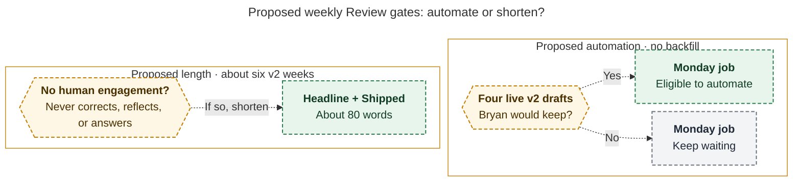

# Diagram proposals: Period-note reviews: keep the setup, and make v2 record what the period produced

Proposals for the swarm linker, not a report. Each diagram restates only what the source
report says.

```yaml
source: research:202611/period_review_instructions_v2/period_review_instructions_v2__final.md
producer: research.3u.image
check: "mmdc 12.0.0 with the PDF-mirroring config rendered 1 of 1 Mermaid diagrams; deliberately invalid syntax exited nonzero"
```

## live-pilot-gates

```yaml
anchor: |-
  Open bead **bob-cli-gp** (Monday athena job) should wait
question: |-
  What permits Monday automation, and when should Reviews shrink?
illustrates: |-
  The Monday job waits for four live v2 drafts Bryan would keep, while no corrections, reflection, or answers after about six v2 weeks calls for Headline + Shipped.
caption: Automate only after four acceptable live drafts; without human engagement after about six weeks, shorten the Review to Headline + Shipped.
review: "864.654×455 px, fit 75.5%; source tracing, reader-question, labels, arrowheads, crossings, and visual checks passed; 1 revision across 2 visual checks"
```


