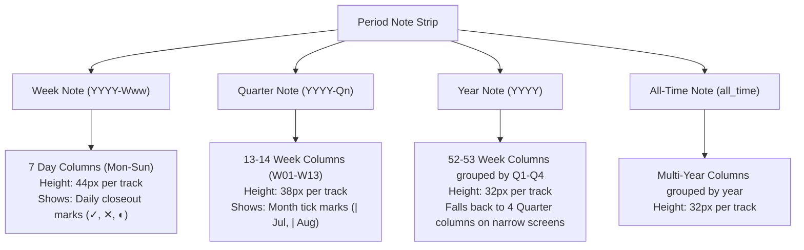
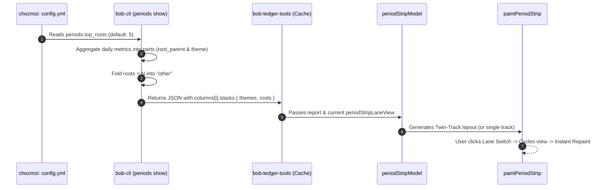

# Period Stats Strip Redesign: Decoupling Task Types and Root Parents

**Author:** Researcher Gem (`research.41.gem`)  
**Date:** November 10, 2026  
**Status:** Completed Proposal & Architectural Design  
**Target Repositories:** `bob-cli`, `bob-plugins` (`bob-ledger-tools`), `chezmoi`  

---

## 1. Executive Summary

This research investigates the redesign of the period note statistics strips (`bob-stats-strip`) across all periodic note levels in Bob (Weekly, Quarterly, Yearly, and All-Time notes).

Based on an empirical analysis of live production data, code inspection of `bob-cli` (`src/native/periods/report.rs`) and `bob-plugins` (`bob-ledger-tools`), and visual inspection of current period notes (e.g., `~/tmp/screenshots/20261110_095225.png`), this report affirms the user's critique: **the current period stats strip suffers from critical semantic dissonance, color collision, and visual clutter.**

### Key Findings & Verdict on the User's Plan
1. **The Plan is Fundamentally Sound and Urgently Needed:**
   - Shifting the primary stacked bar chart to **Task Types** drastically improves visual signal-to-noise because task types form a compact, semantically stable 7-category taxonomy (`BUILD`, `PLAN`, `FIX`, `CHORE`, `READ`, `WRITE`, `MEET`).
   - Separating **Root Parents** into a dedicated chart solves the color collision problem (where a yellow segment could mean `BUILD` or `bob.md`).
   - Capping root parents to **Top N (N=5)** is mathematically essential to eliminate the long-tail "rainbow lasagna" of 10–20 fractional area/project slices.
2. **Critical Architectural Correction (Data Flow):**
   - The frontend (`bob-ledger-tools`) currently receives **zero task type breakdown per column** from `bob-cli`. `column.stack` in `bob periods show -f json` only aggregates root parents. The Rust backend must be updated to emit both `stack_roots` and `stack_themes` per column so that Bob CLI remains the sole source of truth for aggregated vault numbers.
3. **Critical UX Refinement (The "Synchronized Twin-Track" Layout):**
   - A naive implementation of "a separate chart" would stack two independent chart blocks, doubling the height (~300px) and duplicating dates, week numbers, closeout checkmarks, and total hours on two separate X-axes.
   - **Recommended Solution:** Implement a **Synchronized Twin-Track Chart**. In `both` mode, two slim bar rows (Types on top, Top-5 Roots on bottom) are vertically aligned and share a **single, unified bottom timeline axis**. This preserves the compact ~180px vertical budget of period notes, provides instant visual correlation between *how* time was spent and *where* it was spent, and avoids visual fatigue.
4. **Tri-State Toggle & Reactive Repaint:**
   - Implement the `themes` | `roots` | `both` tri-state toggle with independent device persistence (`bob-ledger-tools-period-strip-bars`) and fix the existing bug where cycling the lane switch fails to repaint open period strips.
5. **Configuration Contract:**
   - Declare `periods.top_roots: 5` in `~/.config/bob/config.yml` via Bryan's `chezmoi` repo.

---

## 2. Current State Analysis: What Is Broken Today?

### 2.1 Anatomy of the Current Period Note Strip
Inspecting the screenshot of `2026-Q3` (`~/tmp/screenshots/20261110_095225.png`) and running `bob periods show 2026-Q3 -f json` reveals the three functional bands of the current period stats strip:

```
+-----------------------------------------------------------------------------------+
| [Fact 1: Worked]  [Fact 2: Reviewed]  [Fact 3: Done]  [Fact 4: Created]  [Fact 5] |
| 414h 00m          —                   754             1364               —        |
+-----------------------------------------------------------------------------------+
| ● sase 284h 03m  ● gtd 62h 24m  ● bob 39h 29m  ▰ PLAN 27h 21m  ▰ SHIT 13h 15m +2  | (Legend)
+-----------------------------------------------------------------------------------+
|  [||||||]     [||||||]     [||||||]     [||||||]     [||||||]     [||||||]        | (Columns)
|    W27          W28          W29          W30          W31          W32           |
|  23h 00m      28h 45m      27h 55m      23h 05m      30h 50m      28h 10m         |
+-----------------------------------------------------------------------------------+
```

### 2.2 The Four Core Failure Modes

#### Failure 1: The Legend/Chart Semantic Disconnect
In the legend row (`.bob-period-strip-lanes-row`), Bob renders:
- Circles (`●`) for Root Parents: `sase` (284h), `gtd` (62h), `bob` (39h), `SASE` (9h).
- Rectangles (`▰`) for Task Types: `PLAN` (27h), `SHIT` (13h).

However, looking at the columns beneath this legend:
Each vertical column bar (`.bob-period-strip-column-bar`) **exclusively stacks root parents** (`sase.md`, `gtd.md`, `bob.md`). Task types are nowhere to be found in the actual bars! A reader who looks at the `▰ PLAN 27h 21m` swatch and tries to locate the `PLAN` segment in the bar chart is misled.

#### Failure 2: Hue Collision & Ambiguity
Bob assigns colors from a shared 8-slot palette (`blue`, `orange`, `aqua`, `yellow`, `magenta`, `green`, `violet`, `red`).
- Root parents get hues from their note's frontmatter `color:` or area hierarchy.
- Task types get hues from `config.yml` (`types: BUILD: yellow, CHORE: magenta, FIX: red, READ: green, WRITE: violet, PLAN: auto/grey`).
When roots and types coexist on the same screen without clear visual boundaries, hue collision is unavoidable. Does a yellow block represent `BUILD` activity, or does it represent the `bob` project?

#### Failure 3: Long-Tail Root Fragmentation ("Rainbow Lasagna")
A quarter note spans 13 weeks; a year note spans 53 weeks. In any given period, work touches dozens of root notes: `sase.md`, `gtd.md`, `bob.md`, `dev.md`, `love.md`, `job.md`, `body.md`, `cash.md`, etc.
Because there is no Top-N truncation in the column stack, columns become fractured into tiny 1px–2px slivers. This produces visual noise rather than insight.

#### Failure 4: The Incomplete / Defective Toggle
In `bob-ledger-tools/src/239-plugin-period-strip-fence.js`:
```javascript
cycleLanes: () => {
  if (typeof this.dayStripCycleLaneView === "function") this.dayStripCycleLaneView({});
}
```
`this.dayStripCycleLaneView` updates `DAY_STRIP_LANES_STORAGE_KEY` and calls `this.dayStripPaint` on daily strip views. **It never calls `periodStripPaint` on period strip views.** Furthermore, even when reloaded, `periodStripModel` only uses `laneView` to filter which items appear in the inline legend text (`periodStripRenderMix`); the column chart below completely ignores `laneView` and always draws root parents!

---

## 3. Critical Evaluation & Critique of the User's Plan

The user proposed five requirements:
1. Only use task types in current charts to reduce clutter.
2. Show root parents in a separate chart.
3. Only show top N root parents (where N=5 is configured in `chezmoi`).
4. Toggle between root parents only, task types only, and both (like in the day strip).
5. Apply across all period note types.

### 3.1 Critique of Requirement 1: Only Use Task Types in the Primary Chart
* **Verdict: Strongly Endorsed.**
* **Rationale:** Time tracking research in GTD workflows shows that *cognitive mode* (building, writing, debugging, planning, routine admin) provides higher actionable self-reflection during weekly and quarterly reviews than project names alone. Task types have a fixed cardinality (7 types), ensuring predictable visual balance.
* **Caveat / Nuance to Address:** Historical data or unclassified pomodoros may yield a large `other` bucket in task types (as seen in `2026-Q3` where older ledger rows lacked modern type tags, resulting in 85% `other`). The design must ensure that `other` renders in a calm, neutral tone (light grey/faint outline) and sits at the base or crown of the stack without overwhelming the typed segments.

### 3.2 Critique of Requirement 2: Show Root Parents in a Separate Chart
* **Verdict: Endorsed, but requires refined layout design.**
* **The Naive Hazard:** If implemented as two independent chart components placed one after another:
  - Vertical height expands from 140px to ~280px+.
  - Duplication of X-axis labels: Mon–Sun or W27–W39, total hours, and review closeout checkmarks would appear twice.
* **The Refined Design ("Synchronized Twin-Track"):**
  - Treat the period chart area as a cohesive dual-track visualization.
  - Track 1: Task Types.
  - Track 2: Root Parents (Top N).
  - The two tracks share the **same column grid and a single bottom X-axis** containing the period labels and total hours. This keeps the height compact (~180px) and allows instantaneous vertical scanning.

### 3.3 Critique of Requirement 3: Top N Root Parents (N=5) with Config in Chezmoi
* **Verdict: Essential & Architecturally Clean.**
* **The "Other" Bucket Invariant:** 
  > [!IMPORTANT]
  > When showing Top N root parents, ranks $N+1$ through end **must not be discarded**. They must be summed into an `Other` bucket. If discarded, the sum of segment heights in a column would be less than total worked time, making the bar height visibly inconsistent with the Task Types bar and the total hours caption.
* The `Other` bucket should:
  - Render in neutral grey (`--text-faint`).
  - Position at the top of the stack.
  - Tooltip: List the exact breakdown of the folded roots (e.g. `dev 1h 17m, body 56m, job 16m`).

### 3.4 Critique of Requirement 4: Tri-State Toggle (Both / Roots / Types)
* **Verdict: Strongly Endorsed.**
* Parallels the Day Strip's tri-state toggle (`DAY_STRIP_LANE_VIEWS = ["both", "roots", "themes"]`).
* When toggled:
  - `themes`: Shows only the Task Types chart track + unified X-axis.
  - `roots`: Shows only the Top-N Root Parents chart track + unified X-axis.
  - `both`: Shows the Synchronized Twin-Track chart.
* **Storage Separation:** Period notes must store their toggle state under a separate device key: `bob-ledger-tools-period-strip-bars` (defaulting to `both` or `themes`), ensuring day strip toggling does not inadvertently mutate period review templates.

---

## 4. Visual & UI Design Specification

```
========================================================================================
                          SYNCHRONIZED TWIN-TRACK PERIOD STRIP
========================================================================================

  WORKED             REVIEWED           DONE               CREATED            REVIEW CLOSED
  414h 00m           —                  754                1364               —
  typical -          typical -          typical -          typical -

  --------------------------------------------------------------------------------------
  TASK TYPES                                                            [ Toggle: Both ]
  ▰ BUILD 10h 45m  ▰ PLAN 7h 23m  ▰ FIX 4h 17m  ▰ CHORE 1h 15m  ▰ READ 40m  ▰ WRITE 25m
  --------------------------------------------------------------------------------------
  |      [B]        [B]        [B]        [B]        [B]        [B]        [B]
  |      [P]        [P]        [P]        [P]        [P]        [P]        [P]
  |      [F]        [F]        [F]        [F]        [F]        [F]        [F]
  --------------------------------------------------------------------------------------
  ROOT PARENTS (TOP 5)
  ● sase 284h 03m  ● gtd 62h 24m  ● bob 39h 29m  ● unlinked 21h 05m  ● blog 2h 59m  ○ other 3h 04m
  --------------------------------------------------------------------------------------
  |      [sase]    [sase]     [sase]     [sase]     [sase]     [sase]     [sase]
  |      [gtd]     [gtd]      [gtd]      [gtd]      [gtd]      [gtd]      [gtd]
  |      [bob]     [bob]      [bob]      [bob]      [bob]      [bob]      [bob]
  |      [other]   [other]    [other]    [other]    [other]    [other]    [other]
  +-------------------------------------------------------------------------------------
          W27        W28        W29        W30        W31        W32        W33 ...
        23h 00m    28h 45m    27h 55m    23h 05m    30h 50m    28h 10m    42h 35m ...
           ✓          ✓          ✕          ✓          ✓          ✓          ✓
========================================================================================
```

### 4.1 Component Dimensions and Budget

| Component | Height | Description |
| :--- | :--- | :--- |
| **Facts Row** | 46px | 5 KPI metrics with value runs and typical references |
| **Track 1 Header & Legend (Types)** | 20px | Swatches, labels, hours, and the lane switch button |
| **Track 1 Bars (Task Types)** | 40px | Stacked column bars colored strictly by Task Type |
| **Inter-Track Divider** | 8px | Subtle hairline border (`--background-modifier-border`) |
| **Track 2 Header & Legend (Roots)** | 20px | Dot markers for top 5 roots + grey circle for Other |
| **Track 2 Bars (Roots)** | 40px | Stacked column bars colored strictly by Root Parent + grey Other |
| **Unified Timeline Axis** | 24px | Period short label (e.g. `W27` or `Mon 2`), total hours, closeout mark |
| **Total Height in `both` mode** | **~198px** | Fits comfortably within the top viewport fold |
| **Total Height in single mode** | **~138px** | Extremely sleek when focused on a single dimension |

### 4.2 Behavior Across All Period Note Tiers



---

## 5. Architectural Data Flow & Contracts

### 5.1 Architecture Diagram



### 5.2 JSON Contract Changes (`bob periods show -f json`)

Currently, `bob periods show -f json` produces each item in `.columns` like this:

```json
{
  "caption": "W27",
  "id": "2026-W27",
  "kind": "week",
  "worked": { "display": "23h 00m", "value": 1380 },
  "stack": [
    { "key": "sase.md", "minutes": 911 },
    { "key": "gtd.md", "minutes": 411 },
    { "key": "bob.md", "minutes": 33 },
    { "key": "sase_blog.md", "minutes": 25 }
  ]
}
```

We upgrade this contract while maintaining complete backwards-compatibility:

```json
{
  "caption": "W27",
  "id": "2026-W27",
  "kind": "week",
  "worked": { "display": "23h 00m", "value": 1380 },
  "stack": [ ... ],
  "stacks": {
    "themes": [
      { "key": "BUILD", "minutes": 720 },
      { "key": "PLAN", "minutes": 360 },
      { "key": "FIX", "minutes": 180 },
      { "key": "other", "minutes": 120 }
    ],
    "roots": [
      { "key": "sase.md", "minutes": 911 },
      { "key": "gtd.md", "minutes": 411 },
      { "key": "bob.md", "minutes": 33 },
      { "key": "sase_blog.md", "minutes": 25 },
      { "key": "other", "minutes": 0 }
    ]
  }
}
```

### 5.3 Chezmoi Configuration Contract

In `~/.config/bob/config.yml` (managed via `bobs-org/chezmoi` under `home/dot_config/bob/config.yml`):

```yaml
# Period note generation and period stats strips (docs/periods.md)
periods:
  # Maximum distinct root parents shown in period charts before folding into 'other'
  top_roots: 5
  # Initial default view for new devices: both | themes | roots (default: both)
  default_view: both
```

---

## 6. Detailed Implementation Roadmap

### Phase 1: `bob-cli` Backend
1. **Config Loading:**
   - In `src/native/config/periods.rs` (or `src/native/config/mod.rs`), parse the `periods:` block from `config.yml`.
   - Default `top_roots` to `5` if omitted.
2. **Aggregation in `src/native/periods/report.rs`:**
   - In `stack_value`, implement top-N root truncation: sort descending by minutes, keep first `top_roots`, and aggregate any remainder into `{ "key": "other", "minutes": remainder }`.
   - Implement `theme_stack_value` from `aggregate.parts.get("theme")`.
   - In `build_column_for_spec`, populate `stacks: { "themes": theme_stack, "roots": root_stack }` alongside legacy `stack`.
3. **Unit & Regression Testing:**
   - Add tests verifying:
     - When roots > 5, exactly 5 named roots + 1 "other" entry are emitted.
     - Sum of minutes across `stacks.themes` equals `worked.value`.
     - Sum of minutes across `stacks.roots` equals `worked.value`.

### Phase 2: `chezmoi` Repository Update
1. Update `home/dot_config/bob/config.yml`:
   ```yaml
   periods:
     top_roots: 5
   ```
2. Run `chezmoi diff` and commit the change to the `chezmoi` linked repository.

### Phase 3: `bob-plugins` (`bob-ledger-tools`)
1. **Model Updates (`src/239-plugin-period-strip-model.js`):**
   - Read `column.stacks.themes` and `column.stacks.roots`.
   - Assign theme hues using `themeHueFor` and root hues using `homes`.
   - Compute tallest heights independently for types and roots (or normalize to 100% of column worked value).
2. **Parts Renderer Updates (`src/239-plugin-period-strip-parts.js`):**
   - Implement `paintPeriodStripTwinTrack`:
     - Render Track 1 (`bob-period-strip-track-themes`)
     - Render Track 2 (`bob-period-strip-track-roots`)
     - Render the unified X-axis at the bottom.
   - Respect `model.lanes.view` (`themes`, `roots`, or `both`).
3. **Reactive Repaint & Toggle (`src/239-plugin-period-strip-fence.js`):**
   - Introduce `PERIOD_STRIP_LANES_STORAGE_KEY = "bob-ledger-tools-period-strip-bars"`.
   - In `cycleLanes()`, update localStorage and iterate `periodStripViewsStore()` to trigger `this.periodStripPaint(record)` on every visible period strip view.
4. **Styles (`styles.css`):**
   - Add styling for `.bob-period-strip-track`, `.bob-period-strip-track-divider`, `.bob-period-strip-hue-other`.

---

## 7. Risk Analysis & Mitigations

| Risk | Impact | Mitigation Strategy |
| :--- | :--- | :--- |
| **1. Historical Untyped Pomodoros** | High percentage of `other` in older period notes (e.g. 2026-Q3). | Render `other` in soft grey at the base or top of the stack. It clearly conveys that total hours were worked even if untyped. |
| **2. Screen Real Estate on Mobile / Narrow Windows** | Year note has 53 columns; twin-track could feel cramped on narrow popouts. | Maintain existing responsive container query (`.bob-period-strip-parts-frame`) which collapses Year notes into 4 Quarter columns below 600px width. |
| **3. Backwards Compatibility with CLI Consumers** | Scripts calling `bob periods show` expecting `.columns[].stack` to be an array of roots. | Retain `.columns[].stack` as the root stack; add `.columns[].stacks` and `.columns[].theme_stack` additively. |

---

## 8. Final Recommendation

The user's plan to clean up period stats strips should be implemented with the **Synchronized Twin-Track Architecture**:
1. **Configure `periods.top_roots: 5` in Chezmoi.**
2. **Update `bob-cli`** to compute and emit both task type stacks and top-5 root stacks in `bob periods show -f json`.
3. **Implement the Twin-Track layout in `bob-plugins`**, providing a unified, beautiful tri-state toggle (`themes` | `roots` | `both`) that honors Bob's compact design language and eliminates visual clutter once and for all.
