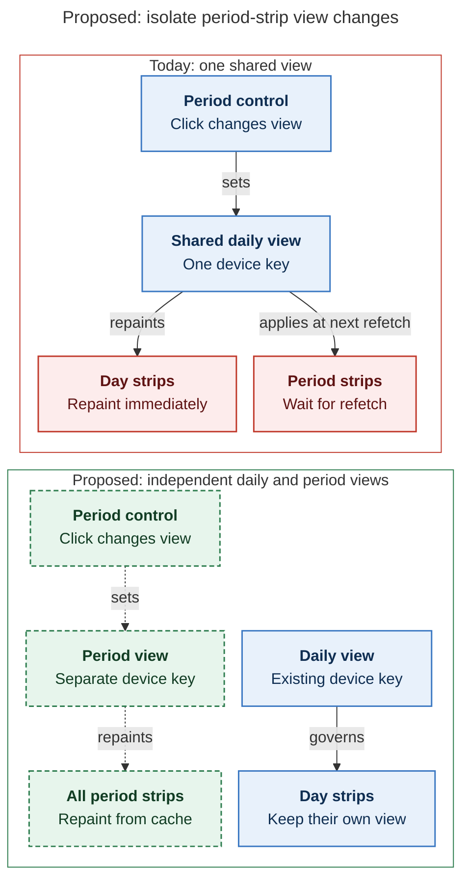

# Diagram proposals: Period stats strips: a Roots chart, a Types chart, and a switch that works

Proposals for the swarm linker, not a report. Each diagram restates only what the source
report says.

```yaml
source: research:202611/period_strip_two_chart_redesign/period_strip_two_chart_redesign__final.md
producer: research.41.image
check: "mmdc 12.0.0 with the PDF-mirroring config and Puppeteer --no-sandbox rendered 1 of 1 Mermaid diagrams; deliberately broken input exited nonzero"
```

## switch-ownership

```yaml
anchor: |-
  All period strips (week, quarter, year, all time) share it.
question: |-
  Why does today's period switch affect daily notes, and how would separate state fix that?
illustrates: |-
  Period strips keep their own device key and repaint from cache, so a period view change no longer silently flips the Day strips.
caption: A separate period-view key would repaint period strips from cache while daily notes retain their own view.
review: "478.773x1016 px, fit 87.9%; reader question, labels, arrowheads, crossings, reading direction and source trace passed; 1 revision, 2 visual look rounds; batch parse passed"
```


