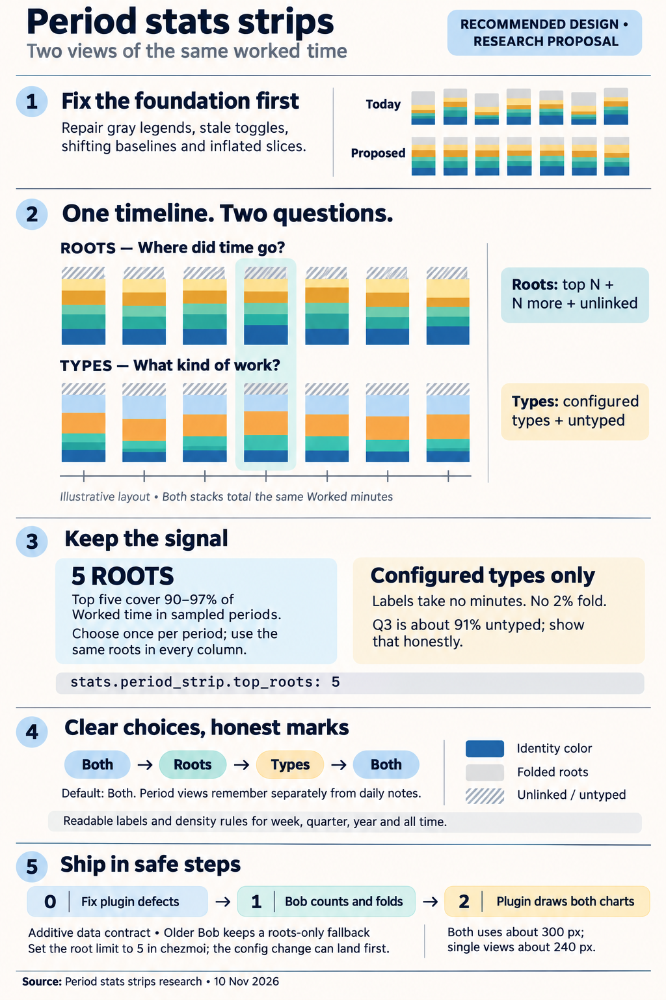
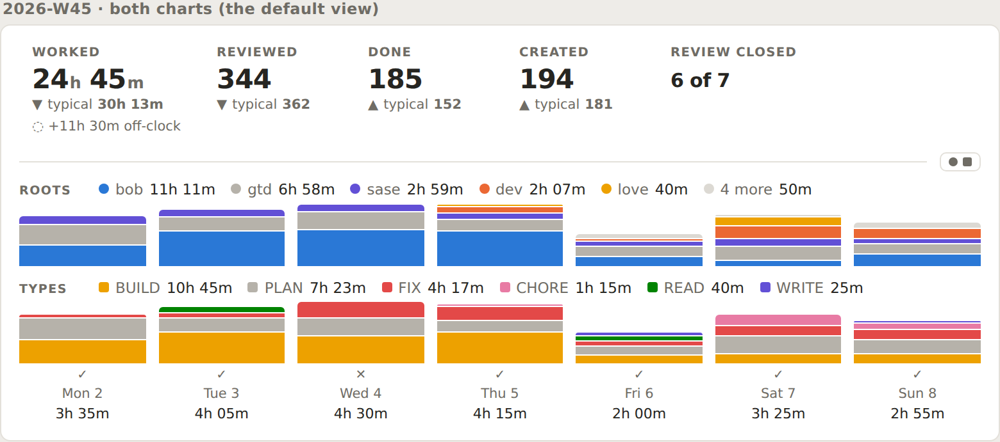
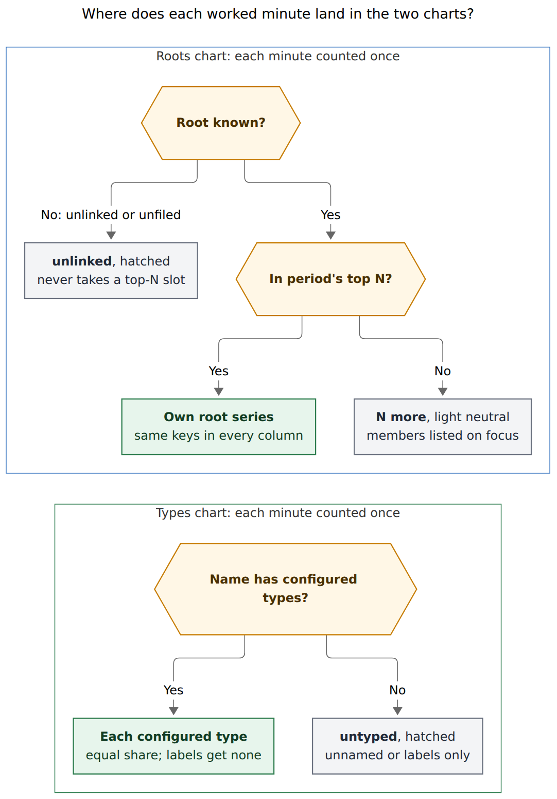
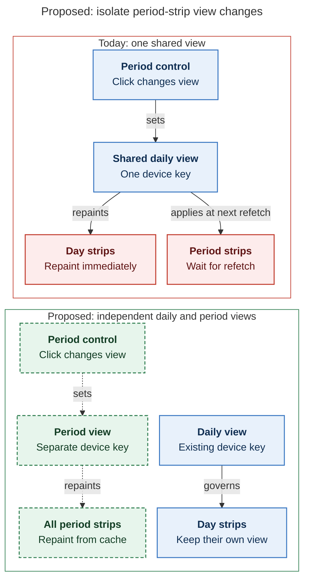
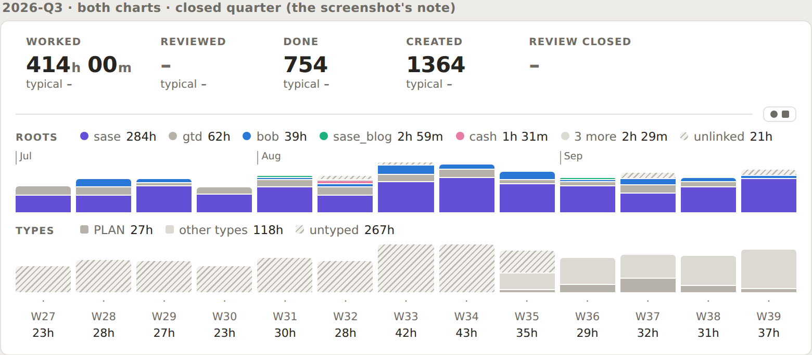

# Period stats strips: a Roots chart, a Types chart, and a switch that works

> **Research query:** How should the stats strips in period notes be made to look much nicer:
> using only task types in the current charts, showing the top N root parents (N configurable,
> set to 5 in chezmoi) in a separate chart, and toggling between roots only, types only, and both
> as the Day strip does, across weekly and the other period note types, so the feature is
> intuitive, reliable, and beautiful? Critique the plan, call out any justified requirement
> changes, and end with a recommended solution.



## Bottom line

- **Yes, build it, but [fix the current strip first](#what-is-wrong-today).** About half of the
  clutter in the screenshot comes from bugs, not from the idea. I confirmed each of these in the
  code:
  - the legend dots are always gray, because their CSS classes don't exist;
  - the legend mixes roots and types, but the columns stack only roots;
  - the switch never repaints a period strip;
  - a root's color depends on its rank, not its identity;
  - month ticks push some columns down;
  - a 2 px minimum slice height turns long periods into barcodes.
- **[Recommended design](#recommended-design).** Two stacked-column charts share one time axis:
  - **Roots** sits on top: the period's top N root parents, then a light "N more" segment, then a
    hatched "unlinked" segment.
  - **Types** sits below: the configured task types, then a hatched "untyped" segment.

  Each chart's legend doubles as its title and names every color with its total. The Day strip's
  ●/■ switch cycles **Both → Roots → Types**. Period strips remember that choice per device,
  separately from the Day strip, and default to **Both**.
- **bob does the counting; the plugin only paints** (see [contract and config](#contract-and-config)).
  - `bob periods show` adds a `charts` member and per-column `stacks`. Both are additive to
    schema 1.
  - A new key, `stats.period_strip.top_roots`, drives the root limit (default 5). Set it to 5
    explicitly in chezmoi.
  - The chezmoi edit can land before the code, because bob ignores unknown `stats:` keys.
- **I changed some requirements** (see [adjusted requirements](#adjusted-requirements)). The main
  changes:
  - "Task types" means *configured* types. Label components never count, and older history shows
    honestly as "untyped".
  - The 2% type fold goes away.
  - Time with no root never takes a top-N slot.
  - Colors follow identity, not rank.
  - Period strips get their own switch memory and default to Both.
  - Year and all-time strips get their own density rules.
  - The height budget grows for Both.

## What is wrong today

Every defect in this section is verified.

The screenshot is the **2026-Q3 quarterly note**, not a weekly one. All five researchers noticed
this, and it matters: the design has to work for 13–53 columns, not just 7.

| # | Defect | Evidence | Phase |
| --- | --- | --- | --- |
| D1 | **Legend marks are always gray.** The period painter emits `bob-period-strip-hue-*` and `bob-period-strip-theme-hue-*` classes. `styles.css` defines neither (0 matches); only the `bob-day-strip-*hue-*` classes exist. | `239-plugin-period-strip-render.js:174–175`; the screenshot | 0 |
| D2 | **The switch never repaints a period strip.** `dayStripSetLaneView` repaints only `dayStripViewsStore()`. The period paint key in `periodStripFinishPaint` leaves out the view. A click silently flips every Day strip on the device, and the period strip changes only at its next refetch. | `239-plugin-day-strip-lanes.js:120–150`; `239-plugin-period-strip-fence.js:413–427` | 0 |
| D3 | **The view could only ever change the legend.** The columns always stack `columns[].stack`, which holds only root-parent minutes. | `report.rs::stack_value`; `periodStripWeekColumns` | redesign |
| D4 | **The legend shows the first three items in bar order, not the three largest.** In Q3 it hides the 85% "other" type bucket behind `+2`. | `slice(0, 3)` at `239-plugin-period-strip-render.js:194` | 0 |
| D5 | **A root's color follows its rank.** `statsPanelDistinctHues` sorts by minutes, and the largest root claims the shared hue. bob, sase, sase_blog, and dev all inherit dev's blue, so `sase` is blue in Q3 but not in W45 or Q4. | `239-plugin-stats-panel-models.js:394–434`; `homes` in the JSON | 2 + vault |
| D6 | **Month ticks shift baselines.** The tick span is part of the column's flex flow, so W27, W31, and W36 sit lower. | `239-plugin-period-strip-parts.js:90–95`; visible in the screenshot | 0 |
| D7 | **Minimum heights inflate stacks.** `.bob-period-strip-column-piece { min-height: 2px }`, plus 1 px gaps. Many-root columns are drawn taller than their data. | `styles.css:7493–7499`; cld's Figure 3 | 0 |
| D8 | **Value labels collide** when 53 columns each paint a value. | cld render with the production plugin | 0 |
| D9 | **Fact values truncate.** "so far" is appended inside the value, giving "1563 so…". | cld render | 0 |
| D10 | **Coverage copy is wrong for long periods.** Q4, 2026, and all time all say "so far · Mon–Tue". | `period.coverage.display` in the live JSON | 1 |
| D11 | **Column tooltips print raw keys** ("sase.md 15h 11m"). | cld, from the code | 0 |
| D12 | **The year view never falls back to four quarter columns in practice.** The fallback triggers only below a 110 px container width. A normal ~530 px note line gets 53 columns of about 10 px each. | `styles.css:7638` | 2 |

### Corrections to individual reports

- **mus** says the toggle "already exists; do not rebuild it." The shared state does exist, but it
  never repaints a period strip (D2), and it could only ever change the legend (D3).
- **mus** says plugins never read `config.yml`. They do: `statsReadConfigValue("day_strip")` and
  `stats.bob_path`. That does not change the conclusion that bob must own N.
- **gem** puts the year fallback at "below 600px". It is 110 px.
- **gem's** ~198 px height for Both leaves out legend wrapping and the axis rows. cld's measured
  mockup is about 300 px.
- **Unrelated bug:** cld found that `bob stats show worked` panics ("RefCell already borrowed",
  `homes.rs:412`) and filed `bob-cli-jr`. I confirmed the bead exists.

## What the data says

Live `bob periods show` output from 2026-11-10. The "untyped" column comes from my ledger scan
using the configured-type rule in [series and where each minute goes](#series-and-where-each-minute-goes).
The scan matched bob's Q4 Worked exactly and 98% of Q3's.

| Period | Worked | Named roots | Top-5 share | Folded into "N more" | No root (`@unlinked` + `@unfiled`) | Untyped |
| --- | ---: | ---: | ---: | --- | ---: | ---: |
| 2026-W45 | 24h 45m | 9 | 96.6% | 4 roots, 3.4% | 0% | 0% |
| 2026-Q3 | 414h 00m | 8 | 94.3% | 3 roots, 0.6% | 5.1% | ~91% |
| 2026-Q4 (so far) | 185h 40m | 14 | 90.1% | 9 roots, 9.1% | 0.8% | 13.6% |
| 2026 (so far) | 718h 00m | 14 | 91.8% | 9 roots, 3.3% | 4.9% | ~72% |

What this means:

1. **N = 5 is the right default.** It covers 90–97% of Worked in every period. The remaining tail
   (nine roots in Q4) is exactly what turns today's columns into barcodes. Five also sits at the
   usual 5–6-series limit for a readable categorical chart.
2. **Types are a recent signal.** Q2 is 100% unnamed, and Q3 is about 91% untyped. The type
   vocabulary arrived in October 2026. A Types-only default would make every older note mostly gray.
   This is the strongest reason to default to Both and to keep roots in view.
3. **The current 2% type fold is backwards.** In Q4 the type lane shows the label `SASE` (235 min)
   but folds the configured type MEET (90 min) into "other". In Q3 it shows the labels SHIT, REMOTE,
   and SASE, while BUILD, READ, and FIX (about 8h together) disappear into an 85% "other".
4. **Sessions that mix a label with a type are rare but real.** Q3 has 7 such sessions (255 min,
   1.0% of Worked); Q4 has none.
   - Stats today splits a session's minutes evenly across *every* name component, labels included
     (`pomodoro_components` and `theme_minute_parts` in `src/native/stats/metrics.rs`). A 30 min
     `BUILD + SASE` session credits BUILD with only 15 min.
   - The glossary says labels "never count" (Merged Pomodoro).
   - `type_components` in `src/native/pomodoro_themes/routing.rs` already classifies each component.
   - Today this is a correctness detail, not a visual one. It will matter again whenever a label
     rides along with a type, because `settle_closed` keeps labels in closed names.
5. **Three of the top roots share one inherited hue.** bob, sase, and sase_blog all inherit
   `dev.md`'s blue. job, job_2026, and job_update_cv all inherit `job.md`'s aqua. No rule that only
   picks distinct colors per chart can make a root look the same in every note while those
   collisions exist.

## Is this a good idea

This section is the critique of the plan.

**Yes.** Taking each requirement in turn:

1. **"Use only task types in the current charts."** Right in spirit: one chart should encode one
   dimension, and its legend should name everything it draws. Taken literally, it would replace the
   one chart that works for older history with one that is ~91% gray for Q3. So types get their own
   chart, roots keep theirs, and the default view shows both.
2. **"Show root parents in a separate chart."** Right: *where the time went* and *what kind of work
   it was* are different questions. The best form of "separate" is two charts that share one time
   axis. Then "Thursday was bob and BUILD" can be read straight down a column. Two independent
   charts would duplicate captions, week numbers, and review marks.
3. **"Top N root parents, N configurable, 5 in chezmoi."** Right, and the data supports 5. Two
   conditions:
   - Compute N **once per period**. Columns must never pick their own top N, or a color would mean
     different roots in different columns.
   - **bob** must apply N, so every consumer of `bob periods show` sees the same result.
4. **"Toggle roots only, types only, or both, like the Day strip."** Right, and reusing the Day
   strip's control keeps one language across the strip family. Today's switch only looks like it
   works (D2, D3), and toggling a whole chart costs far more height than toggling a 4 px bar. So the
   period switch should control charts and keep its own memory.
5. **"Improve the other period types too."** Necessary. The year and all-time strips have the worst
   defects (D7, D8, D9, D12). They need their own rules for label density and for runs of weeks with
   no tracking.

**Would I take a different approach?** I would keep your shape and change how it is built:

- Ship the cheap, plugin-only defect fixes first. They remove about half of the noise on their own.
- Define "type" by the configured vocabulary, as the glossary already does, rather than by raw name
  components.
- Let bob produce the folded, ready-to-paint series.
- Make each neutral fill mean exactly one thing.

The one alternative I took seriously came from cdx: replace the root timeline with a **ranked
horizontal bar chart** of period totals. It wins on exact comparison and inline labels. It loses the
over-time shape of roots, which is the reason a parts row exists at all, and before October that
shape is the only meaningful one. The legend already gives each root's period total in rank order,
so the ranking is still visible. If you later find your real question is "where did the quarter
go?" rather than "when", revisit this.

## Adjusted requirements

These are my changes, called out.

| # | You asked for | I recommend | Why |
| --- | --- | --- | --- |
| A1 | Only task types in the current charts | **Types means configured `types:` members.** Each session's minutes go only to its configured types. Labels take no share. A session with no configured type is **untyped**, drawn hatched. There is no "other types" bucket and no 2% fold. | This matches the glossary and fixes the backwards fold ([what the data says](#what-the-data-says), point 3). The chart is bounded by your 7-type vocabulary. Older history stays honest without guessing types. |
| A2 | Root parents in a separate chart | **Two stacked-column charts on one shared x-axis:** Roots above Types. Legends double as titles and list totals in rank order. | One child period equals one column across both charts, captions appear once, and the Day strip's lane order is kept. |
| A3 | Top N roots | **The period's top N named roots, ranked by Worked minutes** (ties broken by key). The same keys apply in every column. The rest fold into "N more", with its members listed. `@unlinked` and `@unfiled` **never take a slot**: they get their own hatched segment. | Stable colors across columns. Unknown time is never hidden in "other" and never pushes out a real root (Q3's unlinked is 5.1%). |
| A4 | N = 5 in chezmoi | `stats.period_strip.top_roots: 5`. bob reads it: an integer from 1 to 8, default 5, with a warning for bad values. The effective limit appears in the JSON. | bob must fold so every consumer agrees. 8 is the palette size. |
| A5 | A toggle like the Day strip's | **The same ●/■ control and cycle, with its own device memory, defaulting to Both.** It shows and hides whole charts. A new command, "Cycle period stats charts", does the same. | A period chart costs ~60 px, not 4 px. Clicking in a period note should not change daily notes. |
| A6 | *(implied)* | **Colors follow identity, never rank.** Optionally, give the dev-area roots their own `color:`. | Today the same project changes color between your week and quarter notes (D5). |
| A7 | Improve the other period types | **Density rules per period kind** ([rules per period kind](#rules-per-period-kind)): a year shows no per-column values, all time collapses leading untracked years, and the fallback breakpoint is measured, not fixed at 110 px. | D8, D12. |
| A8 | *(implied)* | **Phase 0: a defect-only plugin release first.** | Fast, low-risk, and most of the visual win. |
| A9 | *(implied)* | **Raise the height budget for Both** to about 300 px at normal width. Single views stay at about 240 px. | The earlier strip-family budget was 230–250 px. Two readable charts need about 60 px more. Single views exist for the weeks when height matters. |
| A10 | *(scope)* | Later, the Day strip's type lane and the Stats Types panel should use the same configured-type rule. The Day strip's root lane stays uncapped. | Otherwise a mixed `BUILD + SASE` session would show different BUILD minutes on different surfaces. A 4 px bar doesn't need top-N. |

## Recommended design

### Anatomy from top to bottom

1. **Facts row.** Unchanged, except that "so far" moves out of the value and into the meta line
   (D9). The off-clock hint stays as it is.
2. **A hairline rule.** The meta text sits at its right end with the switch. For long periods the
   meta line describes the period, for example "so far · W40–W46 · 10:06" (D10).
3. **Roots chart.**
   - A legend line that starts with a small `ROOTS` title, then up to N `● name value` items, then
     `● 4 more value`, then a hatched `unlinked value`.
   - For quarters, a month-tick row of its own, so baselines stay aligned (D6).
   - The plot.
4. **Types chart.** A `TYPES ■ BUILD 10h 45m …` legend line, then the plot.
5. **Shared axis rows**, once, under the lower chart: review mark, caption, and value.

In a single view, only that chart renders, with a taller plot. The switch stays where it was.



*Figure 1. The recommended layout for 2026-W45, from cld's mockup built on real `bob periods show`
data. Every color has a named legend entry, both charts share the day captions, and "4 more" (job,
body, abby, cash) is a light neutral. Each day's two stacks are the same height, because both
dimensions split the same Worked minutes. The white rounded frame is mockup chrome; the real strip
has no card. More views are in `period_strip_type_and_root_charts__cld_figs/`: hover, roots-only,
types-only, Q4, the year, dark mode, and ~530 px narrow renders.*

### Series and where each minute goes



*Figure 2. Every counted on-clock minute lands exactly once in each chart. That is why a column's
Roots stack and Types stack are always the same height. Unknown roots and unknown types get their
own hatched series instead of hiding in a remainder. Mermaid source: `fig-minute-routing.mmd`.*

**Roots (bob):**

- Rank the named root parents (areas and projects, not the `@` buckets) by Worked minutes over the
  whole period, including today's provisional minutes when the facts include them.
- Keep the first N, breaking ties by key.
- Fold the rest into one series of kind `rest`, labeled "4 more", whose `members` list gives each
  folded root and its minutes.
- Merge `@unlinked` and `@unfiled` into one series of kind `unattributed`. Label it "unlinked",
  "unfiled", or "no root" (when both are present).
- Use these same keys in every column's stack.
- Synthetic series carry an explicit `kind`, so a real root named `other` can't collide with them.

**Types (bob):**

- Add a new `task_type` dimension, computed with `type_components` during the existing session pass.
  It sits beside the old `theme` parts and leaves them unchanged, because old consumers and custom
  `themes:` metrics still read them.
- A session's minutes split evenly over its distinct configured types; the first type gets the
  remainder, the same rule as today.
- A session with no configured type, whether unnamed or named only with labels, goes to
  `unattributed` ("untyped"). The tooltip splits that into "unnamed" and "other names", so the
  history of naming stays visible.
- Every configured type with minutes gets its own series. There is no share-based fold, because
  the vocabulary already bounds the count (7 today).
- Without any configured vocabulary, fall back to the top 7 components plus "other types", so the
  chart stays bounded.
- Classification follows the *current* vocabulary, as the type catalog already does. Editing
  `types:` reclassifies older periods. Say so in the docs, and invalidate cached reports when the
  config changes.

**Order:** series sort by period minutes, descending, with `rest` and then `unattributed` last.
Bottom-to-top in each stack matches left-to-right in the legend, so the largest series sits on the
shared baseline.

**Invariant (test it):** in each column, the Roots stack sums to Worked and so does the Types
stack. If upstream data breaks this, show a quality warning. Never rescale silently.

### Color and neutral fills

| Fill | Meaning | Examples |
| --- | --- | --- |
| Palette hue (● roots, ■ types) | One root or type, colored by **identity** | bob blue, BUILD yellow |
| Solid gray | A real root or type you chose to mute | gtd; PLAN (exempt, `auto`) |
| Light neutral | Folded roots | "4 more" |
| Diagonal hatch | Time that can't be attributed | "unlinked", "untyped" |
| Dotted ghost | No tracking for this child period | 2026-W01–W21 |
| 2 px baseline stub | A future child period | W47–W53 |

- **Identity colors.** A root's hue must depend only on the root and the catalog, never on the
  period's minutes. Make the collision pass in `statsPanelDistinctHues` independent of minutes, or
  let bob report a stable display hue for each root.
  - Practical fix, your call: give `sase.md` and `sase_blog.md` their own `color:` (a project's own
    `color:` already wins, per `docs/pomodoro-homes.md`). Otherwise three of your top roots will
    always compete for dev's blue.
  - Optional: have bob warn with `root_hue_collision`, matching the existing `area_hue_collision`.
- **Type colors** stay the hues bob reports (`theme_hues`), as decided in
  `theme-hue-is-config-pin-exempt-area-hash`.
- **Your choice:** PLAN is 30% of W45 but renders gray, because it is `auto` and exempt. A
  configured color beats the exempt mute, so `PLAN: aqua` (or orange, the other hue no type uses)
  would make it read as a type rather than a neutral fill.
- **Fix D1** by using the existing `bob-day-strip-hue-*` and `bob-day-strip-theme-hue-*` classes,
  not by adding a third palette.
- **Known weak pairs** (cld ran the dataviz validator on the production palette): orange/red differ
  by only ΔE 7.1, and magenta/aqua are nearly indistinguishable for deuteranopes in dark mode.
  Identity colors plus top-N make these pairs much less likely to sit next to each other, and the
  hatch and the ●/■ shapes give a second cue besides color.

### The switch

- **Control.** The Day strip's control: a `span[role=button]` with a ● mark (roots) and a ■ mark
  (types), each filled when its chart is shown.
  - Click, Enter, or Space cycles **Both → Roots → Types**.
  - The tooltip names the current view and the next one.
  - `mousedown` never steals focus, so vim keeps working.
  - The hit target is at least 24 px, and the period CSS no longer restyles it into a blank pill.
- **State.**
  - A new device key, `bob-ledger-tools-period-strip-charts`, reuses the `both|roots|themes` enum
    and defaults to `both`.
  - All period strips (week, quarter, year, all time) share it. The Day strip keeps its own key.
  - A new command, "Cycle period stats charts", does the same as a click.
  - A view change repaints every mounted period strip from cache. It never spawns bob and never
    writes the note.
  - The view is part of the paint key.
- **Availability.** If only one chart can be drawn, show it and hide the switch, as the Day strip
  does. That happens with an older bob that has no `charts`, or when a period has no Worked time.
- **Motion.** A newly shown chart fades in over 160 ms, the Day strip's timing. Data repaints never
  animate, and reduced-motion preferences turn the fade off.

[The switch-ownership diagram](#figure-switch-ownership) contrasts today's shared key, where a
period click flips every Day strip, with a separate period key that repaints period strips from
cache.

<div id="figure-switch-ownership">



_A separate period-view key would repaint period strips from cache while daily notes retain their own view._

</div>

### Interaction and accessibility

- **One focus stop per child period, spanning both charts.** Hover and focus share one highlight
  band. ←/→/Home/End move between columns; Enter opens the child note; Alt+Enter opens Stats pinned
  to that child, using the whole child period rather than only its start day.
- **Tooltips and aria labels** give Worked, the review mark, and both breakdowns by label, never by
  raw key (D11). Exact values must not be hover-only: each column's accessible name is a full
  sentence, and the legends show every total.
- **Legends.** Each legend opens Stats on the matching view, as today. The "N more" item's title
  lists the folded roots. Hovering a legend item may dim the other series; this is polish, and no
  value depends on it.
- **Legend fit ladder:** one line with full values, then compact values (`64h`), then wrap to at
  most two lines. Never use `+N` for a series that is actually drawn: every color on screen gets a
  name. Top-N already caps the Roots legend at N + 2 items.
- Keep the Day strip's forced-colors treatment, and check non-text contrast for focus states in
  both themes.

### Rules per period kind

| Kind | Columns | Captions | Per-column values | Extras |
| --- | --- | --- | --- | --- |
| Week | 7 days | `Mon 2` | `3h 35m` | review marks ✓ ✕ ◐ |
| Quarter | 13–14 weeks | `W40` | compact (`35h`) | month ticks in their own row; future weeks as baseline stubs |
| Year | 52–53 weeks, grouped by quarter | none | none | quarter-group captions with totals; falls back to 4 quarter columns below a **measured** width |
| All time | quarters, grouped by year | `Q3` | compact | leading untracked years collapse into one quiet ghost ("2023–2025 · not tracked") |

- The fallback breakpoint should come from the narrowest usable column plus gaps (roughly 53 × 6 px
  plus gaps, so about 400 px), measured in the preview harness. Today's 110 px threshold never
  triggers in a real pane.
- bob provides the stacks for the fallback columns too, so the plugin never re-adds anything.
- The root ranking is always the **whole period's** top N, even when the chronology falls back to
  quarter columns.

### Geometry

- **Plot heights.**
  - Both view: 44 px per chart.
  - Single view: 56–64 px.
  - Measured at about 760 px wide in cld's mockups: about 300 px total for Both and about 240 px
    for a single view, against about 200 px today. Tune in the preview.
- **Segment heights are exactly proportional to minutes.**
  - No minimum height (D7).
  - Separators are drawn *inside* each segment as a 1 px background-colored inset, so they add no
    height.
  - Round only the top of the whole stack, not each segment.
  - Don't draw a segment shorter than about 0.75 px, but keep it in the tooltip and the accessible
    text.
- **Type.** Tabular digits, right-aligned durations, and the family's no-cards / no-borders /
  no-shadows rule: hue appears only in the marks.



*Figure 3. The screenshot's 2026-Q3 note redesigned (cld's mockup, real data). The roots chart
carries the story, and the types chart is honestly mostly untyped. This design differs from the
mockup in two ways:*

- *"other types" (118h, mostly label-only names such as SHIT and REMOTE) merges into "untyped",
  with the split kept in the tooltip;*
- *Q3's small configured types (BUILD, READ, FIX) appear as thin series instead of being folded.*

*Compare `before-2026-Q3.png` in the same folder, which is the production plugin reproducing your
screenshot.*

## Contract and config

**Config, in bob and chezmoi (`home/dot_config/bob/config.yml`):**

```yaml
stats:
  period_strip:
    top_roots: 5 # period stats strips chart the 5 biggest root parents; the rest fold into "N more"
```

- Parse it in `src/native/config/stats.rs`. Absent or `null` means 5. A non-integer warns and uses
  5. A value outside 1–8 warns and is clamped. The warning appears in the report's `warnings[]`,
  naming `stats.period_strip.top_roots` and the config path.
- The current bob already ignores unknown `stats:` keys (documented in `docs/stats.md` under
  "Defaults"), so the chezmoi edit is safe to land before the code.
- This is a content setting, distinct from the device-local view, and it limits **only this strip's
  root chart**. `bob periods brief`, `children[].mostly`, the Stats dash, and the Day strip keep
  their current root lists.
- Keep the Worked data needed by the charts separate from whether the Worked fact is shown, so that
  hiding the Worked tile with `stats.hide` doesn't silently remove both charts.

**JSON from `bob periods show`.** Schema stays 1, and every change is additive:

```jsonc
"charts": {
  "version": 1,
  "roots": { "limit": 5, "series": [Series, ...] },
  "types": { "policy": "configured", "series": [Series, ...] }
},
// Series: { key, kind: "root"|"type"|"rest"|"unattributed", label, minutes,
//           display, display_short, share, members?: [{ key, label, minutes, display }] }
"columns": [{ ...,
  "worked": { ..., "display_short": "35h" },
  "stacks": { "roots": [{ "key": "bob.md", "minutes": 671 }],
              "types": [{ "key": "BUILD", "minutes": 645 }] } }]
// the year's quarter fallback columns also carry "stacks"
```

- **Unchanged:** `lanes`, `types_folded`, `columns[].stack`, `children[].stack`, `homes`, and
  `theme_hues`. Old plugins and `bob periods brief` keep working, and the new plugin uses
  `columns[].stack` for full per-column tooltip detail.
- `share` always divides by the period's **total** Worked, never by the shown series. The geometry
  uses integer minutes, so rounded percentages may not add up to exactly 100.
- The `bob-period-parts` table's 3 px mini-bars switch to `stacks.roots` and the same hues.

**Compatibility:**

| | Older bob (no `charts`) | Newer bob |
| --- | --- | --- |
| **Older plugin** | today's strip | today's strip; new fields ignored |
| **Newer plugin** | a roots-only chart from `columns[].stack`, roots legend, no switch, a quiet "Update bob for the types chart" note | the full design |

Never draw root data under a Types heading.

## Implementation plan

Each phase can ship on its own.

**Phase 0: bob-plugins only. Fix the defects and ship first.**

- Changes:
  - D1: legend hue classes.
  - D2: repaint period records on a view change, put the view in the paint key, and draw the ●/■
    marks.
  - D4: legend by rank.
  - D6: tick row outside the column flow.
  - D7: no minimum height; separators that add no height.
  - D8: no per-column values in the year view; compact values elsewhere.
  - D9: "so far" moves to the meta line.
  - D11: tooltip labels.
- Tests:
  - every class a painter emits has a CSS rule;
  - a view change repaints period records;
  - column heights match the data.
- Then `npm run build`, `npm test`, and `bob plugins sync`.

**Phase 1: bob-cli.**

- `stats.period_strip.top_roots` parsing and validation.
- The configured-type `task_type` dimension in `src/native/stats/metrics.rs`, reusing
  `type_components` and `normalize_component`, and carried through `report.rs`, `compute.rs`, and
  `series.rs`.
- In `src/native/periods/report.rs`: build `charts` and `stacks` (beside `build_lanes`,
  `build_parts`, and `stack_value`), including the fallback columns; `display_short`; and the D10
  coverage copy.
- Golden JSON fixtures for week, quarter, year, and all time. Cover:
  - N = 1, N = 5, and N above the root count;
  - ties, and a real root named `other`;
  - only unattributed time;
  - a week-53 year and a 14-week Q4;
  - a mixed `BUILD + LABEL` session, two types with an odd minute count, and an unnamed session;
  - the invariant: Roots sum = Types sum = Worked.
- Docs: `docs/periods.md` (the contract), `docs/stats.md` (the key, plus the switch sentence, which
  currently says one view governs every strip), and `docs/task-types.md` (the configured-type rule).
  Read the `docs` reference memory first.
- Versioning and the changelog ride the release train; agents never edit them. Fix `bob-cli-jr`
  separately.

**Phase 2: bob-plugins.**

- A two-chart renderer on one CSS grid, so each column's focus target spans both plots.
- Legends with the fit ladder.
- The separate switch key and command.
- Identity colors (see [color and neutral fills](#color-and-neutral-fills)).
- The density rules per period kind and the measured fallback.
- The older-bob fallback.
- Extend `scripts/preview-period-strip.cjs` to a matrix:
  - light and dark;
  - about 320, 410, 530, 700, and 1000 px;
  - all four period kinds and all three views;
  - enlarged text;
  - cases with an Unclassified-heavy quarter and with one dominant root.

  Assert that there is no overflow, that caption and value boxes don't overlap, that heights are
  proportional, and that the new height budgets hold.
- Update `docs/bob-ledger-tools.md`.

**Phase 3: config, vault, and memory.**

- chezmoi: `stats.period_strip.top_roots: 5`. This can go first.
- Optional, your call: `color:` on `sase.md` and `sase_blog.md`, and a color for PLAN.
- Through `/sase_memory_write`:
  - update the glossary strands *Stats Strip* (today it says the parts row is "stacked by root
    parent") and *Day Strip* (today it says the switch governs every strip);
  - write a decision record: *"Period strips chart roots and types on a shared axis; bob folds to
    the period's top-N roots and to configured types; unattributed time is hatched; colors follow
    identity; period strips keep their own chart switch."*

## Where the reports disagreed and how I resolved it

| Question | Positions | Resolution |
| --- | --- | --- |
| Form of the root chart | Aligned stacked columns: cld, gem, grk. Ranked horizontal bars: cdx. Keep root columns and cap only the lane legends: mus. | **Aligned columns.** Ranked bars lose the over-time shape ([is this a good idea](#is-this-a-good-idea)). mus's version keeps a root-stacked chart and doesn't give types a chart, which is what you asked for. |
| How to pair the charts | Two stacks inside each column with a 4 px gap, both legends above: grk. Two chart rows, each with its own legend-title, one shared axis: cld, gem. | **Separate rows, each with its own legend.** A 4 px gap reads as one broken bar, and a legend placed next to its chart needs no decoding. |
| Order in Both | Roots first: cld. Types first: grk, gem, cdx. | **Roots first.** This matches the Day strip's lane order and its ● (roots) then ■ (types) marks. Roots are also the only signal that holds up across all your history. It is a one-line flip if you prefer Types on top ([open questions](#open-questions-for-you)). |
| What counts as a type | Keep the 2% fold: cld (long periods). Keep catalog members: grk. Top 5 themes: mus. Raw theme parts: gem. Exact type split: cdx. | **Configured types, with an exact split** (cdx's accounting, grk's membership rule), and no share-based fold. |
| Untyped and unattributed time | Hatched and kept out of the ranking: cld, cdx. Competes for a slot: grk. Hatched: mus. Gray "other": gem. | **Hatched, kept out of the ranking, always shown when nonzero.** |
| Switch memory | Shared with the Day strip: cdx, grk, mus. Separate: cld, gem. | **Separate**, defaulting to Both ([A5](#adjusted-requirements)). |
| Switch control | A visible "Types / Roots / Both" segmented control: cdx. The ●/■ marks: everyone else. | **●/■**, the strip family's control, with a larger hit target, a command, and a clear tooltip. The family avoids buttons, cards, and borders. |
| Config key | `stats.period_strip.root_parent_limit`: cdx. `periods.top_roots`: cld, gem. `stats.strip.top_roots`: grk, mus. | **`stats.period_strip.top_roots`.** Period reports already read `stats.hide`, the strip family's other control (`stats.day_strip`) already lives under `stats:`, and unknown `stats:` keys are ignored, so it can land first. |
| Range of N | 1–8: cld. 1–12: grk. 1–20: mus. Any positive integer: cdx. | **1–8**, the palette size. Beyond that, the "N more" barcode returns. |
| Invalid N | Hard error: cdx. Warn and use the default: cld, grk. Exit 2: mus. | **Warn and fall back.** A non-integer uses 5; an out-of-range value is clamped. The warning names the key and the config path. A display knob must never blank every period strip. |

## Open questions for you

1. **Order in Both.** I recommend Roots above Types, because it matches the Day strip and your
   older history. If you think of the Types chart as "the current chart", flip it; it is a
   one-line change.
2. **Shared or separate switch memory.** I recommend separate. If you want one view across the
   whole family, keep the shared key, but the period strip must still repaint.
3. **Explicit colors** for sase, sase_blog, and possibly PLAN. Without them, the dev-area roots
   will keep competing for blue.
4. **Untyped history.** The hatched region is honest. The only way to make Q2 and Q3 show types is
   to retype old Pomodoro names, which is a separate project I don't recommend now.
5. **Height.** Both adds about 100 px over today's strip. If that is too much day to day, choose
   Types or Roots on the switch; the device remembers it.

## Recommended solution

Build one read-only period-strip design for week, quarter, year, and all time, in three steps:

1. **Phase 0, now:** fix the verified plugin defects. The switch should repaint, legend colors
   should be real, ticks shouldn't shift columns, heights should be honest, long periods should
   show no colliding labels, and "so far" should leave the value.
2. **Phase 1, bob:** `bob periods show` emits an additive, ready-to-paint `charts` and `stacks`
   contract:
   - Roots: the period's top `stats.period_strip.top_roots` root parents (default 5, set to 5 in
     chezmoi), plus "N more", plus a hatched unlinked segment.
   - Types: your configured task types with an exact per-session split, plus a hatched untyped
     segment.

   Every column's two stacks sum to its Worked minutes.
3. **Phase 2, plugin:** paint **two aligned stacked-column charts, Roots above Types**, with:
   - one shared axis and complete legends that double as titles;
   - colors by identity, and one meaning per neutral fill;
   - density rules for each period kind;
   - the Day strip's ●/■ switch cycling Both → Roots → Types, with its own device memory and Both
     as the default.

Then give the dev-area roots their own colors, so a project looks the same in every note you open.
The design is beautiful because of its hierarchy, honest proportions, restrained color, and labels
you can read, not because of extra decoration.

## Sources and method

*Lead researcher's consolidated report · 2026-11-10. This report merges five independent reports
(`__cdx`, `__cld`, `__grk`, `__mus`, `__gem`, all in this folder) with my own checks. I checked
against bob-cli `c8934b93`, bob-plugins `e3e988f`, and live `bob periods show` output for W45, W46,
Q3, Q4, 2026, and all time. I also ran a read-only scan of the vault's Pomodoro ledger. Nothing
outside this folder was changed.*

**Researcher reports in this folder:**

- `__cdx.md`: type accounting (labels take no share), the case for a ranked-bar alternative,
  contract and acceptance tests.
- `__cld.md`: eleven verified defects, real-data measurements, the palette check, the mockups in
  `period_strip_type_and_root_charts__cld_figs/` with their source scripts in `src/`, and the
  `bob-cli-jr` panic.
- `__grk.md`: catalog membership instead of the 2% fold, pairing inside columns, and figures
  `period_strip_type_and_root_charts__grk-{fold,switch}`.
- `__mus.md`: the backend map, and the case for shared switch memory and lanes-only.
- `__gem.md`: the twin-track layout, separate switch memory, and the per-column `stacks` shape.

**My checks:**

- Code: bob-cli `src/native/stats/metrics.rs` (`pomodoro_components`, `theme_minute_parts`),
  `src/native/pomodoro_themes/routing.rs` (`type_components`), `docs/stats.md` (defaults,
  validation, Day strip controls), and `docs/pomodoro-homes.md` (R8, roots wear their own hue).
- Code: bob-plugins `239-plugin-period-strip-{render,fence,parts}.js`,
  `239-plugin-day-strip-lanes.js`, `239-plugin-stats-panel-models.js`, and `styles.css`.
- Data: `bob periods show {2026-W45, 2026-W46, 2026-Q3, 2026-Q4, 2026, all} -f json`, run on
  2026-11-10.
- Ledger: a read-only scan of closed on-clock Pomodoro rows in `~/bob/2026/*.md`, run with the
  configured vocabulary (BUILD, CHORE, FIX, MEET, PLAN, READ, WRITE).
- The screenshot `~/tmp/screenshots/20261110_095225.png`.
- Memory: glossary (Stats Strip, Day Strip, Root Parent, Task Type, Merged Pomodoro, Period Note)
  and decisions (`pomodoro-theme-is-one-component`, `theme-hue-is-config-pin-exempt-area-hash`).
- Prior research: `research:202611/period_note_tree_and_stats_strips/period_note_tree_and_stats_strips__final.md`
  (the strip family's contract, "bob folds, the plugin never sums", and the 230–250 px budget).

**Chart guidance cited by the researchers:**

- ONS, [bar charts](https://service-manual.ons.gov.uk/data-visualisation/chart-types/bar-charts)
  and [stacked bar charts](https://service-manual.ons.gov.uk/data-visualisation/chart-types/stacked-bar-charts):
  a zero baseline, a logical order, and few segments per stack.
- W3C, [WCAG 2.2 non-text contrast](https://www.w3.org/WAI/WCAG22/Understanding/non-text-contrast).
