# Period stats strips: a types chart, a top-N root-parents chart, and a switch that works

*Researcher: cld · 2026-11-10 · Scope: the `bob-stats-strip` period strips (week, quarter, year, all
time) rendered by bob-ledger-tools from `bob periods show`, and their bob-cli contract.*

## TL;DR

- **Yes, do it.** Most of the clutter in the screenshot comes from eleven verifiable defects in
  today's period strip, not from the idea of showing roots and types. Here are the main ones. The
  legend dots are always gray, because their CSS classes do not exist. The legend mixes two
  dimensions, but the columns only stack root parents. The switch never repaints a period strip.
  Root colors change from note to note. Month ticks push some columns down. Year and all-time labels
  overlap until they cannot be read.
- **Recommended design:** two stacked-column charts aligned on one x-axis. **Roots** (the top N root
  parents, the rest folded into one "N more" segment) sits above **Types** (the configured type
  vocabulary, the rest folded into "other types"). Each chart has a complete legend that doubles as
  its title. The day captions and values appear once, under the lower chart. A Day-strip-style
  ●/■ switch cycles **Both → Roots → Types**. It remembers its own setting for period strips, and
  the default is **Both**. Figures 4–10 show mockups built from your real vault data.
- **bob does the folding, not the plugin.** `bob periods show` gains an additive `charts` member and
  per-column `stacks`, and reads a new config key `periods.top_roots` (default 5, range 1–8). Older
  bobs ignore unknown config keys, so you can add the key to chezmoi before bob ships:

  ```yaml
  periods:
    top_roots: 5 # period strips chart the 5 biggest root parents; the rest fold into "N more"
  ```

- **Adjustments to your requirements, called out in §5:** fold types too. Never hide unattributed
  time (`unlinked`, `untyped`) inside "other"; give it its own hatched segment. Make colors stable
  across notes. Give period strips their own switch memory, and default to Both, because types are
  about 54–65% untyped for any period before October 2026. Apply legibility rules to long periods.
  Fix the defects first, as a separate cheap phase.

---

## 1. What exists today

Data flow: the `bob-stats-strip` fence runs `bob periods show <id> -f json` (cached per period,
gated by visibility). It then paints these rows (`239-plugin-period-strip-{model,render,parts,fence}.js`):

1. **Facts row:** Worked, Reviewed, Done, Created, Review closed, each with a `typical` line.
2. **Lanes row:** the meta text, then a root-parent legend (top 3 + `+N`), a type legend (top 3 +
   `+N`), and the "switch". Unlike the Day strip, it has **no lane bars**. Only the legends are
   painted.
3. **Parts row:** one column per child period (7 days, 13–14 weeks, 53 weeks, or quarters grouped by
   year), **always stacked by root parent** from `columns[].stack`, with captions, values, and
   review marks.

My harness loaded the production plugin (`main.js` + `styles.css`) and painted it from your real
`bob periods show` output. It reproduces your screenshot exactly:

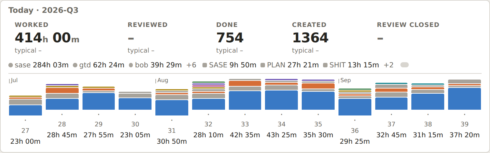

*Figure 1. Today's 2026-Q3 strip, which matches your screenshot. Every legend dot is gray. The legend
lists roots and types, but the columns stack only roots, so the type entries have nothing to point
at. W27, W31, and W36 sit lower than their neighbours. The gray pill at the end of the legend row is
the switch.*

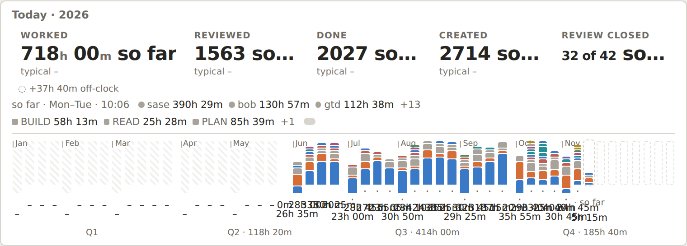

*Figure 2. Today's year strip. Fifty-three value labels collide into unreadable text. Fact values
truncate to "1563 so…". The type legend shows BUILD, READ, and PLAN and hides the 76% "other" segment.*

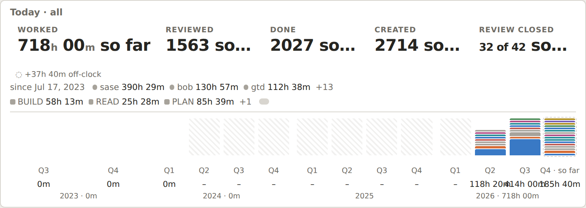

*Figure 3. All time. The 2026-Q4 column (185h 40m so far) is drawn as tall as 2026-Q3 (414h): its 16
root slices each get a 2 px minimum height plus 1 px gaps, which fills the 48 px bar. The value labels
overlap. Three years of not-tracked quarters take most of the width.*

Also see `before-2026-W45.png` and `before-2026-Q4.png` in the figures folder.

## 2. Verified defects in today's strip

The code-verified defects are confirmed by reading the code paths cited; the render-verified ones
were reproduced with the production plugin and real data. Together they explain most of what feels
"cluttered".

| # | Defect | Evidence | Effect |
|---|---|---|---|
| D1 | **Legend marks are always gray.** `periodStripLegendItem` emits the classes `bob-period-strip-hue-<hue>` and `bob-period-strip-theme-hue-<hue>`, but `styles.css` defines none of them. Only `bob-day-strip-hue-*` and `bob-day-strip-theme-hue-*` set `--bob-day-strip-hue`. | grep of styles.css; Figures 1–3; your screenshot | You cannot match the legend to the bars. |
| D2 | **The switch never repaints a period strip.** `cycleLanes` calls `dayStripCycleLaneView`, which repaints only `dayStripViewsStore()`. Period records live in `periodStripViewsStore()`, and the period strip's `paintedKey` does not include the view. | code-verified | A click does nothing visible until the next refetch (≥30 s for a current period, ≥10 min for a past one). Meanwhile it silently flips every daily-note strip on the device. The switch is also a blank pill with no ●/■ marks. |
| D3 | **The view could only ever change the legend.** The columns always stack `columns[].stack`, which contains only root parents. | `periodStripWeekColumns`; `report.rs::stack_value` | A "types" view would put a type legend over a root-stacked chart. |
| D4 | **The legend shows the first three items in bar order, not the three largest.** `periodStripRenderMix` uses `legend.slice(0, 3)`, while the `+N` tooltip lists the items ranked below 3 by minutes. | node dump of the model | In Q4 it shows BUILD, READ, and FIX and hides PLAN (31%, the largest type). In Q3 it shows SASE (2%) and hides "other" (85%). |
| D5 | **Color follows rank, not identity.** `statsPanelDistinctHues` gives the area's hue to whichever root is largest in *this* period. The other roots get the next free hue. | node dump: `sase` is blue in Q3 and 2026 but orange in W45, W46, and Q4; `bob` is the reverse; `sase_blog` is yellow in Q3 but red in Q4 | The same project changes color between your weekly and quarterly notes. With more than 8 colored roots the palette runs out: in Q4, `bob` and `dev` are both blue, and `job`, `job_2026`, and `job_update_cv` are all aqua. |
| D6 | **Month ticks shift baselines.** The tick element sits inside the column's flex flow. | Figure 1; your screenshot (W27, W31, W36) | Bars and captions in tick columns sit about 14 px lower than their neighbours. |
| D7 | **Minimum heights inflate stacks.** `.bob-period-strip-column-piece { min-height: 2px }` plus 1 px gaps. | Figure 3 | Columns with many roots are drawn taller than their data. Q4 weeks look like barcodes. |
| D8 | **Value labels collide in long periods.** Every column paints its value, even at 53 columns. | Figures 2–3 | The labels cannot be read. |
| D9 | **Fact values truncate.** " so far" is appended inside the 1.5em value. | Figure 2; Q4 | "1563 so…", "32 of 42 SO…". |
| D10 | **Coverage copy is wrong for long periods.** `period.coverage.display` is "so far · Mon–Tue" for Q4, 2026, and all time. | `bob periods show` JSON | The meta line describes the current week, not the period. |
| D11 | **Column tooltips use raw keys.** `periodStripColumnTooltip` prints `entry.key`. | code-verified | "sase.md 15h 11m" instead of "sase 15h 11m". |

An unrelated bug I found along the way: `bob stats show worked -f json -r 2026-11-10..2026-11-10`
panics with `RefCell already borrowed` at `src/native/stats/homes.rs:412`. `HomesEngine::finish` calls
`remember()` while it still holds `resolver.borrow_mut()`, and `ensure_root` borrows the resolver
again. It reproduces at HEAD for any `worked`-only range that includes 11-09 or 11-10. `-a` and
`bob periods show` are unaffected. I filed it as bug bead `bob-cli-jr`.

## 3. What the data looks like

Measured from `bob periods show` and `bob stats show worked -g day|week`:

| Period | Root parents | Top-5 share | Folded roots ("N more") | Unlinked / unfiled | Distinct type names | Untyped share | bob's current type lane |
|---|---|---|---|---|---|---|---|
| 2026-W45 | 9 | 96.6% | 4 roots, 3.4% | 0% | 6 | 0% | 6 vocabulary types |
| 2026-Q3 | 9 | 94.3% | 3 roots, 0.6% | 5.1% | 56 | **64.7%** | "other" 85% |
| 2026-Q4 (so far) | 16 | 90.1% | 9 roots, 9.1% | 0.8% | 28 | 0% | "other" 12% |
| 2026 (so far) | 16 | 91.8% | 9 roots, 3.3% | 4.9% | 70 | **53.9%** | "other" 76% |

What this means:

- **N = 5 is the right default.** It covers 90–97% of Worked in every period, and it sits at the
  dataviz "soft cap" of 5–6 categorical series. The rest of the long tail (9 roots in Q4) is the
  barcode noise in Figure 3.
- **Types are a recent signal.** Before the type vocabulary arrived in October 2026, most time is
  `(unnamed)` or ad-hoc names such as SHIT, REMOTE, or MEMORY WEBS. bob's current fold merges
  `(unnamed)` and every type under 2% into one "other" segment, so "we didn't record a type" and "lots
  of small types" look identical. A types-only strip for Q2, Q3, or the year would be mostly gray.
  This is the main reason I would not make Types the only chart or the default.
- **Your palette has one weak pair.** I ran the dataviz validator on the production palette in all-pairs
  mode. Orange (#eb6834) and red (#e34948) differ by only ΔE 7.1, even with normal color vision (the
  floor is 15). Today's rank-based reassignment produces exactly that pair, stacked adjacent, in Q4
  (`sase` orange on top of `sase_blog` red). Folding to the top N before assigning hues, plus stable
  identity colors, removes this in practice.

## 4. Critique: is this a good idea?

**Yes, with adjustments.** Taking your requirements one at a time:

1. *"Only use task types in the current charts."* This is right in spirit. One chart should encode
   one dimension, and its legend should name everything it draws. Today's strip breaks both rules
   (D1, D3, D4). The caveat is history (§3): a types chart is weak for anything before October 2026,
   so roots must stay visible by default.
2. *"Show root parents in a separate chart."* Right. "What kind of work" and "where the time went" are
   different questions. Splitting each column by both dimensions makes them comparable column by
   column, for example "Thursday was bob + BUILD". Two aligned charts let the eye make that
   comparison. A single chart with a dimension toggle cannot.
3. *"Top N root parents, configurable, N = 5."* Right, and it also fixes the color problems (D5) and
   the barcodes (D7). It must be computed **per period** (one set of N series for the whole strip),
   never per column. Otherwise a color would mean different roots in different columns.
4. *"Toggle roots only, types only, and both, like the day strip."* Right. Reuse the Day strip's
   control and wording, so the strip family keeps one language. Fix D2 first, though: today the
   control looks like it exists but does nothing.
5. *"Improve the other period note types too."* Necessary. The year and all-time strips have the worst
   defects (D7, D8, D9). They also need their own rules for label density and for not-tracked runs.

**Would I take a different approach?** I would keep your shape. I would change four things about
*how* it is built:

- Fix the defects first, as an independent plugin-only release (Phase 0).
- Have bob emit the folded series. The plugin should not sum values, which matches the existing
  "bob owns every value" contract.
- Apply the same discipline to types that you are applying to roots.
- Design the neutral fills (muted, folded, unattributed, not tracked, future) so that gray means one
  thing per fill.

## 5. Adjusted requirements (my changes, called out)

- **A1. Fold types as well as roots.** Each configured `types:` vocabulary type gets its own series.
  Non-vocabulary names and inventory labels (MISC, LATER, NEW FEATURES) fold into **"other types"**.
  For quarter, year, and all time, vocabulary types under 2% also fold, keeping bob's existing rule.
  No new knob is needed, because your vocabulary has 7 types. A `periods.top_types` key can come
  later if it is ever needed.
- **A2. Never hide unattributed time in "other".** `@unlinked` and `@unfiled` never take a top-N slot.
  They render as one hatched **"unlinked"** (or "no root") segment. `(unnamed)` renders as a hatched
  **"untyped"** segment, separate from "other types". The hatch means "we can't say where/what". That
  is honest, and in the year view it shows exactly when you started typing your work (Figure 8).
- **A3. Colors follow the entity, never its rank.** The hue a root gets must not depend on that
  period's minutes.
  - Recommended one-time vault edit: give `sase.md` and `sase_blog.md` their own `color:` slots. All
    three dev-area roots currently inherit dev's blue. For example, sase violet and sase_blog aqua;
    the mockups use these.
  - Make the fallback collision pass minutes-independent.
  - Optionally, have `bob stats` warn `root_hue_collision` when shown roots share an inherited hue,
    mirroring the existing `area_hue_collision`.
- **A4. bob owns the fold.** `bob periods show` reads `periods.top_roots` and emits the series,
  "N more" members, and per-column stacks. The plugin only paints them.
- **A5. Period strips get their own switch memory.** Use a separate device key and a separate
  command, defaulting to **Both**. Two charts cost far more height than the Day strip's two 4 px bars,
  so you may want different views in daily and period notes. The control, marks, and cycle order stay
  identical to the Day strip's.
- **A6. Legibility rules for long periods.** Month ticks get their own row. Quarter and all-time
  values use a compact display (`35h`). The year view shows no per-column values, only quarter-group
  totals. Leading not-tracked runs collapse into one quiet ghost. Future columns become 2 px baseline
  stubs instead of dashed boxes.
- **A7. Move "so far" out of fact values** and into the meta line (fixes D9). The meta line for long
  periods should describe the period, for example "so far · W40–W46 · 10:06" (fixes D10).

## 6. Options considered

| Option | Verdict | Why |
|---|---|---|
| **Two aligned stacked-column charts (small multiples), shared x-axis** | **Recommended** | Each chart encodes one dimension. Columns line up for cross-reading. It reuses the existing parts-row geometry and interactions. Both charts share one y-scale, because their totals are identical by construction. |
| One chart with a roots/types dimension toggle (no "both") | Rejected as the only mode | It is compact, but you lose the side-by-side reading you asked for. It survives as the single-chart views. |
| Roots as ranked horizontal bars of period totals | Rejected | Exact comparison and inline labels are nice, but it loses the over-time shape, which is what a period strip adds over the Stats page. The legend already gives each total. |
| Mirrored (butterfly) chart: types above the axis, roots below | Rejected | Compact and striking, but downward bars read as negative values. |
| Side-by-side thin bars per column | Rejected | The bars become 2–4 px wide at 53 columns. |
| 100% (share) columns | Rejected | Loses magnitude, and Worked per column is the main signal. Possible later as an option. |
| Fold in the plugin | Rejected | Fastest to ship, but it breaks "bob owns every value" and risks drift between legend totals and stacks. |

## 7. Recommended design

### 7.1 Anatomy (top to bottom)

1. **Facts row:** unchanged, except that "so far" leaves the value (A7).
2. **Rule:** a hairline. The meta text ("so far · W40–W46 · 10:06") and the **switch** sit at its
   right end.
3. **Roots chart:**
   - A legend line that starts with a small uppercase title (`ROOTS`), followed by up to N
     `● name value` items, `● N more value`, and `◌ unlinked value`.
   - For quarters, a month-tick row.
   - Then the columns.
4. **Types chart:** a legend line (`TYPES ■ BUILD 10h 45m …`), then the columns.
5. **Shared axis rows:** the review mark (✓ ✕ ◐ ·), the caption (`Mon 2` / `W40`), and the value
   (`3h 35m` / `35h`). For a year, the quarter-group captions with totals replace them.

In a single view, only that chart and its legend render, and the plot is taller. The switch stays at
the same position on the rule.

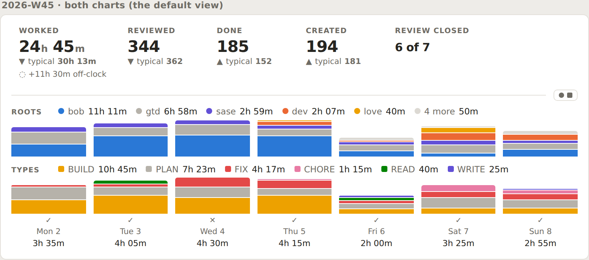

*Figure 4. Proposed 2026-W45 strip in the Both view (default), from real data. Every color in each
chart has a named legend entry. "4 more" (job, body, abby, cash) is a light neutral. gtd and PLAN keep
your deliberate grays.*

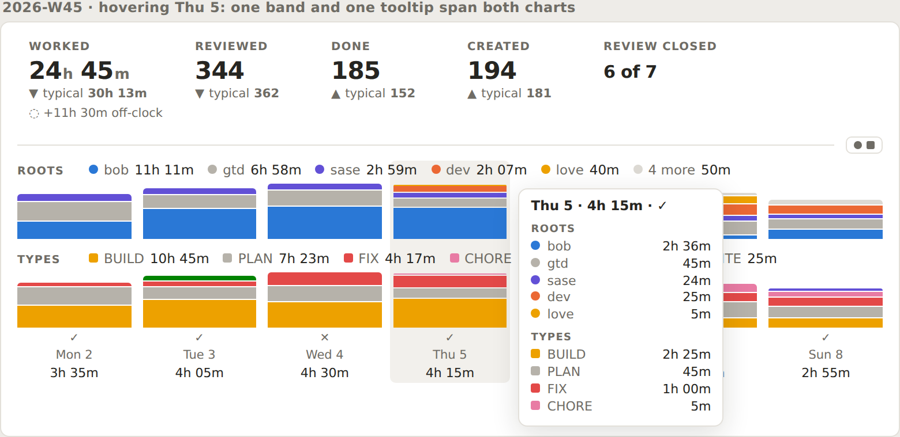

*Figure 5. Hovering or focusing a column highlights it across both charts. One tooltip lists both
dimensions by label (fixes D11).*

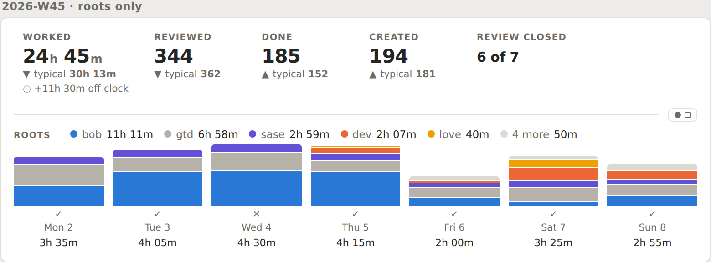
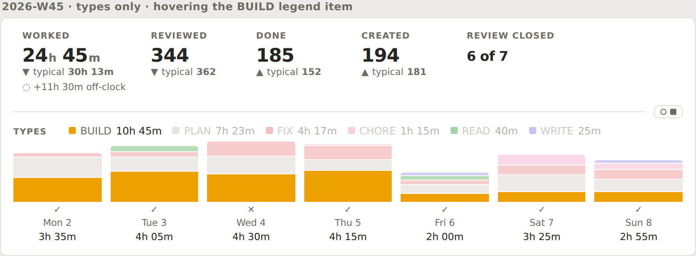

*Figure 6. The two single views. The switch's ● and ■ fill to show which charts are shown. In 6b the
pointer is on the BUILD legend item, so the other series dim. This is optional polish, but it makes a
single series easy to follow across columns.*

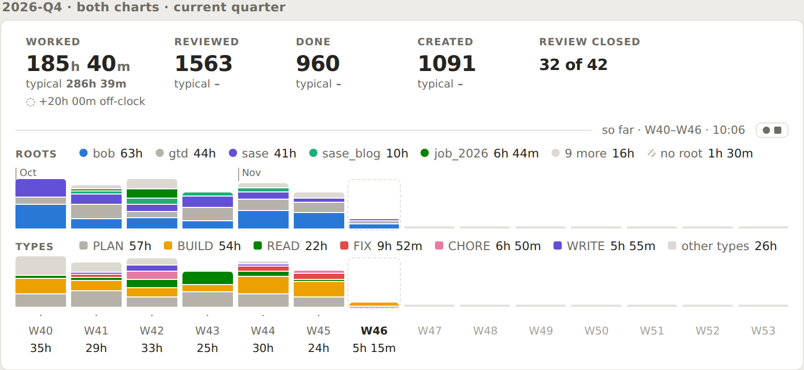

*Figure 7. 2026-Q4 so far. Month ticks have their own row, so baselines stay aligned (D6). Values are
compact. Future weeks are quiet stubs. The top-5 roots cover 90%; "9 more" holds the long tail that
used to make barcodes.*

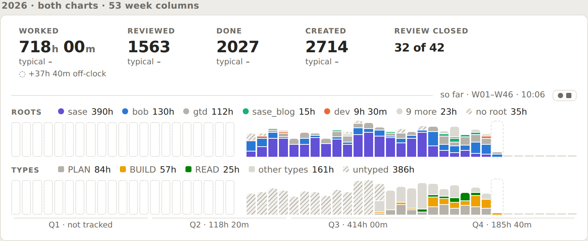

*Figure 8. The 2026 year view. No per-column values (D8), and quarter-group totals instead. The types
chart tells the true story: hatched "untyped" through September, then vocabulary types from October.
Not-tracked weeks are dotted ghosts, distinct from the "unattributed" hatch.*

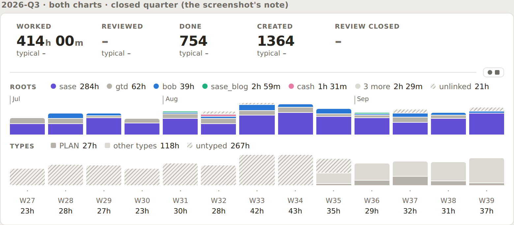

*Figure 9. The 2026-Q3 note from your screenshot, redesigned. The roots chart carries the story; the
types chart is honestly mostly untyped.*

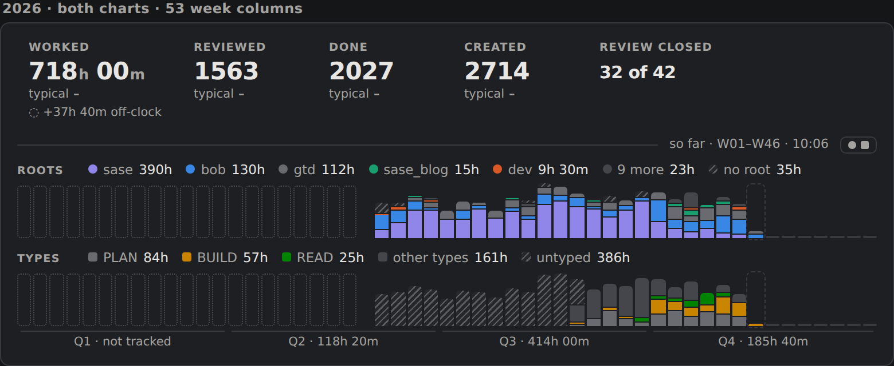

*Figure 10. Dark theme with the production dark palette. `after-Q4-both-dark.png` is also in the
figures folder.*

The mockups were also rendered at about 530 px, which is your note's actual line width, judging by
the screenshot: `narrow-W45-both.png` and `narrow-Q4-both.png`. At that width, each legend needs a
second line (see §7.6).

### 7.2 Series, folding, and order (bob)

- **Roots:**
  - Rank real root parents (areas and projects; not `@` buckets) by Worked over the whole period.
    Keep the first `top_roots`. The rest become one `other` series labeled "N more", with a `members`
    list.
  - Merge `@unlinked` and `@unfiled` into one `unattributed` series, labeled "unlinked" when only
    `@unlinked` is present, otherwise "no root".
  - Apply the same keys to every column's stack. Columns never pick their own top N.
- **Types:**
  - Each vocabulary type with minutes gets its own series (for quarter and longer, only if ≥2%).
  - Everything else becomes `other` ("other types"), and `(unnamed)` becomes `unattributed`
    ("untyped").
  - Without a configured vocabulary, fall back to the top `top_roots` types by minutes, so the rule
    stays bounded.
- **Order:** series sort by period minutes, descending, then the folded series, then the hatched
  series. Stack order (bottom to top) equals legend order (left to right) in every column. The Day
  strip orders its root bar by area hue slot, which suits a 4 px bar. In a stacked column, the largest
  series deserves the shared baseline.
- **Exact heights:** no minimum segment height (fixes D7). A segment under about 0.75 px is simply not
  drawn, and the tooltip still lists it.

### 7.3 Color and neutral fills

| Fill | Meaning | Examples |
|---|---|---|
| Palette hue (●/■) | One root or type, colored by identity (R8 slot / type hue chain) | bob blue, BUILD yellow |
| Solid gray (`--text-faint`) | A real root or type you chose to mute | gtd, exempt PLAN |
| Light neutral (about 45% of faint) | Folded remainder | "4 more", "other types" |
| Diagonal hatch | Time we cannot attribute | "unlinked", "untyped" |
| Dotted ghost outline | No data (not tracked) | 2026-W01–W21 |
| 2 px baseline stub | Future child period | W47–W53 |

The legend marks reuse the strip family's shapes: ● for roots and ■ for types, with a light ● for
"N more" and a hatched mark for unattributed time. The same palette appears in both charts, so the
shapes plus the `ROOTS` and `TYPES` titles keep a yellow root (love) from being read as a yellow type
(BUILD). Fixing D1 means actually using the `bob-day-strip-hue-*` and `bob-day-strip-theme-hue-*`
classes for the legend marks, or adding period aliases for them.

### 7.4 The switch

- **Control:** the Day strip's control exactly: a `span[role=button]` with a ● (roots) mark and a ■
  (types) mark, filled when that chart is shown and hollow when hidden. Click, Enter, and Space cycle
  **Both → Roots → Types**. The tooltip names the current view and the next one ("Showing root
  parents and types · click for root parents only"). `mousedown` never steals focus, so vim keeps
  working.
- **State:**
  - It is stored in its own device key (for example `bob-ledger-tools-period-strip-charts`) and
    shared by every period strip: week, quarter, year, and all time.
  - It defaults to Both.
  - A new command, "Cycle period stats charts", does the same thing.
  - Changing the view repaints every period strip from the cache, without spawning bob.
  - The view is part of the paint key (fixes D2).
- **Availability:** if one chart is unavailable (an older bob without `charts`, or a period with no
  Worked), show the chart that exists and hide the switch, as the Day strip does.
- **Motion:** the newly shown chart fades in over 160 ms, like the Day strip. Data repaints never
  animate.

### 7.5 Interaction

- A child period is **one focus stop spanning both charts**. Implement it as one CSS grid, where each
  column's hit target covers both plot rows plus the axis rows.
  - Hover and focus share one highlight band.
  - The tooltip lists Worked, the review mark, and both dimensions by label.
  - ←/→/Home/End move between columns (unchanged).
  - Enter opens the child note, and Alt+Enter opens Stats pinned to that child (unchanged).
- Each chart's legend stays one link that opens Stats on the matching "Where the time went" view, as
  today. The "N more" item's title lists the folded roots and their values. Hovering a legend item
  dims the other series. This only enhances the chart; no value depends on it.

### 7.6 Per kind, widths, and height budget

| Kind | Columns | Captions | Values | Extras |
|---|---|---|---|---|
| Week | 7 days | `Mon 2` | `3h 35m` | review ✓/✕/◐ marks |
| Quarter | 13–14 weeks | `W40` | compact `35h` | month ticks in their own row |
| Year | 52–53 weeks | none | none | quarter-group captions with totals; the existing narrow fallback to 4 quarter bars |
| All time | quarters, grouped by year | `Q3` | compact | leading not-tracked years collapse into one ghost ("2023–2025 · not tracked") |

- **Legend fit ladder:**
  1. One line of names with full values.
  2. Compact values (`64h`).
  3. Wrap to at most two lines.

  Never use `+N` for charted series. Every color on screen must be named, and top-N already bounds
  the count to N + 2.
- **Plot heights:** 44 px per chart in Both, 56 px in a single view.
- **Measured strip heights at about 760 px:** today's strip is about 200 px. The mockup is about
  300 px in Both and about 245 px in a single view, with a 66 px plot. A 56 px plot brings the single
  view to about 235 px.
- **Height budget for the preview matrix:** Both ≤ 310 px at 700 px wide; single ≤ 250 px. Allow two
  extra legend lines at ≤ 560 px.

## 8. Contract and config

**Config (bob, `~/.config/bob/config.yml`):**

```yaml
# Period notes (docs/periods.md in bob-cli).
periods:
  top_roots: 5 # period stats strips chart the 5 biggest root parents; the rest fold into "N more"
```

- The value is an integer from 1 to 8 (8 is the palette's size). The default is 5.
- An absent or `null` value means the default. An out-of-range or non-integer value falls back to the
  default with a warning that names `periods.top_roots` and the config path, the same way the `plan:`
  caps behave.
- Older bobs ignore unknown top-level keys (no `deny_unknown_fields`), so the chezmoi edit is safe to
  land first.
- An alternative home is `stats.period_strip.top_roots`. I prefer a `periods:` block, because
  `bob periods` is the producer and the key only means something for period strips.

**JSON (`bob periods show`, schema stays 1; every change is additive):**

```jsonc
"charts": {
  "roots": { "limit": 5, "series": [Series, ...] },
  "types": { "series": [Series, ...] }
},
// Series: { key, label, kind: "root"|"type"|"other"|"unattributed", hue, minutes,
//           display, display_short, share, members?: [{key, label, minutes, display}] }
"columns": [{ ..., "worked": { ..., "display_short": "35h" },
              "stacks": { "roots": [{key, minutes}], "types": [{key, minutes}] } }]
```

- **Unchanged:** `lanes`, `columns[].stack`, and `children[].stack` stay as they are for older
  plugins. The new plugin uses `columns[].stack` (all roots, by label) for per-column tooltip detail.
- **Who owns hue:** `hue` is optional. I recommend the plugin keep resolving hue through one shared,
  minutes-independent function. That way the Day strip, the Stats page, and period strips always
  agree on a root's color.
- **The parts table:** the `bob-period-parts` table's mini bars should switch to the folded root
  stacks and the same hues.

**Compatibility:**

| | Older bob (no `charts`) | Newer bob |
|---|---|---|
| **Older plugin** | today | today; the new fields are ignored |
| **Newer plugin** | a roots-only chart from `columns[].stack`, roots legend, no switch | the full design |

## 9. Implementation plan

The phases can ship independently. Each phase states its acceptance in terms you can check.

- **Phase 0 (bob-plugins only; fixes defects; ship first).**
  - Changes:
    - Legend hue classes (D1).
    - Switch repaint and paint key, plus the ●/■ marks (D2).
    - Legend top-3 by rank (D4).
    - Tick row outside the column flow (D6).
    - Remove `min-height` (D7).
    - Hide per-column values in the year view and use short values elsewhere (D8).
    - "so far" moves to the meta line (D9).
    - Tooltip labels (D11).
  - Tests: one asserting that every class the painters emit has a CSS rule, and one asserting that
    the switch repaints period records.
  - Then `npm run build`, `npm test`, and `bob plugins sync`.
- **Phase 1 (bob-cli).**
  - Add `periods.top_roots` parsing and docs, the series and stack fold, the `(unnamed)` →
    `untyped` split, `display_short`, and the D10 coverage copy.
  - Golden JSON fixtures for week, quarter, year, and all time, with tie-breaking by key.
  - Docs: `docs/periods.md` (the period-report and strip contract) and the config reference.
  - Optional: a `root_hue_collision` lint. Versioning and the changelog ride the release train;
    agents never edit them.
  - Also fix the unrelated `homes.rs` panic.
- **Phase 2 (bob-plugins).**
  - A two-chart grid renderer, legends with the fit ladder, its own switch memory and command,
    hover band and tooltip, legend-hover dimming, and the older-bob fallback.
  - Update `preview-period-strip.cjs` to cover the matrix of light/dark × 410/560/700 px × four
    period kinds × three views, with the new height budgets and a check that caption and value boxes
    don't overlap.
  - Update `docs/bob-ledger-tools.md`.
- **Phase 3 (config, vault, memory).**
  - chezmoi: `periods.top_roots: 5`.
  - Optionally, `color:` slots on `sase.md` and `sase_blog.md` (your call).
  - Update the glossary's Stats Strip strand: two charts, top-N roots, separate switch.
  - Consider a short decision record: "Period strips chart roots and types separately; bob folds
    to top-N roots; colors follow identity." Both of these go through `/sase_memory_write`.

## 10. Risks and open questions for you

1. **Order in Both view:** I recommend Roots above Types. It matches the Day strip's lane order and
   its ●-then-■ switch, and roots are the signal that holds up across all of your history. Flipping
   the order is a one-line change if you would rather keep types as "the original chart".
2. **Shared or separate switch:** I recommend separate memory for daily and period strips (A5). If you
   prefer one family-wide view, keep the shared key, but still repaint period records.
3. **Explicit colors:** are sase violet and sase_blog aqua acceptable? Without explicit slots, dev-area
   roots will always compete for blue.
4. **Day strip follow-up:** should the Day strip's root lane adopt the same top-N rule later? That
   requires `bob stats` to fold as well. I left it out of scope.
5. **Untyped history:** the hatched "untyped" region is honest. If you want Q2 and Q3 to show types,
   the only fix is a retro-typing pass over legacy Pomodoro names. That is a separate project, and I
   don't recommend it now.
6. **Height:** Both adds about 100 px over today's strip. The single views exist for the weeks when
   that matters.

## 11. Recommended solution

Ship the redesign in this order:

- **Phase 0:** fix the eleven defects in the existing period strip. This alone removes most of the
  visual noise.
- **Phase 1:** have `bob periods show` emit a folded, render-ready `charts` contract, driven by
  `periods.top_roots` (default 5, set to 5 in chezmoi). Fold roots to the top N plus "N more", types
  to your vocabulary plus "other types", and keep unattributed time as its own hatched series.
- **Phase 2:** have bob-ledger-tools paint two aligned stacked-column charts, **Roots** above
  **Types**:
  - one shared axis, and complete, titled legends;
  - stable identity colors, and one meaning per neutral fill;
  - per-kind legibility rules for quarter, year, and all time;
  - the Day strip's ●/■ switch cycling Both → Roots → Types, with its own device memory, defaulting
    to Both.

Then set explicit colors on the dev-area roots, so a project looks the same in every note you open.

---

### Appendix: method and sources

- **Code read:**
  - bob-plugins `plugins/bob-ledger-tools/src/239-plugin-period-strip-{model,render,parts,fence}.js`,
    `239-plugin-day-strip-lanes.js`, `239-plugin-time-lanes-model.js`, `239-plugin-stats-panel-models.js`
    (`statsPanelDistinctHues`), and `styles.css` (period strip, day strip hue classes, R8 palette).
  - bob-cli `src/native/periods/report.rs` (`build_lanes`, `stack_value`), `src/native/config/{mod,stats}.rs`,
    `src/native/stats/homes.rs`, `docs/periods.md`, `docs/stats.md` (Day strip, `stats:` config), and
    `docs/pomodoro-homes.md` (R8 hues).
- **Data:**
  - `bob periods show {2026-W45, 2026-W46, 2026-Q3, 2026-Q4, 2026, all} -f json`.
  - `bob stats show worked -f json -g day|week` over the matching ranges, all on 2026-11-10.
- **Rendering:** headless Chromium driven over CDP.
  - The "before" images load the production `main.js` and `styles.css` and call
    `periodStripModel`/`paintPeriodStrip` on the real reports.
  - The "after" images come from a standalone mockup. It uses the production light and dark palette
    and folds the real data the way §7.2 specifies.
  - The scripts are in `period_strip_type_and_root_charts__cld_figs/src/`. Raw vault JSON is not
    committed; rerun the bob commands to regenerate it.
- **Palette check:** the dataviz skill's `validate_palette.js` on the production light and dark
  `--bob-area-*` values.
  - Adjacent order passes.
  - All-pairs mode fails for orange/red (ΔE 7.1 normal vision) and for magenta/aqua in dark (1.6
    deutan).
- **Prior research consulted:** `research:202611/period_note_tree_and_stats_strips/period_note_tree_and_stats_strips__final.md`
  (via `sase artifact read`): the strip family's original contract and the "bob folds, the plugin
  never sums" principle.
- **Memory read:** glossary (Stats Strip, Day Strip, Root Parent, Task Type, Period Note, Stats Dash),
  `cli_rules.md`, `docs.md`.
