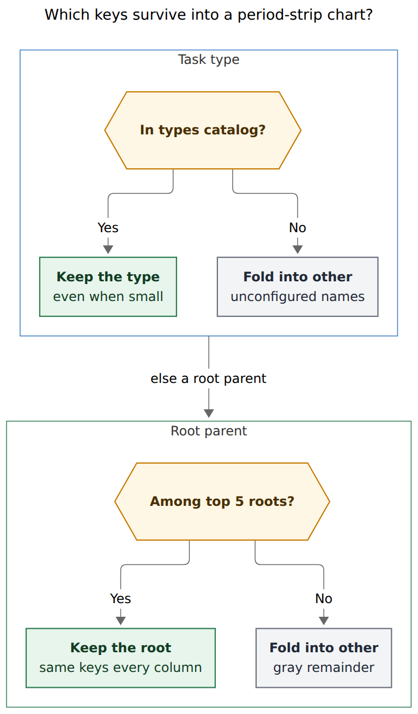
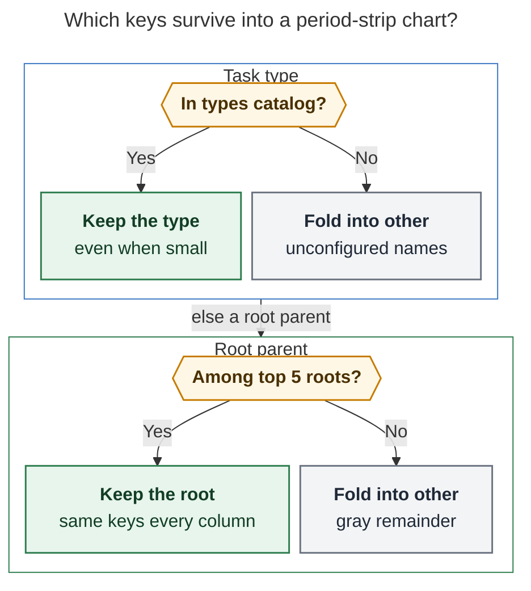
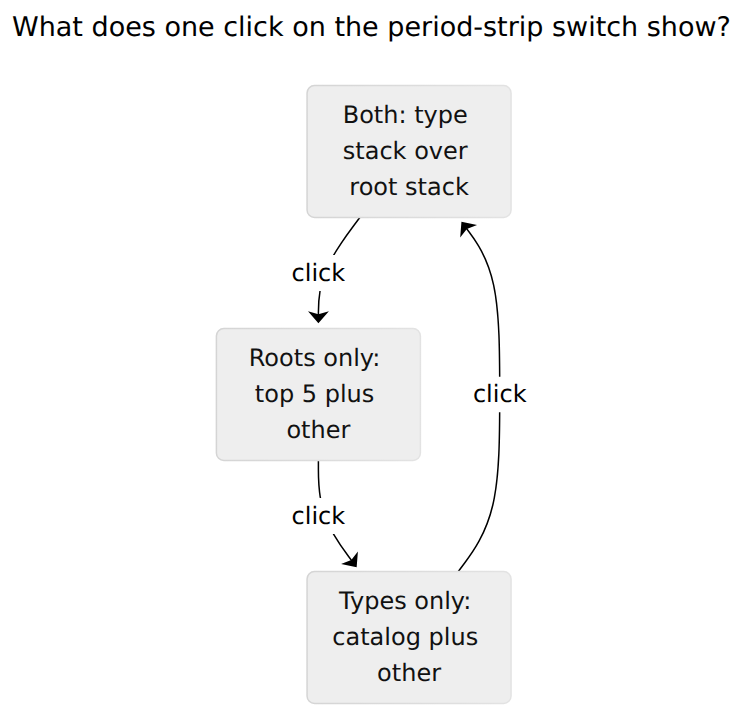
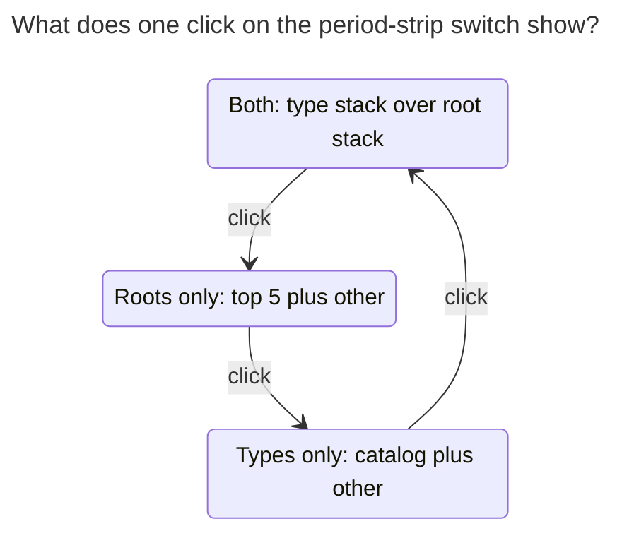

# Period stats strips: catalog types, top-N roots, and a switch that actually drives the charts

> **Research query:** Make the stats strips on period notes much nicer. Use only task types in the current charts, show root parents in a separate chart limited to a configurable top N (set to 5 in chezmoi), and toggle roots / types / both the way the Day strip already can. Critique the plan, adjust the requirements, and recommend a design that is intuitive, reliable, and beautiful. Cover week, quarter, year, and all-time notes.

**Researcher:** grk (independent swarm report).
**Date:** 2026-11-10.
**Inputs:** screenshot `~/tmp/screenshots/20261110_095225.png`; live `bob periods show 2026-Q3 -f json` and `2026-W45 -f json`; `docs/periods.md`, `docs/stats.md`; glossary `stats-strip`, `day-strip`, `period-note`, `root-parent`, `task-type`; bob-ledger-tools `239-plugin-period-strip-*.js`, `239-plugin-day-strip-lanes.js`, `239-plugin-time-lanes-model.js`, `styles.css`; `src/native/periods/report.rs`; `src/native/config/stats.rs`; chezmoi `home/dot_config/bob/config.yml`; stacked-bar guidance from Atlassian, Depict Data Studio, and Stephen Few. Nothing in any repo or the vault was changed except this report and its figures.

Renderer: `@mermaid-js/mermaid-cli` 12.0.0 with the Highlights PDF-mirroring config (`--no-sandbox` on this host).

---

## 0. Bottom line

**Yes, build this. Rebuild the parts row so the switch drives it. Do not paint a second disconnected 13-column chart.**

The screenshot is a closed quarterly note (`2026-Q3`), not a weekly one. It already has a lane switch, two legends, and a parts row. The niceness problem is that those three pieces disagree:

1. The parts columns always stack **root parents** (up to 8 slices in a week).
2. The legend concatenates **3 roots + 3 types** on one wrapping line, with a hard `slice(0, 3)` that hid Q3's 85% `other` type bucket behind `+2`.
3. The switch is a mute 1.2em pill. It already cycles `both → roots → types` in the same localStorage key as the Day strip, and it does **not** change the stacked columns.

Live Q3 numbers (414h Worked, 13 week columns, `types_folded: true`):

| Root parent | Time | Share |
| --- | ---: | ---: |
| sase | 284h 03m | 69% |
| gtd | 62h 24m | 15% |
| bob | 39h 29m | 10% |
| unlinked | 21h 05m | 5% |
| sase_blog | 2h 59m | 1% |
| cash, dev, body, job | 4h 00m | ~1% |

| Type lane after the 2% fold | Time | Share | `hue_source` |
| --- | ---: | ---: | --- |
| **other** | **352h 19m** | **85%** | — |
| PLAN | 27h 21m | 7% | exempt |
| SHIT | 13h 15m | 3% | unconfigured |
| REMOTE | 11h 15m | 3% | unconfigured |
| SASE | 9h 50m | 2% | pin |

The 2% quarter fold hid the configured vocabulary (BUILD / FIX / READ appear in Q3 `theme_hues` and were swallowed) and kept unconfigured names that barely cleared 8.3 hours. A week in the new vocabulary, `2026-W45`, already looks like the goal: BUILD 43%, PLAN 30%, FIX 17%, CHORE 5%, READ 3%, WRITE 2%.

**Recommended product:** paired small-multiples. Each child column keeps one identity (the week, day, or quarter) and paints a **type stack over a root stack**, sharing the caption and Worked value. The Day strip's `●` / `■` switch shows both, roots only, or types only. Types keep every configured `types:` member with minutes, plus gray `other`. Roots keep the period's top N by minutes (chezmoi `stats.strip.top_roots: 5`) plus gray `other`, **the same keys in every column**. Bob owns both folds. The plugin stops inventing a 3-item legend.

---

## 1. Is this a good idea?

**Yes.** The Q3 strip is a scoreboard with a rainbow that cannot be read back to the legend. Separating *kind of work* from *where the time sat*, capping the home dimension, and making the existing switch drive the charts is the right family of fixes. The Day strip already proved the two-dimension switch. Period notes need the same grammar with a parts row that can carry it.

### Why it earns a place

- **Two questions, two encodings.** Root parent answers "which area or project ate the week?" Task type answers "was it BUILD, PLAN, FIX…?" The glossary already describes a stats strip as having both a root-parent lane and a task-type lane. The parts row currently answers only the first question, in too many colours.
- **The Day strip already has the switch.** `both → roots → types`, stored in `bob-ledger-tools-day-strip-bars`, painted with a filled/hollow `●` (roots) and `■` (types). Period strips call `dayStripCycleLaneView` today. Users already know the control. Period notes should speak it, not invent a pill.
- **Top-N + other is the standard stacked-bar repair.** Atlassian: keep secondary levels few, and stack every bar in the **same** secondary order. Depict Data Studio: put the legend on top and match its colours to the bars. Few's practical cap is about 15 bars on the *primary* axis (13 quarter-weeks is inside; 53 year-weeks is not, and the plugin already falls back to four quarter bars below 110px). Datylon's "about three segments" is too tight for a 7-type catalog; five to eight is the readable band.
- **N = 5 is empirically right for this vault.** Q3's top five roots are 69% + 15% + 10% + 5% + 1% = 100% of Worked to the displayed precision. The four leftovers total four hours. W45's top five (bob, gtd, sase, dev, love) leave 50 minutes of tail. Five is a cut that still tells the truth.

### Where the request goes wrong if built as specified

| Risk | Evidence | What the design does |
| --- | --- | --- |
| **"Current charts" are root stacks** | `stack_value` in `src/native/periods/report.rs` reads `parts.root_parent`. `periodStripWeekColumns` hues from `timeLaneRootSegments`. | Treat the parts row as the chart family. Give it a type stack *and* a folded root stack. Flipping it to types-only without a root encoding throws away the original question. |
| **A second 13-column chart** | Q3 already spends ~48px × 13 columns. Two disconnected rows duplicate captions, week numbers, and closeout marks, and jump the header toward 260px. | Pair the two stacks **inside** each column. One caption, one Worked value, two encodings. |
| **The 2% type fold** | Documented in `docs/periods.md`: quarter/year/all-time fold `(unnamed)` and types below 2% of Worked into `other`. Q3 2% = 8.3h. Result: `other` 85%, SHIT/REMOTE/SASE visible, BUILD hidden. | Fold by **catalog membership**, not share. Configured types stay even when small. Unconfigured names become `other`. |
| **Hard-capped legends** | `periodStripRenderMix` does `mix.legend.slice(0, 3)`. Time-lane order puts coloured types first, `other` last. Q3's 352h `other` is the `+2`. | Reuse the Day strip fitter. Drop lowest-minute items first. A large `other` stays visible. |
| **Mute pill** | `.bob-period-strip-lanes-switch` is a 1.2em × 0.7em unlabeled track. | Paint the Day strip's `●` / `■` marks. Same tooltip grammar ("Showing root parents and types · click for root parents only"). |
| **Year density** | CSS already hides the 53-week row below 110px container width and shows four quarter bars. Two extra chart rows would make that worse. | Pairing applies to the detailed week row *and* the quarter fallback. No third row of 53 stacks. |

### Would I take a different approach?

I would still separate types from roots, still cap roots at N, still share the Day strip switch, and still have bob own the numbers.

I would **not** add a free-standing second parts row. Pairing is the beautiful form of "a separate chart": two encodings, one child identity.

I would **not** keep the 2% fold and also "only show current types." Those two rules fight. The 2% rule is why Q3's type lane is junk.

I would **not** filter types by "appeared this week in Recent." The configured `types:` list is the vocabulary. Pins that are not on that list (Q3's SASE type, aqua, `configured: false`) fold into `other` so they stop colliding with the `sase` root.

I would **not** apply `top_roots` to the Day strip. A day is one 4px bar; many thin segments still read as a mix. The cap is a period-strip rule.

---

## 2. Explicit requirement adjustments

Call these out as changes to the request.

| # | You asked for | I recommend | Why |
| --- | --- | --- | --- |
| **A1** | "Weekly period note" screenshot | Treat `2026-Q3` as the motivating surface, and design week / quarter / year / all-time together. | The PNG is the Q3 note (`2026-Q3 · W27–W39 · Jun 29 – Sep 27`, 13 week columns, 414h). Weekly is the easy case (W45's type lane is already the catalog). |
| **A2** | "Only use task types in the current charts" | Give the parts row a **type stack** (catalog + `other`) and keep a **root stack** (top N + `other`) in the same column. | "Current charts" are root-parent stacks. Replacing them with types deletes the home question. Pairing keeps both. |
| **A3** | "Only current task types" | **Configured `types:` members** (`theme_hues[key].configured == true`, including exempt PLAN). Unconfigured names, inventory labels, and pins off the list fold into `other`. | "Current" as "cleared 2% of a quarter" hides BUILD and keeps SHIT. "Current" as the live vocabulary matches W45 and `decisions:theme-hue-is-config-pin-exempt-area-hash`. |
| **A4** | "Root parents in a separate chart" | **Paired stacks in one column**: type stack above, root stack below, shared caption. | Two 13-column rows duplicate chrome. Pairing is how the Day strip already shows two 4px bars for one day. |
| **A5** | Top N roots, N = 5 in chezmoi | `stats.strip.top_roots: 5` parsed by bob (default 5, min 1, max 12). Rank by **period total** minutes, then label. Apply that key set to every column. Remainder is gray `other`. | Per-column top N makes colours jump week to week. Atlassian: the same secondary order in every bar. Bob must fold so `bob periods show` matches the strip. |
| **A6** | Toggle like the Day strip | **Share** the Day strip view and storage key. Replace the period pill with the `●` / `■` control. The switch **repaints the stacks**, not only the legend. | The cycle already exists (`dayStripCycleLaneView`). Period paint already reads `dayStripLaneViewCurrent`. Only the parts row ignores it. |
| **A7** | (implied) plugin-side trimming | Bob emits `theme_stack` and `root_stack` per column, plus strip-ready lanes. Plugin paints. Keep existing `columns[].stack` as the full root list for older plugins. | JSON contract stays additive on schema 1. Folding in two places would drift. |
| **A8** | (implied) year and all-time equal to quarter | Pairing on the detailed row **and** on the existing 4-quarter year fallback. All-time keeps year groups of quarter columns. | 53 paired stacks are still 53 columns. The fallback already exists; teach it the second stack. |

---

## 3. What the screenshot is actually showing

The PNG is Obsidian on `2026/2026-Q3.md`. Anatomy from the top of the note body:

- Title `2026-Q3 · W27–W39 · Jun 29 – Sep 27`, nav, week child links.
- Five facts: Worked **414h 00m**, Reviewed **–**, Done **754**, Created **1364**, Review closed **–**. Typical lines are blank (`typical –`), matching the live report: only 1 of 4 prior quarters is usable.
- One wrapping legend: `sase 284h 03m`, `gtd 62h 24m`, `bob 39h 29m +6`, then `SASE 9h 50m`, `PLAN 27h 21m`, `SHIT 13h 15m +2`, then a gray pill.
- Thirteen week columns W27–W39 with rainbow stacks, month ticks (Jul, Aug, Sep), closeout dots, and per-week Worked.

That legend is **two 3-item lanes on one row**. Roots: three names + 6 hidden (9 roots live). Types: SASE (coloured pin, so it sorts ahead of larger gray types), PLAN, SHIT, with REMOTE and the 352h `other` behind `+2`. The columns do not encode SASE/PLAN/SHIT at all; they encode the nine roots. Colour in the bars cannot be read back to the type half of the legend. That is the clutter.

The switch is present and wired. It is just mute, and it does not change `column.stack`.

---

## 4. How the strip is built today

```text
bob periods show <PERIOD> -f json
        │
        ▼
  facts, lanes.root_parent, lanes.theme,
  columns[].stack  (root-parent minutes only)
        │
        ▼
  periodStripModel  →  paintPeriodStrip
        │                 │
        │                 ├─ facts (shared Day-strip value runs)
        │                 ├─ lanes row: periodStripRenderMix × shown
        │                 │     (slice 0..3 + overflow + mute pill)
        │                 └─ paintPeriodStripParts
        │                       └─ always column.stack, root hues
        ▼
  dayStripLaneViewCurrent()  // shared with the Day strip
```

Contract (`docs/periods.md`, schema 1):

- `lanes.root_parent` / `lanes.theme`: `{key, label, minutes, display, share}`.
- Week type lane is unmodified. Quarter, year, and all-time fold `(unnamed)` and types below 2% of Worked into `other` (`build_lanes` in `report.rs`).
- `columns[].stack` is every positive root-parent part, sorted by that column's minutes, **not** aligned to the period total.
- Plugin `periodStripRenderMix` then takes the first three legend entries of each shown lane.

Chezmoi `types:` today: BUILD yellow, CHORE magenta, FIX red, MEET blue, PLAN auto, READ green, WRITE violet. `plan.exempt: [PLAN]`. Inventory labels LATER / MISC / NEW FEATURES. Q3 `theme_hues` has 55 keys: 3 `config`, 1 `exempt`, 3 `pin`, 3 `hash`, 45 `unconfigured`.

`StatsConfig` has `range`, `overview`, `hide`, `since`, `user_metrics`. It does not yet parse a `strip` block. Unknown `stats:` keys, including plugin-only `day_strip`, currently fall through. A top-N that bob must honour cannot live as a plugin-only key.

---

## 5. Figures

**Reader question:** Which keys survive into a period-strip chart?

**Caption:** Configured task types stay even when small; unconfigured names become gray `other`. Root parents keep the period's top five by minutes on every column; the tail becomes gray `other` and stays in the legend when it has minutes.



Rendered size: 510.9 × 872 px; fit scale: 100%.



**Reader question:** What does one click on the period-strip switch show?

**Caption:** The control is the Day strip cycle. Both paints a type stack over a root stack in each child column. A single-dimension view keeps one stack and gives it the extra height.



Rendered size: 495.3 × 478 px; fit scale: 100%.



---

## 6. Recommended design

### 6.1 Paired column (the chart)

Each parts column, top to bottom:

1. Type stack (rounded 2px pieces, 1px note-background gaps, `flex-direction: column-reverse` so the largest catalog type sits on the baseline).
2. A 4px gap.
3. Root stack, same construction, period-rank order, `other` and `@unlinked` / `@unfiled` gray and last among their group.
4. Closeout mark (unchanged).
5. Caption + Worked value (shared).

Heights at a 16px base:

| View | Type stack | Root stack |
| --- | ---: | ---: |
| both | 40px | 40px |
| types | 56px | omitted |
| roots | omitted | 56px |

Week: 7 columns. Quarter: 13 week columns, month ticks stay. Year: grouped weeks as today, with the existing 4-quarter fallback under `@container (max-width: 110px)` — pairing applies to both. All-time: quarter columns grouped by year.

Skeleton paints the stacks of the current view. Future / missing columns keep today's dashed / hatched ghosts, with empty stacks.

### 6.2 Legends

One legend **per visible stack**, immediately above the parts host, full width:

- Types: `■` swatch, ALL-CAPS name, value. Quiet prefix `By type`.
- Roots: `●` dot, catalog `label`, value. Quiet prefix `By root parent`.

Reuse `dayStripLegendFit`. Never `slice(0, 3)`. Overflow `+N` lists the hidden keys in bar order. A nonzero `other` is a first-class segment: gray, last, kept while it outranks the items the fitter would drop.

Clicking a type legend still opens Stats on the types panel; a root legend still opens root parents. Each stack is a mouse-only second target for its legend, matching the Day strip bars.

### 6.3 Switch

Copy `dayStripRenderLanesSwitch` (or share the helper). Same `role="button"`, same tooltip/aria, same cycle, same storage key, same `Cycle Day stats bars` command. Period CSS must not restyle it into a pill. Focus survives the repaint. The switch never opens Stats.

When only one dimension exists (no type parts, or no root parts), the switch hides and the remaining stack fills 56px, as the Day strip already does.

### 6.4 Folding rules bob owns

**Types** (every period kind, including weeks):

- Keep a key when `theme_hues[normalize(key)].configured` is true, or the key is in the `types:` map. PLAN stays (exempt, configured).
- Fold unconfigured names, `(unnamed)`, inventory labels, and pins with `configured: false` into `other`.
- Do not fold a configured type for being under 2% of a quarter. A 3-hour BUILD in Q3 is a real catalog fact.
- `other` is gray. Stacks plus `other` equal that column's Worked minutes.

**Roots:**

- Rank by the period total, minutes desc, then label.
- Keep N keys (`stats.strip.top_roots`, default 5). `@unlinked` and `@unfiled` compete; they are not auto-excluded.
- Every column uses that key set. A week that is 100% `job` while `job` is outside the top 5 paints as `other`. Alignment beats local honesty; the tooltip can still list the unfolded names from leftover `stack`.
- Remainder → `other` (gray).

Hue assignment runs on the **folded** key set so `other` does not steal a palette slot. Root distinct-hue logic and type shade-on-collision stay the shared time-lane builders.

### 6.5 JSON (schema 1, additive)

Keep `columns[].stack` as today's full root list.

Add:

```json
"lanes": {
  "root_parent": [ "…full list, unchanged…" ],
  "theme": [ "…catalog fold, not 2% fold…" ],
  "types_folded": true,
  "strip": {
    "top_roots": 5,
    "type_policy": "catalog",
    "root_parent": [ "top N plus other" ],
    "theme": [ "catalog plus other" ]
  }
}
```

Per column:

```json
"theme_stack": [{ "key": "BUILD", "minutes": 645 }],
"root_stack": [{ "key": "sase.md", "minutes": 900 }]
```

Older plugins ignore the new fields and keep painting rainbow roots. Newer plugins prefer `theme_stack` / `root_stack` and `lanes.strip.*` for legends. `types_folded` remains true when any minutes moved into `other`.

This is a documented behavior change for quarter/year/all-time type lanes (2% fold → catalog fold). Record it as a decision; update `docs/periods.md`, the stats-strip glossary, and the plugin reference. It is not a CLI flag, so `cli_rules.md` does not add a short alias.

### 6.6 Config (bob + chezmoi)

```yaml
stats:
  strip:
    top_roots: 5   # period-strip root stacks and strip legends; 1..12
```

Parse in `StatsConfig`. Invalid values warn and fall back to 5, same local-warning style as a bad metric entry. Missing block = 5. Chezmoi sets 5 explicitly so the source of truth is visible next to `types:`.

Do not add `top_types` until the catalog itself is long. Seven configured names plus `other` already sits in the readable band. Stats dash already caps its type panel at 8 with a "N more" reveal; that is a different surface.

### 6.7 Beauty notes (the last constraint)

- No cards, borders, backgrounds, shadows, or `<button>`s. Hue lives in stacks and swatches only. This is already the family rule.
- Types use square swatches and ALL-CAPS; roots use round dots and catalog labels. That is how a reader tells the two stacks apart without a paragraph of UI copy.
- `other` is one gray, never a hash of leftover hues.
- When both stacks show, the type stack is on top (kind of work first; that is the new default story) and the root stack is below (home). Captions stay under the pair so week numbers do not appear twice.
- Column hover still highlights the whole child (both stacks), because the child is the navigation target (Enter opens the child note; Alt+Enter opens Stats pinned there).
- Forced-colors: keep the Day strip treatment (`CanvasText` pieces, `GrayText` for gray/hatch).

Q3 under this design, default `both`:

- Type stack: PLAN (muted) + small BUILD/FIX/READ if they have minutes + a large gray `other`. Honest: the quarter predates the vocabulary.
- Root stack: sase / gtd / bob / unlinked / sase_blog, five colours, no four-hour dust.
- Legend: those keys, full width, no `SASE` type colliding with `sase` root.

W45 under `types`: BUILD, PLAN, FIX, CHORE, READ, WRITE. No `other`. That is the strip you already almost have on weeks.

### 6.8 Surfaces this does not change in v1

- The five facts and typical lines.
- Off-clock hint under Worked.
- `bob-period-parts` table, except its 3px mini-bar should use `root_stack` so its colours match the strip. Do not add a second mini-bar.
- Day strip geometry and its un-capped 4px bars.
- Stats dash top-8 type panel.

### 6.9 Implementation split

1. **bob-cli:** `stats.strip.top_roots`; catalog fold in `build_lanes`; `root_stack` / `theme_stack`; tests around `aggregation_sums_today_and_folds_small_period_types` rewritten for catalog policy; `docs/periods.md` + glossary.
2. **bob-plugins:** model both stacks; paint paired columns from `lanes.view`; share the Day strip switch marks and fitter; delete `slice(0, 3)` and the pill CSS; golden/DOM tests in `test-ledger-tools-period-strip.cjs`.
3. **chezmoi:** `stats.strip.top_roots: 5` under the existing `stats:` block (add the block if chezmoi still relies on defaults).
4. **Decision record** for replacing the 2% type fold with catalog membership.

Ship 1+2 together. A plugin that paints `theme_stack` against a bob that does not emit it must keep today's root-only parts row (already the fallback).

### 6.10 Tests that would have caught today's mess

- Q3-shaped fixture: 9 roots, 5 type rows with `other` at 85% after 2% fold. After the change, legend contains `other` when it is the largest type; parts root stacks have ≤ N+1 pieces; every column's `root_stack` keys equal the period key set.
- W45-shaped fixture: 6 configured types, no `other`; types-only view omits the root stack.
- Switch: `both` paints two stacks per column; `themes` paints one; cycling calls the shared Day strip setter and repaints.
- Year fallback: paired stacks exist on both the detailed and the 4-quarter row.
- Older report without `theme_stack`: still paints `stack` as roots, no throw.

---

## 7. Critique of alternatives I considered

**Two full parts rows.** Matches the letter of "a separate chart." Doubles captions and closeout marks. On a quarter it is ~80px extra before legends. Rejected for pairing.

**Types in the parts row, roots only as a period-total 4px bar.** Smaller, very Day-strip-like. Loses "which weeks were gtd-heavy?" which is the reason the parts row exists. Rejected as the default; the period-total bar can still appear in the type/root **legends** (the mix bar the period strip currently skips). Optional v1.1: paint a 4px period-total bar under each legend, Day-strip style, in addition to the paired columns.

**Keep 2% fold, then also filter to the catalog.** Intersection is almost empty on Q3 (PLAN only). Worse than either rule alone.

**Top N types as well as roots.** The catalog is 7. Unnecessary until `types:` is long. Revisit if it crosses 8.

**Percentage (100% stacked) columns.** Better for mix, worse for the Worked-height story the captions already print. Keep absolute heights; the tallest week still reads as the tallest bar.

**Grouped (side-by-side) bars per type.** Precise comparisons, no total. Atlassian flags this trade. Period notes care about Worked totals. Stay stacked, few secondary levels.

---

## 8. Recommended solution

Build **paired period-strip columns** driven by the existing Day strip switch, with bob-owned folds:

1. Each child column paints a catalog-type stack over a top-N root stack and shares one caption.
2. `both` / `roots` / `types` show two stacks, the root stack, or the type stack. Same `●` `■` control, same device memory as the Day strip.
3. Types: configured `types:` members + gray `other`. Delete the 2% quarter fold.
4. Roots: `stats.strip.top_roots` (chezmoi **5**) by period total, same keys every column, + gray `other`.
5. Legends sit on the stacks they describe, fitted by width, never sliced to 3.
6. JSON additive (`theme_stack`, `root_stack`, `lanes.strip`). Facts, typical lines, and the parts table stay.
7. Week, quarter, year (including the 4-quarter fallback), and all-time all use this grammar.

That is the intuitive reading (one week, two questions), the reliable contract (bob folds, plugin paints, switch actually switches), and the beautiful one (five colours, aligned stacks, no SASE-vs-sase collision in the same legend line).
