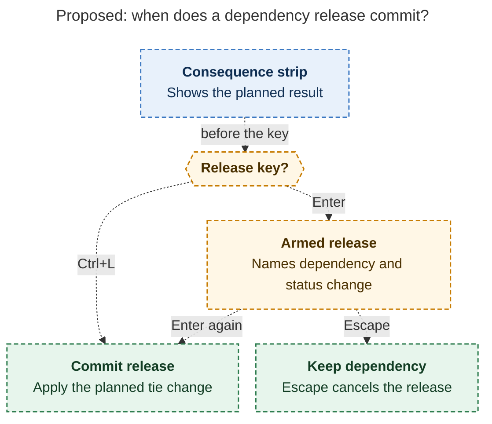
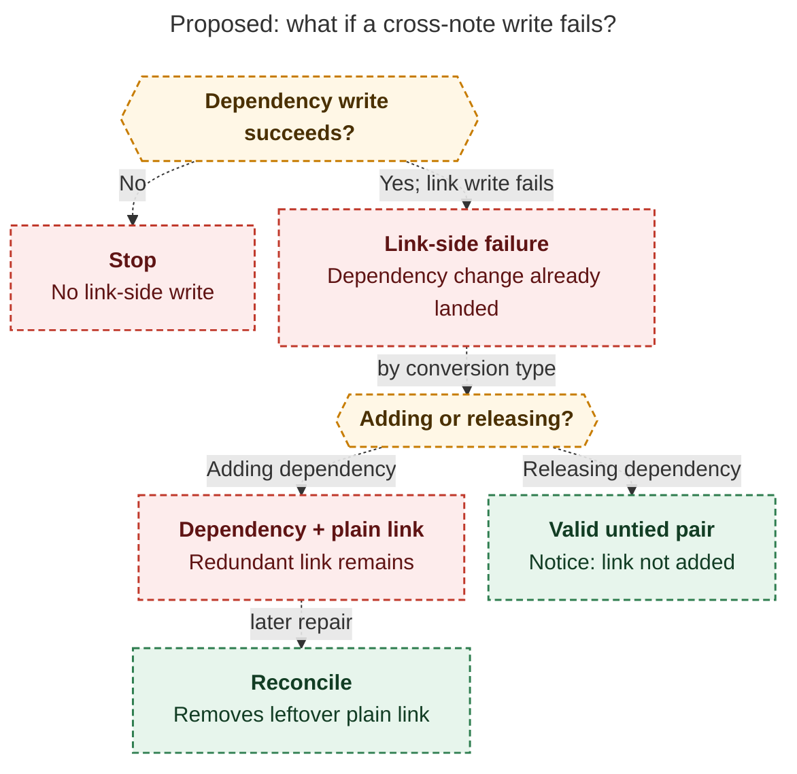

# Diagram proposals: One tie per pair: dependencies and plain links

Proposals for the swarm linker, not a report. Each diagram restates only what the source
report says.

```yaml
source: research:202611/plain_link_dependency_exclusivity/plain_link_dependency_exclusivity__final.md
producer: research.6f.image
check: "mmdc 12.0.0 (Puppeteer --no-sandbox) with the PDF-mirroring config rendered 2 of 2 Mermaid diagrams"
```

## release-confirmation

```yaml
anchor: |-
  commit on one press with the consequence strip
question: |-
  When does a release commit, and when does Escape keep the dependency?
illustrates: |-
  A proposed release commits on one Ctrl+L press or a second Enter press, while Escape keeps an armed dependency release from landing.
caption: "Ctrl+L commits the previewed release; Enter arms a second press, and Escape keeps the dependency."
review: "557.078x740 px, fit 100%; question, source trace, labels, arrows and visual checks passed; 1 revision, 2 look rounds"
```



## cross-note-failures

```yaml
anchor: |-
  **Cross-note conversions** write the **dependency side first** through the existing
question: |-
  What remains if a cross-note conversion only partly succeeds?
illustrates: |-
  Proposed cross-note conversions write the dependency side first; a failed link-side write then leaves either a plain link for reconcile or a valid untied pair with a notice.
caption: "Failure paths only: dependency-write failure stops; later link-write failure leaves redundancy for reconcile or an untied pair with a notice."
review: "592.102x938 px, fit 95.2%; question, source trace, labels, arrows and visual checks passed; 1 revision, 2 look rounds"
```


