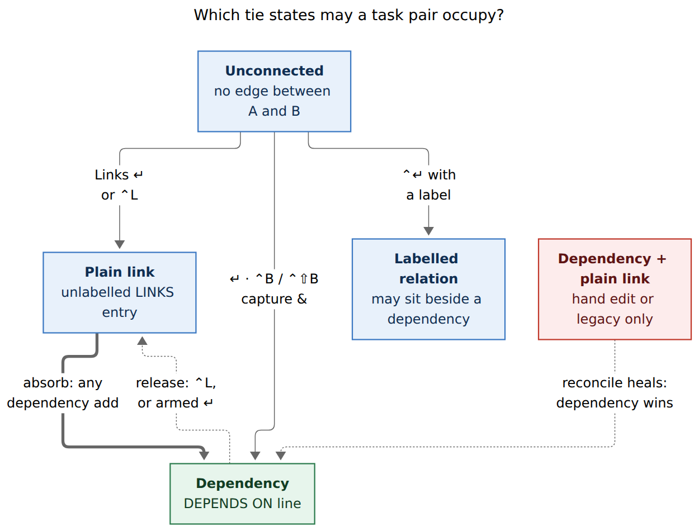
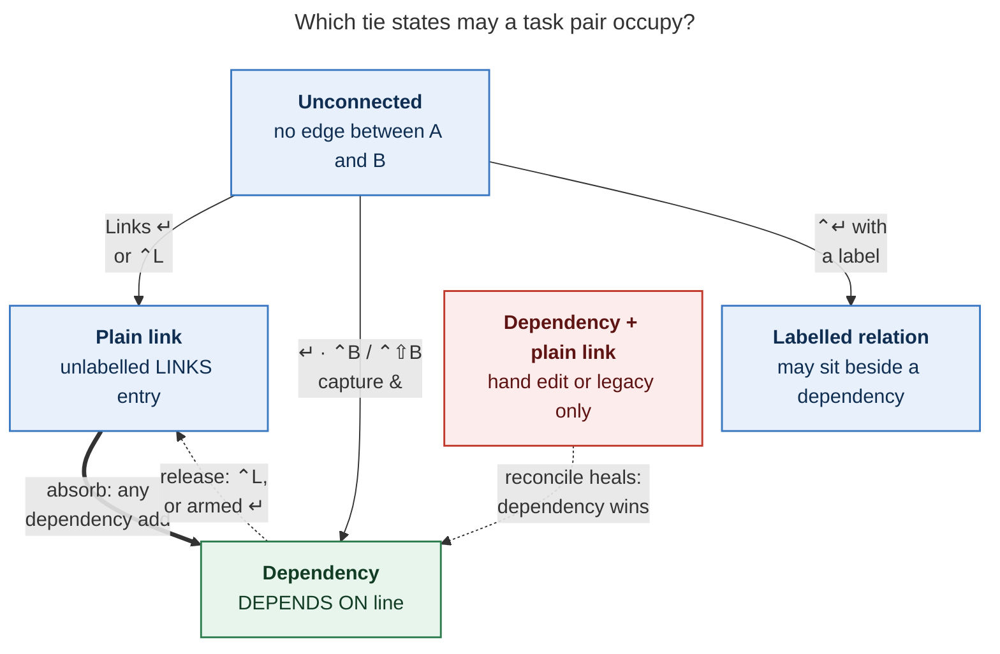

# One tie per pair: dependencies and plain links

*Consolidated report · 2026-11-25 · lead researcher merging five independent swarm
reports (`__cdx`, `__cld`, `__grk`, `__mus`, `__gem`, in this directory) plus the lead's
own verification against bob-cli (workspace HEAD `d67a5b7b`; researchers pinned
`68dee6e1`) and bob-plugins (`origin/master`, fast-forwarded 2026-11-25).*

## Verdict

**Build it.** A task pair should hold a dependency (`⛓️ DEPENDS ON`, either direction)
or a plain — unlabelled — `🪢 LINKS` entry (either direction), never both. All five
researchers independently reached yes, and two independent read-only vault scans agree
the confusing state is real but rare: of 274 dependency edges and 58 plain links, there
are exactly **two** overlaps — and **both are in the reverse direction the brief's
literal rules would never catch**. The brief's instinct is right; its two literal rules
need four adjustments, called out below, the most important being: the invariant must be
**pair-level in both directions**, the exclusion must **exempt labelled relations**, and
the two conversion directions are **not symmetric in risk** — adding a dependency over a
plain link loses nothing, while adding a plain link over a dependency un-blocks a task
(possibly a different task than the one whose panel is open, possibly a whole `^prj`
project). The design below absorbs plain links automatically everywhere, releases
dependencies only through explicit, consequence-previewed Obsidian gestures, and lets
`bob task reconcile` heal anything that slips through, always in the dependency's
favour.

## What the swarm established

### Vault evidence (cld and grk, two independent scans, matching results)

| Fact | Count |
| --- | ---: |
| Dependency edges | 274 |
| LINKS entries | 321 (58 plain, 263 labelled) |
| Same-direction overlap: A depends on B and A plain-links B (the brief's rule shape) | **0** |
| Reverse-direction overlap: A depends on B and **B** plain-links **A** | **2** |
| Labelled relation beside a dependency | 1 (legitimate; keep) |

The two real overlaps:

1. **`bob.md`** (live, writable): the ref task `^ref-plugin-sync-unblocking` gained a
   plain `🪢 LINKS` to `^no-bob-plugins-sync-qs`, and **nineteen seconds later** Bryan
   added the dependency in the other direction from the other panel — the exact
   two-panel correction dance this feature collapses to one keystroke. The direction he
   needed was "**it** waits on **me**", which matters for the keymap design (§ Key
   grammar).
2. **`done/cash_done.md`** (protected history): a prerequisite gained a plain link to
   its dependent at close. A naive either-direction "plain link deletes the dependency"
   rule would have deleted a dependency nobody meant to drop. It stays as history;
   reconcile never writes `done/`.

The one labelled overlap (`dev.md`: a task waits on `^buy-harddrive` **and** labels the
edge `picks out good hard-drive`) is knowledge riding beside a wait — evidence that
labelled relations must stay legal next to dependencies.

### Code facts (verified by the lead against the checkouts)

| Fact | Where | Consequence |
| --- | --- | --- |
| Reconcile already computes "does a dependency join this pair, either direction" for mention suppression (M7) | `dependency_joins`, `src/native/task_status_hooks/relations.rs:1227` | The enforcement predicate exists; the fold is a small extension, not new machinery |
| The contract hole is one sentence: "Dependencies never suppress relation entries" | `docs/task-relations.md:1865` | Becomes "Dependencies suppress unlabelled relation entries; labelled relations stay" |
| The Links stage already badges `⛓ prerequisite` with tooltip "Also a prerequisite · linking stays inert" — forward direction only, information only | `410-picker-filter-and-render.js:492–499` | Half the visibility feature exists; the tooltip becomes false and must change |
| The Depends-on stage has **no** relation awareness and is the only one of the four stages without a consequence strip | `300-dependency-stage.js`, vs `303-blocks-stage-copy.js` / `305-relation-stage-copy.js` | Both gaps must close for the "make it clear" half |
| `isCtrlKey` omits a `shiftKey` guard (the `Ctrl+[` helper right above has one) | `470-keydown-and-freshness.js` | Bare `⌃B` bound with it would also fire on `⌃⇧B`; fix before adding the chords |
| A stale-editor conflict in a Links/Linked-from stage reopens a **dependency** stage | `reopenDependencyStageFresh`, `440-picker-vault-commit.js:18–23` | Pre-existing bug; fold the fix into this work |
| `.bob-cnp-task-badge` caps at `max-width: 190px` with all extra pills inside it | `styles.css:780` | New tie pills must move out of the badge or they clip |
| Capture stages `&`/`*` dependency edits before `~`/`~~` relation edits; nothing stops `&T ~T` on one item | `src/native/capture/` (all five reports agree) | Same-item contradiction needs an explicit rule, not implementation-order luck |
| Capture already has the preview/report precedent for destructive-but-previewed dependency drops | `dropped_dependencies` / `link_guard`; decision `capture-link-drops-blocking-deps` | Reuse the report shape; Mac renders it for free (thin client) |

## Is this a good idea?

Yes — the case does not rest on volume (2 of 274 edges) but on three things:

1. **Redundancy lands in the most visible place.** One overlap renders the same fact on
   four child lines across two tasks, as two chip rows per task.
2. **Correcting the edge kind is a real workflow** (the `bob.md` case), and today it
   costs two stage trips plus a manual unlink that Bryan actually forgot — which is how
   the overlap got there.
3. **The panels currently mislead.** "Linking stays inert" invites the overlap; the
   Depends-on panel says nothing at all about existing links.

The honest costs: the relations **inertness guarantee needs rewording**, not quiet
violation — the new framing is *a tie change that adds or removes a dependency is a
dependency write* (guards, lane transfer, Pomodoro consumption, freshness stamps all
follow the dependency contract), while relation writes themselves stay inert. And
"impossible" has a scope: supported writers cannot produce the state and reconcile heals
hand edits, but arbitrary Markdown files can always briefly contain contradictory text,
and protected history (`done/`, the previous daily note) is never rewritten. Claiming
more than that would be false.

## Adjustments to the brief (each one is a deliberate change)

| # | Brief | Adjusted to | Why |
| --- | --- | --- | --- |
| **R1** | "Remove any existing dependency/link to task B **from the current task**" | The invariant is over the **unordered pair, both directions**: if a dependency joins A and B either way, neither holds a plain link to the other | Both real overlaps are reverse-direction; the literal rules catch zero of them |
| **R2** | "relationless link" | **Plain link** = a LINKS entry with no label. **Labelled relations coexist with dependencies** and are untouched | 263 of 321 LINKS entries are labelled and carry meaning a dependency cannot (`implemented by`, `superseded by`, `starts after` per SA14); the one live labelled overlap is legitimate. mus's widen-to-labelled is rejected: adding a label *resolves* the ambiguity rather than gaming the rule, and label-bearing edges drive completion/cancel/merge/successor effects that must not be silently destroyed |
| **R3** | Adding a plain link removes the dependency, symmetrically, everywhere | **Asymmetric**: a dependency **absorbs** plain links everywhere (stages, `⌃B`, capture `&`/`*`, task-merge repointing). A dependency is **released** to a plain link only by an explicit Obsidian stage gesture whose consequence is shown before the key lands. Capture plain `~`, hand edits, agents, and reconcile never release | Absorbing loses nothing; releasing changes task status — possibly another task's, possibly a `^prj` cascade. `bob capture` is also driven by agents: a "see also" link must never unblock work |
| **R4** | `Ctrl+B` in the link panel; reverse from the dependency panel | One grammar in **all four** stages (Depends on, Blocks, Links, Linked from), copying the Task Card keycaps: **⌃B** = this task waits on it, **⌃⇧B** = it waits on this task, **⌃L** = plain link. Picker-scoped only — never a global hotkey | A plain link has no direction a dependency can inherit; the `bob.md` case needed the reverse edge, so one `⌃B` cannot cover it. Global `Ctrl+B` is Bold; inside the stages the chords are free (the modal is a keymap island — `Ctrl+R` already shadows `app:reload` there) |
| **R5** | "Make it clear in the panels" | Tie badges **in both directions** in all four stages, a `⇄` badge on rows where ↵ converts, an empty-filter tie band, subtitle counts, and the consequence strip the Depends-on stage is missing | Today's badge is one panel, one direction, and claims inertness that will no longer be true |
| **R6** | "Make this state impossible" | Supported writers cannot produce it; **`bob task reconcile` converges** hand edits and legacy data (dependency wins, reported); protected history is diagnosed, never rewritten | Markdown files cannot be made incapable of containing invalid text; the achievable guarantee is convergence plus honest reporting |
| **R7** | (implicit) Obsidian-only | Enforce in every writer: capture (`&`/`*` absorb; same-item `&T ~T` is a teaching error; plain `~` over a dependency is a reported no-op), `bob task merge` repointing, the `⌃↵` relation-label stage ("Plain link (no relation)" is guarded when a dependency joins the pair), and reconcile | Four non-Obsidian backdoors exist today; closing three of four ships a hole |
| **R8** | (implicit) | Counted sessions (`N Ctrl+Shift+L`) and Tab-marked batches **refuse** the convert chords in v1 (`⌃B acts on one task`) | Status fan-out hides too easily in a batch; cdx's desired-state batch semantics are a coherent v2 if wanted |

## The rule

Let `D(A,B)` mean A's DEPENDS ON line lists B, and `P(A,B)` mean A's LINKS line holds an
**unlabelled** entry for B.

```text
Forbidden, for pairs in writable notes:
    (D(A,B) or D(B,A)) and (P(A,B) or P(B,A))

Always legal beside either family:
    labelled relations (existing one-entry-per-direction rule unchanged)
    mentions (already governed by M7)
```

The rule is **structural, not status-keyed** (cdx): a dependency on an already-completed
prerequisite is still the pair's tie — it no longer blocks, so conversion copy must say
"status unchanged · removes satisfied prerequisite" instead of falsely promising "Ready
again" — but the plain link is still redundant. Closed tasks' own lines and protected
notes (`done/`, the previous daily) are never auto-edited; the `done/cash_done.md`
overlap stays as diagnosed history.



**Caption.** A dependency add absorbs a plain link from any writer; only an explicit
Obsidian gesture releases a dependency back to a plain link; reconcile heals hand-made
overlaps by keeping the dependency. Labelled relations sit outside the exclusive set.

Rendered size: 832 × 634 px; fit scale: 78.5% (Mermaid CLI 12.0.0, PDF-mirroring
config).



## Design

### Key grammar: Ctrl plus the Task Card key

The Task Card opens the four stages with `b`, `⇧B`, `l`, `⇧L`. Inside any of them, the
same letter with Ctrl **sets the highlighted pair's tie to that kind**, relative to the
stage's owner:

| Key, in any of the four stages | Result for owner O and highlighted row X |
| --- | --- |
| **⌃B** | ⛓ O waits on X — absorbs plain links both ways; keeps labelled relations |
| **⌃⇧B** | 🧱 X waits on O — same absorption; reversing an existing dependency is cycle-guarded |
| **⌃L** | 🪢 plain link — releases the pair's dependency; the strip names the status change first |
| **↵** | unchanged: the stage's native add/remove. On a row tied the *other* kind (marked `⇄`), ↵ converts — and **arms a 2-press confirm whenever the conversion releases a dependency** |

The chords are desired-state commands, not toggles (rejecting mus's "⌃B toggles
blocking-ness"): pressing one when the pair already has that tie shows a quiet notice
("Already waits on it") and writes nothing, so a double-press can never flip state back.
Guards are the existing ones: dependency eligibility (closed, archived, and daily-note
Event Tasks cannot become prerequisites, with the refusal reason in the strip), cycle
checks on the trial graph, the `＋ id` prompt, stale-row refusal. `^prj` conversions
pass through the project guards and the strip names the resident fan-out (`unblocks 12
residents of ‹sase›`).

Key handling: picker-scoped only; strict modifier matching (fix `isCtrlKey` to require
`shiftKey === false` and add a shift-required variant for ⌃⇧B, mirroring
`isCtrlLeftBracketKeydown`); `preventDefault` so ⌃B never bolds the editor behind the
modal and macOS caret motion is suppressed like the existing `Ctrl+N`/`P`; Ctrl only,
never Meta, so macOS `⌘B` stays Bold; ignore repeats, composition events, and the
relation-label field and block-ID prompt; `Esc`/`q`/`Ctrl+[` behaviour unchanged.

### Why the confirm asymmetry

Deliberate chords (⌃B / ⌃⇧B / ⌃L) commit on one press with the consequence strip
already showing the result — the user chose a conversion key. The habitual key (↵) can
land on a `⇄` row out of muscle memory, and a release can change **another** task's
status from this panel; so ↵-releases arm once (amber strip:
`⚠ Removes the dependency · "X" becomes Ready — ↵ again · Esc keeps it`) and commit on
the second press. This reuses the existing cancel/merge confirm-nonce machinery in
`426-picker-relation-stage.js` — no new UX pattern. Absorbing ↵-conversions (adding a
dependency over a plain link) stay single-press: nothing is lost.

### Making the existing tie obvious

Same glyphs, no new palette, no line-height change:

- **Tie badges on every row, both directions, all four stages**: `⛓ prerequisite` (O
  waits on X — today's badge, tooltip changed), `🧱 dependent` (X waits on O), and in
  the dependency stages `🪢 linked` / `🪢 links here`. Labelled relations keep their
  muted pill, now also shown in the dependency stages so "follow-up of" stays visible
  when a dependency is added beside it. Move the pills out of the 190px
  `.bob-cnp-task-badge` into a trailing cluster (fixes the clipping bug); the badge
  keeps only the action glyph (`＋`, `−`, `⇄`, `🔒`).
- **The `⇄` action badge** replaces `＋`/`−` whenever ↵ would convert instead of
  add/remove, so conversion is visible before any key.
- **An empty-filter tie band** between CURRENT and RESULTS, shown only when non-empty:
  `TIED BY A DEPENDENCY` in the link stages, `PLAIN LINKS` in the dependency stages,
  listing the owner's other-kind ties in both directions — the panel answers "is this
  already tied?" without typing.
- **Subtitle counts** the other kind (`Links to 2 · 1 tied by a dependency`), and the
  Links subtitle drops "does not block", because ⌃B now can.
- **The consequence strip comes to the Depends-on stage** (the only stage without one).
  Strip copy always comes from the planned result, never from the gesture: `Ready
  again`, `still Blocked (waits on 2)`, `status unchanged · prerequisite already done`,
  `Blocked · removes its link from JOB 10:10–10:35`, resident counts for `^prj`.
- **Notices name what was replaced**: `⛓ Now waits on "X" · replaced the 🪢 link ·
  Blocked`; `🪢 Now links to "X" · no longer waits on it · Ready again`; `⛓ Now waits
  on "X" · kept the "follow-up of" relation`.
- The `"Also a prerequisite · linking stays inert"` tooltip is retired.
- Chips need no change: the invariant means a pair never renders two tie chips.

### Reliability and write order

- One shared pure planner — `planTieChange({owner, other, to})` composing the existing
  dependency and LINKS line planners, with a Rust twin, pinned by a new **PT vector
  family** in `docs/task-relations.md` (the LW/DW pattern). Reuse the pair predicate the
  code already has (`dependency_joins`; ledger-tools' `relationPairs`/`dependencyPairs`
  join) rather than minting a third identity/equality.
- **Same-note conversions** (the common case: both lines are children of the owner) are
  one editor transaction and **one Ctrl+Z**. Never split the drop and the add across
  transactions.
- **Cross-note conversions** write the **dependency side first** through the existing
  guarded writers (preflight, guards, stamps, lane transfer, consumption); if that
  fails, nothing else is written. The link side follows best-effort, like today's
  mirrors — and the order converges either way: a leftover plain link is folded by
  reconcile; a missing plain link after a release leaves a valid (merely untied) pair,
  and the notice says `· 🪢 link not added`.
- Required authored removals complete before the new relationship is reported; a no-op
  is byte-identical with no history entry and no freshness stamp. A conversion that
  touches dependencies follows dependency-edit freshness rules; a pure relation edit
  stays unstamped.
- Clear `[dependsOn::]` with the line when removing the last dependency, or R2
  re-adopts the edge; never strip the target's `[id::]` (other dependents may use it).
- Fix `reopenDependencyStageFresh` to reopen the stage the user was actually in.

### Capture and Bob Mac Capture

Capture stays the grammar authority; Mac stays a thin client.

- `&` / `*` **absorb**: the staged batch removes the pair's plain links in the same
  all-or-nothing write, reported additively as `absorbed_plain_links[] {path, line,
  source, target, dependency}` (mirroring the `dropped_dependencies` shape);
  `--dry-run` previews it.
- Plain `~` / `~~` against an existing dependency is a **reported no-op**:
  `relation_updates[].action: "unchanged"` plus `subsumed_by: "dependency"` and a
  warning. It never releases. (`~T|label` writes normally.) A no-op rather than gem's
  hard refusal because capture is all-or-nothing: aborting a whole agent draft over a
  harmless redundant "see also" is the wrong trade, and the no-op already converges
  with reconcile's semantics.
- One item naming the same resolved target with both a dependency sigil and a plain
  relation sigil (`&T ~T`, `*T ~~T`, …) is a **teaching error**: `"T is already a
  prerequisite here · drop ~ or give it a |label"`. Positional last-sigil-wins (grk) is
  rejected: a silent winner chosen by token order is exactly the kind of invisible
  precedence this feature exists to remove.
- `capture-complete` grows additive fields: relation candidates carry the pair's
  dependency tie in **both** directions (today's `also_prerequisite` stays as a
  deprecated alias), dependency candidates carry plain-link flags. Mac renders the new
  capsules (`Prerequisite · plain ~ adds nothing`, `Linked · & replaces the link`);
  Mac-side convert keys in its pickers are a follow-up, not a blocker. Coordinate the
  contract change across both repos and watch the exact-SHA macOS run.
- `bob task merge` repointing a dependent prunes any plain link it would newly overlap
  (gem's find), inside the same merge transaction.

### Reconcile, repair, and existing data

- New fold step in `reconcile_relation_lines`, before the LINKED FROM projection,
  reusing the `DependencyState` M7 already builds: when a dependency joins a pair,
  drop the pair's plain LINKS entries. **Never drop a dependency; never guess from
  modification times.** Skip on any uncertainty: malformed Depends-On or LINKS lines,
  uncertain dependents, duplicate block IDs, quiet-deferred notes. Writable notes only.
- This is a narrow, documented exception to relations §7's "reconcile never edits
  authored LINKS lines" — the cross-line twin of LK8's same-line dedupe — and must not
  grow into general relation rewriting.
- Report additively (`absorbed_plain_links[]`; human `🪢 −1 plain (⛓)`); `--dry-run`
  previews. The one-time vault effect is exactly the `bob.md` case; the `done/` case
  stays. No migration needed.
- Hand edits: nav writes nothing mid-keystroke; when the cursor leaves a hand-typed
  plain link on a dependency-joined pair, show one notice that reconcile will fold it.
  M7 already keeps mentions suppressed, so no mention backlink resurfaces after a fold.
- The `⌃↵` label stage guards "Plain link (no relation)" when a dependency joins the
  pair (relabel-to-empty is a plain-link add, i.e. a release — route it through the
  explicit gestures instead). Relabelling empty → labelled never resurrects a released
  dependency.

## Where the researchers disagreed, and the lead's resolution

| Question | Positions | Resolution |
| --- | --- | --- |
| Labelled relations in scope? | mus: widen to all LINKS entries; the other four: exempt | **Exempt.** 263 labelled edges do real work (completion, cancel, merge, successor per SA14); the vault's one labelled overlap is legitimate knowledge. mus's "users will game the rule by adding labels" inverts the reality: a label turns noise into meaning — that is the escape hatch working |
| Key grammar | cld: ⌃B/⌃⇧B/⌃L with fixed meanings everywhere; grk/gem: per-panel ⌃B/⌃L; mus: ⌃B as a both-ways toggle | **cld's grammar.** The live `bob.md` case needed the reverse edge *from the Links panel*; per-panel direction would have produced the wrong edge or forced a panel switch. The grammar is the Task Card's own keycaps with Ctrl. mus's toggle is rejected (desired-state commands must be idempotent). grk's ⌃⇧B collision worry is answered by the modal keymap island plus strict modifier helpers |
| Releasing a reverse dependency from the Links panel | grk: refuse, redirect to Blocks; gem: allow with 2-press confirm; cdx/cld: allow with consequence copy | **Allow with the 2-press arm on ↵** (and single-press ⌃L). Refusing recreates the two-panel dance this feature kills; arming makes the remote status change deliberate without blocking it |
| Capture plain `~` over an existing dependency | grk: last-sigil-wins; gem: refuse; cld: reported no-op; cdx: reject same-item contradiction | **Same-item → teaching error; cross-gesture → reported no-op.** Order-based winners are invisible precedence; hard refusal aborts whole agent drafts over harmless redundancy |
| Invariant keyed on open/closed status | gem: scope to open dependents; cdx: structural | **Structural**, with closed-task lines and protected notes never auto-edited, and consequence copy honest about satisfied dependencies. Simpler to state, and no status flip can resurrect a pruned overlap |
| Marked/counted batch conversion | cdx: desired-state batches with aggregate preview; cld/grk: refuse in v1 | **Refuse in v1** (`⌃B acts on one task`). cdx's batch semantics are coherent and can be a follow-up |
| Mutual plain links A↔B | cld/grk: zero in vault, no rule yet | **Defer** |

## Contract, docs, and memory

- `docs/task-relations.md`: new "Plain links and dependencies" section (vocabulary,
  the invariant, the writer table, the key grammar, PT vectors); reword §2 /
  guarantee 2 (relation writes stay inert; a tie change that adds or removes a
  dependency is a dependency write); change the M7 sentence at line 1865; add the §7
  fold exception; LX/LG rows for the capture no-op and stage keys.
- `docs/task-dependencies.md`: §6/§15 gain the tie badges, the `PLAIN LINKS` band, the
  forward-stage strip, ⌃L/⌃⇧B, and absorption in the one-gesture writes; §8 capture
  rows gain absorption.
- `docs/capture.md` and `docs/reference/mac-capture/relationship-pickers.md`: new
  fields and capsules. Read `sase/memory/docs.md` before editing any of these.
- A new decision record (e.g. `dependency-absorbs-plain-link`) recording the asymmetry
  and the rejected alternatives, plus a glossary strand **Plain link** — both through
  `/sase_memory_write`, after the contract sentence is true in production.

## Implementation order

1. **Contract first** (bob-cli docs + PT vectors, Rust and JS twins of
   `planTieChange`/pair-occupancy).
2. **Rust core**: the reconcile fold (reusing `DependencyState`/`dependency_joins`);
   capture absorption, the same-item error, the plain-`~` no-op; `capture-complete`
   fields; merge-repoint pruning; a dry run of the fold against the vault (expected
   effect: the `bob.md` pair only).
3. **bob-plugins (nav)**: planner + JS vectors; absorption in the forward and Blocks
   writers; tie badges, `⇄`, tie bands, the Depends-on strip; ⌃B/⌃⇧B/⌃L; the armed ↵
   release; notices; retire the inert tooltip; fix `isCtrlKey`,
   `reopenDependencyStageFresh`, and the badge CSS split; `npm run build`, tests,
   `bob plugins sync`.
4. **Mac**: render the new capsules; watch the exact-SHA macOS CI run.

Minimum viable cut if the epic must shrink: phase 2's reconcile fold plus phase 3's
chords, badges, and strip. Capture JSON and Mac can follow.

Test focus beyond the PT vectors: all four stages × both directions × (no edge, plain
same/reverse/both, dependency, labelled, labelled+dependency, invalid pair); satisfied
(closed-prerequisite) conversions say "status unchanged"; last-vs-one-of-several
dependency removal and `[dependsOn::]` clearing (R2 re-adoption); cycle and eligibility
refusals that leave the original link intact; `^prj` fan-out counts; cross-note failure
after each authored step; stale snapshots and duplicate IDs; counted/marked refusal;
repeats, IME, no ⌃B leakage into Bold, macOS `⌘B` untouched; reconcile idempotence
(second pass is a no-op); capture dry-run/apply agreement.

## Recommended solution

**Adopt pair-wise exclusivity between dependencies and plain (unlabelled) links, with
labelled relations exempt, under one rule: a dependency absorbs a plain link anywhere;
only an explicit, consequence-previewed Obsidian gesture releases one.** Ship the
`⌃B / ⌃⇧B / ⌃L` grammar in all four relationship stages with tie badges in both
directions, the `⇄` convert marker, the empty-filter tie band, the Depends-on
consequence strip, and an armed two-press ↵ for any release. Enforce in every writer —
stages, capture, merge — on one shared Rust/JS planner pinned by shared vectors, with
`bob task reconcile` converging hand edits in the dependency's favour and protected
history left as diagnosed. In the live vault this turns the recorded 19-second,
two-panel correction into one keystroke (⌃⇧B), heals the one writable overlap on the
next reconcile, and makes the remaining one impossible to recreate from any supported
writer — without silently unblocking anything, losing a label, or promising filesystem
guarantees Bob cannot keep.

## Sources

- The five swarm reports in this directory (`__cdx`, `__cld`, `__grk`, `__mus`,
  `__gem`), each with its own detailed source lists; grk's rendered figures are in
  `unlabelled_relation_xor_dependency__grk_assets/`.
- Lead verification (2026-11-25): bob-cli `src/native/task_status_hooks/relations.rs`
  (`dependency_joins`, line 1227), `docs/task-relations.md:1865`; bob-plugins
  `bob-navigation-hotkeys/src/470-keydown-and-freshness.js` (`isCtrlKey`),
  `src/440-picker-vault-commit.js` (`reopenDependencyStageFresh`),
  `src/410-picker-filter-and-render.js:492–499` (`⛓ prerequisite` badge and tooltip),
  `styles.css:780` (badge `max-width`).
- SASE memory (audited reads this turn): `decisions:task-deps-are-depends-on-links`,
  `decisions:capture-link-drops-blocking-deps`, `glossary:Task Relation`.
- Vault evidence: the independent read-only scans in the cld and grk reports
  (matching counts and the same two overlap pairs).
