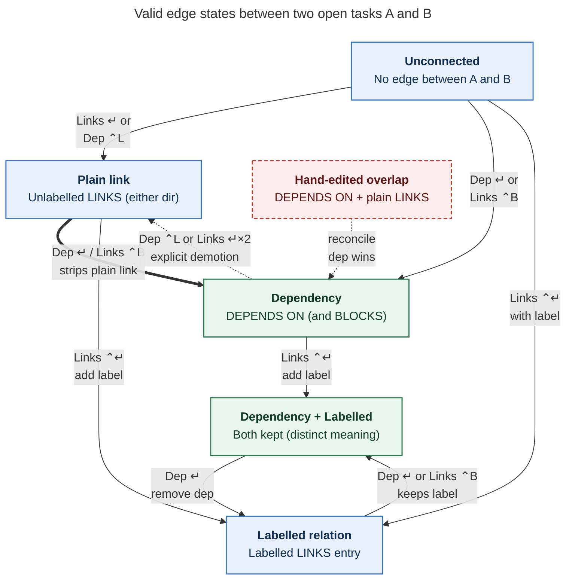
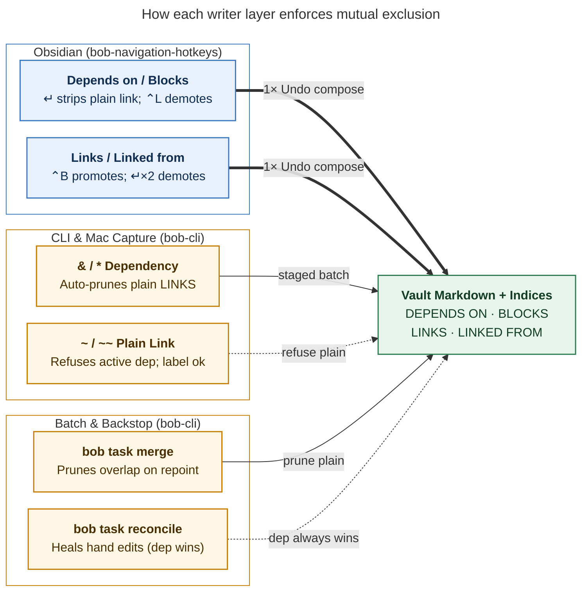

# Mutual Exclusion Between Task Dependencies and Relationless Links

> **Research scope**: `bob-cli`, `bob-plugins` (`bob-navigation-hotkeys`, `bob-ledger-tools`), and `bob-mac-capture`
> **Question**: Should an open task pair `(A, B)` be prevented from simultaneously holding a dependency (`DEPENDS ON:`) and a relationless (unlabelled) link (`LINKS:`) in either direction—and what is the most intuitive, reliable, and cohesive way to design cross-panel visibility, `<ctrl+b>` / `<ctrl+l>` conversion gestures, and full-stack enforcement?

---

## 1. Executive Summary & Verdict

**Verdict: The core instinct is strong and aligns cleanly with Bob's existing graph semantics—but implementing the rule *literally and symmetrically* would introduce real footguns.**

In Bob today, a dependency (`⛓ DEPENDS ON:` / `🧱 BLOCKS:`) already establishes a bidirectional, navigable, back-projected connection between two tasks. Adding an unlabelled `🪢 LINKS:` entry between the same pair carries **zero additional semantic information** while creating duplicate backlinks, redundant UI chips, and cognitive noise ("is `A` related to `B` *besides* waiting on it, or is this a stale link from before I made it a dependency?"). Crucially, Bob already enforces the exact sibling rule for mentions (`docs/task-relations.md` §19.2 **M7**: any `DEPENDS ON` edge in either direction suppresses `(💬 mentions)` because the dependency already links the pair).

At the same time, scoping the prohibition **strictly to relationless (unlabelled) links** is essential. Live vault data confirms why: `bob relations list -a -f json` reports **263 labelled relations** across 14 labels—dominated by `implemented by` (148, completes), `superseded by` (37, cancels), `inspired by` (33), `merged into` (18, merges), `verified by` (12, completes), `duplicate of` (5, cancels), and `starts after` (3, offers). Those carry workflow and provenance meaning that a dependency cannot replace and must remain legal alongside `DEPENDS ON`.

However, **three design traps** sit inside the literal requirements as originally stated:

1. **Upgrading a plain link to a dependency is safe and inert; silently *removing* a dependency when adding a plain link is destructive.** Removing a dependency mutates task status (`Blocked → Ready`), can silently unblock an entire `^prj` project and all of its sub-projects (`decisions:projects-block-from-prj-line`), can unblock a *different* task `B` remotely from `A`'s Links panel, and can erase completed prerequisite history (`docs/task-dependencies.md` §5). It also breaks the **Relations Inertness** contract (`docs/task-relations.md` §2, **LR18**).
2. **Bob has four panels, not two.** Obsidian ships `⛓ Depends on` (`Ctrl+Shift+B`), `🧱 Blocks` (`Ctrl+Shift+Alt+B`), `🪢 Links` (`Ctrl+Shift+L`), and `🪢 Linked from` (`Ctrl+Shift+Alt+L`). Designing only the two forward panels leaves `Blocks` and `Linked from` blind and inconsistent—and creates a hidden directionality choice on reverse demotion.
3. **Obsidian alone cannot make the state "impossible."** Hand edits, Vim edits, `bob capture` (`&`/`*` paired with `~`/`~~`), the `⌃↵` relation-label picker (`Plain link (no relation)`), `bob task merge` dependent repointing, and Git sync merges can all re-introduce the overlap unless `bob-cli` and `bob task reconcile` enforce the invariant too.

### Recommended Solution in One Paragraph

Enforce **Asymmetric Guarded Replacement + 4-Panel Arrow-Preserving Conversion + Convergent Reconcile Backstop**:

- **Invariant**: Whenever an open dependent task `D` has a dependency on `P` (`D ──dep──▶ P`), neither `D` nor an open `P` may carry an **unlabelled** `LINKS:` entry targeting the other. Labelled relations remain legal; closed/archived dependents remain frozen history.
- **Upgrades auto-clean; demotions require explicit intent**: Adding a dependency (`Depends on` / `Blocks` `↵`, `Links` / `Linked from` `Ctrl+B`, or `bob capture` `&`/`*`) automatically strips any unlabelled `LINKS:` entry between the pair in either direction in one composed write. Conversely, demoting a dependency to a plain link is **1-keystroke explicit** via `Ctrl+L` in `Depends on` / `Blocks`, **2-press inline-confirmed** via `↵` on a dependency-joined row in `Links` / `Linked from` (matching Bob's existing cancel/merge confirm-strip pattern), and **refused with a teaching error** in `bob capture` unlabelled `~`/`~~` (while labelled `~...|label` stays 1-step everywhere).
- **4-panel visual clarity**: Give `⛓ Depends on` the fixed-height consequence strip the other three panels already have; split semantic micro-pills out of the 190px-capped `.bob-cnp-task-badge` (fixing a real clipping bug); show amber `⛓ depends on` / `🧱 blocks` badges and `⇄` action icons in Link panels and accent-tinted `🪢 plain link` / `🪢 linked here` badges in Dependency panels; and make `bob task reconcile` deterministically prune any hand-edited overlap (**dependency always wins**).

---

## 2. Current State Audit

### 2.1 Four-Panel Parity & Blind Spots in Obsidian (`bob-plugins`)

Inspecting `bob-navigation-hotkeys/src/` reveals that the four relationship panels evolved sequentially and have asymmetric cross-awareness, UI chrome, and data wiring:

| Panel & Hotkey | Stage Builder / View | Cross-Relationship Awareness Today | Consequence Strip Today | Graph Data Loaded Today |
|---|---|---|---|---|
| **⛓ Depends on** (`Ctrl+Shift+B`) | `300-dependency-stage.js`, `400-picker-local-task.js`, `590-plugin-dependency-stage.js` | **None.** Zero visibility into `LINKS` / `LINKED FROM`. | **Missing.** Only panel of the 4 without `.bob-cnp-consequence-strip`. | Full `edges` dependency graph (open buffers + Warm Tasks cache). |
| **🧱 Blocks** (`Ctrl+Shift+Alt+B`) | `302-blocks-stage-view.js`, `303-blocks-stage-copy.js`, `425-picker-blocks-stage.js` | **None.** Zero visibility into `LINKS` / `LINKED FROM`. | Present (fixed-height, shows `Blocked` / `Ready again` / project cascade). | Full `edges` dependency graph. |
| **🪢 Links** (`Ctrl+Shift+L`) | `304-relation-stage-view.js`, `305-relation-stage-copy.js`, `426-picker-relation-stage.js`, `427-relation-stage-plugin.js` | **Half-wired.** `buildRelationStageViewModel` (`304-relation-stage-view.js:271`) sets `prerequisite: prerequisiteIds.has(identity)` from `owner.dependsOn` only. Renders muted `⛓ prerequisite` pill (`410-picker-filter-and-render.js:492`) with tooltip `"Also a prerequisite · linking stays inert"`. Misses reverse (`Blocks`), open vs closed status, and consequence copy. | Present (fixed-height, shows label workflow effects & cancel/merge confirm). | **No dependency `edges` graph.** Reads only owner's own `DEPENDS ON` links; cannot check reverse `blocks` or cycles without adding edge collection. |
| **🪢 Linked from** (`Ctrl+Shift+Alt+L`) | `304-relation-stage-view.js:765-860`, `426-picker-relation-stage.js` | **None.** Explicitly hardcodes `prerequisite: false` (`304-relation-stage-view.js:821`). | Present (fixed-height, includes `💬 mention` promotion hints). | **No dependency `edges` graph.** |

### 2.2 Pre-Existing Implementation Details & Bugs Discovered

Four codebase facts directly constrain—and benefit from—this design:

1. **CSS badge clipping bug (`bob-plugins: plugins/bob-navigation-hotkeys/styles.css:774-791`)**:
   `.bob-cnp-task-badge` enforces `max-width: 190px; overflow: hidden; white-space: nowrap;`, yet `410-picker-filter-and-render.js:413-542` currently appends all `.bob-cnp-task-badge-extra` pills (including `⛓ prerequisite`, `🔗 mentions`, `project`, and `session`) *inside* `.bob-cnp-task-badge` alongside the primary action label (`＋`, `−`, `🔒 waits on N`). Adding a clear `🪢 plain link` or `⛓ depends on` badge plus a `⇄` action label inside a 190px box will clip text on normal rows.
2. **Missing `!event.shiftKey` guard in `isCtrlKey` (`bob-plugins: plugins/bob-navigation-hotkeys/src/470-keydown-and-freshness.js:35-43`)**:
   `isCtrlKey(event, key)` checks `ctrlKey && !altKey && !metaKey` but omits `event.shiftKey !== true`. Because the panel hotkeys themselves are `Ctrl+Shift+B` and `Ctrl+Shift+L`, binding bare `Ctrl+B` / `Ctrl+L` with `isCtrlKey` would collide with `Ctrl+Shift+B` / `Ctrl+Shift+L` unless guarded with `event.shiftKey !== true` (matching `isCtrlLeftBracketKeydown` right above it at lines 5–14) plus `!event.repeat && !event.isComposing && event.keyCode !== 229`.
3. **Stale-reopen bug in `reopenDependencyStageFresh` (`bob-plugins: plugins/bob-navigation-hotkeys/src/440-picker-vault-commit.js:18-23`)**:
   When a stale-editor conflict hits `Links` or `Linked from` (`426-picker-relation-stage.js:587`), `refuseDependencyStale` calls `reopenDependencyStageFresh()`, which only branches on `this.blocksStage ? null : "dependsOn"`. A stale conflict in a Link panel currently reopens **`Depends on`** instead of reopening `Links` or `Linked from`. Fixing `reopenDependencyStageFresh()` to dispatch all 4 stages is a low-cost reliability win to fold into this work.
4. **Zero-disk-I/O indices already exist on both sides**:
   - `bob-ledger-tools` exposes `api.relationIndex` (v2, `src/145-relation-index-model.js`, `src/170-plugin-lifecycle.js`) providing O(1) `outgoing(identity)` and `incoming(identity)` over live unsaved buffers + vault cache (authored relations only—excluding mentions). `Depends on` and `Blocks` can query it instantaneously with a snapshot fallback when `bob-ledger-tools` is disabled or warming.
   - `bob-navigation-hotkeys` already has `collectDependencyStageEdgesFromSnapshots` + `mergeStageCacheEdges` (`590-plugin-dependency-stage.js`) operating entirely on in-memory buffers + Warm Tasks cache. Wiring it into `buildVaultRelationStageFromNotes` (`427-relation-stage-plugin.js`) gives `Links` and `Linked from` instant bidirectional dependency awareness *and* live cycle checks for `Ctrl+B` with zero extra disk reads.

### 2.3 CLI (`bob-cli`) & Bob Mac Capture (`bob-mac-capture`) Gaps

- **Capture execution (`bob-cli: src/native/capture/plan.rs:4439,6099`, `dependencies.rs:3518`, `relations.rs`)**: `&`/`*` dependency edits stage before `~`/`~~` relation edits. Today `bob capture "Ship API &foo:bar ~foo:bar"` silently creates **both** `DEPENDS ON: [[foo#^bar]]` and plain `LINKS: [[foo#^bar]]`. Similarly, capturing `~existing` when a dependency already exists, or `&existing` when a plain link already exists, silently creates the overlap.
- **Capture completion (`bob-cli: src/native/capture_complete/candidates.rs:2670`, `render.rs:380-480`; `bob-mac-capture: Sources/CaptureCore/CaptureModels.swift`, `DependencyPickerPresentation.swift`)**: Relation candidates emit a boolean `also_prerequisite` (owner's `DEPENDS ON` only—missing reverse blocks and open/closed status), and `&`/`*` candidates emit no relation metadata at all.
- **Reconcile (`bob-cli: src/native/task_status_hooks/relations.rs:280-285, 923-1030, 1227-1245`)**: `RelationsPass` *already* computes `DependencyState` (`depends_from_loc`, `depends_identities`, `malformed_depends`) and `dependency_joins(...)` in both directions for M7 mention suppression! However, `docs/task-relations.md` §7 rule 5 currently states that reconcile never rewrites authored `LINKS` lines, so overlaps created by hand edits, agent edits, or git merges persist forever.
- **Task merge (`bob-cli: src/native/task_merge/retirement.rs`)**: When `bob task merge` repoints an open dependent `D` from retired source `S` to target `T`, `D` gains a dependency on `T`—which will violate the invariant if `D` or `T` already had an unlabelled `LINKS:` entry to the other.

---

## 3. Critical Critique of the Plan & Justified Adjustments

### 3.1 Is This a Good Idea?

**Yes—with clear scope boundaries.** Plain links and dependencies occupy overlapping territory in a user's mental model ("these two tasks are connected"), while *labelled* relations occupy a distinct semantic tier ("A was superseded by B", "A was implemented by B", "A starts after B"). Removing the possibility of `(dependency + plain link)` eliminates four concrete failure modes:

- **Duplicate backlinks on the task block**: `🧱 BLOCKS: [[A]]` directly above `🪢 LINKED FROM: [[A]]` looks broken and forces Bryan to mentally diff both lines.
- **Lifecycle drift**: A task starts as a loose brainstorm link (`A ~ B`), later becomes a real prerequisite (`A & B`), and the obsolete plain link lingers indefinitely—and stays behind even after `B` is unlinked or reparented.
- **Uncertain cleanup**: When looking at a task's `Links` panel and seeing a linked task that is also a prerequisite, you cannot tell whether unlinking it is safe or changes blocking status.
- **Friction during planning**: You often open `Links` (`Ctrl+Shift+L`) intending to connect two tasks and realize mid-pick that one actually *blocks* the other—or open `Depends on` (`Ctrl+Shift+B`) and realize an existing dependency is really just a loose reference, not a hard gate. Direct `Ctrl+B` / `Ctrl+L` conversion removes the "close panel → open other panel → search the same task again → remove old edge → add new edge" tax.

### 3.2 Evaluating Four Architectural Alternatives

| Option | Description | Pros | Cons / Why Chosen or Rejected |
|---|---|---|---|
| **Option 1: Literal Symmetric Auto-Replacement** | Adding either edge silently removes the other across Obsidian and CLI; `Ctrl+B`/`Ctrl+L` swap directly. | Minimal rules to explain; 1-keystroke everywhere. | **Rejected.** Silently removes dependencies from `Links`/`~`, violating Relations Inertness (`LR18`), risking accidental project/task unblocking (`^prj` cascade) and silent remote unblocking of another task `B`, plus erasing completed prerequisite history. |
| **Option 2: Strict Hard-Refusal Everywhere** | Refuse adding a dep when a plain link exists (and vice versa); require explicit `Ctrl+B`/`Ctrl+L` or manual deletion first. | Zero accidental mutations; strictly preserves `LR18`. | **Rejected.** Unnecessary friction on the *upgrade* path: when you are in `Depends on` and press `↵` on a plain-linked task, refusing and forcing you to go delete a bare link first feels bureaucratic because upgrading a plain link to a dependency loses zero information. |
| **Option 3: Unified "Connections" Modal** | Replace all 4 panels (`Depends on`, `Blocks`, `Links`, `Linked from`) with a single task-connection modal with mode tabs/toggles. | Single mental surface for all edges. | **Rejected.** Throws away the muscle-memory symmetry of `Ctrl+Shift+B` / `Ctrl+Shift+L` and the crisp single-purpose semantics of each stage (blocking, reverse blocking, typed relations, mentions, cancel/merge confirmations). Violates Bob's established multi-stage architecture. |
| **Option 4: Asymmetric Guarded Replacement + 4-Panel Conversion + Reconcile Backstop *(Recommended)*** | Upgrades (`plain → dep`) auto-strip the plain link; demotions (`dep → plain`) are 1-step via `Ctrl+L` in Dep panels, 2-press confirmed via `↵` in Link panels, and refused in plain CLI capture; `reconcile` heals hand edits (dep wins). | Zero friction on safe upgrades; zero accidental unblocking on demotions; preserves Relations Inertness for unconfirmed/CLI paths; 100% consistent across all 4 panels, capture, merge, and hand edits. | Slightly more copy/state logic in `Links`/`Linked from` (reusing the exact 2-press confirm mechanism already built for `cancel`/`merge` relations) and a narrow, documented exception to `docs/task-relations.md` §7 rule 5. |

### 3.3 Justified Adjustments to the Requirements (Explicitly Called Out)

Every deviation from the original prompt is called out below with its justification:

| ID | Original Requirement | Recommended Adjustment | Justification |
|---|---|---|---|
| **A1** | Adding a plain link removes any existing dependency (symmetric with adding a dependency). | **Asymmetric Guarded Replacement**: Adding a dependency silently auto-strips any plain link (either direction). Demoting a dependency to a plain link is **1-keystroke** via `Ctrl+L` in `Depends on`/`Blocks`, **2-press inline-confirmed** (`↵` arms amber warning, `↵` confirms, `Esc` disarms) in `Links`/`Linked from`, and **refused with a teaching error** in unlabelled `bob capture ~`/`~~`. | Dependencies control task status, `^prj` blocking cascades, and completion history; plain links are inert (`LR18`). A misplaced `↵` in `Links` or a capture typo must never silently unblock a project or unblock another task `B` remotely. Reuses the exact inline confirmation UX already used by `superseded by` and `merged into` (`304-relation-stage-view.js`, `426-picker-relation-stage.js`). |
| **A2** | Add `<ctrl+b>` to the link panel and the reverse in the dependency panel (described in terms of 2 panels). | **Full 4-panel arrow-preserving symmetry (`Ctrl+B` in `Links` & `Linked from`; `Ctrl+L` in `Depends on` & `Blocks`)**, where `Blocks + Ctrl+L` demotes `B ──dep──▶ A` into **`B ──plain link──▶ A`** (keeping the arrow on `B`). | Preserves exact round-trip symmetry with `Linked from + Ctrl+B` (`B → A` link ↔ `B → A` dep), avoids prompting for a `^block-id` on `B` (since `A` already has one), and collapses `B`'s `DEPENDS ON` removal + `LINKS` addition into a **single write on `B`'s note**. Also unlocks promoting `💬 mention` rows directly to `Blocks` in `Linked from`! |
| **A3** | "When A has a dependency on B, A should not also have a relationless link to B (in either direction)." | **Scope the active invariant to open dependents**: If `D` is open and `D ──dep──▶ P`, `D` cannot hold plain `LINKS: [[P]]`, and if `P` is also open, `P` cannot hold plain `LINKS: [[D]]`. **Closed/archived dependents (`[x]`/`[-]`, `done/`, previous daily note) are frozen history** and exempt from auto-mutation; their past dependencies display as quiet muted `⛓ done prereq` context pills. | `docs/task-dependencies.md` §5 keeps completed `DEPENDS ON:` links as history, and `docs/task-relations.md` **LR7** forbids mutating `done/` or previous daily notes. Mutating a closed task's historical `DEPENDS ON:` would destroy audit trail and fail write-guard checks. |
| **A4** | Implied Obsidian-first enforcement. | **Close all four non-Obsidian backdoors**: (1) disable `"Plain link (no relation)"` in `relation-label` (`⌃↵`) when an active dependency joins the pair; (2) enforce in `bob capture` (`&`/`*` prune plain `LINKS`, `~`/`~~` refuse active deps, same-draft `& + ~` rejected); (3) prune overlaps in `bob task merge` dependent repointing; (4) add a convergent cleanup pass in `bob task reconcile` where **dependency always wins** over redundant plain `LINKS`. | Without a reconcile backstop and CLI/label-stage guards, "make this state impossible" is porous: a user could bypass it via `⌃↵ → Plain link`, via `bob capture`, via `bob task merge`, or via Vim/agent edits. Because reconcile always lets dependency win, healing never accidentally unblocks a task. |
| **A5** | "`Ctrl+L` makes a dependency a relationless link." | **Also allow `Ctrl+L` on `RESULTS` (unconnected) rows in `Depends on`/`Blocks` to add a plain link directly, AND preserve any existing labelled relation on `CURRENT` rows.** | If you open `Depends on`, search for a task, and realize it's only a loose reference (or blocked by a cycle!), pressing `Ctrl+L` links it immediately without switching modals. And if `A` holds *both* `DEPENDS ON: [[B]]` and `LINKS: inspired by [[B]]`, `Ctrl+L` must not overwrite `inspired by` with a blank label—instead show a clear non-destructive behavior (remove dependency & keep `inspired by`, or refuse with notice explaining it already has a labelled relation; see §5.3). |
| **A6** | "Make it clear in Obsidian panels." | **Add the missing fixed-height consequence strip to `⛓ Depends on`, decouple `.bob-cnp-dep-extras` from the 190px `.bob-cnp-task-badge`, and expose symmetrical metadata in `bob capture-complete` for Bob Mac Capture.** | Fixes an active CSS clipping bug, brings `Depends on` to visual parity with `Blocks`/`Links`/`Linked from`, and prevents Bob Mac Capture from drifting behind Obsidian. |
| **A7** | Implicit assumption that stale-conflict recovery works in Link panels. | **Fix `reopenDependencyStageFresh()` (`440-picker-vault-commit.js:18-23`)** to reopen the exact active stage (`dependsOn`, `blocks`, `links`, `linkedFrom`). | Composed cross-relationship writes touch more lines; stale-conflict recovery must reopen the panel the user was actually in, not dump them into `Depends on`. |

---

## 4. Formal Invariant & Edge State Machine

### 4.1 Exact Pairwise Invariant

For any two distinct tasks `D` and `P` identified by `(canonicalVaultPath, blockId)`:

1. **Active dependency definition**: `D ──dep──▶ P` is an *active dependency* iff `D` has an accepted `DEPENDS ON:` link resolving to `P` **and `D` is open** (`[ ]`, `[/]`, `[!]`, `[b]`, `[w]`, `[?]`, or any non-closed checkbox—i.e., not `[x]` and not `[-]`).
   - Note: `P` itself may be open *or* closed (`[x]`/`[-]`). While `D` is open and still carries `DEPENDS ON: [[P]]`, `P` is part of `D`'s active dependency record. (A closed `P` is already satisfied, so `D`'s `DEPENDS ON: [[P]]` no longer blocks `D`, yet remains an explicit dependency entry on `D` until removed; see §4.2 for the subtle completed-prerequisite UX nuance!)
2. **Prohibited overlap**:
   - Whenever `D` is open and `D ──dep──▶ P`, `D` **must not** contain an unlabelled (`label == None`) `LINKS:` entry resolving to `P`.
   - Whenever `D` is open, `P` is open, and `D ──dep──▶ P`, `P` **must not** contain an unlabelled (`label == None`) `LINKS:` entry resolving to `D`.
3. **Permitted co-existence**:
   - **Labelled relations**: `D ──dep──▶ P` **may** coexist with `LINKS: <label> [[P]]` on `D` and/or `LINKS: <label> [[D]]` on `P` (e.g., `starts after`, `inspired by`, `verified by`).
   - **Closed/archived tasks**: A closed task's existing `DEPENDS ON:` or `LINKS:` line is never auto-mutated; archived notes under `done/` and the previous daily note stay strictly read-only (`LR7`).
   - **Mentions**: Already governed by M7 (`docs/task-relations.md` §19.2), which suppresses `(💬 mentions)` whenever any dependency joins the pair in either direction.

### 4.2 Subtle Edge Case: Open `D` Depending on Already-Done `P`

Suppose `D` is open and has `DEPENDS ON: [[P]]`, where `P` is already `[x]` done (kept as prerequisite history per `docs/task-dependencies.md` §5):
- `D` *still* shouldn't also carry plain `LINKS: [[P]]` (still redundant on `D`).
- However, in `Links` on `D`, removing `DEPENDS ON: [[P]]` when `P` is already done does **not** unblock `D`—it only drops completed prerequisite history. The badge and consequence copy should reflect that distinction clearly: `⛓ done prereq` (muted amber-gray) with strip copy `"Replaces done prerequisite with plain link · status unchanged"` instead of falsely claiming `"Ready again"`.

### 4.3 Edge State Machine



*Figure 1: Valid pairwise edge states between two open tasks `A` and `B`. Thick solid arrow indicates automatic lossless upgrade; dashed arrows indicate explicit demotion or convergent healing of out-of-band hand edits (`bob task reconcile`), ensuring `Dependency + Plain link` has no reachable steady state.*

---

## 5. Obsidian UX & Visual Design (`bob-navigation-hotkeys`)

### 5.1 Design Principles

1. **Zero guesswork before pressing a key**: Every row tells you *what edge already exists* (micro-pill) and *what pressing `↵` will do* (action glyph `＋` / `−` / `⇄`), while the fixed-height consequence strip tells you *exactly what will change across notes and statuses*.
2. **Color encodes consequence, not decoration**:
   - **Neutral muted**: read-only context (`⛓ done prereq`, `🪢 inspired by` — labelled relation stays untouched).
   - **Soft accent (`--text-accent`)**: safe, inert transition (`🪢 plain link`, `🪢 linked here` in Dependency panels — auto-replaced on `↵` without changing any other task's blocking state).
   - **Warm amber (`--color-orange` / `--text-warning`)**: blocking-state mutation (`⛓ depends on`, `🧱 blocks` in Link panels, and armed 2-press confirmation strips).
3. **Muscle-memory symmetry**: `Ctrl+B` = "make this a **B**locking dependency" (same `B` as `Ctrl+Shift+B`); `Ctrl+L` = "make this a plain **L**ink" (same `L` as `Ctrl+Shift+L`).

### 5.2 Visual Architecture & CSS Fix

First, fix the 190px clipping bug (`styles.css:774-791`) by decoupling semantic micro-pills from the right-edge action badge in `410-picker-filter-and-render.js`:

```html
<!-- Proposed right-side cluster inside .bob-cnp-item -->
<div class="bob-cnp-row-trailing">
  <span class="bob-cnp-dep-extras">
    <span class="bob-cnp-xref-pill is-plain-link">🪢 plain link</span>
  </span>
  <span class="bob-cnp-task-badge is-swap" aria-label="Replace plain link with dependency">⇄</span>
</div>
```

- **`.bob-cnp-row-trailing`**: `display: inline-flex; align-items: center; gap: 6px; flex: 0 0 auto;`
- **`.bob-cnp-dep-extras`**: holds up to two compact pills (`max-width: 170px; text-overflow: ellipsis;` per pill, `font-size: 11px; padding: 1px 6px; border-radius: 999px;`).
- **`.bob-cnp-task-badge`**: reserved strictly for the single primary action glyph (`＋`, `−`, `⇄`, `🔒 waits on N`, `↩ cycle`), keeping clean right-edge alignment down the list.
- **New pill classes (theme-adaptive via `color-mix` matching `styles.css` conventions)**:
  - `.bob-cnp-xref-pill.is-plain-link`: `color: var(--text-accent); border: 1px solid color-mix(in srgb, var(--text-accent) 36%, transparent); background: color-mix(in srgb, var(--text-accent) 10%, transparent);`
  - `.bob-cnp-xref-pill.is-dep-active`: `color: var(--text-warning, var(--color-orange)); border: 1px solid color-mix(in srgb, var(--text-warning, var(--color-orange)) 46%, transparent); background: color-mix(in srgb, var(--text-warning, var(--color-orange)) 12%, transparent); font-weight: var(--font-medium);`
  - `.bob-cnp-xref-pill.is-dep-done` / `.is-labelled`: `color: var(--text-muted); border: 1px dashed var(--background-modifier-border); background: transparent;`
  - `.bob-cnp-task-badge.is-swap`: `color: var(--text-accent); border-color: color-mix(in srgb, var(--text-accent) 42%, transparent); background: color-mix(in srgb, var(--text-accent) 10%, transparent);` (amber variant `.is-swap-warn` when replacing an active dependency in Link panels).
- **Consequence strip on `⛓ Depends on`**: Reuse the exact `.bob-cnp-consequence-strip` (fixed `min-height: 28px`, zero layout jitter, tabular transition) already rendered in `Blocks`, `Links`, and `Linked from` (`styles.css:2022-2060`).

### 5.3 Cross-Relationship Badge & Consequence Strip Matrix (All 4 Panels)

| Panel | Row's Cross-State | Micro-Pill | Action Badge | Consequence Strip (on focus) |
|---|---|---|---|---|
| **⛓ Depends on** | Plain link `A → B` | `🪢 plain link` *(accent)* | `⇄` | `Replaces plain link with prerequisite · Blocks this task` *(or `Replaces plain link` if `B` is done)* |
| **⛓ Depends on** | Plain link `B → A` | `🪢 linked here` *(accent)* | `⇄` | `Replaces incoming plain link from B · Blocks this task` |
| **⛓ Depends on** | Plain links both ways | `🪢 plain link ⇄` *(accent)* | `⇄` | `Replaces plain links in both directions · Blocks this task` |
| **⛓ Depends on** | Labelled relation `A ↔ B` | `🪢 <label>` *(muted dashed)* | `＋` | `Adds prerequisite · keeps “<label>” relation` |
| **⛓ Depends on** | Current prerequisite (`CURRENT`) | *(none, or `🪢 <label>` if labelled)* | `−` | `Removes prerequisite · Ready again` *(or `stays Blocked by N other`)* · hint `⌃L plain link` |
| **🧱 Blocks** | Plain link `B → A` or `A → B` | `🪢 plain link` / `🪢 linked here` *(accent)* | `⇄` | `Replaces plain link · Blocks B` *(or `+ project cascade`)* |
| **🧱 Blocks** | Labelled relation `B ↔ A` | `🪢 <label>` *(muted dashed)* | `＋` | `Blocks B · keeps “<label>” relation` |
| **🧱 Blocks** | Current dependent (`CURRENT`) | *(none, or `🪢 <label>`)* | `−` | `Unblocks B` *(or `B stays Blocked by N other`)* · hint `⌃L plain link` |
| **🪢 Links** | Active dep `A → B` (open `B`) | `⛓ depends on` *(amber)* | `⇄` *(amber)* | `Already a prerequisite · ↵ replaces dep with plain link · ⌃↵ adds a label` |
| **🪢 Links** | Active dep `A → B` (done `B`) | `⛓ done prereq` *(muted dashed)* | `⇄` | `Done prerequisite · ↵ replaces with plain link (status unchanged) · ⌃↵ adds label` |
| **🪢 Links** | Reverse active dep `B → A` | `🧱 blocks` *(amber)* | `⇄` *(amber)* | `This task blocks B · ↵ unblocks B & plain-links · ⌃↵ adds a label` |
| **🪢 Links** | Armed 2-press confirm (`↵` #1) | `⛓ depends on` / `🧱 blocks` *(amber)* | `⚠ ↵` | **Amber banner**: `⚠ Removes dependency (Ready again) and adds plain link — ↵ again to confirm · Esc cancels` |
| **🪢 Linked from** | Reverse active dep `B → A` | `🧱 blocks` *(amber)* | `⇄` *(amber)* | `Already blocked by this task · ↵ unblocks B & links here · ⌃↵ adds label` |
| **🪢 Linked from** | Forward active dep `A → B` | `⛓ depends on` *(amber)* | `⇄` *(amber)* | `Already a prerequisite · ↵ drops dep & links here · ⌃↵ adds label` |
| **🪢 Linked from** | `💬 mention` row (`CURRENT`) | `💬 mention` *(accent)* | `＋` | `Mentions this task · ↵ promotes to plain link · ⌃B marks as blocked by this task` |

### 5.4 Panel Mockups

#### Mockup A — `⛓ Depends on` (`Ctrl+Shift+B`) showing plain-link awareness + new consequence strip

```text
╭─ ⛓ Depends on · Ship v2 billing webhook ───────────────────────────────────────╮
│ 🔍 Search tasks...                                                             │
├────────────────────────────────────────────────────────────────────────────────┤
│ CURRENT (1)                                                                    │
│   ○ Verify Stripe signing secret  [billing.md]                             [−] │
│                                                                                │
│ RESULTS                                                                        │
│ ▸ ○ Draft webhook retry policy    [billing.md]    (🪢 plain link)          [⇄] │
│   ○ Update customer status page   [ops.md]        (🪢 linked here)         [⇄] │
│   ○ Audit webhook latency         [perf.md]       (🪢 inspired by)         [＋] │
│   ○ Rotate staging API key        [infra.md]                               [＋] │
│   ⊘ Backfill failed webhooks      [billing.md]    (↩ cycle)         [🔒 cycle] │
├────────────────────────────────────────────────────────────────────────────────┤
│ ℹ Replaces plain link with prerequisite · Blocks this task (Blocked)           │
├────────────────────────────────────────────────────────────────────────────────┤
│ ↵ replace link with dep · ⌃L plain link · Tab mark · ⌃N/P move · Esc close     │
╰────────────────────────────────────────────────────────────────────────────────╯
```
*Note how even on the cycle-disabled row (`Backfill failed webhooks`), `↵` is disabled for dependency cycles, while `⌃L` remains enabled to create a plain link—because plain links are acyclic-unconstrained!*

#### Mockup B — `🪢 Links` (`Ctrl+Shift+L`) showing dependency badge, `⌃B`, and armed 2-press confirm

```text
╭─ 🪢 Links · Ship v2 billing webhook ───────────────────────────────────────────╮
│ 🔍 webhook                                                                     │
├────────────────────────────────────────────────────────────────────────────────┤
│ CURRENT (2)                                                                    │
│   ○ Draft webhook retry policy    [billing.md]                             [−] │
│   ○ Audit webhook latency         [perf.md]       [inspired by]            [−] │
│                                                                                │
│ RESULTS                                                                        │
│ ▸ ○ Verify Stripe signing secret  [billing.md]    (⛓ depends on)          [⇄] │
│   ○ Notify enterprise customers   [launch.md]     (🧱 blocks)              [⇄] │
│   ○ Document webhook payload      [docs.md]                                [＋] │
├────────────────────────────────────────────────────────────────────────────────┤
│ ⚠ Removes prerequisite (Ready again) & adds plain link — ↵ confirm · Esc back  │
├────────────────────────────────────────────────────────────────────────────────┤
│ ↵ confirm demote · ⌃↵ add label · ⌃B dependency · Tab mark · Esc cancel        │
╰────────────────────────────────────────────────────────────────────────────────╯
```

### 5.5 Complete Keymap Semantics: `<ctrl+b>` and `<ctrl+l>`

#### Key Detection & macOS Ergonomics

- **Helper fix**: Introduce `isStrictCtrlKey(event, key)` checking `event.ctrlKey && !event.altKey && !event.metaKey && !event.shiftKey && !event.repeat && !event.isComposing && event.keyCode !== 229`.
- **macOS `Ctrl+B` note**: On macOS AppKit, `Ctrl+B` defaults to Emacs caret-left inside `<input>`. This is an intentional, already-accepted trade-off in Bob: `decisions:relation-card-tab-accepts-ctrl-d-hides` already claims `Ctrl+H`, `Ctrl+D`, `Ctrl+N`, and `Ctrl+P` in picker inputs, with `←`/`→` and `Opt+←`/`→` remaining available for caret motion. Calling `event.preventDefault(); event.stopPropagation();` matches those siblings cleanly.
- **Unbound check**: Audited `200-filtered-picker-modals.js`, `450-picker-keydown.js`, and `428-picker-relation-label-vocabulary.js`: neither `Ctrl+B` nor `Ctrl+L` is bound anywhere in `FilteredPickerModal` or any stage mixin (only `n`, `p`, `r`, `d`, `h`, `x`, `[` are used).

#### Arrow-Preserving Behavior Matrix (Single Row & Marked Batches)

Let `A` be the anchor task (cursor task) and `B` be the focused row (or each marked row when `Tab`-marked items exist):

| Panel | Key | Focused Row State | Exact Action | Guard / Edge Case Behavior |
|---|---|---|---|---|
| **🪢 Links** (`A → B`) | `Ctrl+B` | Plain link (`CURRENT`), unconnected (`RESULTS`), or labelled (`CURRENT`) | Add `A ──dep──▶ B` (`DEPENDS ON: [[B]]` on `A`, `BLOCKS: [[A]]` on `B`); strip any plain `LINKS` between `A` and `B` in either direction. **Preserve** any labelled relation (`A` keeps `LINKS: <label> [[B]]`). | **Cycle guard**: refuse with `"↩ Can't depend on B — would create a cycle"` (nothing written). **Already `A ──dep──▶ B`**: noop notice `"⛓ Already a prerequisite"`. **Already `B ──dep──▶ A`**: refuse as direct 2-cycle (`"↩ Already blocks B"`). **Archived/read-only `A`**: refuse (`LR7`). **Counted session / `NEEDS ID` row**: reuse the existing `ensureBlockId` / `counted-session` confirmation flow from `420-picker-counted-dependency.js` and `440-picker-vault-commit.js`! |
| **🪢 Linked from** (`B → A`) | `Ctrl+B` | Incoming plain link (`CURRENT`), `💬 mention` (`CURRENT`), unconnected (`RESULTS`), or incoming labelled (`CURRENT`) | Make `A` block `B`: add `B ──dep──▶ A` (`DEPENDS ON: [[A]]` on `B`, `BLOCKS: [[B]]` on `A`); strip any plain `LINKS` between `B` and `A` in either direction. **Preserve** any labelled relation. | Same cycle guard (`A` depending on `B` blocks `B → A`). **Closed `B` or daily-note Event Task `B`**: refuse with the exact `Blocks` stage eligibility guards (`302-blocks-stage-view.js`: `"Can't block a closed task"` / `"Can't block a daily event"`). **Read-only `B` (`done/` or previous daily)**: refuse. |
| **⛓ Depends on** (`A → B`) | `Ctrl+L` | Current prerequisite (`CURRENT`) | **Demote** `A ──dep──▶ B` to plain link `A ──plain link──▶ B`: remove `DEPENDS ON: [[B]]` from `A` (and `BLOCKS: [[A]]` from `B`), add unlabelled `LINKS: [[B]]` on `A` (and `LINKED FROM: [[A]]` on `B`). | **Already has a labelled relation `A ↔ B`**: do **not** overwrite or erase the label! Remove `DEPENDS ON: [[B]]` and keep the existing labelled relation, notifying `"⛓ Removed prerequisite “B” · kept “<label>” relation"`. (If `A` has no label on `B`, only `B` has a labelled link to `A`, still add plain `LINKS: [[B]]` on `A`—Wait: labelled + plain in opposite directions is legal, and removing dep leaves both valid!) |
| **⛓ Depends on** (`A → B`) | `Ctrl+L` | Unconnected / cycle-disabled (`RESULTS`) | Add plain link `A ──plain link──▶ B` directly (without touching dependencies). | Works even on `↩ cycle` rows! If `B` is already plain-linked from `A`, noop `"🪢 Already linked"`. |
| **🧱 Blocks** (`B → A`) | `Ctrl+L` | Current dependent (`CURRENT`) | **Demote** `B ──dep──▶ A` to plain link **`B ──plain link──▶ A`**: remove `DEPENDS ON: [[A]]` from `B` AND add unlabelled `LINKS: [[A]]` on `B` (**single write on `B`**!), then update `BLOCKS` and `LINKED FROM` on `A` (**single write on `A`**!). | **Arrow-preserving dual of `Linked from + Ctrl+B`**! Preserves round-trip symmetry, never needs a `^block-id` on `B` (only `A` needs one, which `A` already has), and respects `B`'s existing labelled relation to `A` (if `B` already has `LINKS: <label> [[A]]`, removes `DEPENDS ON: [[A]]` and keeps the label). |
| **🧱 Blocks** (`B → A`) | `Ctrl+L` | Unconnected (`RESULTS`) | Add plain link **`B ──plain link──▶ A`** (same direction as `Linked from`). | If `B` is read-only (`done/` or previous daily), refuse cleanly (`"Archived notes can't be edited"`). |

#### Marked Multi-Select Batches (`Tab`)

- If items are `Tab`-marked when `Ctrl+B` or `Ctrl+L` is pressed:
  - Operate on the marked set (matching how `↵` operates on marked items across all 4 stages).
  - Pre-validate the entire batch before writing anything: if any marked row would fail a cycle check or eligibility guard (e.g., closed dependent in `Linked from + Ctrl+B`), **refuse the whole batch** with a clear summary notice (no partial state), matching `440-picker-vault-commit.js`'s all-or-nothing batch discipline.
- When `↵` is pressed on a marked batch in `Links`/`Linked from` containing ≥1 dependency-joined row:
  - Arm the **exact same 2-press amber confirmation strip**: `"⚠ Removes N dependencies (unblocking M tasks) & adds plain links — ↵ again to confirm · Esc cancels"`.

#### Disarming Rules for the 2-Press Confirmation Strip

Match the existing `relationCancelConfirmNonce` / `relationMergeConfirmNonce` behavior in `426-picker-relation-stage.js` exactly:
- Changing selection (`Ctrl+N`/`P`, arrows, mouse hover/click), editing the query, toggling a `Tab` mark, or pressing `Esc` / `Ctrl+[` **disarms** the confirmation without closing the modal (for `Esc` / `Ctrl+[`, first press disarms, second press closes).
- Pressing `⌃↵` while armed opens the `relation-label` stage immediately (labelled relations don't remove the dependency, so no confirmation is needed!).
- Pressing `↵` a second time commits the demotion + plain link in one composed transaction.

#### `relation-label` Sub-Stage Guard (`⌃↵`)

In `428-picker-relation-label-vocabulary.js`, the top option is `"Plain link (no relation)"`. When the target pair `(A, B)` is joined by an active dependency:
- Mark `"Plain link (no relation)"` as **disabled / guarded** with subtext `"Already linked by dependency · press Esc then ↵ to replace dependency"` (or omit it and show a footer note `"Dependency exists — pick a relation label, or Esc → ↵ to replace dep"`).
- This closes the subtle backdoor where a user could add `inspired by`, press `⌃↵`, and clear the label back to plain to recreate `(dep + plain link)`.

#### Unified Notice Copy

Notices confirm both halves of a replacement succinctly so the user trusts what happened:
- Upgrade (`Depends on ↵` or `Links Ctrl+B`): `⛓ Added prerequisite “Retry policy” · removed plain link`
- Reverse upgrade (`Blocks ↵` or `Linked from Ctrl+B`): `🧱 Now blocks “Notify customers” · removed plain link`
- Demote (`Depends on Ctrl+L` or `Links ↵×2`): `🪢 Replaced prerequisite “Retry policy” with plain link · Ready again`
- Reverse demote (`Blocks Ctrl+L` or `Linked from ↵×2`): `🪢 “Notify customers” now links here · unblocked`
- Label preserved (`Depends on Ctrl+L` with existing label): `⛓ Removed prerequisite “Audit latency” · kept “inspired by” relation`
- Cross-note follow-up failure: append the existing partial-failure suffix (`· 🪢 LINKED FROM not updated` / `· 🧱 BLOCKS not updated`) and let `bob task reconcile` converge.

### 5.6 Inline Task Card & Ledger-Tools Harmony

In `bob-ledger-tools` (`src/278-plugin-relation-model.js`, `styles.css:1133-1247`) and `bob-navigation-hotkeys/src/312-task-card-relations.js`:
- Because the invariant prevents `(dep + plain link)` from existing in steady state, task cards and inline pills naturally stay clean—never showing duplicate `🧱 Blocks: Foo` and `🪢 Linked from: Foo` entries.
- If a hand-edited overlap temporarily exists before `bob task reconcile` runs, `bob-ledger-tools` should still render it honestly (never hide markdown reality from the user) and optionally tint the redundant plain chip with a subtle warning tooltip `"Also a dependency · bob task reconcile will clean up plain link"`.

---

## 6. Architecture & Full-Stack Enforcement

Making the invalid state genuinely impossible requires coordinated enforcement at every layer that writes `DEPENDS ON:` or `LINKS:`.



*Figure 2: Multi-layer enforcement pipeline. Interactive Obsidian edits compose dependency and relation changes into a single transaction per note; CLI capture auto-prunes on upgrade and refuses unsafe plain demotions; `bob task merge` and `bob task reconcile` close batch and out-of-band hand-edit gaps.*

### 6.1 Obsidian Single-Transaction Composition (`bob-navigation-hotkeys`)

Today `applyDependencyEdit` (`580-plugin-properties-and-dependency-edit.js`) and `applyRelationEdit` (`594-plugin-relation-edit.js`) are independent transaction runners. Calling them sequentially on a promotion/demotion would have **three unacceptable defects**:
1. **Two undo steps** in CodeMirror (`Ctrl+Z` would undo the `DEPENDS ON` edit while leaving the `LINKS` edit applied—or vice versa!).
2. **Stale-editor false positives**: the second edit would see the file modified by the first and trigger `"changed — reopen"`.
3. **Double remote file writes**: when `A` and `B` live in different notes, removing `LINKS: [[A]]` on `B` and adding `BLOCKS: [[A]]` on `B` would fire two separate `vault.process` calls on `B`'s note.

**Clean design — Composed Per-Note Planner (`applyComposedDepRelationEdit`)**:

1. **Pure planning phase**:
   - Group all required line plans (`planDependencyEdit`, `planBlocksLine`, `planLinksLine`, `planLinkedFromLine`) **by target file path**.
   - On the **anchor note** (open in CodeMirror `editor`), compute the complete before/after line range diff across both `DEPENDS ON`/`BLOCKS` and `LINKS`/`LINKED FROM` (plus any `^block-id` mint or task status/tag reconciliation), then apply as **one single `editor.transaction(...)`**. Result: **1× `Ctrl+Z` cleanly reverts the entire swap**!
   - On each **remote note** (e.g., `B`'s note when `A` promotes `B` to a prerequisite while `B` held `LINKS: [[A]]`), apply all edits for that remote note (`BLOCKS` update + plain `LINKS` removal + `LINKED FROM` update + optional `^block-id` mint) inside **one single `vault.process`** callback, re-verifying the target task line snapshot before committing.
2. **Ordering & crash safety**:
   - Always commit the **authored-edge note** first (the note receiving `DEPENDS ON:` on upgrade, or losing `DEPENDS ON:` + receiving `LINKS:` on demotion), followed by the **mirror/peer note** (`BLOCKS:` / `LINKED FROM:` / peer plain-`LINKS:` cleanup).
   - If the peer note write fails (e.g., externally modified mid-commit), show the partial-failure notice; because `bob task reconcile` converges both mirrors *and* redundant plain links, the vault never stays permanently inconsistent.
3. **Hand-edit mirror hook (`594a-relation-hand-edit.js` & `600-plugin-dependency-mirror.js`)**:
   - Keep hand-edit mirrors lightweight and safe: **do not** delete a user's `DEPENDS ON:` line while they are typing a `LINKS:` line by hand in Obsidian! Instead, let `600-plugin-dependency-mirror.js` strip an unlabelled `LINKS:` entry only if needed on explicit commit, or rely cleanly on `bob task reconcile` for raw Markdown typing so hand editing never surprises the user mid-keystroke.

### 6.2 Cross-Index Wiring in Stage Builders (Zero Disk I/O)

- **`Depends on` & `Blocks` stage builders (`590-plugin-dependency-stage.js`, `425-picker-blocks-stage.js`)**:
  - Query `bob-ledger-tools` `api.relationIndex` (v2) when available:
    - `outgoing(ownerIdentity)` → map of `targetIdentity -> { plain: boolean, labels: string[] }`
    - `incoming(ownerIdentity)` → map of `sourceIdentity -> { plain: boolean, labels: string[] }`
  - Fallback when `bob-ledger-tools` is disabled or warming: scan the already-collected in-memory note snapshots (`findLinksChildren` on owner and candidate tasks) — same snapshots already loaded by `buildVaultDependencyStageFromNotes`.
  - Attach `relationState: { outgoingPlain, incomingPlain, outgoingLabels, incomingLabels }` to every candidate row in `300-dependency-stage.js` and `302-blocks-stage-view.js`.
- **`Links` & `Linked from` stage builders (`427-relation-stage-plugin.js`, `304-relation-stage-view.js`)**:
  - Call `collectDependencyStageEdgesFromSnapshots` + `mergeStageCacheEdges` (already in `590-plugin-dependency-stage.js`) inside `buildVaultRelationStageFromNotes` to pass the full `edges` map into `buildRelationStageViewModel`.
  - For every candidate `B`, compute:
    - `dependsOn: { active: boolean, targetClosed: boolean }` (`A ──dep──▶ B`)
    - `blocks: { active: boolean, dependentClosed: boolean }` (`B ──dep──▶ A`)
    - `wouldCycleOnDep: boolean` (for `Links + Ctrl+B`: is `A` reachable from `B` via `edges`?)
    - `wouldCycleOnBlock: boolean` (for `Linked from + Ctrl+B`: is `B` reachable from `A` via `edges`?)
  - Precomputing cycle flags during stage build makes `Ctrl+B` validation instantaneous and lets the consequence strip warn ahead of time if `Ctrl+B` is unavailable.

### 6.3 CLI Capture (`bob capture`) & Completion (`bob capture-complete`)

#### `bob capture` (`src/native/capture/plan.rs`, `dependencies.rs`, `relations.rs`)

1. **Same-draft conflict check**: Before staging, if a single capture item specifies both a dependency (`&target` or `*target`) **and** an unlabelled relation (`~target` or `~~target`) targeting the exact same resolved task identity, fail fast with a clear error:
   > `cannot combine dependency and plain link for the same task (<target>) — add a relation label (e.g., ~<target>|inspired by) or keep only the dependency`
   Labelled relations in the same draft (e.g. `&target ~target|starts after`) remain **allowed**.
2. **Existing-task upgrade (`&target` / `*target` when plain `LINKS` already exists)**:
   - For a new task captured with `&target` or `*target`, no prior link exists on the new task—so only existing-task mutations apply (e.g., `*existing` making the new task a prerequisite of `existing`, or future edit-mode capture). Whenever `&` or `*` adds a dependency between open `D` and `P`, check both `D` and `P` in the staged batch and prune any unlabelled `LINKS:` entry joining them (updating `LINKED FROM:` accordingly).
3. **Existing-task plain link (`~target` / `~~target` when an active dependency already exists)**:
   - Under **A1**, do **not** silently drop an existing dependency from `bob capture`!
   - If the relation is **unlabelled** (`label == None`) and an active dependency joins the pair in either direction, refuse with a clear teaching error:
     > `already connected by a dependency — add a label with |, or demote the dependency in Obsidian`
   - If the relation is **labelled** (`label == Some(...)`), allow it as before.

#### `bob capture-complete` & Bob Mac Capture (`src/native/capture_complete/`, `bob-mac-capture/`)

Evolve the candidate JSON contract additively (maintaining backward compatibility; no `!` breaking change needed initially if `also_prerequisite` stays populated as a deprecated alias):
- On **relation (`~`/`~~`) candidates**: add `dependency_relation: "none" | "depends_on" | "blocks" | "done_prereq"` (replacing the incomplete `also_prerequisite: bool`). In `DependencyPickerPresentation.swift`, render amber `⛓ depends on` / `🧱 blocks` badges and hint `"Add |label (plain link blocked by dep)"`.
- On **dependency (`&`/`*`) candidates**: add `existing_relation: { kind: "none" | "plain_outgoing" | "plain_incoming" | "plain_both" | "labelled", label?: string }`. In `DependencyPickerPresentation.swift`, render `🪢 plain link` with hint `"Replaces plain link"`.

### 6.4 Convergent Backstop in `bob task reconcile` (`src/native/task_status_hooks/relations.rs`)

`reconcile_relation_lines` already runs immediately after `reconcile_blocks_lines` and already builds `DependencyState` (`depends_from_loc`, `depends_identities`, `malformed_depends`) across active and archive files (`relations.rs:923-1013`). Extending it is remarkably surgical:

1. **Extend `DependencyState`**: Track `open_depends_from_loc` and `open_depends_identities` (filtering to `!task.status.is_closed()` — i.e., active open dependents only). Also track `open_task_identities` so we know whether `P` is open before pruning a reverse `P → D` plain link.
2. **Add `prune_redundant_plain_links(&mut self, deps: &DependencyState)` before `collect_edges()`**:
   - Iterate only over **writable active files** (skip `archives`, `previous_daily_file`, and `quiet_deferred` files—preserving **LR5** and **LR7**).
   - For each **open** task `S` with a **single well-formed accepted `LINKS:` child** (skip malformed or duplicate `LINKS:` lines so reconcile never guesses on broken syntax, matching existing uncertainty rules):
     - For each entry `e` with `e.label.is_none()` resolving cleanly to `T`:
       - Skip if `S` or `T` is in `deps.malformed_depends` (never prune when dependency syntax is uncertain!).
       - Check whether an active dependency joins `(S, T)`:
         - Forward: `S` is open and `(S, T) ∈ open_depends_from_loc` (`S ──dep──▶ T`), **OR**
         - Reverse: `T` is open and `(T, S) ∈ open_depends_identities` (`T ──dep──▶ S`, with `S` also open).
       - If joined, drop `e` from `S`'s `LINKS:` line via `plan_links_line` (removing the entire `LINKS:` line if it becomes empty), and record a structured report entry `PrunedRedundantRelation { path, line, target, direction, reason: "dependency_precedence" }`.
   - Apply the `LINKS:` edits to `self.files[file_index].contents` and re-parse touched files, then let the existing `collect_edges()` + `plan_owner()` flow run immediately afterward.
   - **Automatic cascading cleanup**: Because `collect_edges()` runs on the pruned buffers, the obsolete `LINKED FROM:` entry on `T` is removed in the exact same reconcile run—and M7 already suppresses `(💬 mentions)`, so no spurious mention backlink appears!
3. **Contract update**: Document this as a narrow, explicit exception to `docs/task-relations.md` §7 rule 5 ("reconcile never edits authored `LINKS` lines *except* pruning unlabelled entries that overlap an active dependency on a writable, well-formed note, where the dependency always takes precedence"). Because reconcile **never removes `DEPENDS ON:`**, it can never accidentally unblock a task or project.

### 6.5 `bob task merge` (`src/native/task_merge/retirement.rs`)

When `bob task merge` repoints an open dependent `D` from retired source `S` to target `T`:
- After repointing `D`'s `DEPENDS ON:` to `T`, check whether open `D` holds an unlabelled `LINKS: [[T]]` or open `T` holds an unlabelled `LINKS: [[D]]`.
- Prune those redundant plain entries inside the same merge transaction (preserving any labelled relations between `D` and `T`) and update `LINKED FROM:` accordingly.

---

## 7. Conformance Vectors & Test Matrix

Pin the cross-repo contract with shared conformance vectors in `docs/task-relations.md` (e.g., **LM1–LM12**, "Link Mutual Exclusion") mirrored in both `bob-cli` Rust tests and `bob-plugins` JS unit tests:

| Vector | Scenario | Expected Result |
|---|---|---|
| **LM1** | Open `A` has plain `LINKS: [[B]]`; user adds `A ──dep──▶ B` (`Depends on ↵` or `Links Ctrl+B`) | `A` gains `DEPENDS ON: [[B]]`, loses `LINKS: [[B]]`; `B` gains `BLOCKS: [[A]]`, loses `LINKED FROM: [[A]]`. Single undo step on `A`. |
| **LM2** | Open `B` has plain `LINKS: [[A]]`; user adds `A ──dep──▶ B` | `A` gains `DEPENDS ON: [[B]]`; `B` loses plain `LINKS: [[A]]` and gains `BLOCKS: [[A]]` in one `vault.process` write; `A` loses `LINKED FROM: [[B]]`. |
| **LM3** | Open `A` has `LINKS: inspired by [[B]]`; user adds `A ──dep──▶ B` (`Depends on ↵` or `Links Ctrl+B`) | **Label preserved**: `A` keeps `LINKS: inspired by [[B]]` AND gains `DEPENDS ON: [[B]]`. |
| **LM4** | Open `A` has `DEPENDS ON: [[B]]`; user presses `Ctrl+L` in `Depends on` | `A` loses `DEPENDS ON: [[B]]` (unblocks if no other blockers) and gains plain `LINKS: [[B]]` in 1 transaction; `B` loses `BLOCKS: [[A]]` and gains `LINKED FROM: [[A]]`. |
| **LM5** | Open `B` has `DEPENDS ON: [[A]]`; user presses `Ctrl+L` in `Blocks` on `A` | **Arrow-preserving**: `B` loses `DEPENDS ON: [[A]]` and gains plain `LINKS: [[A]]` in 1 write on `B`; `A` loses `BLOCKS: [[B]]` and gains `LINKED FROM: [[B]]` in 1 write on `A`. |
| **LM6** | Open `A` has `DEPENDS ON: [[B]]`; user presses `↵` once in `Links` on `B` | **No write**; inline amber confirmation strip arms. `Esc` disarms without closing modal; second `↵` executes LM4. |
| **LM7** | Open `A` has `DEPENDS ON: [[B]]` AND `LINKS: inspired by [[B]]`; user presses `Ctrl+L` in `Depends on` | `DEPENDS ON: [[B]]` is removed; `LINKS: inspired by [[B]]` is **not** overwritten with a plain link; notice confirms label was kept. |
| **LM8** | Open `A` has `DEPENDS ON: [[B]]`; user opens `⌃↵` label stage on `B` | `"Plain link (no relation)"` is disabled; picking a real label (e.g. `verified by`) succeeds and keeps the dependency. |
| **LM9** | `B` depends on `A`; user presses `Ctrl+B` on `B` inside `A`'s `Links` panel | Refused as cycle (`"↩ Already blocks B"`); zero writes. |
| **LM10** | `B` mentions `A` (`💬 mention` in `Linked from`); user presses `Ctrl+B` | `B` gains `DEPENDS ON: [[A]]`; `A` gains `BLOCKS: [[B]]`; M7 suppresses `(💬 mentions)` on `A`'s `LINKED FROM:`. |
| **LM11** | Closed `D` (`[x]`) has `DEPENDS ON: [[P]]` and open `P` adds plain `LINKS: [[D]]` | Allowed (closed dependent is frozen history); reconcile does not mutate `D` or `P`. |
| **LM12** | Hand-edited open `A` has both `DEPENDS ON: [[B]]` and plain `LINKS: [[B]]`; run `bob task reconcile` | Reconcile prunes plain `LINKS: [[B]]` on `A`, keeps `DEPENDS ON: [[B]]`, removes `LINKED FROM: [[A]]` on `B`, reports `pruned_redundant_relations`. Malformed `DEPENDS ON` or `LINKS` skips pruning safely. |

---

## 8. Recommended Solution & Implementation Roadmap

### Final Recommendation

Adopt **Option 4 (Asymmetric Guarded Replacement + 4-Panel Arrow-Preserving Conversion + Convergent Reconcile Backstop)**:

1. **Invariant**: Forbid `(active dependency + unlabelled LINKS)` in either direction between open tasks while keeping labelled relations legal and closed/archived dependents frozen.
2. **Keymaps & UX**:
   - **`Ctrl+B`** in `Links` (`A → B` ⇒ `A` depends on `B`) and `Linked from` (`B → A` ⇒ `A` blocks `B`).
   - **`Ctrl+L`** in `Depends on` (`A → B` ⇒ demote dep to plain link, or add plain link on `RESULTS`) and `Blocks` (`B → A` ⇒ arrow-preserving demote `B → A` dep to `B → A` plain link, or add plain link `B → A`).
   - **Asymmetric safety**: Upgrades auto-strip plain links silently; demotions via `↵` in `Links`/`Linked from` use Bob's existing 2-press inline amber confirmation strip; unlabelled `bob capture ~`/`~~` refuses active deps with a teaching error; `relation-label` (`⌃↵`) disables `"Plain link"` when an active dep exists.
   - **Visual craft**: Add `.bob-cnp-consequence-strip` to `Depends on`, decouple `.bob-cnp-dep-extras` from the 190px `.bob-cnp-task-badge`, use accent pills for safe plain-link upgrades and amber pills + `⇄` for blocking-state replacements.
3. **Reliability**: Single-transaction composed per-note writes (`1× Ctrl+Z` same-note, 1 `vault.process` per remote note), zero-disk-I/O index wiring (`api.relationIndex` v2 + in-memory `edges`), `reopenDependencyStageFresh()` fix, and a deterministic `bob task reconcile` cleanup pass where **dependency always wins**.

### Phased Rollout Plan

1. **Phase 1 — Contract & Decision Record (`bob-cli`)**:
   - Record an accepted decision in `sase/memory/decisions/` (via `/sase_memory_write`) establishing the invariant, asymmetric guarded demotion, and the narrow reconcile cleanup exception.
   - Update `docs/task-relations.md` (§2, §7 rule 5, §16 label stage, plus new **LM1–LM12** vectors) and `docs/task-dependencies.md` (§5, §15).
2. **Phase 2 — `bob-cli` Enforcement (`reconcile`, `capture`, `merge`, `capture-complete`)**:
   - Add `prune_redundant_plain_links` to `src/native/task_status_hooks/relations.rs` with additive report field `pruned_redundant_relations`.
   - Enforce same-draft rejection, `&`/`*` plain-link pruning, and `~`/`~~` active-dep refusal in `src/native/capture/`.
   - Prune plain overlaps on repointing in `src/native/task_merge/retirement.rs`.
   - Extend `capture-complete` candidate JSON additively with `dependency_relation` and `existing_relation`.
3. **Phase 3 — Obsidian 4-Panel UX & Composed Transactions (`bob-plugins`)**:
   - Fix `isCtrlKey` (`isStrictCtrlKey`), `reopenDependencyStageFresh()`, and the `.bob-cnp-task-badge` 190px CSS clip; add `.bob-cnp-consequence-strip` to `Depends on`.
   - Wire `api.relationIndex` v2 into `Depends on`/`Blocks` and `edges` into `Links`/`Linked from`.
   - Implement `applyComposedDepRelationEdit`, `Ctrl+B` / `Ctrl+L` handlers, 2-press inline confirmation in `Links`/`Linked from`, and `"Plain link"` guard in `428-picker-relation-label-vocabulary.js`.
   - Sync to vault with `bob plugins sync`.
4. **Phase 4 — Bob Mac Capture Polish (`bob-mac-capture`)**:
   - Render `dependency_relation` (amber `⛓ depends on` / `🧱 blocks`) and `existing_relation` (`🪢 plain link`) pills in `DependencyPickerPresentation.swift` using the additive `capture-complete` fields, then verify exact-SHA macOS CI green.
