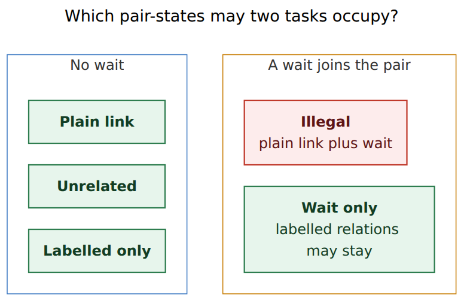
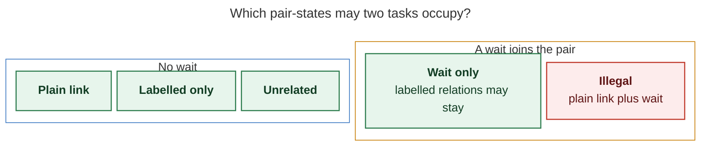
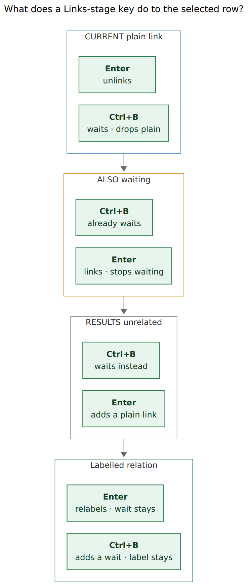
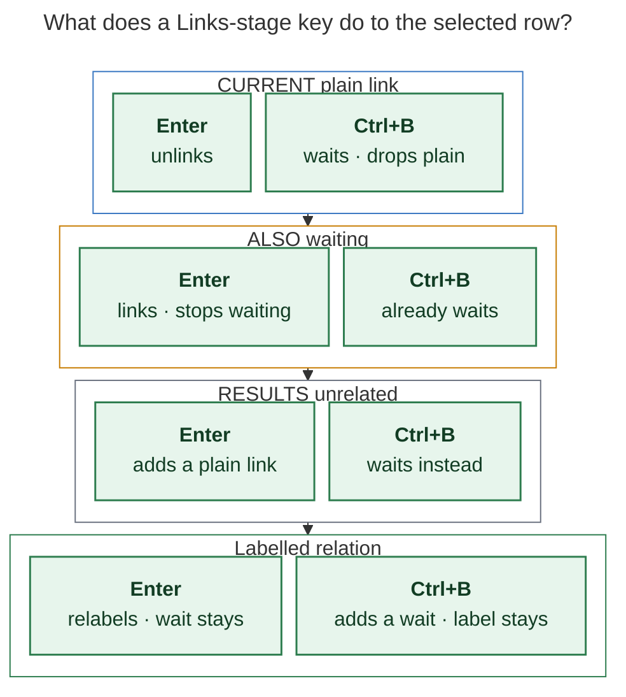

# Plain 🪢 and wait: one occupancy, two convert keys

> **Research query.** When task A depends on task B, A should not also hold a relationless (unlabelled) link to B in either direction. Adding a relationless link to B should drop any existing dependency to B from the current task, and adding a dependency to B should drop any existing relationless link to B. Add Obsidian `Ctrl+B` in the Links panel to mark the selected task as a wait instead of linking, with the reverse convert from the Depends panel. Make the other exclusive occupancy obvious in both panels. Lead the design so it is intuitive, reliable, and beautiful; critique the plan; call out justified requirement adjustments; recommend a solution.

**Researcher.** `grk` (independent swarm report).
**Date.** 2026-11-25.
**Scope.** Research only. No bob-cli, plugin, chezmoi, vault, or memory files were changed. This file and its rendered figures are the deliverable.

**Checkouts.** bob-cli `68dee6e1`; bob-plugins `1c2534cc`.

**Prior research consulted (unrelated earlier swarms, not this one).**
`research:202610/task_relation_links/`,
`research:202610/task_dep_link_depends_on_line/`,
`research:202610/undirected_task_relations/`,
`research:202611/starts_after_relation/`.

**Primary evidence in this repo.**
`docs/task-relations.md` §§1–3, 7–8, 19 (M7, MN9, LX4, LX15, LC1, capture JSON `also_prerequisite`);
`docs/task-dependencies.md` §12.19 SA14;
`docs/reference/plugins/task-card.md`;
`docs/reference/mac-capture/relationship-pickers.md`;
`docs/develop/plugins/plugin-apis.md` (`relations` v1);
bob-plugins `304-relation-stage-view.js`, `305-relation-stage-copy.js`, `410-picker-filter-and-render.js`, `426-picker-relation-stage.js`, `450-picker-keydown.js`, `314-task-card-key-model.js`, `470-keydown-and-freshness.js`;
bob-cli `src/native/task_relations/plan.rs`, `src/native/capture/relations.rs`, `src/native/capture_complete/model.rs`;
ledger-tools `171-relation-index-lifecycle.js` (`relationPairs`, `dependencyPairs`);
decisions `task-deps-are-depends-on-links`, `relation-equals-alias-and-flips`, `unblocked-tasks-are-offered`, `mac-capture-is-a-thin-client`, `q-and-ctrl-bracket-mirror-esc`.

---

## Bottom line

**Build it. Store at most one exclusive occupancy per pair, and convert with the letter that already names that graph.**

A pair of tasks may hold a wait (`⛓️ **DEPENDS ON:**` in either direction) or a plain 🪢 (`🪢 **LINKS:**` with no label, in either direction). It may not hold both. A labelled 🪢 (`starts after`, `implemented by`, `picks out good hard-drive`) may sit beside a wait; SA14 already relies on that, and the live vault has one such pair that would be wrong to strip.

`Ctrl+B` in Links means "this pair should wait." `Ctrl+L` in Depends means "this pair should be a plain 🪢." Each key keeps that meaning in the reverse stages (Linked-from / Blocks). Enter still does the panel's native add-or-remove. The existing informational `⛓ prerequisite` badge on Links becomes a convertible occupancy signal; Depends gets the missing reverse. An `ALSO` band between CURRENT and RESULTS makes the other graph impossible to miss.

Writers convert. Reconcile heals leftovers by **keeping the wait and dropping the plain 🪢**, with a warning. A reverse wait is never dropped in order to add a plain link: that would unblock the other task. Capture `&T ~T` on the same T follows the last explicit sigil.

Do not fold this into the unshipped undirected-relations epic. The occupancy rule is independently valuable, and it agrees with that epic's "plain is the weaker edge" reading.

The contract heart is one sentence in M7. Today: "Dependencies never suppress relation entries." Ship: **"Dependencies suppress unlabelled relation entries; labelled relations stay."** Mentions already yield to waits (MN9). Plain 🪢 should too.

Live vault, 2026-11-25, excluding `_conflicts/` and `.bob/` (7021 notes, 5412 `#task` lines, 2983 with `^id`):

| Occupancy | Count |
| --- | ---: |
| Dependency edges | 274 |
| Unlabelled relation edges | 58 |
| Labelled relation edges | 263 |
| Same-direction unlabelled + wait | **0** |
| Reverse-direction unlabelled + wait | **2** |
| Same-direction labelled + wait | **1** (keep) |
| Mutual waits / mutual unlabelled | 0 |

The confusing state the request names is rare, and every live instance is **reverse-direction**. Same-direction-only exclusivity would miss both of them.

---

## Is this a good idea

**Yes.** The two graphs already mean different things, the panels already sit next to each other on the Task Card (`b` then `l`), and the vault already shows what double occupancy looks like.

### Why the overlap is confusing

A wait changes lanes: the dependent is `[?]`, its live Pomodoro links leave, residents of a `^prj` follow. A plain 🪢 is history. Chips for both families share the same live-preview slot. Seeing `⛓️` and a bare `🪢` on the same pair tells two stories: "I cannot start" and "I merely know about this." Mentions already refuse that pairing (M7 / MN9: a wait on the pair yields no `💬 mentions` entry). Plain 🪢 is the same kind of inert back-reference, authored instead of derived.

The live reverse pairs:

1. `bob.md` `^ref-plugin-sync-unblocking` has a **plain** `🪢 **LINKS:** [[#^no-bob-plugins-sync-qs]]` and a generated `🧱 **BLOCKS:**` for the same target. The questions task is `[?]` with `⛓️ **DEPENDS ON:**` the ref. Opening Links on the ref shows a CURRENT 🪢 to a task that is already waiting on it. Opening Depends on the questions task shows a wait whose other end also claims a relationless link.
2. `done/cash_done.md` `^pick-day-to-sell-stocks` (closed) plain-links `dev_plex_hack_patch.md#^sell-stocks-now` and BLOCKS it; the seller still carries the Depends-On. History, same shape.

The one labelled overlap is the opposite of a bug: `dev.md` `^ref-athena-root-nvme-wear-and-replacement` waits on `^buy-harddrive` **and** labels the edge `picks out good hard-drive`. That is knowledge riding beside a wait, the SA14 shape (`starts after` plus Depends-On collapses to a hand-off on Done and stays held `blocked` on park). Dropping it would be a regression.

### Why convert is the right verb

LG22 already lets `Ctrl+Shift+B` on a LINKS line open Depends, and `Ctrl+Shift+L` on a Depends-On line open Links. The two-panel dance exists. `Ctrl+B` / `Ctrl+L` collapse it to one key on the row you are already looking at, with a consequence strip that names Blocked or Ready **before** the write.

Refuse-and-go-elsewhere would train a dead-end: you pick T in Links, Enter is rejected because a wait exists, you close, you open Depends, you remove, you reopen Links, you add. Convert is the gesture the request described.

### Why the idea stays good only if labelled 🪢 survive

Of 321 relation edges in the live vault, **263 are labelled**. The catalog is doing work (`implemented by` 148, `superseded by` 37, `inspired by` 33, `merged into` 18, `starts after` 3). A blanket "relations XOR waits" would smash successor labels, merge labels, and captions like `picks out good hard-drive`. The exclusive set is **plain 🪢 versus wait**. That is also the reading the undirected-relations research reached and did not ship: the unlabelled edge is the weaker one.

### What is already on the road

The Links stage already paints `⛓ prerequisite` when the owner’s Depends-On names that row (`relationStagePrerequisiteIdentities`, tooltip *"Also a prerequisite · linking stays inert"*). Capture-complete already sends `also_prerequisite`; Mac already renders **Prerequisite too**. The Depends stage paints nothing for a plain 🪢. Reverse waits (`🧱 **BLOCKS:**`) are invisible on Links. The missing pieces are: exclusivity, convert, the reverse badge, and reverse-direction occupancy.

---

## Critique of the plan as stated

### What to keep

- Exclusive occupancy for **plain** 🪢 versus wait.
- Convert on add, in both directions, from the panel you are in.
- `Ctrl+B` in the Obsidian Links list.
- A visual that makes the other occupancy obvious.
- Writers as the authority, so capture, nav, and reconcile tell the same story.

### Where the sketch needs a sharper rule

**1. "From the current task" is same-direction; the live bugs are reverse.**
Adding a plain 🪢 from A to B and dropping `A ⛓️ B` matches the request. The two vault overlaps are `A 🪢 B` (plain) with `B ⛓️ A`. A same-direction-only writer would leave both in place. Occupancy has to be **pair-wise, either direction**.

**2. Silently dropping a reverse wait unblocks someone else.**
If B waits on A and A adds a plain 🪢 to B, deleting `B ⛓️ A` would flip B to Ready, recover residents, and possibly relink Pomodoros. That is a status write hiding inside a "link" key. Convert of a reverse wait belongs on **B’s** Depends or Blocks panel, where the strip can name Ready. From A’s Links, Enter on that occupancy **refuses**, with copy that points at Blocks.

**3. The reverse key is unnamed.**
`Ctrl+B` is specified for Links. Depends needs a twin that is as guessable as Task Card `b` / `l`. `Ctrl+L` is that twin: **Ctrl+B always means wait, Ctrl+L always means plain 🪢**, in every relationship stage.

**4. The Links stage already has a prerequisite badge, and it is a no-op.**
Shipping a second visual language on top of `⛓ prerequisite` would teach two stories. Evolve that badge (and add its reverse on Depends). Put wait-only / plain-only occupancy in an `ALSO` band so it is not a RESULTS row forty matches down.

**5. `Ctrl+B` is Bold in the Linux editor.**
Inside the picker modal this is a keymap island (`Ctrl+[`, `Ctrl+Enter` relabel, `Ctrl+N`/`P` already claimed). Capture `Ctrl+B` with `preventDefault` on the list stage. Keep `isCtrlKey` (Ctrl only, never Meta), so macOS `Cmd+B` stays Bold. Ignore the chord in the relation-label field. One undo on same-note converts.

**6. Capture last-intent is missing.**
LX4 (`Ask plumber &job:parts ~job:cleanup`) is two targets and stays. `&T ~T` on the **same** T has no vector. Last explicit sigil wins; the other exclusive occupancy is dropped in the same batch.

**7. Mac already has half the visual and none of the convert.**
`also_prerequisite` is additive JSON today. Obsidian is the requested surface. Capture writers still enforce the invariant so a Mac draft cannot recreate the illegal pair. Mac convert keys and `also_unlabelled_relation` are a follow-up, not a blocker.

**8. Counted sessions and `^prj` are status multipliers.**
`N Ctrl+Shift+L` already commits one target to every source. Converting a wait on a `^prj` unblocks residents (`decisions:projects-block-from-prj-line`). Refuse convert in counted sessions (one task at a time). On `^prj`, the strip names the resident count in the same sentence as Ready.

**9. Relabel is not a history toggle.**
Empty → labelled does not restore a wait that convert dropped. Labelled → empty **is** an unlabelled add: if a wait exists on the pair, the wait yields (same-direction) or the empty-label commit refuses (reverse wait).

---

## Requirement adjustments

Each row is a change to the request.

| # | You asked | Adjusted to | Why |
| --- | --- | --- | --- |
| **A1** | Exclusive occupancy "from the current task" | **Pair-wise XOR:** a wait in either direction and a plain 🪢 in either direction cannot both be stored | Live overlaps are reverse-only (2 of 2). Same-direction-only exclusivity misses them. |
| **A2** | Adding a plain 🪢 drops any dependency to B from the current task | **Same-direction convert** (drop `A ⛓️ B` when A authors a plain 🪢 to B). **Refuse** adding a plain 🪢 while `B ⛓️ A` exists | Dropping the reverse wait unblocks B from a Links key. Convert that wait from B’s Depends / Blocks via `Ctrl+L`. |
| **A3** | Adding a wait drops the relationless link from the current task | Drop **plain 🪢 both ways** when adding a wait. Labelled 🪢 stay | Wait is the stronger edge. Reverse plain 🪢 is history-only, safe to drop. SA14 and the hard-drive pair need labelled coexistence. |
| **A4** | `Ctrl+B` in the link panel | `Ctrl+B` on the Links **and** Linked-from list stages, Ctrl-only, `preventDefault`, ignored in the label field | Linked-from authors the other task’s LINKS; its wait twin is Blocks (`T ⛓️ S`). Modal island avoids Linux Bold; `Cmd+B` stays Bold. |
| **A5** | Reverse convert from the dependency panel, key unspecified | **`Ctrl+L`** on Depends and Blocks, same Ctrl-only rules | Task Card already pairs `b` / `l`. One meaning per key across all four stages. |
| **A6** | Make the other occupancy obvious in both panels | **`ALSO` band** plus directional badges. Evolve `⛓ prerequisite` from info-only to convertible. Depends gains `🪢 linked` | Today’s badge is same-direction and inert; reverse waits are invisible; Depends has no reverse mark. |
| **A7** | (implicit) both graphs stay independently writable | **Writers convert; reconcile heals** leftovers by keeping the wait and dropping plain 🪢, warning `unlabelled_relation_yielded_to_dependency`. Never auto-drop labelled. Never auto-drop a wait | Hand-edits and agents will still compose both. Wait is status; plain 🪢 is not. |
| **A8** | (implicit) capture `&` / `~` independently | **Last explicit sigil on the same T wins.** LX4 (different targets) unchanged. New LX vector for `&T ~T` / `~T &T` | A draft can still name both graphs; occupancy is per pair. |
| **A9** | Obsidian first | Obsidian list stages in v1. **Capture enforces the invariant in the same change.** Mac picker convert and additive `also_unlabelled_relation` / reverse-wait flags follow | Mac is a thin client (`decisions:mac-capture-is-a-thin-client`). Illegal pairs must be unsayable in `bob capture` even before the app grows keys. |
| **A10** | (implicit) counted / `^prj` convert | **Refuse convert in counted sessions.** `^prj` convert allowed, strip names resident unblock count | Status fan-out is easy to miss in a batch. |
| **A11** | (implicit) cycles | `Ctrl+B` that would invert an existing wait **refuses** with the existing cycle copy | Two-cycle waits are already illegal. Convert must not create them. |
| **A12** | (implicit) undirected-relations epic | **Ship independently.** Align the rule with "plain is weaker than wait"; do not wait on undirected storage | That epic is unshipped. These two live pairs are healable now. |
| **A13** | (implicit) M7 untouched | Change M7 to: **dependencies suppress unlabelled relation entries; labelled relations stay.** Mentions keep MN9 | The current sentence is the hole. |

---

## Recommended solution

### 1. Vocabulary

- **Wait:** a Task Dependency Link on the dependent’s `⛓️ **DEPENDS ON:**` line. `🧱 **BLOCKS:**` remains a projection.
- **Plain 🪢 / relationless link:** a LINKS entry with no label (`[[T]]`).
- **Labelled 🪢:** a LINKS entry with a label (`starts after [[T]]`, `picks out good hard-drive [[T]]`).
- **Pair occupancy:** for unordered `{A, B}`, at most one of {wait either way, plain 🪢 either way}. Labelled 🪢 are outside the exclusive set.
- **Convert:** one gesture that writes the requested occupancy and drops the other exclusive occupancy in the same transaction.

### 2. The occupancy rule

```text
illegal(A, B) :=
    wait(A, B) or wait(B, A)
      and
    plain_link(A, B) or plain_link(B, A)

legal extras := labelled_link(A, B) and/or labelled_link(B, A),
                with or without a wait
```



**Caption.** A wait and a plain relation cannot share a pair in either direction. Labelled relations may sit beside a wait.

Rendered size: 516.438 × 337 px; fit scale: 100%.



### 3. Four-panel keymap

Authorship direction of the panel is the convert direction.

| Stage | Enter | `Ctrl+B` | `Ctrl+L` |
| --- | --- | --- | --- |
| **Links** (S → T) | add/remove plain or labelled 🪢 | S waits on T; drop plain 🪢 both ways | already the relation panel; on ALSO-waiting, convert to plain 🪢 |
| **Linked-from** (T → S) | T’s LINKS gains S | T waits on S (Blocks write); drop plain 🪢 both ways | convert a wait T→S into T’s plain 🪢 |
| **Depends** (S waits on T) | add/remove wait | already waits (notice, no write) | S plain-links T; drop S’s wait |
| **Blocks** (T waits on S) | add/remove T’s wait | T waits (already / add) | T plain-links S; drop T’s wait |

`Ctrl+B` always means **this pair should wait**. `Ctrl+L` always means **this pair should be a plain 🪢**. Labelled `Ctrl+Enter` still opens the label field and **does not** drop a wait.



**Caption.** Enter writes a plain relation and drops any same-direction wait. Ctrl+B writes a wait and drops any plain relation. Labelled relations stay.

Rendered size: 491.25 × 1162 px; fit scale: 76.8%.



Row-level detail for Links:

| Row | Enter | `Ctrl+B` |
| --- | --- | --- |
| CURRENT plain 🪢 | unlink (today) | convert to wait; drop the plain 🪢 |
| CURRENT labelled | unlink / `Ctrl+Enter` relabel (today); wait stays | add wait; label stays |
| ALSO `⛓ waits` (I wait on them, no 🪢) | convert to plain 🪢; S may become Ready | already waits |
| ALSO `⛓ this waits` (they wait on me) | **refuse:** `‹T› waits on this · ⌃L from Blocks converts` | **refuse cycle** if it would invert |
| RESULTS unrelated | add plain 🪢 | wait instead |
| RESULTS labelled (rare; labelled lives in CURRENT) | — | — |

Depends is the mirror: ALSO holds plain-🪢 pairs; Enter there converts to a wait; `Ctrl+L` on CURRENT converts the wait to a plain 🪢.

### 4. Visual design

Keep CURRENT as **this panel’s graph**. Do not mix waits into CURRENT on Links.

**ALSO** sits between CURRENT and RESULTS, omitted when empty.

- Links / Linked-from header: `ALSO ⛓ waiting`
- Depends / Blocks header: `ALSO 🪢 linked`

Directional badges, amber (`is-other-graph`), using the existing orange family of `is-marked-id-needed` so they read as occupancy rather than error (`is-marked-remove` red) or membership (`is-linked` green):

| Badge | Meaning |
| --- | --- |
| `⛓ waits` | I wait on them (same-direction) |
| `⛓ this waits` | They wait on me (reverse) |
| `🪢 linked` | A plain 🪢 joins the pair |
| labelled pill (today) plus `⛓ waits` | Legal labelled + wait; CURRENT, not ALSO |

CURRENT labelled + wait keeps the row in CURRENT and adds the wait badge. That is how the hard-drive pair should look: the caption stays, the wait is visible, Enter still unlinks the **label**, `Ctrl+B` is already-waits.

Footer (Links): `↵ link · ⌃B wait · ⌃↵ label · ~ flips`. Subtitle keeps `does not block` for Enter; the consequence strip speaks for `Ctrl+B`.

Footer (Depends): `↵ wait · ⌃L relate · ⇥ mark`.

Consequence strip, full sentences, names of both tasks:

- `⌃B waits on “Buy harddrive” · “Athena NVMe ref” becomes Blocked`
- `↵ links “Stop sync QUESTIONS” · “Stop sync QUESTIONS” becomes Ready · drops the wait`
- `‹Stop sync QUESTIONS› waits on this · ⌃L from Blocks converts · ↵ stays`
- `⌃L relates · unblocks 12 residents of ‹sase›` (only on `^prj`)

Apply + close + notice, matching today’s Enter. Same-note LINKS + Depends-On edits share one undo (`594-plugin-relation-edit.js` already does this for relation mirrors). Cross-note follow-ups stay best-effort, with `· 🧱 BLOCKS not updated` / `· 🪢 LINKED FROM not updated` as today.

`ALSO` rows are not Tab-markable. Convert keys ignore marks and operate on the selected row. A marked batch plus `Ctrl+B` refuses: `convert one task at a time`.

### 5. Writers, reconcile, capture

**Shared helper** (Rust + JS twin). Ledger-tools already builds `relationPairs` and `dependencyPairs` in `relationIndexResolveMentionPairs`. Extend that join with `plain` vs `labelled` and a `pairOccupancy(A, B)` verdict: `free`, `wait`, `plain`, `labelled`, `illegal`. Nav, capture, and reconcile call it. Do not hand-roll a third index.

**Nav / capture writers**

- Add wait: drop plain 🪢 both ways; keep labelled; existing cycle checks stay.
- Add plain 🪢: drop same-direction wait; if reverse wait exists, refuse (nav notice / capture teaching error `pair_waits_the_other_way`).
- Add labelled 🪢: occupancy unchanged; SA14 remains.
- Relabel to empty: treated as add plain 🪢.
- Relabel empty → labelled: occupancy unchanged; a previously dropped wait is not restored.

**Reconcile** (authority for leftovers, vim, agents)

- If `illegal(A, B)`: keep the wait, delete plain 🪢 entries both ways, rewrite both LINKED FROM projections, warn `unlabelled_relation_yielded_to_dependency` with both paths.
- Labelled entries untouched.
- Waits untouched except the existing malformed/cycle repairs.
- First ship heals the two live reverse pairs without a vault migration.

**Capture**

- New LX: last relationship modifier that names T wins, scanning the item left to right. `N &T ~T` writes a plain 🪢 and drops the wait. `N ~T &T` writes the wait and drops the plain 🪢.
- `N &T ~T|"follow-up of"` is labelled, so the wait may stay.
- Additive JSON: `also_unlabelled_relation` on dependency candidates; `also_blocks` (reverse wait) beside today’s `also_prerequisite`. Schema 1 stays; fields omitted when false.

**Hand-edit courtesy** (nav leaving a line, MN18 cousin): if the owner just typed a plain 🪢 onto a wait pair, the courtesy write may drop the plain 🪢 (heal) or the same-direction wait (if the last edit was clearly an unlabelled add). Prefer **heal to wait** when the edit is ambiguous. Explicit convert keys are the way to yield a wait.

### 6. Contract edits

`docs/task-relations.md`:

- §2 already says "A link that needs to block is a dependency (`&`, `b`)." Add the occupancy sentence next to it.
- **M7** last bullet becomes: *Dependencies suppress unlabelled relation entries; labelled relations stay. Mentions stay suppressed as today.*
- New **XO vectors** (never renumber M7/MN/LX):

| # | Situation | Outcome |
| --- | --- | --- |
| XO1 | S waits on T; add plain 🪢 S→T | wait dropped; plain 🪢 written; S may become Ready |
| XO2 | S waits on T; add labelled 🪢 S→T | both stay |
| XO3 | T waits on S; add plain 🪢 S→T | refused; wait stays; no 🪢 write |
| XO4 | S plain-links T; add wait S→T | plain 🪢 dropped both ways; wait written |
| XO5 | T plain-links S; add wait S→T | T’s plain 🪢 dropped; wait written |
| XO6 | illegal leftover at reconcile | wait kept; plain 🪢 dropped; warning |
| XO7 | `N &T ~T` / `N ~T &T` | last modifier that names T wins (plain 🪢 vs wait) |
| XO8 | Links `Ctrl+B` on RESULTS T | wait; panel closes; notice |
| XO9 | Depends `Ctrl+L` on CURRENT T | plain 🪢; wait gone |
| XO10 | counted `Ctrl+B` | refuse, no write |
| XO11 | `Ctrl+B` would invert T ⛓️ S | refuse cycle |
| XO12 | `^prj` `Ctrl+L` | plain 🪢; strip names resident count |
| XO13 | Linux Links `Ctrl+B` | convert; Bold does not fire |
| XO14 | macOS Links `Cmd+B` | Bold; no convert |
| XO15 | relation-label field `Ctrl+B` | ignored |

`docs/task-dependencies.md` LG22 stays (chords still open the other panel). Chip docs note that a pair never renders a bare 🪢 chip and a wait chip together.

After ship, a new decision record `plain-relations-yield-to-dependencies` (write through `/sase_memory_write` in the implementation plan, not this turn).

### 7. Implementation order

1. **Contract + helper + vectors** in bob-cli (`pairOccupancy`, XO1–XO7, XO6 reconcile). Plugin JS twin in ledger-tools / nav, copying the fixture.
2. **Writers:** `plan_links_edit` and the Depends-On planner convert in one note transaction; capture last-sigil; reconcile heal. This step alone makes the illegal state unsayable from `bob capture` and heals the two vault pairs on the next Mac cron reconcile.
3. **Obsidian:** `ALSO` section, badges, `Ctrl+B` / `Ctrl+L` in `450-picker-keydown.js` (claim before the scheduled-roll `Ctrl+Enter` handler, same pattern as relabel), copy in `305-relation-stage-copy.js`, CSS `is-other-graph`. Tests in `test-navigation-relation-links-stage.cjs` (the `prerequisite targets badge` test becomes convert-aware).
4. **Mac follow-up:** render `also_unlabelled_relation` / `also_blocks`; Control-B / Control-L in the relationship pickers. Not in the first PR.
5. **Decision record** once the contract sentence is true in production.

`relations.removeLink` / `blocks.openStage` stay. Feature-detect stays `api.relations?.version >= 1`. Convert is a writer composition, not a new API namespace in v1; add `relations.convertToWait` only if a chip control needs it later.

Docs: `docs/task-relations.md` is the contract (read `docs.md` before editing). Guides `link-related-tasks.md` and `add-prerequisites.md` each gain one short "plain 🪢 and wait convert" paragraph. CLI help names the occupancy rule in `bob relations` / capture relationship help.

### 8. Beauty, in one sitting

The Task Card already reads as two graphs with two letters. The convert keys reuse those letters with Ctrl, the way `Ctrl+Shift+B` already reuses `b`. The `ALSO` band is the same CURRENT / RESULTS typography, one extra header, amber instead of green. The strip always says the lane word (Blocked / Ready) so the user feels the graph they are entering. Illegal leftovers die on reconcile without a migration. The hard-drive caption survives.

That is intuitive (same letters), reliable (one helper, heal-to-wait, refuse reverse unblock), and beautiful (one extra band, two badges, no merged mega-panel).

---

## Rejected alternatives

| Alternative | Why it loses |
| --- | --- |
| Refuse instead of convert | Restores the two-panel dance LG22 already offers. The request is a one-key convert. |
| Same-direction-only exclusivity | Misses both live illegal pairs. |
| Drop reverse waits from Links Enter | Silent unblock of the other task. |
| Merge Links and Depends into one picker | Two semantics, two letters, two chip families. A combined list would bury wait under history. |
| Treat plain 🪢 as an alias of wait | Destroys the knowledge graph. 58 unlabelled edges would all Block. |
| Auto-promote plain 🪢 to wait | Same destruction, plus surprise Blocked. |
| XOR labelled 🪢 too | Breaks SA14 and the hard-drive pair; 263 labelled edges. |
| Wait for undirected-relations | That epic is unshipped; these two pairs are healable now. |
| `Ctrl+Shift+B` inside Links as the convert | Already means "open Depends" from the editor; inside the modal it is ambiguous. `Ctrl+B` is the request and is free in the island (Shift would collide with `⇧B` muscle memory). |
| Stay open after convert | Nicer for multi-edit, but today’s Enter closes. Match Enter. |

---

## Open questions (for Bryan, after this swarm)

1. **Heal-on-reconcile of the two live reverse pairs:** proceed automatically (recommended), or preview once in `bob task reconcile --dry-run` and confirm? They are exactly XO6.
2. **Mac convert in the same release train as Obsidian, or the follow-up?** Writers-in-capture should ship with Obsidian either way.
3. **Stay-open after convert** if the existing "already-refresh" path in the vault stage is cheap. Default remains close.

None of these blocks the design.

---

## Recommended decision, one paragraph

Ship **pair-wise exclusive occupancy** of wait versus plain 🪢, either direction, with labelled 🪢 allowed beside a wait. Obsidian Links / Linked-from get `Ctrl+B` (wait); Depends / Blocks get `Ctrl+L` (plain 🪢). Enter on ALSO converts same-direction occupancy and **refuses** a reverse-wait unblock. Evolve the existing `⛓ prerequisite` badge, add `🪢 linked` on Depends, and put the other graph in an amber `ALSO` band. Writers convert; reconcile keeps the wait and drops leftover plain 🪢; capture last-sigil wins; counted convert refuses; `^prj` convert names residents. Change M7 to "Dependencies suppress unlabelled relation entries; labelled relations stay." Do this independently of undirected relations. That is the design that is intuitive (the Task Card’s own two letters), reliable (one helper, heal-to-wait, no silent unblock), and beautiful (one extra band, two badges, the hard-drive caption kept).

---

## Sources

**Bob contracts (this checkout).**

- `docs/task-relations.md` §§1–3, 7–8, 19 (M7 last bullet "Dependencies never suppress relation entries"; MN9; LX4; LX15; LC1; capture-complete `also_prerequisite`).
- `docs/task-dependencies.md` §12.19 SA14 (labelled successor plus wait).
- `docs/reference/plugins/task-card.md` (`b` / `⇧B` / `l` / `⇧L`, `Ctrl+Shift+B` / `Ctrl+Shift+L`).
- `docs/reference/plugins/task-relations.md`.
- `docs/reference/mac-capture/relationship-pickers.md` (`already_linked`, `also_prerequisite`, **Prerequisite too**).
- `docs/develop/plugins/plugin-apis.md` (`relations.removeLink`, `relations.openStage`, `blocks.openStage`).
- `docs/capture.md` relationship JSON.

**Plugin / CLI implementation (this checkout).**

- `sase/repos/linked/bob-plugins/plugins/bob-navigation-hotkeys/src/304-relation-stage-view.js` (`relationStagePrerequisiteIdentities`, `prerequisiteIds`, comment "information only").
- `…/305-relation-stage-copy.js` (subtitle `does not block`; CURRENT `↵ unlinks · ⌃↵ relabels`).
- `…/410-picker-filter-and-render.js` (`is-linked` CURRENT `−`; `⛓ prerequisite` tooltip *"Also a prerequisite · linking stays inert"*).
- `…/426-picker-relation-stage.js`, `…/450-picker-keydown.js` (`Ctrl+Enter` relabel, `~` flip, `Ctrl+[`; no `Ctrl+B`).
- `…/314-task-card-key-model.js` (`b` depends, `l` links, `⇧B` / `⇧L`).
- `…/470-keydown-and-freshness.js` (`isCtrlKey` is Ctrl-only).
- `…/styles.css` (`.bob-cnp-task-badge.is-linked` green; orange `is-marked-id-needed`).
- `…/594-plugin-relation-edit.js` / `594a-relation-hand-edit.js` (same-note one undo; M7 "never a relation entry").
- `sase/repos/linked/bob-plugins/plugins/bob-ledger-tools/src/171-relation-index-lifecycle.js` (`relationPairs`, `dependencyPairs`).
- `src/native/task_relations/plan.rs` (`plan_links_edit`).
- `src/native/capture/relations.rs`, `src/native/capture_complete/model.rs` (`also_prerequisite`).

**Live vault probe (read-only, 2026-11-25).**

- Walk of `/home/bryan/bob/**/*.md` excluding `.git`, `.obsidian`, `.bob`, `_conflicts`.
- Task / Depends-On / LINKS parse with label-before-link grammar (`docs/task-relations.md` §3: `<entry> := [<label> ' ']<link>`).
- Counts as in Bottom line. Reverse pairs: `bob.md#^ref-plugin-sync-unblocking` 🪢 `^no-bob-plugins-sync-qs` with reverse wait; `done/cash_done.md#^pick-day-to-sell-stocks` 🪢 `dev_plex_hack_patch.md#^sell-stocks-now` with reverse wait. Labelled keep: `dev.md#^ref-athena-root-nvme-wear-and-replacement` ⛓️ `^buy-harddrive` with `picks out good hard-drive`.

**Memory (audited `sase memory read`).**

- `sase_artifacts.md`
- `glossary:Task Relation`, `glossary:Task Dependency Link`, `glossary:Task Link`, `glossary:Property Card`, `glossary:Capture`, `glossary:Capture Panel`, `glossary:Successor Offer`
- `decisions:task-deps-are-depends-on-links`
- `decisions:relation-equals-alias-and-flips`
- `decisions:unblocked-tasks-are-offered`
- `decisions:mac-capture-is-a-thin-client`
- `decisions:capture-star-blocks-existing-tasks`
- `decisions:capture-link-drops-blocking-deps`
- `decisions:q-and-ctrl-bracket-mirror-esc`
- `cli_rules.md`, `docs.md`

**Prior research.**

- `research:202610/task_relation_links/` — second graph must stay non-blocking; one authored direction.
- `research:202611/starts_after_relation/` — labelled successor plus wait is legal (SA14).
- `research:202610/undirected_task_relations/` — plain as the weaker edge; unshipped.

**Figures.**

- Mermaid CLI `@mermaid-js/mermaid-cli@12.0.0`, PDF-mirroring config, Puppeteer `--no-sandbox`.
- `unlabelled_relation_xor_dependency__grk_assets/pair-states.{mmd,svg,png}`
- `unlabelled_relation_xor_dependency__grk_assets/links-gestures.{mmd,svg,png}`
