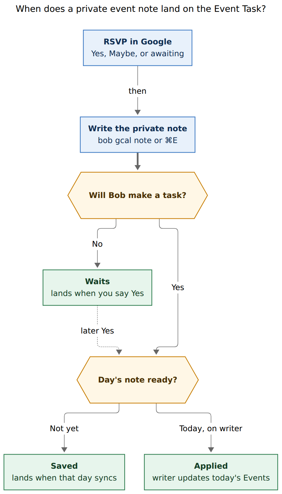
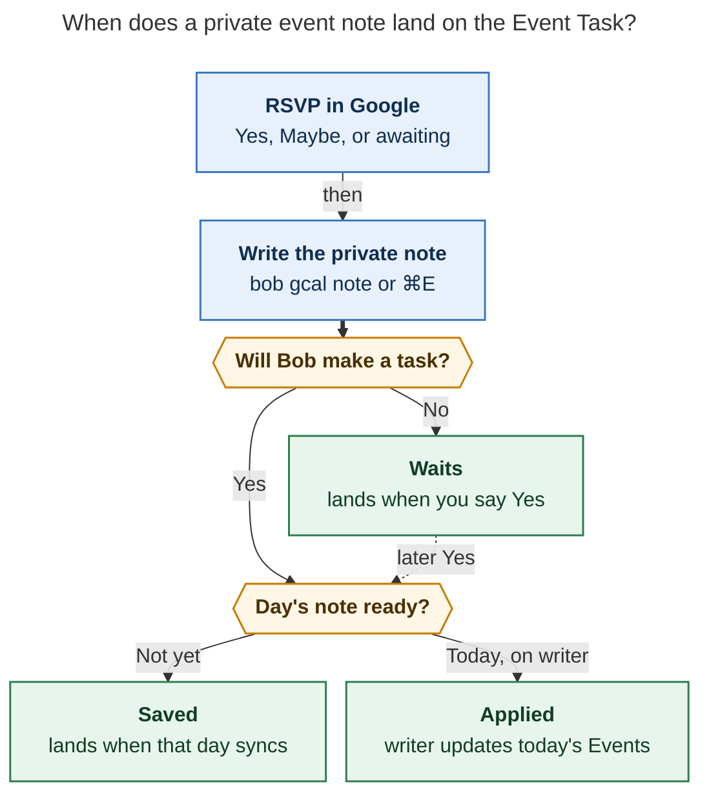

# Plan an event you don't own: user-guide research

> **Research query.** Write a small, accurate, useful, and visually appealing
> guide that walks users through how to add metadata to private event tasks.
> Context: epic bead `bob-cli-ji` (Private event notes for Google Calendar
> events) and its approved plan.

**Researcher.** `grk` (independent swarm report).
**Date.** 2026-11-10.
**Scope.** Research only. This file is the deliverable: facts, a lift-ready
guide draft, and visual direction for `docs/guides/plan-events-you-dont-own.md`.
No bob-cli, plugin, vault, or memory files were changed.

**Primary evidence.**
Epic `bob-cli-ji` and phases `.1`–`.7`; approved plan
`plan:202611/private_gcal_event_notes.md`; prior design
`research:202611/private_notes_for_unowned_gcal_events/private_notes_for_unowned_gcal_events.md`
(accepted R1–R10); contract `docs/gcal-notes.md`; `docs/gcal.md` §§ List,
Who owns each part of a row, Buffers, Buffer reasons, Description bullets,
Root selection, Event inclusion, Known limits; `docs/guides/connect-google-calendar.md`;
`docs/guides/capture-from-your-mac.md`; `docs/_templates/how-to.md`;
`docs/develop/writing-docs.md`; `docs/_meta/contracts.yml` (`gcal-notes` reader);
`tests/gcal_notes.rs` (birth, RSVP wait, moved event); `src/native/gcal/description.rs`
`parse_note`; `src/native/gcal/model.rs` `apply_notes`; `src/native/gcal/root.rs`
note-first candidates; `src/native/config/gcal.rs` colour names; glossary
`event-task`; decisions `bob-gcal-is-read-only-and-proposes-once`,
`buffer-reasons-ride-description-bullets`, `event-buffers-widen-the-span`,
`gcal-root-follows-google-until-edited`, `mac-capture-is-a-thin-client`,
`idle-capture-shows-ledger-agenda`. Reviewer branches: `auto_sync = yes`,
`mac_chord = cmd_e`, `memory_record = yes`, `memory_glossary = no`.

**Landed today (`bob-cli-ji.1`, `.3`).** Journal `gcal.note` fold, plain-text
`parse_note`, per-field layering, note-first roots, list `✎` / JSON summaries
(never note text), provenance `gcal.row.note`, fail-safe hold, contract page
`docs/gcal-notes.md`. **Still in this epic.** `bob gcal note` select/write,
`-e`/`-A`/doctor `notes`/fragile hint, this guide, Mac Event note mode.

---

## Bottom line

Publish **one short how-to**, `docs/guides/plan-events-you-dont-own.md`,
titled **Plan an event you don't own**. Target **700–900 words** (guides
median ~500; hard limit 2,500). Walk one RSVP-to-row path, then the five
other jobs the epic named. Link the contract for exact flags.

Do not frame the page as “metadata on Event Tasks”. The Event Task does not
exist at RSVP time, and Bob never pre-creates daily notes. The object is a
**private event note**: Bob-only description text keyed by the Google event.
Write the same `@route`, `#off`/`#on`, `-30 Drive there`, and prose lines you
would put in Google. They beat Google’s description field by field on that
event’s Event Task. Google keeps the time, the title, and the 📅/📹/📍 links.
Bob never writes the note to Google.

The one-sentence rule already in `docs/gcal-notes.md` is the right lede:

> A private event note is a description of a Google Calendar event that only
> Bob reads.



**Caption.** RSVP, then write the note. It waits until the event is a task,
then lands when that day’s daily note syncs — or applies at once if today’s
note is already on the writer Mac.

Rendered size: 572.6 × 1002 px; fit scale: 89.1% (Mermaid CLI 12.0.0,
PDF-mirroring config). Source: `plan_events_you_dont_own_guide__grk_assets/lands.mmd`.

The published guide should **not** embed this figure. Guides in this tree
stay portable Markdown; beauty comes from the CLI time rail, one `bob-task`
row, and two compact tables. Keep the figure for the research PDF and for
the author of the page.

---

## What to publish

| Item | Value |
| --- | --- |
| Path | `docs/guides/plan-events-you-dont-own.md` |
| Title | Plan an event you don't own |
| Description (≤160 chars) | RSVP, then add a private event note so Bob routes, buffers, and annotates the Event Task even when you cannot edit Google's description. |
| Tags | `CLI`, `macOS` |
| Template | `docs/_templates/how-to.md` |
| Word budget | 1,500 target / 2,500 hard; ship near 800 |
| Index | New **Calendar** group on `docs/guides/index.md`, with [Connect Google Calendar](guides/connect-google-calendar.md) (already in `mkdocs.yml`, missing from the Markdown index) above this page |
| mkdocs | Same Calendar group, or directly after Connect Google Calendar under Capture |
| Contract reader | Point `docs/_meta/contracts.yml` `gcal-notes.reader` at this guide (it currently points at Connect Google Calendar) |
| Memory | Define “private event note” in the opening paragraph. Reviewer set `memory_glossary = no`, so do not rely on a glossary strand |

Hygiene the linter will fail: no bead IDs, no `src/` paths, no epic/phase
labels, no history wording (`formerly`, `no longer`, `legacy`, `renamed`).
No `$` prompt at the start of `bash` / `console` fences — put the session
in a `text` fence titled `Output` and marked `.no-copy`, as
[Connect Google Calendar](guides/connect-google-calendar.md) does. Use
`<kbd>⌘E</kbd>` for the Mac chord. GitHub `> [!NOTE]` is allowed;
`!!!` admonitions are not.

Cover exactly the epic’s list, in this order:

1. RSVP, then `bob gcal note <query> …`
2. Recurring scope (This event / All events)
3. Checking with `bob gcal note` and `bob gcal list`
4. Adopting fragile external-invite lines with `-A`
5. The `gcal.colors` stopgap for routing from the phone
6. What “lands” means

Add a short **On your Mac** subsection for the decided chord (`⌘E` from any
draft state). Phase `mac` is supposed to expand it with rail fixtures; the
records page should already name the chord so the epic ships one complete
walkthrough. Skip `-e` (editor) and doctor internals — they are not on the
epic’s guide list, and they blow the word budget.

Write against the **approved command**, not today’s tree. `bob gcal --help`
still has no `note` subcommand. After `bob-cli-ji.2` and `.4` land, diff
every example against `bob gcal note -h` and one `-d` preview.

---

## Facts the page must not get wrong

| Topic | Fact | Evidence |
| --- | --- | --- |
| Object | Private event note, not the Event Task. The row is the note’s projection. | Plan “Why this design”; `docs/gcal-notes.md` § Model |
| Who it works on | Any timed busy event that can become an Event Task: owned, locked guest, awaiting reply, Maybe. Declined, cancelled, all-day, multi-day, and free events are out. | Plan R1/R6; select “Eligible events”; `tests/gcal_notes.rs` `awaiting_reply_note_waits_applies_on_yes_and_skips_declined` |
| Google | Read-only. A note never RSVPs, never creates a daily note, never changes inclusion. | `decisions:bob-gcal-is-read-only-and-proposes-once`; plan R5/R6 |
| Grammar | Same description grammar. One-liners are normalized: `@family -30 Drive there` becomes two canonical lines. | Plan § Normalization; `docs/gcal.md` § Buffers / Buffer reasons |
| Sign | `-30` is **before**; `+15` is **after**. Bob never guesses the sign from prose. The time rail is how you catch a wrong sign. | Plan write “The rail makes a wrong sign obvious”; prior research critique point 4 |
| Adopt flag | **`-A` / `--adopt`**. `-a` / `--all` lists every upcoming event. Prior research used `-a` for adopt; the plan flipped it. | Plan command shape vs prior research |
| Scope flag | `-s event\|series`. Recurring TTY prompt; off-TTY without `-s` is exit 2. | Plan § Scope |
| Query | Case-insensitive title words, today→+90 days. Pasted Google URL (`eid=`) or `-i` selects exactly, including outside the window. | Plan § Selecting the event |
| Precedence | This event, then all events, then Google, per field. A reason travels with its side. `-0`/`+0` clear a side. | `docs/gcal-notes.md` § Precedence; `apply_notes` |
| What Google keeps | Time, title, 📅/📹/📍. | Plan R3 |
| Lands | Saved now, applied when the event is a task and that day’s note syncs. On the writer, a save/clear syncs each affected day whose note already exists (`auto_sync = yes`). | Plan write “Saved versus applied”; reviewer `auto_sync = yes` |
| Maybe | Default `gcal.tentative: context` → waits for Yes. `task` makes Maybe a task. | `docs/gcal.md` § Event inclusion; plan status words |
| List mark | Dim `✎` after the title; root source `✎ @family`. JSON `note` is a summary, never the words. | Landed list contract; `docs/gcal.md` § List |
| Fragile invites | Guest event, Bob lines in the organizer’s description, no private note → `⚑` hint and `bob gcal note -A -i …`. | Plan extras item 4 |
| Phone | Colour is private per guest copy. `gcal.colors` maps `lavender`/`1` … `tomato`/`11` to a root. Colour cannot carry buffers or reasons. | `src/native/config/gcal.rs`; prior research R8 |
| Mac | Thin client of `bob gcal note -f json`. Chord is **⌘E** from any draft state, plus **Event Note…** and a Calendar-band row. Not a capture sigil. | `decisions:mac-capture-is-a-thin-client`; reviewer `mac_chord = cmd_e` |
| ⌘E clash | Capture panel does not currently bind ⌘E. Highlights can map Command-E to Bob Refs Tabs; that is a Highlights-frontmost setting, not the capture default. | `docs/reference/mac-capture/keyboard.md` |
| Kill switch | `gcal.description: off` hides note bullets too; directives still apply. | `docs/gcal-notes.md` § Model |
| Known limits | `docs/gcal.md` still says a description you cannot edit cannot take a Google-owned buffer. The write phase replaces that sentence. The guide must describe the note path as current behavior. | `docs/gcal.md` § Known limits; plan write Docs |

---

## Visual direction

The beautiful object is the **preview**, not a screenshot of a daily note.

1. **CLI time rail** (plan write, ≤48 columns): meeting `━` in the root hue,
   buffer wings `╱`, labelled times. Copy it into a `.no-copy` Output fence.
   That single line teaches occupied vs meeting time and catches `-`/`+`
   mistakes.
2. **Canonical lines** above the rail, coloured in the real CLI (route in
   the root hue). In docs they are plain text.
3. **`lands as` block** — the exact Event Task sync will write, dimmed on a
   TTY. Confirm it with a `bob-task` (or Markdown) row after “when that day
   syncs”.
4. **Type-this table** (below) instead of a second diagram. A “where to
   write” flowchart was drafted and dropped: at 883–1050 px wide it missed
   the 75% PDF fit floor. A three-row table is the better published form.

Mac Capture’s hatched wings and `Occupied 09:30–12:15 · Meeting 10:00–12:00`
are the same language as the idle agenda. Mention them in **On your Mac**;
do not add a PNG until phase `mac` has render fixtures. Do not put vault
paths, journal JSON, or a provenance glyph on the page — the vault row is
byte-for-byte the Google-description row, by design.

### What you type

| Line | What Bob sets on the Event Task |
| --- | --- |
| `@family` | `[root:: family]` |
| `#off` or `#on` | Clock tag (`#on` wins if both appear) |
| `-30` | 30 minutes **before** (`[buffer:: -30m]`) |
| `-30 Drive to Deerwood` | That buffer plus `↤ *30m before* · Drive to Deerwood` |
| `+15 Drive home` | 15 minutes **after** plus the `↦` reason |
| `-0` / `+0` | Clear that side, including a value Google set |
| `Bring gifts` | A bullet (note prose, uncapped) |

Directive tokens can share one line (`@family #off -30 +15`). A reason
starts when minutes are followed by a non-directive word. `@` and `#`
inside a reason are text.

---

## Lift-ready draft

Copy from the next heading through **Related**, then add front matter. After
`bob-cli-ji.4`, replace the Output fences with a real `-d` transcript if the
wording drifted. Estimated body (excluding front matter and fences): ~940
words.

````markdown
---
title: "Plan an event you don't own"
description: "RSVP, then add a private event note so Bob routes, buffers, and annotates the Event Task even when you cannot edit Google's description."
tags:
  - CLI
  - macOS
---

# Plan an event you don't own

This guide attaches Bob-only routing, travel buffers, and notes to a Google
Calendar event — including invitations someone else owns. A **private event
note** is a description of that event that only Bob reads. Write the same
`@route`, `#off`/`#on`, `-30 Drive there`, and prose lines you would put in
Google. They beat Google's description on the event's Event Task, field by
field. Google keeps the time, the title, and the 📅/📹/📍 links. Bob never
writes the note to Google.

The same command works on events you organize. Use it when you want the
lines private, or when a guest description might vanish on the organizer's
next update.

## Before you start

Connect Calendar with
[Connect Google Calendar](connect-google-calendar.md) and point Bob at your
vault. Any logged-in host may save a note. Only the `gcal.writer` host
applies it through sync.

## 1. RSVP, then write the note

Answer the invite in Google Calendar or Gmail, then name the event and type
the lines:

```bash
bob gcal note deerwood @family -30 Drive to Deerwood +15 Drive home
```

```text { .no-copy title="Output" }
✎ Deerwood. Christmas breakfast
  Sun Dec 13 · 10:00–12:00 · from Kelly · Yes

  @family
  -30 Drive to Deerwood
  +15 Drive home

  ● family  09:30 ╱╱╱╱╱╱ 10:00 ━━━━━━━━━━━━━━━━━━━━━━━━ 12:00 ╱╱╱ 12:15

  lands as
  - [ ] #task **1000-1200** Deerwood. Christmas breakfast [📅](…)
    [buffer:: -30m +15m] [root:: family] [type:: MEET] ^deerwood-christmas-breakfast
    - ↤ *30m before* · Drive to Deerwood
    - ↦ *15m after* · Drive home

✓ Noted · only in Bob · lands in 2026/20261213.md when that day syncs
```

Confirm the header is the right event, the rail occupies **09:30–12:15**,
and `lands as` shows `[root:: family]` plus the two reason bullets. `-30`
reserves time **before** the meeting; a drive home after it is `+15` (or
`+30`). Preview without writing with `-d`.

You can also note an invitation you have not answered yet. The note waits
until the event becomes a task.

Paste a Google Calendar URL in place of the query, or pass `-i` with the
event id, when several titles match.

## 2. Recurring events: this one or every one

A weekly series prompts on a terminal:

```text { .no-copy title="Output" }
Little Gym repeats weekly · Fridays 09:15–10:00 · guest · Maybe
  1  This event   Fri Nov 13
  2  All events   every Little Gym
Which? [1] ›
```

**This event** is the soonest matching occurrence (or the `-D` day's).
**All events** applies to the series. In a script, pass `-s event` or
`-s series`. A Maybe RSVP stays off the day until you say Yes (unless
`gcal.tentative: task`).

## 3. Check the note

```bash
bob gcal note
bob gcal note deerwood
bob gcal list -D 2026-12-13
```

Bare `bob gcal note` lists notes in the next 90 days. Naming the event
prints the canonical lines, the rail, and `lands as`. `bob gcal list`
marks a noted Event Task with a dim `✎` and a root source such as
`✎ @family`. List JSON carries a summary only; the words stay on
`bob gcal note`.

## 4. Adopt lines that live in someone else's description

If you already typed `@job` and `-30 Prep` into an external invite, Google
may drop those lines when the organizer updates the event. Adopt them into
Bob:

```bash
bob gcal note -A -i EVENT_ID
```

`bob gcal list` flags that case with a ⚑ hint. Adopt copies directive and
reason lines; Google's prose stays in Google. An event that already has a
note in that scope is edited with `-e`, not adopted twice.

## 5. From your phone: colour maps to a root

The Calendar app cannot run `bob`. Event colour is private on your copy, so
you can still pick a root at RSVP time. Map colours in
`~/.config/bob/config.yml`:

```yaml
gcal:
  colors:
    grape: family
    tomato: job
    sage: body
```

Recolour the invite in Google Calendar. That sets `[root::]` only. Buffers,
reasons, clock tags, and prose still need `bob gcal note` (over SSH if you
are away from the Mac).

## What "lands" means

The note is stored when you save it. The Event Task receives it later:

| When you save | What Bob reports |
| --- | --- |
| Before that day's daily note exists | `lands in 2026/20261213.md when that day syncs` |
| On an unanswered invite, or Maybe (default) | `lands when you say Yes` |
| Today, on the writer Mac, daily note already there | `↻ applied to today's note` |
| On another host while today's note exists | Saved; the writer applies it on the next sync |

On the writer Mac, saving or clearing a note syncs each affected day whose
daily note already exists. A declined or cancelled event never gets a row.
Clear a note with `bob gcal note deerwood -c`.

When that December day syncs, the Event Task looks like this:

```bob-task
- [ ] #task **1000-1200** Deerwood. Christmas breakfast [buffer:: -30m +15m] [root:: family] [type:: MEET] ^deerwood-christmas-breakfast
```

```text { .no-copy title="Child bullets" }
- ↤ *30m before* · Drive to Deerwood
- ↦ *15m after* · Drive home
```

## On your Mac

Open Mac Capture and press <kbd>⌘E</kbd>, or choose **Event Note…** from
the status menu. On an idle-agenda Calendar row, <kbd>⌘E</kbd> opens that
event directly. Esc returns to the capture draft.

Pick the event (soonest first; type to filter). For a series, choose
**This event** or **All events**. Type the same lines as the CLI. The
preview paints a solid meeting capsule with hatched buffer wings and
**Occupied 09:30–12:15 · Meeting 10:00–12:00**. Return saves; Shift-Return
inserts a newline; <kbd>⌘⌫</kbd> clears.

The panel talks only to `bob`. It does not parse `@family` itself and does
not write the vault.

## If it goes wrong

| Symptom | What to do |
| --- | --- |
| Several events match | Pick from the numbered list, or pass a Calendar URL / `-i` / `-C` |
| `did you mean body (area · Body)?` | Fix the route; nothing was saved |
| Occupied span looks backwards | You swapped `-` and `+`. Preview with `-d` and rewrite |
| `waiting for Yes` | Accept the invite, or set `gcal.tentative: task` for Maybe |
| ⚑ in `bob gcal list` | `bob gcal note -A -i …` so the lines survive the organizer's next edit |
| Saved on SSH, missing on today | Run `bob gcal sync` on the writer Mac |
| Need Google's description again | `bob gcal note deerwood -c` |

Exit 2 is usage, no match, an ambiguous match off a terminal, or an invalid
note. Exit 1 is gog or network.

## Related

- [Private event notes](../gcal-notes.md)
- [Bob Gcal](../gcal.md)
- [Connect Google Calendar](connect-google-calendar.md)
- [Capture a task from anywhere on your Mac](capture-from-your-mac.md)
- [Configuration · gcal](../reference/configuration.md#gcal)
````

---

## What to leave out of the guide

These belong in `docs/gcal-notes.md` or `docs/gcal.md`, not the walkthrough:

- Journal record shape, fold order, 2048-byte cap, account guard
- Badge-hash cost (a note after birth reaches buffer/clock only while time,
  title, and badges are untouched)
- Fail-safe hold on malformed journal lines
- Mac JSON `spans` / `schema_version`
- Normalization algorithm (`;`, reason scanning) beyond the one-liner example
- Doctor `notes` check (point at `bob gcal doctor` only if a row is stuck)
- Keep-phone follow-up, RSVP-from-Bob, “this and following”, Ledger Tools tooltip
- Teaching people to hand-edit `[buffer::]` on the day (that freezes the
  badges span)

---

## Placement and follow-through

**guides/index.md** — add a Calendar group so setup and this how-to sit
together:

```markdown
## Calendar

- [Connect Google Calendar](connect-google-calendar.md)
- [Plan an event you don't own](plan-events-you-dont-own.md)
```

Connect Google Calendar is already in `mkdocs.yml` under Capture and is
absent from the Markdown index; grouping it here repairs that.

**mkdocs.yml** — same two titles, either a new `Calendar:` nav group or
the new page immediately after Connect Google Calendar.

**contracts.yml** — `gcal-notes.reader: guides/plan-events-you-dont-own.md`.

**On your Mac** — records writes the chord and the save keys; phase `mac`
adds `docs/event-notes.md` in bob-mac-capture, short cross-links from
`keyboard.md` / `protocol.md` / `idle-agenda.md`, and may extend this
section with the hatched-rail fixture. Do not block the CLI guide on that.

**Verification for records.** `just docs-gen` (help and By component) and
`just docs-check`. After write/select land, run `bob gcal note -h` and one
`-d` save against the Output fences.

---

## Worked examples to keep (and why)

| Example | Why it is the right one |
| --- | --- |
| *Deerwood. Christmas breakfast* `@family -30 Drive to Deerwood +15 Drive home` | Locked guest event, 51 days ahead, both buffer sides, the plan’s canonical CLI transcript, covered by `locked_guest_is_born_with_note_root_buffer_and_reasons` |
| *Little Gym* Maybe + This event / All events | Recurring scope plus “waiting for Yes”, the plan’s second transcript |
| *Interview with PermitFlow* `-A` | Fragile external-invite class; the ⚑ hint’s example |
| Phone `grape: family` / `tomato: job` / `sage: body` | Real colour ids (`3`/`11`/`2`); roots that already appear in gcal tests |

Do not use `@body -30 I need to walk home from the park` as the **only**
example. Typed as one line it is a before-buffer whose prose says “walk
home”. If the walk is after the meeting, the token is `+30`. Deerwood’s
paired `-30` / `+15` teaches the sign; a NOTE callout can mention the walk
without making it the lead example.

---

## Implementation status the author should assume

The engine already layers a hand-written `gcal.note` onto list and sync.
That is why `docs/gcal.md` already shows `✎` and why `docs/gcal-notes.md`
exists. Users still cannot write a note from the CLI or Mac until select,
write, extras, and mac land. The guide is the records-phase page for the
**finished epic**, so it describes `bob gcal note` and ⌘E in the present
tense. If records merges before mac, keep **On your Mac** to four short
paragraphs so a later additive edit can add fixtures without rewriting the
CLI walkthrough.

---

## Sources

- `plan:202611/private_gcal_event_notes.md` — command shape, transcripts,
  lands statuses, guide bullet list, Mac chord, `auto_sync = yes`
- `research:202611/private_notes_for_unowned_gcal_events/private_notes_for_unowned_gcal_events.md`
  — object framing, R1–R10, phone colour stopgap, “when a note lands” table
- `docs/gcal-notes.md` — lede, grammar, precedence, privacy of list JSON
- `docs/gcal.md` — ownership table, buffers, inclusion, root order, list `✎`
- `tests/gcal_notes.rs` — birth row, RSVP wait, declined skip
- `docs/develop/writing-docs.md` and `docs/_templates/how-to.md` — page type,
  budget, portable fences
- Existing short guides: `capture-from-your-mac.md` (360 words),
  `add-prerequisites.md` (305), `file-email-from-your-phone.md` (480)

### Figure source (research PDF only)


