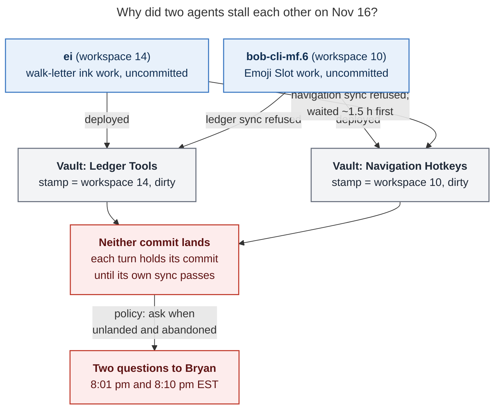
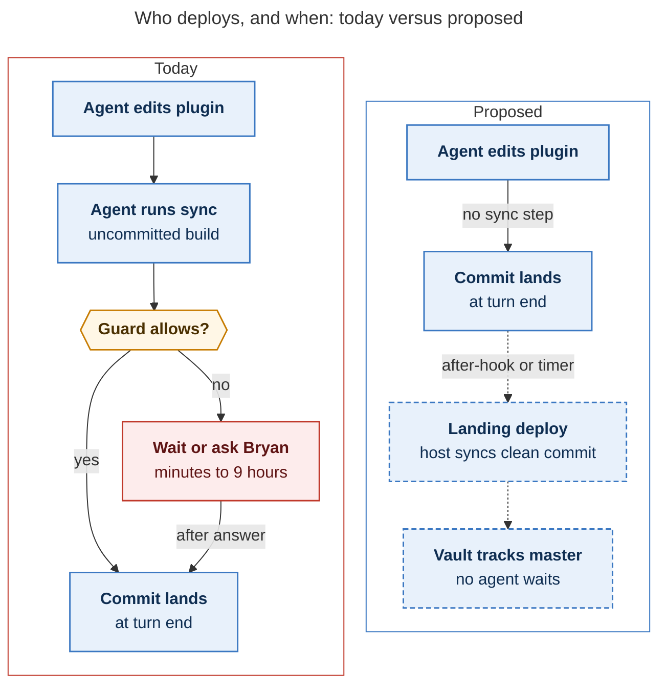

# Stop agents blocking on `bob plugins sync`: deploy what lands, not work in progress

**Date:** 2026-11-16 (evening, EST) · **Researcher:** `research.53.cld` · **Scope:** bob-cli
(`src/native/plugins/`), bob-plugins (`AGENTS.md`, `docs/develop/deployment.md`), SASE commit
hooks, and the agent transcripts, questions, and vault stamps from November.

## Short answer

| Question | Answer |
| --- | --- |
| **What are agents actually asking?** | They aren't asking whether they may *run* `bob plugins sync`. Every sync-related question on record asks whether they may **force** (`-F`) over **another workspace's uncommitted deploy** after the deploy-protection guard refused. The bob-plugins `AGENTS.md` tells them to wait, then ask. |
| **How much does it cost?** | Six recorded force questions since Nov 1. The five answered ones waited **7 min to 9 h 11 min** (about **18.8 h** in total). The sixth (`ei`) has waited 85+ min and is still open. `ei` had already spent about 1.5 h in five monitor waits before it asked. About **100** November agent runs hit a `refusing to overwrite plugin` refusal. |
| **Does the question protect anything?** | Not in practice. Bryan picked **force in 5 of 5** answered cases. Forcing also caused at least one real regression: on Nov 9 it dropped `api.notebooks` from the vault. So the question costs hours and doesn't reliably prevent harm. |
| **Root cause** | Agents deploy **uncommitted** builds to **one shared live vault** from **parallel workspaces**. SASE only commits after the turn ends, so every agent deploy is "dirty", and parallel work on the same plugin always collides. The guard turns those collisions into locks that clear only when identical bytes land in a commit. It also over-protects: it marks every plugin in a dirty checkout as dirty, and it can't see "already landed" from a dirty tree. **`ei` has been blocked 3+ hours on a navigation build that was byte-identical to commit `866bb77`, already on `master`.** The policy then says "wait for the author to land", which can **deadlock**: on Nov 16 two agents each waited on the other. |
| **Recommendation** | **Deploy only what has landed.** Agents stop deploying to the live vault. A host-owned *landing deploy* (a per-host timer, optionally triggered by a SASE `commit_hooks.after`) syncs clean `origin/master` into each vault. `bob plugins sync` run inside an agent quietly defers instead of refusing. Three small guard bugs get fixed: agent identity, landed-from-a-dirty-tree, and per-plugin dirtiness. A docs-only stopgap ("don't force, don't wait, don't ask; land your work and report the skipped deploy") ends the blocking **today**. |

## 1. What is actually happening

### 1.1 The asks are about forcing past the guard

These are all the sync-related questions in `~/.sase/interaction_requests/question`, plus the
Nov 9 case documented in prior research
(`research:202611/j8_6_1_1_deploy_guard_question.md`):

| Asked (EST) | Agent | Plugin(s) protected | Waited | Bryan's answer |
| --- | --- | --- | --- | --- |
| Nov 1 20:38 | `bob-cli-fe.6--7` | 4 plugins (cycler, ledger, nav, block-id) | 9 h 11 m | **Yes, force sync** |
| Nov 9 15:44 | `bob-cli-j8.6.1.1` | ledger-tools | 1 h 44 m | **Force** (this regressed the vault: `api.notebooks` was lost) |
| Nov 12 15:03 | `bob-cli-kr.4.1.2` | ledger-tools | 7 m | **Approve replacement** |
| Nov 14 22:56 | (agent meta pruned) | ledger-tools v1.116.0 | 6 h 40 m | **Allow overwrite** |
| Nov 16 20:01 | `bob-cli-mf.6--3` | ledger-tools v1.123.0 (ws14) | 1 h 7 m | **Approve force-sync** |
| Nov 16 20:10 | `ei--6` | navigation-hotkeys (ws10) | 85 m+ and counting | *unanswered* |

All six follow the same pattern:

1. `bob plugins sync` refuses because the vault stamp says *"uncommitted build from another
   checkout"*.
2. The agent follows bob-plugins `AGENTS.md`, which says: *"If it has not landed and the
   agent named in the refusal is still running, wait for it to land… Ask Bryan only when
   the build is unlanded and abandoned."*

No question asked for plain permission to run sync. So **Claude/Codex permission allowlists
would not help**: these agents run in bypass mode, and the stop comes from repo policy plus
the guard, not from a harness prompt.

### 1.2 Waiting costs as much as asking, and agents get the wait wrong

`ei` (codex, workspace 14) implemented the *selected walk letter attention ink* plan.
Its ledger deploy succeeded. Its navigation deploy was refused because workspace 10 had an
uncommitted navigation build in the vault. What followed:

- **Five monitor waits on `bob-cli-mf.6`, about 94 minutes.** Each one used a hand-written
  `sase agent list -j | jq …` poll. The first had an **inverted condition**: it exited at
  once while `mf.6` was still running. Later waits had to chase `mf.6--1`, `mf.6--3`, and a
  `--mon-1` test monitor.
- **The stamp kept moving.** Workspace 10 redeployed mid-inspection (a new 00:45Z stamp),
  so `ei` had to wait again.
- **Then it asked anyway** (Nov 16 20:10 EST). As of this report the question is still
  unanswered, and `ei`'s work is still uncommitted.

**The build `ei` was protecting had already landed.** I compared the vault's protected
navigation bundle (`manifest.json`, `main.js`, `styles.css`) with the committed files:

- All three are **byte-identical to commit `866bb77`**, which has been on `origin/master`
  since 23:18Z. By the time `ei` asked, that was almost two hours earlier.
- Workspace 10's stamp says "dirty" only because its working tree had **unrelated
  ledger-tools edits**. `mf.6`'s landed commit `86ddb9f` touches only
  `plugins/bob-ledger-tools`.

The guard never said "landed" because of two blind spots in `src/native/plugins/deploy.rs`:

- The landed hint (`find_landed_dirty_commit`) searches only `--remotes --not HEAD`, so a
  holding commit **already in your own history** is invisible to it.
- The real proof (`find_inclusion_proof`) runs only when the incoming tree is clean, and an
  agent mid-task never has a clean tree.

So the refusal fell back to its generic hint. `ei` concluded "no reachable commit matches its
bytes", which was wrong, and treated the build as unlanded and abandoned. The documented
stash → clean sync → restore → sync recipe would have worked with no `-F` and no question.

The policy's "author still running?" check is guesswork because of a bug: **the stamp never
records the agent.**
- `deploy.rs:191` reads `SASE_AGENT_ID`, but SASE exports `SASE_AGENT_NAME` (and
  `SASE_AGENT=1`). `SASE_AGENT_ID` is unset in agent shells.
- None of the 11 stamps in `~/bob/.obsidian/plugins/*/.bob-deploy.json` carries an agent.
- So the refusal's "by agent X" clause never prints. Agents infer the author from the
  workspace number in `source_root` and write fragile polls around it.

### 1.3 The Nov 16 deadlock

*Figure 1. Each workspace's uncommitted deploy blocked the other's sync. Each agent also held
its own commit until its sync passed, so neither build could ever "land". The "wait for the
author to land" rule cannot resolve this; only a human can.*

The damage spread:

- `bob-cli-mg.3` recorded *"bob plugins sync BLOCKED: vault stamp is WS-14 uncommitted"*.
- Phases `bob-cli-mf.7` through `mf.10` and `mf.land` sit **WAITING** behind `mf.6`, which is
  on its sixth continuation (`--5`).
- Workspace 14's ledger build was replaced once Bryan approved `mf.6`'s force. `mf.6`
  then force-synced ledger-tools at 02:26Z and landed its Emoji Slot commit (`86ddb9f`) at
  02:34Z (9:34 pm EST), about 26 minutes after the approval.
- `ei`'s attention-ink work is still unlanded, behind its open question. bob-plugins
  `master` has no attention-ink or `walkMode` v6 commit.

### 1.4 Why this keeps happening (root causes, in order of weight)

1. **Structural: every agent deploy is dirty.**
   - SASE's `host-owned-completion` decision means agents never commit; host finalizers do,
     after the turn ends.
   - Meanwhile bob-plugins `AGENTS.md` says *"After any changes… you MUST run `bob plugins
     sync`"*.
   - So each deploy necessarily comes from an uncommitted tree. Two agents touching the same
     plugin always collide, and there is one vault per host.

2. **The lock clears only when exact bytes land.** For another checkout's dirty stamp, the
   guard permits only a clean checkout whose history holds the stamped bundle byte for byte
   (`find_inclusion_proof`). That never happens when the author:
   - edited after deploying;
   - rebased onto other work, which regenerates `main.js` and bumps `manifest.json`;
   - failed tests and never committed (`mf.6`'s `npm test && bob plugins sync` hit 14–17
     pre-existing failures, so its chained sync never ran); or
   - deferred its commit while waiting on someone else (Figure 1).

   Many locks are therefore **orphaned by construction**, and only `-F` or a human clears
   them.

3. **The guard over-protects in two ways, as `ei`'s case shows.**
   - **The dirty flag covers the whole checkout, not the plugin.** A bare `bob plugins
     sync` from a dirty checkout re-stamps *every* plugin whose bytes differ from the
     vault, including plugins the agent never touched. Those all become locks.
   - **"Landed" is invisible when the holding commit is already in the incoming HEAD and
     the incoming tree is dirty.** The landed hint searches `--remotes --not HEAD`, and the
     proof requires a clean tree.

   Together these make some refusals **false protections**: the bytes were already on
   `master`.

4. **The policy routes the leftovers to the slowest resource.** "Wait" costs hours of
   monitor churn. "Ask" costs hours of human latency, and the human always says force.

5. **Missing agent identity** (the `SASE_AGENT_ID` bug) makes the wait branch unreliable.

6. **Deploying is per host, so it's also incomplete.** An agent's sync only updates the vault
   on the host it runs on. Per `docs/vault-git-sync.md`, the Mac is refreshed by hand
   (`ssh mac 'bob plugins sync'`).

## 2. Critique of the plan as stated

> *"Agents are frequently blocking work … to confirm that they are allowed to sync … I need to
> find a way to stop this safely."*

The goal is right. The framing points at the wrong lever.

- **"Allowed to sync" is really "allowed to force over someone else's in-progress deploy".**
  The obvious move, letting agents use `-F` (or pre-approving it), *is* unsafe. It
  re-creates the exact bug the guard was built for. The guard's original plan
  (`plan:202610/plugin_deploy_guard.md`) says: *"The bug has recurred twice: one agent deploys
  an uncommitted fix, another deploys an older build … and the fix disappears from the
  vault."*
- **Stopping the questions alone leaves the waits.** The `ei` chain shows the wait branch
  wastes about as much time as the ask branch, and it can deadlock.
- **What the guard protects is in the wrong place.** The valuable asset is the *source* of
  in-progress work, which lives in the agent's workspace and, once landed, in git. The
  deployed bytes are a disposable cache of some source. Guarding the cache forces every other
  agent to queue behind work that may never land in that exact form. The original bug, an
  older build replacing a newer *landed* fix, is still worth preventing. Freezing the vault
  on an *unlanded* preview is not.

### Adjusted requirements (my changes are marked)

| # | Requirement | Status |
| --- | --- | --- |
| R1 | No agent waits on, polls for, or asks a human about a live-vault deploy. | **Strengthened.** It was "stop asking"; it now also covers waiting. |
| R2 | The live vault never silently loses a change that has **landed** on `master`, and never moves to an older build. | **Kept**, narrowed to landed work. |
| R3 | An agent's commit never depends on its deploy succeeding. | **New.** This removes the deadlock in Figure 1. |
| R4 | Every host's vault converges on `origin/master` automatically. | **New.** It closes the "who deploys after a skipped sync?" gap and the manual Mac refresh. |
| — | "Agents must deploy their own change mid-turn" (`AGENTS.md` MUST) | **Dropped.** Replaced by the landing deploy. An explicit live preview stays available when Bryan asks for one. |
| — | "Protect an unlanded preview in the vault" | **Dropped.** Unlanded work is protected where it lives: in its workspace and, soon, in git. |

## 3. Options considered

| Option | Removes asks? | Removes waits? | Safe (R2)? | Effort | Verdict |
| --- | --- | --- | --- | --- | --- |
| **A. Pre-authorize `-F`** (or "force when abandoned") | Yes | No (the wait branch stays) | **No**: last writer wins, and the Nov 9 `api.notebooks` loss repeats | Minutes | Reject as the main fix |
| **B. Question timeout that defaults to force** (requests carry `gate_timeout_seconds`) | Mostly | No | No | Small | Reject: a slower version of A |
| **C. Harness permission allowlist** for `bob plugins sync` | No | No | n/a | Minutes | Not applicable; the stop is policy-driven |
| **D. Smarter guard** (stamp names the agent, guard checks liveness, orphaned stamps auto-expire) | Partly | Partly ("author running" still waits) | Mostly | Medium | **Adopt the cheap parts:** agent identity, a landed proof from a dirty tree, and per-plugin dirtiness (§4.3). Leave liveness probing out; the original plan deliberately kept bob from "probing SASE internals". |
| **E. Per-plugin lease** (one agent edits a plugin at a time, e.g. via SASE holds) | Yes | No (moves the wait to admission) | Yes | Medium | Reject: costs parallelism for a deploy-only problem |
| **F. Skip-and-report policy** (docs only: no force, no wait, no ask; land your work; mention the skipped deploy) | **Yes** | **Yes** | **Yes** | Minutes | **Do today** as a stopgap. On its own it lets the vault lag. |
| **G. Deploy on land** (host-owned deploy of clean `master`; agents never deploy live) | **Yes** | **Yes** | **Yes** (clean-stamp ancestry blocks downgrades) | Small to medium | **Recommended end state** |

G is standard continuous-delivery practice: environments are built from the trunk, never from
developer workstations ([trunkbaseddevelopment.com](https://trunkbaseddevelopment.com/)). It
also matches the GitOps idea that a target continuously *reconciles* to the versioned source
of truth instead of receiving pushes ([OpenGitOps principles](https://opengitops.dev/)). In
SASE terms, deploying becomes a **completion side effect owned by the host**, like everything
else at turn end.

There is a SASE precedent: the chezmoi repo's own `commit_hooks.after: "chezmoi update -a
--force"` redeploys config when its commit lands (sase plan
`202608/feature_task_type_default.md`, §D3). There is also a precedent for the agent-side
guard: SASE's `global-install-is-human-only` decision makes `just install` refuse inside
agents unless a bypass reason is given.

## 4. Recommended design

*Figure 2. Moving the deploy after the commit removes the only step that can block an agent.
The dashed steps are proposed and run in the host, not in the agent's turn.*

### 4.1 Agent policy (docs; bob-plugins and bob-cli)

- Agents build (`npm run build`), check (`npm run build:check`, the focused tests), and may
  preview with `bob plugins sync --dry-run`. They **do not** run a real sync against the live
  vault, **never** pass `-F`, **never** wait for another workspace, and **never** ask about a
  deploy.
- Real deployed-vault checks move to a scratch vault. The repo already has an isolated
  Obsidian smoke harness: `npm run smoke:obsidian`, which "never opens the live vault".
- Files to change:
  - bob-plugins `AGENTS.md`: replace the "MUST run `bob plugins sync`" line and the
    landed/running/abandoned decision tree.
  - bob-plugins `docs/develop/deployment.md`, "When sync refuses an overwrite".
  - bob-cli `sase/sase.yml`: the linked-repo description, which feeds this project's
    `AGENTS.md`.
  - The same sentence in `sase/memory/sase.md`. Memory edits go through `/sase_memory_write`.
- Live preview stays available only when Bryan explicitly asks for one (see 4.3).

### 4.2 Landing deploy (host-owned)

**Primary: a per-host reconciler.** A chezmoi-managed timer runs every ~2 min on apollo and
athena; the Mac is best-effort while it is awake. Install it through `cronctl` / the
`/crontab` workflow. Each tick:

1. `git fetch` the canonical checkout (`~/projects/github/bobs-org/bob-plugins`). If
   `origin/master` equals the last deployed SHA, exit.
2. If the checkout is dirty or has diverged, **skip and notify once**. Never deploy a dirty
   canonical tree.
3. Fast-forward. Run `npm run build:check`, and **skip and notify** if generated `main.js`
   is stale. This catches a conflict-resolved rebase that kept one side's generated file.
4. Run `bob plugins sync --repo <canonical> --no-pull`. On lock contention, the next tick
   retries. On a guard refusal (normally only a human preview stamp), notify once and do
   not force.
5. Always exit 0, and log the result.

This mirrors `just install-all`'s existing plugin step: pull the sibling checkout, preview,
sync, and restart Obsidian when `copied > 0` on macOS. It may make sense to factor that step
out and reuse it.

**Optional accelerator: SASE `commit_hooks.after`.** It runs *after the push* in the
committing repo (`workflow.py` `_run_after_hook`; documented as "Command to run after a
commit is created and, where applicable, pushed"). A bob-plugins commit could use it to kick
the reconciler right away instead of waiting up to one tick. Two caveats to verify first:

- **A failing after-hook marks the commit workflow FAILED.** It prints "run `sase stitch
  create --resume`", so the hook must always exit 0. Kicking a systemd unit or the
  reconciler and ignoring the result is safest.
- **Local config trust is checkout-scoped.** Linked bob-plugins checkouts inside numbered
  bob-cli workspaces are not a registered project's workspaces, so a `sase/sase.yml` *inside
  bob-plugins* may need per-checkout trust. A user-layer (chezmoi) global `after` dispatcher
  that acts only when `origin` is `bobs-org/bob-plugins` avoids that. It runs for every SASE
  commit, so it must return in milliseconds for other repos.

**Why this is safe (R2):**

- The guard's existing clean-stamp rule permits only a stamped commit that is an ancestor of
  the incoming HEAD, so an out-of-order or stale landing deploy is refused rather than
  allowed to downgrade.
- Backups under `~/.local/state/bob-cli/plugin-backups/` and `git revert` remain the rollback
  path.

### 4.3 bob-cli changes

1. **Fix agent identity** (independent, do it now).
   - `current_agent()` at `src/native/plugins/deploy.rs:191`: read `SASE_AGENT_NAME`, then
     fall back to `SASE_AGENT_ID`.
   - Stamps, refusals, and `bob plugins list` then name the deploying agent.
2. **Close the two false-protection gaps in the guard** (independent, do it now).
   - **Count a dirty stamp as landed when its exact bundle is in the incoming HEAD's
     history, even if the incoming tree is dirty.** Run `find_inclusion_proof` before the
     `incoming_clean` gate. If the stamped bytes live in a commit you already contain, an
     overwrite erases nothing unlanded, so R2 still holds. At a minimum, the refusal should
     name that commit instead of the generic hint.
   - **Track dirtiness per plugin.** Mark the stamp dirty only when `plugins/<id>/` or the
     shared build inputs (`scripts/build-plugins.mjs`, `package.json`) differ from HEAD.
     This stops a dirty checkout from locking plugins it never edited. It still honors the
     original rule against claiming clean provenance while source fragments are dirty.
   - With both fixes, `ei`'s Nov 16 refusal would have been an immediate permit.
3. **Agent-context deferral** (belt and braces for plans, beads, and old instructions that
   still say "run `bob plugins sync`").
   - When `SASE_AGENT` is set and the incoming checkout is dirty, or its HEAD isn't contained
     in its upstream: a real sync prints *"deferred: plugin deploys happen when your commit
     lands; nothing to do"*, sets JSON `"deferred": true`, and **exits 0**.
   - A guard refusal in agent context is reported the same way, as information, not an error
     to escalate.
   - An explicit `--preview` flag (or an env var carrying a reason, like
     `SASE_GLOBAL_INSTALL_BYPASS`) keeps human-requested live previews possible.
   - This change touches CLI behavior, so it follows the `cli_rules` and `docs` memory
     guidance and needs a `!` marker under the release-train decision.
4. **Optional later: "trunk wins over stale previews".**
   - A clean, landed incoming commit may replace a *dirty* stamp when the stamp's
     `source_head` is an ancestor of incoming HEAD and the stamp is older than a configured
     age. The replacement is backed up and noted.
   - Only worth building if human previews start blocking the reconciler.

### 4.4 Costs and risks I accept

- **No live preview of an agent's work before it lands.** SASE agents land automatically at
  turn end, with no human review in between, so Bryan sees the change minutes later anyway.
  Agents verify in scratch vaults.
- **Up to one timer tick of lag** (about 2 min), or none with the after-hook.
- **A broken `master` reaches the vault.** This is no worse than today, where agents already
  deploy their own builds. `build:check` gates the most likely breakage.
- **Cutover:** today's leftover dirty stamps (navigation from workspace 10, `bob-emoji` from
  workspace 15) need one manual resolution. Let the in-flight agents land, then run one
  explicit `-F` sync from clean `master`, or let an inclusion proof clear the stamp if the
  bytes match.

## 5. Rollout order

1. **Now, minutes, docs only (option F).**
   - Edit bob-plugins `AGENTS.md` and `deployment.md` to say: *"If sync refuses: do not
     force, do not wait, do not ask. If the landed-build recipe applies, run it; otherwise
     leave the vault alone, finish and land your work, and note the skipped deploy in your
     final report."*
   - Answer `ei`'s pending question with **Keep deployment** and this note: *"The deployed
     navigation bundle is byte-identical to `866bb77` on master, so it has landed. Follow
     the landed recipe: stash, fast-forward to `origin/master`, sync clean (no `-F`),
     restore, build, sync."*
   - This alone removes every block.
2. **bob-cli guard fixes:** `SASE_AGENT_NAME` identity, a landed proof that works from a
   dirty tree, and per-plugin dirtiness (§4.3 items 1–2). Each is small and testable, and
   together they remove the false protections.
3. **Landing-deploy reconciler** on apollo and athena (chezmoi plus cron or systemd), with
   notify-once on skips and refusals.
4. **bob-cli agent-context deferral** plus `--preview`. Then shrink the `AGENTS.md` deploy
   section to a single line: "Never deploy; landing does it."
5. **Record a decision** in the `decisions` web (for example *"Plugins Deploy From Landed
   Master"*) via `/sase_memory_write`, so future plans stop adding "run `bob plugins sync`"
   steps.
6. *(Optional)* The `commit_hooks.after` accelerator, then the trunk-wins rule.

## Recommended solution

**Stop deploying work in progress.** The live vault should track landed `master`, deployed by
the host. Agents should not deploy it from inside their turns.

1. Today, change the bob-plugins agent policy to *never force, never wait, never ask*. Agents
   land their work and report a skipped deploy. This alone ends the multi-hour blocks safely,
   because nothing gets overwritten.
2. Add a per-host landing-deploy reconciler (optionally triggered by SASE's
   `commit_hooks.after`). It syncs clean `origin/master`, gated by `npm run build:check`,
   into each vault, so the vault stays current without any agent involvement.
3. Make `bob plugins sync` defer, with exit 0, inside SASE agents unless the checkout is
   landed or `--preview` is explicit.
4. Fix three guard bugs:
   - read `SASE_AGENT_NAME` instead of `SASE_AGENT_ID`;
   - accept a stamped bundle that is already in the incoming HEAD's history, even from a
     dirty tree;
   - track dirtiness per plugin, not per checkout.

   Then the guard stops "protecting" builds that have already landed. That false
   protection is exactly what blocked `ei` for 3+ hours on Nov 16.

Keep the existing guard. Under this design it rarely fires, and when it does it still blocks
real downgrades. Pre-authorizing `-F` would also stop the questions, but I'd reject it as the
main fix: it trades hours of latency for silent vault regressions, and it leaves the wait
branch and the deadlock in place.

---

**Sources:**
- Transcripts: `ei` (`sase chat show --agent ei`) and `bob-cli-mf.6` through `--4`.
- Questions in `~/.sase/interaction_requests/question/`: `d97194ca`, `bff44bd3`, `b4e83c50`,
  `7c7ab360`, `d8a8aeef` (request and response timestamps).
- Vault stamps: `~/bob/.obsidian/plugins/*/.bob-deploy.json`.
- Refusal count: `grep -rl "refusing to overwrite plugin"` over
  `~/.sase/projects/gh_bobs-org__bob-cli/artifacts/ace-run/202611/`. This gives 100 distinct
  runs; it's an upper bound, since a few runs only discuss the guard.
- bob-cli: `src/native/plugins/deploy.rs` (`evaluate_guard`, `current_agent`),
  `src/native/plugins/guard.rs`, `docs/plugins.md`, `docs/vault-git-sync.md`, commit
  `115a3610`.
- `plan:202610/plugin_deploy_guard.md`.
- bob-plugins: `AGENTS.md`, `docs/develop/deployment.md` (commit `1b39478`), `package.json`.
- sase: `src/sase/workflows/commit/command_hooks.py` and `workflow.py`,
  `docs/reference/config/repositories.md`, `src/sase/config/local_trust_*`, plan
  `202608/feature_task_type_default.md`, and the decisions `host-owned-completion` and
  `global-install-is-human-only`.
- Prior research: `research:202611/j8_6_1_1_deploy_guard_question.md`.
- Beads: `bob-cli-mg.3` notes; `sase agent list` for the `mf.*` states.
