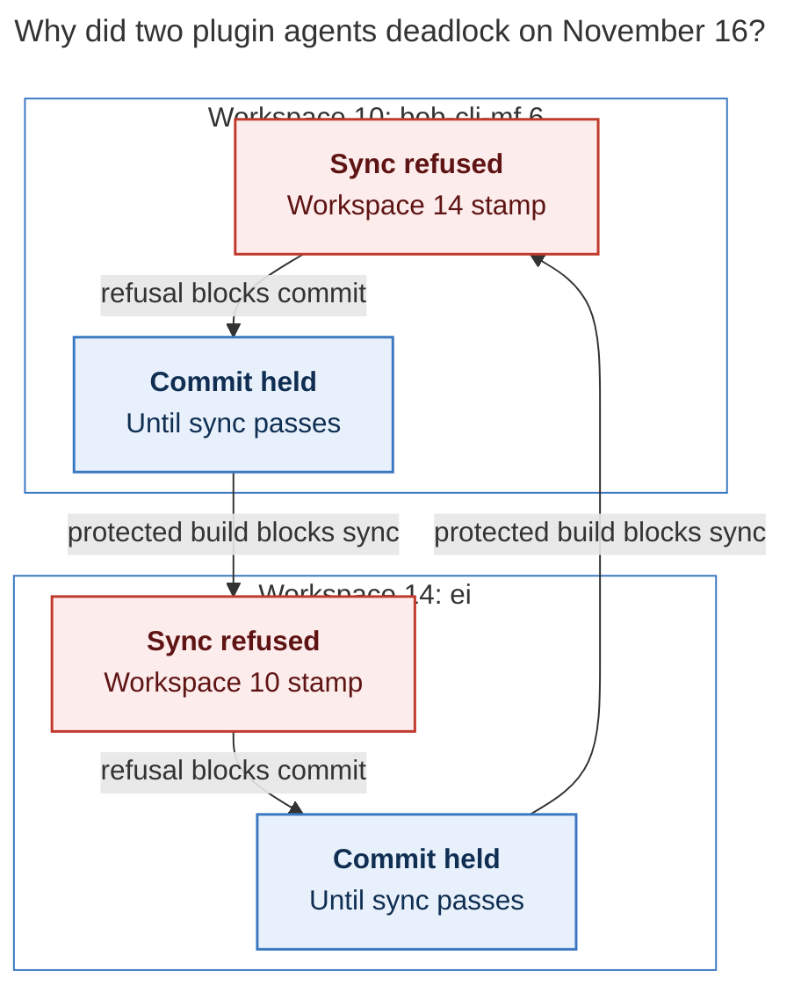

# Diagram proposals: Stop SASE agents blocking on `bob plugins sync`

Proposals for the swarm linker, not a report. Each diagram restates only what the source
report says.

```yaml
source: research:202611/plugin_sync_unblocking/plugin_sync_unblocking__final.md
producer: research.53.image
check: "mmdc 12.0.0 with --no-sandbox and the PDF-mirroring config rendered 1 of 1 Mermaid diagrams"
```

## mutual-deploy-deadlock

```yaml
anchor: |-
  each held its own commit until its sync passed
question: |-
  Why did two plugin agents deadlock on November 16?
illustrates: |-
  Each workspace held its own commit until its sync passed, while each uncommitted deployed build blocked the other's sync.
caption: "Each agent held its commit until sync passed; each protected build blocked the other agent. Arrows show blocking dependencies."
review: "509.141x872 px, fit 100.0%; question and visual checks passed; all entities and edges traced to sections 1.2 and 2.1; 0 revisions"
```


