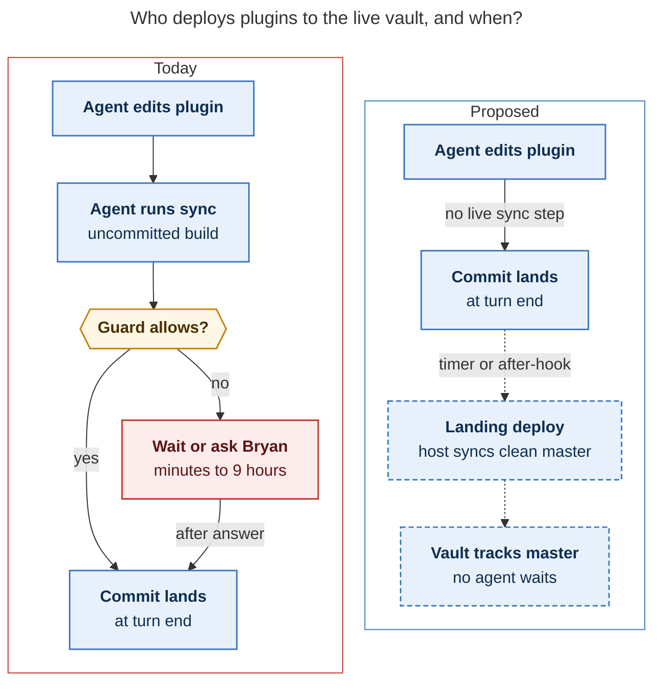

# Stop SASE agents blocking on `bob plugins sync`: consolidated research and recommendation

**Date:** 2026-11-17 · **Lead researcher** consolidating five independent reports
(`__cdx`, `__cld`, `__grk`, `__mus`, `__gem`, in this directory) plus the lead's own
verification of every load-bearing claim against bob-cli source, the live vault stamps,
the pending question gate, and the bob-plugins history.

## Decision in brief

**Yes, stop the confirmations — but the fix is not "let agents sync without asking."**
The recorded stalls are almost never about permission to run plain `bob plugins sync`.
They are `sase questions` gates and multi-hour monitor loops about **forcing (`-F`) past
the deploy-protection guard** when it refuses to overwrite another workspace's
uncommitted build — plus the waits the written policy mandates before asking.

The consolidated recommendation, in rollout order:

1. **Today (docs only):** change the bob-plugins agent policy to *never force, never
   wait, never ask* about a live-vault deploy — follow the landed-build recipe when it
   applies, otherwise skip the deploy, land the source, and report the skip. Answer the
   still-pending `ei` question with **Keep deployment** (the protected bytes are already
   landed; see §1.3). This alone ends the blocking safely.
2. **Fix four verified guard defects in bob-cli** that make the guard "protect" builds
   that already landed: read `SASE_AGENT_NAME`, run the inclusion proof even from a
   dirty incoming tree, scope dirtiness per plugin, and report the installed vault
   version truthfully.
3. **Move live deployment out of agent turns**: a host-owned *landing deploy* (per-host
   timer, optionally accelerated by a SASE `commit_hooks.after` hook) syncs clean
   `origin/master` into each vault. Agents verify in scratch vaults and never deploy.
4. **Make `bob plugins sync` defer politely (exit 0) inside agent context** unless the
   checkout is landed or an explicit preview flag is given, then record a decision in
   the decisions web so future plans stop re-adding mid-turn sync steps.

Keep the guard. Never pre-authorize `-F`.

## 1. What is actually blocking (verified)

### 1.1 The mechanism

Agents run with provider approval bypasses (`--dangerously-skip-permissions`,
`--dangerously-bypass-approvals-and-sandbox` in the SASE launchers), and gem found **zero
CustomGate requests** for the command. So harness/provider permission allowlists are not
the lever. The stalls come from two agent-side behaviors that bob-plugins `AGENTS.md`
itself prescribes:

- **`sase questions` UserQuestion gates** ("may I force-sync over the protected
  deploy?"), each with a 24 h timeout that holds a workspace claim; and
- **`sase_monitor` wait loops** on the stamped author ("wait for it to land"), which in
  the `ei` case burned ~94 minutes across five hand-written polls (one with an inverted
  condition) before the question was even asked.

### 1.2 The cost

Counting differed between researchers because the samples differed; gem's is the most
complete. Across November 2026 through Nov 16, `~/.sase/interaction_requests/question/`
holds **10 plugin force-sync questions**: 9 resolved after a total of **~1,691 minutes
(28.2 h)** of wall-clock blocking (several spanning overnight), plus the still-pending
`ei` question. cld's narrower sample (6 questions, 18.8 h) is a subset of the same
events. Roughly 100 November agent runs touched a `refusing to overwrite plugin`
refusal (upper bound; some only discuss it). Bryan answered **force in nearly every
resolved case** (one quick "Keep no-force" on Nov 13) — and the Nov 9 force caused a
real regression, rolling live `bob-ledger-tools` 1.102.0 → 1.101.1 and dropping the
`api.notebooks` API that the deployed navigation plugin needed. The questions cost
hours and reliably produce the answer that is sometimes harmful; as protection they
bought nothing.

On Nov 16 the pattern escalated to a **mutual deadlock**: workspace 10 (`bob-cli-mf.6`)
and workspace 14 (`ei`) had each deployed an uncommitted build the other's sync then
tripped on, each held its own commit until its sync passed, and each ended in a question
to Bryan (20:01 and 20:10 EST). Downstream phases queued behind both.

### 1.3 Lead verification: today's locks are all false protections

The lead independently re-checked the decisive claims on 2026-11-17:

| Claim | Result |
| --- | --- |
| `ei`'s blocked navigation bundle had already landed (cld) | **Confirmed.** All three managed files in `~/bob/.obsidian/plugins/bob-navigation-hotkeys/` are byte-identical to commit `866bb77c`, an ancestor of `origin/master`. |
| The question misreported the deployed version (gem) | **Confirmed.** Gate `d8a8aeef` says the deployed build is 2.86.0; the vault manifest holds **2.85.2**. 2.86.0 is the *incoming* checkout's version. |
| The `ei` question is still open | **Confirmed.** No response recorded as of Nov 17; `ei`'s attention-ink work remains unlanded behind it. |
| Current dirty stamps | **All three** dirty-stamped plugins match landed commits byte-for-byte: `bob-navigation-hotkeys` → `866bb77c`, `bob-ledger-tools` → `86ddb9f9`, `bob-emoji` → `daceef0e`. The other 8 stamps are clean. |

In other words: **every lock currently blocking agents protects bytes that are already
durable on `master`.** The guard refuses anyway because of the code defects in §2.2, and
the written policy then routes agents into waits and questions. Also note the vault's
navigation plugin is now *stale* (master has two newer navigation commits) precisely
because the false lock blocks everyone, including clean deploys.

## 2. Root causes, in order of weight

### 2.1 Structural: every agent deploy is dirty by construction

bob-plugins `AGENTS.md` mandates: *"After any changes to files in this repo, you MUST
run `bob plugins sync`"* — mid-turn. But under SASE's host-owned completion, agents
never commit; host finalizers commit **after** the turn ends. So every compliant agent
deploys from an uncommitted tree and writes a `dirty` stamp, and any two agents touching
plugins in parallel collide by construction. The lock only clears when the exact stamped
bytes land in one commit — which routinely never happens in that exact form (the author
edits again, rebases regenerate `main.js`, tests fail so the chained sync never runs, or
the author is itself blocked on the first agent: the Nov 16 deadlock).

### 2.2 Four guard defects (all verified in `src/native/plugins/deploy.rs` at `8a81843d`)

1. **Agent identity is never recorded.** `current_agent()` (line ~192) reads
   `SASE_AGENT_ID`; SASE agent shells export `SASE_AGENT_NAME` (verified in the lead's
   own environment — `SASE_AGENT_ID` is unset). All 11 live stamps carry `agent: null`,
   so the "is the author still running?" policy branch runs on guesswork over workspace
   numbers.
2. **The inclusion proof is gated on a clean incoming tree.** In `evaluate_guard`, the
   foreign-dirty-stamp arm runs `find_inclusion_proof` only when `incoming_clean`
   (line ~940). An agent mid-task never has a clean tree, so a stamp whose bytes already
   landed — today, all of them — still refuses with the generic "no single commit…
   holds the stamped bundle" message. The separate landed *hint* searches
   `--remotes --not HEAD`, so a holding commit already in your own history is invisible
   to it.
3. **Dirtiness is repo-wide.** `git_dirty()` runs `git status --porcelain
   --untracked-files=all` over the whole monorepo. Combined with the un-scoped default
   sync (a bare `bob plugins sync` iterates all 11 configured plugins), one agent's
   unrelated edit dirty-stamps plugins it never touched — exactly how workspace 10
   locked navigation while editing only emoji/ledger, which is the lock that blocked
   `ei`.
4. **Version conflation in refusals and questions.** Diagnostics surface the incoming
   checkout's manifest version, not the installed vault version, which is how `ei` told
   Bryan it would replace "2.86.0" when the vault held 2.85.2.

### 2.3 Policy routes the leftovers to the slowest resources

The `AGENTS.md` decision tree ends in "wait for the author" (hours of monitor churn,
deadlock-prone, built on the missing agent identity) or "ask Bryan" (hours of human
latency in a workspace-holding 24 h gate). And deploys are per-host, so even a
successful agent sync covers only the host it ran on.

## 3. Critique of the request

The goal — stop losing hours — is right. Three corrections to the framing:

1. **"Confirm they are allowed to sync" is a misdiagnosis.** No recorded question asks
   for plain-sync permission; they ask to **force**. Any fix aimed at pre-approving the
   command (provider allowlists, a named tool, `sase gate auto`) misses the actual
   mechanism, which is repo policy + `sase questions`. (grk notes Grok-style
   publish-safety rules *could* also produce ordinary-sync hesitation since the current
   instructions read as workflow color rather than standing approval; worth fixing in
   wording, but it is not what the evidence shows happening.)
2. **Stopping the questions alone leaves the waits and the deadlock.** The `ei` chain
   spent as long waiting as asking.
3. **The guard protects the wrong asset.** In-progress work lives in the workspace and,
   once landed, in git; the deployed bytes are a disposable cache. Guarding the cache
   freezes the shared vault on previews that may never land in that exact form. The
   original anti-clobber goal (an older build silently wiping a newer *landed* fix — the
   recurring bug the guard was built for) is still worth enforcing; freezing on
   *unlanded* previews is not.

**Adjusted requirements** (changes from the request as asked, called out):

| # | Requirement | Status |
| --- | --- | --- |
| R1 | No agent waits on, polls for, or asks a human about a live-vault deploy. | **Strengthened** — was "stop asking"; now also covers waiting. |
| R2 | The vault never silently loses a **landed** change and never moves to an older build. | **Kept**, narrowed to landed work. Unlanded work is protected where it lives (workspace, then git), not in the vault. |
| R3 | An agent's commit never depends on its deploy succeeding. | **New** — removes the deadlock. |
| R4 | Every host's vault converges on `origin/master` automatically. | **New** — closes the "who deploys after a skipped sync?" gap and the manual Mac refresh. |
| R5 | Zero *routine* questions, not zero refusals. | **New (cdx)** — content conflicts, failed verification, and I/O failures stay visible outcomes; elapsed time or author inactivity never authorizes force. |
| — | "Agents MUST deploy their own change mid-turn" | **Dropped** — replaced by the landing deploy; explicit live previews remain available on request. |

## 4. Where the researchers disagreed, and how it resolves

Two camps emerged:

- **Standing pre-authorization of non-force sync, keep mid-turn deploys** (grk; mus
  with a clean-tree condition): one always-loaded paragraph names the exact safe argv
  (`bob plugins sync --repo <opened checkout> --no-pull`, no `-F`), declares itself
  standing user approval, and replaces the ask-Bryan branch with keep-and-notify.
- **Deploy on land, agents never deploy** (cld, gem; cdx as the durable end state):
  host-owned deployment of clean landed `master`, plus guard hardening.

**Resolution: deploy-on-land wins as the end state**, for three reasons the first camp's
own analysis concedes:

1. Under host-owned completion an agent *cannot* deploy clean mid-turn, so pre-authorized
   mid-turn syncs keep producing dirty stamps and same-plugin collisions — the structural
   cause stays. mus's clean-tree condition, applied honestly, already reduces to "agents
   don't deploy mid-turn."
2. Agents don't need the live vault: bob-plugins' automated verification
   (`npm run build:check`, the Obsidian smoke/E2E scripts) runs against **isolated
   scratch vaults**, never `~/bob`.
3. grk's objection — post-commit-only deploy breaks same-checkout dirty iteration — is
   answered by scoping: dirty iteration remains a *human* dev-loop privilege on Bryan's
   own checkout; agents lose nothing they actually use, and the inclusion-proof fix
   clears foreign stamps whose bytes landed.

What the first camp gets right is **adopted as the stopgap and residual policy**: the
never-force/never-wait/never-ask instruction ships today in plain prose, written as
explicit standing authorization (so publish-safety-rule providers stop hesitating), and
keep-and-notify replaces every remaining ask.

Rejected outright by every report and the lead: pre-authorizing `-F`, question timeouts
defaulting to force, deleting the stamp guard, per-plugin edit leases (serializes
development to fix a deploy-only problem), and bypassing the guard with `cp`/stamp
deletion.

## 5. Recommended solution

*Figure 1. Moving the deploy after the commit removes the only step that can block an
agent. Dashed steps are proposed and run in the host, not in the agent's turn.
(Rendered at 660.7 × 767 px, fit 98.8%, Mermaid CLI 12.0.0.)*

### Phase 0 — today, minutes, no code

1. **Answer `ei`'s pending question with "Keep deployment"**, noting the deployed
   navigation bundle is byte-identical to `866bb77c` on `master`, so nothing unlanded is
   at stake and the landed recipe (stash → fast-forward → clean sync → restore) applies
   with no `-F`.
2. **Edit the policy** in bob-plugins `AGENTS.md`/`CLAUDE.md` and
   `docs/develop/deployment.md`, and the linked-repo description in bob-cli
   `sase/sase.yml` (never hand-edit generated `AGENTS.md`/`sase/memory/sase.md`; route
   memory changes through `/sase_memory_write`): *"If sync refuses: do not force, do not
   wait, do not ask. If the landed-build recipe applies, run it; otherwise leave the
   vault alone, finish and land your work, and note the skipped deploy (plugin id,
   versions, stamp provenance) in your final report."* Phrase the ordinary-sync sentence
   as **explicit standing authorization for the non-force argv family**
   (`--repo <opened checkout> --no-pull`, optional `-p`/`--dry-run`/`-f json`) so
   publish-safety provider rules stop generating permission questions; state that `-F`
   is never covered and is Bryan-only.
3. **Clear today's three false locks without force:** the stamped bytes all match landed
   commits, so one plain `bob plugins sync` from a clean, up-to-date canonical checkout
   (e.g. `~/projects/github/bobs-org/bob-plugins`) satisfies the existing inclusion
   proof and replaces them legitimately — no `-F` needed.

### Phase 1 — bob-cli guard fixes (small, independent, testable)

1. `current_agent()`: read `SASE_AGENT_NAME`, falling back to `SASE_AGENT_ID`, so
   stamps and refusals name the deploying agent.
2. Run `find_inclusion_proof` for foreign dirty stamps **regardless of incoming-tree
   dirtiness** (it proves facts about the *vault's* bytes, not the incoming tree); at
   minimum, name the proving commit in the refusal instead of the generic hint.
3. **Per-plugin dirtiness:** mark a stamp dirty only when `plugins/<id>/` or shared
   build inputs (`scripts/build-plugins.mjs`, root `package.json`/lockfile) differ from
   HEAD.
4. Surface the installed vault manifest version alongside the incoming version in
   refusals and `bob plugins list`.

With 1–3, `ei`'s Nov 16 refusal would have been an immediate permit. Rewrite
`refuse_message` (and the malformed/unsupported-stamp variants) so the copy-paste remedy
is fetch / landed-recipe / skip — with `-F` last and labelled Bryan-only. Read the
`cli_rules.md` and `docs.md` reference memory before implementing; behavior changes ride
the daily release train with a `!` marker where contracts change.

### Phase 2 — host-owned landing deploy

**Primary: a per-host reconciler** (chezmoi-managed cron/systemd via `cronctl` and the
`/crontab` workflow) on apollo and athena, best-effort on the Mac, every ~2 minutes:

1. Fetch the host's canonical bob-plugins checkout; exit if `origin/master` equals the
   last deployed SHA. Prefer a dedicated clean deploy mirror (gem's C2, e.g.
   `~/.local/share/bob/bob-plugins-deploy`) so Bryan's personal checkout's dirty state
   never blocks it and stamps never point at ephemeral workspace paths.
2. Never deploy a dirty or diverged tree — skip and notify once.
3. Fast-forward; run `npm run build:check` (catches a rebase that left `main.js` stale);
   skip and notify on failure.
4. `bob plugins sync --repo <mirror> --no-pull`. Retry lock contention next tick. On a
   guard refusal (after Phase 1, essentially only a deliberate human preview), notify
   once and never force. Always exit 0; log the outcome.

**Optional accelerator:** a SASE `commit_hooks.after` on bob-plugins commits kicks the
reconciler immediately. Two verified caveats: a failing after-hook marks the commit
workflow FAILED, so the hook must fire-and-forget and always exit 0; and local-config
trust is checkout-scoped for linked checkouts inside numbered workspaces, so either
register trust appropriately or dispatch from user-level (chezmoi) config gated on the
repo's origin.

**Why R2 holds:** the guard's clean-stamp ancestry rule already refuses an out-of-order
or stale deploy (no downgrades); backups under the plugin-backups state directory plus
`git revert` remain the rollback path.

### Phase 3 — make the old habit impossible, then record it

1. **Agent-context deferral in bob-cli:** when `SASE_AGENT` is set and the checkout is
   dirty or unlanded, a real sync prints "deferred: plugin deploys happen when your
   commit lands", sets `"deferred": true` in JSON, and **exits 0**; an explicit
   `--preview` flag (with a reason, mirroring the global-install bypass pattern) keeps
   human-requested live previews possible. This is belt-and-braces against stale plans,
   beads, and instructions that still say "run `bob plugins sync`".
2. Shrink the deploy section of the docs to one line ("never deploy; landing does it"),
   and record a decision in the decisions web (e.g. *Plugins Deploy From Landed
   Master*) via `/sase_memory_write` so future plans stop re-adding the step.

### Accepted costs

- **No automatic live preview of unlanded agent work.** Agents land at turn end with no
  human review gate, so the change reaches the vault minutes later anyway; scratch
  vaults cover verification. Explicit previews survive behind `--preview`, durably
  snapshotting source before install (cdx).
- **Up to one timer tick (~2 min) of lag**, or none with the after-hook.
- **A broken `master` reaches the vault** — no worse than today's agent-built deploys,
  and `build:check` gates the most likely breakage.

## 6. Acceptance checks and metrics

Minimum scenario coverage (condensed from cdx):

- Ordinary plugin fix → no question, no wait; vault converges post-land with verified
  bytes. Docs-only change → no deploy.
- Foreign dirty stamp whose bytes landed → immediate permit naming the proving commit
  (even from a dirty incoming tree).
- Genuinely unlanded foreign stamp → agent skips and reports; reconciler notifies once;
  nothing is overwritten; no timeout-based force.
- `ei` replay (author's tests fail before its chained sync) → no deadlock: both agents
  land source; the reconciler deploys whichever lands.
- Older candidate after a newer installed descendant → refused (no rollback).
- Dirty-vault-file skip with exit 0 → reconciler reports the rollout incomplete.

Measure after rollout (mus): plugin-sync questions filed (target zero), monitor-wait
minutes attributable to deploys, `-F` runs without a human typing them (target zero),
dirty-provenance stamps appearing in the vault (target zero after Phase 2), and vault
lag behind `master`.

## 7. Evidence appendix

Lead verification performed 2026-11-17 on apollo: `deploy.rs` read at bob-cli
`8a81843d` (this workspace); agent env inspected live (`SASE_AGENT_NAME` set,
`SASE_AGENT_ID` unset); all 11 `~/bob/.obsidian/plugins/*/.bob-deploy.json` stamps read;
vault bundles hashed with `git hash-object` and matched against `origin/master` history
in the opened linked bob-plugins checkout (`866bb77c`, `86ddb9f9`, `daceef0e` proofs);
gate `d8a8aeef` request read (created 2026-11-16 20:10 EST, 86400 s timeout, holds
workspace claim, no response recorded); current `AGENTS.md`/`CLAUDE.md` policy wording
confirmed in the opened checkout.

Researcher-specific evidence retained in the sibling reports: question-gate inventory
and durations (gem §1.1, cld §1.1), the Nov 16 deadlock reconstruction (cld Figure 1,
gem §1.2), the Nov 9 `api.notebooks` force regression
(`research:202611/j8_6_1_1_deploy_guard_question.md`, grk, cld), the sync safety
inventory and failure-JSON/structured-refusal critique (cdx, mus, grk), SASE
`commit_hooks.after` semantics and trust scoping (cld, gem, cdx S9), and the standing-
authorization wording analysis for publish-safety provider rules (grk).
