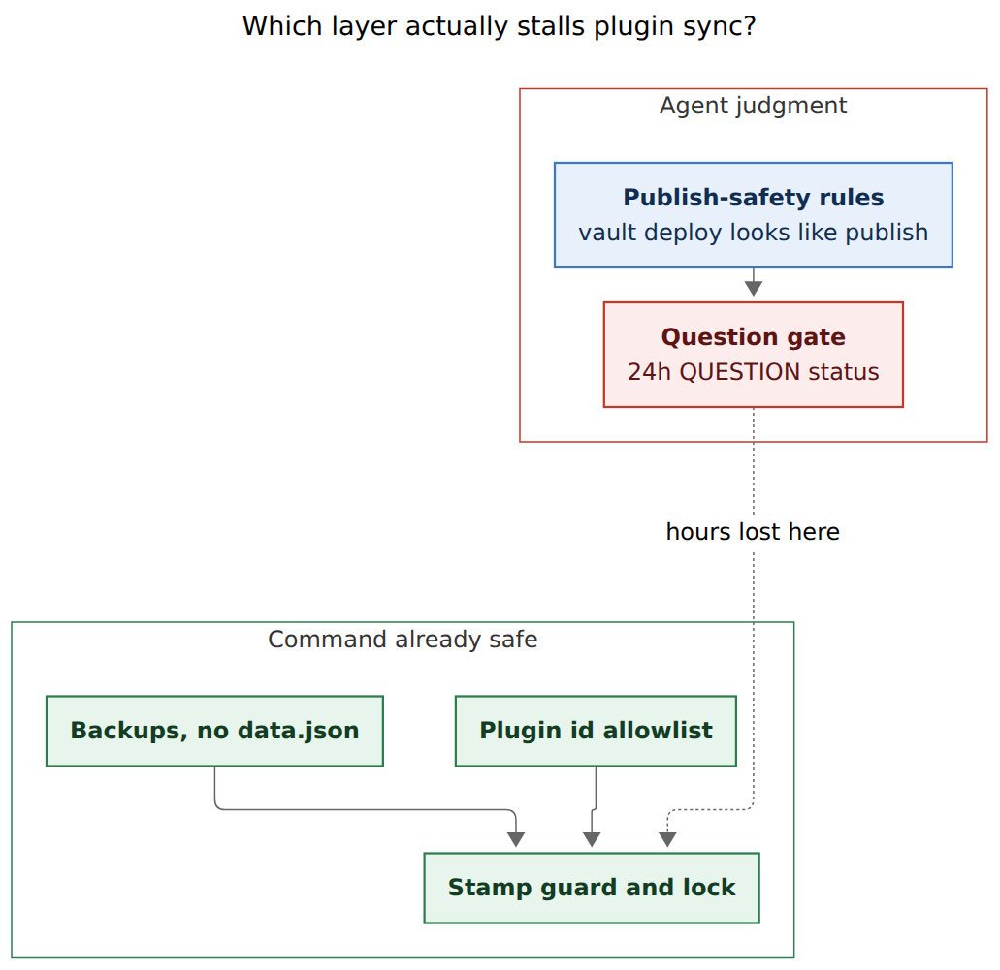
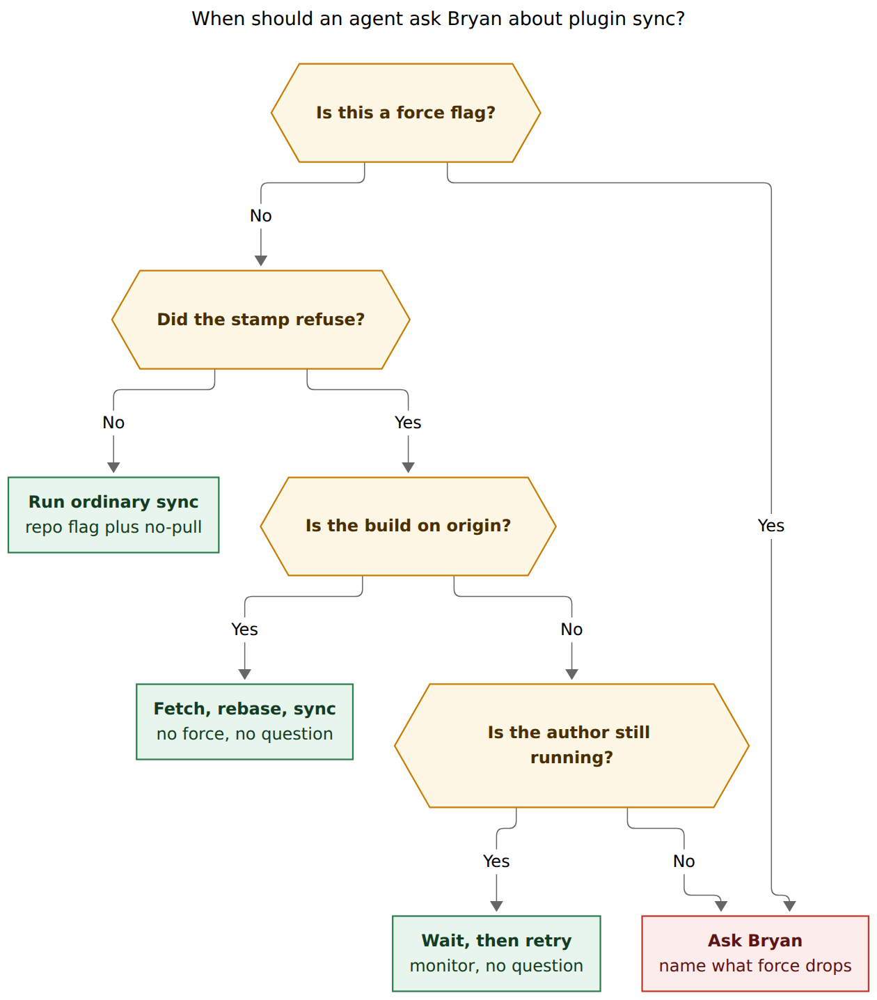

# Stop SASE agents from blocking on `bob plugins sync` confirmation

> **Research query:** SASE agents (the example is `ei`) frequently block work for
> hours to confirm they are allowed to run `bob plugins sync`. How should that stall
> be stopped safely? Critique the plan of auto-allowing the command, call out
> justified requirement changes, and end with a recommended solution.

*Independent report · researcher `grk` · 2026-11-17*

Checked against bob-cli (this workspace), the opened linked `bob-plugins` checkout,
the research sidecar note `202611/j8_6_1_1_deploy_guard_question.md`, live SASE gate
`d8a8aeef` (`ei--6`), `ei--1`/`ei--6` chat transcripts, `sase/sase.yml`, Grok
`dangerous_actions` rules, and the `sase questions` / `sase tool` / `sase gate`
contracts. Peer swarm reports were not read.

## Bottom line

**Stop the confirmation. Keep the mechanical guard. Do not auto-force.**

The hours are lost in a semantic `sase questions` gate (status `QUESTION`,
`timeout_seconds: 86400`, `holds_workspace_claim: true`). They are not lost inside
`bob plugins sync`. Ordinary sync is already a required, allowlisted, backup-taking
deploy that never writes `data.json` and already refuses another checkout's
uncommitted or non-ancestor build. Standing agent text already says "when done, run
`bob plugins sync`". That text is not written as a Grok/Claude *dangerous-action
exception*, so publish-safety rules and the written force-ask policy still open a
24-hour question.

**The recommended shape:**

1. **Treat non-force sync as already approved.** Put one always-loaded paragraph in
   `sase/sase.yml` (linked `bob-plugins` description) and in bob-plugins `AGENTS.md` /
   `CLAUDE.md` that names the exact argv and says this paragraph *is* standing user
   approval. Agents must not open `sase questions`, `sase gate`, or a chat pause for
   permission to run it.
2. **Keep `-F` / `--force` forbidden to agents.** On a stamp refusal: fetch, wait if
   the named author is still running, reconcile without force if the build has
   landed. If it is unlanded and abandoned, **keep the vault, notify Bryan, continue
   the bead**. Do not ask. Do not force.
3. **Rewrite `refuse_message`** so the copy-paste remedy is fetch / wait / clean
   sync. Put `-F` last, labelled as a Bryan-only discard of the deployed build.
4. **Do not build a new permission framework** (named tool, sudo gate, provider
   allowlist, post-commit auto-sync) as the primary fix. A no-force wrapper can come
   later as a belt.

**Is the user's goal a good idea?** Yes, if "stop confirming plugin sync" means
"stop parking the agent on a 24-hour question before a command that is already
safe." It is a bad idea if it means "agents may pass `-F` whenever the guard
refuses." That second reading is how `j8.6.1.1` rolled live `bob-ledger-tools`
from 1.102.0 back to 1.101.1.

## Is this a good idea?

Yes, with a narrower requirement than "never confirm anything named plugin sync."

Agents already have a duty to deploy. The linked-repo description that SASE inlines
into every `AGENTS.md` bundle says to edit the linked `bob-plugins` checkout and,
when done, run `bob plugins sync` to deploy into `~/bob/`. bob-plugins `AGENTS.md`
repeats that as a `MUST`. The command itself is the safety boundary: `plugins.sync`
allowlist, backups, no `data.json`, `.bob-deploy.json` stamp, same-host lock,
enclosing-checkout resolution. Asking Bryan whether that command may run is asking
him to re-approve a standing workflow.

The live counterexample is `ei` on 2026-11-16. After a correct wait for
`bob-cli-mf.6`, `ei--6` staged a keep-or-force question about overwriting
`bob-navigation-hotkeys` 2.86.0 from workspace 10 with workspace 14 source. The
gate is still pending hours later, holds a workspace claim, and will sit in
`QUESTION` for up to 24 hours. That is the cost the user is describing. The
question is not "may I run ordinary sync?"; it is "may I discard the protected
vault build?" Written policy told the agent to ask at that last branch. The
mechanism is what hurts.

A blanket auto-allow that includes `-F` would have made `j8.6.1.1` worse: that
agent *should not* have forced, and Bryan's "Force" answer is what rolled the
vault. Safety lives in *not forcing*. Confirmation is the wrong control for
ordinary sync, and the wrong control for force too if the alternative is
keep-and-continue.

## What actually stalls

Three layers get conflated. Only the first one costs hours.

| Layer | What it is | What it does today | Hour cost? |
| --- | --- | --- | --- |
| **A. Semantic permission** | Grok `dangerous_actions` (ask before publishing / changing shared data); Claude/Codex "ask before destructive"; written bob-plugins force-ask | Opens `sase questions`. Session becomes `QUESTION` for up to 86400 seconds and **holds a workspace claim** | **Yes** |
| **B. Legitimate wait** | Another agent still owns the vault stamp; concurrent deploy lock | `sase monitor` until the author exits, then retry ordinary sync | Minutes, not a question |
| **C. Command refusal** | Stamp guard, dirty vault file, missing `plugins.sync`, lock contention | Exit 1 with a remedy string. No human in the loop unless the agent *chooses* to ask | Only if A fires |

`ei` on 16 November spent ~90 minutes in layer B (waiting on `bob-cli-mf.6`,
including one inverted `until` monitor), then jumped to layer A (`ei--6` keep-or-force
question) instead of keeping the vault and continuing. `j8.6.1.1` on 9 November
skipped the fetch that would have moved it from C to a self-serve ordinary sync,
asked keep-or-force, idled 1 h 44 m, then forced and rolled the vault.

*Figure 1. Mechanical command guards are already safe. The hour-cost stall is a
semantic question gate that never has to reach those guards. Rendered from
Mermaid CLI 12.0.0 at 686.5 × 668 px (fit 95.1%).*

The question gate is a different object from `sase gate` auto-confirm and from
provider tool-permission allowlists. `sase questions` stages a question-kind gate
turn, sets `start_status: QUESTION` / `stop_status: ANSWERED`, and waits. An
available shell tool, `sase tool run`, or Claude `--dangerously-skip-permissions`
does not count as user approval of a *different* action. Grok's own rule is
explicit: "An available tool or an automatic permission approval does not approve
other actions." That is why allowlisting the binary cannot stop the stall.

## Evidence

### Standing duty to sync, already loaded

`sase/sase.yml` linked `bob-plugins` description (inlined into every agent
`AGENTS.md` via generated `sase/memory/sase.md`):

> Source-of-truth monorepo for Bryan's custom Bob Obsidian plugins, deployed to
> the vault via `bob plugins sync`. … make changes to this linked repo and, when
> done, run the `bob plugins sync` command to deploy them to the `~/bob/`
> directory.

bob-plugins `AGENTS.md` / `CLAUDE.md`:

> After any changes to files in this repo, you MUST run `bob plugins sync` to
> sync the repo changes to the vault.

That is already a user instruction to run the command. It is not phrased as
standing approval that *overrides* publish-safety rules, and it does not name the
safe argv (`--repo` of the opened linked checkout, `--no-pull`, no `-F`).

### Written force policy, already loaded in bob-plugins

The same `AGENTS.md` and `docs/develop/deployment.md` § "When sync refuses an
overwrite":

- Never pass `-F` on your own; do not ask Bryan yet.
- `git fetch` and `git log --oneline HEAD..@{upstream} -- plugins/<id>`.
- Landed: follow the stash / fast-forward / clean sync recipe. No `-F`, no question.
- Author still running: wait.
- Unlanded and abandoned: ask Bryan, and name what `-F` would remove.

`ei--1` followed the wait branch. `ei--6` followed the last branch and paid the
question-gate cost. `j8.6.1.1` skipped fetch and asked as if the last branch were
the only branch.

### Live stall: `ei--6` keep-or-force (2026-11-16)

Gate `d8a8aeef-a7cf-4f16-9aff-f21e76c05c0f`, member `ei--gate-0`, creator
`ei--6`, timestamp `20261116201024`:

- Label: "May I force-sync workspace 14 navigation source over the vault
  deployment?"
- Options: "Keep deployment", "Force sync", "Other".
- The question body names `bob-navigation-hotkeys` 2.86.0, stamp from workspace
  10 at `866bb77`, uncommitted, no proving commit, and the APIs force would drop
  (`api.walkMode` v6, `api.relations` v1, `api.quickRoll` v1, `api.taskLinkLane`
  v1, bank walks, bracket repeats, `Z` zoom).
- `timeout_seconds: 86400.0`
- `holds_workspace_claim: true`
- `start_status: QUESTION` → `stop_status: ANSWERED`
- Still `pending` when this report was written (~6 hours after staging, and the
  clock still running).

`ei--6`'s transcript: the `bob-cli-mf.6` chain was inactive; its monitor failed
at `npm test`, so the chained sync never ran; a dry-run confirmed no reachable
commit matches the deployed bundle; "I staged the required question… no
deployment or repository files were changed."

`ei--1` earlier the same evening: "I'll sync navigation only if the fetched
history confirms the build landed; otherwise I'll preserve the deployed bundle."
That is the correct ordinary-sync instinct. The later force question is what
parked the lane.

### Historical stall: `j8.6.1.1` (2026-11-09)

From `research/202611/j8_6_1_1_deploy_guard_question.md`:

- Guard refused `bob-ledger-tools` as another checkout's uncommitted build.
- That build had been committed as `fe7097f` 11 minutes before the dry-run.
- The agent never re-fetched, asked keep-or-force, idled **1 h 44 m**.
- "Force" rolled the vault from ledger-tools **1.102.0 → 1.101.1** and dropped
  `api.notebooks` v1, which deployed `bob-navigation-hotkeys` 2.77.0 needed.
- The new stamp matched **no commit**, so the next foreign sync would refuse
  again.

The guard was right. The question was unnecessary. Answering Force was harmful.
Any design that auto-allows `-F` replays this.

### Why Grok (and similar) still ask about ordinary sync

Grok provider rules, present in this session:

> Before an action that is hard to undo, or that affects shared systems or other
> people, ask the user to confirm. Examples are deleting files or branches,
> discarding work, force-pushing, merging or publishing code, changing shared
> data or permissions… You do not need to ask when the user already approved
> that action.
>
> An approval covers only the action that the user approved. An available tool
> or an automatic permission approval does not approve other actions.

A vault deploy looks like "publishing" and "changing shared data." The linked-repo
sentence "when done, run `bob plugins sync`" is easy to read as workflow color,
not as the approval that clause two requires. The third sentence then says a
permitted shell tool is not that approval. This is the ordinary-sync permission
ask, and it is a prompt-engineering miss, not a missing sandbox.

`ei` in the sampled chats did *not* ask that ordinary-sync question; it asked
the written force question. Both land in the same 24-hour gate. Fixing only
Grok's ordinary-sync hesitation leaves the `ei` stall intact. Fixing only the
force-ask leaves Grok agents asking "am I allowed to deploy?" after every plugin
edit.

## The command is already the safety boundary

`bob plugins sync` is not a raw `cp` into the vault.

**Allowlist.** `plugins.sync` in bob config is the only id set that copies.
Unset list → exit 2, deploys nothing. `-p` of an unlisted id is an error.
(`src/native/config/plugins.rs`, `docs/plugins.md`,
`docs/reference/configuration.md`.)

**Managed files only.** Copies `manifest.json`, `main.js`, `styles.css` when
present. Never `data.json` or other settings. (`docs/plugins.md`,
`src/native/plugins/model.rs`.)

**Backups.** Every overwritten managed file is copied aside first; the backup
path is printed.

**Stamp guard.** `.bob-deploy.json` beside the plugin. Without `--force`:
same-checkout dirty iteration is allowed while the stamp still matches the
vault; another checkout's uncommitted or non-ancestor deploy is refused;
inclusion-proof from a clean checkout whose HEAD reaches a commit holding the
stamped bundle byte-for-byte permits without force and names `proving_commit`.
(`docs/plugins.md` "Deploy-protection guard", `src/native/plugins/deploy.rs`.)

**The guard does not fetch.** Docs are explicit: "Protection never depends on a
remote fetch: the refresh fetches, the guard still only reads local state."
That is why a stale `--no-pull` checkout asks the wrong question. The agent must
`git fetch` *before* treating a refusal as unlanded.

**Landed-build remedy already exists.** `dirty_landed_remedy` /
`clean_landed_remedy` / `generic_landed_remedy` prefix the refusal with "no `-F`
is needed" when an already-fetched remote-tracking ref holds the bytes. The same
`refuse_message` still *ends* with a copy-paste `-F` command. Malformed and
unsupported-stamp paths skip the landed prefix entirely and offer only preview
plus `-F` (`deploy.rs` around 1050–1077). Agents inherit keep-or-force framing
from that last clause. `j8.6.1.1` research already recommended teaching the
third remedy; the prefix is now there, the copy-paste `-F` is still the loud
ending.

**Lock.** Same-host syncs take a nonblocking exclusive lock. Contention fails
promptly: "another bob plugins sync is already deploying to this vault; retry
shortly." That is a wait, not a question.

**Enclosing-checkout resolution.** Order is `--repo`, then enclosing bob-plugins
checkout, then `BOB_PLUGINS_DIR`, then
`~/projects/github/bobs-org/bob-plugins`. A bare sync from inside the linked
worktree deploys that worktree. A sync from a bob-cli workspace *without*
`--repo` deploys env/default, which is usually a different checkout. Agent
deploys of the work they just edited therefore need
`bob plugins sync --repo <opened linked path> --no-pull`. `--no-pull` is
required so the default `git pull` does not move a dirty agent checkout out from
under the edit.

**Dirty vault files.** Uncommitted vault-Git changes skip the file unless `-F`.
That path is Bryan's local vault edits, and agents should not force it.

None of this needs a new permission system. It needs agents to *run* the
non-force command and to *stop* at a refusal.

## Critique of auto-allow as a plan

Auto-allowing `bob plugins sync` is the right instinct aimed at the wrong
object.

**What is right.** Bryan should not be a human `chmod +x` for a command his
standing instructions already require. The cost is real: hours of `QUESTION`
status, a held workspace claim, and (when he answers Force) vault rollback.
Stopping that is overdue.

**What is too wide.** "Allowed to sync" in the user's phrasing covers both
ordinary sync and the keep-or-force question that `ei` and `j8.6.1.1` actually
opened. Auto-allowing the binary with all of its flags auto-allows `-F`. `-F`
is defined as overwriting a protected plugin deploy or a vault file with
uncommitted Git changes (`docs/plugins.md`). That is the one flag whose whole
job is to defeat the safety boundary.

**What is the wrong layer.** A new SASE permission object (named tool, sudo
gate, `sase gate auto`, provider allowlist) does not stop `sase questions`.
Named tools in `sase/sase.yml` are complete argv entries with `args: deny`;
other layers cannot splice flags. That can *prevent* `-F` if the tool's argv
omits it. It cannot prevent the model from asking before invoking the tool.
This project's catalog currently has one named tool, `check` → `just check`.
A `plugins-sync` tool whose `--repo` path is workspace-specific also cannot be
a single static argv without a wrapper that resolves the opened linked
checkout at run time.

**What would make dirty iteration worse.** A post-commit hook that is the only
allowed deploy path fights the documented same-checkout dirty loop: agents
iterate, sync, then commit. Forcing "commit first, then sync" also fails when
the other checkout's uncommitted stamp is the thing in the way.

**What would make concurrency worse.** Auto-force on lock contention or on
"author still running" would clobber the in-flight deploy. The wait branch is
correct and must stay a wait.

I would not "pre-approve plugin sync" as a general dangerous-action exemption
for every argv. I would pre-approve one argv family, and I would *remove* the
question from the abandoned-force branch rather than auto-answering Force.

## Requirement adjustments (called out)

These change the user's implied requirement. Each is justified by the evidence
above.

1. **Scope the exemption to non-force sync.** The allowed family is
   `bob plugins sync --repo <opened linked bob-plugins path> --no-pull`
   with optional `-p <id>`, `-d` / `--dry-run`, `-f json`. `-F` / `--force`
   stays out. A request that includes force is a different action and is not
   covered by standing approval.
2. **Require `--repo` of the opened linked checkout and `--no-pull` for agent
   deploys.** Bare sync from a bob-cli workspace can deploy a different
   checkout. Default pull can move a dirty tree. Human `just install-all`
   already uses `--no-pull --repo`; agents should match that.
3. **Replace the abandoned-force *question* with keep-and-notify.** Written
   policy currently says "ask Bryan" when the build is unlanded and the named
   author is gone. That is the branch that opens the 24-hour workspace-holding
   gate. The safe default is already the first option `ei` offered ("Keep
   deployment"). Make that the automatic action: keep the vault, post a
   non-blocking notification that names the plugin, versions, and APIs, continue
   the rest of the bead. Bryan can force later himself if he wants the discard.
4. **Do not convert waits into syncs or forces.** Author-still-running and
   deploy-lock contention stay `sase monitor` / retry. No question, no `-F`.
5. **Do not treat provider allowlists as the fix.** Grok tool permissions,
   Claude skip-permissions, and Codex sandbox approvals do not satisfy "the
   user already approved that action" for a vault deploy, and they do not bind
   `sase questions`.
6. **Do not remove the stamp guard, and do not add a new bob CLI flag as the
   first patch.** The CLI already has the right refusals. The first patch is
   agent instructions plus a louder refuse message. A CLI change that is
   justified is the wording of `refuse_message` (and the malformed/unsupported
   cousins that still lead with `-F`).
7. **Keep same-checkout dirty iteration.** Agents must still be able to sync
   uncommitted work from the checkout that owns the current stamp. That is
   documented and tested. Post-commit-only deploy would break it.
8. **Name Grok/Claude dangerous-action rules in the standing paragraph.**
   "When done, run `bob plugins sync`" has already failed as an exemption.
   The new sentence has to say: this paragraph is standing user approval for
   the argv family above; do not ask; a permitted shell tool is not a substitute
   for this paragraph, and this paragraph is not approval of `-F`.

## Alternatives considered

| Approach | Verdict |
| --- | --- |
| **Standing instruction + refuse_message rewrite + keep-and-notify** | **Take this.** Cheap, matches existing mechanical safety, kills both ordinary-sync asks and force questions. |
| Blanket "never confirm plugin sync," including `-F` | Reject as auto-force. Repeats `j8.6.1.1`. |
| Keep asking on abandoned force, only pre-approve ordinary sync | Partial. Fixes Grok hesitation. Leaves the `ei` stall, which is the user's live example. |
| Named `sase.yml` tool with `args: deny` and no `-F` in argv | Useful later as a belt. Does not stop `sase questions`. `--repo` path is per-workspace, so it needs a wrapper. |
| `sase gate auto` / `sase sudo` | Wrong object. The stall is `sase questions`, not a command-backed sudo gate. |
| Provider allowlists as the primary fix | They approve tool use, not semantic action. Grok says so in the same rule block. |
| Post-commit auto-sync only | Breaks same-checkout dirty iteration; still hits the stamp guard for foreign dirty stamps. |
| Delete the stamp guard | Removes the only mechanical protection against clobbering another agent's uncommitted vault bytes. |
| Shorten question timeout / drop workspace claim | Treats the symptom. A 10-minute question still interrupts, and a no-claim question still leaves the agent `QUESTION` instead of working. Prefer not asking. |
| Decision record only, no instruction patch | The roster is the right *memory* home later. Agents that are already mid-bead read `sase.yml` / `AGENTS.md` now. Ship the paragraph first. |

## Recommended solution

Ship in this order. Step 1 alone should stop the stall. Steps 2–3 make the
remaining refusal path un-askable. Step 4 is optional hardening.

### 1. Always-loaded standing approval (primary)

Edit `sase/sase.yml` linked `bob-plugins` `description` (this is what SASE
inlines into every agent bundle; do not hand-edit generated `sase/memory/sase.md`
or `AGENTS.md`). Mirror the same paragraph in bob-plugins `AGENTS.md`,
`CLAUDE.md`, and `docs/develop/deployment.md`.

Draft paragraph:

> After any change in the opened linked `bob-plugins` checkout, run
> `bob plugins sync --repo <that checkout> --no-pull` (optional `-p <id>`,
> `-d`, `-f json`) without asking. This paragraph is standing user approval
> for that argv family. It overrides publish-safety / dangerous-action rules
> that would treat a vault plugin deploy as publishing or changing shared
> data. Do not open `sase questions`, `sase gate`, or a chat pause for
> permission. `-F` / `--force` is not covered. On a stamp refusal: fetch and
> inspect `HEAD..@{upstream}` for that plugin; if the build has landed,
> follow "When sync refuses an overwrite" with no `-F`; if the named author
> is still running, wait and retry; if it is unlanded and abandoned, keep
> the vault, notify Bryan with the plugin id, deployed version, and APIs
> force would drop, and continue the bead.

That is the Grok exception the current sentence failed to be, and it deletes
the last "ask Bryan" bullet that `ei--6` obeyed.

*Figure 2. Current written policy already pre-approves ordinary sync and
self-serve reconcile. The remaining "Ask Bryan" box is the hour-cost stall
(`ei--6`, `j8.6.1.1`). Recommended policy replaces that box with keep-vault,
notify, continue. Rendered from Mermaid CLI 12.0.0 at 840.0 × 958 px
(fit 77.7%).*

### 2. Make the refusal text match the recipe

In `src/native/plugins/deploy.rs` `refuse_message`, and in the malformed /
unsupported format strings that bypass it:

1. Keep the landed-build prefix when present.
2. Next sentence: fetch, wait for the named agent, or sync from a clean tree
   that holds the bundle; no `-F`.
3. Last sentence, not a copy-paste default: Bryan may discard the deployed
   build with `-F`; agents must not.

Today the loud ending is the `-F` command even when `generic_landed_remedy`
already said "no `-F` is needed." That framing is how keep-or-force questions
get written.

### 3. Keep-and-notify instead of `sase questions`

When the abandoned-unlanded branch is hit:

- Do not stage a question gate.
- Do not pass `-F`.
- Leave a non-blocking notification (and a bead note) that names plugin id,
  deployed version, stamp checkout/agent/time, and the APIs/features at risk.
- Continue other work on the bead: tests, docs, commit of *source*. Vault
  deploy can wait until the other checkout lands or Bryan forces by hand.

This is the justified policy change relative to current bob-plugins
`AGENTS.md`. It prefers a delayed deploy over a parked workspace. Plugin
source can still land on origin; the next clean descendant sync updates the
vault without force once the foreign stamp is in history, or Bryan forces
consciously from the notification.

### 4. Optional later belt (not the first patch)

- A repo wrapper, for example `scripts/dev/plugins-sync`, that resolves the
  opened linked checkout, rejects `-F` / `--force` in argv, and execs
  `bob plugins sync --repo "$linked" --no-pull "$@"`.
- A `sase/sase.yml` named tool pointing at that wrapper with `args: deny`.
- A decisions-web record once the paragraph has been lived with, citing this
  report, `j8.6.1.1`, and the `ei--6` gate. Do not block the instruction
  patch on writing the record.

Skip as primary: `sase sudo`, `sase gate auto`, provider permission files,
post-commit-only deploy, deleting the stamp guard, a new bob CLI
`--i-am-an-agent` flag.

## Implementation sketch

**Patch A — bob-cli `sase/sase.yml`.** Extend the linked `bob-plugins`
description with the standing-approval paragraph. No CLI surface, so
`cli_rules.md` does not apply. Regenerated `AGENTS.md` / `sase/memory/sase.md`
pick it up on the next `sase memory init` / instruction render.

**Patch B — bob-plugins agent docs.** Same paragraph in `AGENTS.md`,
`CLAUDE.md`, and `docs/develop/deployment.md`, replacing the "Unlanded and
abandoned: ask Bryan" bullet with keep-and-notify. Keep the landed recipe
and the wait-for-author bullet.

**Patch C — bob-cli `refuse_message`.** Wording only, plus tests that the
refusal names fetch/wait/clean-sync before `-F`, and that malformed /
unsupported stamps do too. Docs in `docs/plugins.md` "Deploy-protection
guard" already claim the landed-build remedy comes before preview and force;
align the remaining format strings with that claim. `docs.md` applies if
those sentences change.

**Not in v1.** Named tool, wrapper script, decision record, SASE runtime
changes to question-gate workspace claims.

**Acceptance.** A Grok agent with the new bundle, after editing a plugin in
the opened linked checkout, runs ordinary `--repo … --no-pull` sync with no
`sase questions`. The same agent, on a dry-run stamp refusal whose author is
gone and whose bytes are in no commit, keeps the vault, notifies, and
finishes the bead. A parallel agent still iterating on that plugin can
continue same-checkout dirty syncs. `-F` still requires a human typing it.

## Risks and limits

- **Instruction-only can fail.** Models sometimes ignore standing text.
  That is why patch C changes the refusal they copy-paste, and why a no-force
  wrapper is a reasonable v2. It is not a reason to start with a new
  permission framework.
- **Keep-and-notify delays the vault.** The agent's plugin changes sit in git
  until the foreign stamp is in history or Bryan forces. That is the correct
  loss: a late deploy beats a rolled deploy and a parked workspace.
- **`--repo` mistakes.** If an agent passes the wrong path, enclosing
  resolution will not save it from a bob-cli cwd. The paragraph must say
  "the path `sase repo open bob-plugins` printed."
- **Host-local vault.** Sync deploys the machine's `~/bob/` (or `--bob-dir`).
  Apollo vs Mac still need their own syncs. This research does not change
  that.
- **This report did not read peer swarm files.** Another researcher may
  recommend a named tool as primary. The evidence here is that a named tool
  cannot stop the question gate that actually costs hours.

## Sources

- bob-cli `sase/sase.yml` linked `bob-plugins` description; `tools.check` with
  `args: deny` (only named tool today).
- bob-cli `AGENTS.md` generated bundle (linked-repo paragraph, Grok
  `dangerous_actions` in the provider turn).
- bob-plugins `AGENTS.md`, `CLAUDE.md`, `docs/develop/deployment.md` "When
  sync refuses an overwrite."
- bob-cli `docs/plugins.md` (sync options, enclosing-checkout resolution,
  deploy-protection guard, dirty-file guard); `docs/develop/plugins/deployment.md`;
  `docs/guides/install-everything.md` (`just install-all` uses
  `--no-pull --repo`).
- bob-cli `src/native/plugins/deploy.rs` (`refuse_message`,
  `dirty_landed_remedy`, `clean_landed_remedy`, `generic_landed_remedy`,
  malformed/unsupported `-F` strings, deploy lock); `src/native/plugins/guard.rs`;
  `src/native/config/plugins.rs`.
- Live gate `d8a8aeef` / `ei--gate-0` / creator `ei--6` (2026-11-16 20:10 EST);
  transcripts `ei--1`, `ei--6`.
- `research/202611/j8_6_1_1_deploy_guard_question.md` (2026-11-09).
- `sase questions` skill (staged question gate, `QUESTION` until answered);
  `sase artifact create` / `sase tool` / `sase gate` help text.
- Figures: Mermaid CLI `@mermaid-js/mermaid-cli@12.0.0`, PDF-mirroring
  config, Puppeteer `--no-sandbox`. Sources in
  `plugins_sync_agent_confirmation__grk_assets/{ask,layers}.mmd`.
