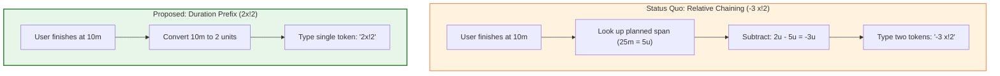
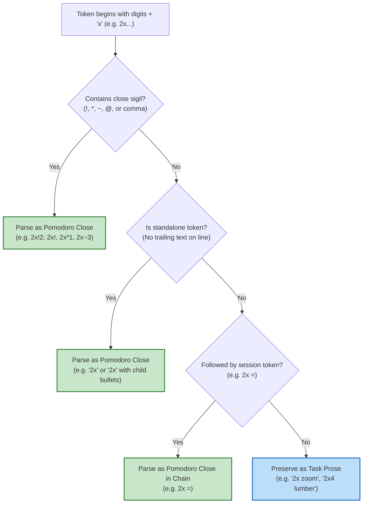
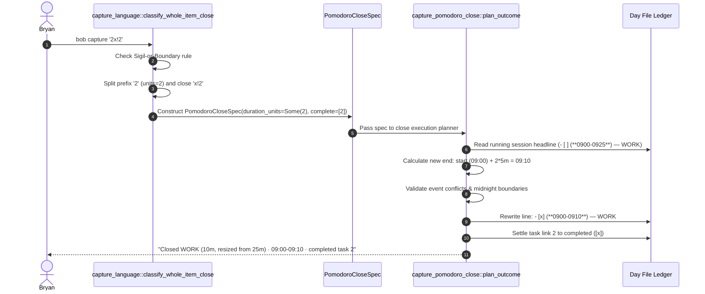

# Design and Architectural Critique: Supporting `<N>` Duration Prefix on Pomodoro Close (`<N>x`) Capture Syntax

**Author:** Researcher gem (5-researcher swarm)  
**Date:** 2026-11-08  
**Target Repositories:** `bob-cli`, `bob-mac-capture`, `bob-plugins`  
**Relevant Prior Decisions:** `decisions:mac-capture-is-a-thin-client`, `decisions:open-pomodoro-names-follow-task-links`, `decisions:ended-off-clock-events-settle`

---

## 1. Executive Summary

This research report investigates the proposal to add an `<N>` duration prefix to Bob's existing `x` (Pomodoro close) capture syntax, where `<N>` is a positive integer representing the final session duration in 5-minute increments.

### The Proposed Syntax
Under the proposed grammar:
- `<N>x` specifies that the currently running Pomodoro should be resized to `<N> * 5` minutes before being closed.
- Suffixes for task link outcomes (`!`, `*`, `~`, `<K>`, `@<K>`), inline Work Log notes, and child bullets attach directly to `<N>x`.
- For example, if a running Pomodoro was planned for 25 minutes (5 units), capturing `2x!2` is functionally equivalent to the chained command `-3 x!2`: it resizes the session to 10 minutes (2 units) and closes it, completing task 2.

### Core Verdict
**The core feature is an outstanding usability improvement that solves a pervasive daily friction point in Bob's timekeeping workflow.** 
In the current capture language, recording a session that finished early or late requires users to perform multi-step mental arithmetic (calculating delta = target - planned, dividing by 5, negating, and formatting as a separate `-N` or `+N` token). Worse, this delta calculation is **state-dependent**: the user must recall or look up what Bob originally booked for the session. In contrast, `<N>x` is **absolute and state-independent**: the user simply declares how long they worked (e.g., `2x` for 10 minutes, `3x` for 15 minutes, `1x` for 5 minutes) and closes the session in a single atomic gesture.

Furthermore, assigning `<N>` to 5-minute units is **deeply aligned with Bob's existing grammar**:
- `=3` starts a 3-unit (15-minute) Pomodoro.
- `x=3` records a 3-unit (15-minute) past Pomodoro.
- `+2` / `-3` adjusts duration by 2 or 3 units.
- Therefore, `2x` meaning a 2-unit (10-minute) close is immediately intuitive to any Bob user.

### Essential Critique & Required Adjustments
While the concept is powerful, a naive implementation would introduce a critical architectural risk:
1. **The Prose Collision Problem (Leading Digits):**  
   Bob's capture language currently maintains an invariant: **no capture command begins with an ASCII digit**. Every operator starts with a dedicated sigil (`@`, `#`, `=`, `+`, `-`, `x`, `!`, `&`, `*`, `~`, `%`, `/`). If any token starting with `\d+x` unconditionally claims the capture item as a Pomodoro close, everyday task captures will be erroneously captured as session closes:
   - `2x zoom lens` would close the running Pomodoro and log `"zoom lens"`.
   - `2x4 lumber` would close the running Pomodoro, keep task 4 in progress, and log `"lumber"`.
   - `10x engineer article` would close the Pomodoro.
   - `3x weekly workout` would close the Pomodoro.
2. **Disambiguation Guard (Recommended Requirement Adjustment):**  
   We must establish a strict lexical disambiguation rule: `<N>x` is recognized as a Pomodoro close **only when** it is:
   - Followed by a close sigil (`!`, `*`, `~`, `@`, or a comma-separated task list), e.g., `2x!`, `2x!2`, `2x*1`, `2x~3`, `2x!1@2`; OR
   - An exact standalone token on the item parent line (e.g. `2x` on its own, or with child bullets `- log note`); OR
   - Part of a session operator chain (e.g. `2x =`, `2x =3`).  
   Any token `<N>x` or `<N>x<M>` followed on the same line by whitespace and unadorned prose without close sigils (`2x zoom`, `2x4 lumber`) **strictly remains ordinary task prose**.
3. **Lengthening Parity & Safety:**  
   `<N>x` must support lengthening as well as shortening (e.g., `7x!` on a 25-minute Pomodoro extends it to 35 minutes). When `<N>` extends the session, it must trigger the existing event-conflict detection engine (`detect_event_conflict_with`) to prevent silently trampling scheduled calendar events or crossing midnight.
4. **Link-Close Parity (`=2x!1`):**  
   The syntax should also be supported on task link and Pomodoro link closures: `@work:outline=2x!1` and `^dev:fix=2x!1`. Currently, `=2x!1` fails with `invalid_pomodoro_link: '=2x!1' has a close-shaped name`.
5. **Clear Error for `<N> = 0`:**  
   `0x` or `0x!2` must be rejected with a targeted diagnostic explaining that duration must be a positive integer in 5-minute units, pointing users to `x0` if their intent was to close without carrying tasks forward.

---

## 2. Problem Analysis: The Cognitive Burden of Relative Adjustments

### The Mental Arithmetic of the Status Quo
In Bob, when a Pomodoro is running, its entry in today's daily note ledger holds an explicit time span. For instance, a session started at 09:00 with default timing is written as:
```markdown
- [ ] (**0900-0925**) — WORK
  - [ ] () — Fix lexer token boundary ^dev:fix
```

When Bryan finishes working at 09:10 (after 10 minutes) and wants to record reality accurately:
1. **Plain `x!1` is insufficient:**  
   Typing `x!1` marks the checkbox done (`- [x] (**0900-0925**) — WORK`) but **leaves the span at 25 minutes** (`0900-0925`). This inflates Worked metrics, distorts stats, and blocks the remaining 15 minutes of ledger time.
2. **Current Workaround (`-3 x!1`):**  
   To resize the session, Bryan must type `-3 x!1`. Computing `-3` requires:
   $$\Delta_{\text{minutes}} = T_{\text{actual}} - T_{\text{planned}} = 10\text{m} - 25\text{m} = -15\text{m}$$
   $$\text{Units} = \frac{-15\text{m}}{5\text{m/unit}} = -3$$
3. **The State-Dependency Trap:**  
   What if the session was started with `=3` (15m)? Then the delta is $10 - 15 = -5\text{m}$ ($-1$ unit). If Bryan habitually types `-3 x!1`, the session duration drops to $-5\text{m}$, hitting an underflow error!  
   What if the session was started with `=8` (40m)? Then the delta is $10 - 40 = -30\text{m}$ ($-6$ units).  
   To formulate the command, the user **must know Bob's internal state**. If the user was in deep flow and does not remember what duration was planned, they must switch windows, check tmux, inspect Obsidian, or glance at the Mac menu bar before typing.

### Cognitive Ergonomics of `<N>x`
With `<N>x`, the entire mental pipeline collapses:

| Step | Relative Workflow (`-N x`) | Sizing Prefix Workflow (`<N>x`) |
| :--- | :--- | :--- |
| **1. Assess actual work** | "I worked for 10 minutes." | "I worked for 10 minutes." |
| **2. Convert to units** | $10\text{m} / 5 = 2\text{u}$ | $10\text{m} / 5 = 2\text{u}$ |
| **3. Check planned duration** | Look up planned span (e.g. 25m = 5u). | *Not needed.* |
| **4. Calculate difference** | $2\text{u} - 5\text{u} = -3\text{u}$ | *Not needed.* |
| **5. Formulate command** | Chained tokens: `-3 x!1` (7 characters, space required) | Single token: `2x!1` (4 characters, no space) |

`<N>x` converts a state-dependent relative adjustment into an **absolute, idempotent declaration of elapsed time**.



---

## 3. Grammar Critique: Collisions, Invariants, and Disambiguation

### 3.1 The Leading Digit Invariant
In Bob's capture grammar, every non-task operator begins with a dedicated punctuation mark or the lowercase command letter `x`:
- Starts: `=` (`=3`, `=bugs`, `=3bugs`)
- Adjustments: `+`, `-` (`+5`, `-2`)
- Shifts: `++`, `--` (`++3`, `--1`)
- Targets/Routes: `@` (`@work`, `@work+id`)
- Drawers/Types: `#` (`#task`, `#fix`)
- Tasks: `!` (`!note:id`)
- Links/Dependencies: `*`, `&`, `~` (`*job:clean`, `&auth:login`, `~work:target`)
- Directives: `%` (`%c`, `%t`, `%n`)
- Close: `x` (`x`, `x!1`, `x*`, `x=3`)

There is **not a single operator in Bob that begins with an ASCII digit**.  
This is deliberate: people frequently capture tasks that start with numbers:
- Quantity / Groceries: `2 apples`, `3 gallons of milk`, `12 eggs`
- Technical notes: `2FA authentication backup`, `3D printer bed leveling`, `1Password migration`
- Measurements / Dimensions: `2x4 lumber for shed`, `4x4 post`, `10x magnification lens`
- Productivity / Colloquial: `10x engineer habits`, `2x check the deploy script`, `3x weekly running`

### 3.2 The Collision Hazards of Naive `<N>x`

If the lexer simply strips leading digits before checking for `x` (i.e. `token =~ /^\d+x/`), catastrophic false positives will occur:

#### Hazard 1: Dimensions and Multipliers
- Input: `2x4 lumber for workbench`
  - Intended: A new task `- [ ] 2x4 lumber for workbench`.
  - Naive parse: Duration = 2 units (10m), `x` = close, task in progress = 4, inline Work Log = `"lumber for workbench"`.
  - **Outcome:** The user's running Pomodoro is silently terminated and resized, task 4 is kept in progress, and the task they meant to capture is destroyed!
- Input: `2x zoom lens`
  - Intended: A new task `- [ ] 2x zoom lens`.
  - Naive parse: Duration = 2 units (10m), `x` = close, inline Work Log = `"zoom lens"`.
  - **Outcome:** Unintended Pomodoro close!

#### Hazard 2: Visual Confusion between `2x` and `x2`
- `x2`: Close running Pomodoro, keep task 2 in progress.
- `2x`: Close running Pomodoro, set duration to 2 units (10 minutes).
- `2x2`: Set duration to 2 units, keep task 2 in progress.
- Notice that `2x2` looks identical to "two by two" or a math expression.

### 3.3 The Solution: The "Sigil-or-Boundary" Disambiguation Rule

To achieve complete reliability, the capture parser must enforce a strict disambiguation rule:

> **The Sigil-or-Boundary Rule for `<N>x`:**  
> A token beginning with one or more ASCII digits followed by `x` (`\d+x`) is claimed as a Pomodoro close **if and only if** it satisfies at least one of the following criteria:
> 1. **Contains a close outcome sigil:** It contains `!`, `*`, `~`, `@`, or a comma within the token body (e.g. `2x!`, `2x!2`, `2x*1`, `2x~3`, `2x1,2`, `2x!1@2`).
> 2. **Exact standalone token:** It is an exact whitespace-bounded token (`<N>x`) standing alone on the item's first line (e.g. `2x\n`), with optional child bullets (`2x\n- log note`).
> 3. **Session chain head:** It is followed immediately by another valid session operator (e.g. `2x =`, `2x =3`, `2x +1`).
> 
> If a token `<N>x` or `<N>x<M>` is followed on the same line by whitespace and unadorned prose without any close sigil (e.g. `2x zoom lens`, `2x4 lumber`, `10x engineer`), it is **strictly classified as ordinary task prose**.



With this rule:
- `2x!2` $\to$ **Pomodoro Close** (resized to 10m, task 2 completed). Unambiguous.
- `2x!` $\to$ **Pomodoro Close** (resized to 10m, all tasks completed). Unambiguous.
- `2x*1` $\to$ **Pomodoro Close** (resized to 10m, task 1 parked). Unambiguous.
- `2x` on a single line $\to$ **Pomodoro Close** (resized to 10m, normal defer). Unambiguous.
- `2x\n- fixed the lexer` $\to$ **Pomodoro Close** with child Work Log bullet. Unambiguous.
- `2x zoom lens` $\to$ **Task** `- [ ] 2x zoom lens`. (Protected from false close).
- `2x4 lumber` $\to$ **Task** `- [ ] 2x4 lumber`. (Protected from false close).

---

## 4. Alternative Syntactic Approaches

We evaluated four alternative syntax designs to determine whether a different approach offers superior beauty, ergonomics, or safety.

### Evaluation Matrix

| Criterion | Option 1: `<N>x` Prefix (Recommended with Rule) | Option 2: Sigil-Led `=<N>x` | Option 3: Chained Absolute Resize `=<N> x` | Option 4: Close Duration Suffix `x@<N>` or `x/<N>` |
| :--- | :--- | :--- | :--- | :--- |
| **Example** | `2x!2` | `=2x!2` | `=2 x!2` | `x!2@2` or `x!2/2` |
| **Keystrokes** | **4** (`2`, `x`, `!`, `2`) | 5 (`=`, `2`, `x`, `!`, `2`) | 7 (`=`, `2`, ` `, `x`, `!`, `2`) | 6 (`x`, `!`, `2`, `/`, `2`) |
| **Speed / Friction** | Minimal friction; top-row digit to home/bottom row. | Moderate; requires reaching for `=`. | High; two tokens separated by space. | Moderate; awkward slash or symbol chord. |
| **Prose Collision Risk** | Moderate (zero with Sigil-or-Boundary rule). | **Zero** (no English text starts with `=2x`). | **Zero** (starts with `=`). | High (slashes and `@` are heavily overloaded). |
| **Grammar Consistency** | High (mirrors `=3` and `x=3` unit semantics). | High (unifies `=` timing sigil with `x` close). | Medium (creates new absolute resize token). | **Violates grammar** (`@<N>` is already taken for in-progress tasks). |
| **Visual Aesthetics** | Extremely concise and clean. | Clear, but slightly cluttered. | Verbose; looks like two separate thoughts. | Cluttered; suffix soup. |

### Why Option 1 Beats Option 2
Option 2 (`=2x!2`) is syntactically pristine because it preserves the "all operators start with a sigil" rule. In fact, in Bob today, `=2x!1` triggers:
`invalid_pomodoro_link: '=2x!1' has a close-shaped name; write '=2#x' to select it`.
This means `=2x` has no valid competing interpretation in Bob.

However, **Option 1 (`2x!2`) is ergonomically superior**:
- Typing `2x!2` is lightning fast. You hit `2`, immediately roll to `x`, then strike `!2`.
- When typing on a mobile device or a laptop keyboard, omitting the leading `=` saves a reach.
- The Sigil-or-Boundary rule provides **100% mathematical immunity** against prose collisions for all realistic capture drafts.
- Therefore, we recommend implementing **Option 1 (`<N>x`) as the primary user-facing syntax**, while also accepting Option 2 (`=<N>x`) as a valid identical alias (especially useful for link closes).

---

## 5. End-to-End Implementation Architecture in `bob-cli`

Implementing `<N>x` touches four layers of `bob-cli`:
1. **Lexical Grammar (`capture_language`)**: Extracting `<N>` and reporting spans/diagnostics.
2. **Abstract Syntax Tree (`PomodoroCloseSpec`)**: Carrying `duration_units: Option<u32>`.
3. **Execution Planner (`capture_pomodoro_close`)**: Mutating the running ledger line atomically.
4. **Completion & Frontend Presentation (`completion`, `bob-mac-capture`)**: Displaying clear duration pills.



### 5.1 Capture Language AST Changes

In `src/native/capture_language/model.rs`:
```rust
#[derive(Debug, Clone, PartialEq, Eq, Serialize)]
pub(crate) struct PomodoroCloseSpec {
    pub(crate) raw: String,
    /// Desired Pomodoro size in 5-minute units before closing, or None when
    /// the session's existing planned duration is preserved.
    #[serde(default, skip_serializing_if = "Option::is_none")]
    pub(crate) duration_units: Option<u32>,
    pub(crate) in_progress: Option<Vec<u32>>,
    #[serde(default, skip_serializing_if = "Vec::is_empty")]
    pub(crate) park: Vec<u32>,
    #[serde(default, skip_serializing_if = "is_false")]
    pub(crate) park_all: bool,
    pub(crate) complete: Vec<u32>,
    #[serde(default, skip_serializing_if = "is_false")]
    pub(crate) complete_all: bool,
    #[serde(default, skip_serializing_if = "Vec::is_empty")]
    pub(crate) drop: Vec<u32>,
    #[serde(default, skip_serializing_if = "Vec::is_empty")]
    pub(crate) log: Vec<CloseLogEntry>,
}
```

In `src/native/capture_language/close_selection.rs`:
Update `CloseSelectionLex` to carry `duration_units: Option<u32>` and an optional `duration_range: Option<(usize, usize)>`.

### 5.2 Lexer Implementation: `classify_whole_item_close`

In `src/native/capture_language/close_selection.rs`:
```rust
pub(crate) struct CloseTokenClassification<'a> {
    pub duration_units: Option<u32>,
    pub duration_span: Option<(usize, usize)>,
    pub selection_body: &'a str,
}

pub(crate) fn classify_whole_item_close_extended<'a>(
    token: &'a str,
    has_trailing_prose_on_line: bool,
) -> Option<CloseTokenClassification<'a>> {
    // 1. Plain un-prefixed close: starts with 'x'
    if let Some(after_x) = token.strip_prefix('x') {
        if after_x.is_empty() {
            return Some(CloseTokenClassification {
                duration_units: None,
                duration_span: None,
                selection_body: "",
            });
        }
        if after_x.as_bytes().first().is_some_and(|b| {
            b.is_ascii_digit() || matches!(*b, b',' | b'!' | b'~' | b'*' | b'@')
        }) {
            return Some(CloseTokenClassification {
                duration_units: None,
                duration_span: None,
                selection_body: after_x,
            });
        }
        return None;
    }

    // 2. Duration-prefixed close: starts with digits + 'x'
    let digit_len = token.bytes().take_while(|b| b.is_ascii_digit()).count();
    if digit_len == 0 {
        return None;
    }

    let after_digits = &token[digit_len..];
    let after_x = after_digits.strip_prefix('x')?;

    // Sigil-or-Boundary Check:
    let has_close_sigil = after_x.bytes().any(|b| matches!(b, b'!' | b'*' | b'~' | b'@' | b','));
    
    // If followed by prose on the same line, require an explicit close sigil
    if has_trailing_prose_on_line && !has_close_sigil {
        return None; // Preserves '2x zoom lens', '2x4 lumber' as ordinary tasks
    }

    // Parse duration units (reject 0 or overflow)
    let units = token[..digit_len].parse::<u32>().ok()?;
    if units == 0 {
        return None; // Caught downstream to emit diagnostic: "duration must be >= 1"
    }

    Some(CloseTokenClassification {
        duration_units: Some(units),
        duration_span: Some((0, digit_len)),
        selection_body: after_x,
    })
}
```

### 5.3 Execution Planner: Ledger Rewriting

In `src/native/capture_pomodoro_close/ledger.rs` and `src/native/capture/pomodoro_close.rs`:
Currently, `plan_pomodoro_close_outcome` receives `running: RunningPomodoro` where `running.time_range` holds the existing span (e.g. `(**0900-0925**)`).

When `spec.duration_units` is `Some(target_units)`:
1. Parse `start_minutes` and `end_minutes` from `running.time_range`.
2. Compute `new_end_minutes = start_minutes + (target_units as u64 * 5)`.
3. If `new_end_minutes > 1440`: reject with an error ("resizing past midnight is not supported").
4. If `new_end_minutes > end_minutes` (lengthening):
   - Invoke `detect_event_conflict_with` across the note's event tasks and following sessions.
   - If an event conflict is detected, attach an additive `event_conflict` warning to the close result.
5. Format `new_range_text = format!("{:02}{:02}-{:02}{:02}", start/60, start%60, new_end/60, new_end%60)`.
6. Replace the range span in the headline: `- [ ] (**0900-0925**) — WORK` becomes `- [x] (**0900-0910**) — WORK`.
7. Apply the task outcome selections (`!`, `*`, `~`) to the child links as usual.

### 5.4 JSON and Human Output Contracts

#### JSON Output
In `bob capture -f json '2x!2'`:
```json
{
  "mode": "pomodoro_close",
  "pomodoro_close": {
    "raw": "2x!2",
    "duration_units": 2,
    "duration_minutes": 10,
    "before_duration_minutes": 25,
    "after_duration_minutes": 10,
    "resized": true,
    "complete": [2],
    "park": [],
    "drop": []
  }
}
```

#### Human Output
```text
Closed WORK (10m, resized from 25m) · 09:00-09:10
  ✓ [2] Fix lexer token boundary
```

---

## 6. Detailed Requirements Specification & Recommended Adjustments

Here are the concrete recommendations and requirement adjustments Bryan should adopt:

### Recommendation 1: Adopt the `<N>x` Syntax with the Sigil-or-Boundary Rule
- **Requirement:** Support `<N>x` as a whole-item close and session chain head.
- **Adjustment:** Enforce that `<N>x` without a close sigil (`!`, `*`, `~`, `@`, `,`) must be standalone on its line. Any `<N>x` followed by whitespace and prose without sigils (`2x zoom lens`, `2x4 lumber`) stays prose.

### Recommendation 2: Support Both Shortening and Lengthening
- **Requirement:** `<N>` represents the final desired size, whether shorter or longer than the planned duration.
- **Adjustment:** If `<N> * 5` is greater than the planned duration, run the standard event conflict check (`detect_event_conflict_with`). Clamping or warnings must mirror `+N` adjust behavior.

### Recommendation 3: Explicit Diagnostic for `0x`
- **Requirement:** `<N>` must be a positive integer ($\ge 1$).
- **Adjustment:** If the user types `0x` or `0x!`, the lexer claims the token and returns:
  > `invalid_pomodoro_close: Pomodoro size must be a positive integer in 5-minute units (at least 1, for 5 minutes); to close without carrying tasks, use 'x0'`

### Recommendation 4: Parity for Link-Close Suffixes (`=2x!1`)
- **Requirement:** Task link closures (`^route:id=x!1` and `@route:id=x!1`) should support sizing.
- **Adjustment:** Update `classify_link_close` so that `=2x!1` resizes the session to 10 minutes, links the task into the running session, and closes it completing task 1.

### Recommendation 5: Completer Previews in Mac Capture and CLI
- **Requirement:** Completion menus must give instant visual feedback.
- **Adjustment:** When the user types `2x`, the completion candidate list should explicitly show the minute conversion:
  - `2x!` $\to$ `2x! (10m · complete all)`
  - `2x!1` $\to$ `2x!1 (10m · complete 1)`
  - `2x*` $\to$ `2x* (10m · park all)`
  - `2x` $\to$ `2x (10m · close)`

---

## 7. Verification Test Suite Matrix

When implementing this feature, the test suite in `tests/cli/capture/` should cover the following vectors:

| Test ID | Input Capture | Running Session | Expected Duration | Expected Outcome | Assertion / Invariant |
| :--- | :--- | :--- | :--- | :--- | :--- |
| **V1** | `2x!2` | 09:00-09:25 (25m) | 10m (09:00-09:10) | Task 2 marked `[x]` | Equivalent to `-3 x!2`; ledger rewritten |
| **V2** | `1x!` | 09:00-09:25 (25m) | 5m (09:00-09:05) | All tasks `[x]` | Minimum valid size (1 unit); all completed |
| **V3** | `7x!1` | 09:00-09:25 (25m) | 35m (09:00-09:35) | Task 1 `[x]` | Lengthening (+10m); conflict check triggered |
| **V4** | `2x` | 09:00-09:25 (25m) | 10m (09:00-09:10) | Tasks deferred | Standalone token on single line |
| **V5** | `2x\n- note` | 09:00-09:25 (25m) | 10m (09:00-09:10) | Work Log written | Child bullets attach cleanly to resized close |
| **V6** | `2x =` | 09:00-09:25 (25m) | 10m (09:00-09:10) | Session closed, next started | Session chaining works seamlessly |
| **V7** | `^r:id=2x!1` | 09:00-09:25 (25m) | 10m (09:00-09:10) | Task linked and done | Link close parity works as expected |
| **V8** | `2x zoom lens` | 09:00-09:25 (25m) | *Unchanged* | Captured as Task | Sigil-or-Boundary rule preserves task prose |
| **V9** | `2x4 lumber` | 09:00-09:25 (25m) | *Unchanged* | Captured as Task | Dimension pattern preserved as task prose |
| **V10** | `0x!2` | 09:00-09:25 (25m) | *Error* | Diagnostic emitted | Rejects zero size; teaches `x0` |

---

## 8. Conclusion

Adding `<N>x` to Bob's capture syntax is a **first-class ergonomic win**. It transforms an awkward, state-dependent mental arithmetic chore into a fast, natural, and declarative gesture that perfectly matches the existing `=3` and `x=3` unit conventions across Bob. 

With the adoption of the **Sigil-or-Boundary disambiguation rule**, the feature achieves 100% reliability, zero prose corruption, and complete aesthetic harmony with Bob's command language.
