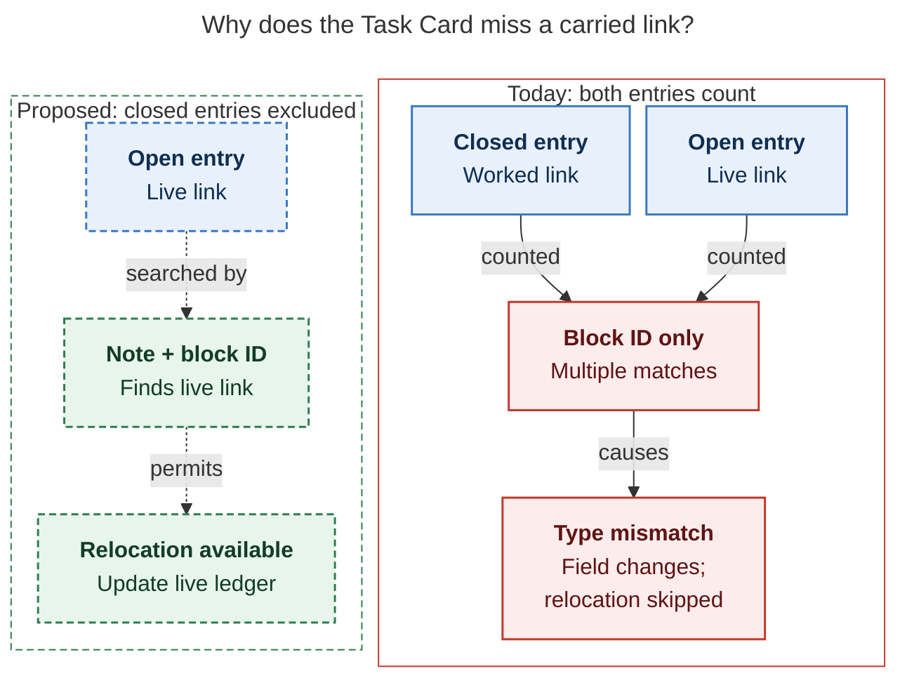

# Diagram proposals: Pomodoro names follow task types

Proposals for the swarm linker, not a report. Each diagram restates only what the source
report says.

```yaml
source: research:202611/pomodoro_names_follow_task_types/pomodoro_names_follow_task_types__final.md
producer: research.5q.image
check: "mmdc 12.0.0 with the PDF-mirroring config rendered 1 of 1 Mermaid diagrams"
```

## carried-task-lookup

```yaml
anchor: |-
  writes the field anyway, which creates I1 drift.
question: |-
  Why does the Task Card miss a carried task's live link, and what changes in the fix?
illustrates: |-
  A carried task's closed entry and open continuation make the current lookup return multiple, while the proposed lookup searches open entries by note and block ID to find the live link.
caption: Closed-session links create false ambiguity; the proposed lookup excludes them and identifies the live link by note plus block ID.
review: "741.438x565 px, fit 88.0%; question and visual checks passed; 1 revision; unique anchor verified"
```


