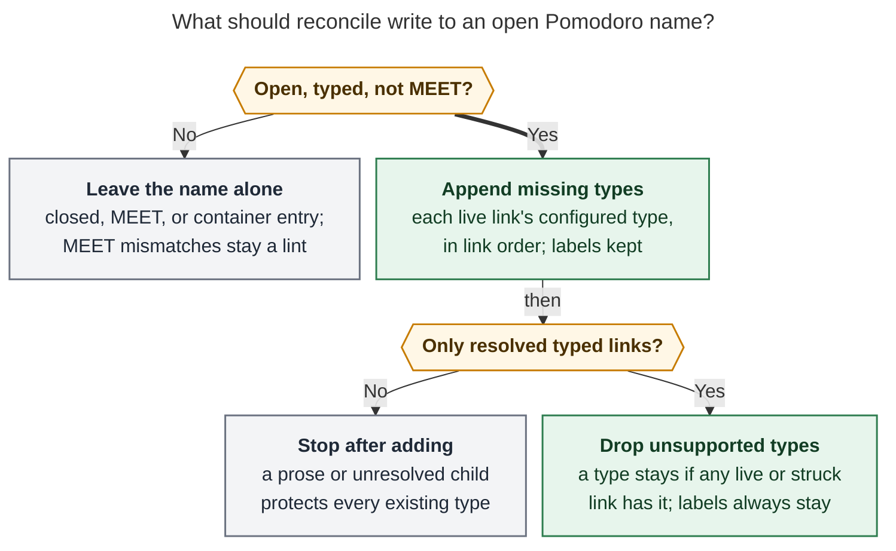

# Pomodoro names follow task types: fix the writers, then let reconcile repair both ways

> **Request.** Every Obsidian task (typed explicitly or by inheritance) should have a
> type that matches one of the types of a Pomodoro that holds a Task Link to it. Make
> `bob task reconcile` the fallback that adds or removes types on Pomodoro lines. Fix the
> keymaps that break the rule so the fallback is rarely needed. Custom Pomodoro names may
> be an exception, but they should not drive the design. Critique the plan, adjust the
> requirements where justified, and recommend a solution.
>
> **Lead consolidation**, 2026-11-05. Merges five independent reports (cdx, cld, grk,
> mus, gem; they sit beside this file) with the lead's own verification. Code was checked
> at bob-cli `7e437418` and bob-plugins `cfb331ea`. Vault checks were read-only.

## Bottom line

- **It is a good idea, and most of the model already exists.** Bob already defines this
  invariant as *agreement* (D5 in `docs/task-types.md`). It already merges a task's type
  into the destination name when a link lands. But the written policy says drift is
  "flagged and never silently repaired" (`docs/task-types.md:867`, and the glossary
  `task-type` entry). Your request reverses that policy, so it needs a new decision
  record, not just new code.
- **The Pomodoro follows the task. All five researchers agree.** Reconcile should edit
  only the ` — NAME` tails of today's open entries. It must never write `[type::]` fields
  and never move links. The task's type is the deliberate, durable fact; an open name is a
  transient plan label.
- **The bigger leak is extra types, not missing ones.** cld replayed the vault's git
  history. Since merge-on-landing shipped on Nov 2, missing types (a task's type absent
  from its Pomodoro name) are rare. The common case is the reverse: a name keeps a type
  that no remaining link has. Outside close, split, and Ctrl+Shift+M bullet moves, no path
  that removes a link ever removes a type. Your own merged-in note
  `bob#^task-reconcile-removes-types` asks for exactly this. So removal is the most
  important part of your request, and the part most in need of a precise definition.
- **Three researchers wanted reconcile to never remove types, or only with proof. I side
  with removal, plus guards.** The "planned extra type" worry is weak in this vault:
  - reconcile already deletes every childless entry;
  - merged names are rare;
  - the leaks come from plugin gestures that reconcile can never observe, so "remove
    only when this run removed the link" would never fire for them.
- **Fix two verified writer bugs first:**
  1. Renaming a Pomodoro in Obsidian has stopped retyping its tasks (a regression since
     Nov 2).
  2. The Task Card type edit skips relocation for any task that already had a session
     today.

  Then make every link-removal path apply the same rule as reconcile.
- **Custom names need no new mechanism.** The existing *container* rule (a name with no
  type components) already covers them. No entry has used a non-vocabulary name since
  Oct 19.

## 1. What already exists

| Piece | Where | Behavior today |
| --- | --- | --- |
| Agreement predicate | `routing.rs` `agrees`, JS `typeAgrees` | True if the entry is a container, the task has no type, or the task's type key equals any name component (labels included). |
| Type vs. label | `routing.rs` `type_components` | You configure `types:` (PLAN, BUILD, READ, CHORE, WRITE, FIX, MEET) and `plan.default_type: CHORE`. Components outside the vocabulary are labels. A name with no type components, or no name at all, is a **container**. |
| Landing | `routing::land`, plugin `planLanding` | Enter merges (destination gains ` + T`); Alt+Enter and MEET destinations retype the task. Capture always lands with `retype: false` (`capture/task_theme.rs:683-694`). |
| Naming (D6) | `capture_pomodoro_name.rs:598` (`retype: true`) | Naming or renaming an entry retypes its linked tasks. The Obsidian path is broken (§3). |
| Relocation (D8) | `routing::relocate`, `relocation_apply.rs` | A type edit moves the live link or renames a sole-link entry. It does not shed the source entry and has no MEET guard. |
| Close (R6) | `capture_pomodoro_close/names.rs:92-93`, `merged.rs` | Narrows the closed name to worked types. Leaves single-type names and names with no worked type match unchanged. Sheds the continuation. |
| Shed (R7) | `merged::shed` | Its only Rust production caller is close. In JS, only the Ctrl+Shift+M bullet move and the cycler close call it. |
| Drift signals | `bob plan` `type_mismatch` lint; Ledger Tools `#TYPE` mark | Cover missing types only. The lint has no tests. The mark skips every task whose type is inherited (`268-plugin-ledger-type-marks.js:272`), so it sees only explicit `[type::]` tasks. |
| Reconcile | `task_status_hooks/sync.rs` | Dedupes links, removes canceled links, retires completed links, consumes Blocked links, and deletes **every** childless entry. Never looks at types. Runs every 15 minutes on the Mac. |

Your request actually contains two separate invariants. They need different handling:

- **I1, coverage:** every live Task Link's task type is a type component of its open
  entry, unless the entry is a container or MEET.
- **I2, support:** every type component of an open entry is carried by at least one of
  its links. The docs state this intent ("after any merge, split, move, or close, a name
  says which kinds of work its Task Links hold"), but nothing enforces it outside close
  and R7 moves.

## 2. Evidence

| Measurement | Result | Source |
| --- | --- | --- |
| Vault git-snapshot replay, Oct 25 – Nov 2 (types rolling out) | 610 snapshots; I1 drift in 33%, I2 drift in 26% | cld |
| Same replay, Nov 3 – 5 (merge landing live) | 187 snapshots; I1 in 1.6% (2 episodes, one only a 20-second gap between a two-file write's halves); I2 in 2.1% (2 episodes, one lasting 5.5 hours) | cld |
| `bob plan -f json` now | zero `type_mismatch`; the only lint is `pending_cap_exceeded` | grk, re-run by lead |
| Final-state ledger entries in Sep–Nov daily notes | 586 entries: **0 unnamed**, **4 merged names**, **4 direct prose children** | lead |
| Entries with a non-vocabulary component | 29 of 40 (late Sep), 48 of 207 (early Oct), 20 of 245 (late Oct), **0 of 94 (Nov)**; last one was `BUGS` on Oct 19 | lead |
| Your motivating note | `bob.md ^task-types-match-pom` absorbed `^task-reconcile-removes-types`: "Make sure that task reconcile removes any task types from the Pomodoro line that were not actually used." | lead |

Caveats:

- cld's replay uses today's types for non-daily tasks.
- Snapshots are minutes apart, so short episodes are under-sampled.
- "Zero lints" understates drift: the lint cannot see I2 at all, and the Obsidian mark
  cannot see inherited types.

## 3. Disputes between the reports, and how I resolved them

| Question | Positions | Verdict and evidence |
| --- | --- | --- |
| **Does renaming an entry in Obsidian (Ctrl+Shift+M on the entry line) still retype its tasks?** | cdx, cld: no, a regression. grk, mus: yes. | **Regression confirmed.** See the four points below the table. |
| **Do named captures (`#NAME`, `=name`) still retype the task?** | mus: yes, so fix this first. cld, grk: no. | **No.** `capture/task_theme.rs:683-694` always lands with `retype: false`. The only `retype: true` caller is `capture_pomodoro_name.rs:598`. mus relied on a stale sentence at `docs/task-types.md:838-843`, which also still says "Task Card integration remains later work". Fix the docs; no capture code change is needed. |
| **Should reconcile remove types?** | cld, gem: yes, from the current links. cdx, grk: only when the same operation removed the type's last link. mus: never, and adding only as an opt-in. | **Yes, from current links, with guards (§6).** See "Why removal should not require proof" below the table. |
| **Do struck links (the task was worked) count as support?** | cld: yes. gem's algorithm counts only live links. | **Yes.** Otherwise, finishing the last FIX task halfway through a running `BUILD + FIX` session strips FIX before the close can credit it. This also matches what R6 counts as worked. Implementation note: `suggest_for_task` refuses closed tasks (`suggest.rs:88`, `closed_task`). The close reads pre-close types for exactly this reason (`names.rs:1-6`), so reconcile needs a resolver that types a completed task as if it were open. |
| **Where in reconcile does the pass go?** | gem: before the status passes. grk: before empty-entry deletion. cdx, cld: after the final link removal, before writing. | **After `consume_blocked_links_after_compose` and before `apply_guarded_outputs`** (`sync.rs:1009-1036`). Blocked-link consumption runs after composition and deletes the entries it empties, so an earlier pass would grow names for links that are about to disappear. Renaming never empties an entry, so no later cleanup is needed. |
| **Should drift from inherited types (frontmatter, config) be repaired, or only linted?** | grk, mus: lint only. cld: repair. | **Repair.** The invariant is about the *effective* type, and the effect is limited to today's open entries (five right now). After a `job.md` default changes WRITE → CHORE, `— WRITE` holding only job tasks should read `— CHORE`. The reconcile report lists every rename. |
| gem: a move to a note with no `task_type:` aborts relocation | gem | **Refuted for this vault.** `taskTypeEffectiveTypeFor` passes `plan.default_type` (`279-plugin-task-theme-api.js:661`), so the destination type is CHORE, not null. With no default configured, a null type agrees with anything. |
| gem: name unnamed `()` placeholders when a link lands | gem | **Not needed.** None of the 586 final-state entries in Sep–Nov daily notes is unnamed. Unnamed stays a container by design. |
| mus: one task linked under several entries cannot agree with all of them | mus | **Moot.** Reconcile's deduplication keeps only the first open entry's link before the type pass runs. |
| mus: keep reconcile repair opt-in forever (`--fix-types`) | mus | **Rejected as a permanent state.** You asked for a fallback that just works. Keep mus's caution as a short report-only soak (§7, Phase 1). |

**The rename regression, in four points:**

- `650-plugin-move-commit.js:140` calls `pomodoroBulletMoveTypePlanRows(…, plan.name, {})`.
- In that helper (`651:43`), `retype` is true only when `typeMode === "retype"`. So the
  rename asks `planLanding` to *merge*.
- `pomodoroBulletMoveTaskWrites` writes only set or clear outcomes, so the merge result is
  dropped. The tasks keep their old type, and the toast says "keeps X".
- Commit `71ae1cb` (Nov 2, "merge Pomodoro task types by default") changed the meaning of
  `{}` from `planRetype` to `planLanding`. The rename preview at `200a:427` has the same
  bug, and `gestureRetypeRenamePlanForTask` (`650:38`) now has no callers. cdx reproduced
  the failure in the plugin harness.

**Why removal should not require proof:**

1. You asked for it, in both the request and the motivating note.
2. I2 is the leak that remains (§2).
3. The leftovers come from plugin removals (Alt+N, unlink, roll, cancel) that reconcile
   never observes. A rule that removes only on "this run removed the link" can never
   clean those leftovers.
4. The "planned extra slot" the doubters protect has almost no standing today:
   - `sync.rs:483` calls `plan_empty_pomodoro_removals(…)` with `only_emptied = false`,
     so every childless planned `— T` entry is deleted within 15 minutes;
   - so is every empty entry that split (R4) creates;
   - only 4 of 586 final-state names were merged.
5. My guard keeps the legitimate case: any prose or unresolved child protects the name.

## 4. A newly confirmed leak: Task Card retype skips carried tasks

cdx found that `taskCardTypeFindLiveLink` (`316-task-card-type-relocation.js:122-139`)
has two flaws. It searches **every** entry, closed ones included, and it matches on the
block ID alone, not on (note, block ID). I verified that this is the *common* case, not an
edge case:

1. A task worked in an earlier session has a `🍅` link under the closed entry.
2. The close carries the task, so it also has a live link under the continuation.

Today's ledger has exactly this shape: `cash#^picture-of-real-id-paper` appears under the
closed `0905-0910 — CHORE` and under the open `() — CHORE`.

For such a task the lookup returns `multiple`. The Task Card then:

- previews "no live link · ledger unchanged" (`352-picker-task-card-theme-stage.js:116`);
- skips the relocation (`316:277`);
- writes the field anyway, which creates I1 drift.

Inbox routing and note moves share the lookup (`655-plugin-inbox-route.js:102`). Rust's
`relocation_apply::find_live_link` correctly filters to open entries, but it also matches
on block ID alone (cdx).

## 5. Critique: is this a good idea?

**Yes, provided "remove" is defined precisely and the close also enforces the rule.**

Why enforce it:

- Pomodoro names feed several surfaces: Stats time-by-type, the type budget
  (`plan.max_themes`), the capture agenda and Mac menu bar, and `=type` selectors.
- An I1 violation that survives to close records minutes under the wrong type for good.
- An I2 violation inflates names (`PLAN + FIX + BUILD`) and confuses selectors.
- The current signals cannot carry the load. The lint covers only I1, has no tests, and
  appears only in `bob plan`. The Obsidian mark is blind to inherited types, which is most
  of your tasks.

Why the Pomodoro should follow the task, and not the other way around:

- **Which side is more reliable.** A task's type comes from a deliberate field or a
  structural default. An open name was often generated by Bob itself (placement, merge,
  continuation).
- **Blast radius.** Renaming touches one file, today's daily note, and stays out of closed
  history. Retyping tasks would scatter sticky `[type::]` exceptions across area and
  project notes, against the "a field stores only an exception" model.
- **Consistency.** Enter already merges and only Alt+Enter retypes, so a correct gesture
  already produces output that reconcile would leave unchanged.
- **The old objection is answered.** The prior research rejected silent repair because
  "Bob can't know which side a hand edit meant". Choosing a fixed side is legitimate when
  gestures exist for the other side: rename (D6), the Task Card `t`, and Alt+Enter.

What it costs. State these plainly when recording the decision:

1. **Hand-typed renames revert.** Type `— BUILD` over `— FIX` in the editor and reconcile
   turns it back into `— FIX` within about 15 minutes. The supported rename is the
   keymap, which is broken today. Fix it before shipping removal.
2. **Running sessions get renamed while you watch.** The menu bar and agenda show the new
   name; the timespan never changes.
3. **Unattended writes.** Reconcile already rewrites the daily note behind an open editor
   through its guarded write and quiet period. This adds surprise, not a new class of
   risk, so the report must say what it renamed.
4. **Mid-session release.** A type whose only link was released mid-session stops counting
   toward that session. That matches what R6 already does at close.

**What I would do differently from the literal request:**

- Define removal as "unsupported by any live *or worked* link", with a guard.
- Add the close as a second enforcement point; Stats freezes there.
- Fix writers at their shared choke points instead of patching about 25 gestures one by
  one.
- Do not add a "custom name" class.

## 6. Requirement adjustments (each one is a deliberate change)

| # | Your requirement | Adjusted to | Why |
| --- | --- | --- | --- |
| A1 | "A Pomodoro that contains a task link" | **Open entries in today's daily note only.** Closed entries are history. | Stats and the `🍅` record describe what happened. A retype next week must not rewrite last week. |
| A2 | Reconcile adds **or removes** types | **Add** each live link's missing configured type. **Remove** a type component only when no live or struck link carries it **and** every direct child of the entry is a resolved, typed Task Link. | Any prose, embed, or unresolved child keeps every existing type. That protects deliberately planned types and gives you a zero-state escape hatch: add a prose child. |
| A3 | (implicit) which side wins | **The name follows the task.** Reconcile never writes `[type::]` and never moves links. | §5. It also keeps reconcile's documented role as a "never-writer of type fields". |
| A4 | Custom names may be an exception | **Use the existing container rule.** A name with no type components (label-only like `SASE V18`, `LATER`, or unnamed) is never touched. Labels in mixed names (`BOB + FIX`) are kept in place. | Already shipped in Rust and JS. No new flag or syntax. You have used no custom names since Oct 19. |
| A5 | "Always" | **MEET is exempt.** A name that normalizes to MEET is never renamed. A non-MEET task under MEET stays a `type_mismatch` lint. | Calendar sync owns MEET. `bob gcal sync` stamps `[type:: MEET]` on Event Tasks. |
| A6 | "Always have a type" | **Never guess.** Untyped, unresolved, ambiguous, or malformed-field links are reported, not repaired. Add only types in the configured vocabulary. Unconfigured ones are reported. | An unconfigured type appended to a name becomes a label that removal can never clean. All your types are configured, so this costs nothing today. |
| A7 | Reconcile is the fallback | **The close is also an enforcement point.** It "settles" instead of narrowing: the closed name becomes its labels plus exactly its worked types, adding a missing worked type, and single-type entries may rename. | Stats freezes at close. Today `narrow_closed` leaves a `— FIX` session that worked only BUILD as FIX forever (`merged.rs:41-67`). |
| A8 | "Fix the keymaps" | **Every gesture's output must already satisfy the rule.** Enforce this at shared helpers, not gesture by gesture. | It is testable: `agree_entry(output) == output` for every gesture vector. New gestures get it for free. |
| A9 | (implicit) hand-typed names | **A hand-typed entry name is not authoritative.** The fixed rename keymap is how naming retypes tasks. | Reconcile cannot know what a hand edit meant. Choose a side and document it. |
| A10 | (not addressed) | **Typing a type name for a brand-new entry retypes the linked task** (D6) instead of producing `NAME + T`. | `078-pomodoro-theme-write.js:377` currently merges, so NAME is unsupported from birth and A2 would drop it. That was cld's Nov 4 episode: you later set `[type:: FIX]` by hand. Please confirm (§8). |

## 7. Recommended solution

**Adopt the request with A1–A10.** Write one pure per-entry rule, `agree_entry`. Enforce
it at three layers:

1. every writer's shared choke point;
2. the close;
3. `bob task reconcile`, as the safety net.

*Reconcile always adds missing linked types to an open, typed, non-MEET name. It removes
a type only when every direct child is a resolved typed Task Link and none of them,
including struck ones, carries that type.* (Rendered with Mermaid CLI 12.0.0 under the
PDF-mirroring config: 792 × 786 px, 82.4% fit.)

### 7.1 The rule: `agree_entry(entry, children) → name`

- **Inputs.** The entry's name and state, plus its **direct** child bullets, classified
  as follows:
  - `Live`: an unstruck link to an open task, with its effective type;
  - `Worked`: a struck or `🍅` link to a completed task, typed as if open;
  - `Unknown`: a link that is unresolved, ambiguous, untyped, or has a malformed field;
  - `Prose`: anything else.
- **Placement.** It lives next to `land` and `shed` in `pomodoro_themes` and is mirrored
  in `279-plugin-task-type-routing.js`. A new `agree_entry` section in
  `tests/fixtures/pomodoro_themes/vectors.json` (already byte-shared with bob-plugins)
  includes idempotence cases.
- **Order of edits.**
  - When exactly one type is dropped and one added, substitute in place, as relocation's
    `replace_type_components` already does.
  - Otherwise, drop first, then append in catalog spelling.
  - Labels, checkbox, timespan, `[t::]` / `[off::]`, and every child stay byte-identical.
  - An entry that already agrees is unchanged.
- **Guarantee.** The supported types always remain in the result, so a supported entry
  never becomes typeless. The rule is idempotent.

| Before | Direct children | After | Why |
| --- | --- | --- | --- |
| `— FIX` | BUILD live | `— BUILD` | add BUILD, drop FIX, substitute in place |
| `— BUILD` | BUILD live, FIX live | `— BUILD + FIX` | add (the same result as an Enter merge) |
| `— FIX + BUILD` | FIX live | `— FIX` | the Nov 4 leftover |
| `— BUILD + FIX` (running) | BUILD live, FIX struck | unchanged | the worked link supports FIX |
| `— BUILD + FIX` | BUILD live, one unresolved link | unchanged | an Unknown child blocks removal |
| `— BUILD + WRITE` | BUILD live, prose "draft post" | unchanged | the prose child protects the planned type |
| `— BOB + FIX` | BUILD live | `— BOB + BUILD` | the label is kept |
| `— LATER`, `— SASE V18`, `()` | anything | unchanged | container (A4) |
| `— MEET` | WRITE live | unchanged, plus lint | A5 |
| `[x] … — FIX` | BUILD worked | unchanged | closed history; the close settles it (A7) |

The existing helpers become special cases of this rule:

- the R2 merge is the add step for one link;
- R7 shed is the drop step with known before and after sets;
- relocation's rename branches are the substitution.

### 7.2 Reconcile pass (the fallback)

- **Slot.** After `consume_blocked_links_after_compose` and before
  `apply_guarded_outputs`. Operate on the composed daily output
  (`compose.outputs[daily]`, falling back to `normalized_daily`).
- **Task resolution.** Resolve tasks against this run's staged post-images, with one
  shared `HomeResolver` and cache.
- **Occurrences.** Inspect each entry's own children. Do not use the deduplicated
  `today_tasks` list, which keeps only the first occurrence (cdx).
- **Writes.** Name tails only, marked structural so they obey the quiet period and the
  stale-input guard. Extend the guarded read-set to the type configuration and to the
  notes the inheritance walk reads.
- **Output.** Make the JSON additions additive (`schema_version` stays 1):
  - a `type_agreement[]` array with `{line, before, after, added[], removed[], reason}`;
  - an `unrepaired[]` array for MEET, Unknown, and unconfigured cases.

  Human output reads like `≈ renamed — FIX + BUILD → — FIX (BUILD has no link)`, with
  "would rename" under `--dry-run`. Count these in `change_count`. No new flags and no
  `!` commit marker: the JSON is additive and the command path is unchanged.
- **Lint.** `bob plan` keeps `type_mismatch` only for what reconcile refuses. Add tests
  for it; it has none today.

### 7.3 Writer fixes, by priority

| # | Writer | Leak | Status | Fix |
| --- | --- | --- | --- | --- |
| 1 | Obsidian entry rename (Ctrl+Shift+M on the entry line, typed name or Recent row) | I1: tasks keep the old type | **Verified regression** (lead, cdx, cld) | Pass `{ typeMode: "retype" }` in the commit (`650:140`) and the preview (`200a:427`). Add a regression test that uses the production `planLanding`; the existing test stubs it. |
| 2 | Task Card Type, Use default, and Ctrl+D; note move; inbox route | I1: relocation skipped for carried tasks; can act on a same-ID link in another note | **Verified** (lead, cdx) | Look up live links in open entries only, by (resolved path, block ID). Report "ambiguous" instead of "no live link". Fix Rust's `find_live_link` identity the same way. |
| 3 | Plugin link-removal paths: Alt+N, Ctrl+Shift+Enter unlink, Alt+P / Ctrl+Enter roll, future schedule, cancel, decay Drop, blocked consume, block-id-prompt unlink, delete, and duplicate prune | I2 leftovers | **Verified:** no shed in `160-pomodoro-reorder.js` or `060-link-cleanup-and-deletion.js` | Run `agree_entry` on the touched entries inside `planDeferredPomodoroLinkCleanup` and block-id-prompt `060` / `075`, in the same editor transaction as the removal. |
| 4 | Bob-side removals: capture unlink and drop, Ensure Next, `bob task cancel` / `complete`, D8 `MoveTo` source | I2 | **Verified:** `merged::shed`'s only production caller is close | Add a final `agree_entry` stage over touched entries in `CaptureBatchPlanner`, which also covers Bob Mac Capture as a thin client. Add a shared `ledger_agree_touched` helper for the other bob writers. |
| 5 | New entry with a typed name (block-id-prompt picker; capture glued `#NAME` / `=name` per cld) | I2 from birth (`NAME + T`) | Verified in `078:377` | A10: retype the linked task. |
| 6 | Close | I1 frozen into history | Verified in `merged.rs:41-67` | A7: replace `narrow_closed` with a settle step that uses the worked types. The continuation runs `agree_entry`. This is a shared vector change across `names.rs` and the task-status-cycler. |
| 7 | `relocate` | Can rename or grow MEET | cld | Add the `is_meet_name` guard. |
| 8 | Reported by cld, not verified by the lead | Mostly I1 | — | See the list below. Choke points and reconcile cover these. Fix one individually only if the reconcile log keeps pointing at it. |
| 9 | Hand edits, frontmatter or config edits, sync merges, partial two-file writes (Task Card writes the field before the ledger; `capture-pomodoro-name` writes the headline before the tasks) | Both | Inherent | This is what reconcile is for. Still preflight inputs and report partial writes precisely (cdx). |

Row 8 covers these cld-reported writers:

- whole-entry move into another entry;
- Ctrl+X absorbing a container;
- capture "link into running";
- `stage_merge_rename` taking the first `#^id` in the note;
- subtask, `parent:`, and project moves that change an inherited type;
- the successor check reading the name before the close sheds it;
- `bob types rename` not rewriting `plan.default_type`.

### 7.4 Phasing

1. **Phase 0: plugin bug fixes** (bob-plugins, small). Rows 1 and 2. Ship the rename fix
   first. Reverting hand-typed renames is only acceptable once the rename keymap works.
2. **Phase 1: rule and safety net** (bob-cli plus vectors).
   - Add `agree_entry` in Rust and JS, with the vectors.
   - Add the reconcile pass and its report, plus lint tests and the MEET guard.
   - Land it **report-only for one or two days**: the pass runs and is reported, as if in
     `--dry-run`. Then flip it to apply. This keeps mus's caution without a permanent
     flag.
   - Record the decision (§7.5).
3. **Phase 2: choke points** (rows 3 and 4). Acceptance: every gesture vector's output is
   a fixed point of `agree_entry`.
4. **Phase 3: close settle and new-entry naming** (rows 5 and 6, A7 and A10), after you
   confirm them.
5. **Phase 4: visibility and docs.**
   - Let the Obsidian mark include inherited types.
   - Fix the stale `docs/task-types.md:838-843`.
   - Update the agreement bullet (`:867`), `docs/task-status-hooks.md` (new section), and
     the lint row in `docs/plan.md`.

**Success metric.** Over time, reconcile's `type_agreement[]` count should trend to about
zero per day. Every nonzero repair after Phase 2 points at a leaking writer: the vault-sync
commit just before it names the gesture.

**Acceptance cases:**

- Running reconcile twice changes nothing the second time.
- Dry-run and apply plan the same edits.
- A corrected gesture followed by reconcile yields zero repairs.
- Closed entries stay byte-identical.
- CRLF line endings and a missing final newline are preserved.
- Same-run consumption followed by agreement behaves correctly.
- Running and planned entries are both handled.
- Containers, labels, MEET, and prose guards behave as in §7.1.
- Use production routing helpers in the integration tests, not stubs. The rename
  regression hid behind a stub.

### 7.5 Records to change

These go through `/sase_memory_write` in the implementing plan. This report edits none of
them.

- **New decision**, for example `open-pomodoro-names-follow-task-links`. It supersedes
  the D5 sentence "flagged and never silently repaired". It partly supersedes R6's
  single-type exemption (if A7 is accepted) and R7's "components that never had a link
  stay" for reconcile.
  - Rejected alternatives: reconcile retyping tasks; reconcile relocating links;
    add-only; removal only with proof; deriving names at read time; a live in-editor
    normalizer.
  - What would reopen it: names you planned getting dropped more than rarely.
- **Glossary strands.** In `task-type`, the sentence "Disagreement is shown as drift; it
  is not silently repaired" becomes false. In `merged-pomodoro`, the close-naming
  sentences change if A7 is accepted. The plan's memory decisions should quote these
  sentences under `corrects:`.

### 7.6 Alternatives rejected

| Alternative | Why not |
| --- | --- |
| Keep warning-only | The lint misses I2 and inherited types, and you asked for repair. |
| Reconcile retypes tasks to match the name | Lets a transient plan label overwrite durable intent. It also writes sticky fields across the vault and inverts R2. |
| Reconcile moves links to `place(T)` | Rearranges the day and breaks "this was worked in this session". Keep relocation for explicit type edits (D8). |
| Add-only reconcile (grk, mus) | Leaves the dominant leak (I2) and your explicit request unsolved. |
| Removal only with same-run proof (cdx, grk) | Never fires for plugin-created leftovers, the main source. |
| Rebuild names from links with no guards (gem) | Strips worked types mid-session and erases prose-backed plans. |
| Provenance or pinned-component metadata | A second authority for names, with sync and migration costs. Revisit only if the prose guard proves insufficient. |
| Derive names at read time | Selectors, placement, the agenda, and the menu bar all read stored names. It also reopens `decisions:pomodoro-theme-is-one-component`. |
| In-editor normalizer on every keystroke | Fights you while you type a name. Reconcile within 15 minutes is enough. |

## 8. Open questions for Bryan

1. **Hand-typed renames revert within about 15 minutes**, once the rename keymap works
   again. Acceptable? (Recommended: yes.)
2. **A10:** should typing `FIX` for a brand-new entry retype a BUILD-inherited task to
   FIX, rather than create `FIX + BUILD`? (Recommended: yes.)
3. **A7:** may a single-type close rename? For example, a `— FIX` session that worked only
   a BUILD task would close as `— BUILD`. (Recommended: yes.)
4. **MEET-typed tasks under work entries.** Should an Event Task linked under `— BUILD`
   grow it to `BUILD + MEET`, as R2 landing does today? That counts the session toward
   MEET in Stats.
5. **The prose escape hatch.** Is "add a prose child to keep a planned type" an acceptable
   way to protect deliberately planned extras? The alternative is a removal that ignores
   prose.

## Sources

**Researcher reports** (beside this file): `__cdx` (rename and lookup reproductions,
partial-write audit, conservative removal), `__cld` (vault replay, writer audit,
`agree_entry`, close settle), `__grk` (coverage vs. exactness framing, live `bob plan`,
same-run shed; its figures sit in `task_type_pomodoro_link_agreement__grk_assets/`),
`__mus` (writer matrix, pass ordering, opt-in caution), `__gem` (unlink-leak audit,
container and label treatment).

**Lead verification:**

- **bob-cli** at `7e437418e958a12ed999053c425003eb9831eb52`:
  - `capture/task_theme.rs:683-694`;
  - `capture_pomodoro_name.rs:598`;
  - `task_status_hooks/sync.rs:483`, `:1009-1036`;
  - `task_status_hooks/pomodoro.rs:287-320`;
  - `pomodoro_themes/merged.rs:41-110`;
  - `pomodoro_themes/suggest.rs:88`;
  - `capture_pomodoro_close/names.rs:1-6`, `:55-93`;
  - `docs/task-types.md:838-843`, `:867`, and the Merged Pomodoros section;
  - `docs/task-status-hooks.md` "Empty Pomodoros".
- **bob-plugins** at `cfb331ea7f4d9f7413dece935e738a0eaa77e16e`:
  - `bob-navigation-hotkeys` `650-plugin-move-commit.js:28-36`, `:38`, `:140`;
  - `651-pomodoro-bullet-type-move-commit.js:42-60`;
  - `200a-pomodoro-bullet-type-move.js:427`;
  - `316-task-card-type-relocation.js:33-139`, `:277`;
  - `352-picker-task-card-theme-stage.js:116`;
  - `655-plugin-inbox-route.js:82-103`;
  - `bob-ledger-tools` `268-plugin-ledger-type-marks.js:272` and
    `279-plugin-task-theme-api.js:634-670`;
  - `block-id-prompt` `078-pomodoro-theme-write.js:377`;
  - commit `71ae1cb` (2026-11-02).
- **Vault, read-only:**
  - `bob plan -f json` (2026-11-05);
  - the Pomodoros sections of Sep–Nov daily notes, using a throwaway parser in `/tmp`;
  - `bob.md` `^task-types-match-pom` and `^task-reconcile-removes-types`.
- **Memory:** glossary `task-type`, `merged-pomodoro`, `pomodoro`, `task-link`.
