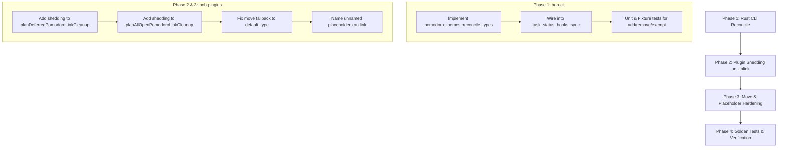

# Research Report: Enforcing Task-to-Pomodoro Type Consistency

**Author:** Researcher `gem` (Independent Investigation)  
**Date:** 2026-11-05  
**Topic:** Enforcing Task and Pomodoro Type Alignment in Bob CLI and Obsidian Plugins  
**Target Repository:** `bob-cli` & `bob-plugins`  

---

## 1. Executive Summary

In the Bob productivity ecosystem, both Obsidian tasks and Pomodoro ledger sessions carry **task types** (e.g., `BUILD`, `DEV`, `READ`, `CHORE`, `WRITE`, `FIX`, `MEET`, `PLAN`). A task inherits an effective type either explicitly (via `[type:: X]`) or implicitly (via note frontmatter `task_type:`, reading rules, or the global `plan.default_type`). A Pomodoro entry in the daily note ledger carries a name tail containing one or more type components (e.g., `- [ ] () — BUILD + FIX`).

Bryan's core invariant proposal states:
> *Obsidian tasks should always have a type (either implicitly or explicitly) that matches one of the task types of a pomodoro that contains a task link pointing to that task.*

The proposal seeks to:
1. Use `bob task reconcile` as an authoritative fallback mechanism to ensure this invariant holds (by automatically adding missing types or stripping unused types on Pomodoro lines).
2. Fix any keymap pathways in Obsidian that currently break this constraint so that fallback cleanup is rarely required.
3. Treat custom Pomodoro names as an exception without compromising the broader design.

### Key Findings & Verdict
* **Is this a good idea?** **Yes, fundamentally.** In Bob's domain model, tasks represent the ground-truth unit of work, whereas Pomodoro lines represent temporal execution buckets that feed time-tracking statistics (`Stats`, `Worked` minutes, and Pomodoro catalogs). Permitting tasks to sit under mismatched Pomodoro entries corrupts time metrics and confuses ledger intent.
* **Why does enforcement fail today?** Our audit of `bob-plugins` revealed that while linking gestures (like `Ctrl+Shift+Enter` and `((`) attempt to merge types on insertion, **every unlink and removal gesture completely ignores type shedding**. Specifically, `Alt+N` (lane release), `Ctrl+Shift+Enter` (unlinking), task rescheduling (`Alt+P`), task cancellation, and note moves remove the task link line but leave the Pomodoro name unchanged. Over time, Pomodoros accumulate orphaned, stale type components. Additionally, manual Vim edits (`dd`, `p`) and in-line Pomodoro renaming bypass plugin hooks entirely.
* **Recommended Strategy:**
  1. **Strict Fallback Scope in `bob task reconcile`:** Reconcile must bidirectionally synchronize type components on **open** Pomodoros in today's daily note (adding missing types, shedding unused types). It must **never** mutate closed (`[x]`) historical Pomodoros or `MEET` entries.
  2. **Custom Pomodoro Names as Exempt Containers:** A Pomodoro whose components are entirely non-vocabulary labels (e.g., `— INTERVIEW`, `— 1:1 WITH ALEX`) is defined as a pure *container*. Reconcile and linking keymaps must respect containers as exempt from type additions unless explicitly configured.
  3. **Keymap Hardening in `bob-plugins`:** Inject type shedding into `planDeferredPomodoroLinkCleanup` and `planAllOpenPomodoroLinkCleanup` so that releasing, unlinking, or rolling a task immediately sheds that task's type if no other tasks of that type remain under the Pomodoro.

---

## 2. Current Architecture & Root Cause Analysis

### 2.1 The Two Sides of the Type Contract

To understand why drift occurs, we must examine how types are defined and resolved on both sides of a task link.

```
       TASK SIDE                                      POMODORO SIDE
  (Ground-Truth Work)                             (Temporal Aggregation)
┌────────────────────────────────┐              ┌────────────────────────────────┐
│  Explicit: [type:: FIX]        │              │  Entry: - [ ] () — BUILD + FIX │
│  Reading Rule: #ref -> READ    │    Link      │                                │
│  Note Default: task_type: DEV  │ ───────────> │  Type Components: {BUILD, FIX} │
│  Global Default: default_type  │              │  Labels: (e.g. SASE)           │
│                                │              │  Containers: (no type comp.)   │
└────────────────────────────────┘              └────────────────────────────────┘
                 \                                              /
                  ───────────── MUST AGREE ─────────────────────
```

#### The Task Side: Effective Type Resolution (PT13)
As defined in `docs/task-types.md` and implemented in `src/native/pomodoro_themes/suggest.rs`:
1. **Task Field:** An authored `[type:: X]` or `(type:: X)` on the task line.
2. **Reading Rule:** `#ref` tag or trailing `^ref*` block ID resolves to `plan.reading_type` (default `READ`).
3. **Note Default:** Scalar frontmatter `task_type: X` walking up the note's `parent:` residence chain (stopping at `off`).
4. **Global Default:** `plan.default_type` in `~/.config/bob/config.yml` (configured as `CHORE` in Bryan's vault).
5. **No Type:** Only occurs if `plan.default_type` is unset/off and note defaults are unset or `off`.

Because Bryan configures `default_type: CHORE`, virtually every task in his vault has an effective type.

#### The Pomodoro Side: Component Classification (PT1, D4)
Implemented in `src/native/pomodoro_themes/routing.rs`:
* In Bryan's vault, a strict `types:` vocabulary is configured:
  $$\mathcal{V} = \{ \text{PLAN}, \text{BUILD}, \text{READ}, \text{CHORE}, \text{WRITE}, \text{FIX}, \text{MEET} \}$$
* A component of a Pomodoro name (` — COMP1 + COMP2`) is a **type component** if and only if its normalized key is in $\mathcal{V}$.
* Any component not in $\mathcal{V}$ is a **label** (e.g., `SASE`, `BOB`, `INTERVIEW`).
* An entry with no type components is a **container** (e.g., `(unnamed)`, ` — LATER`, ` — INTERVIEW`).
* **Agreement Rule ($D5$):** `agrees(task_type, entry)` is true if:
  1. The entry is a container (holds any task without typing it).
  2. The task has no effective type.
  3. The task's type key matches at least one component key of the Pomodoro name.

### 2.2 Where Does Enforcement Break Down Today?

Our deep audit of `bob-plugins` and `bob-cli` reveals the exact leak points that cause type mismatches:

#### Leak 1: The "Unlink Without Shedding" Gap (Primary Leak)
When a task link is removed from an open Pomodoro, the system deletes the link line but **never recalculates the Pomodoro's name**:
* **`Alt+N` (`toggleTaskLaneOnLinks` in `520-plugin-lane-links-and-review.js`):** When Bryan releases a task from Next back to Ready, `planDeferredPomodoroLinkCleanup` strips the link bullet from the daily note. The Pomodoro's ` — NAME` is completely untouched.
* **`Ctrl+Shift+Enter` on a linked task (`applyPomodoroTaskUnlink` in `120-plugin-pomodoro-links.js`):** Invokes `planAllOpenPomodoroLinkCleanup`. It strips the link bullet, but has no mechanism to shed type components.
* **Rescheduling / Rolling (`Alt+P`, `Ctrl+Shift+P reschedule`):** Invokes `planDeferredPomodoroLinkCleanup`. The link is removed, but the Pomodoro retains the rolled task's type.
* **Task Cancellation:** If an open linked task is cancelled via status cycler, the link is pruned, leaving its type behind.

*Consequence:* If a Pomodoro was `— BUILD + FIX` with one `BUILD` task and one `FIX` task, releasing the `FIX` task leaves the Pomodoro as `— BUILD + FIX` even though only `BUILD` work remains. Over a typical day, Pomodoros accumulate orphaned types.

#### Leak 2: Linking into Unnamed / Container Placeholders
When Bryan presses `Ctrl+Shift+Enter` to link a task of type `BUILD`, the picker allows selecting an untimed placeholder `- [ ] ()`.
In `279-plugin-task-type-routing.js`:
```javascript
const components = typeComponents(destination, sources);
if (components.every((item) => !item.isType)) {
  return { kind: "container" };
}
```
Because `- [ ] ()` has no type components, `planLanding` classifies it as a container. `themeWrite.mergeName` is not generated, and the task is inserted under `- [ ] ()`. When Bryan later starts this Pomodoro or types `t25`, the Pomodoro line remains untyped or gets named arbitrarily, breaking alignment.

#### Leak 3: Task Move Relocation Abort
In `bob-navigation-hotkeys` (`650-plugin-move-commit.js:33`):
```javascript
function gestureRetypeMoveShouldRelocate(field, sourceEffective, destEffective) {
  if (!field || typeof field !== "object") return null;
  if (field.state !== "none") return null;
  const source = gestureRetypeEffectiveParts(sourceEffective);
  const dest = gestureRetypeEffectiveParts(destEffective);
  if (!dest.key || !dest.name) return null; // <--- ABORTS HERE
  if (source.key === dest.key) return null;
  return Object.freeze({ key: dest.key, name: dest.name });
}
```
If a task without an explicit `[type::]` is moved (`Ctrl+Shift+M`) to a note that does not declare frontmatter `task_type:`, `dest.key` is null. The plugin aborts link relocation entirely! The task's link remains stranded under its old Pomodoro, but the task now inherits `default_type: CHORE`, resulting in an immediate mismatch.

#### Leak 4: In-Editor Manual Actions
Obsidian is a text editor. No keymap hook fires when:
* Bryan cuts and pastes a task link bullet using Vim `dd` and `p`.
* Bryan manually renames a Pomodoro line in the daily note (e.g. changing `— BUILD` to `— WRITE`).
* Bryan types a raw wikilink `- [[note#^task]]` directly beneath a Pomodoro.
* Bryan edits `task_type:` in an area/project note frontmatter or alters `[type::]` on a task line directly.

#### Leak 5: The Fallback Void in `bob task reconcile`
Currently, `bob task reconcile` does not touch Pomodoro names at all. In `docs/task-types.md`, `reconcile` was deliberately designated as a "never-writer" for Pomodoro types:
> *"Drift that no gesture caused (hand edits, frontmatter or config edits, sync merges) is flagged and never silently repaired: a `type_mismatch` lint in `bob plan` plus a ledger mark in Obsidian. Closed Pomodoros are history."*

Because `reconcile` only flags `type_mismatch` as a read-only lint in `bob plan` without repairing it, any drift that occurs through Leaks 1–4 remains permanently broken until hand-edited.

---

## 3. Critique of the Proposed Plan

Bryan's plan contains three core tenets:
1. `bob task reconcile` as the fallback mechanism (adding/removing types on Pomodoro lines).
2. Fixing keymaps so `bob task reconcile` is rarely needed.
3. Treating custom Pomodoro names as an exception.

### 3.1 Critique: Is this a good idea?

#### Arguments in Favor (Why it is sound)
* **Alignment with Time Tracking:** Pomodoro time accounting (`bob stats`) splits time by the `+` type components of each ledger entry. If an entry says `— FIX` but contains a `WRITE` task, worked minutes are incorrectly credited to `FIX`. Enforcing synchronization restores accounting truth.
* **Local vs. Vault-Wide Blast Radius:** When agreement breaks, one could either retype the task or rename the Pomodoro. Modifying the Pomodoro line in `YYYYMMDD.md` is vastly superior to rewriting `[type::]` across arbitrary project notes. The Pomodoro is an ephemeral daily view; the task is persistent domain knowledge.
* **Reduced Cognitive Friction:** Manually synchronizing Pomodoro names when moving tasks or releasing items is tedious busywork. Automating it relieves Bryan from ledger upkeep.

#### Critical Risks & Design Hazards
1. **The "Empty Planned Pomodoro" Hazard:**
   If `reconcile` naively strips types not matched by child links, what happens to `- [ ] () — DEV` that Bryan just created but hasn't linked tasks to yet?
   *Discovery:* `bob task reconcile` already deletes childless Pomodoros via `plan_empty_pomodoro_removals`. However, what about Pomodoros that have *plain-text notes* (e.g. ad-hoc non-task work)?
   ```markdown
   - [ ] (0900-0925) — DEV
     - Investigate memory leak in cache parser
   ```
   If reconcile sees zero *task links*, it must not wipe `DEV` into an unnamed entry! Reconcile must only adjust types when task links are present, or when an entry's task links were emptied.
2. **The "Closed Session History" Boundary:**
   Closed Pomodoros (`- [x] (0825-0840) — FIX`) represent completed time slices. If Bryan moves a completed task's note or edits its frontmatter hours later, `bob task reconcile` must **never** rewrite historical closed Pomodoro headers. Closed Pomodoros are immutable historical records.
3. **Intentional Intent Overwrite:**
   If Bryan deliberately starts a `WRITE` session (`- [ ] (0900-0925) — WRITE`) and accidentally links a `BUILD` task, auto-renaming the Pomodoro to `BUILD` might feel like the tool "hijacked" his session.
   *Resolution:* If Bryan actually worked on `BUILD`, the session *was* a build session. If he intended to write, the task should carry `[type:: WRITE]`. Ledger truth must reflect actual tasks.

### 3.2 Critique: Custom Pomodoro Names

Bryan noted:
> *"I think that the exception to this rule should maybe be custom pomodoro names, but I don't use these much so don't let them constrain the design too much (but don't break anything)."*

In Bob's formal grammar, a Pomodoro name consists of components. Those in `types:` are type components; everything else is a **label**.
* **Pure Containers:** An entry with zero type components is a container (e.g. `— INTERVIEW`, `— 1:1 WITH ALEX`, `— TAXES`, `(unnamed)`).
* **Mixed Entries:** An entry with both labels and types (e.g. `— SASE + BUILD`).

#### Recommendation for Custom Names
* **Pure Containers must be EXEMPT:**
  If a Pomodoro has an ad-hoc name containing *no* configured type components, `reconcile` must leave it alone. It must NOT append `+ DEV` to `— INTERVIEW`.
  *Why?* A custom name represents a specific human event or ad-hoc bucket. Transforming `— INTERVIEW` into `— INTERVIEW + CHORE` degrades readability and violates the existing container contract (`agrees()` already returns true for containers).
* **Mixed Entries must Reconcile Types while Preserving Labels:**
  In `— SASE + BUILD`, `SASE` is a label and `BUILD` is a type. If only `FIX` tasks are present, it must become `— SASE + FIX`. The label `SASE` is strictly preserved.

---

## 4. Architectural Blueprint & Implementation Specification

### 4.1 Component A: `bob task reconcile` Fallback Pass

We specify a new reconciliation pass in `src/native/task_status_hooks/`: `reconcile_pomodoro_types`.

#### Pipeline Placement in `sync_task_statuses`
In `src/native/task_status_hooks/sync.rs`, the pass must execute after structural cleanup (retirements, canceled deletions, duplicate removals) and empty Pomodoro pruning, but before the final write:

```
[Read Daily & Notes] ──> [Resolve Task Refs] ──> [Structural Cleanup] 
        ──> [Prune Empty Pomodoros] ──> [RECONCILE POMODORO TYPES] 
        ──> [Dependency & Status Passes] ──> [Commit Writes]
```

#### Detailed Reconcile Algorithm
For each Pomodoro entry $P$ in the daily note's `## Pomodoros` section:
1. **Filter Eligible Entries:**
   * If $P$ is closed (`!entry.open`), **SKIP**.
   * If $P$'s name normalizes to `meet`, **SKIP** (MEET is calendar-owned).
   * If $P$ has no child list items, **SKIP** (handled by empty-pomodoro pruning).
   * If $P$ has child list items but **zero Task Links** (only prose/notes), **SKIP** (preserve ad-hoc session names).
2. **Extract Active Task Types ($\mathcal{T}_{tasks}$):**
   * Inspect all resolved live Task Links directly under $P$.
   * Resolve each task's `EffectiveType` using `pomodoro_themes::suggest::suggest_for_task`.
   * Filter to valid types matching the configured vocabulary $\mathcal{V}$ (case-normalized).
   * Let $\mathcal{T}_{tasks}$ be the deduplicated set of required task types.
3. **Classify Pomodoro Components:**
   * Parse $P$'s existing name: `type_components(P.name, sources)`.
   * Partition into:
     * Labels: $\mathcal{L} = \{ c \mid c.\text{is\_type} == \text{false} \}$
     * Existing Types: $\mathcal{T}_{pomo} = \{ c \mid c.\text{is\_type} == \text{true} \}$
4. **Evaluate Container Exemption:**
   * If $\mathcal{T}_{pomo} == \emptyset$ and $\mathcal{L} \neq \emptyset$:
     * This is a **custom container** (e.g. `— INTERVIEW`).
     * **EXEMPT:** Do not add types; retain the container as-is.
5. **Compute Reconciled Type Components:**
   * If $\mathcal{T}_{pomo} \neq \emptyset$ or $P$ is an unnamed placeholder `()` with typed tasks:
     * **Types to Retain:** $\mathcal{T}_{surviving} = \{ t \in \mathcal{T}_{pomo} \mid t.\text{key} \in \mathcal{T}_{tasks} \}$ (maintains original ordering).
     * **Types to Add:** $\mathcal{T}_{missing} = \{ t \in \mathcal{T}_{tasks} \mid t.\text{key} \notin \mathcal{T}_{pomo} \}$ (appended in link discovery order).
     * $\mathcal{T}_{next} = \mathcal{T}_{surviving} \cup \mathcal{T}_{missing}$.
6. **Apply Rewrite:**
   * If $\mathcal{T}_{next} == \mathcal{T}_{pomo}$, no change.
   * If $\mathcal{T}_{next} == \emptyset$ and $\mathcal{L} == \emptyset$:
     * The Pomodoro has no surviving types and no labels (all tasks were untyped or removed).
     * Revert to unnamed entry: `- [ ] (timespan)` or `- [ ] ()`.
   * Otherwise, format new name:
     $$\text{Name} = \text{join}(\mathcal{L} \mathbin{\Vert} \mathcal{T}_{next}, \text{ " + "})$$
     Using canonical catalog spelling for all type components.
   * Update the daily note line in-place, preserving indentation, checkbox, timespan, and metadata fields (`[t::]`, `[off::]`).

---

### 4.2 Component B: Keymap Hardening in `bob-plugins`

Fixing keymaps ensures that `bob task reconcile` remains a true fallback rather than an active cleaner.

#### Fix 1: Universal Type Shedding on Task Link Deletion
Currently, `planDeferredPomodoroLinkCleanup` (`160-pomodoro-reorder.js`) and `planAllOpenPomodoroLinkCleanup` (`060-link-cleanup-and-deletion.js`) remove the task link line but ignore the Pomodoro name.

**Implementation:**
* In `planDeferredPomodoroLinkCleanup`, after identifying link lines to remove, group removed links by their owning Pomodoro entry line.
* For each affected Pomodoro:
  1. Determine the effective types of the tasks being removed.
  2. Inspect the remaining child links under that Pomodoro in the post-removal document.
  3. If a removed type $T$ has zero remaining links under the Pomodoro:
     * Call `api.planShed(entryName, [T])`.
     * Update the Pomodoro header line in the daily note plan.
* This immediately fixes:
  * `Alt+N` (`toggle-task-lane`)
  * `Ctrl+Shift+Enter` unlinking
  * `Alt+P` / reschedule commands
  * Cycler task cancellation

#### Fix 2: Auto-Type Initializer for Unnamed Placeholders
In `block-id-prompt` (`120-plugin-pomodoro-links.js`):
* When `Ctrl+Shift+Enter` links a task to an unnamed placeholder `- [ ] ()`, do not treat it as a container.
* If the task has an effective type $T$, initialize the placeholder to `- [ ] () — T`.

#### Fix 3: Task Move Relocation Fallback
In `bob-navigation-hotkeys` (`650-plugin-move-commit.js`):
* In `gestureRetypeMoveShouldRelocate`, when `destEffective` has no explicit or note default type, do not return `null`.
* Instead, fall back to `sources.default_type` (which resolves to `CHORE`).
* Relocate the live link to `CHORE` (or create a `CHORE` placeholder) rather than aborting and stranding the link under the old Pomodoro.

---

## 5. Comparative Trade-off Matrix

| Approach | Consistency Guarantee | User Disruption | Implementation Complexity | Edge Case Fragility |
| :--- | :--- | :--- | :--- | :--- |
| **Status Quo (Read-Only Linting)** | Low (Drifts continuously) | None (Passive warnings) | Low (Already exists) | High (Manual fixes required) |
| **Strict Modal Blocking (Refuse Mismatches)** | High | Very High (Annoying popups block workflow) | Medium | High (Blocks quick notes & Vim edits) |
| **Task-Side Retyping (Rewrite `[type::]` on tasks)** | High | High (Pollutes project notes with overrides) | High (Vault-wide writes) | High (Violates note inheritance) |
| **Recommended: Dual-Layer (Keymap Shedding + Reconcile Fallback)** | **Very High** | **Very Low (Seamless & intuitive)** | **Medium** | **Low (Clear container & closed guards)** |

---

## 6. Actionable Implementation Roadmap



### Step-by-Step Execution Plan

1. **Phase 1: Core CLI Fallback Engine (`bob-cli`)**
   * Implement `reconcile_pomodoro_types` in `src/native/task_status_hooks/pomodoro.rs`.
   * Integrate into `sync.rs` immediately following `apply_empty_pomodoro_plan`.
   * Add CLI tests covering:
     * Adding missing types when tasks are present.
     * Shedding leftover types when tasks are unlinked.
     * Skipping closed (`[x]`) entries.
     * Skipping `MEET` entries.
     * Preserving pure containers (e.g. `— INTERVIEW`).
     * Preserving labels in mixed entries (e.g. `— SASE + BUILD`).

2. **Phase 2: Plugin Keymap Shedding (`bob-plugins`)**
   * Update `plugins/bob-navigation-hotkeys/src/160-pomodoro-reorder.js` (`planDeferredPomodoroLinkCleanup`) to compute and apply Pomodoro name shedding.
   * Update `plugins/block-id-prompt/src/060-link-cleanup-and-deletion.js` (`planAllOpenPomodoroLinkCleanup`) with matching shedding logic.
   * Verify with `npm test` across all plugin suites.

3. **Phase 3: Move & Placeholder Polishing (`bob-plugins`)**
   * Adjust `650-plugin-move-commit.js` to use global `default_type` when moving to notes without frontmatter `task_type:`.
   * Adjust `120-plugin-pomodoro-links.js` to name untimed placeholders upon linking.

4. **Phase 4: Deployment & Verification**
   * Run `bob plugins sync` to deploy updated plugins to `~/bob/`.
   * Run `bob task reconcile --dry-run` and live verification against the live daily ledger.
