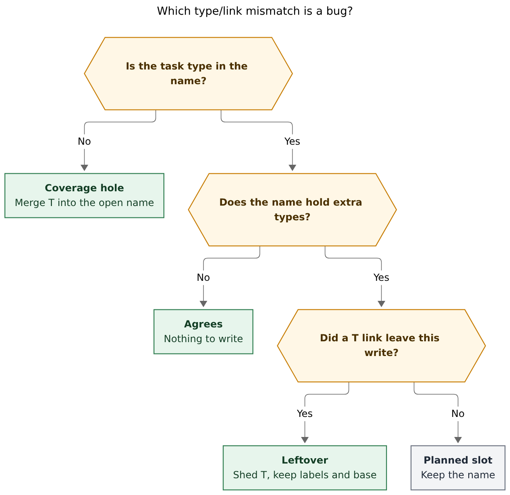
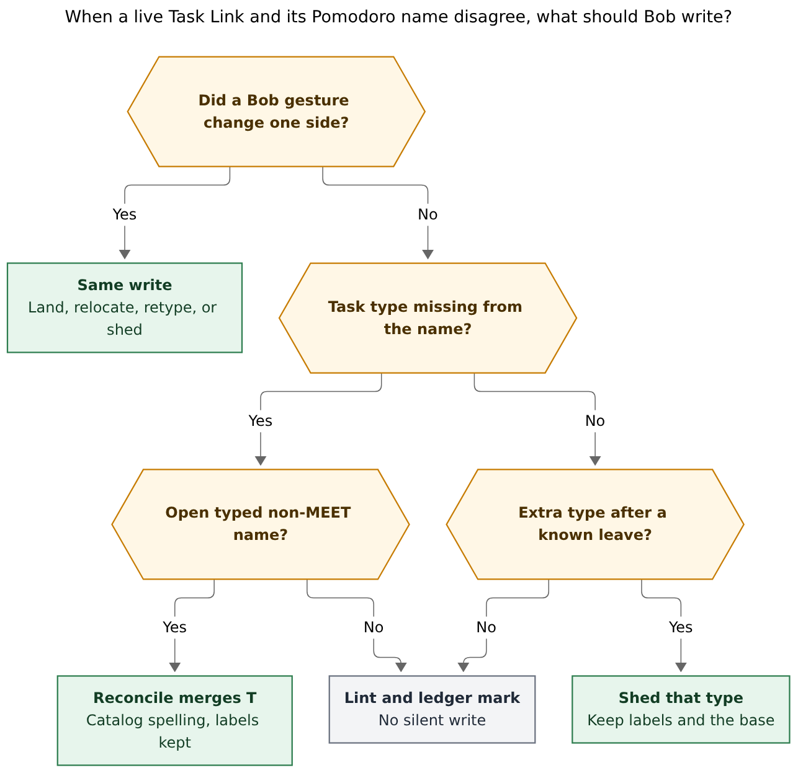

# Enforce type/Pomodoro agreement by gesture, then a narrow reconcile merge

> **Research query:** Obsidian tasks should always have a type (implicit or
> explicit) that matches one of the task types of a Pomodoro that contains a
> Task Link pointing at that task. Use `bob task reconcile` as a fallback that
> adds or removes types on Pomodoro lines. Fix keymaps that can still break the
> constraint so reconcile is rarely needed. Custom Pomodoro names may be an
> exception, but should not constrain the design. Critique the plan, adjust
> requirements where justified, and recommend a solution.

Researcher: **grk**. Independent of the other swarm reports.

Figures rendered with Mermaid CLI **12.0.0** (PDF-mirroring config, DejaVu
Sans, `useMaxWidth: false`). Measured fit against a 652.8 × 892.8 px text
box:

| Figure | Size | Fit |
| --- | --- | --- |
| Coverage vs leftover | 831.884 × 808 px | 78.5% |
| Repair policy | 856.312 × 832 px | 76.2% |

## Bottom line

**Keep the existing agreement invariant. Do not turn `bob task reconcile` into
a sweeper that rewrites every open ` — NAME` until it equals the linked-task
type set.**

The constraint you want is already the accepted D5 rule in
`docs/task-types.md`: every live Task Link sits under a Pomodoro whose name
includes that task's type, or under a container. Gestures already restore it
in the same write. Landing merges (`routing::land`, default `retype: false`).
Type edits relocate (`routing::relocate`). Naming an entry retypes its linked
tasks. Close narrows and sheds (`merged::narrow_closed`, `merged::shed`).
Today's live ledger already agrees: `bob plan -f json` on 2026-11-05 reports
six open named entries (FIX, READ, WRITE, CHORE, BUILD, MEET), fifteen live
links, and **zero** `type_mismatch` lints.

The plan as written mixes two different claims:

1. **Coverage (D5).** The linked task's type appears in the Pomodoro name.
   This is the standing invariant. A hole is a bug.
2. **Exactness (R1 "names follow links").** The name's type components equal
   the set of currently linked types. Gestures already do this on merge, split,
   move, and close. A standing sweeper would delete planned slots that R4
   creates on purpose.

Reconcile should be a **coverage fallback that only merges missing type
components onto open, typed, non-MEET names**. Removing types belongs on the
gesture that dropped the last link of that type (R7), including the unlink,
cancel, blocked-consume, and D8 `MoveTo` holes that `plan:202611/merged_pomodoros.md`
left out of scope. Custom names are already the container rule. Do not convert
`LATER` or `SNACK` into `LATER + BUILD`.

## Verdict

The instinct is right: a live Task Link and its session name should describe
the same kind of work, and a 15-minute cron pass is the right *safety net*.
The proposed mechanism is too wide in two places.

**Adding types on Pomodoro lines is the right fallback direction.** After
merged Pomodoros, a link keeps the task's type and the destination name grows
(`BUILD` plus a WRITE task becomes `BUILD + WRITE`). Reconcile doing the same
merge for a hand-pasted `[[note#^id]]` is the honest repair. It does not stamp
`[type::]`, it does not yank the link into another session, and it reuses
`routing::land` with `retype: false`.

**Removing types as a standing reconcile pass is the wrong fallback.** Extra
type components on an open name are often a plan: `=/` / Ctrl+S create empty
`— T` entries; you name `BUILD + FIX` before the FIX work is linked; close
sheds the continuation and leaves the closed row as history. A sweeper that
makes every open name equal its current link set would fight that. Shed only
when a Bob write in the same transaction dropped the last live link of that
type.

**Silent repair of inherited-type drift is also the wrong fallback.** Changing
`job.md`'s `task_type:` or `plan.default_type` is not a misplaced link. D5
already classifies that as lint, not a write. Auto-merging the new inherited
type into every open session would mutate today's ledger because a note
default moved. Auto-relocating those links would rearrange the day. Leave
that class of drift on the `type_mismatch` lint and the Task Card / move
gestures.

The original task-types research
(`research:202610/task_types_from_pomodoro_themes/task_types_from_pomodoro_themes.md`)
and epic (`plan:202610/task_types.md` D5) rejected "silent drift repair" and
"deriving Pomodoro names from tasks" as standing policy. Merged Pomodoros later
accepted name-follows-links **for gestures**. The justified next step is to
extend that to (a) the remaining leave-link keymaps and (b) a merge-only
reconcile fallback for coverage holes. It is not to reopen D5 as "reconcile
owns the name."

## What already exists

Verified in this workspace against bob-cli, bob-plugins, and a live
`bob plan -f json` on 2026-11-05. Nothing below is a proposal.

### The invariant, the lint, the mark

`routing::agrees` (`src/native/pomodoro_themes/routing.rs`) is true when any
of these holds:

- the entry is a **container** (no type components: unnamed, `(unnamed)`, or
  only labels / inventory names under a configured `types:` vocabulary);
- the task has **no effective type**;
- the task type's key equals **any component** of the entry, labels included
  (a SNACK-typed task under `— SNACK` agrees).

`bob plan` emits one `type_mismatch` warning per disagreeing live link, at the
ledger line, with additive `link`, `entry`, `task_type`, and `entry_types`
(`docs/plan.md`, `with_type_mismatch_lints` in
`src/native/plan_budget/mod.rs`). The message already teaches the two human
repairs: `Ctrl+Shift+M to move or Ctrl+Shift+P t to retype`. Ledger Tools
prefixes the disagreeing Task Link with a `#TYPE` mark
(`137-ledger-type-marks.js`, kind `disagree`). Closed Pomodoros are history.

There are **no CLI tests** that pin `type_mismatch`. The only `type_mismatch`
string hits in `tests/` are the unrelated `ref_type_mismatch` path in
highlights overwrite.

### Gestures already restore coverage

| Gesture | Restores agreement by | Code |
| --- | --- | --- |
| Link / move into a named open Pomodoro | Merge the task's type into the name (Enter). Alt+Enter retypes | `routing::land`, plugin `planLanding` (`retype` only when Alt+Enter) |
| `^^` Task Link inside a Pomodoro bullet | Same merge | `129-plugin-task-wikilink-pomodoro.js` (`retype: false`) |
| Bare capture, Ensure Next, successor default | Place by type (`routing::place`) | D7 |
| Capture `#<type>` / Task Card Type | Relocate the live link (D8) | `relocate`, `running_retype = absorb` |
| Note move without `[type::]` | Relocate when inherited type changes | `docs/task-move.md`, `650-plugin-move-commit.js` |
| Naming / renaming an entry that holds links | Retype the linked tasks (D6) | `capture_pomodoro_name.rs` (`retype: true`), plugin `planRetype` |
| `=*` / Ctrl+X entry merge | `merge_names` | R5 |
| `=/` / Ctrl+S split | Move links by type, drop those components from the source | R4 |
| `x` / Ctrl+Enter close | Narrow the closed name; shed the continuation | R6 |
| Ctrl+Shift+M last-of-type leave | Shed the source (R7) | NAV bullet-move commit |

Capture `#NAME` / `=name` now lands with `retype: false`
(`src/native/capture/task_theme.rs`). The remaining `retype: true` callers are
the ones D6 still owns: naming an entry, and Alt+Enter.

### Reconcile is explicitly a type never-writer

`docs/task-types.md` PT13 lists reconcile among the writers that **do not**
write type fields. `docs/task-status-hooks.md` says it owns Blocked recovery,
Next promotion, duplicate-link cleanup, canceled-reference removal, blocked
link consumption, empty-Pomodoro deletion, 🍅 repair, and off-clock Event
Task settlement. It never calls `land`, `shed`, or `relocate`. After it
consumes a blocked or canceled link from a merged name, the extra type
component stays. That is reconcile creating the exactness leftover the request
wants it to clean.

### Custom names and MEET already have rules

- **Container:** no type components. Holds any task without typing it.
  Warning copy: `SNACK isn't one of your types; tasks here keep their own types`.
- **Label:** a component outside `types:` when a vocabulary is configured, or
  an inventory label (`LATER`, `MISC`, `NEW FEATURES`, `SASE` in
  `docs/plan.md`). Labels are never added, moved, or removed by merge / split
  / shed (`docs/task-types.md` Merged Pomodoros).
- **MEET:** `routing::is_meet_name`. Calendar sync owns that exact name. No
  merge, split, narrow, or shed. Landing into MEET still takes the Set/Clear
  retype path. `bob gcal sync` stamps `[type:: MEET]` on Event Tasks so they
  agree without renaming the session (`src/native/gcal/render.rs`).

### Live vault, 2026-11-05

`bob plan -f json` (read-only):

- Open names: FIX (3 links), READ (1), WRITE (3), CHORE (2), BUILD (5),
  MEET (1).
- 15 `today_tasks`. Zero `type_mismatch`. Other warnings are caps
  (`plan_link_cap_exceeded`, `next_cap_exceeded`, `pending_cap_exceeded`).
- No merged open names today.

On 2026-10-29, before the task-types epic and merged-Pomodoro landing, the
consolidated research replayed 28 of 85 live links (33%) under a Pomodoro that
did not contain the task's effective type. The gesture work closed that gap
on today's ledger. The remaining product is the hole class, not a currently
visible pile of mismatches.

## Two invariants, one of which is a bug

*A missing task type on an open typed name is a coverage hole and should be
merged. An extra type is a leftover only after a link of that type left in
the same write. A planned slot stays.*

D5 `agrees()` is **coverage only**. `BUILD + FIX` with one BUILD task still
agrees. The `type_mismatch` lint never fires for extra types. If the feeling
that "we do not enforce this" is about leftover `+ FIX` after an unlink, that
is R7, not D5, and reconcile as specified in `docs/task-status-hooks.md` does
not touch it.

Exactness is real, and it is already a **gesture** rule: "After any merge,
split, move, or close, a name says which kinds of work its Task Links hold"
(`docs/task-types.md`, glossary Merged Pomodoro). The merged-Pomodoro epic
listed the missing leaves as follow-ups, not as a cron rewrite:

> Out of scope (follow-ups, not built here): Shedding when a link leaves
> through unlink toggles, cancels, D8 relocation, or start drops.

That list is the keymap work. It is also why reconcile currently *creates*
leftover types: blocked-link consumption and canceled-reference cleanup remove
links and then skip `shed`.

## Critique of the request

### Is this a good idea?

**Coverage as a standing invariant: yes.** It is already shipped. Every open
task already has a computed type (field, reading rule, note `task_type:`,
then `plan.default_type`). The request's "implicitly or explicitly" matches
PT13. Do not start stamping `[type::]` onto inherited rows.

**Reconcile as a fallback: yes, narrowly.** Hand-pasted Task Links, a
half-applied Task Card ledger step, a git merge, and a Vim yank are not Bob
gestures. A 15-minute `bob task reconcile` that merges missing types onto
open typed names is the same role reconcile already plays for blocked
markers, duplicate links, and emptied Pomodoros.

**Reconcile as "add or remove types until the name equals the links": no.**
That treats a Pomodoro name as a derived projection of its children. Names
are also the catalog source (PT2: history comes from ledger tails, never from
task text), the plan-budget identity, Stats keys, and the place you park
afternoon work before it is linked. Deriving them continuously was a rejected
alternative in `plan:202610/task_types.md` D5.

### Would I take a different approach?

Yes. Three layers, in this order:

1. **Close the R7 keymap holes** so a leave-link write sheds in the same
   undoable edit. That is what makes reconcile "rarely needed" for extra
   types.
2. **Add a merge-only coverage pass** to `bob task reconcile`, after
   structural link removal and before empty-Pomodoro deletion, reusing
   `routing::land(retype: false)`. Never write task fields. Never rename
   containers, MEET, unnamed entries, or closed rows. Never add or remove
   labels.
3. **Keep `type_mismatch`** for everything that pass refuses: MEET with a
   non-MEET task that somehow lost its `[type:: MEET]`, container-vs-nothing
   (already agrees), inherited-type drift from frontmatter or config, closed
   history, and Task Card partial failure the user has not yet moved.

I would not add a second standing lint for extra types. Extra types are
often intentional. A lint that cried on every `BUILD + FIX` plan would train
you to ignore it.

### Keymaps that still break the constraint

Bob-owned **Enter** paths for link, move, `^^`, successor retarget, and
capture named landing already merge. The remaining breakers:

| Path | Breaks coverage? | Breaks exactness? | Fix |
| --- | --- | --- | --- |
| Paste or type `[[note#^id]]` under a Pomodoro | Yes | Yes | Reconcile merge (fallback). Optional editor interceptor later |
| Hand-edit the ` — NAME` tail in the daily note | Yes (D6 retype skipped) | Yes | Reconcile merge for missing types. Rename picker remains the writer that retypes tasks |
| Hand-edit `[type::]` on the task line | Yes (D8 skipped) | Maybe | Lint + Task Card. Do not auto-relocate from reconcile |
| Frontmatter `task_type:` / `plan.default_type` / `types:` vocabulary | Yes (inherited type moves) | No | Lint only. This is not a misplaced link |
| Task Card type edit whose ledger step fails | Yes | Yes | Existing notice already points at Ctrl+Shift+M. Reconcile merge is the net |
| Ctrl+Shift+Enter / `@route+id!` / Alt+N unlink | No (the link is gone) | Yes | Call `merged::shed` in `plan_link_removal` and the plugin prune |
| Cancel prune of today's links | No | Yes | Same shed |
| Reconcile blocked-link consume / canceled-reference cleanup | No | Yes | Shed in the same reconcile run, then empty-delete |
| D8 `RelocateOutcome::MoveTo` | Coverage restored at dest | Yes on the source | Shed the source in `relocation_apply` |
| Git / sync merge of the daily note | Yes | Yes | Reconcile merge |
| MEET + Event Task | No when gcal stamped `[type:: MEET]` | Frozen | Never rename MEET |

Ctrl+Shift+M bullet move already sheds on last-of-type leave. Ctrl+S, Ctrl+X,
`x`, and the rename picker are already on the right side of the table.

The plugin rename path still goes through `planRetype`
(`650-plugin-move-commit.js`). That is correct: naming states what the entry
*is*, so linked tasks follow the name. Do not flip rename to merge. That
would make "I renamed this session to WRITE" leave BUILD tasks in place and
grow `WRITE + BUILD`, which is the opposite of a rename.

## Requirement adjustments

Each row is a justified edit to the request. The rest of the request stands.

| ID | Original request | Adjustment | Why |
| --- | --- | --- | --- |
| A1 | Tasks should always have a type matching one of the Pomodoro's types | Keep D5: the **Pomodoro name includes the task's type, or is a container**. Typeless tasks and containers already agree | "Always have a type" is already true via the PT13 cascade. Forcing an explicit `[type::]` would freeze inherited defaults. Containers (`LATER`, ad-hoc `SNACK`) are the custom-name exception you already suspected |
| A2 | Reconcile adds **or removes** types on Pomodoro lines as necessary | Reconcile **merges missing type components** onto open typed non-MEET names. It sheds a type only when **this run** dropped the last live link of that type | A standing remove pass deletes planned slots and fights R4. Reconcile already removes blocked/canceled links and then leaves the extra type; shed those in the same run |
| A3 | Reconcile is the fallback that makes the constraint always true | "Always" does not include inherited-type drift from frontmatter, config, or `types:` vocabulary edits, and does not include MEET, containers, labels, unnamed entries, or closed history | Those are not misplaced links. Auto-merge after a `task_type:` edit would rewrite today's names because a note default moved. Auto-relocate would rearrange the day |
| A4 | Fix keymaps that can break the constraint | Prioritize **leave-link R7** (unlink, cancel prune, blocked consume, D8 `MoveTo`). Link/move Enter paths already merge | Extra types after unlink are the hole merged Pomodoros deferred. Coverage holes from Enter keymaps are largely closed |
| A5 | Custom Pomodoro names may be an exception | Adopt the existing container/label/MEET rules. Do not invent a third "custom" class | A configured vocabulary already treats unknown names as labels. Landing into them does not type the task and does not grow the name. Reconcile must not turn `SNACK` into `SNACK + CHORE` |
| A6 | Add/remove types rather than retype tasks | Keep this as a hard rule for reconcile. Rename (D6) still retypes | Aligns with R2. Reconcile remains a type-field never-writer (`docs/task-types.md` PT13) |
| A7 | *(implicit)* Silent repair replaces the lint | Keep `type_mismatch` for refused cases. Add tests; there are none today | Lint is how you see a MEET conflict, a failed Task Card ledger step, and a note-default edit. Reconcile should clear the mergeable subset, not delete the diagnostic |

A1–A3 are the ones I would not ship without. A4 is the work that actually
makes reconcile rare. A5 is already in the contract; the request should name
it rather than leave it as a maybe.

## Recommended solution

*A Bob gesture restores the other side in the same write. Reconcile merges a
missing type onto an open typed non-MEET name. Containers, MEET, labels,
planned extras, frontmatter drift, and closed history stay on the lint.*

### Policy (new decision record)

Record this as a new accepted decision, for example
`reconcile-merges-missing-types`. Do not edit the D5 body in place. Mark D5's
"never silently repaired" clause `superseded-in-part` and point at the new
record. Claim:

> A live Task Link's effective type appears in its open Pomodoro name, or
> the name is a container. Bob-owned gestures restore that in the same write.
> `bob task reconcile` may merge missing **type** components onto open,
> typed, non-MEET names. It never writes `[type::]`, never adds or removes
> labels, never renames MEET or containers, never rewrites closed rows, and
> never sheds a type unless this run dropped that type's last live link.

Rejected alternatives: standing exactness sweeper; retyping tasks from
reconcile; relocating links from reconcile; converting custom names into
merged type names.

Reopens when leftover merged names after unlink remain common even with R7
on the keymaps, or when Bryan wants planned extra types to expire at end of
day (that would be a close/shed rule, not reconcile).

### Layer 1 — keymaps (makes reconcile rare)

Reuse `api.themes.shed` / `merged::shed`. Same keep-labels, keep-base,
single-type-unchanged, MEET-unchanged contract as R7.

1. **`plan_link_removal`** (`src/native/capture_task_toggle/links.rs`) and
   the plugin prunes it mirrors: after removing the last live link of type T
   from an open merged name, shed T.
2. **Cancel prune** of today's open-Pomodoro links: same.
3. **D8 `MoveTo` / `CreateBelow`:** shed the source after the link leaves.
   `RenameEntry` / `AppendComponent` already rewrite the running name.
4. **Alt+N release** and **Ctrl+Shift+Enter unlink** go through the same
   removal planner, so they inherit (1).
5. Do not change rename, Alt+Enter retype, or MEET landing.

Plugin tests already exist for merge-on-Enter and shed-on-bullet-move. Add
unlink / cancel / D8-move cases next to them.

### Layer 2 — reconcile coverage pass

Insert the pass in `task_status_hooks/sync.rs` **after** duplicate cleanup,
canceled-reference removal, and blocked-link consumption, **before**
empty-Pomodoro deletion.

For each remaining live Task Link under an open entry E:

1. Resolve the task's effective type T (same cascade as the lint:
   `suggest_for_task`).
2. If `agrees(T, E)`: skip.
3. If E is MEET, a container, unnamed, or closed: skip (lint remains).
4. Else apply `land(retype: false)`: E's name gains ` + T` in catalog
   spelling, once per missing key, in link order. Labels stay. No task
   field write.

Then, for each open merged E whose last T-link was removed **in this run**,
apply `shed`. Then run empty-Pomodoro deletion as today, so a childless
entry is deleted rather than renamed.

Idempotent. `--dry-run` prints the planned tails. JSON grows additively
(`schema_version` stays 1), for example
`type_name_updates: [{line, before, after, reason: "merge"|"shed"}]`. Human
output gets a short section next to empty-Pomodoro cleanup. Over-budget
`plan.max_themes` is a warning, not a refusal: coverage beats the cap, same
as D8 type creations.

Do not merge onto an entry this run is about to delete.

### Layer 3 — lint, tests, docs

- Keep `type_mismatch`. After the merge pass, it should only remain for the
  refused class. Teach the same two human repairs.
- Add the missing CLI / vector coverage: one disagreeing live link, one
  container, one MEET, one inherited-type frontmatter change (lint, no
  write), one hand-pasted WRITE under BUILD (merge), one blocked consume of
  the last FIX link under `BUILD + FIX` (shed).
- Docs: `docs/task-types.md` D5 paragraph, `docs/task-status-hooks.md` new
  "Type names" subsection, `docs/plan.md` lint row ("never repaired"
  becomes "reconcile merges open typed non-MEET names; other drift stays
  lint"). CLI help already exists; mention the new JSON field in
  `just docs-gen` output if the command grows a documented JSON key.
- Glossary `task-type` currently says disagreement is shown as drift and is
  not silently repaired. That sentence becomes false for the mergeable
  subset. Update it through `/sase_memory_write` when the plan that lands
  this work authorizes the note.

### What not to build

- A reconcile pass that retypes tasks to match the Pomodoro (old D6 default,
  opposite of R2).
- A reconcile pass that relocates links to `place(T)` (that rearranges
  Today).
- A standing extra-type lint or sweeper.
- Editor interception of every raw `[[wikilink]]` paste, unless Layer 2
  proves noisy. Paste is the case reconcile is for.
- Changing MEET, gcal's `[type:: MEET]` stamp, or Stats attribution of
  closed rows.
- Mac Capture logic. The app stays a thin client of bob.

### Rollout

One epic, three phases, bob-cli then bob-plugins. No CLI contract break if
JSON is additive and `bob task reconcile` keeps its flags. No `!` commit
unless you change the documented "never repaired" lint into a write without
a matching docs/`!` note; I would mark the lint-row docs change as the
behavior change and keep the command path stable.

1. **R7 leaves** (bob-cli planners + plugins). This is the "rarely needed"
   half.
2. **Reconcile merge + same-run shed** (bob-cli). Cron on the Mac already
   runs `bob task reconcile --retry-timeout 120` every 15 minutes
   (`docs/vault-git-sync.md`).
3. **Lint tests, docs, decision, glossary.** Closeout.

Acceptance, each followed by the required result:

- BUILD session, hand-pasted WRITE Task Link, `bob task reconcile --dry-run`
  then live: name becomes `BUILD + WRITE`; WRITE task field unchanged;
  second run is a no-op.
- `LATER` or `SNACK` session, CHORE task linked: name unchanged; no
  `type_mismatch` (container).
- MEET session, Event Task with `[type:: MEET]`: unchanged. Event Task
  whose type field was deleted: lint, name stays `MEET`.
- `BUILD + FIX`, cancel or blocked-consume the only FIX link in the same
  reconcile run: name becomes `BUILD` (or the entry deletes if it empties).
- `BUILD + FIX` with only BUILD links, no leave this run: name stays
  `BUILD + FIX` (planned slot).
- `job.md` `task_type:` WRITE → CHORE, linked job tasks still under WRITE,
  no field: `type_mismatch` lint, names unchanged.
- Task Card type edit with a failed ledger step: field written, lint until
  the next reconcile merge or a Ctrl+Shift+M.
- Closed ` — BUILD + FIX` row: never rewritten.

## Risks

1. **Merge grows names.** A week of pasted mismatches can produce
   `BUILD + FIX + WRITE + CHORE`. Close already narrows. That is acceptable
   for a fallback. If it becomes common, the paste interceptor is the
   follow-up, not a sweeper.
2. **Budget.** Merging a fourth type can trip `plan.max_themes`. Warn, do
   not refuse.
3. **Partial two-note writes.** Task Card already documents this. Reconcile
   merge is the net that makes the ledger match the surviving field.
4. **Vocabulary edits.** Adding SNACK to `types:` turns yesterday's
   container into a type component. Existing SNACK sessions start counting
   as typed. Reconcile would then treat a CHORE task under `— SNACK` as a
   coverage hole and merge. That is correct under D4, and rare. Mention it
   in the `types:` docs, not in the reconcile loop.

## Sources

**bob-cli (this workspace):**

- `docs/task-types.md` — PT13, D5 agreement, landing, placement, relocation,
  merged R1–R7, never-writers
- `docs/plan.md` — `type_mismatch` lint row
- `docs/task-status-hooks.md` — reconcile passes, empty Pomodoros, plugin
  prune
- `docs/task-move.md` — D8 on note move; frontmatter is not a gesture
- `docs/vault-git-sync.md` — Mac cron `bob task reconcile`
- `src/native/pomodoro_themes/routing.rs` — `agrees`, `land`, `place`,
  `relocate`, `is_meet_name`
- `src/native/pomodoro_themes/merged.rs` — `merge_names`, `narrow_closed`,
  `shed`
- `src/native/plan_budget/mod.rs` — `with_type_mismatch_lints`
- `src/native/capture/task_theme.rs` — capture lands with `retype: false`
- `src/native/capture_pomodoro_name.rs` — rename lands with `retype: true`
- `src/native/capture_task_toggle/links.rs` — `plan_link_removal` (no shed)
- `src/native/task_status_hooks/sync.rs` — blocked consume, empty delete
- `src/native/gcal/render.rs` — `[type:: MEET]` stamp
- `tests/fixtures/pomodoro_themes/vectors.json` — `agree`, `land`, `shed`
- Live `bob plan -f json`, 2026-11-05

**bob-plugins (opened via `sase repo open bob-plugins`):**

- `bob-ledger-tools/src/279-plugin-task-type-routing.js` — `typeAgrees`,
  `planLanding`, `planRetype` alias
- `bob-ledger-tools/src/137-ledger-type-marks.js` — disagree mark
- `block-id-prompt/src/078-pomodoro-theme-write.js` — merge unless
  `intent.retype === true`
- `block-id-prompt/src/129-plugin-task-wikilink-pomodoro.js` — `retype: false`
- `bob-navigation-hotkeys/src/650-plugin-move-commit.js` — rename uses
  `planRetype`
- `task-status-cycler/src/085c-successor-theme-write.js` — `planLanding`

**Plans and prior research (audited `sase artifact read`):**

- `plan:202610/task_types.md` — D5, rejected silent repair
- `plan:202611/merged_pomodoros.md` — R1–R7, leave-link shed out of scope
- `research:202610/task_types_from_pomodoro_themes/task_types_from_pomodoro_themes.md`
  — 33% mismatch replay; "flagged, never silently repaired"

**Memory:**

- `glossary:task-type`, `glossary:merged-pomodoro`, `glossary:pomodoro`,
  `glossary:task-link`
- `decisions:pomodoro-theme-is-one-component`
- `sase_artifacts.md`, `docs.md`, `cli_rules.md`

*Figure note:* both figures were rendered with `@mermaid-js/mermaid-cli`
12.0.0 under the PDF-mirroring config and checked visually from PNG.
Sources live beside this report in
`task_type_pomodoro_link_agreement__grk_assets/`.
