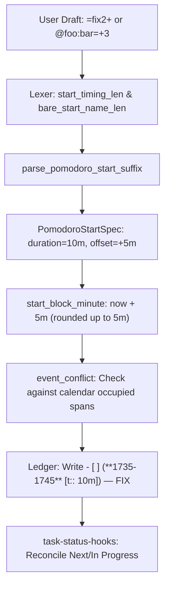

# Research & Design: Positive Pomodoro Start Offsets (`+<N>`) in Bob Capture Grammar

**Report ID:** `pomodoro_start_positive_offset__gem`  
**Author:** Researcher gem (5-researcher swarm study)  
**Date:** 2026-11-07  
**Target Repositories:** `bob-cli`, `bob-mac-capture`, `bob-plugins`  
**Subject:** Adding `+<N>` start offset support to `=<X>`, `@route:id=<X>`, and evaluating `x=<X>`  

---

## Executive Summary

This research investigates the design, mechanics, edge cases, and architectural implications of adding positive 5-minute start offsets (`+<N>`) to the Bob capture language.

Today, the `<X>` timing suffix mirroring the Obsidian `se<X>` snippet supports duration and **negative** offsets (e.g. `=-` for -5m, `=-2` for -10m, `=3-1` for 15m starting -5m in the past). Users can adjust or shift an *already running* Pomodoro forward via `++[N]`, or chain session operators (`=fix2 ++`). However:
1. **Chaining is structurally impossible on routed task captures:** `@route:id=` is a task-capture token, not a session-operator chain. Typing `@foo:bar= ++3` captures `++3` as the task's body text rather than shifting the session.
2. **Pre-scheduling future starts is unexpressive:** A user planning to start work in 5, 10, or 15 minutes cannot express that intent in a single atomic start token.

### Core Verdict & Recommendations

1. **Adopt `+<N>` for `=<X>` and `@route:id=<X>`:**
   Extending the `<X>` grammar from `[0-9]*(-[0-9]*)?` to `[0-9]*([+-][0-9]*)?` is a natural, elegant, and highly ergonomic improvement. It completes mathematical symmetry with negative offsets and eliminates the expressiveness hole in routed link starts.
2. **STRICTLY REJECT `+<N>` for `x=<X>`:**
   Extending `x=` with `+<N>` is fundamentally flawed. `x=` is reserved exclusively for **past** Pomodoros ("records what already happened"). A future start offset on a past session is an ontological contradiction. Furthermore, `x=` already explicitly rejects negative offsets (`x=3-1` teaches `x=3~1`), uses `+` for segment pin indexing (`~n+`), and supports compound themes (`x=bob+decks`). Adding `+` to `x=` would break lifecycle separation and inject grammar collisions.
3. **Disambiguate Trailing `+` from Theme Grammar:**
   In Bob, `+` is also the Pomodoro theme separator (e.g., `WORK+RESEARCH`). Under the current lexer, `=fix2+` is parsed as a 25-minute Pomodoro named `FIX2+`. We provide a disambiguation rule in the bare-name lexer: trailing timing matching `[0-9]*([+-][0-9]*)?` must be greedily peeled off before validating bare name and theme components.
4. **Coordinate Across the Bob Ecosystem:**
   Because `<X>` mirrors Obsidian's `se<X>` snippet, this syntax must be coordinated across `bob-cli`, `bob-mac-capture` (syntax highlighter spans and live previews), and `bob-plugins` (`bob-ledger-tools`).

---

## 1. Background & Current Grammar Baseline

### 1.1 The Pomodoro Session Lifecycle in Bob

Bob structures Pomodoro tracking around strict single-token verbs and modifiers:
- `=` / `=<X>`: Start today's next planned Pomodoro, or restart the running one.
- `=name` / `=<X>#name` / `=name<X>`: Start or swap a named Pomodoro.
- `+` / `-[N]`: Resize the running timed Pomodoro.
- `++` / `--[N]`: Shift the running timed Pomodoro later or earlier.
- `x`: Close today's running timed Pomodoro.
- `x=`: Record past completed Pomodoros stacking backward onto the timeline.

### 1.2 The Current `<X>` Timing Grammar

In `src/native/capture_language/tokens.rs` and `item.rs`, `<X>` represents the start timing specification:
```text
<X> := [0-9]*(-[0-9]*)?
```
The timing units are standardized 5-minute blocks:
- **Duration:** Defaults to 5 units (25 minutes) if omitted.
- **Offset:** Follows `-`. Defaults to 1 unit (5 minutes) if `-` is present without digits. Omitted `-` means 0 offset.

| Typed Syntax | Duration | Offset | Meaning |
| :--- | :--- | :--- | :--- |
| `=` | 25m (5 units) | 0m | Start 25m Pomodoro now |
| `=3` | 15m (3 units) | 0m | Start 15m Pomodoro now |
| `=-` | 25m (5 units) | -5m (1 unit) | Start 25m Pomodoro 5m in the past |
| `=-2` | 25m (5 units) | -10m (2 units) | Start 25m Pomodoro 10m in the past |
| `=3-` | 15m (3 units) | -5m (1 unit) | Start 15m Pomodoro 5m in the past |
| `=3-1` | 15m (3 units) | -5m (1 unit) | Start 15m Pomodoro 5m in the past |
| `=2-3` | 10m (2 units) | -15m (3 units) | Start 10m Pomodoro 15m in the past |

The unwrapped start minute calculation lives in `start_block_minute()` (`src/native/capture/meet_event_run.rs`):
```rust
let numerator = now_minutes.checked_sub(offset_i64)?;
let quot = if numerator >= 0 { (numerator + 4) / 5 } else { numerator / 5 };
quot * 5
```
Because `numerator = now_minutes - offset_i64`, `offset_units` has always been subtracted from current wall-clock time.

---

## 2. Critique of the Proposed Feature

### 2.1 The Case For `=<X>+<N>` and `@route:id=<X>+<N>`

Adding positive start offsets solves two concrete problems in daily ledger operation:

#### Problem 1: Chaining Fails on Routed Task Starts
When a user captures a standalone start, they can chain the start with a shift operator:
```bash
bob capture '=fix2 ++'
```
The draft splitter (`session_chain_tokens`) breaks this into two sequential items:
1. `=fix2` (Starts FIX from 17:30 to 17:40)
2. `++` (Shifts the running FIX session to 17:35 to 17:45)

However, when linking an existing or new task:
```bash
bob capture '@work:bar= ++3'
```
This does **not** chain! In `src/native/capture_language/draft.rs`, a session-operator chain requires *every* token on the line to pass `is_session_chain_token`. `@work:bar=` is a task-route token, not a session operator. As verified against the current binary:
```text
✓ captured  work.md
  - [*] #task ++3 [created::2026-11-07] ^bar
  → into running CHORE ((**1730-1755** [t:: 25m]))
```
`++3` was captured as the task title! There is currently **no syntactic mechanism** to capture a task, link it into the ledger, and start its session in the future.

Allowing `@work:bar=+3` or `@work:bar=fix2+` solves this cleanly and atomically inside the single token.

#### Problem 2: Intentional Delayed Start vs Reactive Adjustment
The existing session operators (`++`, `+`) are reactive: they require a session to already be running. If no session is running, `bob capture '++'` halts with:
```text
bob capture: Bob daily note has no open timed Pomodoro to shift; next up is BUILD (start it with `=`)
```
A user who is about to take a 5-minute break or finish an email before diving into a 25-minute focus session wants to author that intention upfront:
```bash
bob capture '=+ focus'        # Start FOCUS 5 minutes from now
bob capture '=fix3+2'         # Start 15m FIX 10 minutes from now
```
This is intuitive, clean, and respects the cognitive flow of planning.

---

### 2.2 The Critical Critique: Why `x=<X>` MUST NOT Support `+<N>`

The user prompt asks whether `x=<X>` should also support `+<N>`. The answer is an unambiguous **NO**.

#### Reason 1: Ontological & Semantic Incoherence
Bob's session verbs have unambiguous temporal roles:
- `=` is **present and future**: starts now or starts later.
- `x` is **present**: stops the currently running session now.
- `x=` is **past**: records historical work that has already finished.

The documentation in `docs/reference/cli/capture.md` states:
> *"Mnemonic: `=` starts now, `x` stops now, and `x=` records what already happened. A whole-item `x=` token records past work ending at the next five-minute boundary; stack members fill earlier windows backward."*

Applying a "future positive offset" to an operator designed strictly to record past elapsed work makes no conceptual sense. If a session begins in the future, it has not happened yet; it is a planned or started future session (`=`), never a past record (`x=`).

#### Reason 2: `x=` Already Forbids Offsets by Architectural Invariant
In Bob's capture grammar, `x=` does not even permit negative `-` offsets! As documented in `docs/reference/capture-syntax.md` (Rule 152):
> `x=3-1`, `x=-2`, `x=3-` | No past offsets; write `x=3~1` or drop the dash (`x=3`)

Past sessions are positioned on today's timeline backward from the next 5-minute boundary, or pinned explicitly via segment suffixes (`~`):
- `x=fix3`: Ends at the next 5-minute boundary (e.g. 17:30) and spans backward 15 minutes (17:15–17:30).
- `x=fix3~1`: Pins to segment 1 in today's ledger timeline.

Allowing `+` offsets on `x=` while explicitly forbidding `-` offsets would create a bizarre asymmetry: you could offset a past session forward into the future, but not backward into the past!

#### Reason 3: Severe Grammar Collisions with Themes and Segments
1. **Segment Pin Indexing (`~n+`):** In `x=`, `+` is already an established marker in segment pin notation. `x=build~1+` indicates placing the session at the start edge following segment 1.
2. **Compound Theme Names (`x=bob+decks`):** In `x=`, `+` is actively used to separate multi-theme past sessions.
3. **Close Modifier Confusion:** In `x=E=X`, the second `=` introduces close modifiers (`x=fix3=*3`, `x=fix3=!2`). Adding signed start offsets to `x=` would create parsing ambiguities with close actions.

**Conclusion:** `x=` must remain strictly un-offset. If a user attempts `x=+` or `x=3+`, Bob should reject the token with an explicit diagnostic:
```text
bob capture: `x=` records past Pomodoros and does not take start offsets; use `=` or `+` to adjust running or future sessions
```

---

### 2.3 The Bare Name & Theme Ambiguity

A critical subtlety that any implementation must solve is the interaction between `+` in start timing and `+` in Pomodoro themes.

According to Bob Architecture Decision Record (`decisions:pomodoro-theme-is-one-component`):
> *"A Pomodoro theme is one `+`-separated component of a named ledger entry's ` — NAME` tail."*

Users frequently write multi-theme sessions like `=work+research`. Furthermore, `is_pomodoro_selector_byte` (`src/native/capture_language/tokens.rs:576`) explicitly includes `+`:
```rust
pub(super) fn is_pomodoro_selector_byte(byte: u8) -> bool {
    is_selector_byte(byte) || byte == b'+'
}
```

#### What Happens Today with `=fix2+`
When testing `=fix2+` in the existing codebase:
```bash
bob capture --dry-run "=fix2+"
```
Output:
```text
bob capture: warning: FIX2 isn't one of your types
[dry-run] ok would start  2026/20261107.md
  FIX2+ 1730-1755 (25m) (created) at line 92
  - [ ] (**1730-1755** [t:: 25m]) — FIX2+
```
`bare_start_name_len` consumed `fix2+` as the Pomodoro name! It only stripped trailing digits; because `+` is not a digit, the lexer treated the trailing `+` as part of the theme name!

#### The Resolution Rule
Fortunately, Bob's theme grammar provides a clean invariant:
1. In `can_spell_bare(name)` (`bare_name.rs:67`), every theme component must start with an ASCII alphabetic character.
2. A theme component can never begin with a digit, nor can a theme name end with a trailing `+` (in `split_components`, empty components are filtered out).

Therefore, when parsing a bare name tail:
- If `+` is followed by an ASCII letter (`+alpha`), it is a **theme separator** (e.g. `=bob+decks`).
- If `+` is followed by an ASCII digit (`+2`), it is an **offset specification** (e.g. `=bob+2`).
- If `+` is at the end of the timing token or followed by `~` (drop list), it is a **default 1-unit (+5m) offset** (e.g. `=fix2+`, `=bob+decks+`).

By enforcing greedy trailing-timing extraction matching `[0-9]*([+-][0-9]*)?`, the lexer can cleanly and deterministically peel off the timing suffix without colliding with multi-theme names.

---

## 3. Comprehensive Grammar Specification

### 3.1 Formal Grammar of `<X>`

The unified `<X>` grammar across all start contexts (`=<X>`, `=<X>#name`, `=name<X>`, `@route:id=<X>`) is:

```text
<start_token>       ::= "=" <start_spec>
<link_start_tail>   ::= "=" <start_spec>

<start_spec>        ::= <leading_timing_form>
                      | <trailing_timing_form>
                      | <timing_spec>

<leading_timing_form>  ::= <timing_spec> [ "#" <pomodoro_name> | <bare_name> ] [ "~" <drop_list> ]
<trailing_timing_form> ::= ( <bare_name> | "#" <pomodoro_name> ) <timing_spec> [ "~" <drop_list> ]

<timing_spec>       ::= [ <duration_units> ] [ <offset_sign> [ <offset_units> ] ]
<duration_units>    ::= [0-9]+
<offset_sign>       ::= "+" | "-"
<offset_units>      ::= [0-9]+
```

### 3.2 Evaluation Rules

1. **Duration (`duration_units`):**
   - If present: duration in minutes = `duration_units * 5`.
   - If omitted: defaults to 5 units = 25 minutes.
   - Zero duration (`=0`, `=0+2`) is refused with `invalid_pomodoro_start`: *"need at least one block"*.
2. **Offset Sign (`offset_sign`) & Magnitude (`offset_units`):**
   - If no `offset_sign` is present: offset = 0 minutes.
   - If `offset_sign` is `+`:
     * If `offset_units` is present: offset = `+1 * offset_units * 5` minutes.
     * If `offset_units` is omitted: defaults to `+1 * 1 * 5` = +5 minutes.
   - If `offset_sign` is `-`:
     * If `offset_units` is present: offset = `-1 * offset_units * 5` minutes.
     * If `offset_units` is omitted: defaults to `-1 * 1 * 5` = -5 minutes.
3. **Mutual Exclusivity of Signs:**
   - A single `<timing_spec>` may contain at most one sign (`+` or `-`).
   - Combinations like `=3+2-1`, `=3-1+2`, `=++`, or `=--` are rejected with `invalid_pomodoro_start`.

---

### 3.3 Complete Permutation Matrix

The table below documents every valid permutation across all supported forms:

| Category | Typed Form | Duration | Offset | Start Time (if now = 12:00) | Notes |
| :--- | :--- | :--- | :--- | :--- | :--- |
| **Bare Start** | `=` | 25m | 0m | 12:00–12:25 | Standard default |
| | `=3` | 15m | 0m | 12:00–12:15 | Standard 3 blocks |
| | `=+` | 25m | +5m | 12:05–12:30 | **New:** Default 25m, 1 offset unit |
| | `=+1` | 25m | +5m | 12:05–12:30 | **New:** Explicit 1 offset unit |
| | `=+3` | 25m | +15m | 12:15–12:40 | **New:** Default 25m, 3 offset units |
| | `=3+` | 15m | +5m | 12:05–12:20 | **New:** 15m duration, 1 offset unit |
| | `=3+2` | 15m | +10m | 12:10–12:25 | **New:** 15m duration, 2 offset units |
| | `=-` | 25m | -5m | 11:55–12:20 | Existing negative offset |
| | `=-2` | 25m | -10m | 11:50–12:15 | Existing negative offset |
| | `=3-` | 15m | -5m | 11:55–12:10 | Existing negative offset |
| | `=3-1` | 15m | -5m | 11:55–12:10 | Existing negative offset |
| **Leading Timing** | `=+bugs` | 25m | +5m | 12:05–12:30 (BUGS) | **New:** Leading + offset on bare name |
| | `=+2bugs` | 25m | +10m | 12:10–12:35 (BUGS) | **New:** Leading +2 offset on bare name |
| | `=3+2bugs` | 15m | +10m | 12:10–12:25 (BUGS) | **New:** Leading duration + offset |
| | `=+2#deep-work` | 25m | +10m | 12:10–12:35 (DEEP-WORK) | **New:** Leading +2 on hashed name |
| | `=3+2#deep-work`| 15m | +10m | 12:10–12:25 (DEEP-WORK) | **New:** Leading duration + offset |
| **Trailing Timing**| `=fix+` | 25m | +5m | 12:05–12:30 (FIX) | **New:** Trailing + on bare name |
| | `=fix+3` | 25m | +15m | 12:15–12:40 (FIX) | **New:** Trailing +3 on bare name |
| | `=fix2+` | 10m | +5m | 12:05–12:15 (FIX) | **New:** Equivalent to `=fix2 ++` |
| | `=fix2+3` | 10m | +15m | 12:15–12:25 (FIX) | **New:** Equivalent to `=fix2 ++3` |
| | `="DEEP WORK"2+3`| 10m | +15m | 12:15–12:25 (DEEP WORK)| **New:** Trailing on exact literal |
| **Multi-Theme** | `=bob+decks+` | 25m | +5m | 12:05–12:30 (BOB+DECKS)| **New:** Trailing + on 2 themes |
| | `=bob+decks2+`| 10m | +5m | 12:05–12:15 (BOB+DECKS)| **New:** Trailing duration + offset |
| | `=bob+decks2+3`| 10m | +15m | 12:15–12:25 (BOB+DECKS)| **New:** Trailing duration + offset |
| **Task Link Start**| `@w:k=+` | 25m | +5m | 12:05–12:30 | **New:** Link task & start in 5m |
| | `@w:k=+3` | 25m | +15m | 12:15–12:40 | **New:** Link task & start in 15m |
| | `@w:k=fix2+` | 10m | +5m | 12:05–12:15 (FIX) | **New:** Link task, 10m FIX in 5m |
| | `@w:k=2+3#bugs` | 10m | +15m | 12:15–12:25 (BUGS) | **New:** Link task, 10m BUGS in 15m |
| **With Drop List** | `=3+2~1` | 15m | +10m | 12:10–12:25 | **New:** Start in 10m, drop task 1 |
| | `=fix2+~1,3` | 10m | +5m | 12:05–12:15 (FIX) | **New:** Start in 5m, drop 1 & 3 |

---

### 3.4 Rejected & Error Forms

Teaching diagnostics must guide users toward correct syntax:

| Typed Input | Error Code | Diagnostic / Teaching Message |
| :--- | :--- | :--- |
| `x=+`, `x=3+` | `invalid_pomodoro_past` | `x=` records past Pomodoros and does not take start offsets; use `=` or `+` to adjust running or future sessions |
| `x=3+1` | `invalid_pomodoro_past` | `x=` records past Pomodoros and does not take start offsets; use `x=3~1` to pin to a segment or drop the offset (`x=3`) |
| `=3+2-1`, `=3-1+2` | `invalid_pomodoro_start` | Pomodoro start suffix cannot combine `+` and `-` offsets; write `=3+2` or `=3-1` |
| `=++3` | `invalid_pomodoro_start` | `++3` is a session shift operator, not a start suffix; write `=+3` to start with an offset, or run `++3` on an already running session |
| `==+` | `retired_doubled_equals` | doubled `=` is retired; write `=+` |
| `=+0`, `=0+` | `invalid_pomodoro_start` | Pomodoro start offset must be at least 1 unit (5 minutes); write `=+` or drop the offset |

---

## 4. Implementation Blueprint in `bob-cli`

### 4.1 Data Structure Adjustments

In `src/native/capture_language/model.rs`:
```rust
/// Direction of a 5-minute start offset.
#[derive(Debug, Clone, Copy, PartialEq, Eq, Serialize)]
#[serde(rename_all = "snake_case")]
pub(crate) enum StartOffsetDirection {
    Past,    // '-'
    Future,  // '+'
}

#[derive(Debug, Clone, PartialEq, Eq, Serialize)]
pub(crate) struct PomodoroStartSpec {
    pub(crate) raw: String,
    pub(crate) duration_units: u64,
    pub(crate) offset_units: u64,
    /// None when offset_units == 0; Some(Past) for '-'; Some(Future) for '+'.
    #[serde(skip_serializing_if = "Option::is_none")]
    pub(crate) offset_direction: Option<StartOffsetDirection>,
    #[serde(default, skip_serializing_if = "Vec::is_empty")]
    pub(crate) drop: Vec<u32>,
}
```

In `src/native/capture/batch.rs` (`PomodoroStartSummary`):
```rust
pub(super) struct PomodoroStartSummary {
    pub(super) start: String,
    pub(super) end: String,
    pub(super) duration_minutes: u64,
    pub(super) offset_units: u64,
    #[serde(skip_serializing_if = "Option::is_none")]
    pub(super) offset_direction: Option<StartOffsetDirection>,
    // ... remaining fields unchanged
}
```
*Note on JSON compatibility:* Retaining `offset_units: u64` as an unsigned scalar and adding `offset_direction` ensures complete non-breaking backward compatibility for older JSON consumers.

---

### 4.2 Lexer Modifications

#### 1. `start_timing_len` (`src/native/capture_language/item.rs`)
Extend to recognize `+` alongside `-`:
```rust
pub(crate) fn start_timing_len(text: &str) -> usize {
    let bytes = text.as_bytes();
    let mut len = 0;
    while len < bytes.len() && bytes[len].is_ascii_digit() {
        len += 1;
    }
    if let Some(&sign) = bytes.get(len) {
        if sign == b'-' || sign == b'+' {
            len += 1;
            while len < bytes.len() && bytes[len].is_ascii_digit() {
                len += 1;
            }
        }
    }
    len
}
```

#### 2. `bare_start_name_len` & `trailing_glued_timing` (`src/native/capture_language/bare_name.rs`)
In `trailing_glued_timing`:
```rust
pub(crate) fn trailing_glued_timing(slice: &str) -> &str {
    if slice.starts_with('#') {
        return "";
    }
    let Some(name_len) = bare_start_name_len(slice) else {
        return "";
    };
    if name_len >= slice.len() {
        return "";
    }
    let rest = &slice[name_len..];
    if rest.starts_with('@') {
        return "";
    }
    let bytes = rest.as_bytes();
    let mut len = 0;
    while len < bytes.len() && bytes[len].is_ascii_digit() {
        len += 1;
    }
    if let Some(&sign) = bytes.get(len) {
        if sign == b'-' || sign == b'+' {
            len += 1;
            while len < bytes.len() && bytes[len].is_ascii_digit() {
                len += 1;
            }
        }
    }
    &rest[..len]
}
```

In `bare_start_name_len`:
When scanning candidate characters, after accumulating bytes matching `is_pomodoro_selector_byte`, peel off any trailing timing suffix matching `[0-9]*([+-][0-9]*)?`:
- If `slice` ends with `+` preceded by digits (e.g. `fix2+`), peel `2+`.
- If `slice` ends with `+digits` (e.g. `fix+3`), peel `+3`.
- If `slice` ends with bare `+` not followed by an alphabetic theme component, peel `+`.

---

### 4.3 Suffix Parser (`parse_pomodoro_start_suffix`)

In `src/native/capture_language/tokens.rs`:
```rust
pub(super) fn parse_pomodoro_start_suffix(
    raw: &str,
) -> Result<PomodoroStartSpec, String> {
    if raw.contains('=') || raw.contains('#') || raw.contains(':') {
        return Err(POMODORO_START_SHAPE_ERROR.to_string());
    }
    if raw.is_empty() {
        return Ok(PomodoroStartSpec {
            raw: raw.to_string(),
            drop: Vec::new(),
            duration_units: 5,
            offset_units: 0,
            offset_direction: None,
        });
    }

    // Bare signs: "-" or "+"
    if raw == "-" || raw == "+" {
        let dir = if raw == "-" { StartOffsetDirection::Past } else { StartOffsetDirection::Future };
        return Ok(PomodoroStartSpec {
            raw: raw.to_string(),
            drop: Vec::new(),
            duration_units: 5,
            offset_units: 1,
            offset_direction: Some(dir),
        });
    }

    // Leading sign: "-digits" or "+digits"
    if let Some(after_sign) = raw.strip_prefix('-').or_else(|| raw.strip_prefix('+')) {
        let dir = if raw.starts_with('-') { StartOffsetDirection::Past } else { StartOffsetDirection::Future };
        if after_sign.is_empty() || !after_sign.bytes().all(|b| b.is_ascii_digit()) {
            return Err(POMODORO_START_SHAPE_ERROR.to_string());
        }
        let offset_units = after_sign
            .parse::<u64>()
            .map_err(|_| POMODORO_START_OVERFLOW_ERROR.to_string())?;
        if offset_units == 0 {
            return Err("Pomodoro start offset must be at least 1 unit".to_string());
        }
        return Ok(PomodoroStartSpec {
            raw: raw.to_string(),
            drop: Vec::new(),
            duration_units: 5,
            offset_units,
            offset_direction: Some(dir),
        });
    }

    // Signed split: "digits-digits", "digits-", "digits+digits", "digits+"
    let sign_split = raw.split_once('-').map(|(d, o)| (d, o, StartOffsetDirection::Past))
        .or_else(|| raw.split_once('+').map(|(d, o)| (d, o, StartOffsetDirection::Future)));

    if let Some((duration_text, offset_text, dir)) = sign_split {
        if duration_text.is_empty()
            || !duration_text.bytes().all(|b| b.is_ascii_digit())
            || offset_text.contains('-')
            || offset_text.contains('+')
            || (!offset_text.is_empty() && !offset_text.bytes().all(|b| b.is_ascii_digit()))
        {
            return Err(POMODORO_START_SHAPE_ERROR.to_string());
        }
        let duration_units = duration_text
            .parse::<u64>()
            .map_err(|_| POMODORO_START_OVERFLOW_ERROR.to_string())?;
        let offset_units = if offset_text.is_empty() {
            1
        } else {
            let units = offset_text
                .parse::<u64>()
                .map_err(|_| POMODORO_START_OVERFLOW_ERROR.to_string())?;
            if units == 0 {
                return Err("Pomodoro start offset must be at least 1 unit".to_string());
            }
            units
        };
        return Ok(PomodoroStartSpec {
            raw: raw.to_string(),
            duration_units,
            offset_units,
            offset_direction: Some(dir),
            drop: Vec::new(),
        });
    }

    // Unsigned digits only
    if !raw.bytes().all(|b| b.is_ascii_digit()) {
        return Err(POMODORO_START_SHAPE_ERROR.to_string());
    }
    let duration_units = raw
        .parse::<u64>()
        .map_err(|_| POMODORO_START_OVERFLOW_ERROR.to_string())?;
    Ok(PomodoroStartSpec {
        raw: raw.to_string(),
        duration_units,
        offset_units: 0,
        offset_direction: None,
        drop: Vec::new(),
    })
}
```

---

### 4.4 Start Minute Calculation

In `src/native/capture/meet_event_run.rs` (`start_block_minute`):
```rust
pub(crate) fn start_block_minute(
    now: chrono::NaiveDateTime,
    spec: &PomodoroStartSpec,
) -> Result<i64, CaptureError> {
    use chrono::Timelike;
    let offset_minutes = spec
        .offset_units
        .checked_mul(5)
        .ok_or_else(start_suffix_too_large)?;
    let offset_i64: i64 = offset_minutes
        .try_into()
        .map_err(|_| start_suffix_too_large())?;
    let now_minutes = (now.time().hour() * 60 + now.time().minute()) as i64;
    
    // Signed addition/subtraction based on offset_direction
    let numerator = match spec.offset_direction {
        Some(StartOffsetDirection::Past) => {
            now_minutes.checked_sub(offset_i64).ok_or_else(start_suffix_too_large)?
        }
        Some(StartOffsetDirection::Future) => {
            now_minutes.checked_add(offset_i64).ok_or_else(start_suffix_too_large)?
        }
        None => now_minutes,
    };

    let quot = if numerator >= 0 {
        numerator.checked_add(4).ok_or_else(start_suffix_too_large)? / 5
    } else {
        numerator / 5
    };
    quot.checked_mul(5).ok_or_else(start_suffix_too_large)
}
```

---

## 5. Subsystem Interactions & Ledger Behavior



### 5.1 Ledger Entry Placement & Single Open Timed Entry Rule
Bob enforces an invariant: **at most one open timed entry** in `## Pomodoros`.
When `=fix2+` writes `- [ ] (**1735-1745** [t:: 10m]) — FIX`, this is an open timed entry whose clock starts 5 minutes in the future.
- If an existing timed entry is already open, the existing guard triggers: *"cannot start the next Pomodoro: today's ledger has an open timed Pomodoro; finish it first"*.
- If the start is restarting or overriding the current session, it rewrites the headline in place with the fresh span and warns before committing.

### 5.2 Calendar Overlap & MEET Auto-Join
When `unnamed_start_target_with()` evaluates an unnamed start (e.g. `=+2`), it calls `start_block_minute(now, spec)`.
If a Google Calendar event occupies `17:40–18:00` and `now` is `17:30`:
- Running `=+2` computes start time `17:40`.
- The start block `[1740, 1745)` directly overlaps the upcoming MEET placeholder.
- Bob automatically targets and joins the upcoming meeting! This makes pre-joining calendar calls seamless.

### 5.3 Event Conflict Warnings
If a non-MEET session is started in the future (e.g. `=work+2` for `17:40–18:05`) and collides with an occupied calendar event, `event_span_conflicts()` in `event_conflict.rs` catches the conflict and emits `pomodoro_runs_past_event`.

---

## 6. Ecosystem Impact & Cross-Repo Coordination

### 6.1 `bob-mac-capture` (Native macOS Client)
`bob-mac-capture` is a thin client of `bob-cli` (`decisions:mac-capture-is-a-thin-client`). It relies on `bob capture-parse` for syntax tokenization and error reporting:
1. **Live Editor Highlighting:** The regex and span mapping for `pomodoro_start` automatically receives the expanded `(start, end)` span covering `+<N>`.
2. **Empty Draft Agenda:** No changes required; the agenda reads from `capture-pomodoros --tasks`.

### 6.2 `bob-plugins` (`bob-ledger-tools`)
In Obsidian, `se<X>` + Tab expands into session headlines.
1. `se<X>` snippet regex should be updated from `se([0-9]*(-[0-9]*)?)` to `se([0-9]*([+-][0-9]*)?)`.
2. Expanding `se+2` inside `()` should compute `now + 10m` matching `bob`'s rounding math.

---

## 7. Architectural Decision Record (Draft)

```markdown
# Positive Start Offsets Mirror Negative se<X> Timing

**Applies to.** bob-cli, bob-plugins, Bob Mac Capture.

**Claim.** Start timing `<X>` in `=<X>`, `@route:id=<X>`, and `^route:id=<X>` supports
positive 5-minute start offsets via `+` and `+<N>` (defaulting to 1 unit / +5 minutes),
mirroring negative `-` offsets under the unified grammar `[0-9]*([+-][0-9]*)?`.
Positive offsets shift the written session start minute later by `5 * N` minutes.
`x=<X>` does NOT take start offsets and rejects them with `invalid_pomodoro_past`.
Trailing timing is greedily extracted before bare theme name validation, so `=fix2+`
starts a 10m FIX session +5m later, while `=bob+decks+` starts a 25m BOB+DECKS session
+5m later.

**Why.** Chaining `++` after a task link start (`@route:id= ++3`) is impossible because
task capture treats trailing tokens as prose. Standalone `= ++` required two operations.
`x=` is reserved for past work, pins with `~`, and already forbids `-` offsets; allowing
`+` on `x=` would contradict its temporal role and collide with `~n+` segment pins.

**Cost.** The bare-name lexer must peel trailing timing before theme component checks.
`PomodoroStartSpec` gains an `offset_direction` field.

**Reopens when.** A new session verb replaces `=` or `x=`.
```

---

## 8. Verification & Test Plan

A complete implementation must include unit and integration tests across the following suites:

1. **Parser Tests (`src/native/capture_language/tests/grammar.rs`):**
   - Exact start table coverage: `=+`, `=+1`, `=+3`, `=3+`, `=3+2`, `=2+3`.
   - Error cases: `=++`, `=3+2-1`, `=+0`, `x=+`, `x=3+`.
2. **Bare Name Disambiguation (`src/native/capture_language/tests/exact_name.rs`):**
   - Single bare name with trailing timing: `=fix2+`, `=fix+3`, `=fix+`.
   - Multi-theme names with trailing timing: `=bob+decks+`, `=bob+decks2+3`.
3. **Link Start Tests (`tests/cli/capture/parse_pomodoro.rs`):**
   - Verify `@foo:bar=+3` produces `CaptureKind::Pomodoro` with `start.offset_units == 3` and `offset_direction == Future`.
   - Verify `@foo:bar=fix2+` starts named session FIX with duration 10m and offset +5m.
4. **Execution & Daily Note Integration (`tests/cli/capture/pomodoro_start.rs`):**
   - Verify dry-run and committed execution write the correct rounded start time to `YYYYMMDD.md`.
   - Verify calendar MEET joining when `=+N` lands in an upcoming meeting slot.
   - Verify event conflict warning when future span overlaps an occupied event.

---

## 9. Conclusion & Recommendation

The user's plan to introduce `+<N>` start offsets is an outstanding enhancement to Bob's capture language. It closes a real gap in task-link session authoring, restores mathematical symmetry to `<X>`, and simplifies future planning into a single intuitive token.

**Recommended adjustments to the user prompt requirements:**
1. **Proceed with `=<X>` and `@file:id=<X>`:** Implement full `+<N>` and bare `+` support.
2. **Exclude `x=<X>`:** Do not implement `+<N>` on `x=`. Keep `x=` dedicated to past records, and reject `x=+` with a helpful teaching error pointing to `=+`.
3. **Follow the unified grammar `[0-9]*([+-][0-9]*)?`:** Ensure duration precedes offset across both signs.
