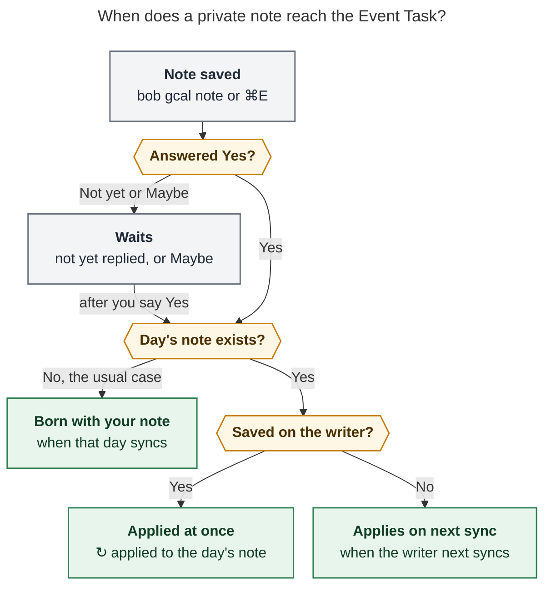

# Guide draft: give any calendar event private Bob metadata

> **Research query:** Help me write a small, accurate, useful, and visually appealing
> guide that walks users through how to add metadata to private event tasks (context:
> the `bob-cli-ji` epic, "Private event notes for Google Calendar events").
>
> **Researcher:** cld · 2026-11-10 · bob-cli `master` @ `7ff24c82`

## Bottom line

- **The deliverable is below:** a copy-ready draft of
  `docs/guides/plan-events-you-dont-own.md`, the guide the epic's records phase must add.
  It runs about 1,240 words of prose, inside the guides' 1,500-word target. It follows
  the `how-to` template and the docs lint rules: no `!!!` admonitions, no `===` tabs, no
  `$` prompts, and no bead IDs or history phrases in prose.
- **Name the feature after what is private.** No "private Event Task" exists. The
  _note_ is private: Bob-only description text keyed by the Google event. The Event Task
  it produces is an ordinary row. The guide says "private event note" and
  "Event Task", never "private event task".
- **Only half of what the guide describes is on master.** The engine (layering,
  precedence, `✎` in `list`, provenance, fail-safe hold) is merged. The `bob gcal note`
  command and the Mac Event note mode are still in progress. So the draft follows the
  approved plan's contract, and [Verify before publishing](#verify-before-publishing)
  lists every string to recheck against the shipped `--help` and golden JSON fixtures.
- **The plan's examples miss two pitfalls:** shell quoting and reasons that swallow
  prose. In bash, an unquoted `#off` starts a comment and is silently dropped. An
  unquoted `;` ends the command. And a reason runs to the end of its line, so prose after
  it needs a `;`. The guide teaches one habit that avoids all three: put the note after
  `--` in single quotes.
- **The visuals come from Bob's own surfaces:** the CLI's time rail, a `bob-task` row,
  one cheat-sheet table, one sign callout, and one Mermaid figure. The figure answers the
  only branching question a reader has: when will my note show up?

## What exists today vs. what the guide assumes

| Piece | On master `7ff24c82` | Evidence |
| --- | --- | --- |
| Note store (`gcal.note` in `.bob/gcal/<host>.jsonl`), last-writer-wins fold, clears | ✅ Shipped | `journal.rs` `load_notes`/`append_note`; `docs/gcal-notes.md` § Storage |
| Per-field layering (this event → all events → Google) | ✅ Shipped | `model.rs` `apply_notes`; `tests/gcal_notes.rs` `occurrence_beats_series_beats_google_per_field` |
| Root sources `✎ @family` / `✎ all events @abby`, list `✎` marker, JSON `note` summary | ✅ Shipped | `root.rs`, `list.rs`; `docs/gcal.md` § Root selection, § List |
| Waits for Yes, follows moved events, survives `sync -F`, foreign account ignored | ✅ Shipped (engine) | `tests/gcal_notes.rs` (8 named tests) |
| Provenance in `gcal.row`, hold on malformed journal | ✅ Shipped | commit `7ff24c82`; `docs/gcal-notes.md` § Reliability |
| `bob gcal note` select, list, show (`-l`, `-a`, `-D`, `-i`, `-C`, `-s`, picker) | 🚧 Phase `.2` in progress | plan § Phase select |
| Write, preview, rail, "lands as", `-c`, `-d`, auto-sync on writer | 🚧 Phase `.4` in progress | plan § Phase write; decision `auto_sync = yes` |
| `-e` editor, `-A` adopt, doctor `notes`, `⚑` fragile hint | 🚧 Phase `.5` in progress | plan § Phase extras |
| Mac Event note mode (<kbd>⌘</kbd><kbd>E</kbd>) | 🚧 Phase `.7` in progress | plan § Phase mac; decision `mac_chord = cmd_e` |
| `gcal.colors` (colour → root) | ✅ Shipped, routing only | `src/native/config/gcal.rs` `color_id_for_key`; `docs/gcal.md` § Configuration |

**Until phase `.4` merges, a user cannot write a note through a supported path.** The
engine applies hand-appended journal lines, which is how the tests drive it, but a guide
must never send readers to edit `.bob/gcal/*.jsonl`. The only zero-code option today is
the `gcal.colors` stopgap, and the guide keeps it in its phone section.

---

## The guide (copy-ready draft)

Front matter for `docs/guides/plan-events-you-dont-own.md`:

```yaml
---
title: "Plan an event you don't own"
description: "Give any Google Calendar event a private Bob note (route, clock tag, buffers, reasons) right after you RSVP, before its Event Task exists."
tags:
  - CLI
  - macOS
---
```

Everything between the two rules below is the page body. Its `#` heading is the page
title.

---

# Plan an event you don't own

You can't edit the title or description of an event someone else organizes. Its Event
Task doesn't exist yet either: sync writes it only once that day's daily note exists. A
**private event note** handles both. Write the same lines you would put in a Google
description (`@route`, `#off`/`#on`, `-30 Drive there`, plain prose) and Bob applies
them to the event's Event Task when it lands. The note lives only in your vault. Bob
never sends it to Google.

It works on any event, including your own, for lines you would rather guests not see.

## Before you start

- [Connect Google Calendar](connect-google-calendar.md). The event should appear in
  `bob gcal list -D <day>`.
- RSVP the usual way: Google Calendar, Gmail, or your phone. You can note an invitation
  you haven't answered, or one you answered Maybe. The note waits for your Yes.
- Know the route you want. It must be an area or root project, written `@family` or
  `@body`.

## 1. Write the note right after you RSVP

Give a few title words, then `--`, then the note in single quotes:

```bash
bob gcal note brunch -- '@family -30 Drive to the restaurant +15 Drive home'
```

```text { .no-copy title="Output" }
✎ Holiday brunch
  Sun Dec 13 · 10:00–12:00 · from Sam · Yes

  @family
  -30 Drive to the restaurant
  +15 Drive home

  ● family  09:30 ╱╱╱╱╱╱ 10:00 ━━━━━━━━━━━━━━━━━━━━━━━━ 12:00 ╱╱╱ 12:15

  lands as
  - [ ] #task **1000-1200** Holiday brunch [📅](…)
    [buffer:: -30m +15m] [root:: family] [type:: MEET] ^holiday-brunch
    - ↤ *30m before* · Drive to the restaurant
    - ↦ *15m after* · Drive home

✓ Noted · only in Bob · lands in 2026/20261213.md when that day syncs
```

Read the output from top to bottom:

1. **Which event.** The header shows the day, time, title, organizer, and your answer.
   Bob searches titles over the next 90 days. When several events match, a terminal
   offers a numbered picker. Add `-D 2026-12-13` to search one day.
2. **What you meant.** Bob splits your one line into canonical lines and echoes them
   back. A typo such as `@fmaily` is rejected now, with the closest routes, and nothing
   is saved.
3. **Where the time goes.** The rail shows the meeting (`━`) and its buffers (`╱`).
4. **What lands.** This is the Event Task row and bullets that sync will write.
5. **When.** The last line tells you whether the note is saved for later or already
   applied.

Add `-d` to preview without saving. Run the command again to replace the note.

> [!TIP]
> Quoting after `--` keeps your shell out of the way. In bash, an unquoted `#off` starts
> a comment and silently disappears, and an unquoted `;` or `'` breaks the command.

## 2. Use the description grammar

| You write | Bob sets |
| --- | --- |
| `@family` | `[root:: family]`, ahead of the title, colour, and calendar |
| `#off` or `#on` | The event's clock: off-clock, or forced on-clock |
| `-30` / `+15` | A buffer of 0–720 minutes before / after the meeting |
| `-30 Drive there` | That buffer, plus a `↤ *30m before* · Drive there` bullet |
| `-0` / `+0` | No buffer on that side, even when Google's description sets one |
| `Bring the gift card` | A plain bullet under the Event Task |

A reason runs to the end of its line, so end it with `;` before adding prose:
`'@family -30 Drive there; Bring the gift card'`. For longer notes, `bob gcal note -e
brunch` opens your editor. Leaving the note empty clears it.

> [!IMPORTANT]
> **Check the sign on the rail.** `-` reserves time **before** the meeting and `+`
> reserves time **after** it. Walking home after class is `+30 Walk home from the park`,
> not `-30`. Bob never guesses the side from your words.

Your note wins field by field. Anything it doesn't set, such as a buffer side, still
comes from Google's description. Google always keeps the time, title, and 📅/📹/📍
links. See [Precedence](../gcal-notes.md#precedence).

## 3. Choose a scope for a recurring event

```bash
bob gcal note swim -- '@family -15 Walk to the pool'
```

```text { .no-copy title="Output" }
Swim lessons repeats weekly · Fridays 09:15–10:00 · guest · Maybe
  1  This event   Fri Nov 13
  2  All events   every Swim lessons
Which? [1] ›
```

**This event** notes only that date (the soonest one, or the `-D` day). **All events**
notes every occurrence. A this-event note beats an all-events note for each field it
sets. In scripts, pass `-s event` or `-s series`.

## 4. Check what you've noted

```bash
bob gcal note
```

```text { .no-copy title="Output" }
✎ 2 private notes · next 90 days
  Fri Nov 13  09:15  Swim lessons    all events  ● family  −15m       waiting for Yes
  Sun Dec 13  10:00  Holiday brunch  this event  ● family  −30m +15m  lands Sun Dec 13
```

`bob gcal note brunch` shows one note in full. `bob gcal list -D <day>` marks each noted
Event Task with a dim `✎` after its title, and its root source reads `✎ @family`.

## When your note lands



_Most notes are written weeks ahead, so the Event Task is born with them. The writer is
the one host that syncs, normally your Mac._

On the day, the row reads like one from an event you own:

```bob-task
- [*] #task **1000-1200** Holiday brunch [📅](…) [buffer:: -30m +15m] [root:: family] [type:: MEET] ^holiday-brunch
  - ↤ *30m before* · Drive to the restaurant
  - ↦ *15m after* · Drive home
```

After that, the usual row rules hold. While you leave the row alone, it follows your
note. Your own edit to `[root::]`, the buffer, or the bullets wins, and Bob reports it
once. A note you change after the row exists reaches the clock tag and buffer only while
you haven't edited the row's time, title, or badges (its links, clock tag, and buffer).
To clear a note, run
`bob gcal note -c brunch`. Google's description then decides again.

A Bob buffer reserves time in Bob's day, not in Google: other people still see you as
free.

## Keep your lines in someone else's invite

Some external invites let you edit your copy of the description. An organizer's update
can still overwrite those lines. `bob gcal list` flags such an event with `⚑` and prints
a ready-made command. Run it to copy your `@route` and buffer lines into a private note:

```bash
bob gcal note -A -i <event-id>
```

## On your Mac

In the capture panel, press <kbd>⌘</kbd><kbd>E</kbd>, or choose **Event Note…** from
the menu-bar icon. Pick the event, type the same lines, and watch the rail redraw. Press
<kbd>⏎</kbd> to save, <kbd>⇧</kbd><kbd>⏎</kbd> for a new line, <kbd>⌘</kbd><kbd>⌫</kbd>
to clear, and <kbd>⎋</kbd> to go back. Your capture draft waits untouched until you
return. While the mode is open, <kbd>⌘</kbd><kbd>Z</kbd> undoes the last save or clear.
On an agenda Calendar-band row, <kbd>⌘</kbd><kbd>E</kbd> opens that event directly.

## From your phone

Nothing runs on the phone. Use SSH to a host with Bob and run `bob gcal note` there. For
routing only, map colours to roots once:

```yaml
gcal:
  colors: { sage: body, grape: family }
```

Then recolour the event in Google Calendar when you RSVP. Colour is private to your copy
of the event. It can't carry buffers or reasons, and a note's route beats it.

## If it goes wrong

| Symptom | What to do |
| --- | --- |
| No event matches | Add `-D DAY`, or check `bob gcal list -D DAY`. Declined, cancelled, all-day, multi-day, and free events can't take notes |
| Several matches, not in a terminal | Rerun with the `-i ID` (and `-C ID`) values Bob lists |
| `#off` or text after `;` is missing | Your shell ate it. Put the note after `--` in single quotes |
| The buffer is on the wrong side | `-` is before and `+` is after. Rewrite the note |
| The row didn't change | You edited that part of the row, so your edit wins. Or the note was saved off the writer: run `bob gcal sync` there |
| Reasons or prose bullets are missing | `gcal.description: off` hides all bullets. The route, clock tag, and buffers still apply |
| `⚠` beside a note in `bob gcal note` | The event left your calendar. Run the printed `bob gcal note -c -i …` |
| Sync says a row is `held` | A journal line can't be read. Run `bob gcal doctor` |

## Related

- [Private event notes](../gcal-notes.md)
- [Who owns each part of a row](../gcal.md#who-owns-each-part-of-a-row)
- [Buffers](../gcal.md#buffers)
- [Connect Google Calendar](connect-google-calendar.md)
- [Capture a task from anywhere on your Mac](capture-from-your-mac.md)

---

## Why the guide is shaped this way

- **One goal, one first command.** The guides index groups by goal. The reader's goal is
  "set this up when I RSVP", so step 1 is the whole job and every later section is
  optional depth. This follows `docs/develop/writing-docs.md`: a guide answers one goal
  and links to the contract for the rules.
- **The first output is the teacher.** The `bob gcal note` output already holds the
  model: which event, the canonical lines, the rail, the row, and saved versus applied.
  A five-item read-through of that block replaces a concept section.
- **One table, not the precedence matrix.** The contract page owns the full precedence
  table. The guide keeps the one sentence a user needs ("your note wins field by field;
  Google keeps time, title, links") and links the rest.
- **The sign gets its own callout.** The source research names it as the main trap.
  Bryan's own motivating example, `-30 I need to walk home from the park`, reads like an
  _after_ buffer. The callout uses that example on purpose.
- **One figure, for the only branching question.** "When does it land?" depends on the
  RSVP state, whether the day's note exists, and which host saved the note. Every other
  question fits in a sentence or a table. Rendered with mermaid-cli 12.0.0 under the
  research PDF config: 674 × 1024 px, fit 87.2%. I checked the PNG visually.
- **Neutral examples.** The plan and the contract page use real calendar events and
  names. The guide uses "Holiday brunch · from Sam" and "Swim lessons", so a published
  how-to carries no personal calendar content. The writing guide asks for this, and the
  privacy lint enforces it.
- **Tags `CLI` and `macOS`.** The page uses both surfaces. Obsidian only displays the
  result.

## Accuracy ledger

Every behavioral claim in the draft, with its source:

| Claim in the guide | Source | Status |
| --- | --- | --- |
| Note beats Google per field; Google keeps time, title, links | `docs/gcal-notes.md` § Precedence; `apply_notes` | Shipped |
| Any event qualifies; notes wait for Yes; declined never applies | `docs/gcal-notes.md` intro; test `awaiting_reply_note_waits_applies_on_yes_and_skips_declined` | Shipped |
| This-event beats all-events per field | test `occurrence_beats_series_beats_google_per_field` | Shipped |
| `-0`/`+0` clear Google's side | `docs/gcal-notes.md` § Grammar | Shipped |
| Minutes 0–720 | `docs/gcal.md` § Buffers (cap 720); plan § Validation | Shipped (parse) / planned (write-time error) |
| `↤ *30m before* · …` bullet shape | `description/bullets.rs`; `docs/gcal.md` § Buffer reasons | Shipped |
| Row field order: links, clock, `[buffer::]`, `[root::]`, `[type:: MEET]`, block id | `docs/gcal.md` § Buffers example | Shipped |
| A future meeting is born `[*]` | `docs/guides/connect-google-calendar.md` step 4 | Shipped |
| Your row edit wins and is reported once | `docs/gcal-notes.md` § Ownership; test `row_edited_root_is_kept_and_reported_once` | Shipped |
| A later note change reaches clock/buffer only while time, title, badges are untouched | plan § Ownership ("Accepted v1 cost") | Shipped behavior (single badge hash) |
| `gcal.description: off` hides note bullets, directives still apply | test `note_prose_is_exempt_from_the_cap_and_off_hides_bullets` | Shipped |
| `✎` after the title in `list`; root source `✎ @family` | `list.rs`; `root.rs`; `docs/gcal.md` § List | Shipped |
| `held …` warning, `bob gcal doctor` | `docs/gcal-notes.md` § Reliability | Shipped |
| A buffer is not Google free/busy | source research R10 | Shipped (Google is read-only) |
| `gcal.colors` keys (`sage`, `grape`, …), colour private per copy, note route beats colour | `config/gcal.rs`; `docs/gcal.md` § Root selection; Google support (cited by source research) | Shipped |
| 90-day title search, picker, `-D`, `-i`, `-C`, `-s event\|series`, `--` | plan § Phase select | Planned |
| One-line normalization, echo, route suggestions, `-d`, `-c`, rerun replaces | plan § Phase write | Planned |
| Output strings (`✓ Noted · only in Bob · lands in …`, `✓ Cleared · …`, status words) | plan § Phase write and § List and show output | Planned |
| `;` ends a reason; prose after it | plan § Normalization rules 1–3 | Planned |
| Applied at once on the writer when the day's note exists | plan decision `auto_sync = yes` | Planned |
| `-e` (empty clears), `-A`, `⚑` hint, `⚠` orphan | plan § Phase extras, § List and show output | Planned |
| <kbd>⌘</kbd><kbd>E</kbd>, **Event Note…**, footer keys, <kbd>⌘</kbd><kbd>Z</kbd>, Calendar-band entry | plan § Phase mac; decision `mac_chord = cmd_e` | Planned |

## Verify before publishing

Recheck these items against the merged command, not against this draft:

1. **Flags.** Run `bob gcal note -h` and confirm `-s|--scope event|series`, `-A|--adopt`
   (capital; `-a` means "all"), `-c`, `-d`, `-e`, `-D`, `-i`, `-C`, and that `--` makes
   every later token TEXT. The source research used `-a` for adopt and `-s` as a bare
   flag. The plan changed both. Copy from `--help`, not from the research.
2. **A quoted single TEXT argument.** Confirm that
   `bob gcal note brunch -- '@family -30 Drive there; Bring snacks'` normalizes to three
   lines. The plan says TEXT words are joined with spaces and newlines split lines. A
   quoted argument should therefore behave exactly like unquoted words.
3. **The preview checkbox.** The plan's "lands as" example shows `- [ ]`, but sync
   writes a meeting that hasn't started as `[*]` with a MEET link. Either the preview
   should match what sync writes (the plan promises "what you see is what sync
   writes"), or the guide should say the checkbox follows the meeting's phase on the
   day. Regenerate the output block from the golden fixture `preview`/`saved`.
4. **Exact strings.** Recheck the status lines (`lands in …`, `↻ applied to …`,
   `saved · … updates on the next sync on <host>`, `waiting for Yes`,
   `waiting for your reply`), the `⚑` hint, and the `⚠` orphan wording. Then
   regenerate the guide's output blocks from real runs against the fake gog.
5. **Docs lint.** Run `just docs-check`. Add the page to `mkdocs.yml` and to
   `docs/guides/index.md`. I suggest **Plan the day**, right after "Run the morning
   review walk". Keep "no longer" (the orphan wording) inside code only, because
   history phrases in prose fail the guide hygiene lint.
6. **Mac keys.** Confirm the footer hints and the menu item title in the
   `bob-mac-capture` Event note docs, and confirm that <kbd>⌘</kbd><kbd>Z</kbd> undoes
   only while the mode is open.
7. **`docs/gcal.md` § Known limits.** It still says "a description you cannot edit
   cannot take a Google-owned buffer". The write phase must replace that line with a
   pointer to private notes. Otherwise it contradicts this guide.

## Suggestions for the implementers (outside the guide)

- **Put the quoting rule in `-h`.** In bash, an unquoted `#off` and everything after
  it never reaches bob, so bob cannot detect the loss. The echoed canonical lines do
  reveal it. Make one `bob gcal note -h` example use `--` and single quotes, so the
  safe form is the one people copy.
- **Keep one unquoted example.** The plan's
  `bob gcal note deerwood @family -30 Drive to Deerwood +15 Drive home` works in any
  shell and reads naturally. The guide uses the `--` form throughout because it works
  for every note, `#off`, `;`, and apostrophes included.

## Sources

- Epic `bob-cli-ji` and phases `.1`–`.7` (read through `sase bead read`, 2026-11-10).
- Plan `plan:202611/private_gcal_event_notes.md` (shared design, phases select, write,
  extras, records, and mac, plus the reviewer decisions).
- Source research
  `research:202611/private_notes_for_unowned_gcal_events/private_notes_for_unowned_gcal_events.md`
  (requirement adjustments R1–R10, the sign trap, the colour stopgap).
- bob-cli `master` @ `7ff24c82`: `docs/gcal-notes.md`, `docs/gcal.md` (§ Configuration,
  § Who owns each part of a row, § Buffers, § Description bullets, § Where it runs,
  § Event inclusion, § Root selection, § List, § Known limits), `tests/gcal_notes.rs`,
  `src/native/gcal/{model,journal,root,list,description}.rs`,
  `src/native/config/gcal.rs`.
- Docs conventions: `docs/develop/writing-docs.md`, `docs/_templates/how-to.md`,
  `tools/docs/bob_docs/lint.py` (hygiene and portability rules),
  `tools/docs/bob_docs/fences.py` (`bob-task` rendering), `mkdocs.yml` (extensions).
