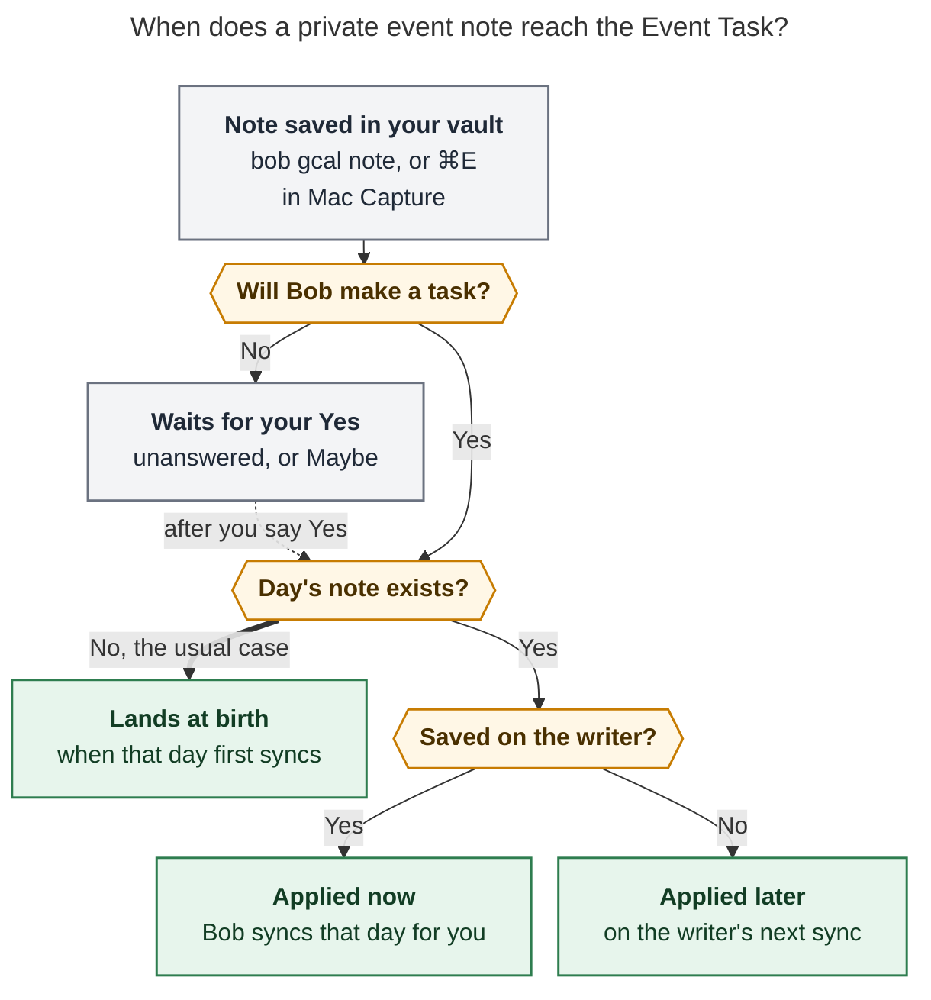

# Plan an event you don't own: a guide to private event notes

> **Research query:** Can you help write a small, accurate, useful, and visually appealing guide that walks users through how to add metadata to private event tasks, using the `bob-cli-ji` epic bead for context?


## Bottom line

- **The deliverable is the [copy-ready guide below](#the-copy-ready-guide).** It is the page the epic's records
  phase must add, `docs/guides/plan-events-you-dont-own.md`, titled **"Plan an event you
  don't own"**. Its prose measures 1,167 words with the docs lint counter, under the
  guides' 1,500-word target. It follows the `how-to` template and the docs lint rules.
- **Call the feature a "private event note", never a "private event task".** The *note*
  is the private part: Bob-only description text keyed by the Google event. The Event Task
  it produces is an ordinary row, and the row does not exist when you RSVP. All five
  reports agree on this framing, and the epic and the contract page already use the term.
- **Don't publish it yet. About half of what it describes is [shipped](#what-ships-today-versus-what-the-guide-assumes).** The layering
  engine, `✎` list markers, provenance, and the fail-safe hold are on `master`. The
  installed `bob` still answers `bob gcal note --help` with
  `error: unrecognized subcommand 'note'`. Bob Mac Capture has no Event note mode either.
  The repo's writing rules require current behavior and flags checked against `--help`, so
  the draft must pass [Verify before publishing](#verify-before-publishing) first.
- **The biggest trap is the shell, not Bob.** The plan's examples, and [four of the five
  drafts](#where-the-reports-disagreed), type notes unquoted. I tested bash (interactive and scripts) and zsh with
  `interactive_comments` (Bryan's setting). In both, an unquoted `#off` silently drops
  itself *and the rest of the line*. An unquoted `;` ends the command, so
  `+15 Drive home` runs as its own command (`+15: command not found`) after Bob has
  already saved the first half. The guide therefore teaches one form:
  `bob gcal note <words> -- '<note>'`.
- **The second trap is the sign.** `-30` always means before and `+15` always means
  after. Bob never reads intent from prose. The guide gives the sign [its own callout](#write-what-you-need) and
  uses the CLI's time rail to show it.
- **Most of the visual appeal comes from Bob's own output.** The guide uses the CLI time
  rail, one `bob-task` row (rendered by the site's custom fence), two compact tables, two
  GitHub callouts, and [one Mermaid figure](#when-your-note-lands). The figure answers the only branching question
  readers have: *when will my note show up?*

## What ships today versus what the guide assumes

| Piece | State on 2026-11-10 | Evidence |
| --- | --- | --- |
| Note store, per-field layering, note-first roots, `✎` in `bob gcal list` | ✅ Shipped (`4219d70a`) | `docs/gcal-notes.md`; `tests/gcal_notes.rs` (for example `occurrence_beats_series_beats_google_per_field`, `awaiting_reply_note_waits_applies_on_yes_and_skips_declined`) |
| Note provenance in `gcal.row`; hold on malformed journal lines | ✅ Shipped (`7ff24c82`) | `docs/gcal-notes.md` § Reliability |
| `gcal.colors` colour → root routing | ✅ Shipped | `src/native/config/gcal.rs` (`lavender`/`1` … `tomato`/`11`); `docs/gcal.md` § Configuration |
| `bob gcal note` select, list, show | 🚧 Phase `.2` in progress | Plan § Phase select; `bob gcal note --help` → unrecognized subcommand |
| Write, `-d` preview, rail, `lands as`, `-c`, writer auto-sync | 🚧 Phase `.4` in progress | Plan § Phase write; reviewer decision `auto_sync = yes` |
| `-e` editor, `-A` adopt, doctor `notes`, `⚑` hint | 🚧 Phase `.5` in progress | Plan § Phase extras |
| Mac Event note mode (⌘E) | 🚧 Phase `.7` in progress | Plan § Phase mac; decision `mac_chord = cmd_e`; no "event note" or "gcal note" string in bob-mac-capture @ `28aa5b3` |

Until phase `.4` merges, no supported path writes a note. The tests drive the engine with
hand-appended journal lines. A guide must never tell readers to edit `.bob/gcal/*.jsonl`.

## The copy-ready guide

Front matter for `docs/guides/plan-events-you-dont-own.md`:

```yaml
---
title: "Plan an event you don't own"
description: "Give any Google Calendar event private Bob routing, buffers, and notes when you RSVP, even if you can't edit its description."
tags:
  - CLI
  - macOS
---
```

The page body runs from the `# Plan an event you don't own` heading through **Related**.
In the published page, the `text` and `bob-task` fences carry the attributes shown, and
the Mermaid fence renders through the site's `mermaid` custom fence.

---

### Plan an event you don't own

You can't edit an event someone else organizes, and its Event Task doesn't exist until
that day's daily note syncs. A **private event note** handles both. Write the lines you
would put in a Google description (`@family`, `#off`, `-30 Drive there`, prose), and Bob
applies them to the Event Task when it lands. The note lives only in your vault, so
organizers and guests never see it. It works on your own events too.

#### Before you start

- [Connect Google Calendar](https://github.com/bobs-org/bob-cli/blob/ffcb9864bb38332059659596dbbfe7a532c9be1f/docs/guides/connect-google-calendar.md).
- RSVP as usual in Google Calendar, Gmail, or on your phone. You can also note an
  invitation before you answer it.
- Choose a route: an area or root project in your vault, such as `@family`.

#### Write the note right after you RSVP

Give a few title words, then `--`, then the note in single quotes:

```bash
bob gcal note brunch -- '@family -30 Drive to the restaurant +15 Drive home'
```

```text { .no-copy title="Output" }
✎ Holiday brunch
  Sun Dec 13 · 10:00–12:00 · from Sam · Yes

  @family
  -30 Drive to the restaurant
  +15 Drive home

  ● family  09:30 ╱╱╱╱╱╱ 10:00 ━━━━━━━━━━━━━━━━━━━━━━━━ 12:00 ╱╱╱ 12:15

  lands as
  - [*] #task **1000-1200** Holiday brunch [📅](…)
    [buffer:: -30m +15m] [root:: family] [type:: MEET] ^holiday-brunch
    - ↤ *30m before* · Drive to the restaurant
    - ↦ *15m after* · Drive home

✓ Noted · only in Bob · lands in 2026/20261213.md when that day syncs
```

Read it from top to bottom:

1. **Which event.** Bob searches titles over the next 90 days and lists matches if
   several fit. Add `-D 2026-12-13` to search one day, or paste the event's Google
   Calendar link instead of title words.
2. **What you meant.** Your line, split into canonical lines. A typo such as `@fmaily` is
   rejected with the closest routes, and nothing is saved.
3. **Where the time goes.** The meeting (`━`) and the time reserved around it (`╱`).
4. **What lands.** The row and bullets sync will write.
5. **When.** See [When your note lands](#when-your-note-lands).

To preview without saving, add `-d` before the title words.

> [!TIP]
> Keep the note in single quotes after `--`. Unquoted, most shells drop `#off` and
> everything after it as a comment, and `;` ends the command.

#### Write what you need

| You write | Bob sets on the Event Task |
| --- | --- |
| `@family` | `[root:: family]`, ahead of the title, colour, and calendar |
| `#off` or `#on` | Off-clock, or forced on-clock. Use one, not both |
| `-30` / `+15` | Minutes reserved before / after the meeting (0–720) |
| `-30 Drive there` | That buffer, plus a `↤ *30m before* · Drive there` bullet |
| `-0` / `+0` | No buffer on that side, even if Google's description sets one |
| `Bring the gift card` | A plain bullet under the Event Task |

A reason runs until the other side's buffer or a `;`. To add prose after a reason, end
the reason with `;`: `'@family -30 Drive there; Bring the gift card'`.

> [!IMPORTANT]
> `-` reserves time **before** the meeting and `+` reserves time **after** it. A walk home
> after class is `+30 Walk home`, not `-30`. Bob never guesses the side from your words,
> so check the rail.

Your note wins field by field. Anything it leaves out still comes from Google's
description, and Google always keeps the time, title, and 📅/📹/📍 links. Buffers
reserve time in Bob only; Google still shows you as free.

Saving again replaces the whole note. To change one line, `bob gcal note -e brunch` opens
it in your editor.

#### Choose a scope for a recurring event

```bash
bob gcal note swim -- '@family -15 Walk to the pool'
```

```text { .no-copy title="Output" }
Swim lessons repeats weekly · Fridays 09:15–10:00 · guest · Maybe
  1  This event   Fri Nov 13
  2  All events   every Swim lessons
Which? [1] ›
```

**This event** notes one date (the soonest, or the `-D` day); **All events** notes the
series. This event wins for each field it sets. In scripts, pass `-s event` or
`-s series`.

#### Check your notes

```bash
bob gcal note
```

```text { .no-copy title="Output" }
✎ 2 private notes · next 90 days
  Fri Nov 13  09:15  Swim lessons    all events  ● family  −15m       waiting for Yes
  Sun Dec 13  10:00  Holiday brunch  this event  ● family  −30m +15m  lands Sun Dec 13
```

`bob gcal note brunch` shows one note in full. `bob gcal list` marks each noted Event
Task with a dim `✎`.

`bob gcal note -c brunch` removes a note. The event falls back to its All events note, if
any, then to Google's description.

#### When your note lands



_Most notes are written weeks ahead, so the Event Task is born with them. The writer is
the one host that syncs your calendar, normally your Mac. Maybe counts as a task only
with `gcal.tentative: task`._

| The save's last line says | What happens next |
| --- | --- |
| `lands in 2026/20261213.md when that day syncs` | Nothing to do. |
| `you haven't replied: lands when you say Yes` | Accept the invite; the note waits. |
| `you answered Maybe: lands when you say Yes` | The same wait. |
| `↻ applied to 2026/20261110.md` | Done: Bob synced that day for you. |
| `saved · … updates on the next sync on <host>` | The writer applies it after the vault syncs. |

If that automatic sync fails, the note is still saved; run `bob gcal sync` on the writer.

On the day, the row reads like one from an event you own:

```bob-task
- [*] #task **1000-1200** Holiday brunch [📅](…) [buffer:: -30m +15m] [root:: family] [type:: MEET] ^holiday-brunch
  - ↤ *30m before* · Drive to the restaurant
  - ↦ *15m after* · Drive home
```

While you leave the row alone, it follows your note. If you edit `[root::]`, the buffer,
or the bullets yourself, your edit wins. A note changed after the row exists reaches the
buffer and clock tag only while the row's time, title, and badges are untouched.

#### On your Mac

In Bob Mac Capture, press <kbd>⌘E</kbd>, or choose **Event Note…** from the menu-bar
icon. Pick the event and type the same lines. The preview draws the meeting with hatched
buffer wings and **Occupied 09:30–12:15 · Meeting 10:00–12:00**.

<kbd>⏎</kbd> saves, <kbd>⇧⏎</kbd> adds a line, <kbd>⌘⌫</kbd> clears, <kbd>⎋</kbd> goes
back, and <kbd>⌘Z</kbd> undoes the last save or clear. Your capture draft waits
untouched.

#### Keep your lines in someone else's invite

Lines you add to an external invite's description can vanish on the organizer's next
update. `bob gcal list` flags such events with `⚑` and prints a command that copies your
`@route` and buffer lines into a private note:

```bash
bob gcal note -A -i EVENT_ID
```

#### From your phone

Run `bob gcal note` over SSH. For routing alone, map event colours to roots once in
`~/.config/bob/config.yml`:

```yaml
gcal:
  colors: { grape: family, sage: body }
```

Then recolour the event in Google Calendar when you RSVP. Only your copy changes colour.
Colour can't carry buffers or reasons, and a note's route beats it.

#### If it goes wrong

| Symptom | What to do |
| --- | --- |
| No event matches | Add `-D DAY`. All-day, multi-day, free, declined, and cancelled events can't take notes. |
| Several matches in a script | Rerun with the `-i` (and `-C`) values Bob lists. |
| `#off` or text after `;` is missing | Quote the note after `--`. |
| Buffer on the wrong side | `-` is before, `+` is after. Save again. |
| The row didn't change | Run `bob gcal sync` on the writer. Otherwise the event awaits your Yes, or you edited that part of the row. |
| Reason and prose bullets are missing | `gcal.description: off` hides them; route, clock, and buffers still apply. |
| `⚠` beside a note | The event left your calendar. Run the printed `bob gcal note -c -i …`. |

#### Related

- [Private event notes](https://github.com/bobs-org/bob-cli/blob/ffcb9864bb38332059659596dbbfe7a532c9be1f/docs/gcal-notes.md)
- [Who owns each part of a row](https://github.com/bobs-org/bob-cli/blob/ffcb9864bb38332059659596dbbfe7a532c9be1f/docs/gcal.md#who-owns-each-part-of-a-row)
- [Connect Google Calendar](https://github.com/bobs-org/bob-cli/blob/ffcb9864bb38332059659596dbbfe7a532c9be1f/docs/guides/connect-google-calendar.md)
- [Capture a task from anywhere on your Mac](https://github.com/bobs-org/bob-cli/blob/ffcb9864bb38332059659596dbbfe7a532c9be1f/docs/guides/capture-from-your-mac.md)
- [Configuration · gcal](https://github.com/bobs-org/bob-cli/blob/ffcb9864bb38332059659596dbbfe7a532c9be1f/docs/reference/configuration.md#gcal)

---

## Why the guide looks like this

- **One goal, one first command.** The reader's goal is "set this up when I RSVP", so
  [step 1](#write-the-note-right-after-you-rsvp) does the whole job. Later sections are optional depth. The repo's writing guide
  says a guide answers one goal and links to the contract for the rules, so the full
  precedence matrix stays in `docs/gcal-notes.md`.
- **The first output teaches the model.** One `bob gcal note` transcript shows the event,
  the canonical lines, the rail, the row, and saved versus applied. A five-item walk
  through it replaces a concept section (cld).
- **One worked example throughout.** The same brunch, route, times, and reasons appear in
  the command, rail, row, list, and Mac section, so the reader never re-maps (cdx).
- **Neutral examples.** The plan and contract page use real family events ("Deerwood",
  "Kelly", "Little Gym", "@abby"). The guide uses "Holiday brunch · from Sam" and "Swim
  lessons". The docs privacy lint does **not** enforce this: `docs/_meta/privacy.yml`
  checks only home paths, vault-repo URLs, LaunchAgent labels, and emails. It is still the
  right default for a published how-to. cld's claim that the lint enforces it is wrong.
- **The figure.** It answers "when does my note show up?". The answer depends on three
  things: whether Bob will make a task, whether the day's note exists, and which host
  saved the note. A sentence can't carry that branching. I merged cld's three-question
  figure (which covers the off-writer path) with grk's "will Bob make a task?" wording
  (which correctly includes `gcal.tentative: task`, unlike "answered Yes?"). Rendered
  with mermaid-cli 12.0.0 under the research PDF config: **681 × 1048 px, fit 85.2%**,
  PNG checked visually. No guide in `docs/guides/` uses Mermaid yet. The site's
  `mkdocs.yml` defines a `mermaid` custom fence, concept pages already use it, and the
  writing guide doesn't forbid it in guides. If the editor wants guides to stay
  diagram-free, drop the figure. The status table under it carries the same facts in
  text.
- **Tags `CLI` and `macOS`.** The page uses both surfaces. Obsidian only displays the
  result.

## Accuracy rules the editor must keep

These come mainly from cdx and mus and were checked against the plan and contract.

1. **"Private" describes storage, not Google visibility.** The note lives in the vault's
   gcal journal (`.bob/gcal/<host>.jsonl`), with the vault's access and sync boundaries.
   Don't call it encrypted, device-only, or an RSVP comment. Google's `visibility: private`
   is a separate thing. Bob's grant is `calendar.readonly`.
2. **"Any event" needs its qualifier.** Eligible events are timed, busy, under 24 hours,
   of type `default` or `fromGmail`, and answered Yes, Maybe, or not yet. Declined,
   cancelled, all-day, multi-day, and free events can't take a note. A note never RSVPs,
   creates a row, or changes inclusion.
3. **A save replaces the whole note.** Writing again is not a patch. The guide steers
   one-line changes to `-e`. An explicit `-0`/`+0` blocks inheritance; leaving a side out
   allows it.
4. **Saved and applied are different outcomes.** Writer auto-sync touches only affected
   days whose daily note exists and is rendered (normally today). An off-writer save
   waits for vault sync and then the writer's sync. A sync failure after a save still
   exits 0 with a warning, so exit 0 alone doesn't prove the row changed.
5. **Manual row edits limit later updates (accepted v1 cost).** The badges span is one
   hash. A note changed after the row's birth reaches the buffer and clock tag only while
   the time, title, and badges are all untouched. An edited `[root::]` or bullet block
   wins on its own. Don't recommend `sync -F` as a routine repair. It resets the whole day
   (notes survive and reapply).
6. **Write-time grammar is stricter than raw description parsing.** These are all
   rejected with exit 2, all errors shown at once, nothing saved: two routes, both clock
   tags, two values for one side, minutes outside 0–720, a reason with 0 minutes, and
   canonical text over 2,048 bytes. A `#word` that isn't a directive is a warning and
   becomes a bullet. `@` and `#` inside a reason are text.
7. **Selection isn't an unlimited search.** Title words search today plus 90 days, and
   every query word must appear in the title. A pasted Calendar URL (`eid=`) or `-i`
   selects exactly, even outside the window. `-C` pins the calendar when an id appears in
   two calendars.
8. **Missing bullets can be configuration.** `gcal.description: off` hides note reasons
   and prose too. Route, clock, and buffer still apply. Note prose and reasons never count
   toward `gcal.description_lines`.
9. **A Bob buffer is not Google free/busy.** Other people still see the original time.
10. **Privacy in machine output.** `bob gcal list` and `sync` JSON carry summaries only
    (`scope`, `fields`, `bullet_lines`). Only `bob gcal note` and `sync -d` diffs print
    the words.

## Verify before publishing

Check every item against the merged code, not against this draft:

1. **Flags.** Run `bob gcal note -h`. Confirm `-A/--adopt` (capital), `-a/--all`, `-c`,
   `-C`, `-d`, `-D`, `-e`, `-f`, `-i`, `-l`, `-s event|series`, and that `--` makes every
   later token TEXT.
2. **The quoted form.** Confirm that
   `bob gcal note brunch -- '@family -30 Drive there; Bring snacks'` normalizes to three
   canonical lines. Suggest one `-h` example in this form so the safe form is the one
   people copy (cld).
3. **The `lands as` checkbox.** Regenerate every Output fence from the golden fixtures
   (`preview`, `saved`, `cleared`) or a fake-gog run. Either the preview prints `[*]`, or
   the guide must say the checkbox follows the meeting's phase on the day.
4. **Exact strings.** Check `✓ Noted · only in Bob · …`, the five status lines, the
   `waiting for …` and `lands …` list words, the `⚑` hint, the `⚠` orphan text, and
   `✓ Cleared · …`. Keep "no longer" (the orphan wording) inside code only, because the
   guide hygiene lint rejects it in prose.
5. **End-to-end behavior.** Run a fake-calendar preview, save, show, and clear. Then check
   one recurring override, one unanswered invite, one missing daily note, one off-writer
   save, and one preserved manual edit (cdx).
6. **Mac.** Check the shipped chord, the menu item title, the footer hints,
   <kbd>⌘Z</kbd> scope, and the Calendar-band entry in bob-mac-capture's
   `docs/event-notes.md`. Confirm the scope-toggle key before mentioning it.
7. **Contradicting docs.** `docs/gcal.md` § Known limits still says "A description you
   cannot edit cannot take a Google-owned buffer". The write phase must replace that line.
   `docs/gcal-notes.md` still says command write and the Mac mode "land in later phases".
8. **Docs gate.** Add the page to `mkdocs.yml` and `docs/guides/index.md` under **Plan the
   day**. Point `docs/_meta/contracts.yml` `gcal-notes.reader` at this guide (it points
   at `guides/connect-google-calendar.md` today). Then run `just docs-gen` and
   `just docs-check`.

## What stays out of the guide

These belong in `docs/gcal-notes.md` or `docs/gcal.md`:

- The journal record shape, fold order, account guard, and the 2,048-byte cap
- The full precedence matrix and bullet-block order
- The details of the fail-safe hold, provenance hashes, and doctor `notes` internals
- The Mac JSON `spans` and `schema_version`
- Follow-ups such as the Keep phone path, RSVP-from-Bob, "this and following", and the
  Ledger Tools tooltip
- Hand-editing `[buffer::]` on the day, which freezes the badges span

## Where the reports disagreed

| Question | Positions | Verdict and evidence |
| --- | --- | --- |
| How to type the note on the CLI | Plan, grk, mus, gem: unquoted words. cld: `-- '…'`. | **cld.** Tested here: in bash, and in zsh with `interactive_comments`, `printf "<%s>" note @family #off -30 Drive there` passes only `<note><@family>`. `… -30 Drive there; +15 Drive home` runs the first half, then fails with `+15: command not found`. gem's `deerwood @family -30 Drive to Deerwood; +15 Drive home; Bring stroller` would therefore save a partial note. The plan's argv pre-pass handles `-30`/`+15` but can't see what the shell removed. |
| `;` and reasons | cld: "a reason runs to the end of its line". mus: "`;` breaks a directive-started line only". | **Both partly right; the plan is exact.** A reason ends at the *other* side's `±N` token or at `;`. `;` splits only lines that start with a directive, so `Bring snacks; and water` stays one bullet (plan § Normalization rules 1–3). |
| Preview checkbox `[ ]` vs `[*]` | The plan's `lands as` and grk show `- [ ]`. cld's row uses `[*]`. | **The on-the-day row is `[*]`.** `docs/guides/connect-google-calendar.md` says ended meetings "arrive as `[ ]` rows with no link; later meetings arrive `[*]` and linked". The plan also promises the preview is "what sync writes". The draft shows `[*]`. Regenerate it from the golden `preview` fixture before publishing (cdx, cld). |
| Scope flag | gem: `-s event` is the default, and `-s all` exists. | **gem is wrong.** The plan defines only `-s event\|series`. On a TTY the prompt defaults to `[1] This event`. Off a TTY, a recurring match without `-s` exits 2. `-s series` on a one-off event exits 2. |
| Both clock tags | grk: "`#on` wins if both appear". | **Only true of the raw layer rule.** Write-time validation rejects `#off` together with `#on` (plan § Validation). The guide says "use one, not both". |
| What clearing reveals | cld and the plan's output: "Google's description decides again". | **cdx is more precise.** Clearing an occurrence note falls back to an All events note first (per-field precedence). The guide says so. |
| Adopt syntax | Older research: `-a`. All five reports: `-A`. gem: `-A <query>`. | **`-A`/`--adopt`.** `-a` is `--all`. Any selector works (`<query>`, URL, `-i`), and the `⚑` hint prints the `-i` form, so the guide shows that one. gem's adopt output text is invented. The plan's wording is "now live in Bob too: they survive the organizer's next update". |
| Where `-d` goes | gem: after the TEXT (`… Drive there -d`). | **Put options before the query.** The pre-pass honors options anywhere before `--`, but the validator also warns about "option-like tokens inside TEXT … put options before the event query". Teaching the unambiguous form avoids the question. |
| Mermaid figure in the published guide | grk: research PDF only. cld: embed it. | **Embed one, as an editor's option.** See [Why the guide looks like this](#why-the-guide-looks-like-this). gem's figure is unstyled, uses `&lt;` entities, and says "Event is Today → auto-sync". That last part is wrong: auto-sync runs only on the writer, and only for days whose note exists. |
| Index placement | grk: a new **Calendar** group. cld: **Plan the day**. | **Plan the day**, in both `docs/guides/index.md` and the `mkdocs.yml` nav, which already has that group. grk did find a real gap: Connect Google Calendar *and* Connect Google Mail are in the `mkdocs.yml` nav under Capture but missing from `guides/index.md`. Fix that in the same PR, or regroup only if Bryan wants a Calendar section. |
| Length | cdx, grk: 700–900 words. cld: about 1,240. | Lint warns above **1,500** words and fails above **2,500**. Words exclude fenced code (`tools/docs/bob_docs/lint.py`). This draft measures 1,167 words with the repo's own `count_words`; the earlier untrimmed version measured 1,470. |
| Mac details | gem adds Ctrl-N/P, "Return saves and returns to the picker", ⌘Z, and an ASCII mock-up. | **All confirmed in the plan § Phase mac**, except the scope-toggle key, which the plan leaves to the implementer ("pick a key that is free inside the mode"). The guide names no key for it. gem links `private_notes_mac_mode_mockup.png`, which doesn't exist. |
| Root fallback order | gem: note, then Google, then colour, calendar, `meet`. | gem leaves out **learned series memory** (rank 3) and the title-before-description order. The contract's order is: ✎ this event, ✎ all events, series memory, title `@route`, description `@route`, colour, calendar, default. The guide only needs "ahead of the title, colour, and calendar". |

## Method and sources

> **Research request.** Help write a small, accurate, useful, and visually appealing
> guide that walks users through adding metadata to private event tasks. Context: the
> `bob-cli-ji` epic, "Private event notes for Google Calendar events".
>
> **Lead researcher.** Consolidated on 2026-11-10 from five independent reports (cdx, cld,
> grk, mus, gem) plus the lead researcher's own checks. Evidence pins: bob-cli `master` @
> `ffcb9864`, bob-mac-capture @ `28aa5b3`, and plan
> `plan:202611/private_gcal_event_notes.md`.

**Own checks this session:**

- bob-cli `master` @ `ffcb9864`, fetched. There is no `note` in `src/native/gcal/cli.rs`,
  and the installed `bob gcal note --help` returns "unrecognized subcommand".
- bob-mac-capture @ `28aa5b3`, opened via `sase repo open`. It has no Event note mode.
- Shell experiments in bash (interactive and script) and zsh. They covered `#off` comment
  stripping and `;` command splitting.
- Docs conventions: `docs/develop/writing-docs.md`, `docs/_templates/how-to.md`,
  `tools/docs/bob_docs/lint.py` (budgets, hygiene, and portability), `docs/_meta/privacy.yml`,
  `tools/docs/bob_docs/fences.py` (`[*]` renders as ● Next; child bullets render as raw
  lines), `mkdocs.yml` (`mermaid` and `bob-task` fences, `github-callouts`, Guides nav),
  `docs/guides/index.md`, and `docs/_meta/contracts.yml`.
- Behavior: `docs/gcal-notes.md`, `docs/gcal.md` (§§ Configuration, Who owns each part of
  a row, Root selection, Known limits), `docs/guides/connect-google-calendar.md` step 4,
  `src/native/config/gcal.rs` colour names, and the Mac keyboard reference (the capture
  panel doesn't bind ⌘E today).
- The figure was rendered with mermaid-cli 12.0.0 under the PDF-mirroring config, revised
  twice, and checked visually.

**Primary sources:** epic `bob-cli-ji` (status, phases `.1`–`.7`, reviewer decisions
`auto_sync = yes`, `mac_chord = cmd_e`, `memory_record = yes`, `memory_glossary = no`), and
`plan:202611/private_gcal_event_notes.md` (§§ Shared design, select, write, extras,
records, mac).

**Researcher reports**, in this directory: `private_event_notes_how_to__cdx.md` (accuracy
rules, saved-vs-applied, publication qualification), `__cld.md` (copy-ready draft, the
quoting trap, the three-question figure), `__grk.md` (placement and hygiene, the
`-A`/`-a` flip, the leave-out list; its figure assets are in
`plan_events_you_dont_own_guide__grk_assets/`), `__mus.md` (normalization and validation
detail, privacy in machine output), and `__gem.md` (Mac key detail, the doctor checks, a
series-override scenario; its precedence, scope-flag, and `;` examples are [corrected
above](#where-the-reports-disagreed)).
