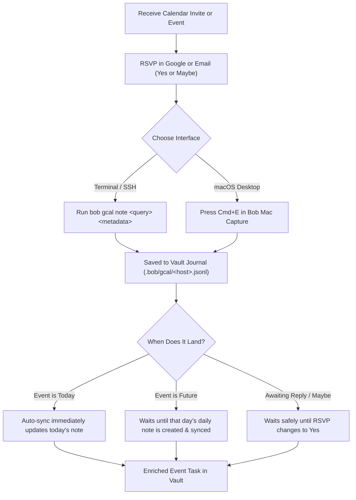

# User Guide: Adding Metadata to Private Event Tasks

**Author:** Researcher gem (5-researcher swarm)  
**Date:** 2026-11-10  
**Target Systems:** `bob-cli` (`bob gcal note`), `bob-mac-capture` (Event Note Mode, `⌘E`)  
**Epic Context:** `bob-cli-ji` (Private Event Notes for Google Calendar Events)  
**Associated Contracts:** `docs/gcal-notes.md`, `plan:202611/private_gcal_event_notes.md`

---

## 1. Introduction & The Core Problem

When planning your day in Bob, Google Calendar events automatically project into daily notes as **Event Tasks** under the `## Events` section:

```markdown
- [ ] #task **1000-1200** Deerwood. Christmas breakfast [📅](https://www.google.com/calendar/event?eid=...) [root:: meet] [type:: MEET] ^deerwood-christmas-breakfast
```

However, users routinely face three major friction points with Google Calendar events:

1. **Events You Don't Own (Guest / Locked Events):** If someone else organizes the meeting, family gathering, or appointment, you cannot edit the Google Calendar title or description. You cannot add Bob routing directives like `@family`, buffer travel times like `-30 Drive there`, or checklist notes.
2. **Fragile External Invites:** On external calendar invites (such as recruiter interviews from Ashby or calendar links from doctors), Google lets guests append text, but warns that any update or reschedule by the organizer will silently wipe out your edits.
3. **Ahead-of-Time Planning at RSVP:** You typically figure out logistics (e.g., travel buffers, route area, prep items) weeks ahead of time when you receive the invite and click "RSVP". But future daily notes do not exist yet—Bob never creates future daily notes in advance because of template race conditions.

### The Solution: Private Event Notes

A **private event note** is an event description stored locally in your Bob vault that only Bob reads. 

- **Google stays 100% read-only:** Bob never writes to Google Calendar or exposes your private notes to meeting organizers or attendees.
- **Keyed to Event Identity:** The note attaches to Google's permanent event ID (`{calendar_id, event_id}`) or recurring series ID (`{calendar_id, series}`).
- **Zero Premature Vault Clutter:** You don't need placeholder daily notes. The private note waits safely in your local journal (`.bob/gcal/<host>.jsonl`). When the day arrives and Bob syncs that date, your private note is layered directly over Google's description, field by field.
- **Byte-Identical Projection:** The resulting Event Task row is byte-for-byte identical to what would have been generated if those directives had been typed directly into Google Calendar.

```
                      ┌─────────────────────────────────────────┐
                      │ Google Calendar Event (Read-Only)       │
                      │  • Title: Deerwood. Christmas breakfast │
                      │  • Time:  10:00 – 12:00                 │
                      │  • Description: (empty or organizer's)  │
                      └────────────────────┬────────────────────┘
                                           │
                                           │ (Layered at Sync)
                                           ▼
┌─────────────────────────────────┐      ┌────────────────────────────────────────────────────────┐
│ Vault Journal (.bob/gcal/)      │─────►│ Final Event Task in Daily Note (20261213.md)            │
│  • Private Note:                │      │  - [ ] #task **1000-1200** Deerwood. Christmas...      │
│    @family                      │      │    [buffer:: -30m +15m] [root:: family] [type:: MEET]  │
│    -30 Drive to Deerwood        │      │    - ↤ *30m before* · Drive to Deerwood                │
│    +15 Drive home               │      │    - ↦ *15m after* · Drive home                         │
└─────────────────────────────────┘      └────────────────────────────────────────────────────────┘
```

---

## 2. Quick Mental Model & Workflow Flowchart



---

## 3. The Metadata Grammar: What You Can Add

Private event notes use the exact same directive and description grammar as Bob's Google Calendar integration. You don't have to learn a new syntax.

### 3.1 Metadata Tokens & Directives

| Token / Syntax | Meaning | Effect on Event Task Row | Example Input |
| :--- | :--- | :--- | :--- |
| `@<route>` | **Root Routing** | Sets `[root:: <route>]` (must resolve to valid area or project). Strips route from title if present. | `@family`, `@body`, `@job` |
| `#off` | **Off-Clock Tag** | Stamped as `#off`. Kept out of worked time metrics. | `#off` |
| `#on` | **On-Clock Tag** | Overrides any default area `#off` rule; kept on-clock. | `#on` |
| `-N` or `-Nm` | **Before Buffer** | Reserves $N$ minutes before start; adds to `[buffer:: -Nm ...]`. | `-30` or `-30m` |
| `+M` or `+Mm` | **After Buffer** | Reserves $M$ minutes after end; adds to `[buffer:: ... +Mm]`. | `+15` or `+15m` |
| `-0` or `+0` | **Clear Buffer** | Explicitly zeroes out/cancels a buffer set in Google's description. | `-0`, `+0` |
| `-N <reason>` | **Before Reason** | Sets buffer and generates a dedicated `↤` reason bullet. | `-30 Drive to park` |
| `+M <reason>` | **After Reason** | Sets buffer and generates a dedicated `↦` reason bullet. | `+15 Drive home` |
| `<prose>` | **Prose Notes** | Appends normal task bullets underneath the event row. | `Bring the stroller` |

> [!IMPORTANT]
> **Understanding Buffer Signs:**
> - `-` indicates time **before** the event begins (e.g., travel to venue, pre-meeting prep).
> - `+` indicates time **after** the event concludes (e.g., travel home, post-meeting debrief).
> 
> Bob never guesses the sign from prose words! If you type `-30 Drive home`, Bob will reserve 30 minutes *before* the event starts. Always ensure before-buffers use `-` and after-buffers use `+`.

### 3.2 Canonical Formatting & Tokenization

When you enter a note via the CLI, Bob automatically normalizes the input into canonical lines:
1. **Directive Line:** Route, clock tag, and bare buffers (`@family #off -30 +15`).
2. **Reason Lines:** Before reason (`-30 Drive there`), followed by after reason (`+15 Drive home`).
3. **Prose Lines:** Any subsequent bullet points in entered order.

In the CLI, you can separate items using spaces or semicolons:
```bash
bob gcal note deerwood @family -30 Drive to Deerwood; +15 Drive home; Bring stroller and gifts
```

---

## 4. Field Precedence: How Conflicts Are Resolved

When an event has both an organizer description in Google Calendar and private notes in Bob, Bob resolves each field independently using strict precedence:

| Field | 1st Priority (Wins) | 2nd Priority | 3rd Priority | Fallback / Default |
| :--- | :--- | :--- | :--- | :--- |
| **Root Area** (`[root::]`) | ✎ Occurrence Note (`scope: event`) | ✎ Series Note (`scope: series`) | Google title `@route` or description `@route` | Mapped `gcal.colors`, calendar default, or `meet` |
| **Clock Tag** (`#off`/`#on`) | ✎ Occurrence Note (`scope: event`) | ✎ Series Note (`scope: series`) | Google title/description tag | Note root walk default, then on-clock |
| **Before Buffer** | ✎ Occurrence Note (`scope: event`) | ✎ Series Note (`scope: series`) | Google description (`-N`) | None (`0m`) |
| **After Buffer** | ✎ Occurrence Note (`scope: event`) | ✎ Series Note (`scope: series`) | Google description (`+M`) | None (`0m`) |
| **Buffer Reason** | Travels with the winning buffer value on that side | Travels with series | Travels with Google buffer | None |
| **Prose Bullets** | 1. `↤` & `↦` reasons<br>2. Occurrence note prose<br>3. Series note prose<br>4. Google description lines | | | Overflow line if capped by `gcal.description_lines` |

> [!TIP]
> **Key Insight:** If you set a buffer (e.g. `-20`) without providing a reason, Google's existing reason for that side is dropped rather than inherited. If you want to keep a reason while changing buffer length, specify both: `-20 New travel route`.

---

## 5. Walkthrough: Command-Line Interface (`bob gcal note`)

The CLI command `bob gcal note` is available across all environments (macOS, Linux, headless servers, and over SSH).

### 5.1 Listing & Inspecting Events

#### 1. List active private notes in the next 90 days:
```bash
bob gcal note
```
Output:
```text
✎ 3 private notes · next 90 days
  Fri Nov 13  09:15  Little Gym                     all events  ● abby    −30m       waiting for Yes
  Sun Dec 13  10:00  Deerwood. Christmas breakfast  this event  ● family  −30m +15m  lands Sun Dec 13
  ⚠           PermitFlow Final Interview         this event  no longer on your calendar · bob gcal note -c -i 7k2...
```

#### 2. List all upcoming eligible events (noted or unnoted):
```bash
bob gcal note -l -a
```
Shows every upcoming timed event, organizer name, RSVP status (Yes, Maybe, Awaiting reply), and existing note badges.

#### 3. Inspect a specific event:
```bash
bob gcal note deerwood
```
Prints the event's date, time, organizer, RSVP status, and its current canonical private note (if any).

---

### 5.2 Writing & Previewing Metadata

To add metadata, pass your search query followed by the directives:

```bash
bob gcal note deerwood @family -30 Drive to Deerwood +15 Drive home Bring camera
```

#### What You See on the Terminal:
```text
✎ Deerwood. Christmas breakfast
  Sun Dec 13 · 10:00–12:00 · from Kelly · Yes

  @family
  -30 Drive to Deerwood
  +15 Drive home
  Bring camera

  ● family  09:30 ╱╱╱╱╱╱ 10:00 ━━━━━━━━━━━━━━━━━━━━━━━━ 12:00 ╱╱╱ 12:15

  lands as
  - [ ] #task **1000-1200** Deerwood. Christmas breakfast [📅](https://www.google.com/calendar/event?eid=...)
    [buffer:: -30m +15m] [root:: family] [type:: MEET] ^deerwood-christmas-breakfast
    - ↤ *30m before* · Drive to Deerwood
    - ↦ *15m after* · Drive home
    - Bring camera

✓ Noted · only in Bob · lands in 2026/20261213.md when that day syncs
```

#### Visual Time-Rail Breakdown:
The time-rail visualizes the exact spans calculated by Bob:
```
09:30       10:00                        12:00     12:15
  ╱╱╱╱╱╱      ━━━━━━━━━━━━━━━━━━━━━━━━     ╱╱╱
Before Buffer         Meeting Span          After Buffer
 (30m travel)          (2 hours)            (15m return)
```
- `╱╱╱`: Hatched buffer wings (dim area hue).
- `━━━`: Scheduled meeting span (solid area hue).
- If buffers exceed midnight, Bob cleanly indicates `(clipped at 00:00)`.

---

### 5.3 Handling Recurring Events (`-s event` vs `-s series`)

When target event matches a recurring series (e.g., weekly gymnastics class):

#### Interactive Terminal (TTY):
Bob prompts you to choose the scope:
```text
Little Gym repeats weekly · Fridays 09:15–10:00 · guest · Maybe
  1  This event   Fri Nov 13
  2  All events   every Little Gym
Which? [1] › 
```

#### Scripted / Headless / Explicit:
Pass `-s` or `--scope`:
- `-s event` (default): Applies only to the single occurrence.
- `-s series` or `-s all`: Applies to all recurring events in that series.

```bash
# Apply -30m travel buffer to EVERY Little Gym class
bob gcal note "Little Gym" -s series @abby -30 Drive to gym
```

---

### 5.4 Interactive Editor Mode (`-e`)

If you want to write multi-line prose, detailed agendas, or checklists, launch your configured text editor (`$VISUAL` or `$EDITOR`):

```bash
bob gcal note -e deerwood
```

Bob opens a temporary file with a git-style scissors separator:
```text
@family
-30 Drive to Deerwood
+15 Drive home
Bring the camera and gifts
Review morning schedule
------------------------ >8 ------------------------
Do not modify or remove the line above; everything below it is ignored.
Private note for Sun Dec 13 10:00–12:00 Deerwood. Christmas breakfast (from Kelly · Yes)
  @route  #off  #on  -30  +15        directives: root, clock, buffers
  -30 Drive there   +15 Drive home   buffer reasons (bullets)
  anything else                      bullets on the Event Task
An empty note clears it.
```
Edit the text above the line, save, and exit. Bob immediately validates your directives and previews the resulting Event Task.

---

### 5.5 Adopting Fragile External Invites (`-A`)

When an external recruiter or organizer includes directives in their Google Calendar invite description, that text is vulnerable to being overwritten if the organizer changes the event time.

Use `--adopt` (`-A`) to snapshot those directives into a permanent, private Bob note:

```bash
bob gcal note -A "PermitFlow"
```
Output:
```text
✓ Adopted Bob lines from Google description into private note
  Lines now live safely in Bob: they survive the organizer's next update.
```

---

### 5.6 Dry-Run and Clearing Notes

- **Dry-run validation (`-d`):**
  Validate syntax and preview the time-rail without saving:
  ```bash
  bob gcal note deerwood @family -30 Drive there -d
  ```

- **Clear a private note (`-c`):**
  Remove your note and let Google Calendar's description decide the row again:
  ```bash
  bob gcal note -c deerwood
  ```
  Output:
  ```text
  ✓ Cleared · Google's description decides again
  ```

---

## 6. Walkthrough: macOS Menu-Bar Interface (`bob-mac-capture`)

For macOS users, Bob provides a rich, native graphical interface built directly into `bob-mac-capture`.


### 6.1 Entering Event Note Mode (`⌘E`)

1. Open Bob Mac Capture using your global capture hotkey.
2. Press **`⌘E`** (Command-E).
3. The panel switches seamlessly into **Event Note Mode**.

```
┌────────────────────────────────────────────────────────────────────────┐
│  ✎ Event Note Mode                                                ⎋ Esc │
├────────────────────────────────────────────────────────────────────────┤
│  🔍 Search upcoming events...                                          │
├────────────────────────────────────────────────────────────────────────┤
│  Today                                                                 │
│    14:00 - 15:00  PermitFlow Final Interview     from HR · Yes         │
│  Tomorrow                                                              │
│    09:15 - 10:00  Little Gym (↻ weekly)          from Kelly · Maybe    │
│  Sun Dec 13                                                            │
│  ► 10:00 - 12:00  Deerwood. Christmas breakfast  from Kelly · Yes  ✎   │
└────────────────────────────────────────────────────────────────────────┘
```

### 6.2 Navigating the Picker & Editor

1. **Pick the Event:** Type to filter events. Use `Ctrl+N` / `Ctrl+P` or `Up` / `Down` arrows to navigate. Press `Return` to enter the editor.
2. **Select Scope:** For recurring events, toggle between **[ This event ]** and **[ All events ]** using the segmented switch.
3. **Draft Directives:**
   - As you type `@family -30 Drive there`, Bob performs live syntax highlighting:
     - `@family` renders in the distinctive hue of the `family` area.
     - Buffer tokens (`-30`, `+15`) are highlighted.
     - Reasons and prose are styled clearly.
     - Syntax errors (e.g. unknown route `@falimy`) display immediate red underlines with helpful suggested corrections.
4. **Live Time-Rail & Task Preview:**
   Below the editor, the panel dynamically renders:
   - A visual capsule for the meeting with diagonal hatched wings for before/after buffers.
   - An exact "Lands as" preview of the markdown task row.
5. **Keyboard Shortcuts in Editor:**
   - `⏎` (**Return**): Save note and return to event picker.
   - `⇧⏎` (**Shift-Return**): Insert a new line for additional prose/checklists.
   - `⌘⌫` (**Cmd-Backspace**): Clear existing private note.
   - `⎋` (**Escape**): Back to picker / close panel.
   - `⌘Z` (**Cmd-Z**): Undo last save or clear.

---

## 7. Lifecycle & Status States: When Does Metadata Land?

Because private notes decouple the event from the daily note, Bob clearly reports what happens when you save:

| Reported Status | What It Means | Action Required |
| :--- | :--- | :--- |
| `↻ applied to 2026/20261110.md` | The event is today and the daily note exists. The row was updated immediately in your vault. | None. Check today's daily note! |
| `lands in 2026/20261213.md when that day syncs` | The event is in the future. The note is stored in `.bob/gcal/` and will automatically project when that day arrives. | None. Bob handles this during morning sync. |
| `you haven't replied: lands when you say Yes` | You have an invitation you have not answered yet. The note is stored, but Bob won't create an Event Task until you RSVP Yes. | RSVP in Google Calendar or email. |
| `you answered Maybe: lands when you say Yes` | Event is answered Maybe. Unless `gcal.tentative: task` is configured, it will project once confirmed. | RSVP Yes when confirmed. |
| `saved · updates on next sync on the-mac` | You wrote the note on a secondary host (e.g. Athena over SSH), and the designated writer host will apply it on its next scheduled sync. | None. Synced via Git/journal. |

### Diagnostic Health Checks (`bob gcal doctor`)

Run `bob gcal doctor` to inspect the health of your private notes:
- **Orphans:** Warns if an event with a private note was cancelled, declined, or deleted from Google Calendar, providing a one-click copy-paste command to clear it:
  ```bash
  bob gcal note -c -i <event_id>
  ```
- **Unresolved Routes:** Flags if an area or project route was renamed or deleted in your vault.

---

## 8. Common Real-World Scenarios

### Scenario A: Off-Site Doctor's Appointment (Travel Buffers + Routing)
You have a dentist appointment organized by the dental clinic at 2:00 PM next Tuesday.
```bash
bob gcal note dentist @body -20 Drive to dental clinic +20 Drive back to office Bring insurance card
```
- **Result:** Routed to `body` area. Reserves 13:40–14:00 before and 15:00–15:20 after on your schedule. Adds "Bring insurance card" bullet to the Event Task.

### Scenario B: Attending a Friend's Birthday Party (Off-Clock)
A weekend birthday party from 6:00 PM to 9:00 PM that shouldn't count toward your tracked pomodoro time.
```bash
bob gcal note birthday @family #off -15 Buy card on way
```
- **Result:** Stamped `#off`, routed to `family`, with a 15-minute buffer before the party.

### Scenario C: Weekly Recurring Class (Series Note with Exception)
Your child has weekly swimming lessons every Thursday. You usually need 30 minutes travel time, but next week you need 45 minutes due to road construction.
1. Set the baseline buffer for **all** classes:
   ```bash
   bob gcal note swimming -s series @kids -30 Drive to pool
   ```
2. Set an override for **next week's specific instance**:
   ```bash
   bob gcal note swimming -D 2026-11-19 -s event -45 Detour via Route 9
   ```
- **Result:** Next week gets a 45-minute buffer with the detour note. All subsequent weeks retain the 30-minute buffer.

---

## 9. Quick Reference Cheat Sheet

```
COMMANDS
  bob gcal note                              List private notes (next 90 days)
  bob gcal note -l -a                        List all upcoming eligible events
  bob gcal note <query>                      Show details and note for matching event
  bob gcal note <query> <directives...>      Write/update private note
  bob gcal note -e <query>                   Open note in $EDITOR
  bob gcal note -A <query>                   Adopt Google description directives into Bob
  bob gcal note -c <query>                   Clear private note (revert to Google)
  bob gcal note <query> -d                   Dry-run preview without saving
  bob gcal note <query> -s event|series      Specify occurrence or series scope

DIRECTIVES
  @<route>           Set root area/project (e.g. @family, @body, @job)
  #off / #on         Set clock status tag
  -N / -Nm           Buffer before meeting (e.g. -30, -30m)
  +M / +Mm           Buffer after meeting (e.g. +15, +15m)
  -0 / +0            Clear Google before/after buffer
  -N <reason>        Buffer before with dedicated ↤ reason bullet
  +M <reason>        Buffer after with dedicated ↦ reason bullet
  <prose text>       Task checklist / notes bullets

MAC CAPTURE SHORTCUTS (⌘E)
  ⌘E                 Open Event Note Mode from anywhere in Capture
  ⏎ (Return)         Save note and return to picker
  ⇧⏎ (Shift-Return)  New line
  ⌘⌫ (Cmd-Delete)    Clear note
  ⎋ (Escape)         Back / close
  ⌘Z                 Undo save or clear
```
