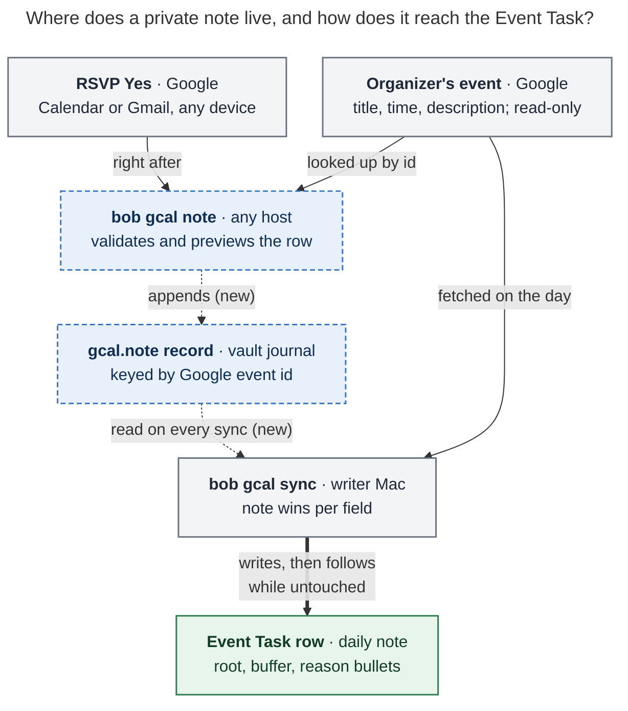

# Private notes for Google Calendar events you can't edit: consolidated design

*Lead researcher: final synthesis · 2026-11-09 · bob-cli `master` @ `0ed552a5`*

**Inputs.** Five independent reports are kept next to this one:

- [`__cdx`](private_notes_for_unowned_gcal_events__cdx.md): a **My details**
  editor in Mac Capture, a separate vault namespace, and strict field ownership.
- [`__cld`](private_notes_for_unowned_gcal_events__cld.md): **private notes**
  in the existing gcal journal, written in the same description grammar and
  added to the event before rendering.
- [`__grk`](private_notes_for_unowned_gcal_events__grk.md): a **Bob overlay**
  set from a capture event picker, with split badge hashes.
- [`__mus`](private_notes_for_unowned_gcal_events__mus.md): **pre-touched
  overrides** through `bob gcal annotate`.
- [`__gem`](private_notes_for_unowned_gcal_events__gem.md): **annotations**
  set from a TUI and a CLI one-liner, with an optional in-Bob RSVP.

I checked the disputed claims against the code at `0ed552a5`, the decision
records, Google's documentation, and a read-only sample of Bryan's calendar
from 2026-11-09 to 2027-01-31. Where a report was wrong, I say so below.

---

## Bottom line

**Build it, with one change of framing.** Don't think of this as "metadata on
Event Tasks for events I don't own". Think of it as a **private note**: a
description of a Google event that only Bob reads. Bob stores it in the vault,
keyed by the event's Google identity. You can write it the moment you RSVP.
Sync adds it on top of Google's description, field by field, when it writes
the Event Task. It works on any event, including ones you own. Google stays
read-only.

```console
$ bob gcal note deerwood @family -30 Drive to Deerwood +15 Drive home
```

**The rule in one sentence (for docs and help):**

> A private note is an event description only Bob reads: write the same
> `@route`, `#off`, and `-30 Drive there` lines you would put in Google, and
> they beat Google's description on that event's Event Task.

All five reports agree on the core:

- Store the metadata in the vault, keyed by the Google event.
- Never write to Google in v1.
- Never pre-create future daily notes.
- Accept invitations that are still awaiting a reply.
- Reuse the directive grammar Bryan already types.

They disagree on how the note governs the row after it lands, how much of the
grammar it carries, and which surface comes first. Those disputes are settled
in [Where the reports disagree](#where-the-reports-disagree-and-my-verdicts).

**Stopgap for today, no code needed.** Google keeps an event's colour private
to each guest's copy, and the phone app can set it at RSVP time.
`gcal.colors` already maps colour to root. It is **not configured today**
(`~/.config/bob/config.yml` has `colors: {}` commented out). Adding, for
example, `{sage: body, flamingo: abby, grape: family, tomato: job}` would
cover `@body`-style routing now. Colour cannot carry buffers or reasons.

---

## Is this a good idea?

**Yes.** Bob's own docs already describe the gap. `docs/gcal.md` § Known
limits says: *"A description you cannot edit cannot take a Google-owned
buffer: a hand-added `[buffer::]` is your edit — kept and reported once."*
The request is that sentence plus a timing requirement.

The calendar shows **three classes** of affected event, not one. I confirmed
cld's sample independently:

| Class | Real example (read-only sample) | What goes wrong today |
| --- | --- | --- |
| **Locked**: another Google user's event | *Deerwood. Christmas breakfast* (Kelly organizes, accepted, no description). Kelly created it 2026-10-23 for 2026-12-13, **51 days ahead**. Also Kelly's weekly *Little Gym* series, which Bryan answers Maybe | Lands as `[root:: meet]` with no buffer and no reason. Bryan cannot fix it until the morning of the event |
| **Editable but fragile**: an external iCal-style invite | *Interview with PermitFlow* (organizer `hr@…`). Bryan's copy of the description already ends with `@job` / `-30 Prep for interview!`, which he appended himself | Works today. But Google warns that guest edits "might be lost if the organizer makes a change". An Ashby reschedule would silently drop `job` and the prep buffer |
| **Owned but shared** | *Haircut* (Bryan organizes; Kelly is a guest): `@body` / `-15 Walk to The Wolves Den…` | The directives work, but every guest can read them |

Events Bryan doesn't own are **rare but high-stakes**: a few accepted ones
per quarter, such as interviews and family outings that involve travel. Bryan
decides the logistics when he RSVPs. That is weeks before the daily note
exists, and the Event Task is born only when the note exists.

### Critique of the literal plan

1. **The Event Task is the wrong object.** It doesn't exist at RSVP time.
   Bob never creates daily notes, because Templater races the write
   ([haircut race](../gcal_haircut_lost_to_daily_note_race.md)). Any design
   that starts from "edit the Event Task" has already missed the requirement.
   The note must attach to the **Google event's identity**. The row is only
   its projection.
2. **"Events I don't own" is the wrong boundary.** The PermitFlow class needs
   the note for reliability, and the Haircut class needs it for privacy. "Any
   event" is also simpler than an ownership test.
3. **Hand-editing the row on the day is insufficient.** The row doesn't exist
   ahead of time. A hand-added `[buffer::]` also sits inside the Google-owned
   badges span (verified below), so it freezes the 📅/📹/📍 links and the
   clock tag along with the buffer.
4. **The example input has two traps worth designing for:**
   - **Typed on one line, the example is prose, not directives.**
     `@body -30 I need to walk home from the park` fails today's grammar. A
     directive line must contain only directive tokens, and a reason line
     must start with its sign (`description.rs` `is_directive_line`,
     `reason_line`). gem's claim that the existing parser handles this
     one-liner is **wrong**. The CLI must normalize it and echo the
     canonical lines back.
   - **The sign is easy to get wrong.** `-30` reserves time *before* the
     meeting. If the walk home comes after the event, the right token is
     `+30`. The preview must show the occupied span (for example
     `occupies 13:30–15:00`) so a wrong sign is obvious. Bob must never
     guess the sign from the prose.
5. **A Bob buffer is not Google free/busy.** `-30` widens the occupied span
   in Bob's planning and ledger. It does not block time in Google or tell
   anyone else (cdx). Blocking availability would be a separate,
   calendar-writing feature.

**Would I take a different approach?** Only in framing and scope. I would not
write to Google, ask organizers for edit rights, mirror events onto a second
calendar, or keep a Markdown holding note. I would build "private notes on any
event", reuse every existing ownership rule, and make the authoring surface
the thing that makes it beautiful.

---

## Requirement adjustments (called out)

| # | As asked | Adjusted | Why |
| --- | --- | --- | --- |
| R1 | Events I don't own | **Any Google event**, owned or not | Covers the fragile and shared classes. One rule is simpler than an ownership test |
| R2 | Metadata "like `@body` or `-30 …`" | **The full description grammar:** `@route`, `#off`/`#on`, `-N`/`+M`, reason lines, and prose lines | Nothing new to learn: if you can write it in a description, you can write it in a note. Unrecognized text becomes a bullet; it never silently vanishes |
| R3 | Set the metadata | **The note beats Google per field. Google fills in everything the note leaves unset.** Time, title, and the 📅/📹/📍 links can never be overridden | Those are the organizer's facts. Overriding them would break the span hashes and the trust that 📅 opens the real invite |
| R4 | Ahead of time | **Any time.** Before the row exists, the note is applied at birth. Afterwards, it follows the row while the row is untouched | The same rule every Google-derived part of the row already follows |
| R5 | "When I RSVP" | **A second gesture right after the RSVP. Bob does not RSVP in v1** | RSVPing from Bob needs a write scope, and the read-only decision's own reopen trigger is "Bob needs to RSVP to or create events" |
| R6 | (unstated) | **Notes can be written on invitations awaiting a reply or answered Maybe. A note never changes inclusion** | The note waits until the event becomes an Event Task. It never creates a row, never RSVPs, and never bypasses `gcal.tentative` |
| R7 | (unstated) | **Recurring events need an explicit scope: This event or All events** | *Little Gym* is weekly, and the choice mirrors Google's own dialog. "This and following" is deferred |
| R8 | (unstated: which device?) | **v1 runs on the Mac and over SSH.** The phone gets the colour stopgap now and a phone path later if needed | Neither Google's mobile UI nor Obsidian mobile can run `bob` |
| R9 | (unstated) | **Note text stays out of `list` and `sync` JSON.** Only counts and sources appear there | Matches today's rule that JSON never carries description text |
| R10 | (unstated) | **Bob's occupied time is not Google busy time** | Keeps the feature's promise honest (critique point 5) |

---

## Where the reports disagree, and my verdicts

| Question | Positions | Verdict |
| --- | --- | --- |
| **How the note governs the row after it lands** | cld: add it on top before rendering, then the existing rule applies (follow while untouched; your edit wins, reported once). mus: treat noted fields as "edited from birth". gem: seed the row once, then ignore the note. cdx and grk: new per-field ownership and a separate tracked block | **cld.** No new ownership rule. mus's "pre-touch" contradicts itself: it says override beats edit, then that edit beats override. It also makes later note changes inert. gem's seed-once silently ignores a note updated the day before. cdx's and grk's machinery is real work for an edge case (see costs below) |
| Where reason bullets go | cld, mus: inside the existing Google-owned description block. cdx, grk: a separate block | **Same block.** `buffer-reasons-ride-description-bullets` rejected a second block. Its stated reopen trigger is "reasons must survive hand-edited blocks", and that trigger has not fired. If it ever does, the separate block becomes the follow-up |
| Stored form | cld: canonical raw text. Others: typed fields | **Canonical text, validated at write time.** It is the exact input the Google path parses, so `list` and `sync` share one parser. The grammar can evolve, prose comes free, and an editor just round-trips text |
| Storage location | cld, grk, mus, gem: the existing `.bob/gcal/<host>.jsonl`. cdx: a new `.bob/gcal-personal/` namespace | **Existing journal**, with the costs below. It inherits the `!/.bob/gcal/*.jsonl` gitignore exception, the `merge=union` attribute, and the doctor checks |
| Who may write | cdx: the `gcal.writer` host only. Others: any host | **Any host, last writer wins.** This is the established pattern for themes, relations, and `gcal.series_root`, and the SSH and phone paths need it. Only the writer *applies* notes |
| Recurring scope in v1 | cdx, mus: one occurrence only. cld, gem: This event or All events. grk: default to the series | **Both scopes in v1, always chosen explicitly** (a prompt on a TTY, `-s` or `-D` in scripts). The series key already exists (`gcal.series_root`), so the cost is small |
| Clock tags and prose | cdx leaves both out of v1. mus leaves prose out | **Include both.** Grammar reuse makes them free, and Bryan already uses `#offclock` (Halloween) |
| `sync -F` | Four reports: keep notes and reapply them. mus: drop them for the day | **Keep and reapply.** A note is intent, not day state, just as reset keeps learned series roots |
| RSVP from Bob | gem: a `--rsvp` flag in v1. cld: a later phase | **Not in v1.** It reopens `bob-gcal-is-read-only-and-proposes-once`. If it is ever wanted, Google's narrower `calendar.events.owned` scope (events on calendars you own, which includes your copy of an invite) is enough; the full `calendar.events` scope is not required |
| First surface | cld, mus, gem: CLI. cdx: a Mac editor. grk: a capture sigil | **CLI engine first, then a Mac Capture "Event note" mode as the required second phase.** It must not be a new capture sigil (see [Mac Capture](#mac-capture-the-beautiful-surface-phase-2)) |
| Pruning | gem: silently drop notes more than 30 days past. Others: keep them and report orphans | **Never drop silently.** `-l` hides past events by default, and doctor reports orphans |
| Fail-safe reads | cdx: refuse to project when the note store can't be read cleanly | **Adopt a narrow version** (see [Reliability](#reliability)) |

**Facts I verified directly:**

- **The badges span is one hash.** `render.rs` `badge_text` concatenates the
  📅/📹/📍 links, `#off`/`#on`, and `[buffer::]`. `plan.rs`
  `apply_span_updates` rebuilds the row only when *no* span (time, title, or
  badges) is edited. So a note changed after the row's birth reaches the row
  only while the whole row is untouched, which is exactly how a Google-side
  buffer change behaves today. cdx flagged this trap correctly.
- **Re-filing is free.** `buffer_changed` pushes a `MovedRow` whenever the
  rendered `[buffer::]` changes, so a note-driven buffer change re-files
  Bob-owned MEET filing with no new code (cld).
- **`-0` already parses** (`parse_buffer_token` accepts `0`). But
  `DescriptionDirectives.buffer` is two plain `u16`s, so "set to 0" and
  "unset" look the same. The layering needs a per-side *set* flag.
- **`bob gcal list -f json` has no `calendar_id` or `event_id`**, so scripts
  and the Mac cannot select an event exactly yet (mus).
- **The fetch mask requests `organizer(self)` only**, not the organizer's
  name or email. Showing "from Kelly" in a picker needs the mask widened.
- **Old binaries will warn.** `load_state` sends any unknown `gcal.*` kind to
  `parse_record`. That requires a `day` and a known kind, so on an old binary
  each `gcal.note` line becomes "skipping malformed gcal journal line". It
  also advances `newest`, the `list` header's "last sync" fallback. Shipped
  binaries must exclude `gcal.note` from both.

---

## Recommended design: private event notes

### How it flows



*The note never touches Google. It reaches the writer Mac through the vault
journal, and sync lets it beat Google's description field by field when it
writes, and later updates, the Event Task. Dashed boxes are new. Rendered
650 × 810 px, fit 100%.*

### Grammar

A note is plain text in the existing description grammar, parsed by the
plain-text path of `parse_description`:

```text
@body
-30 I need to walk home from the park
Bring the stroller
```

- **Directive lines** (`@route`, `#off`, `#on`, `-N`, `+M`) set the root, the
  clock tag, and the buffers.
- **Reason lines** (`-30 …`, `+15 …`) set one buffer side and write its
  `↤`/`↦` bullet.
- **Any other line** is prose and becomes a bullet.
- **`-0` / `+0`** explicitly clear a side that Google's description set.

**One-liner normalization (CLI only).** The Mac editor is multi-line and
doesn't need this. The CLI turns one line into canonical lines and **always
echoes them back** (cld's rule, tightened):

1. Leading directive tokens form the directive line.
2. A `±N[m]` token followed by text starts a reason. The reason runs until a
   `±N[m]` token for the *other*, still-unset side.
3. `;` or a real newline forces a line break.
4. Any other text becomes a prose line.

So `@body -30 I need to walk home from the park` becomes two lines, and
`-30 Drive there +15 Drive home` becomes two reasons. `@` and `#` inside a
reason stay text. These rules need shared test vectors (JSON) so the Mac
client can be tested against the same cases.

### Precedence: each field takes the first layer that sets it

| Field | 1 | 2 | 3 | Then (unchanged) |
| --- | --- | --- | --- | --- |
| Root | ✎ this event | ✎ all events | learned series memory | title `@route`, description `@route`, colour, calendar, default |
| Clock tag | ✎ this event | ✎ all events | Google title or description tag | root walk (`offclock`, `offclock_types`), then on-clock |
| Before buffer | ✎ this event | ✎ all events | Google description | none |
| After buffer | ✎ this event | ✎ all events | Google description | none |
| Reason | **Travels with the winning value for its side.** When a note sets a side without a reason, Google's reason for that side is dropped, not inherited (cdx) | | | |
| Prose bullets | ✎ this event lines, then ✎ all events lines, then Google's copied lines | | | |

Within one layer, today's rules hold: `#on` beats off, and the first value per
side wins. A note ranks above series memory on purpose: a note is an explicit
statement, while series memory is inferred from an edit to some other
occurrence. An unedited `[root::]` therefore follows a note-derived root, just
as it follows Google's chosen root today
(`gcal-root-follows-google-until-edited`). Note prose and reasons don't count
toward `description_lines`. In v1, `gcal.description: off` remains the total
kill switch for bullets, note bullets included. Note *directives* still apply
when it is off, just as Google's directives do. This is open question 3.

### Storage: one new journal record

```json
{"v":1,"ts":"2026-11-09T18:02:11-05:00","host":"athena","kind":"gcal.note",
 "account":"<gog account>",
 "key":{"calendar_id":"primary","event_id":"st49ogf0k0jiciob1ebgj1aupo"},
 "scope":"event",
 "text":"@family\n-30 Drive to Deerwood\n+15 Drive home",
 "seen":{"title":"Deerwood. Christmas breakfast","start":"2026-12-13T10:00:00-05:00",
         "ical_uid":"…","original_start":null}}
```

- **Identity.** `scope: "event"` keys on `(calendar_id, event_id)`. A
  recurring instance's ID already embeds its original start
  (`<series>_20261113T141500Z`). `scope: "series"` keys on
  `(calendar_id, series)` (the `recurringEventId`), the same shape as
  `gcal.series_root`. Use the configured calendar ID, as the row journal does.
  `account` is a guard: a note never applies under a different gog account.
  Never key by title, date, daily-note path, or block ID.
- **Fold.** Last writer wins, ordered `(ts, host, path, line)` as
  `load_series_roots` already does. `text: ""` clears the note. Records are
  only appended, never deleted. Cap `text` at about 2 KiB.
- **`seen` is for display and repair only.** It lets `-l` and doctor name an
  orphaned note. Never use it to transfer a note silently: a series split or a
  recreated event gets an explicit fix, not a guess.
- **`-F` keeps notes.** The rebuilt rows include them.
- **Exclude `gcal.note`** from the occurrence fold and from `newest`, and
  teach `malformed_count` to recognize it.

### Ownership in the row: no new rules

Only the Owner column in `docs/gcal.md` § Who owns each part of a row changes:

| Part | Owner | Sync behavior (unchanged) |
| --- | --- | --- |
| `[root::]`, `[buffer::]`, `#off`/`#on`, description bullets (reasons included) | **Your private note, then Google**, until you edit that part of the row | Follows while untouched. Your row edit wins and is reported once (`kept_root`, `kept_edit`, `kept_description`). The `kept_description` wording names "your private note" when the note, not Google, changed |

The row keeps **no provenance marker** in the vault. The result is
byte-for-byte the row the same lines would produce in a Google description.
`event-buffers-widen-the-span` already rejected glyph tokens because titles
can forge them. Provenance belongs in `bob gcal list` and `sync` output, which
already report root sources. This sameness is most of the beauty: Bob Ledger
Tools' hatched wings, the time pill, the agenda, and Mac Capture's rail
already read `[buffer::]` and `[root::]`, so **none of them need changes for
v1**.

### The command: `bob gcal note`

```text
bob gcal note [-a|--adopt] [-b|--bob-dir DIR] [-c|--clear] [-D|--day DAY]
              [-d|--dry-run] [-e|--edit] [-f|--format human|json]
              [-i|--event-id ID] [-l|--list] [-s|--series] [QUERY [--] [TEXT...]]
```

The bare `bob gcal note` lists notes; `cli_rules` allows a read-only, flag-only
default.

- **Selecting the event.** `QUERY` matches titles case-insensitively across
  the configured calendars, from today to 90 days out (`-D` narrows it to one
  day). A pasted Google event URL selects the exact event. Its `eid` decodes
  to `"<eventId> <calendar>"`, but that format is undocumented community
  knowledge, so verify the decoded ID against the fetched event and fall back
  to search. `-i` takes an exact ID, for scripts and the Mac. On a TTY, an
  ambiguous match opens a numbered picker. Off a TTY it exits 2 and lists the
  candidates with their `-D`/`-i` values.
- **Where the text starts.** `TEXT` starts at the first directive token, or
  after `--`. clap needs `allow_negative_numbers` so that `-30` is text, not a
  flag.
- **Which events qualify.** Invitations awaiting a reply or answered Maybe are
  included. Declined and cancelled events are not.
- **Validation at write time.** The route is resolved against that day's
  note path, so `@bdy` fails *now* and lists the closest routes. Minutes are
  checked against 0–720. Clipping at midnight appears in the preview.
- **`-a/--adopt`** copies the directive and reason lines from the event's
  current Google description into a private note. One keystroke protects the
  PermitFlow class before the organizer's next update wipes them.
- **Saved versus applied (cdx).** The output always says which: "lands when
  that day syncs", "↻ applied to 2026/20261109.md", or "saved; today's note
  needs a sync on the Mac". On the writer host, saving a note for a day whose
  note already exists runs that day's sync immediately.

**A one-off (the common case):**

```console
$ bob gcal note deerwood @family -30 Drive to Deerwood +15 Drive home
bob gcal note · Sun Dec 13  10:00–12:00  Deerwood. Christmas breakfast  · guest · Yes
  ✎ @family
  ✎ -30 Drive to Deerwood
  ✎ +15 Drive home
  lands as
  - [ ] #task **1000-1200** Deerwood. Christmas breakfast [📅](…) [📹](…)
    [buffer:: -30m +15m] [root:: family] [type:: MEET] ^deerwood-christmas-breakfast
    - ↤ *30m before* · Drive to Deerwood
    - ↦ *15m after* · Drive home
✓ Noted, only in Bob · ● family · occupies 09:30–12:15 · lands in 2026/20261213.md when that day syncs
```

The "lands as" block comes from the same renderer sync uses, shown dimmed:
what you see is what lands.

**A recurring event:**

```console
$ bob gcal note little gym @abby -30 I need to walk home from the park
Little Gym repeats weekly · Fridays 09:15–10:00 · guest · Maybe
  1  This event   Fri Nov 13
  2  All events   every Little Gym
Which? [1] › 1
  ✎ @abby
  ✎ -30 I need to walk home from the park
✓ Noted, only in Bob · ● abby · occupies 08:45–10:00 · you answered Maybe: lands when you say Yes
```

**Listing:**

```console
$ bob gcal note
✎ 3 private notes
  Fri Nov 13  09:15  Little Gym                      this event  ● abby    −30m       waiting for Yes
  Sun Dec 13  10:00  Deerwood. Christmas breakfast   this event  ● family  −30m +15m
  ⚠ Thu Nov 12        Interview with PermitFlow      this event  no longer on your calendar · bob gcal note -c -i …
```

### Where notes show elsewhere

- **`bob gcal list`.** A dim `✎` follows the title, and the root source reads
  `✎ @family` (or `✎ all events @abby`). The `bob ref` board already uses
  `✎ N` for "your annotations". JSON gains `note: null | {scope, lines}` and
  `root.source: "note @family"`, never the text. Add `calendar_id` and
  `event_id` to each row as well, closing the identity gap mus found.
- **`bob gcal sync`.** Rows read
  `+ task 10:00–12:00 −30m +15m Deerwood… ● family via ✎ @family`, reusing
  the existing `via @love` vocabulary.
- **`bob gcal doctor`.** A new `notes` check reports the count, orphans, and
  routes that no longer resolve.
- **A hint for fragile descriptions.** `list` flags an event you don't
  organize whose *description* carries Bob directives: "may vanish when the
  organizer updates · `bob gcal note -a`".

### When a note lands

| You write the note… | Result |
| --- | --- |
| Before the day's note exists (the usual case, at RSVP) | Applied when the row is born, by the daily-note sync that Ledger Tools triggers |
| After the row exists, and the row is untouched | The next sync updates root, tag, buffer, and bullets in place. A buffer change re-files Bob-owned MEET filing |
| After you edited the row | Your edit wins and is reported once |
| On an event awaiting your reply, or answered Maybe | It waits and applies when you say Yes (or when `gcal.tentative: task` makes the event a task) |
| On a declined or cancelled event | Never applied. Shown as inactive by `-l` |
| From another host, after today's sync | It waits for the next writer sync, because sync is never periodic. The command prints `bob gcal sync`. The Mac surface closes this gap by syncing right after a save |

### Mac Capture: the beautiful surface (phase 2)

The CLI makes the feature *work*. The Mac makes it *beautiful*, and Bryan
asked for both, so this phase is part of the feature, not polish. It follows
`mac-capture-is-a-thin-client`: the app talks to `bob gcal note -f json` for
candidates, parsing, preview, and saving. It never parses `@body` itself and
never writes to the vault.

- **Entry.** A dedicated **Event note** mode in the capture panel, opened by
  its own chord and menu item, plus the same action on a Calendar-band row.
  **Not a capture sigil.** Under `capture-sigils-say-where-what-how`, `@`
  names a vault destination, and an event note is not a vault capture.
  Overloading the grammar (grk's `gcal+`/📅 token) would blur "one sigil per
  question" and its error copy. `cli_rules` also forbids subcommands under
  `bob capture`.
- **Picker.** Soonest events first. Each row shows its date, time, title,
  calendar, organizer, and an RSVP chip. Invitations awaiting your reply are
  marked, and events that already have a note wear `✎ @family · −30m`.
  Typing filters the list but never chooses an event by itself.
- **Editor.** A fixed identity header, so you always know which event you
  are changing. Below it, one multi-line field takes the same grammar, with
  bob-reported highlight spans. Below that, a live preview shows the meeting
  as a solid block in the root's hue, flanked by hatched wings, with
  `Occupied 09:30–12:15 · Meeting 10:00–12:00`. That is the visual language
  of the existing Calendar band and Ledger Tools pill, so the preview reads
  like the day it describes. Every state also has a text label, so nothing
  depends on colour alone.
- **Footer.** `Only in Bob`, the scope (`This event` / `All events`), and the
  saved-versus-applied status. Return saves and offers Undo. Because the Mac
  is the writer, a save for today syncs today's note at once.
- **Process.** It needs its own decision record (the trigger chord) and must
  pass exact-SHA macOS CI.

### The phone

The calendar can't tell which device Bryan RSVPs on, so this stays an open
question (Q1). In order of cost:

1. **Now:** the colour stopgap, for routing only.
2. **v1:** SSH to athena and run `bob gcal note`. Any host may write.
3. **Phase 3, if phone RSVPs are common:** a Google Keep line. Bob already
   drains Keep (`bob gkeep pull`). A Keep note that starts with a Calendar
   event link, or with `gcal <query>`, followed by directives, would become a
   private note **when it resolves to exactly one event**. Otherwise it lands
   as an ordinary inbox task ("Resolve event note: …"). It never guesses.

---

## Reliability

| Failure | Answer |
| --- | --- |
| Wrong event matched | The preview shows date, time, title, organizer, and RSVP. `-d` writes nothing. Re-running replaces the note, and `-c` clears it |
| Typo in a route | Rejected at write time, with the closest routes |
| Wrong sign (`-30` vs `+30`) | The occupied span appears in the preview and in `list` |
| Organizer reschedules, even to another day, or renames | The event ID is stable, so the note follows. The time comes from Google |
| Organizer edits the description | The note is unaffected. Fields the note sets keep winning |
| Event deleted and recreated, or the series split | Orphaned: `-l` and doctor report it with a one-line fix. No silent transfer |
| Two hosts write at once | Per-host files, union merge, last writer wins by timestamp. One user, so conflicts are rare and visible in `-l` |
| An older bob reads the journal | It warns about one malformed line per note and ignores notes. **This heals itself:** once the writer upgrades, the next sync applies notes to untouched rows. Rows are reverted only if the writer is *downgraded* after notes were applied, which a single writer makes negligible |
| A corrupted or truncated note line | **Hardening (from cdx):** journal the source of `root` and `buffer` in `gcal.row`. If a row's source is `note`, the note is missing, *and* the fold reported malformed lines, hold that field and warn instead of reverting to Google's value |
| `sync -F` | Keeps notes, and the rebuilt rows include them |
| Incomplete snapshot | Writes nothing (the existing invariant) |
| Note text in machine output | Never in `list` or `sync` JSON, only counts. Only `bob gcal note` and `sync -d` diffs show the words |
| Midnight clipping | The preview shows the occupancy that actually fits |

**Costs accepted in v1, stated plainly:**

- **A note changed after the row's birth applies only while the whole row is
  untouched** (title, time, and badges), because of the single badges hash
  and the `edited.is_empty()` gate. Most notes land at birth, so this is
  rare. The fix, splitting 📅/📹/📍 from clock and buffer in the hash (grk),
  is a separate and worthwhile change.
- **A hand-edited description block freezes note reasons and prose too**,
  exactly as it freezes Google's bullets today. Editing the block is how you
  take it over.
- **Old binaries print malformed-line warnings** until every host upgrades,
  as with the accepted `gcal.reset` precedent. The daily release train keeps
  this short.

---

## Options considered (merged)

| Option | Verdict | Reason |
| --- | --- | --- |
| **Private note in the vault gcal journal** | **Recommended** | Read-only stays intact. Same grammar. Reuses the precedence, ownership, and re-file machinery. Settable from any host and versioned with the vault |
| Separate vault namespace with typed fields and field-level ownership (cdx) | Not for v1 | The most rigorous option, but it adds a second ownership rule, gitignore and doctor plumbing, and a GUI-first dependency. Its best ideas (saved vs applied, fail-safe reads, reason suppression, sign preview) are adopted above |
| Pre-touched overrides (mus) | Rejected | Self-contradictory precedence. Later note changes go inert. Drops notes on `-F` |
| Seed once (gem) | Rejected | Silently ignores a note updated after birth |
| `extendedProperties.private` on the guest's copy | Rejected now | Truly per-copy, but it needs a write scope (`calendar.events.owned` at the narrowest), has no Google UI, and values cap at 1,024 characters. Bob would still be the editor. Revisit only alongside RSVP-in-Bob |
| RSVP comment as the directive source | Rejected | Visible to every invitee and emailed to the organizer |
| Colour → root (`gcal.colors`) | **Keep as a stopgap and complement** | Already shipped, private, settable on the phone. Routes only |
| Edit the guest's copy of the description | Not a design | Works only for external invites (PermitFlow), and organizer updates can erase it. gem's "always 403" overstates the block |
| Ask organizers for "modify event" | Rejected | Social workaround. Directives would become visible to everyone |
| Shadow event on a calendar you own | Rejected | Duplicate busy blocks and rows, fuzzy matching back to the original, drift on reschedule |
| Pre-create future daily notes | Rejected | Templater race, and future-day status side effects |
| Markdown holding note or per-event sidecar notes | Rejected | Fragile parsing, identity anchoring, and vault clutter |
| Title-pattern rules in config | Deferred | Brittle matching. A series note covers the recurring case |
| Companion task linked by a relation | Complement only | It doesn't widen the occupied span, so gaps, conflicts, and MEET clustering stay wrong |
| `bob gcal note --rsvp yes` | Deferred (Phase 4) | Reopens the read-only decision |

---

## Implementation map and phasing

| Phase | Repo | Work |
| --- | --- | --- |
| **1. Core** | bob-cli | `journal.rs`: the `gcal.note` kind, `load_notes()` (last writer wins), `append_note`, exclusion from the occurrence fold and `newest`, and `malformed_count`. `description.rs`/`model.rs`: per-side *set* flags and a layering step (route, clock, each buffer side with its reason, prose flagged `from_note` to bypass the cap). `snapshot.rs` `fetch_day`: load notes next to `series_roots` and apply them right after `GcalEvent::from_google`, so `list` and `sync` agree by construction. `root.rs`: `RootSourceKind::Note` first. `plan.rs`: note-aware `kept_description` wording and `gcal.row` provenance (the hardening). Usable through `-i` |
| **2. CLI** | bob-cli | `note.rs` (new): a 90-day window fetch through gog, matching, `eid` decoding, the scope prompt, one-liner normalization with shared vectors, validation, the "lands as" preview through `render.rs`, `-a` adopt, and an immediate same-day sync on the writer. `cli.rs` help. `list.rs`: `✎`, JSON `note`/`root.source`/`calendar_id`/`event_id`. Widen `gog.rs` `FIELDS` with `organizer(displayName,email,self)`. A doctor `notes` check. Docs: new `docs/gcal.md` § Private notes, updated ownership table, Root selection, and Known limits, plus the command catalog. Decision record and glossary |
| **3. Mac** | bob-mac-capture | The Event note mode: picker, editor, preview, saved/applied status, sync after save. Decision record for the trigger, and macOS CI |
| **4. Optional** | bob-cli (+plugins) | The Keep phone path; splitting the badge hash; "this and following" scope; a Ledger Tools tooltip ("from your private note"); RSVP-in-Bob (reopens the decision) |

**Tests** (fake gog, `tests/gcal_notes.rs`):

1. A locked guest event plus a note is born with its root, buffer, and
   reasons.
2. A note added after birth updates an untouched row and re-files its MEET.
3. A row-edited root is kept and reported with `kept_root`.
4. Occurrence beats series beats Google. Each side resolves independently.
   `-0` clears Google's side. Google's reason is dropped for a side the note
   overrides.
5. Clearing a note restores Google's values on untouched rows.
6. A note in another host's file applies, and the last writer wins.
7. `-F` keeps notes.
8. A note on an event awaiting a reply waits, applies on Yes, and stays
   inactive if declined.
9. An event moved to another day carries its note. A series split reports an
   orphan.
10. A `gcal.note` line doesn't move `newest`.
11. `list` and `sync` JSON carry no note text.
12. An unknown route is rejected at write time.
13. The one-liner normalization vectors pass.
14. An incomplete snapshot writes nothing.

**Size:** one epic in three required phases. Phase 1 alone delivers the value
through `-i`. Don't call the feature done before phase 3.

**Decision record.** A new record, **"Private Event Notes Beat Google Per
Field"**, partly supersedes three records:

- `event-buffers-widen-the-span`: its cost line about descriptions you cannot
  edit.
- `gcal-root-follows-google-until-edited`: the chosen root now includes notes
  ahead of series memory.
- `buffer-reasons-ride-description-bullets`: the block now has two inputs
  under one ownership rule.

It should list the rejected alternatives above. It needs a glossary term,
**Private Event Note** (aliases: private note, ✎ note). "Note" collides with
Bob's daily, area, and project notes. The qualifier "private event note"
carries the distinction, and Google uses "note" for the per-guest RSVP
comment, which this is minus the audience. ("Memo" is not a clean fallback,
because project-note capture already uses it.)

---

## Open questions for Bryan

1. **Do you usually RSVP on your phone or on the Mac?** If on the phone, the
   Keep path moves up from phase 4.
2. **Should a private note on an event you own beat its description?** I say
   yes (R1). The alternative is "description wins on owned events".
3. **Should `gcal.description: off` hide private-note bullets too?** In v1 I
   say yes, to keep one rule. Your directives still apply.
4. **Should saving a note for today sync immediately on the Mac?** I say yes,
   and the output says so on its own line.
5. **Name:** `bob gcal note` ("private event note"), or another verb you
   prefer?

---

## Recommended solution

Ship **private event notes**:

- **Model.** A private note is a description of a Google event that only Bob
  reads. It can sit on any event, owned or not, including invitations still
  awaiting your reply. It uses exactly the grammar you already type
  (`@body`, `#off`, `-30 I need to walk home from the park`, plus prose).
- **Storage.** A `gcal.note` record in the existing per-host
  `.bob/gcal/<host>.jsonl` journal, keyed by account, calendar, and event ID,
  scoped to This event or All events, last writer wins. Notes are never
  pruned silently, and `-F` keeps them.
- **Effect.** Inside `snapshot::fetch_day`, the note is parsed with
  `parse_description` and applied over Google's description **per field**.
  Google keeps the time, title, and links. Root, clock tag, each buffer side
  with its reason, and prose then reach the Event Task through the unchanged
  renderer, the unchanged rule (follow while untouched, your edit wins,
  reported once), and the free MEET re-filing. The vault row looks exactly
  like an owned event's row, so plugins and the Mac need nothing for v1.
- **Surfaces.**
  - `bob gcal note QUERY TEXT…`, right after you RSVP. It validates at write
    time, echoes the canonical lines, previews the exact row and occupied
    span, and says whether the note is saved or already applied.
  - Then a Mac Capture **Event note** mode, which is the beautiful version:
    an event picker, the same grammar, and a live time rail with hatched
    wings in the root's hue.
- **Visibility.** `✎` in `list` and `sync`, a doctor `notes` check, and a
  hint that offers to adopt directives from fragile external-invite
  descriptions.
- **Today, with no code.** Configure `gcal.colors` and recolour invitations
  on your phone when you RSVP.

Keep Google read-only. Treat RSVP-in-Bob as a separate, later decision.

---

## Sources

**Google:**

- [Invite users to an event](https://developers.google.com/workspace/calendar/api/concepts/inviting-attendees-to-events):
  shared vs private properties; guest edits "might be lost if the organizer
  makes a change"; invitation visibility.
- [Extended properties](https://developers.google.com/workspace/calendar/api/guides/extended-properties):
  private properties are per copy; values ≤ 1,024 characters.
- [Events resource](https://developers.google.com/workspace/calendar/api/v3/reference/events):
  `guestsCanModify` defaults to false; `originalStartTime`; recurring
  identity.
- [Events: patch](https://developers.google.com/workspace/calendar/api/v3/reference/events/patch):
  write scopes only.
- [Calendar API scopes](https://developers.google.com/calendar/api/auth):
  `calendar.events.owned` and `calendar.events.owned.readonly`.
- [Respond to invitations](https://support.google.com/calendar/answer/37135):
  an RSVP note is visible to invitees.
- [Colour labels are private](https://support.google.com/calendar/answer/12377581).

**Community and third party:**

- [`eid` structure (Stack Overflow, archived)](https://kiwix.lema.org/stackoverflow.com_en_all_2023-11/questions/53928044/how-do-i-construct-a-link-to-a-google-calendar-event):
  base64 of `"<eventId> <calendar>"`, undocumented.
- [Private Notes for Google Calendar (extension)](https://chromewebstore.google.com/detail/private-notes-for-google/cfhahikbjmmkbiobhlgecilahemdfgph):
  evidence that Google has no native guest-private note.

**Repo (bob-cli @ `0ed552a5`):**

- `docs/gcal.md`: § Who owns each part of a row, § Where it runs, § Event
  inclusion, § Root selection, § Buffer reasons, § Known limits.
- `src/native/gcal/description.rs`: `directives_from_source`, `reason_line`,
  `is_directive_line`.
- `src/native/event_task.rs`: `parse_buffer_token`, `EventBuffer`.
- `src/native/gcal/render.rs`: `badge_text`.
- `src/native/gcal/plan.rs`: `apply_span_updates`, `buffer_changed` →
  `MovedRow`.
- `src/native/gcal/journal.rs`: `load_state`, `load_series_roots`,
  `malformed_count`.
- `src/native/gcal/gog.rs`: `FIELDS`.
- `src/native/gcal/list.rs`: JSON fields.
- `docs/gkeep.md`.
- The vault's `.gitignore` (`!/.bob/gcal/*.jsonl`).
- `~/.config/bob/config.yml` (`gcal.colors` unset).

**Decisions:**

- `bob-gcal-is-read-only-and-proposes-once`
- `gcal-root-follows-google-until-edited`
- `buffer-reasons-ride-description-bullets`
- `event-buffers-widen-the-span`
- `capture-sigils-say-where-what-how`
- `mac-capture-is-a-thin-client`
- `cli_rules.md`

**Prior research:**

- `research:202611/gcal_event_description_notes/gcal_event_description_notes__final.md`
- `research:202611/gcal_haircut_lost_to_daily_note_race.md`

**Calendar:** a read-only sample of the primary calendar, 2026-11-09 →
2027-01-31, taken through the Google Calendar connector on 2026-11-09.
