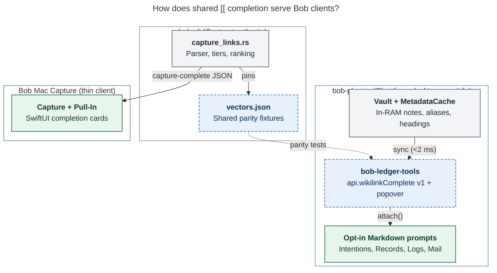
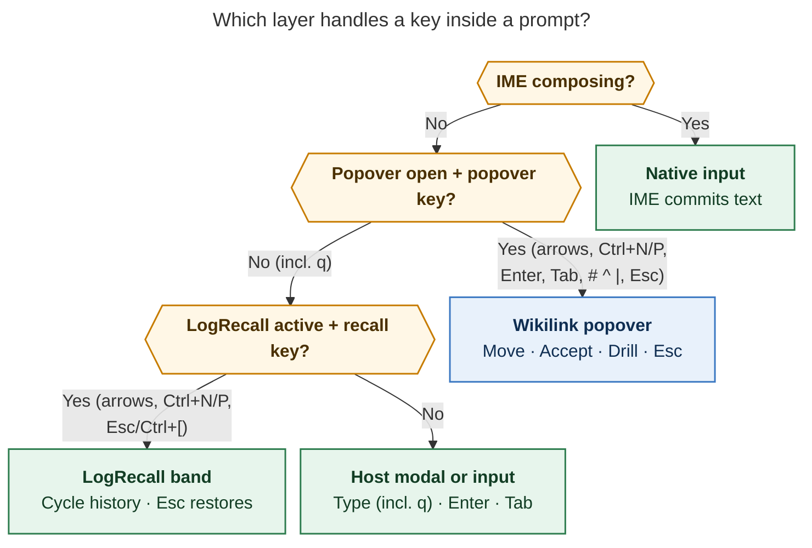

# Obsidian Wikilink Completion (`[[`) Across Bob Text Input Prompts

## Executive Summary

Supporting `[[`-triggered Obsidian wikilink completion inside Bob's text input prompts is a **high-value, cohesive improvement** — provided we tighten its scope from *"any free-form text input"* to **explicitly opt-in, vault-Markdown prose prompts** and build it as one shared, in-memory Obsidian service rather than a subprocess bridge or per-plugin widget.

Two discoveries from the live codebase shape the entire design:

1. **The vault ecosystem is already wired for wikilinks in these prompts, creating an unfinished loop today.** `bob periods update` already auto-quotes `[[` in YAML frontmatter (`src/native/intentions/write.rs:615`), and the Intention Card already renders links through `MarkdownRenderer.render` with hover previews and unresolved-link badges (`bob-ledger-tools/src/296b-plugin-intention-card-dom.js`). Likewise, Bob's **Task Mentions** (`docs/task-relations.md` §19) already index `[[note#^id]]` inside `work_log`, `schedule_log`, `rotten_log`, and `cancel_log` bullets as `(💬 mentions)` on `LINKED FROM:`. Today, however, every one of those prompts forces Bryan to type paths and block IDs from memory.
2. **A blanket interceptor on "any free-form text input" would actively break several prompts.** Our audit uncovered four categories of text inputs that look free-form but must *never* trigger `[[` completion — including a non-obvious trap in **Bob Mac Capture's Private Event Note editor** (`GcalNoteEditorTextView`), where `bob gcal`'s prose escaper (`src/native/task_text_escape.rs:45`) rewrites every `[` to `\[`, turning completed `[[links]]` into dead escaped literals.

**Recommended solution:** Build a single, shared, zero-subprocess completion service and caret-anchored floating popover in **`bob-ledger-tools`** (`api.wikilinkComplete` v1), backed by Obsidian's in-RAM `Vault` and `MetadataCache` (< 2 ms per keystroke, works on both Desktop and Mobile) and pinned to `bob-cli`'s `capture_links.rs` grammar, note tiers, and 5-tier ranking via a shared `vectors.json` parity fixture. Attach it explicitly to **14 Markdown-bound prompt surfaces across 4 Obsidian plugins** (plus Bob Mac Capture's Pull-in Cancel Reason via a `--wikilinks-only` mode on `bob capture-complete`), with strict layered key routing over `LogRecall` (`USED BEFORE`) and full compliance with `decisions:q-and-ctrl-bracket-mirror-esc`.

---

## 1. Critique of the Plan & Justified Adjustments

### Is this a good idea?

**Yes — unequivocally.** Beyond sheer typing convenience, it removes an asymmetric UX seam across Bob:

- **Habit continuity:** Bryan already relies on `[[` completion in Obsidian's CodeMirror editor and in Bob Mac Capture's primary draft (`docs/reference/mac-capture/wikilink-completion.md`). Hitting a dead `[[` inside `==` (Intentions), `Ctrl+Shift+Enter` (Work Log), `Ctrl+Shift+P` (Task Card reasons), or `Alt+F` (Rotten Keep) breaks flow at the exact moment he wants to link a project, ref, or task.
- **Higher link hygiene:** Frontmatter intentions and log bullets often reference notes in nested directories (`2026/20261121`, `ref/...`, `done/...`) or specific `^block-id` anchors. Completion prevents silent typos that become red `.is-unresolved` links on the Intention Card or missed Task Mentions.
- **Better leverage of existing infrastructure:** Both `IntentionCard` rendering and `Task Mention` back-references become dramatically more useful when authoring a valid `[[note#^id]]` inside a log prompt takes three keystrokes instead of leaving the prompt to copy a block ID.

### Six Critiques & Justified Requirement Adjustments

Each adjustment below modifies or sharpens the raw prompt (*"any free-form text input prompt ... triggered by typing `[[`"*). Every adjustment is called out explicitly so Bryan can approve or override it.

| # | Original Assumption | Critique / Evidence | Justified Adjustment |
|---|---|---|---|
| **A1** | *"Any free-form text input prompt"* | A global DOM hook on all `<input>`/`<textarea>` elements would fire inside shell commands (`if [[ -f ... ]]` in `bob-chips`), outbound Gmail (`bob-mail`), CLI args (`bob-command-mode`), and Mac Capture Private Event Notes (`task_text_escape.rs:45` escapes `[` to `\[`). | **Explicit opt-in allowlist (`attachWikilinkComplete`) on vault-Markdown prose fields only.** Exclude literal code/shell, external email, structured identifiers, and escaped gcal prose unless gcal's escaping contract changes. |
| **A2** | Basic `[[` note completion implied | Obsidian's editor and Bob Mac Capture (`capture_links.rs`) both support aliases (`[[target\|Alias]]`), headings (`[[#`, `[[Note#`, `[[##`), blocks (`[[#^`, `[[Note#^`, `[[^^`), and embeds (`![[`). Supporting only note names would feel broken the first time Bryan links a task block in a Work Log. | **Support full wikilink syntax in v1** (notes, frontmatter aliases, headings, blocks, embeds) **plus `#`, `^`, and `\|` drill-down keys** on a highlighted note row to transition seamlessly into heading/block/alias authoring without closing the popover. |
| **A3** | Static alphabetical order on empty `[[` (as in `capture_links.rs`) | Typing bare `[[` in an alphabetically sorted vault surfaces old `00_...` or `2021/...` notes first, forcing extra keystrokes when linking recently touched work. | **Context-aware recency on empty query:** when `[[` has 0 query characters, show recently opened files (`workspace.getLastOpenFiles()`), current-note links, and recently modified Living notes first; switch to `capture_links.rs`'s 5-tier match ranking (with recency tie-breaks) once 1+ characters are typed. |
| **A4** | Auto-pairing `]]` on typing `[[` (like CodeMirror) | Eagerly injecting `]]` inside native `<input>`/`<textarea>` complicates native undo, creates stray brackets when the user presses `Esc` or wants literal `[[`, and fights cursor positioning. | **Close-on-accept (matching Mac Capture / `capture_links.rs`):** typing `[[` does not force-insert `]]`; accepting a candidate appends `]]` only if no closing `]]` already follows the token, and splices via `execCommand("insertText")` so `Cmd+Z`/`Ctrl+Z` undoes the entire link in one step. |
| **A5** | Independent keyboard handling for completion | Almost every log prompt already hosts `LogRecall` (`USED BEFORE`), which claims `↑`/`↓`/`Ctrl+N`/`Ctrl+P`/`Esc`/`Ctrl+[`. `Task Card` also binds `Tab` (field cycling), `Enter` (submit), and `Backspace` (back stage); `SuccessorPicker` commits on `blur`. | **Formal layered key & focus contract:** active `[[` popover preempts `LogRecall` and host keys; `Esc`/`Ctrl+[` dismiss only the popover (one layer per Esc per `decisions:q-and-ctrl-bracket-mirror-esc`); empty-match state suppresses accidental modal submit on `Enter`; popover clicks call `mousedown.preventDefault()` so blur-commit editors never close early. |
| **A6** | Only `[[` trigger vs task wikilinks `((` | Task Mentions need `[[note#^id]]`, yet `[[^^` only finds tasks that *already* carry a block ID and searches by ID rather than task text. `block-id-prompt` already has `((` (`TaskWikilinkIndex`), which handles ID-less tasks — but naming an ID-less task requires a nested modal + cross-note vault write. | **Keep v1 focused on `[[` (zero vault writes during completion),** but design `api.wikilinkComplete`'s attachment controller and popover architecture so a `((` task-wikilink provider can plug into the same attached inputs cleanly in Phase 2. |

---

## 2. Exhaustive Audit of Bob Prompt Surfaces

Every `<input>`, `<textarea>`, `TextField`, `TextEditor`, `NSTextField`, and `NSTextView` across all 12 plugins in `bob-plugins` and all views in `bob-mac-capture` was inspected directly in source.

### 2.1 Include in v1 — Obsidian Vault-Markdown Prose Prompts (14 Surfaces)

| Plugin | Prompt / Stage (Source File) | Control | Existing Sibling Quirks | `sourcePath` for `[[#` / `[[#^` |
|---|---|---|---|---|
| `bob-ledger-tools` | **Intention Card — Intention line** (`297cc-plugin-intention-card-editor-paint.js:131`) | `<input>` | `paintIntentionCard()` rebuilds DOM on paste-newline / stale refresh; `bobCardWireCloseKeys` (`q`/`Ctrl+[`); `Enter` saves. | `this.subjectPath` (daily/period note) |
| `bob-ledger-tools` | **Intention Card — Reflection** (`297cc-plugin-intention-card-editor-paint.js:130`) | `<textarea>` (autogrow) | Multi-line! `Shift+Enter` newline, `Enter` saves, `Ctrl+Enter` saves & closes. Needs true caret-anchored popover. | `this.subjectPath` |
| `bob-ledger-tools` | **Intention Card — Summary** (`297cc-plugin-intention-card-editor-paint.js:131`) | `<input>` | Same DOM rebuild lifecycle as Intention line. | `this.subjectPath` |
| `bob-ledger-tools` | **Record Card — `text` stage** (`242q-plugin-record-card-stages.js:125`) | `<textarea>` | Single-line semantic (`Enter` saves; newlines refused by `bob`); `paintRecordCard()` rebuilds DOM. | `this.recordPath` |
| `bob-ledger-tools` | **Record Card — `list` & `suggest` stages** (`242q-plugin-record-card-stages.js:129,247`) | `<input>` | `list`: `Enter` adds chip, empty `Enter` saves, empty `Backspace` pops chip. `suggest`: already renders a list below input. | `this.recordPath` |
| `bob-ledger-tools` | **Record Card — `link` stage** (`242q-plugin-record-card-stages.js:185`) | `<input>` | Currently uses a naive 30-item `recordCardLinkCandidates` substring list with no aliases/tiers. Unify/upgrade with shared ranking engine! | `this.recordPath` |
| `block-id-prompt` | **WorkSummaryPromptModal** (`090-prompt-modals.js:438`, `Ctrl+Shift+Enter` unlink) | `<input>` | Hosts `LogRecall` (`work`, roomy, `ownKeys: true`); live preview; `Ctrl+[` synthesizes `Escape`. | Linked task's note path (`source.sourcePath`) |
| `bob-navigation-hotkeys` | **TaskLinkLanePromptModal** (`196-task-link-lane-modal.js:126`, Move to Next) | `<input>` | Hosts `LogRecall` (`work`, roomy, `ownKeys: true`); live preview. | First target task's note path |
| `bob-navigation-hotkeys` | **LaneReleaseSummaryModal** (`190-summary-modals.js:759`, `Alt+N` release) | `<input>` | Hosts `LogRecall` (`work`, roomy, `ownKeys: true`); live preview. | Active/target task note path |
| `bob-navigation-hotkeys` | **Task Card — `schedule-review`** (`370-picker-schedule-work-log.js:47,80`) | Two `<input>`s (Reason + Work summary) | `Tab` cycles between Reason, Summary, and Back! `LogRecall` dynamically switches between `schedule` and `work` on focus change. Empty `Backspace` in Summary focuses Reason. | Target task's note path |
| `bob-navigation-hotkeys` | **Task Card — `schedule-work-log`, `lane-release-reason`, `cancel-reason`** (`370-picker-schedule-work-log.js:262`, `380-picker-cancel-and-lane.js:6,233`) | Shared `FilteredPickerModal` `<input>` | Hosts `LogRecall` (`work` / `cancel`); empty `Backspace` returns to Task Card; `Alt+P` submits in `schedule-work-log`; `Ctrl+[` closes modal. | Target task's note path |
| `bob-navigation-hotkeys` | **Task Card — `scheduled` inline reason** (`360-picker-schedule-review.js`, `value` stage) | `FilteredPickerModal` `<input>` | Subtle! Input starts with a date token (`3 waiting on [[...`). Activate `[[` completion **only once the caret is inside the trailing reason segment after a parsed date token** so date filtering stays untouched. | Target task's note path |
| `bob-navigation-hotkeys` | **RottenKeepReasonStage & Batch Refresh** (`195-rotten-keep.js:502`, `192-freshness-refresh-summary-modal.js:77`) | `<input>` | Shared by `FreshnessRefreshSummaryModal` and `FreshnessDecayCardModal`; hosts `LogRecall` (`rotten`, `ownKeys: true`); swallows `Alt+F` repeat. | Target task's note path |
| `bob-navigation-hotkeys` | **SuccessorPickerModal — inline cancel reason** (`206d-successor-picker-verdict-render.js:321`) | Inline `<input>` inside scrolled list row | **High-hazard surface:** commits on `blur`, has `SUCCESSOR_PICKER_ENTER_GUARD_MS`, hosts dense `LogRecall` (`cancel`), sits inside a scrolled container. Floating body-portaled popover + `mousedown.preventDefault()` solves both clipping and blur-commit! | Highlighted successor task's note path |
| `bob-mail` | **BobMailTaskModal** (`040-task-modal.js:16`, "Task from this email") | `<input>` | Captures a Markdown task directly into the vault; wikilinks are first-class here. | Default inbox note path |

*(Note: `Task Card` `More` → custom free-text/list properties in `bob-navigation-hotkeys` can also opt in trivially when the property type is free text rather than date/priority/refresh.)*

### 2.2 Bob Mac Capture Surfaces

| Surface (Source File) | Current Status | Recommendation |
|---|---|---|
| **Main Capture Panel draft** (`CapturePanelView.swift`) | **Already supported** via `bob capture-complete` (`wikilink_note`, `wikilink_heading`, `wikilink_block`, plus `((` `wikilink_task`). | Keep as-is; share golden `vectors.json` parity tests with Obsidian. |
| **Pull-in Cancel Reason** (`CapturePullInChoiceView.swift`, `CapturePullInRecallBand.swift`) | Has `LogRecall` (`cancel`) only; no `[[` completion. Writes to `❌ **CANCEL LOG**` where `[[note#^id]]` feeds Task Mentions. | **Include (Phase 3):** Add `--wikilinks-only` mode to `bob capture-complete` (so capture sigils `@`, `#`, `+`, `!` never misfire on prose) and render using Mac Capture's existing `CompletionRowContent` wikilink rows. |
| **Private Event Note editor** (`GcalNoteEditorTextView.swift`, `Command-E`) | No `[[` completion. Prose bullets run through `task_text_escape::escape_note_inline` (`src/native/task_text_escape.rs:45`), which escapes `[` → `\[`. | **Exclude for now (call out explicitly!).** Adding `[[` completion here would produce broken `\[\[note]]` bullets in daily notes. Only enable if Bryan approves a separate `bob gcal` contract change that leaves valid wikilinks unescaped in *private-note* prose (while keeping organizer Google descriptions strictly escaped). |

### 2.3 Explicitly Excluded Prompts (Must Never Trigger `[[`)

- **Literal code / shell inputs:** `CopyChipAuthorModal` (`bob-chips/src/082-author-modal.js` — `copy:` / `run:` payloads where bash `[[ -f ... ]]` is routine literal syntax) and `BobCommandModeSheet` (`bob-command-mode/src/170-sheet.js`, `175-args-vim.js` — CLI argv).
- **External outbound text:** `BobMailComposeModal` (`bob-mail/src/045-compose.js` — Gmail `To`, `Subject`, `Body` sent to external email recipients).
- **Structured identifiers & search filters:** `BlockIdPromptModal`, `RenameCurrentFileModal`, `NotebookCreateModal`, `PomodoroThemeRenameModal`, `RelationLabelRenameModal`, `BankSetupCard`, `BankCategoryNewStage`, `AlbumSchemaCard` schema inputs, `RecordCard` `date`/`number`/`url`/`choice-filter` stages, and all picker search inputs (`TaskLinkPickerModal`, `PomodoroLinkPickerModal`, `TaskWikilinkPickerModal`, `BobMailPickerModal`, `FilteredPickerModal` filter bars).

---

## 3. Architectural Options Analysis

### Option Comparison

| Dimension | A: Obsidian `AbstractInputSuggest<T>` per plugin | B: Spawn `bob capture-complete` from Obsidian | C: Embedded CodeMirror 6 mini-editors | D: Shared `bob-ledger-tools.api.wikilinkComplete` v1 + Floating Popover *(Recommended)* |
|---|---|---|---|---|
| **Supports `<textarea>` (Reflection, Record text)** | No (`HTMLInputElement \| HTMLDivElement` only in `obsidian.d.ts:1189`) | Yes | Yes | **Yes** (`<input>` and `<textarea>`) |
| **Inline `[[` range splicing (mid-sentence)** | Poor — designed for whole-value `getValue()`/`setValue()` | Yes | Yes | **Yes** (exact UTF-16 range splice + native undo) |
| **Keystroke latency** | < 2 ms | **~300 ms** (`NoteIndex::read` full disk scan, `shell.rs:46`) | < 2 ms | **< 2 ms** (sync in-RAM `Vault` + `MetadataCache`) |
| **Obsidian Mobile support** | Yes | **No** (no CLI binary on iOS/iPadOS) | Fragile | **Yes** (`bob-ledger-tools` is `isDesktopOnly: false`) |
| **Sees unsaved headings / blocks** | Yes | **No** (disk only) | Yes | **Yes** (live `metadataCache` + open editor buffer) |
| **`LogRecall` & `Ctrl+[` / `q` harmony** | Poor — Obsidian's `PopoverSuggest` pushes an opaque `Scope` without `Ctrl+[` or `LogRecall` awareness | Medium | Poor — CM6 intercepts modal keys | **Exact** — capture-phase coordinator obeys one-layer-per-Esc and `LogRecall` handoff |
| **Visual polish & caret anchoring** | Anchored to whole input box; generic flat Obsidian list | Custom UI needed anyway | Native Obsidian suggest | **Caret-anchored floating popover** matching Bob's `bob-cnp` / `bid-twl` / Mac Capture palette |
| **API stability & blast radius** | Stable public API, high workaround hacks | Stable CLI, high latency | **High risk** — relies on undocumented Obsidian editor internals | **100% public Obsidian APIs**, small additive attachment calls per host |

### Why `bob-ledger-tools` Is the Right Home in `bob-plugins`

In `bob-plugins`, `LogRecall` split data (`bob-ledger-tools.api.logs`) from UI (`bob-navigation-hotkeys.api.logRecall`) because `bob-ledger-tools` owned zero log prompts. For `[[` wikilink completion, the dependency graph is reversed: **`bob-ledger-tools` itself owns both `IntentionCardModal` and `RecordCardModal`**, and every other consumer (`bob-navigation-hotkeys`, `block-id-prompt`, `bob-mail`) already depends on `bob-ledger-tools.api` (`docs/develop/plugins/plugin-apis.md`).

Housing both the pure completion engine and the floating popover controller under **`bob-ledger-tools.api.wikilinkComplete` (namespace v1)** delivers four architectural wins:

1. **Zero circular plugin dependencies:** `bob-ledger-tools` uses it internally; other plugins feature-detect `app.plugins.plugins["bob-ledger-tools"]?.api?.wikilinkComplete?.version >= 1` and degrade silently to plain typing if unavailable.
2. **One global stylesheet:** Popover styles live once in `bob-ledger-tools/styles.css` (using standard Obsidian CSS variables), eliminating duplicated CSS across four plugins.
3. **Desktop + Mobile parity:** `bob-ledger-tools` has `isDesktopOnly: false` and never spawns `bob` for `[[` completion.
4. **No grammar drift with `bob-cli` / Mac Capture:** A shared golden fixture (`tests/fixtures/wikilink_complete/vectors.json` in `bob-cli`, mirrored to `bob-plugins/scripts/fixtures/` — the exact pattern Bob already enforces for `log_recall` and `pomodoro_themes`) pins token detection, replacement ranges, note-tier classification, and 5-tier match ranking across Rust and JavaScript.



*Figure 1: `bob-ledger-tools` owns an in-memory Obsidian wikilink completion service and floating popover pinned to `bob-cli` by shared test vectors, keeping Obsidian keystrokes under 2 ms and mobile-ready while Bob Mac Capture continues delegating to `bob-cli`.* *(Rendered and verified with Mermaid CLI 12.0.0: 703.6 × 1088 px, 82.1% PDF fit.)*

---

## 4. Detailed UX, Interaction, and Visual Design

### 4.1 Trigger Grammar & Token Parsing

Port the pure state-machine scanner from `src/native/capture_links.rs:473-940` directly into pure JS (zero DOM dependencies, unit-tested against `vectors.json`):

| Typed Pattern (caret at `\|`) | Mode (`context`) | Search Scope | Replacement Inserted (assuming no trailing `]]`) |
|---|---|---|---|
| `[[query\|` or `![[query\|` | `wikilink_note` | All Markdown notes (Living → Archive → Hidden) | `[[target]]` (or `[[target\|Alias]]` on alias match) |
| `[[#query\|` | `wikilink_heading` | Headings in `sourcePath` (current/owning note) | `[[#Heading]]` |
| `[[Note#query\|` | `wikilink_heading` | Headings in resolved `Note` | `[[Note#Heading]]` |
| `[[##query\|` | `wikilink_heading` | Headings across entire vault (Living first) | `[[target#Heading]]` |
| `[[#^query\|` | `wikilink_block` | Blocks in `sourcePath` | `[[#^block-id]]` |
| `[[Note#^query\|` | `wikilink_block` | Blocks in resolved `Note` | `[[Note#^block-id]]` |
| `[[^^query\|` | `wikilink_block` | Blocks across entire vault (Living first) | `[[target#^block-id]]` |
| `[[Note\|alias\|` | *(none — inert)* | User is authoring custom display alias; popover closes cleanly | *(untouched)* |

**Critical parsing guarantees:**
- **Protected regions stay literal:** `[[` inside inline backtick code spans (`` `[[foo` ``) or escaped with an odd number of backslashes (`\[[`) never triggers completion.
- **Line-scoped:** In multi-line `<textarea>` prompts (`Reflection`), an unclosed `[[` stops at the newline and never bleeds across lines.
- **No `]]]]` duplication:** If the user moves the caret inside an existing closed link (`[[sas|]]`), the parser records `existingCloseEnd`, replaces only the inner span, and places the caret directly *after* the existing `]]` (exact parity with `capture_links.rs:426-442`).
- **Dismissal memory:** Pressing `Esc` or `Ctrl+[` records `{ openerOffset, line }` as dismissed so typing more characters inside that same `[[...` token does not immediately re-pop the menu. Moving the caret outside the token, deleting back past `[[`, or typing a new `[[` clears the dismissal.

### 4.2 Link Target Format (Intentional Obsidian Convention)

There is an important convention difference between `bob-cli` and Obsidian:
- `src/native/capture_links.rs:1086` always emits full vault-relative paths without `.md` (`[[projects/sase]]`).
- Obsidian's own editor (`metadataCache.fileToLinktext(file, sourcePath, true)`) and `block-id-prompt` (`031-task-wikilink-rules.js:366-409`, `buildBasenameIndex`) emit the **shortest unique stem** for living notes (`[[sase]]`, `[[20261121]]`), falling back to the vault-relative path on basename collisions and **always** keeping full vault-relative paths for `done/` archives (`[[done/bob_done]]`).

**Recommendation:** Use `metadataCache.fileToLinktext(file, sourcePath, true)` for Living notes, and force vault-relative path without `.md` for `Archive` (`done/...`) paths. Short stems read dramatically cleaner inside 1-line Intentions (`Finish [[sase]] Phase 2`) and Work Logs, match Obsidian's native `[[` output byte-for-byte, and stay unambiguous on archives. For alias matches, **always emit `[[target|Alias]]`** (never a bare alias without a target path).

### 4.3 Indexing, Ranking, and Zero-Jank Block Previews

- **Notes, aliases, and headings — 100% synchronous from RAM (< 2 ms):**
  - Enumerate `app.vault.getMarkdownFiles()` (rebuilding a tiny lightweight metadata array lazily only when `vault` `create`/`delete`/`rename` or `metadataCache.changed` bumps a generation counter — never on every keystroke).
  - Read `parseFrontMatterAliases(cache.frontmatter)` and `cache.headings` directly from `app.metadataCache.getFileCache(file)`.
  - Classify every note into `Living` (0), `Archive` (1: `done/`, `old_lib/`, `ref_history/`, `lit_review/`, daily `YYYY/YYYYMMDD_(habit|done|poms|events).md` satellites), or `Hidden` (2: dot/underscore directories, PDF siblings) — mirroring `src/native/note_catalog/tiers.rs`.
- **Smart ranking:**
  - **Empty query (`[[` just typed):** Show up to 12 Living notes ordered by: (1) open / recently viewed files (`app.workspace.getLastOpenFiles()`), (2) notes linked from `sourcePath` (`metadataCache.resolvedLinks[sourcePath]`), (3) remaining Living notes by `file.stat.mtime` descending. (Archive/Hidden notes stay hidden on an empty query so they never clutter the initial palette.)
  - **Non-empty query (`1+` chars):** Tier (`Living` → `Archive` → `Hidden`) → 5-tier match rank (`Exact` → `Prefix` → `WordBoundary` → `Acronym` → `Substring`) → component preference (`Alias`/`Stem` → `Path`) → recency tie-break (`lastOpenRank`, then `mtime` desc) → normalized path.
- **Lazy, zero-stutter block previews (`[[#^`, `[[Note#^`, `[[^^`):**
  - Obsidian's `cache.blocks` stores `{ id, position }` in RAM (enough to rank all block IDs synchronously!) but does *not* store line text.
  - For single-note scopes (`[[#^` / `[[Note#^`), read that one file via the open `MarkdownView` editor (if currently open, capturing unsaved edits!) or `app.vault.cachedRead(file)` (~0.5 ms), cached by `(path, mtime)`, and extract an 80-char trimmed line preview for each block ID.
  - For vault-wide `[[^^`, render the top 15 ranked block IDs immediately from RAM, then lazily hydrate line previews for only the **top 10 visible rows** with a monotonic request token so stale async reads are discarded cleanly. **Zero full-vault disk reads ever occur.**

### 4.4 Layered Keyboard & Focus Contract

Because Bob prompts stack multiple interactive layers (IME → `[[` Popover → `LogRecall` → Host Modal/Stage), key ownership must be deterministic and capture-phase-ordered:



*Figure 2: Active `[[` completion claims navigation, acceptance, subpath drilling, and a single Esc/`Ctrl+[` dismiss layer before `LogRecall` or the host modal sees the event, while `q` always types inside focused inputs and IME composition passes straight through.* *(Rendered and verified with Mermaid CLI 12.0.0: 803.8 × 832 px, 81.2% PDF fit.)*

#### Complete Popover Keymap

| Key | While `[[` Popover Is Open (Matches > 0) | While `[[` Popover Is Open (0 Matches) |
|---|---|---|
| `↓` / `Ctrl+N` | Move highlight down (wrap or clamp with subtle 120ms edge-bump matching `LogRecall`; **clamp + edge-bump** recommended for consistency with `LogRecall`) | No-op (consumed so `LogRecall` does not hijack input) |
| `↑` / `Ctrl+P` | Move highlight up (clamp + edge-bump) | No-op (consumed) |
| `Enter` / `Tab` | **Accept highlighted candidate**, splice into input, move caret after `]]`, dispatch `input` event, close popover. *(Never submits modal; never cycles fields!)* | **Close popover without submitting** (prevents accidentally committing a half-typed `[[typo` to the vault); pressing `Enter` a second time submits normally. |
| `#` *(note mode)* | **Drill into headings:** insert `target#` (keeping brackets open) and immediately switch popover to `wikilink_heading` for that note! | Types literal `#` (transitions to heading scope if target resolves) |
| `^` *(note mode)* | **Drill into blocks:** insert `target#^` (keeping brackets open) and switch popover to `wikilink_block` for that note! | Types literal `^` |
| `\|` *(any mode)* | **Accept + custom alias:** insert `target\|` (plus `]]` if unclosed), place caret right after `\|`, and close popover so user types the custom display label immediately. | Types literal `\|` (closes popover cleanly) |
| `Esc` / `Ctrl+[` | **Dismiss popover only** (marks current token dismissed; preserves typed text; does *not* restore `LogRecall` or close modal). Sets `event.__schemaEscapeHandled = true` so `bobCardWireCloseKeys` ignores it! | Same — dismisses popover only |
| `q` / printable chars | Types into input normally and re-filters live (`decisions:q-and-ctrl-bracket-mirror-esc`). | Types into input normally |
| `Backspace` | Deletes char; if deleting breaks the `[[` opener, closes popover cleanly. | Same |
| Mouse click on row | `mousedown` calls `event.preventDefault()` (preserving focus & preventing blur-commit in `SuccessorPicker`); `click` accepts row. Hover highlights softly without stealing keyboard selection. | — |

#### Interaction With `LogRecall` (`USED BEFORE`)
- **Listener ordering:** `attachWikilinkComplete` registers its `keydown` listener in **capture phase** on `inputEl` (and optionally registers a top-priority handler on `modal.scope` checked before `LogRecall` and `bobCardWireCloseKeys`). Better yet, expose a tiny cooperative signal on the input (`inputEl.dataset.bobWikilinkOpen = "true"`) so `LogRecall` (`184-log-recall-band.js`) and `Task Card` (`450-picker-keydown.js`) explicitly yield when open — zero brittle listener-order races!
- **Visual calm:** While `[[` popover is open inside a `LogRecall` prompt, dim the `USED BEFORE` band (`opacity: 0.4; pointer-events: none; transition: opacity 100ms ease`) so only one active suggestion surface competes for the user's attention.
- **Draft adoption:** Accepting a wikilink dispatches a bubbling `input` event so host live previews (`Work Log` preview, `Rotten Log` preview, `Dataview ::` warning, `Reflection` autogrow) update instantaneously and `LogRecall` adopts the updated draft.

### 4.5 Visual Craft — Making It Feel Native & Beautiful

Rather than injecting inline bands that cause modal reflow (and break cramped prompts like `SuccessorPicker`'s inline cancel row), the popover renders as a **caret-anchored floating card** portaled to `inputEl.ownerDocument.body` (`position: fixed; z-index: var(--layer-popover, 60)`).

#### Caret Positioning Engine (Single-Line `<input>` & Multi-Line `<textarea>`)
A compact (~40-line) offscreen mirror-div measurer copies the input's computed font, padding, border, line-height, white-space, and scroll offsets to compute the exact viewport `(left, top, bottom)` coordinates of the `[[` opener character:
- Anchors **4 px below** the active line, left-aligned to the `[[` opener.
- **Auto-flips above** the line when remaining viewport space below is < 220 px and space above is larger.
- **Clamps horizontally** with a 12 px viewport margin (`width: clamp(320px, 420px, calc(100vw - 24px))`).
- **Multi-window safe:** Uses `inputEl.ownerDocument` and `ownerDocument.defaultView` (matching `060-decay-card-modal.js`), so pop-out Obsidian windows work flawlessly.
- **Mobile (`Platform.isMobile`):** Renders as a full-width docked sheet with 44 px touch-friendly rows and hides desktop-only keycaps (`⌃N`, `⇥`).

#### Popover Visual Anatomy

```text
┌────────────────────────────────────────────────────────────────┐
│  📄 LINK NOTE · Recent                            12 matches   │  ← 28px header, uppercase 0.72em
├────────────────────────────────────────────────────────────────┤
│▌ 📄  sase                                             Current  │  ← 3px left accent bar + soft tint
│▌     projects/sase                                             │  ← middle-truncated muted path
│  ↪   AI                                                 Alias  │  ← teal icon + Alias pill
│      → Artificial Intelligence                                 │
│  📖  attention_is_all_you_need                                 │  ← book icon for ref/ notes
│      ref/attention_is_all_you_need                             │
│  📅  20261121                                                  │  ← calendar icon for daily/period
│      2026/20261121                                             │
│  📄  bob_done                                        Archived  │  ← dimmed row + Archived pill
│      done/bob_done                                             │
├────────────────────────────────────────────────────────────────┤
│  ↑↓ Move · ↵ ⇥ Link · # Heading · ^ Block · | Alias · esc     │  ← 26px keycap footer (bob-cnp style)
└────────────────────────────────────────────────────────────────┘
```

In **Block mode (`[[sase#^` or `[[^^`)**, the semantic accent shifts to indigo/purple (matching `CaptureEditorPalette.swift`!), showing the block's human-readable line preview as primary text and the monospace `^block-id` pill on the right:

```text
┌────────────────────────────────────────────────────────────────┐
│  ¶ BLOCK · in sase                                 4 blocks    │
├────────────────────────────────────────────────────────────────┤
│▌ ¶   Fix flaky capture retries                     ^retry-fix  │
│▌     projects/sase                                             │
│  ¶   Design a retry policy                      ^retry-design  │
│      projects/sase                                             │
└────────────────────────────────────────────────────────────────┘
```

#### Concrete Design Tokens (100% Native Obsidian Theme-Adaptive)
- **Container:** `background: var(--background-primary)`, `border: 1px solid var(--background-modifier-border)`, `border-radius: var(--radius-m)`, `box-shadow: var(--shadow-s)`, `overflow: hidden`. Entrance animation: 90 ms opacity + 3 px vertical slide, disabled under `@media (prefers-reduced-motion: reduce)`.
- **Semantic row tint & left rail (matching `bid-tlp-row.is-selected` & `CaptureEditorPalette.swift`):**
  - Note: `--interactive-accent`
  - Alias: `var(--color-cyan, var(--interactive-accent))`
  - Heading: `var(--color-purple, var(--interactive-accent))`
  - Block: `var(--color-indigo, var(--color-purple, var(--interactive-accent)))`
  - Selected row: `border-left: 3px solid <semantic-color>`, `background: color-mix(in srgb, <semantic-color> 14%, transparent)` (raised to 24% under `@media (prefers-contrast: more)`).
- **Subtle note-species icons** (Lucide icons via Obsidian's `setIcon`, zero custom SVGs):
  - `calendar` for daily/period notes (`YYYY/YYYYMMDD.md`, `YYYY-Www`, `YYYY-Qn`)
  - `book-open` for `ref/` reference notes
  - `folder-kanban` for area/project notes (from cached frontmatter `type: "[[project]]"` / `"[[area]]"`)
  - `corner-down-right` for alias matches
  - `file-text` for all other notes; `H1`–`H6` monospace badge for headings; `^` glyph for blocks.
- **Typography & match emphasis:**
  - Primary line: `var(--font-ui-medium)` (13–14 px), matched characters in `font-weight: 600; color: <semantic-color>` (`.bob-wl-match`).
  - Secondary path: `var(--font-ui-smaller)` (11.5 px), `var(--text-faint)`, middle-truncated so the filename is never lost.
  - Keycaps in footer: exact `.bob-cnp-kbd` / `.bob-log-recall-keycap` treatment (`var(--font-monospace)`, 1px border, `var(--radius-s)`).
- **Accessibility:** `role="listbox"`, `role="option"`, `aria-selected`, `aria-controls`, `aria-activedescendant`, `aria-expanded`, and a screen-reader-only `aria-live="polite"` status node announcing scope, match count, and active selection.

---

## 5. Reliability, Edge Cases, and Failure Modes

| Hazard | Root Cause Found in Codebase | Concrete Mitigation |
|---|---|---|
| **DOM rebuild wipes attached input** | `IntentionCardModal.paintIntentionCard()` (`297c-plugin-intention-card-editor.js:443`) and `RecordCardModal.paintRecordCard()` (`242p-plugin-record-card.js:132`) destroy and recreate `<input>`/`<textarea>` on async reads, metadata refreshes, and paste-newline normalization. | Provide `controller.rebindInput(newInputEl)` on the returned handle (or attach inside the paint cycle while passing a modal-owned `sessionState` object that preserves `dismissedToken`). Always call `detach()` in `onClose()` and when exiting a stage. |
| **Blur-commit race destroys editor on click** | `SuccessorPickerModal` inline cancel reason (`206d-successor-picker-verdict-render.js:317`) commits on `blur`. | Every popover element calls `mousedown` → `event.preventDefault()`. Popover never takes focus (`tabindex` omitted). |
| **Native `Cmd+Z` / `Ctrl+Z` broken by `.value =` assignment** | Setting `input.value = next` wipes Chromium's native input undo stack. | Select the replacement range via `input.setSelectionRange(start, end)` and insert via `doc.execCommand("insertText", false, text)` (Electron/Chromium preserves native undo!), falling back to `input.setRangeText(text, start, end, "end")` in JSDOM/test environments. |
| **Esc closes modal instead of popover** | `bobCardWireCloseKeys` (`241xc-plugin-card-close-keys.js:78`) listens on `modal.scope`; `Task Card` listens on `inputEl` and `modal.scope`; `WorkSummaryPromptModal` re-dispatches `Ctrl+[` as `Escape`. | Popover registers capture-phase `keydown` on `inputEl` AND sets `event.__schemaEscapeHandled = true` + `preventDefault()` + `stopImmediatePropagation()` when dismissing. |
| **Multiple `[[` tokens or edits mid-sentence** | User types `Link [[a]] and [[b` or moves caret back into `[[a]]`. | Scanner parses *all* links on the caret's line and selects only the link enclosing `selectionStart` (when `selectionStart === selectionEnd`; a non-empty text selection suppresses the popover). |
| **YAML quoting in Intention frontmatter** | Unquoted `[` in YAML parses as a flow sequence. | Already solved in `bob-cli` (`src/native/intentions/write.rs:615` calls `serde_json::to_string` whenever `text.contains("[[")`); add an integration test asserting `[[note\|Alias]]` and `[[note#^id]]` round-trip cleanly through `bob periods update`. |
| **Dataview `::` warning in logs** | Log modals warn on `::`; wikilinks never contain `::` unless a heading literally contains `::`. | Synthetic `input` event ensures existing Dataview warning banners keep evaluating the post-insert text accurately. |
| **Scheduled inline reason (`3 waiting on [[...`)** | `Task Card` `scheduled` value stage parses a leading date token before free-form reason text. | Expose an optional `minOffset: () => number` callback on `attach()` so `scheduled` passes the end offset of the parsed date token (or `Infinity` when no valid date precedes the caret). Completion activates *only* inside the reason tail! |
| **Plugin disabled / older `bob-ledger-tools`** | Consumers load independently (`docs/develop/plugins/plugin-apis.md`). | Every host feature-detects `api?.wikilinkComplete?.version >= 1` inside a `try/catch`; failure is invisible and never degrades plain typing. |

---

## 6. Recommended Solution & Implementation Roadmap

### Proposed Runtime API (`bob-ledger-tools.api.wikilinkComplete` v1)

```js
// Feature-detected by bob-navigation-hotkeys, block-id-prompt, bob-mail,
// and used directly inside bob-ledger-tools (Intention Card, Record Card).
const api = app.plugins.plugins["bob-ledger-tools"]?.api?.wikilinkComplete;
if (api?.version >= 1) {
  this.wikilink = api.attach({
    inputEl,                          // HTMLInputElement | HTMLTextAreaElement
    sourcePath: () => this.notePath,  // string | () => string (for [[# and [[#^)
    scope: this.scope,                // optional Obsidian Modal Scope
    minOffset: () => 0,               // optional guard (e.g. after date token in scheduled)
    allowEmbeds: true,                // allow ![[...]] (false for single-line YAML if desired)
    onOpenChange: (open) => { ... },  // optional hook (e.g. dim LogRecall band)
  });
}
// Returned handle:
// { isOpen(), dismiss(), rebindInput(nextEl), detach() }
```

Pure helper exports (for deterministic Node unit tests without Obsidian DOM):
- `parseWikilinkAt(text, cursor, options)` — pure UTF-16 token & replacement-range parser
- `classifyNoteTier(path, config)` — `Living` / `Archive` / `Hidden` mirror of `note_catalog/tiers.rs`
- `rankWikilinkCandidates(entries, field, recency)` — 5-tier scorer + empty-query recency
- `spliceWikilink(text, range, replacement, cursorAfter)` — pure text splice helper

### Phased Delivery Plan

1. **Phase 1 — Core Engine, Parity Vectors, & Property Cards (`bob-cli` + `bob-plugins` / `bob-ledger-tools`)**
   - Export `tests/fixtures/wikilink_complete/vectors.json` from `bob-cli` (`capture_links.rs` + `note_catalog/tiers.rs`) and mirror it in `bob-plugins/scripts/fixtures/`.
   - Implement the pure parser/tier/ranking fragments, in-memory `Vault`/`MetadataCache` index + lazy block-preview cache, caret-anchored floating popover, CSS tokens, and `api.wikilinkComplete` v1 inside `bob-ledger-tools`.
   - Wire up **Intention Card** (Intention, Reflection `<textarea>`, Summary) and **Record Card** (`text`, `list`, `suggest`, and upgraded `link` stage).
2. **Phase 2 — All Task Log & Capture-Adjacent Prompts (`bob-navigation-hotkeys`, `block-id-prompt`, `bob-mail`)**
   - Add cooperative yielding in `LogRecall` (`184-log-recall-band.js`) so `[[` popover takes priority and softly dims `USED BEFORE` while open.
   - Attach `api.wikilinkComplete` to: `WorkSummaryPromptModal`, `TaskLinkLanePromptModal`, `LaneReleaseSummaryModal`, `Task Card` (`schedule-review` both inputs, `schedule-work-log`, `lane-release-reason`, `cancel-reason`, and `scheduled` inline reason via `minOffset`), `RottenKeepReasonStage`, `FreshnessRefreshSummaryModal` batch mode, `SuccessorPickerModal` inline cancel reason, and `BobMailTaskModal`.
3. **Phase 3 — Bob Mac Capture Pull-In Cancel Reason (`bob-cli` + `bob-mac-capture`)**
   - Add a `--wikilinks-only` mode (or dedicated `bob wikilink-complete` subcommand) to `bob-cli` so plain-prose Swift fields reuse `capture_links.rs` without triggering `@`/`#`/`+` capture markers. (Optionally add an mtime-keyed cache to `NoteIndex::read` like `bob logs list` already uses, slashing Mac Capture wikilink latency from ~300 ms to ~15 ms!)
   - Wire Pull-in Cancel Reason (`CapturePullInChoiceView`) to render wikilink rows using Mac Capture's existing `CompletionRowContent` palette and dim `CapturePullInRecallBand` while open.
4. **Phase 4 — Optional Follow-Up: `((` Task Wikilinks in Prompts**
   - If desired after Phase 2 ships, extend the same `attach()` controller with an optional `taskWikilink` provider backed by `block-id-prompt`'s `TaskWikilinkIndex`, enabling ID-less task search directly inside Work/Schedule/Rotten/Cancel Logs to supercharge Task Mentions.

### Decisions to Confirm With Bryan Before Implementation

1. **Link target style in Obsidian prompts:** Confirm shortest unique stem (`[[sase]]`, with `done/` kept full path `[[done/bob_done]]`, matching Obsidian's editor and `block-id-prompt`) vs always vault-relative path (`[[projects/sase]]`, matching `bob-cli` / Mac Capture). *(Recommendation: shortest unique stem via `fileToLinktext`, full path for `done/`.)*
2. **Private Event Notes (`Command-E` in Mac Capture):** Confirm keeping `[[` completion *off* for Private Event Notes until/unless we intentionally change `bob gcal`'s `escape_note_inline` to leave valid wikilinks unescaped in private-note prose.
3. **Empty-match `Enter` behavior:** Confirm that pressing `Enter` when `[[typo` matches zero notes should dismiss the popover (protecting against accidentally saving a broken half-typed link) rather than immediately submitting the modal.
