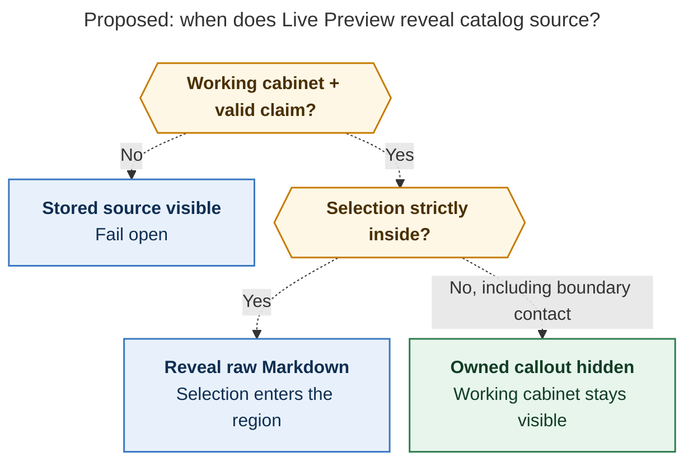

# Diagram proposals: Property Card Cabinets

Proposals for the swarm linker, not a report. Each diagram restates only what the source
report says.

```yaml
source: research:202611/property_card_cabinets/property_card_cabinets__final.md
producer: research.6m.image
check: "mmdc 12.0.0 with the PDF-mirroring config rendered 1 of 1 Mermaid diagrams; Puppeteer --no-sandbox; malformed-source rejection verified"
```

## live-preview-source-visibility

```yaml
anchor: |-
  selection moves **strictly inside** the region
question: |-
  When does Live Preview reveal a catalog's stored Markdown?
illustrates: |-
  Live Preview keeps a valid original catalog visible without a working cabinet representation, and reveals raw Markdown on selection strictly inside rather than boundary contact.
caption: "A working cabinet can hide catalog source; invalid ownership or selection strictly inside reveals it, while boundary contact alone does not."
review: "639.714×658 px, fit 100.0%; reader question answered from PNG; labels, branches, arrowheads and source trace checked; 0 revisions"
```


