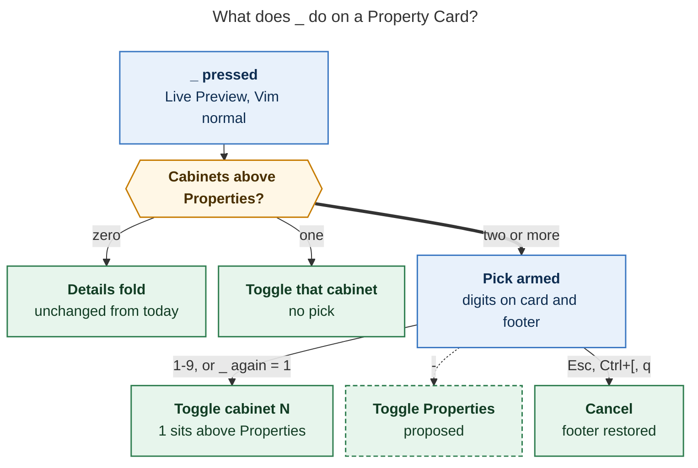
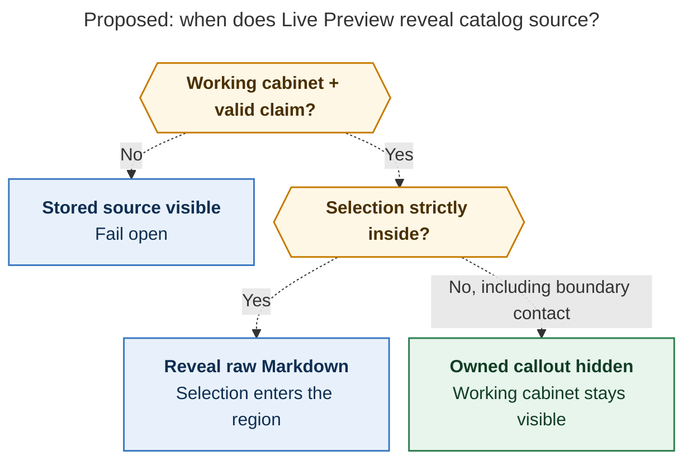

# Property Card Cabinets: consolidated design and delivery recommendation

> **Research query:** How should Bob move child areas, sub-projects, notebooks, albums,
> and records out of H2 sections into collapsible "cabinets" at the bottom of a note's
> property card — keeping the same data, giving the album and bank "Schema" widget a
> cabinet above the existing property cabinet (`-`) with matching styling, and making
> `_` show numbered footer hints (counting up from 1 just above Properties, aborted
> with Esc or `Ctrl+[`) when more than one cabinet sits above Properties — and how can
> this be built in parallel with the in-progress bob-cli-qi, bob-cli-qj, bob-cli-qm,
> and bob-cli-qp epics? Critique the plan, call out any justified requirement
> adjustments, propose a "cabinet" glossary term, and recommend an intuitive, reliable,
> and beautiful solution.

## Bottom line

**Build cabinets — all five researchers and the lead agree this is a good idea — but
with [one load-bearing change to the premise](#requirement-adjustments-explicitly-called-out):
the generated catalogs stay in the Markdown as bob-owned callouts, and cabinets absorb
them at render time.** The request as written ("instead of in H2 sections") must not
mean "stop writing the H2 sections": that would break `SUBOPEN(N)`, capture's
generated-section refusals, the album group jump, mobile, git/agent visibility, and the
explicit rationale of `decisions:notebook-routes-write-notes`.
[Every report converged on this independently](#what-the-five-reports-unanimously-established).

Done as render-time absorption, this is a
**[bob-plugins-only epic](#recommended-solution)**: no bob-cli change, no JSON contract
change, nothing rides the daily release train
(`decisions:bob-cli-releases-ride-a-daily-train`), and Bob Mac Capture is untouched
(`decisions:mac-capture-is-a-thin-client`).

**Parallel delivery needs
[narrow, named coordination](#parallel-delivery-with-the-four-in-progress-epics) — not
a wait.** Development can start today behind a cabinet-owned preview gate. The only
external synchronization points are: Prose Outline delegation after `qm.5`; serializing
real-Obsidian acceptance runs with `qm.6`/`qp.7` (one harness, one vault); and go-live
— gate deletion, docs, and the contended `glossary:property-card` edit — after `qi.6`,
`qm.7`, and `qp.8` close. `qj` has no code seam with this work at all.

## What the five reports unanimously established

These points appeared independently in all (or all-but-one) reports and were verified
against source by the lead. They should be treated as settled.

1. **The "property cabinet" already exists twice over, in divergent styles.** The
   Properties foot (`240o/240p/240r`; `-` keymap; inline disclosure, animated
   `grid-template-rows` drawer, session state keyed by note path) and the full-width
   fold row (`propertyCardBuildFoldRow` in `240s`; `_` keymap) used by album
   **Schema** (`241x`), bank **Setup** (`248b`), and — in flight under qm — prose
   **Outline** (`249m:86–94`, verified by the lead). Area/project/notebook/record (and
   qp's ref) cards instead bind `_` to a *compact title-block chevron* — a third
   style. Unification means one chrome, not three.
2. **`_` assumes exactly one fold per card.** `propertyCardFoldTarget` (`240s:91`,
   verified) returns the **first** visible `[data-card-fold]` node. The moment a
   second extra cabinet mounts, `_` becomes DOM-order-dependent. A multi-fold
   collector must land **before** any card mounts two cabinets — a hard internal
   ordering constraint (grk called it the phase-1 gate; all reports flagged it).
3. **Bob owns exactly the `> [!kind]` callout bytes.** `region.rs` header (verified):
   "Bob owns exactly the `> [!{callout}]` callout block; the position of the block,
   its heading, and every other byte belong to the note's author." A heading with the
   right name does not establish ownership; authored prose can sit in the section.
   Hiding must therefore be callout-anchored, with the heading hidden only when its
   section holds nothing else.
4. **Five readers depend on the stored bytes.** bob's `SUBOPEN(N)`
   (`src/native/projects/surface.rs`, catalog-first, verified), capture's refusal of
   generated-section targets (`src/native/capture/sections.rs:559–612`, verified), the
   album catalog's group jump into `[!records]` rows (`241o`/`241q`), Highlights note
   snapshots (gem), the task-status-cycler plugin (cld) — plus mobile, embeds, Source
   mode, print, git, and agents.
5. **The cancel set is Esc, `Ctrl+[`, and `q`** — not just the two keys in the
   request. `decisions:q-and-ctrl-bracket-mirror-esc` mandates `q` for every panel Esc
   backs out of, and `q` must never be a cabinet number. The Ctrl+W window prefix
   (`bob-navigation-hotkeys` `687`/`266`, verified) is the in-house precedent for the
   whole numbered-prefix interaction: capture-phase listener plus pushed Obsidian
   `Scope`, digits 1–9, the same three cancel keys, disarm on blur/leaf/layout change,
   **no timeout**.
6. **Bank's widget is "Setup", not "Schema", and keeps its name.** It lists
   categories, accounts, rules, and findings; same chrome, different noun.
7. **The preview-gate pattern is proven and must be cabinet-owned.** Reuse neither
   `cardPreviewKinds` (qm.7 deletes it) nor `refCardPreview` (qp owns it).
8. **Passive invariant.** Painting, folding, arming, and cancelling never write the
   vault or spawn bob. Sync stays an explicit gesture.
9. **The glossary race is real.** `qi.6`, `qm.7`, and `qp.8` are all authorized to
   edit `glossary:property-card`. Cabinets must not touch that strand until they
   close. `glossary:cabinet` is uncontended.
10. **qi and qm both recorded this exact feature as deferred out-of-scope work**
    ("Moving `## Albums`/`## Notebooks` catalogs into the cards" —
    `plan:202611/bank_hub_demotion.md`; similarly `plan:202611/prose_and_notebook_cards.md`).
    Cabinets is the follow-up they named, which is why it must be a sibling epic, not
    a splice into qi/qm/qp.

## Lead corrections to the swarm

Three factual claims needed arbitration; the lead verified each against source.

| Claim | Verdict |
| --- | --- |
| gem: every catalog is wrapped in `<!-- bob:<kind>:start/end -->` markers, so hiding can be marker-delimited. | **Wrong.** `region.rs` (verified): HTML markers are **legacy, notebooks-only** (`<!-- bob:notebooks:begin v1 -->`), kept solely for damage detection/migration. Region recognition is heading + contiguous `>`-callout block. gem's `240x` hider must anchor on callout recognition mirroring `region.rs`, exactly as cld specified. |
| grk: prose cards "typically mount zero extras", so no Outline cabinet. | **Wrong.** `249m:86–94` (verified) builds **Outline** with `propertyCardBuildFoldRow`; `249p` is a 6-line stub that `qm.5` (in progress) is filling. Outline becomes a cabinet by delegation, as cld/gem said. |
| Epic snapshots (all reports, ~19:20–19:35 UTC). | **Stale in places.** Fresh read (lead, ~20:00 UTC): qi.1–5 closed, qi.6 in progress; qj.1–2 closed, qj.3–5 in progress; **qm.1–4 closed** (qm.4 closed since the swarm ran), qm.5–7 in progress; **qp.2–3 closed**, qp.1 and qp.4–8 in progress. Implementers must refresh again at planning time. |

One more correction of emphasis: gem's data-source table proposed building Areas and
Projects bodies primarily from report JSON. The consolidated recommendation (cdx, cld,
mus) is **stored-bytes-first for every catalog** — render the callout source with
`MarkdownRenderer.render`, then run the existing painter on the result — because it is
local-first, works with a cold report cache, and preserves exact membership, nesting,
and order (cdx's warning: the Records *index* order is not the walk order; never
rebuild it from `walk_by`). Report data enriches summaries and powers the
missing/damaged states only.

## Requirement adjustments explicitly called out

Consolidated from the five reports; each is a deliberate change to the request.

| # | Adjustment | Why |
| --- | --- | --- |
| A1 | **Catalogs stay in Markdown; cabinets absorb them at render time.** Hide the callout (Live Preview + Reading) only while the card validly owns the note; hide the H2 only when its section holds nothing but the callout and whitespace. Source, mobile, embeds, hover, canvas, print, and plugin-off show the stored sections natively. | [Unanimous points 3–4](#what-the-five-reports-unanimously-established); `decisions:notebook-routes-write-notes` rejected indexes invisible to git, agents, and mobile. Keeps the epic plugin-only and off the release train. If literal H2 removal is ever wanted, it is a separate vault-format epic with migration, rewritten Rust readers, and a superseding decision record (gem's "Stage 2", cdx §7). |
| A2 | **`q` cancels, alongside Esc and `Ctrl+[`.** | `decisions:q-and-ctrl-bracket-mirror-esc` (unanimous). |
| A3 | **Hints appear in two places: digit keycaps lit on the cabinet headers *and* a transient footer overlay.** | Your eyes are on the card when you press `_`; the footer is the guaranteed surface when the stack is scrolled away (4 of 5 reports). mus's cross-pane-leak concern is answered by view-scoping the pick and disarming on leaf change. |
| A4 | **The footer change is an overlay with explicit restore, never a blind repaint.** A `walkerFooterPushOverlay`/`Pop` API on the walker-footer host; async walk painters yield while an overlay is live; restore repaints the current state rather than stashing old HTML; when the status bar is hidden, show a view-local fallback strip instead of entering an invisible mode. | The walker footer hosts the `s`/`w`/`n`/`b` walk panels; a naive `setText` would hide Review/Links/Bank mid-gesture (grk, cld, cdx). |
| A5 | **Bank keeps "Setup"; prose Outline joins the stack by delegation.** | [Unanimous points 1, 6](#what-the-five-reports-unanimously-established). |
| A6 | **Compact details chevrons are not cabinets and get no number.** `_` falls back to the details fold only when zero cabinets sit above Properties (record, ref, notebook, leaf area/project, day–year); when extras exist, the chevron stays click-only. | grk/gem/cld/mus majority; preserves qm/qp in-flight `_` designs unmodified. cdx's numbered "Details" target rejected: details are the card's face, not a compartment. |
| A7 | **`__` (second `_` while armed) toggles cabinet 1; `-` while armed toggles Properties and disarms.** | cld/grk/mus majority; Vim's doubled-key idiom (`dd`, `==`) and the card family's own `==`. On albums it keeps the old one-key Schema habit at two keys. Called out as a proposed addition beyond the request. |
| A8 | **Fixed canonical stack order, not per-note H2 order:** content (Areas → Projects → Notebooks → Albums, or Records / Outline) → config (Schema / Setup) → Properties last. Empty catalogs are omitted; numbering is contiguous bottom-up. | A stable family look, and bottom-up numbering then pins `1` to the config cabinet, which is what makes `__` mean Schema on albums (cld A7, gem §1.4). Matches the writers' placement order in `region.rs`. |
| A9 | **Smart per-cabinet defaults** (see [defaults and state](#defaults-and-state)), including **Records open** on albums and **Schema flipping to closed-when-healthy**. | An album whose primary content collapses would look blank on open (unanimous among reports that considered it); once Records lives inside the card, today's open-by-default Schema would stack two tall bodies (gem). The Schema flip is an explicit behavior change for Bryan to confirm. |
| A10 | **"Cabinet" replaces the second meaning of "drawer".** Docs and memory say "Properties cabinet"; "drawer" remains only the Task Drawer. Code identifiers do not churn. | cld/cdx; avoids colliding with `glossary:task-drawer`. |
| A11 | **Untyped hosts keep their native catalogs.** The root area host (`area.md` is in `HOME_CARD_TYPE_NOTES`, excluded from home cards — verified) has no Property Card to hang a cabinet on; leave its catalog alone as a visible coverage exception rather than inventing a note type. | cdx §5F, gem §1.6. A root hub card is a clean later follow-up. |
| A12 | **Session-only fold state in v1,** keyed `(normalized path, cabinet kind)`, reusing the foot's rename carry-over and delete pruning. Nothing in frontmatter, ever. | Matches Properties today; the one dissent (cld, device-local persistence) loses most of its force once content cabinets default closed. Revisit as a fast-follow if re-opening annoys in practice ([open questions](#open-questions-for-bryan)). |

## Consolidated design

### What a cabinet is

A **cabinet** is a named, independently collapsible full-width compartment at the
bottom of a Property Card: a header (chevron, semibold noun, muted summary, right-slot
stamp/attention chip, keycap) over a lazily built body. Two layers:

- the **property cabinet** — Properties, always last, always `-`, one per card;
- **extra cabinets** stacked above it — Schema/Setup/Outline when the species has one,
  then the note's non-empty catalogs (Areas, Projects, Notebooks, Albums, Records).

Identity — tile, title, crumbs, summary, readouts, the compact details chevron — is
the card's face and is not a cabinet. Several cabinets may be open at once;
independent disclosures, not an accordion, and not tabs (cdx §2).

An area/project host during a pick, and an album at rest:

~~~text
  ▸ Areas       2 areas                                [4]
  ▸ Projects    4 open · 1 blocked · 12 closed  ⚠stale [3]
  ▸ Notebooks   3 notebooks                            [2]
  ▸ Albums      2 albums · 41 records                  [1]
  ─────────────────────────────────────────────────────────
  ▸ Properties  7            created Nov 12            [-]

  ALBUM · Places
  Restaurants — places worth returning to.
  ▾ Records     24 restaurants · by Status
    [existing groups, rows, facets, group folds]
  ▸ Schema      6 fields · walks by Status
  ▸ Properties  9                        created Nov 12
~~~

### One chrome

Pick each attribute from whichever existing style already does it best (cld §4.3, gem
§2.1), applied to every cabinet including Properties:

- Full-width flex button row; `--font-ui-small`; semibold noun; muted ` · ` summary;
  tabular figures.
- One rotating accent chevron (`160ms`, none under `prefers-reduced-motion`).
- Right slot: faint meta (created stamp, age), then the attention chip, then an inline
  keycap at 0.7 opacity on hover/focus — this also fixes the foot's out-of-row keycap
  and the bank foot's missing `-` keycap (cld's side-bug find, `248ca`).
- The foot's animated `grid-template-rows: 0fr→1fr` open for every body; bodies build
  lazily on first open and repaint only when their paint key (bytes digest + report
  generation) changes.
- One hairline stack rule above the first cabinet; hairline separators between fronts;
  no nested boxes; existing theme variables and card accent — no new palette.
- Real `<button>`s with `aria-expanded`/`aria-controls` per the WAI disclosure
  pattern; hidden content leaves the tab order; collapsing a body containing focus
  returns focus to its header; forced-colors fallbacks (cdx §3).
- Large catalogs flow in the document — **no nested scrollbars** (they trap Vim
  `j`/`k` and wheel scrolling; gem §2.1.5, cdx §5E, overruling grk's max-height
  proposal). Bulk is managed by the existing interior folds (record groups,
  `▸ Closed (N)`), lazy bodies, and fixture measurement before any virtualization.

### The underscore keymap

*Figure 1. `_` counts the cabinets above Properties: zero keeps the card's details
fold, one toggles that cabinet directly, two or more arm a numbered pick whose digit
toggles exactly one cabinet; the dashed `-` path is the proposed Properties shortcut
(A7). Rendered 805 × 764 px; fit 81.0% (Mermaid CLI 12.0.0).*

The full contract, merged from cdx's edge-case matrix and cld/grk's key tables:

| Context / input | Result |
| --- | --- |
| `-` anywhere | Toggle Properties; first dismiss an armed pick. |
| `_` arming gate | Today's bare-key gate unchanged: Live Preview, Vim normal mode, no operator/count/register, not composing, not in a text control. Failure falls through to Vim's `_` motion. |
| `_`, zero extras | Today's details fold (or Vim `_` where no card fold exists). |
| `_`, one extra | Toggle it immediately — bank Setup, prose Outline, empty-album Schema keep muscle memory. |
| `_`, two or more extras | Arm the pick; toggle nothing yet. Snapshot the ordered extras bottom-up as semantic kinds (`areas`, `projects`, `notebooks`, `albums`, `records`, `schema`, `setup`, `outline`), never DOM positions. |
| Valid digit | Toggle the advertised cabinet, disarm, scroll a newly opened offscreen header into view (`nearest`). |
| `_` again while armed | Toggle cabinet 1 (`__`; A7). |
| `-` while armed | Toggle Properties, disarm (A7). |
| Out-of-range digit (incl. `0`) | Swallow it, stay armed, nudge the legend ("Choose 1–N"). Never leak a digit into a Vim count. |
| Esc, `Ctrl+[`, `q` | Cancel through the shared close-key classifier (`bobCardCloseKey`, `241xc`). |
| Meta/Alt combos | Cancel and pass through. |
| Any other ordinary key | Cancel and let the original event continue (majority: cdx/grk/mus — in Vim normal mode a passed-through key cannot edit text; cld's swallow-everything alternative noted for the planner). |
| Blur, visibility change, outside mousedown, active-leaf change, layout change, file open, mode change, card unmount, plugin unload | Disarm silently and release hints/listeners. |
| Timeout | **None** — matching Ctrl+W and Vim operator-pending. |
| Mid-pick repaint adds/removes a cabinet | The snapshot's numbering holds for intact kinds; if the picked kind vanished, cancel with a brief "Cabinets changed — press _ again" (cdx). |
| Count cap | Digits 1–9; more extras (none exist today) would be click-only or need an explicit picker (grk A12, cdx). |

Implementation: extend the `_` arm in `248m` additively; while armed push a catch-all
Obsidian `Scope` plus a capture-phase listener, copied from
`687-plugin-window-prefix.js`; de-duplicate window/document delivery; ignore repeats
and IME composition. Reading-view and non-Vim users get clickable headers, clickable
footer chips, and the existing `toggle-card-details` palette command routed through
the same dispatch. An `aria-live="polite"` region announces the choices.

### Footer behavior

~~~text
▤ CABINETS   1 Albums ▸ · 2 Notebooks ▸ · 3 Projects ▾ · 4 Areas ▸ · - Properties · esc
~~~

Ordered `1..N` left-to-right, each chip showing its open/closed glyph so you can see
what a digit will do; chips clickable; answer-chip keycap styling; card-accent tint;
existing end-shedding fit logic on narrow bars. Delivered through the push/pop overlay
API of A4 with `aria-live` and an explicit restore; grk's ~300 ms hint delay (so a
fast `_1` never flashes the footer) is a nice-to-have the planner may keep or drop —
the on-card badges light immediately either way.

### Defaults and state

| Cabinet | Fresh-session default | Resurfacing |
| --- | --- | --- |
| Areas / Projects / Notebooks / Albums | **Closed**, with rich header tallies (`4 open · 1 blocked · 12 closed`) | Never auto-opens; stale/missing shows `⚠` + explicit Sync on the closed header (A9-grk: folded rows stay honest). |
| Records (album) | **Open**, including the empty-album teaching line | n/a |
| Schema (album) | **Closed when healthy** — a change from today's open default (A9, confirm with Bryan) | Auto-opens once per new problem signature via the existing `propertyCardFoldResolve`; an explicit collapse for the current problem stays respected. |
| Setup (bank) / Outline (prose) | Closed when healthy (unchanged) | Existing finding-driven resurface (qi/qm contracts). |
| Properties | Closed (unchanged) | `⚠ N` lint chip on the header. |

State is session-only per `(path, kind)` (A12), shared across same-note panes like the
foot today; per-mount DOM ids stay unique; cleanup is generation-bound so a stale
renderer cannot unregister its replacement (cdx §5A).

### Absorption: hiding the stored sections

- **Recognize** with a pure kit function mirroring `region.rs`: case-insensitive
  callout head, optional fold sign, frontmatter and fences ignored, callout = head
  line plus contiguous `>` lines. Returns `{kind, calloutRange, headingRange|null}`,
  the heading range set only when the section is otherwise empty. A heading whose text
  differs is never adopted.
- **Live Preview:** one kit `StateField` supplying `Decoration.replace({block: true})`
  for owned ranges — directly supplied, not viewport-computed, since multiline hides
  change layout beyond the viewport (cdx). **Spike first, before committing the plan:**
  confirm in real Obsidian that codemirror-vim `j`/`k`/`gg`/`G`, arrows, and heading
  links behave over a block-replaced range; register `EditorView.atomicRanges` if
  motion cannot step over it (cld flagged this as the one unverifiable-from-code
  piece; gem independently proposed atomicRanges). Reveal raw Markdown only when the
  selection moves **strictly inside** the region — not on boundary contact, unlike
  title ownership's inclusive rule, or a Vim `j` landing on the boundary dumps a
  64-line callout mid-scroll (cld §2.1).
- **Reading view:** tag section elements the way title ownership does; the claim must
  be source-aware, not nearest-H2 (postprocessors see sections separately — cdx).
- **Ownership claim:** borrow the frontmatter coordinator's successful-mount /
  valid-evidence / scoped-release shape (`240q`) with a new catalog-specific contract
  carrying file/view identity, exact span, source fingerprint, mount generation, and a
  release function. **Invariant: a valid original catalog is never hidden without a
  working cabinet representation in that view.** Fail open everywhere: Source, embeds,
  hover, canvas, print, mobile, failed mount, stale evidence, malformed or duplicate
  regions, plugin off (cdx §5C table is the reference matrix).
- **Stand the inline painters down** over absorbed regions, or their missing-callout
  status anchors would paint at hidden headings (cld); confirm the shared report
  services still refresh when no inline callout paints (cld §4.7.4).
- **Navigation keeps working:** `[[note#Projects]]` links, Outline pane entries, Find
  hits, and cursor movement either open-and-reveal the corresponding cabinet or reveal
  source at the destination; anchors stay in the Markdown. Obsidian's source-driven
  Outline may still list the stored headings in v1 — an accepted consequence of
  keeping the fallback bytes (cdx §5D).

[The Live Preview source-visibility flowchart](#figure-live-preview-source-visibility)
shows the two proposed checks in sequence: lacking a working cabinet or valid claim
keeps stored source visible, and only selection strictly inside reveals raw Markdown.

_A working cabinet can hide catalog source; invalid ownership or selection strictly inside reveals it, while boundary contact alone does not._

### Special cases the implementation must carry

- **Album group jump** (`apiAlbumOpenGroup`, `241q`): retarget to open the target
  album's Records cabinet, expand the group, and `scrollIntoView` its cabinet DOM
  (cld, gem).
- **`subscriptions.md`**: the Records cabinet body must run the `241hf` subscription
  decoration (pretty category headings, `$X/mo`, `next ≈` chips) — zero chrome loss
  (gem).
- **Records index order ≠ walk order**; preserve the stored index grouping, labels,
  facets, and tally verbatim (cdx).
- **Notebook cards keep qm.4's child-notebook readout chips** — this request does not
  justify rewriting the notebook body or adding owner-style catalogs to notebooks
  (cdx, gem).
- **Root area host**: no card, no cabinet; native catalog stays (A11).
- **Vault scale check** (cld's survey): 27 root notes carry one catalog, 7 carry two,
  3 carry three; `sase.md`'s Projects callout is 64 lines; `eat.md` indexes 106
  records — the fixture set for performance and the acceptance screenshot heroes.

## Resolved disagreements between the reports

| Topic | Positions | Resolution |
| --- | --- | --- |
| Region delimiters | gem: HTML comment markers; cld: callout bytes only | **cld.** Verified in `region.rs`; markers are legacy notebooks-only ([lead corrections](#lead-corrections-to-the-swarm)). |
| Prose Outline | grk: prose mounts zero extras; cld/gem: Outline is a fold row → cabinet | **cld/gem.** Verified in `249m` ([lead corrections](#lead-corrections-to-the-swarm)). |
| Content-cabinet default | cld: open ("nothing disappears") + persistent state; cdx/grk/gem: closed with rich summaries | **Closed.** Decluttering hub notes is the feature's core payoff; honest closed headers (counts, attention, Sync) keep visibility. Session-only state makes closed also the every-session experience, which is the desired steady state. |
| Album Schema default | gem: flip to closed-when-healthy; grk/mus: keep open | **Flip to closed-when-healthy** (A9) — Records open above it makes two open bodies a wall; the existing problem-resurface machinery protects broken schemas. Explicitly flagged for Bryan. |
| Fold-state persistence | cld: per-device localStorage; others: session-only | **Session-only v1** (A12); revisit after living with closed defaults ([open questions](#open-questions-for-bryan)). |
| Large Records body | grk: max-height ~40vh internal scroll; gem/cdx: document flow, no nested scrollbars | **Document flow.** Nested scrollers trap Vim motion and wheel; interior group folds and lazy bodies manage bulk; measure `eat.md` in fixtures before considering virtualization. |
| `_` again while armed | cld/grk/mus: toggles cabinet 1; cdx/gem: cancels | **Toggles cabinet 1** (A7) — majority, preserves the Schema habit, matches doubled-key idiom. Cancel remains three-keyed per decision. |
| Other keys while armed | cdx/grk/mus: cancel and pass through; cld/gem: cancel and swallow | **Cancel and pass through** for ordinary normal-mode keys; Meta/Alt combos pass through; digits never leak ([the underscore keymap](#the-underscore-keymap)). |
| Out-of-range digit | cdx/cld: swallow and stay armed; mus/gem: abort | **Swallow and stay armed** with a "Choose 1–N" nudge — an errant digit should not cost re-arming, and it must not become a Vim count. |
| Compact details fold | cdx: give it a number (`5 Details`); others: not a cabinet, fallback-only | **Fallback-only, click-only when extras exist** (A6) — details are identity chrome; numbering them would also rewrite qm/qp's in-flight `_` designs. |
| Chooser hint surface | mus: card-local only; others: footer + card badges | **Both** (A3/A4), with the overlay-and-restore discipline and the hidden-status-bar fallback strip. |
| Cabinet bodies' data source | gem: report JSON for areas/projects; cdx/cld/mus: stored bytes + painters | **Stored bytes + existing painters**, report-enriched summaries; standalone/report path only for missing/damaged states ([lead corrections](#lead-corrections-to-the-swarm)). |
| External gates | cld: single go-live gate; gem: three gates (qm.5, qp.7, qp.8); grk/mus: file-freeze seams | **Three narrow sync points** ([parallel delivery](#parallel-delivery-with-the-four-in-progress-epics)) — cld's "only go-live" undercounts the Outline seam and the shared acceptance harness; gem's shape is right, with qi.6 added to the go-live set (it owns the family glossary edits now in flight). |

## Parallel delivery with the four in-progress epics

**Start now, as a new sibling bob-plugins epic, dark behind its own `cabinetsPreview`
gate.** Do not splice cabinets into qi/qm/qp, do not make their phases wait, and do
not wait for them to finish development. With the gate closed, rendering is
byte-for-byte today's, so qm.6/qp.7 screenshot reviews and qi.6's passive proof are
unaffected.

Four working rules (consolidated from all five reports):

1. **New fragments for new machinery** (the `240u–240y` slots gem mapped: state, DOM,
   chooser, hider, catalog adapters — note `248n` is taken); **additive hunks only**
   in shared kit files (`240s`, `240o/p/r`, `248m`, `240` footer, `styles.css` in a
   new region). On generated-file conflicts (`main.js`, `fragments.json`,
   `package.json`): take upstream, rebuild, re-bump; never hand-merge `main.js`.
2. **Restyle by delegation.** `propertyCardBuildFoldRow` and the foot disclosure
   build cabinet chrome when the gate is open, so Schema, Setup, Outline, and
   Properties become cabinets **without editing their owning fragments** — in-flight
   cards inherit the change instead of merging it (cld's key insight).
3. **Land the multi-fold collector before any second extra can mount**
   ([unanimous point 2](#what-the-five-reports-unanimously-established)) and
   tag folds with a cabinet-vs-details role attribute in `240s`; keep
   `propertyCardFoldTarget` as a compatibility facade for the 0/1 case.
4. **One integrator owns the shared seams** (fold facade, `_` dispatch, footer
   overlay, shared CSS); content-cabinet work parallelizes per species in separate
   files; record `COORDINATION:` notes on `qm.6`, `qm.7`, `qp.7`, `qp.8` stating that
   the cabinet fragments and gate guard must survive their go-live cleanups (gem).

The only external synchronization points:

| Sync point | What waits | Why |
| --- | --- | --- |
| **`qm.5` closes** | Outline delegation (one small adapter), nothing else | `249p` is the 6-line stub qm.5 is actively writing; touching it now duplicates live work. All other kit/content phases proceed. |
| **`qm.6` / `qp.7` windows** | Scheduling of cabinets' real-Obsidian acceptance | One acceptance harness, one live vault, one `bob plugins sync`; no concurrent screenshot sessions against a moving plugin. A calendar courtesy, not a dependency edge. |
| **`qi.6`, `qm.7`, `qp.8` all closed** | Go-live only: delete the gate, docs sweeps in both repos, `glossary:cabinet`, the `glossary:property-card` family edits, the new decision record, final `bob plugins sync` | All three are authorized editors of `glossary:property-card` and the family docs; cabinets must not race them. If one epic stalls, cabinets can still switch on and file only the conflicting glossary edit as a follow-up (cld). |

`qj` (prose rename) needs no gate: no shared code seam; both prose spellings are
honored (`decisions:prose-notes-are-owned-prose`); retaining the stored sections also
avoids disturbing qj.5's future extract/inline classification (cdx). The existing
family chain (qp acceptance after qm.6, qp go-live after qm.7, qm go-live after qi.6
and qj.4) must not gain reversed edges.

No bob-cli change, no release-train entry, no Mac Capture work, no new CLI
capability. Deployment remains `bob plugins sync` under its refusal protocol.

## Glossary term and memory changes

**At go-live, via `/sase_memory_write`.** No memory is written from this research. The
implementation plan should carry:

- **New `glossary:cabinet`** — consolidated draft below (merging cld's and grk's
  layered drafts with cdx's "not a…" fences).
- **`glossary:property-card`** family edits (one reconciling pass after the three
  go-lives; also `area-card`, `project-card`, `album-card`, `bank-card`, and qm's
  prose strand), replacing "Properties drawer" wording so "drawer" means only the
  Task Drawer.
- **A new decision record**, roughly *"Cabinets absorb catalogs at render time; the
  bytes stay bob's"* — claim A1; rejected alternatives per
  [the resolved disagreements](#resolved-disagreements-between-the-reports); reopens if
  Bryan wants catalogs out of the Markdown or mobile gains cards. It earns a record
  because it settles a cross-repo question: who renders a bob-owned region.

Draft strand:

> **Cabinet** *(aka property cabinet, extra cabinet, cabinet stack)*
>
> A named, independently collapsible full-width compartment at the bottom of a
> [[property-card]]: a header (chevron, noun, one-line summary, attention or stamp,
> keycap) over a body that opens in place. A closed cabinet still says what it holds.
> The **property cabinet** — Properties — is always last and toggles with `-`.
> **Extra cabinets** stack above it in one fixed order: content (Areas, Projects,
> Notebooks, Albums, Records, Outline), then configuration (Schema on an
> [[album-card]], Setup on the [[bank-card]]). Empty catalogs are omitted.
>
> A content cabinet shows the note's bob-owned catalog callout — same rows, grouping,
> and actions. The callout stays in the Markdown; while the card owns the note its
> rendered section hides, along with a heading that labels nothing else. Source,
> mobile, embeds, hover, and print show the stored section natively, and anything
> uncertain fails open to it.
>
> `_` toggles the sole extra cabinet, or, with two or more, arms a numbered pick:
> digits run upward from `1` just above Properties, shown on the cabinet headers and
> in a footer overlay; a digit toggles that cabinet, `_` again picks `1`, `-` picks
> Properties, and Esc, `q`, or Ctrl+`[` cancels. A card with no extra cabinet keeps
> `_` for its own details fold.
>
> Open/closed choices are session-only view state — never frontmatter, never a vault
> write, never a bob spawn. Not a [[task-drawer]], not an Obsidian heading or callout
> fold, not the card's compact details chevron, and not the stored H2 section itself.

## Open questions for Bryan

1. **Schema's default flip** (open → closed-when-healthy on albums): confirm (A9).
2. **`__` = cabinet 1 and `-` = Properties while armed**: welcome, or digits-only?
3. **Session-only vs device-local persistence** for cabinet state: ship session-only
   and revisit, or persist from day one (cld's position)?
4. **Records as a cabinet on the largest albums** (`eat.md`, 106 records): ship for
   consistency and watch during acceptance, or exempt large albums?

## Recommended solution

Ship **Property Card Cabinets** as one new bob-plugins epic (no bob-cli changes),
dark behind its own `cabinetsPreview` gate, with the Vim-motion spike as the first
act:

1. **kit** — cabinet registry + state (session, defaults, resolve), unified chrome by
   delegation (Properties, Schema, Setup join one stack; bank keycap fix), fold-role
   attribute, bottom-up collector with `propertyCardFoldTarget` as the 0/1 facade.
   *The collector must land before any second extra mounts.*
2. **keys** (parallel with 3) — `_` dispatch (0 → details fold, 1 → toggle, 2+ →
   pick), snapshot numbering over semantic kinds, on-card badges, footer overlay
   push/pop with restore and fallback strip, cancel set Esc/`Ctrl+[`/`q`, `__` and
   `-` shortcuts, Scope + capture listener per the window-prefix pattern, aria-live,
   palette/click parity.
3. **absorption** — Vim-over-hidden-range spike first; `region.rs`-mirroring
   recognizer; StateField block-replace (+atomicRanges as spiked); strict-inside
   reveal; Reading-view tagging; painter stand-down; ownership claims with the
   never-hide-without-replacement invariant; navigation reveal.
4. **content cabinets** — host catalogs (Areas/Projects/Notebooks/Albums) and the
   album Records cabinet: stored bytes rendered + existing painters, report-enriched
   summaries, missing/damaged Sync states, subscriptions decoration, group-jump
   retarget. Outline delegation lands here once `qm.5` closes.
5. **acceptance** — real Obsidian with the gate open, scheduled around `qm.6`/`qp.7`:
   every species in Live Preview and Reading, the full keyboard matrix, fail-open
   contexts, passive spy suite (zero writes/spawns), content-parity checks against
   stored catalogs, screenshot heroes (`cash`, `dev`, `sase`, `gtd`, `eat`,
   `subscriptions`, bank, a zero-extra record/prose note proving the `_` fallback),
   light/dark, narrow/wide, reduced-motion, forced-colors.
6. **go-live** — after `qi.6`, `qm.7`, `qp.8` close: delete the gate, docs in both
   repos, `glossary:cabinet` + family strand edits + the new decision record via the
   memory-write workflow, `bob plugins sync`.

Phases 2–4 run concurrently after phase 1; the external world intrudes at exactly the
[three sync points](#parallel-delivery-with-the-four-in-progress-epics). The result
keeps every byte, reader, and fail-open guarantee Bob relies on, gives the whole card
family one beautiful disclosure language with Properties as its anchor, and turns `_`
into a precise, visible, cancel-safe selector instead of a first-match accident.

## Sources

**Consolidated report · 2026-11-26.** Merges five independent swarm reports —
[cdx](property_card_cabinets__cdx.md), [cld](property_card_cabinets__cld.md),
[grk](property_card_cabinets__grk.md), [mus](property_card_cabinets__mus.md),
[gem](property_card_cabinets__gem.md) — plus the lead's own verification pass over
bob-cli (`region.rs`, `surface.rs`, `capture/sections.rs`), bob-plugins (fold kit,
foot, prose card, window prefix), the decisions roster, and a fresh read of the four
epic beads.

- Swarm reports: [cdx](property_card_cabinets__cdx.md) ·
  [cld](property_card_cabinets__cld.md) · [grk](property_card_cabinets__grk.md) ·
  [mus](property_card_cabinets__mus.md) · [gem](property_card_cabinets__gem.md)
  (grk's rendered figures ship alongside as `property_card_cabinets__grk_*.svg`).
- Lead verification (2026-11-26, bob-cli `master`@4168e201, bob-plugins
  `origin/master`): `src/native/host_catalog/region.rs` (callout-only ownership;
  legacy markers notebooks-only), `src/native/projects/surface.rs` (SUBOPEN
  catalog-first), `src/native/capture/sections.rs:559–612` (generated-section
  refusals), `240s` (`propertyCardFoldTarget` first-match), `249m:86–94` (Outline
  fold row), `249p` (6-line stub), `249b:8` (`HOME_CARD_TYPE_NOTES`),
  `266-window-prefix-model.js` (cancel keys).
- Beads (audited reads): `bob-cli-qi`, `bob-cli-qj`, `bob-cli-qm`, `bob-cli-qp`;
  plans `plan:202611/bank_hub_demotion.md`, `plan:202611/prose_note_type.md`,
  `plan:202611/prose_and_notebook_cards.md`, `plan:202611/ref_cards.md`.
- Decisions roster (audited read) and the governing records:
  `decisions:notebook-routes-write-notes`, `decisions:q-and-ctrl-bracket-mirror-esc`,
  `decisions:bank-hub-is-path-canonical-never-area`,
  `decisions:bob-cli-releases-ride-a-daily-train`,
  `decisions:mac-capture-is-a-thin-client`, `decisions:prose-notes-are-owned-prose`,
  `decisions:decision-rules-are-read-at-planning-time`.
- External guidance: WAI-ARIA disclosure/accordion patterns; Obsidian editor
  decoration documentation (per cdx/cld's pinned links).
