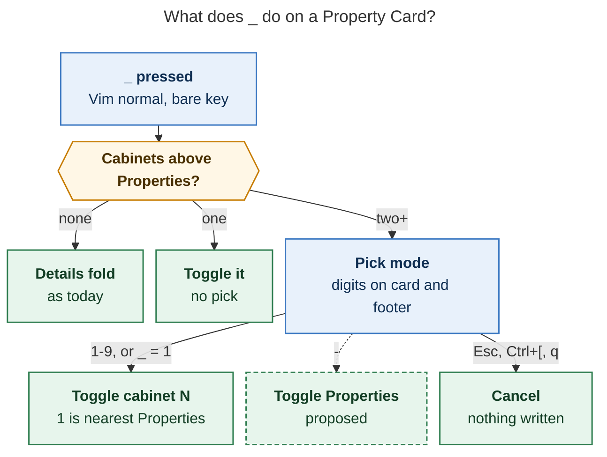
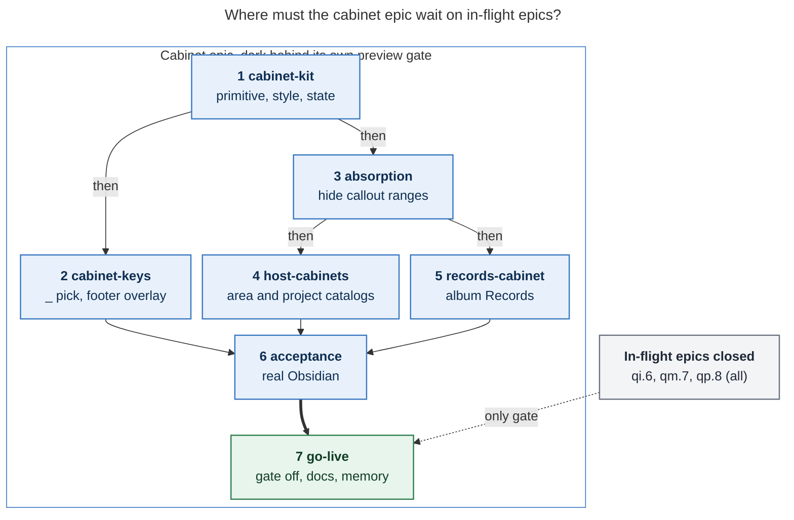

# Property Card Cabinets

## TL;DR

- **The idea is good, but only with one change to its premise.** The catalogs must stay
  in the Markdown as bob-owned callouts. The cabinets should *absorb* them at render
  time, the way the card already absorbs the H1 title. They should not replace them.
  Removing the bytes would break five existing readers and go against the rationale of
  an accepted decision.
- **Done this way, the work is a bob-plugins-only change.** bob-cli needs no change,
  there is no JSON contract change, nothing rides the release train, and Mac Capture
  needs nothing.
- **Very little coordination is needed, by construction.** Put the work behind a
  cabinet-owned preview gate. Restyle by *delegating* the shared fold-row and foot
  builders, so in-flight cards inherit cabinets without anyone editing their code.
  Then the only real gate is **go-live**, after `qi.6`, `qm.7`, and `qp.8` close. That
  gate serializes the shared `glossary:property-card` edits and the family screenshot
  review. Development can start today. qi, qj, qm, and qp do not need new phases or
  gates.
- **`_` keeps working, and the numbered pick appears in two places.** With one cabinet,
  `_` toggles it as today. With two or more, digits light up **on the cabinets
  themselves and in the status-bar footer**. `1` is the cabinet just above Properties.
  - `__` picks `1`, which on album notes is Schema. That keeps the old `_` habit at the
    cost of one extra keystroke.
  - Esc, `Ctrl+[`, **and `q`** cancel. Adding `q` is required by
    `decisions:q-and-ctrl-bracket-mirror-esc`.
- **One visual system covers all cabinets.** Properties, Schema, Setup, Outline, and the
  new catalog cabinets become one stack of matching drawer fronts. Each front has a
  full-width row, a bold noun, an accent chevron that rotates, a summary that stays
  useful when closed, an animated open, and a hairline between fronts.
- **Glossary:** a new `glossary:cabinet` strand (draft in [§4.1](#41-vocabulary-and-the-glossary-term)).
  Rename "Properties drawer" to "Properties cabinet" in docs and memory, so that
  "drawer" means only the Task Drawer.

---

## 1. What exists today (verified)

Plugin paths are relative to bob-plugins `plugins/bob-ledger-tools/src/`. bob-cli paths
are relative to the bob-cli root. Anchors were read at bob-plugins `3863bc46` and drift
quickly while four epics are in flight.

### 1.1 The card already has two collapsibles, in three visual styles

Every Property Card already has two collapsibles: its species fold (`_`) and the
Properties foot drawer (`-`).

- **Properties foot (`-`).** Built by `propertyCardFootBuildEl` (`240o`:541–640).
  - The toggle is `button.bob-property-card-foot-disclosure`, showing `▸ Properties · N`
    with a lint chip and a `created` stamp floated right.
  - The drawer animates `grid-template-rows` from 0fr to 1fr. Its body is built only
    while open.
  - State lives in a module-level `Map` keyed by path (`240p`:18). It is session-only,
    closed by default, carried across renames, and dropped on delete.
- **Species fold (`_`).** Registered per kind with `propertyCardRegisterFoldKind`
  (`240s`:56). What it folds differs by species:
  - **Full-width fold rows** (`propertyCardBuildFoldRow`, `240s`:236–288): album
    **Schema** (`241x`:130–171), bank **Setup** (`248b`:567–668), and prose **Outline**
    (`249m`, being built by qm).
  - **Small chevrons in the title actions:** area/project details (`249c`), notebook
    details (`249h`), and record fields (`242j`/`242k`). qp's Ref Card `_` "compact" is
    the same kind of details fold.
- **The two row styles differ on almost every axis**:

  | Aspect | Properties row | Fold row |
  |---|---|---|
  | Width | Inline | Full width |
  | Font | Body | UI-small |
  | Noun | Plain, muted | Weight-600 noun |
  | Chevron | Rotating, muted | Glyph swap in accent |
  | Open/close | Animated grid | `hidden` |
  | Keycap | Absolutely placed outside the row | Inline |
  | Rule | Border-top | None |

  CSS: `styles.css` 11908–12081 for the foot, 13641–13731 for the fold row.

  The small chevrons are a third style. Side bug: the bank foot never passes `keyLive`
  (`248ca`), so it never shows its `-` keycap.

### 1.2 `_` assumes one fold per card

- **Dispatch.** `handleSchemaDoubleEqualsKeydown` (`248m`:500–624) is a capture-phase
  `keydown` listener. It handles `-`, `_`, `==`, and `+`.
  - The bare keys pass only in Live Preview, in Vim normal mode, with no operator,
    count, or register (`propertyCardBareKeyGate`, `248m`:127–158).
  - When the gate fails, the key falls through to Vim's own motion.
- **The one-section assumption.** `propertyCardFoldTarget` (`240s`:91–118) returns the
  **first** `[data-card-fold]` in DOM order. The registry holds one toggle per kind, and
  state is one value per (kind, path). Nothing in the kit models "several folds on one
  card".

### 1.3 The catalogs are bob-owned callouts that other code reads

All five catalogs go through one engine, `src/native/host_catalog/region.rs`.

**What bob writes and owns.**

- bob owns **only the `> [!kind]` callout bytes**. It writes the `## Heading` once, and
  after that the heading and its position are Bryan's (`docs/areas.md`,
  `docs/projects.md`, `docs/notebooks.md`, `docs/reference/vault-format.md`).
- `decisions:notebook-routes-write-notes`: "Bob owns each area or project's
  `## Notebooks` catalog content; Bryan owns its position." The same decision rejected
  "a Dataview-only index" because it would be "invisible to git, agents, and mobile".

**The five catalogs.**

| Cabinet | Callout | Writer | Hosts in vault |
|---|---|---|---|
| Areas | `[!areas]` (nested descendant forest) | `src/native/areas/catalog.rs`; `bob areas sync`, nightly | 5 |
| Projects (sub-projects) | `[!projects]` (direct children, with lifecycle glyphs and a Closed group) | `src/native/projects/catalog.rs`; `bob projects sync`, `bob tick` every 15 min, capture, plugin auto-sync | 21 |
| Notebooks | `[!notebooks]` | `src/native/notebooks/catalog.rs`; sync, capture `%n`, nightly, plugin auto-sync | 13 |
| Albums | `[!albums]` | `src/native/albums/catalog.rs`; sync, create, nightly, plugin auto-sync | 5 |
| Records (on album notes) | `[!records] <tally>`, always present, even when empty | `src/native/albums/index.rs` | 6 albums |

**Code that reads the stored bytes.** Each of these would break if the bytes went away:

- bob's SUBOPEN (`src/native/projects/surface.rs:153`);
- the task-status-cycler plugin;
- the album catalog's group jump into `[!records]` rows (`241o` `albumGroupJumpTarget`);
- capture's refusal of `@host#areas`-style section targets (`src/native/capture/sections.rs:567-612`);
- mobile, where cards never mount, plus git diffs and agents.

**How the plugin paints them.** Each catalog has a painter that **decorates Obsidian's
natively rendered callout** with report data:

| Catalog | Painter |
|---|---|
| Areas | `areasPaintCallout` (`241ai`) |
| Projects | `projectsPaintCallout` (`241ad`:283) |
| Notebooks | `241c` |
| Albums | `241p` |
| Records | `albumPaintRecordsCallout` (`241s`:88) |

- Areas and projects also have a `*PaintStandalone(host, ctx)` path for hosts whose
  callout is missing.
- In Live Preview, when the callout is absent, the painters add a status-anchor widget
  at the heading (`241ae`:213–245, `241aj`:244).
- Painters read the shared, cached `bob <kind> list -f json` report services.

**Vault shape** (root-level notes):

- 27 notes carry one catalog, 7 carry two, and 3 carry three.
- `cash.md` has Areas, Notebooks, and Albums. `dev.md` has Projects, Notebooks, and
  Albums.
- `sase.md`'s Projects callout alone is 64 lines. `eat.md` indexes 106 records.

### 1.4 The footer has no way for a feature to take it over

- **The footer itself.** The walker footer is one desktop status-bar item
  (`240-plugin-freshness-status.js`). Its painter picks a panel from the persisted walk
  family (`122`:82–114). The async `n`/`b` panels write the footer parts directly.
- **What's missing.** There is no overlay, takeover, or restore API. The painter's
  mode-class list is fixed (`121`:693–703).
- **The only key badge.** The footer's only keycap styling is the tickler "answer chip"
  (`121`:343–476, `styles.css` 568–620).
- **Closest precedent for a transient key mode.** That is nav's **Ctrl+W window
  prefix** (`bob-navigation-hotkeys/src/687-plugin-window-prefix.js`):
  - It uses a capture-phase listener plus a pushed catch-all Obsidian `Scope`.
  - Digits are parsed by `windowPrefixDigitFromKeydown`.
  - Cancel keys are Esc, `Ctrl+[`, and `q`.
  - It disarms on blur, visibility change, outside mousedown, leaf change, and layout
    change.
  - It has no idle timeout.
- **Shared helper for close keys.** `bobCardCloseKey` (`241xc`:5–22) is the shared
  classifier for Esc, `Ctrl+[`, and `q`.

### 1.5 The in-flight epics

| Epic | State (2026-11-26) | Relevant to cabinets |
|---|---|---|
| **bob-cli-qi**, bank hub demotion | qi.1–qi.5 closed. qi.6 (passive proof, docs, memory, deploy) is in progress. | Bank Setup restyle. `docs/bank.md`. `glossary:bank-card` and `glossary:property-card` edits are approved for qi. |
| **bob-cli-qj**, article → prose rename | qj.3–qj.5 in progress | **No seam.** It touches `bob-articles`, CLI, and the vault. |
| **bob-cli-qm**, Notebook and Prose Cards | qm.4–qm.7 in progress, behind the `cardPreviewKinds` gate | Prose **Outline** is a full-width fold row, which makes it a cabinet in all but name. The notebook details fold. It edits shared kit files `240f`/`240s`/`240t`/`styles.css`. qm.7 **deletes** its gate and edits `glossary:property-card`. |
| **bob-cli-qp**, Ref Cards | qp.1–qp.8 in progress, behind the `refCardPreview` gate | `_` compact is a details fold. It makes additive-only edits to shared kit files. qp.6 adds an `==` editor. qp.8 edits `glossary:property-card`. |

---

## 2. Critique: is this a good idea?

**Yes, and the strongest reason is that it puts things where they belong.**

**Benefits:**

- The catalogs are generated navigation chrome, not something Bryan writes.
- Today they sit in the note body, ahead of what Bryan actually authors. On `sase.md`,
  a 64-line Projects block sits before `## Tasks`.
- Moving them into the card makes the body start with authored prose and tasks.
- It gives the family one consistent "contents" zone, and every catalog gets folding
  with a summary line.
- It completes the key family: `-` is Properties and `_` is everything above it.

**Costs and risks you are accepting:**

1. **Hiding byte ranges in the middle of a document is the riskiest part.**
   - Title ownership already hides a range with `Decoration.replace({block: true})`. It
     reveals the raw Markdown when the selection *touches* the range, inclusive of the
     boundary (`240h`:123, `240i`:102–114).
   - For a 64- or 106-line block in the middle of the note, that inclusive rule means a
     Vim `j` landing on the boundary dumps the raw callout onto the screen. A new
     reveal rule is needed, and Vim behavior must be spiked first (§4.7).
2. **There will be two renderings of the same data.** Desktop shows cabinets.
   Mobile, Source mode, embeds, hover previews, and print show the H2 sections. That is
   the honest fallback, and it is the reason the bytes must stay.
3. **Reading order changes.** On `cash.md` the catalogs currently sit after the intro
   prose. As cabinets they sit inside the title card, above it. "Bryan owns the
   position" stops being visible on desktop.
4. **`_` gains a modal state on 16 notes.** Every album note will have two cabinets
   (Records and Schema). So the most common `_` use today, toggling Schema, takes one
   more key. `__` softens this.
5. **Large catalogs make tall cards.** An open Records cabinet on `eat.md` puts Schema
   and Properties below 106 rows. Cabinet state must be remembered, or the card is
   annoying every session.

**What I would *not* do** (details in §6):

- Stop writing the catalogs.
- Show the hints only in the footer.
- Let each note's H2 order decide the cabinet order.
- Leave the three fold styles in place and just add a fourth.

---

## 3. Requirement adjustments (called out)

| # | Your requirement | Adjustment | Why |
|---|---|---|---|
| A1 | "instead of in H2 sections" | Catalogs **stay in Markdown** as bob-owned callouts. Cabinets **absorb** them at render time: on desktop, while a card owns the note, the callout is hidden in Live Preview and Reading. Source, mobile, embeds, hover, and print keep the H2 sections. **No bob-cli change.** | Five readers depend on the bytes (§1.3). `decisions:notebook-routes-write-notes` rejected indexes that git, agents, and mobile can't see. Keeping the bytes also keeps the work off the release train. |
| A2 | Same data as the H2 section | The cabinet body renders **the stored callout bytes** and then runs the **existing** catalog painters on them. Nothing is re-implemented. | Same rows, chips, and folds, with literally the same data. It is local-first and works without a report. |
| A3 | (implicit) hide the section | Hide the callout always. Hide the heading **only when its section holds nothing but the callout.** Authored prose under `## Areas` stays visible. | bob owns only the callout. A cabinet never hides bytes bob doesn't own. |
| A4 | Abort with Esc or `Ctrl+[` | **`q` also aborts.** Any other non-digit key cancels and is swallowed. Meta or Alt combos cancel and pass through. | `decisions:q-and-ctrl-bracket-mirror-esc` says `q` mirrors Esc in every panel and must never be a badge. Swallowing matches Vim's pending-operator behavior, so no stray edit happens. |
| A5 | Hints in the footer | The footer **and** digit keycaps lit on each cabinet header. | Your eyes are on the card when you press `_`. The footer is the guaranteed surface when the card is scrolled away. |
| A6 | (new) | **`__` toggles cabinet 1.** In pick mode, **`-` toggles Properties** and exits. | Vim's doubled-key idiom (`dd`, `yy`, and the card's own `==`) means "the obvious target". It keeps the old one-key Schema habit at two keys on albums. |
| A7 | Numbering starts at the bottom | Kept, with a **fixed, canonical order** of cabinets that does not depend on each note's H2 order: content (Areas → Projects → Notebooks → Albums, or Records / Outline), then config (Schema or Setup), then Properties. | With bottom-up numbering, `_1` is always the config cabinet, so `__` means Schema on album notes. A fixed order gives the family one consistent look. |
| A8 | (implicit) fold state | Open/closed choices **persist per note and per cabinet on each device**, as Obsidian's own heading folds do. Defaults: content cabinets open (nothing you see today disappears), Schema open (today's `foldDefault`), Setup closed when healthy, Properties closed. A *new* problem forces a cabinet open once. | Today's session-only state would reopen `sase.md`'s 64-line Projects cabinet every restart. The force-open-once rule is the kit's existing `propertyCardFoldResolve`. |
| A9 | Bank "Schema" widget | It keeps the name **Setup**. | It shows accounts, categories, and rules, not a schema. Its `==` editor is "Bank Setup". |
| A10 | `_` with no other cabinet | A card with **no** cabinet above Properties keeps `_` for its own details fold. That covers records, notebooks, refs, and areas or projects with no children. On cards that do have cabinets, the details chevron becomes click-only. | This keeps record-field folding and qm/qp's designed `_`, and changes nothing in their in-flight code. |
| A11 | "property cabinet" | Name each cabinet after its label: Properties cabinet, Schema cabinet, Projects cabinet, and so on. The sub-project cabinet is labelled **Projects**, matching its heading; on area notes those projects are children, not sub-projects. Docs and memory say "Properties cabinet" instead of "drawer". Code identifiers do not change. | This frees "drawer" for Task Drawer. Not renaming code avoids conflicts with in-flight branches. |
| A12 | (new) | Prose **Outline** becomes a cabinet automatically, through delegation. | It is already a full-width fold row at the bottom of the card. |

---

## 4. Design

### 4.1 Vocabulary and the glossary term

Each cabinet is one compartment. "Drawer" would be the more literal furniture word, but
it is already taken twice: [[glossary:task-drawer]] and the current "Properties drawer".
Using "cabinet" both distinguishes this concept and retires the second meaning of
drawer. The full set of cabinets on a card is "the cabinet stack".

**Draft `glossary:cabinet` strand.** This text is proposed only; writing it requires
`/sase_memory_write` and a plan-level memory decision.

> **Cabinet** *(aka Properties cabinet, property cabinet, Schema cabinet, cabinet stack)*
>
> One named, collapsible compartment at the foot of a [[property-card]]. A cabinet is a
> full-width header (chevron, name, a one-line summary, a right-hand stamp or attention
> chip, and a keycap) over a body that opens in place. A closed cabinet still says what
> it holds.
>
> Cabinets stack in one fixed order:
> - content first: Areas, Projects, Notebooks, Albums, Records, Outline;
> - then configuration: Schema, Setup;
> - then the Properties cabinet, always last.
>
> A content cabinet shows the rows of the note's bob-owned catalog callout (`[!areas]`,
> `[!projects]`, `[!notebooks]`, `[!albums]`, `[!records]`). The callout stays in the
> Markdown, and while the card owns the note it hides at render time, along with a
> heading that labels nothing else. Source, mobile, embeds, hover, and print show the
> section natively.
>
> Keys:
> - `-` toggles the Properties cabinet.
> - With one other cabinet, `_` toggles it.
> - With two or more, `_` numbers them from the bottom up (`1` sits right above
>   Properties) on the cabinets and in the footer, then waits for a digit. `__` picks
>   `1`, and Esc, `Ctrl+[`, or `q` cancels.
> - A card with no other cabinet keeps `_` for its own details fold.
>
> Choices persist per note on each device. Opening, closing, and picking never write the
> vault or spawn bob. Not a [[task-drawer]], an Obsidian heading or callout fold, or the
> card's details chevron.

**Other memory changes at go-live:**

- `glossary:property-card`: rewrite the key-family sentence.
- `glossary:area-card`, `project-card`, `album-card`, `bank-card`: one clause each.
- A new **decision record**, roughly: "Cabinets Absorb Catalogs At Render Time; The
  Bytes Stay Bob's".
  - Claim: A1 and A3.
  - Rejected alternatives: §6.
  - Reopens when: Bryan wants catalogs gone from the Markdown, or mobile gains cards.

  It deserves a record because it decides a cross-repo question: who renders a
  bob-owned region.

### 4.2 Anatomy and order

```
┌ Property Card ─────────────────────────────────────────────────────┐
│ [tile] AREA · crumbs                         pills  ⊞ Settings  ⌄  │  title block (unchanged)
│        Title                                                       │
│        summary · readouts                                          │  card face (details fold)
├────────────────────────────────────────────────────────────────────┤  ← stack rule (the old foot rule, moved up)
│ ▾ Areas · 3                                                     _  │  content cabinets
│     • child area — summary                  ● 2 projects  today    │    (existing catalog painters)
│     • …                                                            │
│ ▸ Notebooks · 4 · newest 2d                                     _  │
│ ▸ Albums · 2 · 41 records                                       _  │
│ ▸ Properties · 7  ⚠ 1                              created Oct 3  - │  Properties cabinet, always last
└────────────────────────────────────────────────────────────────────┘
```

The mock-up is illustrative; counts are placeholders. Order per species:

| Species | Cabinets, top → bottom | `_` behaviour |
|---|---|---|
| Area / Project | Areas → Projects → Notebooks → Albums (each present only if the catalog exists) → Properties | 0 → details fold; 1 → toggle; 2+ → pick |
| Album | Records → **Schema** → Properties | Always pick (`__` = Schema) |
| Bank | **Setup** → Properties | Toggle Setup (unchanged) |
| Prose (qm) | Outline → Properties | Toggle Outline (unchanged from qm's design) |
| Record / Notebook / Ref / Day–Year | Properties only | Details fold (unchanged), or Vim's `_` where a card has none |

### 4.3 One style for every cabinet

The goal is to pick each attribute from whichever current style already does it best,
then apply it everywhere. Properties joins the stack as an equal.

| Attribute | Cabinet header (all cabinets, Properties included) | Source |
|---|---|---|
| Row | Full-width flex button. 6% accent wash on hover. Focus ring. | fold row |
| Type | `var(--font-ui-small)/1.4 var(--font-interface)`, `tabular-nums` | fold row |
| Noun | Weight 600, `--text-normal` ("Properties" gains weight) | fold row |
| Summary | Joined with ` · `, `--text-muted` | both |
| Chevron | One `▸` in `--bob-property-card-accent`, rotating 90° over 160 ms | foot rotation + fold accent |
| Right slot | Meta (created stamp, age) in `--text-faint`, then the attention chip | foot stamp + fold attention |
| Keycap | Inline at the end of the row, 0.7 opacity on hover or focus. Lit in pick mode. | fold row. This also fixes the out-of-row foot keycap and the missing bank `-`. |
| Open/close | `grid-template-rows` 0fr→1fr over 160 ms; none under `prefers-reduced-motion`. Body built lazily. | foot |
| Separators | One 1px `--bob-walk-ink` stack rule above the first cabinet. Hairline `--background-modifier-border` between fronts. | new |
| Body | Indented to the noun, 0.35em top padding. A 2px accent left rule at about 25% marks the open interior. Catalog rows keep their own styling inside. | album body + new |
| Forced colors | `CanvasText` for chevron, noun, summary, and keycap | fold row |

Together these give the stack its look: quiet drawer fronts separated by hairlines, with
each open body set off by a thin accent rule.

### 4.4 Content cabinets: absorption and bodies

**Recognize.** A pure, kit-level `propertyCardCatalogRegions(text)` sits next to the
title range in `240h`. It mirrors `region.rs` recognition:

- case-insensitive;
- an optional `-`/`+` fold sign;
- ignores frontmatter and fences;
- callout = the head line plus contiguous `>` lines.

It returns `{kind, calloutRange, headingRange|null}`. The heading range is set only when
the section contains nothing else (A3). A heading whose text differs, such as `type.md`'s
`## Projects ([[projects.base]])`, is never adopted.

**Hide.**

- **Live Preview:** one kit StateField supplies `Decoration.replace({block:true})` for
  each owned region.
- **Reading:** tag the section elements with a kit class, the same way title ownership
  already does.
- **Release:** ownership drops exactly as the title does (Source mode, unmount, file
  change, unload). Native rendering returns in the same frame.

**Stand the inline painters down.** While a region is absorbed, the Live Preview catalog
painters must skip it. Otherwise their "missing callout" status anchor
(`241ae`:213–245, `241aj`:244) would paint at the hidden heading.

**Body.** When a cabinet opens:

1. Render the stored callout source with `MarkdownRenderer.render` into the body, under
   the card host's `Component`.
2. Run the existing painter on the result (`areasPaintCallout`, `projectsPaintCallout`,
   the notebook, album, and records painters).
3. Hide the callout's native title row. The cabinet header carries its job.

**Summary line.**

- Counted locally from the bytes: top-level rows, and the records tally text bob writes
  in `[!records] <tally>`.
- Enriched from the cached report when one is present, reusing each painter's tally
  model. Example: Projects `3 open · 1 blocked · 9 closed`. A missing report means the
  enrichment is absent, never zero.

**Edge states.**

- No callout and the report says there are no children: no cabinet.
- Report says there are children but the callout is missing or damaged: the cabinet
  shows an attention chip and an explicit ↻ Sync, using the existing standalone and
  status painters. Clicking Sync invokes bob's writer; that is an explicit gesture, not
  a paint.
- Records is always present (the empty-album teaching line).

**Album group jump.** Clicking an `[!albums]` lead-group chip currently jumps to a stored
`[!records]` row (`241o`). Retarget it to open the album's **Records** cabinet and expand
and scroll to that group.

### 4.5 State and defaults

- **Key and storage.** Key by (normalized path, cabinet kind). Store with
  `app.saveLocalStorage` / `loadLocalStorage`, which is vault-scoped and device-local
  like Obsidian heading folds. bob-* plugin data is gitignored, so plugin data would be
  device-local too and is also acceptable.
- **Lifecycle.** Reuse the foot's rename carry-over and delete pruning (`240p`:158–183).
- **Resolution.** `propertyCardFoldResolve` applies: an explicit choice wins until a
  *new* problem signature appears. Then the cabinet opens once.

### 4.6 `_` and the numbered pick



*Figure 1. `_` counts the cabinets above Properties. With none, it keeps the card's
details fold. With one, it toggles that cabinet directly. With two or more, it arms a
numbered pick that toggles one cabinet and exits. The dashed `-` path is a proposed
addition (A6).*

**Arming.**

- `_` arms only when today's bare-key gate passes: Live Preview, Vim normal mode, no
  operator, count, or register.
- It snapshots the active card's cabinets bottom-up as `[{n, kind, label, open}]`.
- Digits map to **kinds**, not DOM nodes. If a report arrives mid-pick and a repaint adds
  a cabinet, the snapshot's numbering still holds. If the picked kind has vanished, the
  pick cancels with a short notice.

**What shows during a pick.**

```
 card:   ▾ Areas · 3                                           [3]
         ▸ Notebooks · 4 · newest 2d                           [2]
         ▸ Albums · 2 · 41 records                             [1]
         ▸ Properties · 7                       created Oct 3  [-]

 status: ▤ CABINETS  1 Albums ▸ · 2 Notebooks ▸ · 3 Areas ▾ · - Properties ▸ · esc
```

- **On the card:** the digit keycaps light up in the species accent at full opacity.
  The Properties keycap shows `-`.
- **In the footer:** a transient *cabinet* panel shows `[n]` keycaps in the
  answer-chip style, plus each cabinet's state glyph (▸ closed, ▾ open), so you can see
  what pressing a digit will do. The panel wears the card accent and sheds from the end
  as the bar narrows, using the existing fit logic.
- **Accessibility:** an `aria-live="polite"` region announces "Pick a cabinet: 1
  Albums, 2 Notebooks, 3 Areas".

**Keys while armed.**

| Key | Effect |
|---|---|
| `1`–`9` | Toggle that cabinet and exit. |
| `_` | Toggle cabinet `1` and exit (`__`). |
| `-` | Toggle Properties and exit. |
| An out-of-range digit | Swallowed. The pick stays armed and the legend nudges; no motion under reduced-motion. |
| Esc, `Ctrl+[`, `q` | Cancel, through `bobCardCloseKey`. |
| Meta or Alt combos | Cancel and pass through. |
| Any other key | Cancel and swallow. |

**Disarming.**

- Disarms on blur, visibility change, any mousedown, active-leaf change, layout
  change, file open, card unmount, and leaving Vim normal mode.
- There is **no timeout**, matching the window prefix and Vim's operator-pending state.
- After a toggle, a newly opened cabinet whose header is offscreen scrolls into view
  (`nearest`), as `-` already does.

**Implementation shape.**

- Extend the existing `_` arm in `248m` with additive hunks.
- While armed, push a catch-all Obsidian `Scope`, the same pattern as
  `687-plugin-window-prefix.js`:543–573.
- Footer:
  - Add a small overlay API to the footer host: `walkerFooterPushOverlay` /
    `walkerFooterPopOverlay`.
  - `updateFreshnessStatusBar` and the async `n`/`b` painters must yield while an
    overlay is present.
  - The overlay forces the footer visible even when no walk is set.
  - Add a `bob-freshness-cabinets` mode class.
  - On pop, restore by clearing `freshnessFooterPaintKey` and repainting.
- Kit: add `data-card-fold-role="cabinet|details"`. `_` collects every visible
  cabinet-role fold for the view's path. It falls back to the first details-role fold
  only when there are none.

### 4.7 Reliability rules

1. **Passive.** Painting, toggling, and picking never spawn bob or write the vault.
   Only the explicit ↻ Sync button does, through bob's writer. The family's passive
   spy suite gets cabinet cases.
2. **Reveal rule for absorbed catalogs.**
   - Reveal raw Markdown only when the selection is **strictly inside** the region. A
     search hit or a click inside counts; a cursor resting on the boundary does not.
   - Vertical motion steps over the region.
   - **Spike this first:** confirm in real Obsidian that codemirror-vim `j`/`k`/`gg`/`G`,
     arrow keys, and `[[`-heading navigation behave over a block-replaced range. If
     `j` cannot skip it, register the range in `EditorView.atomicRanges`. This is the
     one piece of the design I could not verify from code.
3. **Fail open.** When source or cache evidence is uncertain, the card fails to mount,
   or the context is Source, mobile, embed, hover, canvas, or print, the regions show
   natively. That is the title-ownership contract, extended to catalogs.
4. **Keep the report services warm.** Inline catalog painters used to keep the report
   services subscribed. Confirm the services still refresh on vault events when no
   inline callout paints.
5. **Lazy bodies.** A closed cabinet costs one row. The body renders on first open and
   repaints only when its paint key (bytes digest plus report generation) changes.

---

## 5. Parallel delivery: how much coordination is needed?

**Very little, and only at go-live, as long as the epic follows four rules:**

1. **No bob-cli change at all (A1).** That removes the release-train coupling and every
   CLI or JSON contract question.
2. **Develop dark behind a cabinet-owned preview gate**, for example
   `cabinetsPreview: true` in a **new** fragment.
   - It must not reuse `cardPreviewKinds`, which qm.7 deletes, or `refCardPreview`. This
     is the isolation qp chose for itself.
   - With the gate closed, rendering stays exactly as today, so the in-flight epics'
     real-Obsidian screenshot reviews (qm.6, qp.7) are unaffected.
3. **Restyle by delegation, not by editing other species.**
   - `propertyCardBuildFoldRow` and the foot disclosure build the cabinet header
     whenever the cabinet gate is open.
   - Album Schema, bank Setup, qm's prose Outline, and any qp fold row become cabinets
     **without touching their fragments**.
   - The cabinet-vs-details distinction is one attribute added in `240s`.
4. **Additive hunks only in shared kit files** (`240f`, `240s`, `240o/p/r`, `248m`,
   `styles.css` in a new "Cabinets" region). This is the discipline qm and qp already
   follow. On a conflict in `main.js`, `styles.css`, `fragments.json`, or
   `package.json`: take upstream, rebuild, and re-bump. `bob plugins sync` uses the
   AGENTS.md refusal protocol.



*Figure 2. Converging arrows mean "all of these". Phases 2–5 run in parallel once the kit
lands. The only external gate is go-live, which waits for all three in-flight epics to
close.*

**Seam table.**

| Seam | Cabinet phase | In-flight owner | Handling |
|---|---|---|---|
| Fold kit `240s`, foot `240o/p/r` | kit | qm (notebook/prose folds and feet), qp (ref foot, `_` compact) | Additive. Delegation is gated. Details folds are only tagged, so their behavior doesn't change. |
| Key dispatcher `248m` | keys | qp.6 adds `==` through `registerPropertyCard` | Touch only the `_` arm. The `=` arm is untouched. |
| Gate files `240t`, `cardPreviewKinds` | kit | qm.7 deletes its gate | Own gate in a new fragment. Never read the others. |
| Footer `120`–`125`, `240` | keys | none in flight | Owned by the cabinet epic. |
| Catalog painters `241a`–`241aj`, `241l`–`241t` | absorption, host, records | qm.4 reads `241a` notebook data | Read-only reuse, plus a "stand down for absorbed region" flag. |
| Area/Project card `249b`–`249f`, album `241u`–`241x`, bank `248a`–`248c` | host, records, kit | qi (finished in code; only qi.6 docs remain) | Owned. |
| Docs: `property-editor.md`, `bob-ledger-tools.md`, `area-and-project-cards.md`, `albums.md`, `record-card.md`, bob-cli `docs/*` | go-live | qi.6, qm.7, qp.8 docs sweeps | go-live only, after the gate. |
| Memory: `glossary:property-card` (approved for qi, qm, and qp), `bank-card`, `area-card`, `project-card` | go-live | qi.6, qm.7, qp.8 | go-live only. This is the main reason the gate exists. |
| **qj** | none | none | No seam. |

**What not to do:**

- Don't add cabinet work to qm or qp.
- Don't make their phases wait on cabinets.
- Don't hold the cabinet epic until they finish. The gate makes waiting unnecessary.

If one epic stalls for days, the go-live gate holds for that epic alone. In that case,
go-live can switch cabinets on and defer only the conflicting `glossary:property-card`
edit, filing it as a follow-up.

---

## 6. Alternatives considered

| Alternative | Verdict |
|---|---|
| **Stop writing catalogs and render cabinets only from reports** | Rejected. It breaks SUBOPEN, task-status-cycler, group jumps, mobile, and git/agent visibility. It contradicts the rationale of `decisions:notebook-routes-write-notes`. It forces a bob-cli contract change onto the release train. |
| **Restyle the H2 callouts in place as foldable cabinet-looking blocks** | Cheaper and nothing gets hidden, but it misses the goal: one contents zone in the card under one key family. Native callout folding (`[!x]-`) would also write bob-owned bytes. |
| **Rebuild cabinet bodies from report JSON (the "standalone" path)** | Rejected as the primary path. Only Areas has full standalone rows today, and the rest would need re-implementing. Bodies would also be empty without a report. Kept for the missing-callout edge state. |
| **Letters instead of digits** (`a` Areas, `p` Projects, and so on) | Tempting, because a letter stays the same across notes and could be typed blind. Not recommended now: it adds a second vocabulary, `q` is reserved, and you asked for digits. Revisit if per-note digit shifts bother you in practice. |
| **Top-down numbering** | Rejected. Bottom-up anchors `1` to the stable config cabinet, which is what makes `__` mean Schema. |
| **`N_` count prefix** (`2_` toggles cabinet 2 directly) | Rejected. It is the same number of keys as `_2` and overrides Vim's counted `_` motion. |
| **Footer-only hints** | Rejected (A5). |
| **Keep session-only state** | Rejected (A8). |
| **Make the details fold a "Details" cabinet** | Rejected. Details are the card's face, not a compartment, and the change would rewrite qm's and qp's in-flight `_` designs. |

---

## 7. Open questions for Bryan

1. **Content cabinets open or closed by default?** I recommend open, so nothing you see
   today disappears, with remembered choices. The alternative is closed with rich
   summaries, which gives more compact hub notes from day one.
2. **Should hiding Records inside the album card be optional per album?** The records
   index is the album's main content. I would ship it as a cabinet for consistency and
   watch `eat.md` during acceptance.
3. **Is `__` = 1 and `-` = Properties in pick mode welcome,** or do you want the pick
   strictly digit-only?
4. **Persist Properties-cabinet state too,** or keep only it session-only? I recommend
   one uniform rule.

---

## 8. Recommended solution

Ship **Property Card Cabinets** as one bob-plugins epic. It changes no bob-cli code and
develops dark behind its own `cabinetsPreview` gate, with these phases:

1. **cabinet-kit (medium).**
   - Add a cabinet primitive and the unified header style (§4.3).
   - Add the `data-card-fold-role` attribute and persistent per-note state (§4.5).
   - Gated delegation turns album **Schema**, bank **Setup**, prose **Outline**, and the
     **Properties** foot into one stack. Schema sits directly above Properties.
   - Fix the bank `-` keycap.
2. **cabinet-keys (medium), parallel with phase 3.**
   - `_`: none → details fold, one → toggle, two or more → numbered pick, numbered
     bottom-up.
   - Lit digit keycaps on the cabinets, plus a transient footer overlay panel.
   - `__` picks 1 and `-` toggles Properties. Esc, `Ctrl+[`, and `q` cancel; other keys
     are swallowed.
   - Scope push and disarm rules copied from the window prefix. No timeout. Aria-live
     announcement.
3. **absorption (medium).**
   - Start with the Vim-motion spike.
   - Kit catalog-region recognizer. Hide the callout always, and the heading only when
     its section is otherwise empty.
   - Reveal only on a selection strictly inside; motion steps over the region.
   - Reading-view tagging. Inline painters stand down for absorbed regions.
4. **host-cabinets (medium), after phase 3.**
   - Areas, Projects, Notebooks, and Albums cabinets on Area and Project cards.
   - Bodies are the stored callout rendered by `MarkdownRenderer`, then decorated by the
     existing painters.
   - Summary lines counted from the bytes and enriched from the cached report.
   - The missing or damaged state offers an explicit ↻ Sync.
5. **records-cabinet (medium), parallel with phase 4.** Album **Records** cabinet,
   above Schema. Retarget the album group jump to open the cabinet at that group.
6. **acceptance (medium).** Real Obsidian with the gate open:
   - every species in Live Preview and Reading;
   - pick mode;
   - fail-open contexts;
   - passive spy suite;
   - screenshot review of `cash`, `dev`, `sase`, `gtd`, `eat`, and the bank.
7. **go-live (medium).** Wait for **qi.6, qm.7, and qp.8** to close, then:
   - delete the gate;
   - update docs in both repos, saying "Properties cabinet", not "drawer";
   - add `glossary:cabinet` and the five card strand updates;
   - add the new decision record;
   - run `bob plugins sync`.

Phases 2–5 run concurrently after phase 1. Nothing in qi, qj, qm, or qp changes. The one
thing I would verify before committing to a plan is the Vim-over-hidden-range spike
(§4.7, rule 2). The rest of the design reuses mechanisms the kit already ships: title
ownership, the fold registry and its resolver, the foot's animated drawer, the catalog
painters, and the window prefix's key handling.
