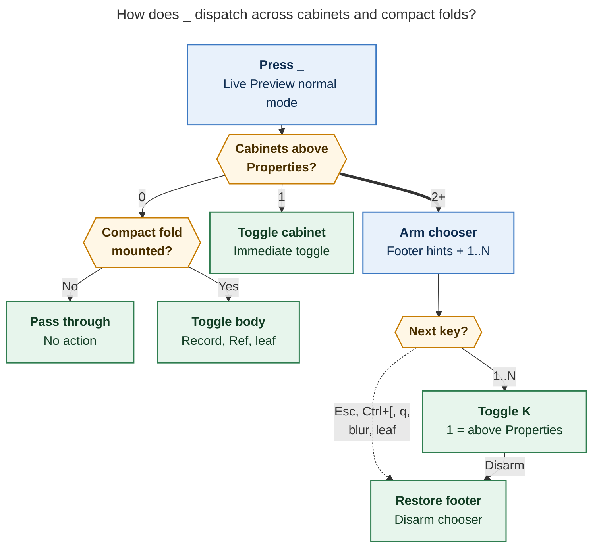

# Property Card Cabinets: Design, Critique, and Parallel Delivery Plan

> **Date:** 2026-11-26  
> **Scope:** `bob-plugins` (`bob-ledger-tools`), `bob-cli` (catalog contracts & optional JSON enrichment), Bob glossary (`sase/memory/glossary/`), and coordination with `bob-cli-qi`, `bob-cli-qj`, `bob-cli-qm`, and `bob-cli-qp`.

---

## Executive Summary & Verdict

**Verdict: Strongly recommended — this is a high-value UX improvement, *with six deliberate design and architecture adjustments*.**

Moving child **Areas**, **Projects**, **Notebooks**, **Albums**, and **Records** from sprawling top-level `##` sections into collapsible **cabinets** stacked at the foot of the **Property Card** directly solves the biggest structural clutter problem in Bob container notes: on an active Area or Project note, `## Areas`, `## Projects`, `## Notebooks`, and `## Albums` currently push `## Tasks` half a screen or more down the page, and every Property Card currently maintains two visually separate disclosure implementations (`.bob-property-card-foot` for `Properties · N` vs. `.bob-property-card-fold` for `Schema` / `Setup` / `Outline`). Unifying them into one **cabinet stack** anchored above `Properties` (`-`) with bottom-up `_` selection makes every container note tighter, calmer, and faster to scan.

However, a deep audit of `bob-cli`, `bob-plugins`, governing decisions, and the four active epics reveals **six concrete pitfalls** in a literal reading of the initial prompt that should be adjusted up front:

1. **Absorb H2 catalogs at render time (Stage 1) rather than deleting them from disk immediately.** Deleting Markdown `##` catalog sections breaks Obsidian Mobile, plain-Markdown/git/agent readability, Obsidian backlinks/graph, `bob-cli`'s `SUBOPEN(N)` parser (`src/native/projects/surface.rs`), Highlights PDF note snapshots (`src/native/highlights_ref/note_snapshot/bob.rs`), and governing decision `decisions:notebook-routes-write-notes`. Rendering cabinets on the desktop Property Card while **hiding the redundant generated H2 + `[!...]` block at render time** mirrors Title Ownership (`240i`) and Frontmatter Ownership (`240q`), keeps all five contracts intact, gives 100% Records/Subscriptions parity with zero `bob-cli` edits, and leaves an optional Stage 2 removal path open later.
2. **Resolve the live `_` keymap collision with compact card-body folds, and include both Bank's `Setup` and Prose Card's `Outline`.** Every card species today already binds `_` (`240s` + `248m`). Bank Card's fold is named **`Setup`** (not `Schema`), and `bob-cli-qm`'s Prose Card uses the exact same `propertyCardBuildFoldRow` widget for **`Outline`**. Meanwhile, Area, Project, Notebook, Record, and Ref cards bind `_` to a compact title-bar chevron that collapses the card body. `_` should target **cabinets above Properties first** and fall back to the compact body fold only when zero cabinets sit above Properties.
3. **Give each cabinet a smart default open/closed state.** Container catalogs (`Areas`, `Projects`, `Notebooks`, `Albums`) and `Setup` / `Outline` should default **closed** (with rich summary tallies on the closed header so `## Tasks` stays on screen), whereas **`Records` on Album notes should default open** (otherwise an Album note opens looking blank) and **`Schema` on Album notes should shift to default closed when healthy**, resurfacing open automatically when invalid or empty.
4. **Pair bottom-up `1..N` numbering with live on-header keycap badges and `q` cancel.** Anchoring `1` directly above `Properties` keeps `Schema` stable at `1` on Album notes even with `Records` (`2`) above it, and avoids shifting lower shortcuts as upper catalogs appear. To eliminate top-down vs. bottom-up scanning friction, arming `_` should simultaneously swap Obsidian's footer to numbered hints **and light up `1`, `2`, `3`… keycaps right on the cabinet headers**. Cancel should accept `<Esc>`, `<Ctrl+[>`, **and `q`** per `decisions:q-and-ctrl-bracket-mirror-esc`.
5. **Make hidden H2 catalog blocks atomic in Live Preview and preserve user-authored prose.** Generated `<!-- bob:*:start -->…<!-- bob:*:end -->` regions are machine-owned; unlike human-authored H1 titles, they should use `EditorView.atomicRanges` so Vim `j`/`k` glides cleanly across them without exploding 100 lines of raw callout Markdown mid-scroll (Source mode reveals them verbatim), and the `##` heading should hide only when no user-authored text sits outside the markers under that heading.
6. **Handle three codebase special cases explicitly:** root `area.md` (currently excluded from `HOME_CARD_TYPE_NOTES` so it has no Property Card), `subscriptions.md` (whose `[!records]` rows carry `241hf` pretty category headings, monthly amounts, and `next ≈` chips), and cross-note group jump `apiAlbumOpenGroup` (`241q`, which must open the `Records` cabinet and expand/scroll to the target group inside the card).

Finally, **can this run in parallel with `bob-cli-qi`, `bob-cli-qj`, `bob-cli-qm`, and `bob-cli-qp`?** **Yes — with lightweight, explicit coordination.** Zero coordination would cause bundle, CSS, glossary, and Obsidian acceptance collisions in `bob-ledger-tools`; gating cabinets behind an independent `cabinetPreview` flag (the exact pattern already coordinating `qm` and `qp`) lets Phases 1–3 build immediately in parallel with zero blocking waits, synchronizing only at three narrow gates: `bob-cli-qm.5` (Prose `Outline`), `bob-cli-qp.7` (real-Obsidian acceptance harness), and `bob-cli-qp.8` (clean go-live & glossary).

---

## 1. Critique of the Plan & Justified Adjustments

### 1.1 Keep vs. Delete H2 Catalog Sections on Disk? (Most Important Architectural Decision)

The prompt asks to render child areas, sub-projects, notebooks, albums, and records as cabinets *"at the bottom of the property card for the given file instead of in H2 sections."* That phrase admits two very different architectures:

| Dimension | Option A: Render-Time Absorption (Recommended — Stage 1) | Option B: Stop Writing H2 Sections to Markdown (Stage 2 / Hard Cutover) |
| :--- | :--- | :--- |
| **Desktop Obsidian (Reading & Live Preview)** | User sees **only** the cabinets at the bottom of the Property Card; redundant `##` + `[!...]` blocks are hidden cleanly at render time. | User sees only the cabinets; Markdown files contain no `## Areas/Projects/Notebooks/Albums/Records` blocks. |
| **Obsidian Mobile** | **Works cleanly.** Property Cards are desktop-only (`homeCardDesktop()`, `ref_cards`, `prose_and_notebook_cards` exclude mobile); mobile keeps clickable H2 callouts. | **Broken.** Mobile users lose all navigation to child areas, sub-projects, notebooks, albums, and records. |
| **Plain Markdown, Git diffs, AI agents** | **Preserved.** Satisfies `decisions:notebook-routes-write-notes`, which explicitly rejected plugin-only indexes as *"Invisible to git, agents, and mobile, and it cannot roll up through sub-projects."* | **Violated.** Requires superseding `decisions:notebook-routes-write-notes` and leaves vault files opaque without running `bob`. |
| **Obsidian Backlinks & Graph View** | **Preserved.** Wikilinks inside on-disk Markdown callouts remain real edges in Obsidian's `resolvedLinks`. | **Lost.** DOM-only plugin widgets do not register in Obsidian's backlinks or graph. |
| **`bob-cli` internal readers** | **Zero breakage.** `src/native/projects/surface.rs` (`read_subopen` / `parse_catalog` powering `SUBOPEN(N)` for `project_pull_in.rs`, `keep_moving.rs`, `successors.rs`) and `src/native/highlights_ref/note_snapshot/bob.rs` keep working untouched. | **Breaks `SUBOPEN(N)` & Highlights PDF snapshots** unless both Rust subsystems are rewritten first to walk the project graph directly. |
| **Fail-open guarantee** | **Matches entire Property Card family.** Source mode, embeds, hover previews, print/PDF, and plugin disable/unload restore native Markdown in the same frame (`240i`, `240q`). | **Not fail-open.** Disabling `bob-ledger-tools` or opening a note in Source mode shows nothing. |
| **Records / Notebooks / Albums data parity** | **100% immediate parity, zero `bob-cli` changes.** The retained `<!-- bob:*:start/end -->` block already carries Rust-computed `index_group_by`/`index_by` subgroups, `index_facets`, and `🧩` descendant groups; plugin caches add live status, ages, and subscription chrome. | **Requires additive `bob-cli` JSON extensions** (`bob albums list` currently emits only top-3 `groups[].peek`, not full records/subgroups/facets; `notebooks`/`albums` JSON lacks pre-grouped `catalogs[].rows`). |
| **File noise on disk** | Keeps generated `<!-- bob:*:start/end -->` blocks in raw `.md` files (invisible in Live Preview & Reading view, visible in Source mode and git). | Cleaner raw `.md` files and smaller git diffs on structural changes. |

**Recommendation (Adjustment #1):** Ship **Option A (Render-Time Absorption)** as the primary design. It delivers **100% of the visual and ergonomic win** on desktop Obsidian while honoring every Bob architectural invariant (fail-open cards, mobile legibility, `SUBOPEN(N)`, backlinks, `decisions:notebook-routes-write-notes`, and zero `bob-cli` merge conflicts during the four concurrent epics).

If after living with cabinets Bryan genuinely wants raw `.md` files free of generated catalog blocks (accepting the loss of mobile/plain-Markdown/backlink indexes), treat that as a separate **Stage 2** `bob-cli` epic whose explicit prerequisites are: (a) rewriting `surface.rs` and `note_snapshot/bob.rs` off `[!projects]`, (b) adding full `records[]` and `catalogs[].rows` JSON payloads to `bob albums list` and `bob notebooks list`, (c) formally superseding `decisions:notebook-routes-write-notes`, and (d) adding a safe `bob ... sync --prune-catalogs` migration.

---

### 1.2 The `_` Keymap Collision & Complete Species Inventory

Inspecting `240f-plugin-property-card-species.js`, `240s-plugin-property-card-fold.js`, and `248m-plugin-schema-double-equals.js` surfaces two critical facts not reflected in the prompt:

1. **Bank's fold is `Setup` (not `Schema`), and Prose Card has a third full-width fold: `Outline`.**
   - `241x-plugin-album-schema-dom.js`: Album Card renders `Schema` via `propertyCardBuildFoldRow`.
   - `248b-plugin-bank-setup-dom.js`: Bank Card renders **`Setup`** via `propertyCardBuildFoldRow` (default closed, resurfaces on findings).
   - `249m-plugin-prose-note-card-dom.js` + `249p` (`bob-cli-qm`): Prose Card renders **`Outline`** via `propertyCardBuildFoldRow` (default closed). Leaving `Outline` on the legacy fold row while migrating `Schema` and `Setup` would fracture the Property Card family on day one.
2. **`_` is ALREADY bound on Area, Project, Notebook, Record, and Ref cards to a compact header chevron (`.bob-property-card-fold-compact`).**
   - `249c-plugin-home-card-dom.js` lines 148–172 registers `area` and `project` with `propertyCardDecorateFoldControl(..., { compact: true })`, collapsing the card's summary line and policy/readout chip row.
   - `propertyCardFoldTarget(view)` in `240s` simply picks the **first** `[data-card-fold]` element in DOM order! Adding cabinets to Area/Project cards without redefining `_` dispatch would either hijack `_` on the header chevron or break cabinet selection.

Here is the complete inventory across all 12 Property Card species (including `Ref` from `bob-cli-qp`):

| Card Species | Existing `_` Control Today | Proposed Cabinets (Top → Bottom) | Bottom-Up `_` Numbers | Behavior of `_` |
| :--- | :--- | :--- | :--- | :--- |
| **Area** | Compact header chevron (body fold) | `Areas` · `Projects` · `Notebooks` · `Albums` → `Properties` *(only present cabinets render)* | `N..1` (only non-empty) | ≥2 cabinets → chooser; 1 → toggle it; 0 (empty leaf) → fallback to compact header fold *(or click-only; see below)* |
| **Project** | Compact header chevron (body fold) | `Projects` · `Notebooks` · `Albums` → `Properties` *(only present cabinets render)* | `N..1` (only non-empty) | Same as Area |
| **Album** | Full-width `Schema` fold row | `Records` → `Schema` → `Properties` | `2` Records, `1` Schema | Always ≥2 cabinets (unless `Records` absent → 1 cabinet `Schema`) → chooser (`1` Schema, `2` Records) |
| **Bank** (`bank.md`) | Full-width `Setup` fold row | `Setup` → `Properties` | `1` Setup *(single)* | 1 cabinet → toggles `Setup` directly (identical to today, unified styling) |
| **Prose** (`bob-cli-qm`) | Full-width `Outline` fold row | `Outline` → `Properties` | `1` Outline *(single)* | 1 cabinet → toggles `Outline` directly (unified styling) |
| **Notebook** (`bob-cli-qm`) | Compact header chevron (body fold) | `Properties` *(note: child notebooks stay in card readout slot unless later promoted)* | `0` above Properties | 0 cabinets → fallback to compact header fold (unchanged) |
| **Record** | Compact header chevron (body fold) | `Properties` | `0` above Properties | 0 cabinets → fallback to compact header fold (unchanged) |
| **Ref** (`bob-cli-qp`) | Compact header chevron (body fold) | `Properties` | `0` above Properties | 0 cabinets → fallback to compact header fold (unchanged) |
| **Day / Week / Quarter / Year** | None | `Properties` | `0` above Properties | No-op pass-through (unchanged) |

**Recommendation (Adjustment #2):**
- Migrate **all three** existing full-width fold rows into cabinets above `Properties`: Album **`Schema`**, Bank **`Setup`**, and Prose **`Outline`** (with Prose `Outline` gated cleanly on `bob-cli-qm.5`).
- Establish one crisp priority rule for `_`: **Cabinets above Properties always own `_`.** When ≥ 1 cabinet sits above `Properties`, the Area/Project title-bar compact chevron drops its `_` keybinding and keycap (staying mouse-clickable for anyone who still wants to tuck away the 1–2 line summary/chip bar). When **0** cabinets sit above `Properties` (Record, Ref, Notebook, or a leaf Area/Project with no child catalogs), `_` cleanly falls back to the compact header chevron so zero existing workflows regress.
- *(Alternative worth noting for Bryan: remove the `_` fallback on leaf Area/Project altogether — keeping their compact chevron click-only everywhere — if you prefer a leaf Project and a parent Project never to differ in what `_` means. On balance, the 0-cabinet fallback is less surprising because leaf Projects preserve current tests and behavior, while parent Projects immediately gain cabinet control.)*

---

### 1.3 Default Expanded/Collapsed States (Don't Make Album Notes Look Blank!)

If every cabinet defaulted to collapsed:
- **Area & Project notes:** Huge win! `## Tasks` immediately rises to the top of the viewport, while compact closed cabinet rows (`▸ Projects · 4 open · 1 blocked · 12 closed`, `▸ Albums · 3`, etc.) give full visibility at a glance.
- **Album notes:** **Major UX regression!** An Album note's primary content *is* its `Records` list (its `## Tasks` is usually absent or short). Opening `restaurants.md` to see only a header and three closed rows (`▸ Records`, `▸ Schema`, `▸ Properties`) forces an extra keystroke (`_` then `2`) every single time you open an album!
- Conversely, Album's `Schema` currently defaults **open** (`foldDefault: true` in `240f`), which made sense when `Records` sat below the card in an H2 — but once `Records` moves *inside* the card above `Schema`, leaving `Schema` open by default would stack two tall expanded bodies inside the card.

**Recommendation (Adjustment #3 — Per-Cabinet Smart Defaults):**

| Cabinet | Default State (Fresh Session) | Problem Resurfacing (`propertyCardFoldResolve`) | Rationale |
| :--- | :--- | :--- | :--- |
| **`Records`** (Album) | **Open** | N/A (already open) | Primary content of an Album note; note should never look empty on open. |
| **`Schema`** (Album) | **Closed** *(changed from today's Open)* | **Auto-opens** when schema has lint errors or is empty (`emptySchema` / `schemaInvalid`) | Keeps Album notes focused on Records while surfacing broken schemas automatically. |
| **`Setup`** (Bank) | **Closed** *(unchanged)* | **Auto-opens** on new/changed bank findings | Matches existing `bob-cli-qi` contract. |
| **`Outline`** (Prose) | **Closed** *(unchanged)* | **Auto-opens** on blocking outline/contract findings | Matches `bob-cli-qm` contract. |
| **`Areas` / `Projects` / `Notebooks` / `Albums`** | **Closed** | Never auto-opens (stale/missing sync shows an inline `⚠` + `Sync` pill right on the closed header!) | Keeps `## Tasks` immediately visible at the top of Area/Project notes while exposing status without expanding. |
| **`Properties`** (all species) | **Closed** *(unchanged)* | Lint count shows `⚠ N` chip on closed header (unchanged) | Matches existing `bob-cli-pf` drawer contract. |

Every cabinet's open/closed choice persists per `(notePath, cabinetId)` in session memory (extending `240p` / `240s` — never written to frontmatter or vault settings), carries across file renames, and clears on delete or plugin unload.

---

### 1.4 Bottom-Up Numbering & Abort Keys

Bryan proposed numbering cabinets above `Properties` starting at `1` from the **bottom non-property cabinet** (the one right above `Properties`) going upward.

**Critique of bottom-up numbering:**
- **Why it is genuinely smart:**
  1. `1` is physically closest to `-` (`Properties`) and closest to the Obsidian footer at the bottom of the window.
  2. On Album notes, `Schema` stays **`1`** (`_`, `1`) and `Records` is **`2`** (`_`, `2`) — matching Bank (`Setup` = sole cabinet above Properties) so configuration/meta cabinets sit nearest `Properties` while content catalogs stack upward.
  3. On Area/Project notes, if a new top catalog (`Areas` or `Projects`) is later added to a note that already had `Albums`, `Albums` stays `1` instead of shifting down.
- **The risk:** Reading a vertical stack top-to-bottom and mentally inverting `3, 2, 1` adds split-second friction *if* numbers only appear in the bottom status bar and not on the cabinets themselves.

**Recommendation (Adjustment #4):** Keep Bryan's **bottom-up numbering**, and make it effortless with two refinements:
1. **Simultaneous inline keycap illumination:** The instant `_` arms chooser mode on a 2+ cabinet card, every numbered cabinet header in the active view lights up its accent-tinted `<kbd>1</kbd>`, `<kbd>2</kbd>`, `<kbd>3</kbd>`… badge right on the row (matching the status bar hints `1 Albums · 2 Notebooks · 3 Projects · 4 Areas`). Your eye never has to count from the bottom!
2. **Honor `q` alongside `<Esc>` and `<Ctrl+[>` to abort**, per governing decision `decisions:q-and-ctrl-bracket-mirror-esc`. Also disarm cleanly (without toggling) on window blur, `visibilitychange`, outside mouse click, active-leaf change, layout change, or pressing `_` a second time.

---

### 1.5 Atomic H2 Hiding & Preserving User-Authored Prose

In Title Ownership (`240i-plugin-property-card-title-ownership.js`), moving the cursor onto the hidden H1 line in Live Preview reveals the raw Markdown because titles are human-authored and users edit them inline.

Generated H2 catalog sections are different: `bob-cli/src/native/host_catalog/region.rs` and `src/native/albums/index.rs` enclose every generated catalog inside exact machine-owned markers:

```markdown
## Projects

<!-- bob:projects:start -->
> [!projects] Projects
> ...
<!-- bob:projects:end -->
```

**Recommendation (Adjustment #5):**
- **Use `EditorView.atomicRanges` in Live Preview** on hidden catalog regions so Vim `j`/`k` and arrow keys step smoothly over the hidden block instead of exploding 100 lines of raw callout Markdown mid-scroll. Switching to **Source mode** (`Ctrl+E`) still reveals every raw byte immediately (just like Title Ownership and Frontmatter Ownership).
- **Never hide user-authored prose.** Only hide the preceding `## <Kind>` heading when the lines between `## <Kind>` and `<!-- bob:<kind>:start -->` (and after `<!-- bob:<kind>:end -->` until the next heading) are blank/whitespace. If a user wrote custom prose under `## Projects` outside the markers, hide *only* the `<!-- bob:projects:start -->…<!-- bob:projects:end -->` callout block and keep the heading + custom prose visible!

---

### 1.6 Codebase Special Cases Surfaced by Audit

1. **Root `area.md` has NO Property Card today.** `HOME_CARD_TYPE_NOTES = Object.freeze(["area.md", "project.md", "bank.md"])` in `249b-plugin-home-card-model.js:8` explicitly excludes `area.md` because `area.md` is an untyped root index note, not a `type: area` note. Yet `area.md` IS the root host of `## Areas`!
   - **Adjustment #6a:** Keep `area.md`'s existing standalone `[!areas]` card untouched in this epic (no hidden H2 because no Property Card mounts there). If Bryan later wants `area.md` to gain a minimal root hub card like `bank.md`, that is a small clean follow-up.
2. **`subscriptions.md` Album Special Decoration (`241hf`).** `241hf-plugin-bank-subscriptions-surfaces-dom.js` decorates the `[!records]` callout on `subscriptions.md` with pretty category headings (`💻 Tech & AI · 5`), monthly equivalent amounts (`$9.99 a month`), and `next ≈ Dec 21` chips from `bob bank subscriptions -f json`. The `Records` cabinet builder MUST invoke `bankSubscriptionPrettyHeading` / `bankSubscriptionIndexRowModel` (or pass the cabinet's rendered record list through `albumPaintSubscriptionRecords`) so zero subscription chrome is lost.
3. **Cross-Note Album Group Jump (`apiAlbumOpenGroup`, `241q:213`).** Clicking a lead-group chip on an album row inside an Area/Project's `Albums` cabinet currently navigates to `albumPath` and jumps to the line number of that group inside `## Records`. When `## Records` is hidden inside a cabinet on the Album Card:
   - `apiAlbumOpenGroup` (via `albumRevealRecordGroup`) MUST **force-open the `Records` cabinet**, expand the target group inside the cabinet, and call `scrollIntoView({ block: "nearest" })` on that group's cabinet DOM element instead of jumping to a hidden Markdown line!
4. **Record Age Chips (`241r`) & Record Group Folding (`241s`).** Both `visited`/`watched_on` age chips (from `metadataCache`) and per-group fold toggles (`▾`/`▸` inside `Records`) live cleanly inside the `Records` cabinet body with zero behavioral loss.
5. **Notebook Card Child Notebooks (`bob-cli-qm.4`).** Note that Notebook notes never had a `## Notebooks` H2 section — `bob-cli-qm.4` renders child notebooks inside the Notebook Card's readout slot. Keep Notebook Card's child notebooks there for now to avoid thrashing `bob-cli-qm.4` mid-flight (they can optionally become a `Notebooks` cabinet in a later cleanup if desired).
6. **`bob-cli-qj.5` Potential `## Prose` Catalog.** `plan:202611/prose_note_type.md` notes that `qj.5` will consider whether to add a generated `## Prose` host catalog. Designing the cabinet registry declaratively means if `## Prose` is ever added later, plugging it into the cabinet stack is a single registry entry.

---

## 2. Visual & Interaction Design

### 2.1 Unifying `Schema` / `Setup` / `Outline` and `Properties` into One Cabinet Tray

Today, `.bob-property-card-foot` (`styles.css:11905–12090`) and `.bob-property-card-fold` (`styles.css:13635–13745`) look like cousins from different eras:
- **`.bob-property-card-foot` (`Properties · N`):** hairline top rule, `inline-flex` disclosure button, smooth CSS `grid-template-rows: 0fr -> 1fr` (`160ms ease`) body reveal, rotating `▸` chevron (`rotate(90deg)`), right-aligned `created` stamp, subtle `⚠ N` lint pill.
- **`.bob-property-card-fold` (`Schema` / `Setup` / `Outline`):** full-width flex button with `0.55em` top margin, `6%` accent hover wash, bold noun + muted `· summary`, `margin-inline-start: auto` attention chip, hover-revealed `<kbd>` keycap, abrupt `hidden` toggle with text-swapped `▸`/`▾` (no animation).

**Unified `.bob-cabinet-stack` Design:**
Every Property Card ends with a single **Cabinet Stack** (`.bob-cabinet-stack`), separated from the card's upper header/body by one crisp hairline rule (`1px solid color-mix(in srgb, var(--bob-walk-ink, var(--text-muted)) 18%, transparent)`), with subtle `1px` internal hairlines (`10%` opacity) separating adjacent cabinets. Every cabinet — **including `Properties` at the bottom** — shares the exact same `.bob-cabinet` component:

```text
┌─────────────────────────────────────────────────────────────────────────┐
│  [Icon]  AREA                                    [Root]  [⊞ Settings]   │
│          Health & Fitness                                               │
│          Daily habits, workouts, and nutrition                          │
│          [🎨 sage] [⏱ 25m]                           2 today            │
├─────────────────────────────────────────────────────────────────────────┤  ← .bob-cabinet-stack
│  ▸ Areas · 2 areas                                                      │  ← closed cabinet (num 4)
│  ▸ Projects · 4 open · 1 blocked · 12 closed                  ⚠ stale   │  ← closed cabinet (num 3)
│  ▸ Notebooks · 3 notebooks                                              │  ← closed cabinet (num 2)
│  ▸ Albums · 2 albums                                                    │  ← closed cabinet (num 1)
├┄┄┄┄┄┄┄┄┄┄┄┄┄┄┄┄┄┄┄┄┄┄┄┄┄┄┄┄┄┄┄┄┄┄┄┄┄┄┄┄┄┄┄┄┄┄┄┄┄┄┄┄┄┄┄┄┄┄┄┄┄┄┄┄┄┄┄┄┄┄┄┄┄┤  ← subtle separator before Properties
│  ▸ Properties · 7                                  created Nov 12   [-] │  ← bottom cabinet (always '-')
└─────────────────────────────────────────────────────────────────────────┘
```

**When the user presses `_` in Live Preview Vim normal mode (2+ cabinets above Properties):**

```text
├─────────────────────────────────────────────────────────────────────────┤  ← .bob-cabinet-stack.is-chooser-armed
│  ▸ Areas · 2 areas                                                 [4]  │  ← live accent keycaps light up!
│  ▸ Projects · 4 open · 1 blocked · 12 closed           ⚠ stale     [3]  │
│  ▸ Notebooks · 3 notebooks                                         [2]  │
│  ▸ Albums · 2 albums                                               [1]  │
├┄┄┄┄┄┄┄┄┄┄┄┄┄┄┄┄┄┄┄┄┄┄┄┄┄┄┄┄┄┄┄┄┄┄┄┄┄┄┄┄┄┄┄┄┄┄┄┄┄┄┄┄┄┄┄┄┄┄┄┄┄┄┄┄┄┄┄┄┄┄┄┄┄┤
│  ▸ Properties · 7                                  created Nov 12       │  ← dimmed keycap while '_' armed
└─────────────────────────────────────────────────────────────────────────┘

Obsidian status bar (transient override in .bob-walker-footer):
┌─────────────────────────────────────────────────────────────────────────┐
│  Cabinet _   [1] Albums · [2] Notebooks · [3] Projects · [4] Areas · Esc│
└─────────────────────────────────────────────────────────────────────────┘
```

**Visual polish details that make this feel genuinely cohesive and beautiful:**
1. **Identical header geometry across every cabinet (including `Schema`, `Setup`, `Outline`, and `Properties`):**
   - Full-width clickable `<button class="bob-cabinet-header">` (`min-height: 28px`, `padding: 4px 6px`, `border-radius: 5px`, subtle `6%` hue-tinted hover wash inheriting the card's `data-root-hue`).
   - Left cluster: smooth rotating `▸` chevron (`transform: rotate(90deg)` when `aria-expanded="true"`, `160ms ease`, disabled under `prefers-reduced-motion`), **semibold noun** (`Areas`, `Projects`, `Notebooks`, `Albums`, `Records`, `Schema`, `Setup`, `Outline`, `Properties`), and muted `· summary` tally.
   - Right cluster (`margin-inline-start: auto`, `gap: 6px`): optional inline status/attention pill (`⚠ 2` lint on Properties, `⚠ stale` + clickable `Sync` pill on out-of-date catalogs, `created Nov 12` stamp on Properties), and the trailing `<kbd class="bob-cabinet-keycap">`.
2. **Smart keycap visibility (clean at rest, unmistakable in action):**
   - **At rest:** keycaps stay subtly hidden (`opacity: 0`) and appear softly on row hover/focus-visible (preserving the quiet aesthetic of `240s`/`styles.css:13712`): `-` on `Properties`, `_` on the sole cabinet above `Properties` (e.g., Bank `Setup`, Prose `Outline`, or an Area with only `Projects`), and subtle `_` hint on the tray when 2+ cabinets exist.
   - **While `_` chooser is armed:** `.bob-cabinet-stack.is-chooser-armed` immediately brings every non-property cabinet's numbered `<kbd>` (`1`, `2`, `3`…) to `opacity: 1` in the card's root-hue accent pill, with a soft row outline on the stack so the user knows keys `1..N` are live.
3. **Unified smooth disclosure animation:** Every cabinet body uses the same CSS grid-row transition already proven on `.bob-property-card-foot-drawer` (`grid-template-rows: 0fr` → `1fr`, `160ms ease`, `prefers-reduced-motion: reduce` disables transition). Closed cabinet bodies remain empty shells (`aria-controls` always resolves; body DOM builds lazily on open so large Areas with 4 closed catalogs have near-zero DOM cost!).
4. **Canonical top-to-bottom cabinet order:** Matches `bob-cli/src/native/host_catalog/region.rs` placement order so visual order feels immediately familiar:
   - **Area / Project:** `Areas` → `Projects` → `Notebooks` → `Albums` → `Properties` *(bottom-up numbers: lowest present catalog = `1`)*
   - **Album:** `Records` → `Schema` → `Properties` *(`1` = Schema, `2` = Records)*
   - **Bank:** `Setup` → `Properties` *(sole non-property cabinet → direct `_` toggle)*
   - **Prose:** `Outline` → `Properties` *(sole non-property cabinet → direct `_` toggle)*
   - **Empty cabinets are never rendered** (except if a catalog is `missing` in a `bob` report and needs a `Sync` affordance, or `Schema`/`Setup`/`Outline` which always exist on their species). Thus numbering is always contiguous `1..N` with zero gaps.
5. **Large-cabinet scrolling (`Records`, big `Projects`):** Let expanded cabinet bodies flow naturally inside the document (no nested inner scrollbars that trap Vim `j`/`k` or trackpad wheel scrolling!). For `Records` on large albums (100+ items), preserve the existing per-group fold toggles (`241s`) so users can collapse individual record groups inside the open `Records` cabinet, and keep `Projects`'s existing `▸ Closed (N)` sub-fold (`241ad`) inside the `Projects` cabinet.

---

### 2.2 `_` Dispatch & Obsidian Footer Chooser Specification



*Caption: Pressing `_` targets cabinets above Properties first—toggling directly when one exists, arming the bottom-up numbered footer chooser when two or more exist, and falling back to the compact header fold only when zero cabinets sit above Properties.*

*(Rendered & verified with `@mermaid-js/mermaid-cli@12.0.0`, PDF-mirroring config: `799.55 × 1080 px`, fit scale `81.6%`.)*

**Exact Footer Chooser Mechanics:**
1. **Transient override on `.bob-walker-footer` (`240-plugin-freshness-status.js`), NOT a competing status-bar item:**
   - Why? Bryan specifically asked that *"the footer should change in Obsidian to show hints for numbers"*, and Obsidian's status bar already hosts the bracket-mode strip (`[[ s w n b ]]`), `.bob-walker-footer`, and `bob-keep-inbox`. Adding a permanent extra status-bar item risks horizontal overflow; transiently overriding `.bob-walker-footer` makes the existing Bob footer cleanly transform into the chooser bar and snap right back to the active walker (`s`/`w`/`n`/`b`) on pick or cancel.
   - Implementation: Add `setCabinetChooserFooter(state | null)` on `BobLedgerToolsFreshnessStatusMixin`. While `this.cabinetChooserFooter` is non-null:
     - `updateFreshnessStatusBar()` short-circuits before painting normal walker content (and still keeps `freshnessFooterLastView` untouched so restoring is instant and race-free — async walker refreshes can never clobber an armed chooser!).
     - Even if the walker footer was currently hidden (`.bob-freshness-hidden` when no queue is active), the override temporarily unhides `.bob-walker-footer`, adds `.is-cabinet-chooser`, sets `aria-live="polite"`, and renders:
       `Cabinet _` + clickable `<button><kbd>1</kbd> Schema</button>` `·` `<button><kbd>2</kbd> Records</button>` … `·` `<span class="bob-cabinet-chooser-cancel">Esc cancel</span>` (ordered `1, 2, 3…` left-to-right for immediate numeric scanning, with an open/closed dot or subtle state class so you can even see which ones are open).
     - On disarm, `setCabinetChooserFooter(null)` clears `.is-cabinet-chooser`, resets `this.freshnessFooterPaintKey = null`, and immediately calls `updateFreshnessStatusBar()` to restore the exact prior walker footer state (or re-hide it if it was hidden).
2. **Input capture lifecycle (mirroring `bob-navigation-hotkeys/src/687-plugin-window-prefix.js`):**
   - When `_` arms chooser mode on a view with `N >= 2` non-property cabinets:
     - Install a high-priority capture-phase `keydown` listener on `window` + `document` (and optional Obsidian `Scope` push) so digits `1..N`, `Escape`, `Ctrl+[`, and `q` are consumed before CodeMirror Vim interprets `1..N` as a Vim count prefix!
     - Any unrecognized key (e.g., `0`, digit `> N`, `j`, `k`, `_`): **disarm cleanly** (consuming `_` to cancel cleanly; for `0` or digit `> N`, show no error noise or a quiet 1s shake/cancel; for movement keys like `j`/`k`, disarm and let movement through or consume cleanly — consuming and disarming is safest so no stray key mutates text).
     - Auto-disarm on `window` `blur`, `document` `visibilitychange`, `mousedown` outside footer/cabinet chooser buttons, `workspace` `active-leaf-change`, `layout-change`, or plugin unload.
3. **Command Palette & Reading View:**
   - The existing `Toggle card details` command (`248m:461`) runs the exact same dispatch: if 1 cabinet → toggles it; if ≥ 2 cabinets → arms the chooser (working in Reading view too since key capture runs on `window`!). Clicking any cabinet header works natively in both Live Preview and Reading view.

---

## 3. Technical Architecture & Data-Source Strategy

### 3.1 New Shared Kit Modules (Purely Additive in `bob-ledger-tools`)

Following `bob-ledger-tools`'s 1000-line fragment rule and existing `240*` naming convention, introduce five cohesive fragments:

| New Fragment | Responsibility |
| :--- | :--- |
| **`240u-plugin-property-card-cabinet-state.js`** | Per-`(path, cabinetId)` session state registry (`Map`), smart defaults + `propertyCardFoldResolve` problem resurfacing, live mount registry (mirroring `240p`), rename/delete path migration, and `propertyCardCabinetsForView(view)` returning ordered non-property cabinets bottom-to-top (`1..N`). |
| **`240v-plugin-property-card-cabinet-dom.js`** | Unified `.bob-cabinet-stack` and `.bob-cabinet` DOM builder used by **all** cabinets — catalogs (`areas`, `projects`, `notebooks`, `albums`, `records`), structural folds (`schema`, `setup`, `outline`), AND `properties` (wrapping/unifying `240o` foot markup so `Properties` and every cabinet above it share identical CSS classes, hover/focus, rotating chevron, and grid-row reveal). |
| **`240w-plugin-property-card-cabinet-chooser.js`** | `_` multi-cabinet dispatch + armed chooser controller: capture-phase `keydown` guard (`1..N`, `Escape`, `Ctrl+[`, `q`), inline `.is-chooser-armed` badge illumination on the active view's `.bob-cabinet-stack`, blur/leaf-change cleanup, and `.bob-walker-footer` transient override hook. |
| **`240x-plugin-property-card-cabinet-hide.js`** | Render-time H2 + `<!-- bob:<kind>:start/end -->` hiding (mirroring `240i` Title Ownership): one lazy CodeMirror `StateField` (`Decoration.replace({ block: true })` + `EditorView.atomicRanges`) for Live Preview, plus Reading-view section tagging via `MutationObserver`. Guards embeds, canvas, print, Source mode, and custom user prose outside markers. |
| **`240y-plugin-property-card-cabinet-catalogs.js`** | Catalog-to-cabinet content adapters for all 5 catalog kinds (`areas`, `projects`, `notebooks`, `albums`, `records`), reusing existing pure model/DOM builders and wiring `subscriptions.md` decoration, `visited`/`watched_on` age chips, and `apiAlbumOpenGroup` cabinet reveal. |

### 3.2 Data-Source Strategy per Catalog Type (Zero `bob-cli` Changes Required for Stage 1!)

A key architectural discovery from auditing both `bob-cli` and `bob-plugins` is how cleanly Stage 1's retained on-disk markers solve every JSON gap without duplicating Rust logic in JS:

| Cabinet | What Today's H2 Contains | Authoritative Data Source for Cabinet Body | Live Chrome Preserved |
| :--- | :--- | :--- | :--- |
| **`Areas`** | Hierarchical indented child areas under `[[area]]` | **`bob areas list -f json` (`catalogs[].rows`)** — already has full `path`, `link`, `depth`! Reuse `areasPaintStandaloneRows` (`241ai`). Fallback to cached on-disk `[!areas]` block while report cold. | Header tally (`N areas`), stale/missing `Sync` pill, root hue tint, hover preview, click navigation. |
| **`Projects`** | Open, blocked (with blocker links & criterion), and collapsed `Closed (N)` sub-projects | **`bob projects list -f json` (`projects[]`)** — already has full `parent`, `children`, `state`, `criterion`, `blocked`, `tasks`, `closed_on`! Reuse `projectsCardRowEntries` + `projectsCardPartition` (`241ac`/`241ad`). | Header tally (`4 open · 1 blocked · 12 closed`), expandable `Closed` sub-fold, ready/blocked badges, stale `Sync` pill. |
| **`Notebooks`** | Direct notebooks + `🧩 [[project]]` descendant groups | **Parse cached on-disk `<!-- bob:notebooks:start/end -->` block** (already grouped by Rust!) + enrich with `apiNotebookReport` cache (freshness/state/missing-catalog status) & `metadataCache`. | Exact `🧩` descendant grouping, header tally (`N notebooks`), stale/missing `Sync` pill, hover preview. |
| **`Albums`** | Direct albums + `🧩 [[project]]` descendant groups + record counts + lead-group jump chips | **Parse cached on-disk `<!-- bob:albums:start/end -->` block** + enrich with `apiAlbumReport` cache (lead-group chips via `241p`, counts, stale status). | Exact `🧩` grouping, clickable lead-group chips wired to updated `apiAlbumOpenGroup`, header tally (`N albums`), `Sync` pill. |
| **`Records`** | Grouped/subgrouped record links (`index_group_by` / `index_by`) + formatted `index_facets` | **Parse cached on-disk `<!-- bob:records:start/end -->` block** (100% parity with Rust's `index_by` and `index_facets` — avoiding `bob albums list`'s top-3 `peek` limitation!) + enrich via `albumPaintRecordsCallout` (`241s`), `albumRecordsAgeChips` (`241r`), and `albumPaintSubscriptionRecords` (`241hf` on `subscriptions.md`). | Group fold chevrons (`241s`), `visited`/`watched_on` age chips (`241r`), Subscriptions pretty headings + `$X/mo` + `next ≈` chips (`241hf`), header tally (`N records · G groups`), `apiAlbumOpenGroup` jump-into-cabinet! |
| **`Schema`** (Album) | Field rows, choices, filled counts, legacy patterns, lint issues | Existing `albumSchemaModel` + `albumSchemaPaintChips` (`241w`, `241x`) — moved cleanly into `.bob-cabinet`. | `· walks by <Field>` summary, `y` YAML jump, attention badge, auto-open on invalid/empty. |
| **`Setup`** (Bank) | Category tile grid, budget/config summary, findings | Existing `bankSetupModel` + `bankSetupDom` (`248a`, `248b`) — moved cleanly into `.bob-cabinet`. | `y` jump, attention badge, auto-open on findings. |
| **`Outline`** (Prose) | Section outline, word/target measures, findings | Existing `249p` outline seam (`bob-cli-qm.5`) — moved cleanly into `.bob-cabinet`. | Safe jumps, attention badge, auto-open on findings. |
| **`Properties`** (all) | Frontmatter inventory (`loose`, `On this card`, `▸ Managed · N`, `+ Add`, `✎ Edit all (+)`) | Existing `propertyCardFootRenderDrawer` (`240o`) — wrapped in `.bob-cabinet` bottom slot. | `-` keymap, `y` YAML jump, `⚠ N` lint chip, `created` stamp, `+` editor hook. |

**Passive Rendering Invariant:** Notice that **zero** `bob` subprocesses are ever spawned on note paint. Every cabinet reads only from already-cached in-memory report stores (`apiAreasReport`, `apiProjectsReport`, `apiNotebookReport`, `apiAlbumReport`, `apiBankSubscriptionsReport`), Obsidian's `metadataCache`, and the already-loaded document text (`view.state.doc` in Live Preview / `vault.cachedRead` in Reading view).

**Handling "Missing" Catalogs:** What if `bob`'s report says an Area/Project is a host for `Albums` (state: `missing`, so no `## Albums` block exists on disk yet)? Show a closed `Albums` cabinet row carrying the `⚠ missing` badge and inline `Sync` action button (matching today's `241q` missing-catalog anchor!) so the user can still trigger one-click sync without needing a stray floating anchor in the note body!

---

## 4. Parallel Execution with `bob-cli-qi`, `bob-cli-qj`, `bob-cli-qm`, and `bob-cli-qp`

Bryan asked: *"think hard about the best way to do this and whether or not coordination is even needed."*

### 4.1 Honest Answer: Coordination *IS* Needed (and Here Is Exactly Why)

Running Cabinets blindly in parallel without coordination would cause real collisions across five concrete seams:

1. **Single Concatenated Bundle (`bob-ledger-tools`):** All fragments concatenate via `plugins/bob-ledger-tools/src/fragments.json` into `main.js`, alongside one `styles.css`. Concurrent edits to `fragments.json` and `styles.css` are trivial to rebase *only* if new files use disjoint numbering (`240u–240y`) and appended CSS blocks.
2. **Shared Property Card Kit Files:** `bob-cli-qm` and `bob-cli-qp` both actively touch `240s` (fold), `240o`/`240p`/`240r` (foot), `248m` (`_`/`-` dispatch), and `styles.css`. If Cabinets modifies default visuals or `_` behavior while `qm.6` or `qp.7` is taking real-Obsidian acceptance screenshots, their screenshot proof breaks!
3. **Single Real-Obsidian Acceptance Harness & Vault Sync:** Only one epic can drive live Obsidian acceptance + `bob plugins sync` at a time without dirtying another epic's screenshots or vault state.
4. **Shared Glossary & Docs:** `qi.6`, `qm.7`, and `qp.8` all update `sase/memory/glossary/property_card.md` and `docs/reference/plugins/`.
5. **Prose Card Outline Seam (`249p`):** `bob-cli-qm.5` is actively writing `249p-plugin-prose-note-card-outline.js` (currently a 6-line stub). Touching Prose Outline before `qm.5` closes would duplicate or conflict with live work.

### 4.2 Live Audit of All Four Concurrent Epics (as of 2026-11-26)

| Active Epic | Remaining Open Phases | Exact Overlap with Cabinets | Required Coordination |
| :--- | :--- | :--- | :--- |
| **`bob-cli-qi`** (Bank hub demotion) | Only **`qi.6`** (`finish`: passive proof, docs, glossary `property-card`/`bank-card`/`area-card`/`project-card`, deploy) — nearly done! | Bank Card `Setup` fold (`248b`), `glossary:property-card` / `bank-card` / `area-card` / `project-card`. | Keep `cabinetPreview` OFF until go-live so `qi.6` screenshots/proof stay 100% unchanged; let `qi.6` land its glossary pass first. |
| **`bob-cli-qj`** (Article → Prose rename) | **`qj.3`** (Obsidian Bob Prose), **`qj.4`** (vault cutover), **`qj.5`** (plan prose-section extract/inline). | **None** in code! (`qj.5` only considers whether a future `## Prose` catalog should exist.) | Zero blocking gate needed. |
| **`bob-cli-qm`** (Prose & Notebook Cards) | **`qm.4`** (Notebook readouts), **`qm.5`** (Prose Outline seam), **`qm.6`** (Obsidian accept), **`qm.7`** (go-live, `glossary:property-card`, deploy). | `249m`/`249p` (Prose `Outline`), `240s`/`240o` shared kit, `glossary:property-card`, Obsidian harness. | **Gate 1:** Wait for `qm.5` closed before migrating Prose `Outline` to a cabinet. Keep `cabinetPreview` OFF during `qm.6`/`qm.7`. |
| **`bob-cli-qp`** (Ref Cards) | **`qp.1`–`qp.8`** (all open; `qp` itself gates `qp.7` on `qm.6` and `qp.8` on `qm.7` behind its own `refCardPreview` flag!). | Shared `240*` kit, `248m`, `glossary:property-card`, Obsidian acceptance harness (`qp.7`), go-live (`qp.8`). | **Gate 2:** Run Cabinets Obsidian acceptance after `qp.7` closes. **Gate 3:** Run Cabinets go-live & glossary after `qp.8` closes. |

### 4.3 Recommended Parallel Strategy: Independent `cabinetPreview` Flag + 3 Narrow Gates

`bob-cli-qm` and `bob-cli-qp` already proved the exact pattern that makes parallel card work in `bob-ledger-tools` conflict-free: **each epic hides behind its own independent preview flag in plugin data until go-live.**

Introduce a dedicated `cabinetPreview` boolean in `bob-ledger-tools` plugin settings (default `false` until Phase 6 go-live, independent of `cardPreviewKinds` and `refCardPreview`):
- When `cabinetPreview === false`: every existing card (`Area`, `Project`, `Album`, `Bank`, `Prose`, `Notebook`, `Record`, `Ref`, Temporal), every H2 catalog (`241a–t`, `241aa–aj`), `_` dispatch (`248m`), and `.bob-walker-footer` (`240`) behaves **byte-for-byte identically** to today. Zero risk of breaking `qi.6`, `qm.4–7`, or `qp.1–8`!
- When `cabinetPreview === true`: the unified `.bob-cabinet-stack` mounts, H2 catalog hiding activates (`240x`), legacy standalone H2 catalog decorators stand down on cards that own their catalogs, and `_` routes through the cabinet chooser (`240w`).

| Cabinets Phase | Scope | Can Start Immediately? | Explicit Gate |
| :--- | :--- | :--- | :--- |
| **Phase 1: Cabinet Kit & Unified CSS** | Add `240u` (state), `240v` (unified `.bob-cabinet-stack` DOM), unified CSS block (behind `.bob-cabinet-stack`), and comprehensive unit tests. Zero edits to existing card visuals while flag is off. | **YES (Zero wait)** | None |
| **Phase 2: `_` Chooser, Footer Override & H2 Hiding** | Add `240w` (chooser + `1..N` keycaps + `<Esc>`/`<Ctrl+[>`/`q`), `240x` (atomic Live Preview + Reading H2 hiding), and tiny flag-guarded hooks in `248m` and `240-plugin-freshness-status.js`. Full unit + jsdom tests. | **YES (Zero wait)** | None |
| **Phase 3: Core Adapters (Areas, Projects, Notebooks, Albums, Records, Schema, Setup)** | Add `240y` catalog adapters, flag-guarded mount hooks in `249d` (Area/Project), `241v`/`241x` (Album `Records` + `Schema`), `248b` (Bank `Setup`), `241hf` Subscriptions integration, and `241q` `apiAlbumOpenGroup` reveal-in-cabinet. | **YES (Zero wait)** *(Area, Project, Album, Bank cards are already done on `master`!)* | None *(lightweight rebase if `qi.6` tweaks `248b`)* |
| **Phase 4: Prose `Outline` Cabinet** | Migrate Prose Card's `Outline` fold row (`249m`/`249p`) into the cabinet stack behind `cabinetPreview`. | After `qm.5` | **Gate 1: `bob-cli-qm.5` closed** |
| **Phase 5: Real-Obsidian Acceptance & Visual Polish** | Enable `cabinetPreview` in live Obsidian, verify every species (Area, Project, Album, `subscriptions.md`, Bank, Prose, Notebook, Record, Ref, `area.md`), screenshot light + dark themes + `_` chooser armed state, verify Source-mode fail-open and `apiAlbumOpenGroup`. | After `qp.7` | **Gate 2: `bob-cli-qp.7` closed** *(transitively after `qm.6`)* |
| **Phase 6: Go-Live, Glossary & Docs** | Flip cabinets on unconditionally (drop `cabinetPreview`), clean up legacy `propertyCardBuildFoldRow` CSS divergence, add `glossary:cabinet`, update `glossary:property-card` / `area-card` / `project-card` / `album-card` / `bank-card` / `prose-card`, update `docs/reference/plugins/`, and run `bob plugins sync`. | After `qp.8` | **Gate 3: `bob-cli-qp.8` closed** *(transitively after `qi.6` & `qm.7`)* |

**Mandatory Lightweight Coordination Hygiene:**
- Record brief `COORDINATION:` notes on `bob-cli-qm.6`, `bob-cli-qm.7`, `bob-cli-qp.7`, and `bob-cli-qp.8` (matching `qp`'s own precedent) stating that `240u–240y` and the `cabinetPreview` guard in `248m` / `240` belong to the Cabinets epic and must not be stripped during their go-live flag cleanups.
- Keep commits small and rebased onto `bob-plugins` `origin/master` between phases. Because Phases 1–3 represent ~80% of total engineering effort and have **zero blocking gates**, the feature finishes nearly in lockstep with `qm`/`qp` instead of sitting in a queue behind them.

---

## 5. Proposed Glossary Term (`glossary:cabinet`) & Companion Updates

> *Note per `/sase_memory_write`: This research report does not modify `sase/memory/`. When the implementation plan is written, include a `decisions:` frontmatter block citing Bryan's request (`requested:`) for adding `sase/memory/glossary/cabinet.md` and updating the companion glossary strands.*

### 5.1 Proposed `sase/memory/glossary/cabinet.md`

```markdown
---
name: Cabinet
type: strand
aliases: [property cabinet, cabinet stack, card cabinet]
---

A collapsible disclosure row stacked in the tray at the bottom of a [[Property Card]]
that holds note metadata, configuration, or generated child catalogs without cluttering
the note body. Every Property Card ends with a **property cabinet** (`Properties · N`),
anchored at the bottom of the stack and toggled directly with `-`. Depending on the
card's species and contents, zero or more additional cabinets stack above it — generated
child catalogs (`Areas`, `Projects`, `Notebooks`, `Albums`, `Records`) and card
structure panels (`Schema` on an [[Album Card]], `Setup` on the [[Bank Card]], `Outline`
on a Prose Card). Empty catalog cabinets are omitted, while stale or missing catalogs
surface an inline status chip and `Sync` action right on the closed header.

All cabinets share one visual chrome — a full-width hover-tinted header with a rotating
chevron, bold noun, compact summary tally, optional attention or stamp metadata, and
smooth grid-row expansion — and store their open/closed choices per note in session
memory only, never in frontmatter or vault settings. In Live Preview Vim normal mode,
`-` always toggles the bottom property cabinet, while `_` targets the cabinets above it:
when one cabinet sits above Properties, `_` toggles it immediately; when two or more
exist, `_` arms a transient chooser that swaps the Obsidian [[Walker Footer]] to
numbered hints (`1`, `2`, `3`…) and illuminates matching keycap badges on the cabinet
headers, numbered bottom-to-top starting at `1` for the cabinet immediately above
Properties. Pressing a digit toggles that cabinet; `<Esc>`, `<Ctrl+[>`, or `q` cancels
and restores the prior footer. On desktop Obsidian, catalog cabinets absorb their
underlying generated Markdown `##` sections at render time while leaving the raw
Markdown intact on disk for mobile, Source mode, git, backlinks, and fail-open recovery.

Not a [[Task Drawer]] (which slides below a task row in walk views), not a standalone
Markdown H2 callout (which remains on disk as the fail-open source of truth), and not a
card editor modal (`==` or `+`, which writes frontmatter). See [[Property Card]],
[[Area Card]], [[Project Card]], [[Album Card]], [[Bank Card]], and [[Walker Footer]].
```

### 5.2 Companion Glossary Strands to Update in Phase 6

- **`glossary:property-card`:** Name the bottom tray the **cabinet stack** (`[[Cabinet]]`), explain `-` (property cabinet) vs. `_` (cabinets above Properties, with multi-cabinet bottom-up chooser in the footer, falling back to compact card-body fold only when zero cabinets sit above Properties).
- **`glossary:area-card` & `glossary:project-card`:** Note that child `Areas`, `Projects`, `Notebooks`, and `Albums` render as collapsible [[Cabinet]]s above the property cabinet on desktop while keeping generated Markdown catalogs intact on disk.
- **`glossary:album-card`:** Note that `Records` (default open) and `Schema` (default closed when healthy, auto-opening on invalid/empty schema) stack as [[Cabinet]]s above the property cabinet (`1` Schema, `2` Records).
- **`glossary:bank-card`:** Note that `Setup` is a [[Cabinet]] above the property cabinet sharing unified cabinet styling.
- **`glossary:prose-card`** *(once created by `bob-cli-qm.7`)*: Note that `Outline` is a [[Cabinet]] above the property cabinet.

---

## 6. Recommended Solution

Proceed with a dedicated **Property Card Cabinets** epic in `bob-plugins` (`bob-ledger-tools`) structured around six clear decisions:

1. **Stage 1 Render-Time Absorption (Zero `bob-cli` Changes):** Keep `bob`'s generated `## Areas/Projects/Notebooks/Albums/Records` + `<!-- bob:*:start/end -->` blocks on disk as the durable source of truth, and hide them at render time on desktop when the Property Card mounts cleanly (`240x`, using `EditorView.atomicRanges` in Live Preview so Vim `j`/`k` glides over hidden blocks without raw-callout explosions, and never hiding user-authored prose outside the markers). Preserve mobile, git, agents, backlinks, `surface.rs` `SUBOPEN(N)`, Highlights snapshots, and `decisions:notebook-routes-write-notes`. Defer any optional disk-removal cutover to a separate Stage 2 epic only if desired later.
2. **Unified `.bob-cabinet-stack` Across the Entire Card Family:** Unify `Properties` (`-`), Album `Schema`, Bank `Setup`, Prose `Outline`, and all 5 catalog types (`Areas`, `Projects`, `Notebooks`, `Albums`, `Records`) into one `.bob-cabinet` component (`240u`/`240v`) with shared typography, rotating chevrons, smooth `0fr -> 1fr` CSS grid-row animation, lazy body mounting, and hover-revealed keycaps.
3. **Smart Per-Cabinet Defaults:** `Records` defaults **open** on Album notes; `Schema` (Album), `Setup` (Bank), and `Outline` (Prose) default **closed** and resurface **open** on blocking/schema findings; `Areas`, `Projects`, `Notebooks`, `Albums`, and `Properties` default **closed** with rich header tallies and inline `⚠`/`Sync` pills.
4. **Clean `_` Dispatch & Illuminated Bottom-Up Chooser:** `_` always targets cabinets above `Properties` first (1 cabinet → immediate toggle; ≥ 2 cabinets → transient `.bob-walker-footer` override + live illuminated `1..N` badges right on the cabinet headers, numbered bottom-to-top from `1` immediately above `Properties`, abortable via `<Esc>`, `<Ctrl+[>`, or `q`). Only cards with 0 cabinets above `Properties` (Record, Ref, Notebook, or empty leaf Area/Project) fall back to the compact header body chevron.
5. **Preserve Every Special Case:** Keep `area.md` standalone (no Property Card yet); preserve `subscriptions.md` pretty headings, amounts, and `next ≈` chips inside the `Records` cabinet; preserve record age chips and per-group folding; update `apiAlbumOpenGroup` to open the `Records` cabinet and scroll to the target group inside the card.
6. **Parallel Execution Behind `cabinetPreview`:** Run Phases 1–3 (`~80%` of the work) **immediately in parallel** with `bob-cli-qi.6`, `qj.3–5`, `qm.4–7`, and `qp.1–8` behind an independent `cabinetPreview` flag in `bob-ledger-tools`, recording `COORDINATION:` notes on `qm.6–7` and `qp.7–8`, and gating only Phase 4 on `qm.5`, Phase 5 (real-Obsidian acceptance) on `qp.7`, and Phase 6 (go-live + `glossary:cabinet`) on `qp.8`.

### Decisions for Bryan Before Planning (`/sase_plan`)

1. **Stage 1 Absorption vs. Stage 2 Markdown Deletion:** Confirm you want Stage 1 (hide H2 catalogs at render time, keep on disk for mobile/backlinks/`SUBOPEN(N)`/fail-open) rather than deleting H2 sections from disk right away.
2. **Compact Header Chevron on Leaf Area/Project Cards:** Confirm whether a leaf Area/Project with 0 child cabinets should keep `_` as a compact-body fallback (recommended; preserves existing behavior/tests) or make the compact header chevron click-only on all Area/Project cards so `_` is strictly cabinets-only on container cards.
3. **Root `area.md`:** Confirm keeping `area.md`'s standalone Areas card untouched in this epic (recommended) vs. giving `area.md` a new root Area Hub Property Card.
