# Property-card cabinets: collapsible child catalogs at the bottom of the card

> **Research query:** Render child areas, sub-projects, notebooks, albums, and records
> as collapsible **cabinets** at the bottom of the property card instead of H2 sections;
> migrate Schema/Setup onto the same chrome above Properties; keep `-` for Properties and
> teach `_` a numbered prefix when more than one extra cabinet is mounted; add a glossary
> term; and do this beside the in-progress `bob-cli-qi`, `bob-cli-qj`, `bob-cli-qm`, and
> `bob-cli-qp` epics. Critique the plan, call out justified requirement changes, lead the
> design so it is intuitive, reliable, and beautiful, and end with a recommended solution.

Researcher: `grk`. Independent of the other four swarm reports. Sources are live plugin
fragments, glossary strands, governing decisions, the four epic beads, and their plans.

## Bottom line

**Yes — build cabinets, as a new plugin-only epic.** The request is the deferred follow-up
that `bob-cli-qi` and `bob-cli-qm` already named and left out of scope. The fold kit, the
`-` / `_` key family, Schema/Setup rows, the Properties foot, and the in-body catalog
painters already exist. The work is assembly, naming, and one real keymap upgrade, not a
new card species.

**Do not wait for the four epics to finish.** Coordination is file-level, not epic-level.
Stand up a new cabinets epic that lands additive fragments and its own preview gate now.
Touch `240s` / `248m` / `240o` only after those files freeze. Do not edit
`glossary:property-card` until `qi.6`, `qm.7`, and `qp.8` have had their go-lives.
`glossary:cabinet` is uncontended and can land with cabinets. `bob-cli-qj` (prose rename)
does not block this work.

The one material correction: **do not treat compact title-block details chevrons as
cabinets, and do not hijack the walker-footer walk panels.** Properties stays last and
owned by `-`. Extra cabinets stack above it. `_` keeps today's single-fold behavior until
a second extra mounts, then it arms numbered hints from the bottom extra, matching
Ctrl+W numbered tabs.

**Recommendation in brief:**

1. Name the chrome. One full-width fold row is a cabinet. Restyle Properties to that
   row. Schema and Setup already are that row. Compact identity chevrons stay compact.
2. Keep stored catalog bytes. Hide the in-body H2 + callout only while the card owns the
   note. Paint the existing catalog chrome inside the cabinet body. Do not stop
   `bob * sync` in v1.
3. Fix `_` before a second extra mounts. Today's `propertyCardFoldTarget` returns the
   first visible `[data-card-fold]`. A second extra would steal the key. Ship a
   collector and the numbered prefix first.
4. Own a `cabinetPreview` gate. Do not reuse `cardPreviewKinds` (`qm.7` deletes it) or
   `refCardPreview` (`qp` owns it).

## Critique of the request

The idea is right. Machine-owned H2 catalogs (`## Areas`, `## Projects`, `## Notebooks`,
`## Albums`, `[!records]`) currently sit in the note body, below the card, and compete
with authored prose. Pushing them into the card as drawers gives the body back to Bryan
and puts navigation where the rest of the identity already lives. qi and qm both
recorded this as a later epic:

- `plan:202611/bank_hub_demotion.md` out of scope: "Moving `## Albums`/`## Notebooks`
  catalogs into the cards."
- `plan:202611/prose_and_notebook_cards.md` out of scope: "Moving the `## Notebooks`
  catalogs."

Calling Properties the first cabinet is also right. The foot already is a collapsible
drawer toggled with `-` (`240o-plugin-property-card-foot-dom.js`). Schema on albums
(`241x`, noun `"Schema"`) and Setup on the bank card (`248b`, noun `"Setup"`) already
use `propertyCardBuildFoldRow`. The missing name is "cabinet"; the missing work is
stacking more of them, unifying the two disclosure styles, and teaching `_` to aim.

Three places the request as written would misfire:

1. **`_` already has a job on cards that have no Schema.** Area, project, notebook,
   prose, and record cards register a compact title-block chevron as `[data-card-fold]`.
   Glossary *Property Card* says `_` "folds the card's own section." If catalog cabinets
   also register as folds, `_` on an area note with child projects would stop folding
   identity and start folding catalogs. That is the intended new world for extras, but
   identity collapse must stay clickable and must not be restyled as a full-width
   cabinet in v1.
2. **"The footer should change in Obsidian" is easy to over-read as the walker footer.**
   `122-walker-footer-host.js` is one ledger status-bar host for the `s` / `w` / `n` /
   `b` walk panels. Overwriting that panel while `_` is armed would hide Review, Links,
   or Bank the moment Bryan tries to fold a catalog. The right analog is Ctrl+W
   numbered tabs: a transient crib in the same status-bar slot, plus numeral keycaps on
   the cabinet rows, that restores the walk panel on abort.
3. **"The only change" for Schema and Properties is not only CSS.** Schema is a
   full-width `.bob-property-card-fold` row. Properties is an inline
   `.bob-property-card-foot-disclosure` with a floated created stamp. Unifying them is
   a real DOM change: Properties must become a full-width cabinet row that still
   toggles with `-`, still shows `created`, and must **not** grow `data-card-fold` or it
   will steal `_`.

The request is a good idea. The design below is the request plus those three
corrections, plus the fail-open and honesty rules the card family already lives by.

## Justified adjustments

Call these out as requirement changes. Each one is required for the feature to stay
intuitive, reliable, and beautiful.

| # | Adjustment | Why |
| --- | --- | --- |
| A1 | Compact title-block details chevrons are **not** cabinets in v1. | They are identity chrome (`249c` `bob-property-card-fold-compact`). Restyling them would fight the qi/qm screenshots and steal width from the title. `_` keeps toggling them only when the card has zero extra cabinets. |
| A2 | Abort the numbered prefix with **`q` as well as Esc and Ctrl+[**. | `decisions:q-and-ctrl-bracket-mirror-esc`. Ctrl+W already lists all three as Cancel. `q` is reserved: it is never a cabinet number. |
| A3 | Overlay a **transient crib** in the status-bar slot. Do not replace an active walk panel. | Walker footer is the walk host. Numbered `_` is a prefix, like Ctrl+W, not a fifth walk family. |
| A4 | Keep stored `##` + callout bytes. Hide them in Reading and Live Preview only while the card owns. | `decisions:notebook-routes-write-notes` rejected a Dataview-only index as invisible to git, agents, and mobile. Fail-open native restore (Source, embeds, hover, canvas, print, mobile, failed mount) needs those bytes. |
| A5 | Do **not** stop `bob areas\|projects\|notebooks\|albums sync` in v1. | Cabinets are plugin chrome over bob-owned regions. Writers stay the source of truth. |
| A6 | Empty catalogs stay omitted. | Property cards "show only what exists." An empty cabinet is noise. |
| A7 | Catalog cabinets default **collapsed**. Schema/Setup keep current species `foldDefault` (album Schema open, bank Setup shut). Properties stays collapsed. | Opening five catalogs would bury the body. Album Schema is the working contract Bryan already has. |
| A8 | Large catalog bodies get a **max-height and internal scroll**. Do not animate card height. | Records-on-album is the beauty risk. Growing the card to the full `[!records]` index would push Properties off-screen and fight the fold. Instant open/close, like today's `hidden` fold shell. |
| A9 | Folded rows stay honest: counts, stale/damaged chips, and findings live on the row. | Bank-fold research already proved collapsed Setup burying findings looks broken. Same rule for catalogs. |
| A10 | Own `cabinetPreview`. Never `cardPreviewKinds`, never `refCardPreview`. | `qm.7` deletes the former. `qp.2` owns the latter. Cabinets are a third gated surface. |
| A11 | A second `_` while the prefix is armed toggles extra 1 (the bottom extra). `-` while armed toggles Properties and disarms. | User-facing completion of the prefix. Extra 1 is Schema/Setup when present, otherwise the last catalog. |
| A12 | Cap numbered extras at **9**. Further extras are click-only. | Ctrl+W analog. No species currently mounts more than five extras. |
| A13 | Do not edit `glossary:property-card` until `qi.6`, `qm.7`, and `qp.8` land. | All three go-lives are authorized to edit that strand. Cabinets add a new term, `glossary:cabinet`, instead of racing the family list. |
| A14 | Plugin-only. No bob-cli change, no `!`, no Mac Capture change. | `decisions:bob-cli-releases-ride-a-daily-train`, `decisions:mac-capture-is-a-thin-client`. Catalog bytes already exist. |

## What exists today (verified)

| Fact | Evidence |
| --- | --- |
| Shared fold kit: session-only Maps, `propertyCardRegisterFoldKind`, `propertyCardBuildFoldRow`, `[data-card-fold]`. | `240s-plugin-property-card-fold.js` |
| **`propertyCardFoldTarget` returns the first visible registered fold** and stops. A second extra cabinet would never see `_` until this changes. | `240s` lines 91–117 |
| `_` is a bare key in the `248m` dispatcher (`reason: "details-toggle"`), gated like `-` and `+`: desktop Live Preview, Vim normal, empty buffer, no operator/count/register. Palette command `toggle-card-details` exists for Reading view. | `248m-plugin-schema-double-equals.js` |
| `-` toggles the Properties foot. Disclosure label is `Properties · N` plus a `-` keycap. Created stamp floats right. CSS is `.bob-property-card-foot-disclosure`, distinct from the fold row. | `240o` ~560–573; `styles.css` ~11919 |
| Album Schema and bank Setup already call `propertyCardBuildFoldRow` with nouns `"Schema"` and `"Setup"`. | `241x-plugin-album-schema-dom.js`, `248b-plugin-bank-setup-dom.js` |
| Compact identity chevrons on area/project (and notebook/prose/record) use `compact: true` so full-width fold CSS does not apply. | `249c-plugin-home-card-dom.js`; `styles.css` ~13709–13712 |
| Species `foldDefault`: album/record/area/project/notebook open; bank and prose shut. | `240f-plugin-property-card-species.js` |
| Catalog painters already exist and never write notes: Areas `241ai`, Projects `241ad`, Albums `241p`, records index `241r`. They paint into `[data-callout="areas"\|"projects"\|"albums"\|"records"]` in the body. | `241ai-plugin-areas-catalog-dom.js` comment: "Stored Markdown remains readable and is never rewritten here" |
| Native Properties hide only with fail-open evidence. Source, embeds, hover, canvas, print, mobile, and failed mounts restore native rendering. | glossary *Property Card*, *Area Card*, *Bank Card* |
| `cardPreviewKinds` still gates notebook and prose. `qm.7` deletes that gate at go-live. `qp` adds a sibling `refCardPreview`. | `240t-plugin-property-card-note-species.js` ~171–177; `plan:202611/ref_cards.md` |
| Walker footer is one status-bar host for walk families `s`/`w`/`n`/`b`. | `122-walker-footer-host.js` |
| Ctrl+W numbered-tab prefix already implements 1–9, Esc / `q` / Ctrl+[ cancel, and a delayed hint. | `266-window-prefix-model.js` `WINDOW_PREFIX_CANCEL_KEYS` |
| qi.6, qj.3–5, qm.5–7, qp.1–8 are in progress. qi and qm explicitly left catalog-into-card moves out of scope. qp.8 and qm.7 and qi.6 are all authorized to edit `glossary:property-card`. | epic beads; plans cited above |

## Design

### What a cabinet is

A **cabinet** is a full-width disclosure row at the **bottom of a property card**, plus
the body it owns. It is plugin chrome. It is not a Markdown heading, not a task drawer,
not a Dataview query, and not identity.

There are two layers:

- **Property cabinet** — Properties, always last, always `-`. One per card. Already
  exists as the foot.
- **Extra cabinets** — everything stacked above Properties. Schema or Setup when the
  species has one. Then child catalogs, omitted when empty.

Identity (tile, title, crumbs, compact details) stays at the top of the card and is not
a cabinet.

### Stack and numbering

Number extras from the **bottom extra upward**, starting at 1. The extra immediately
above Properties is always extra 1. That is Schema or Setup when present, otherwise the
last nonempty catalog.



*Figure 1. Identity is not a cabinet. Extra cabinets stack above Properties. Number 1 is
the extra immediately above Properties. Properties is last and uses `-`. Empty catalogs
are omitted, so a live card shows only the extras it has. Rendered 394 × 814 px; fit
100% (Mermaid CLI 12.0.0).*

Canonical extra order, top to bottom, when every catalog is nonempty:

1. Areas
2. Projects
3. Notebooks
4. Albums (on area/project/cash) or Records (on an album note)
5. Schema (album) or Setup (bank) — extra 1
6. Properties — `-`, never numbered

Species that actually mount extras:

| Species | Extra 1 | Further extras | `_` after cabinets |
| --- | --- | --- | --- |
| Album | Schema | Records when the index is nonempty | Two extras arm the prefix (`1` Schema, `2` Records). An empty album keeps immediate Schema toggle. |
| Bank | Setup | None after the hub demotion (albums live on cash) | Still immediate Setup toggle. |
| Area | Last nonempty catalog | Areas, Projects, Notebooks, Albums as present | Prefix once two catalogs exist. Identity chevron stays click-only whenever any extra is mounted. |
| Project | Last nonempty catalog | Projects, Notebooks, Albums | Same as Area. |
| Record, notebook, prose, ref, day, period | — | — | Zero extras: `_` keeps today's identity/details fold. |

The album case is the first place `_` changes meaning for a card Bryan already uses:
today `_` toggles Schema; after Records becomes a cabinet, `_` arms `1`/`2`. That is
what the request asked for. Empty albums do not pay that tax.

### Shared chrome (beauty)

One row template, already built as `propertyCardBuildFoldRow`:

```text
▸  Noun  ·  summary  ·  extras          [attention]  [keycap]
```

- Chevron `▸` / `▾`, noun in semibold, summary muted, attention on the right, keycap
  visible on hover in Live Preview Vim.
- One hairline above the **first** extra (or above Properties when there are no extras).
  No per-row borders. No card-height animation.
- Properties uses this row, keeps the created stamp on the right, and keeps the `-`
  keycap. It does **not** set `data-card-fold`.
- Schema/Setup already match. Catalog cabinets reuse the same row with nouns `Areas`,
  `Projects`, `Notebooks`, `Albums`, `Records`.
- Compact identity chevrons keep `.bob-property-card-fold-compact` and their current
  padding.

Cabinet bodies reuse the catalog painters that already exist (`241ai`, `241ad`, `241p`,
`241r`, plus the notebook catalog DOM). Nested area forests stay nested. Sync chips,
add-summary, hue dots, and stale/damaged status stay inside the body, with a copy of
the honest bits promoted onto the folded row (A9).

Records-on-album: the folded row shows Bob's tally and group chip; the open body is
`max-height` ~40vh with internal scroll. That is the difference between a cabinet and
an H2 that eats the note.

### Stored bytes (reliability)

`decisions:notebook-routes-write-notes` already rejected a Dataview-only index. Cabinets
do not reopen that. Bob still writes `## Areas` / `## Projects` / `## Notebooks` /
`## Albums` and `[!records]` / `[!albums]` callouts. Bryan still owns heading position.
The plugin hides that region in Reading and Live Preview **only** while the card owns
the title, the same way owned H1 lines already hide.

Fail-open restores the in-body catalog:

- Source mode
- embeds, hover, canvas, print, mobile
- failed mount, missing cache, denied context
- plugin off

Painting never writes and never spawns bob. Sync remains an explicit chip inside the
open cabinet, as it is inside today's callout.

### `_` keymap



*Figure 2. Zero extras keep today's fold. One extra toggles immediately. Two or more
extras arm numbered footer hints from extra 1 upward. Digits toggle that extra. A
second `_` toggles extra 1. Esc, `q`, and Ctrl+[ disarm and leave folds unchanged.
Other keys disarm and pass through. Rendered 760 × 602 px; fit 85.9%.*

Rules:

- Count **extra** cabinets only. Properties is never in this count. Compact identity is
  never in this count.
- **0 extras:** `_` does what it does today (`propertyCardToggleDetails` on the compact
  chevron, or Vim `_` if none).
- **1 extra:** `_` toggles it immediately. Album Schema and bank Setup keep muscle
  memory.
- **2+ extras:** `_` is a prefix. The crib lists `1`…`N` from the bottom extra up. Digit
  `k` toggles extra `k`. Second `_` toggles extra 1 (Schema/Setup when present). Esc /
  `q` / Ctrl+[ abort. Other keys abort and pass through (so `j`/`k` still move). `-`
  toggles Properties and disarms.
- While armed, each extra row shows its numeral keycap. The crib is a short overlay in
  the status-bar slot ("`1` Schema  `2` Records  `esc` abort"), delayed ~300 ms like
  Ctrl+W so a fast `_1` never flashes. It must not clobber an active `s`/`w`/`n`/`b`
  panel; if a walk panel is showing, stack the crib as a prefix line or a sibling item
  and restore on disarm.
- Reading view and non-Vim keep the existing `toggle-card-details` command for the
  single-extra case, plus click on every row. Numbered `_` is Live Preview Vim, same
  gate as today's `_`.

Implementation trap: `propertyCardFoldTarget` must become "collect extras in DOM order,
number from the bottom, ignore compact and ignore Properties." Ship that collector
**before** the first catalog cabinet mounts, or `_` on an album with Records will hit
Schema or Records at random depending on DOM order.

## Parallel work with qi, qj, qm, qp



*Figure 3. Start now: a new cabinets epic, additive fragments, `cabinetPreview`, and
`glossary:cabinet`. Serialize later: fold-kit files `240s` / `248m` / `240o` wait for
qi.6, qm, and qp to freeze; `glossary:property-card` waits for those go-lives. qj does
not block. Rendered 840 × 524 px; fit 77.7%.*

Coordination is needed at **named files**, not as a blanket wait.

| Surface | Who owns it now | Cabinets rule |
| --- | --- | --- |
| `240s` fold target / register | Shared kit; qp.2 and qm still nearby | Additive collector in a **new** fragment after `240s` (for example `240u-plugin-property-card-cabinets.js`). Do not rewrite the first-match function in place until those epics freeze. |
| `248m` `_` dispatcher | Shared key family | New sibling fragment for the prefix state machine. `248m` keeps consuming `_` when `canAct` is true; the new code decides 0/1/2+. `248n` is already `bank-note-stage.js` — do not reuse that id. |
| `240o` Properties foot | Shared foot | Restyle in cabinets, after qi.6's docs/memory pass, or behind the preview gate so qi screenshots stay stable. Keep `-` and the created stamp. |
| `240t` `cardPreviewKinds` | qm.7 deletes it | Do not extend it. New `cabinetPreview` data key, deleted at cabinets go-live. |
| Ref preview | qp.2 | Do not touch. |
| Catalog painters `241ai` / `241ad` / `241p` / `241r` | Stable, not in qi/qj/qm/qp | Reuse inside cabinet bodies. Hide-in-body is cabinets-owned. |
| `glossary:property-card` | qi.6, qm.7, qp.8 all authorized | Cabinets wait. One follow-up sentence after the last of those go-lives. |
| `glossary:cabinet` | nobody | Cabinets go-live. |
| qj prose rename | qj.3–5 | No overlap with cabinets. Notebook/prose cards come from qm; they typically mount zero extras. |
| bob-cli / Mac Capture | daily train; thin client | No change. |

**Do not splice cabinets into qi, qm, or qp.** Those epics have accepted reviewer
decisions and memory authorizations. Cabinets is the follow-up they deferred. A new
epic can start the moment this research is accepted: kit + prefix + Schema/Properties
unification first (safe: still one extra on album/bank), catalog cabinets second
(behind `cabinetPreview`), glossary and go-live last.

qi.6 is polish, docs, and `glossary:property-card` / bank / area / project strands. Let
it finish. Cabinets should not edit those strands in the same window.

## Draft glossary term

Do not write this into SASE memory from this research run. Paste at cabinets go-live
via `/sase_memory_write`.

```markdown
# Cabinet

aka property cabinet, extra cabinet, card cabinet

A full-width collapsible drawer stacked at the bottom of a [[property-card]].
The **property cabinet** is Properties: it is always last and toggles with
`-`. **Extra cabinets** sit above it and hold Schema or Setup and the child
catalogs that used to render as machine-owned H2 sections (Areas, Projects,
Notebooks, Albums, Records). Empty catalogs are omitted. Fold state is
session-only and never written to frontmatter. `_` toggles the only extra
cabinet, or arms numbered footer hints from the bottom extra when two or more
extras are mounted; Esc, `q`, and Ctrl+[ abort the prefix. Compact
title-block details chevrons are identity chrome, not cabinets. Stored
catalog bytes remain git-visible; the plugin hides them in Reading and Live
Preview only while the card owns, and fail-open restores the in-body H2.
Painting never writes the vault or spawns bob.

Not a [[task-drawer]], a Dataview query, an H2 in Source, or a walker-footer
walk panel. See `docs/reference/plugins/area-and-project-cards.md`.
```

## Recommended solution

Ship a **new bob-plugins epic** (working title: property-card cabinets) in four phases.
No bob-cli. No vault rewrite. No Mac Capture. Deploy with `bob plugins sync` behind
`cabinetPreview` until go-live.

### Phase 1 — Name the chrome and collect extras

- Introduce a cabinet registry distinct from compact identity folds: extras plus the
  property cabinet. Properties keeps `-` and must not gain `data-card-fold`.
- Restyle the Properties disclosure to the full-width fold row (chevron, **Properties**,
  `· N`, created stamp, `-` keycap). Schema/Setup already match.
- Add `propertyCardCabinetExtras(view)` that lists visible extra cabinets bottom-up.
  Keep `propertyCardFoldTarget` working for the 0/1 case so qi/qm/qp cards do not
  regress.
- Tests: album `_` still toggles Schema; bank `_` still toggles Setup; area `_` still
  toggles the compact chevron; `-` still toggles Properties; two synthetic extras
  number 1 from the bottom.

### Phase 2 — Numbered `_` prefix

- When extras ≥ 2, `_` arms a prefix (Ctrl+W analog). Digits 1–9, second `_` → extra 1,
  Esc/`q`/Ctrl+[ abort, other keys abort-and-pass, `-` toggles Properties and disarms.
- Transient crib overlay in the status-bar slot; numeral keycaps on extra rows while
  armed; 300 ms hint delay; never replace an active walk panel.
- Still no catalog cabinets mounted, so production `_` is unchanged. Tests drive two
  extras in a fixture.

### Phase 3 — Catalog cabinets (behind `cabinetPreview`)

- For each nonempty host catalog, mount an extra cabinet on the owning card and hide
  the in-body H2 + callout while the card owns.
- Reuse existing catalog DOM inside the body. Default collapsed. Honest folded row.
  Max-height internal scroll on Records (and any catalog that would push Properties
  off-screen).
- Fail-open: Source and denied contexts show the stored H2. Plugin off is native.
- Album with records is the screenshot hero: Schema extra 1, Records extra 2, `_` arms
  `1`/`2`. Area with two catalogs is the second hero.
- `bank.md` stays Setup-only (qi: albums live on cash).

### Phase 4 — Go-live

- Delete `cabinetPreview`. Docs in both repos. Land `glossary:cabinet`. After qi.6,
  qm.7, and qp.8 have each updated `glossary:property-card`, add one sentence that the
  family stacks cabinets at the bottom of the card.
- Screenshot matrix: light/dark, narrow/wide, forced-colors, grayscale; album with
  records; area with nested areas; bank Setup; a card with zero extras (record/prose)
  proving `_` still folds identity.

### What not to do

- Do not invent a Dataview index or stop `bob * sync`.
- Do not put catalogs in the title block.
- Do not restyle compact chevrons.
- Do not number Properties.
- Do not wait for a bob-cli release.
- Do not fold this into qi, qj, qm, or qp.
- Do not animate the card open.
- Do not persist fold state in frontmatter.

## Risks

- **`propertyCardFoldTarget` first-match.** If catalog cabinets mount before the
  collector, `_` becomes order-dependent. Phase 1 is a hard gate for Phase 3.
- **Album `_` muscle memory.** The first two-extra card is album+records. The prefix
  must feel like Ctrl+W on the first try: crib, keycaps, extra 1 = Schema.
- **Records index size.** Internal scroll is mandatory. A fully expanded `[!records]`
  body is how the H2 already fails.
- **Walker-footer clash.** A naive `setText` on the ledger status bar will hide Review.
  Treat the crib as a prefix overlay with an explicit restore.
- **Glossary race.** Three in-progress go-lives own `glossary:property-card`. Cabinets
  must not touch it until they close.
- **qi screenshot drift.** Restyling Properties before qi.6 closes will churn the
  family matrix. Gate the restyle or wait for qi.6's polish pass.

## Sources

- glossary: *Property Card*, *Area Card*, *Project Card*, *Album Card*, *Record Card*,
  *Bank Card*, *Notebook*
- `decisions:notebook-routes-write-notes`
- `decisions:bank-hub-is-path-canonical-never-area`
- `decisions:q-and-ctrl-bracket-mirror-esc`
- `decisions:bob-cli-releases-ride-a-daily-train`
- `decisions:mac-capture-is-a-thin-client`
- Beads: `bob-cli-qi` (qi.6 in progress), `bob-cli-qj` (qj.3–5 in progress),
  `bob-cli-qm` (qm.5–7 in progress), `bob-cli-qp` (qp.1–8 in progress)
- Plans: `plan:202611/bank_hub_demotion.md`, `plan:202611/prose_and_notebook_cards.md`,
  `plan:202611/ref_cards.md`, `plan:202611/prose_note_type.md`
- Prior research: `research:202611/bank_property_card_fold/bank_property_card_fold.md`,
  `research:202611/areas_catalog_design/areas_catalog_design.md`
- Plugin fragments cited in the tables above, all under `plugins/bob-ledger-tools/src/`
  in bob-plugins
