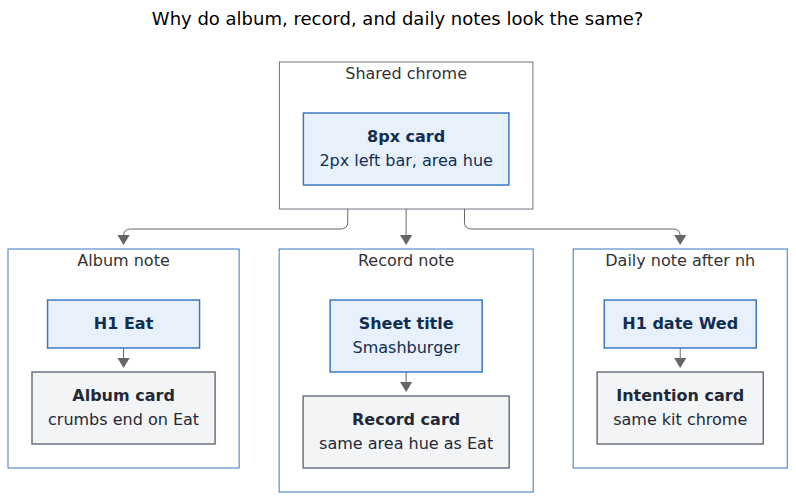
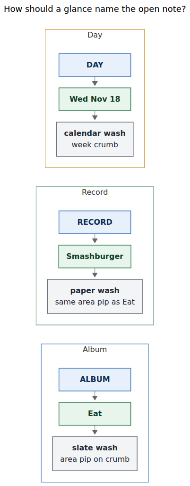
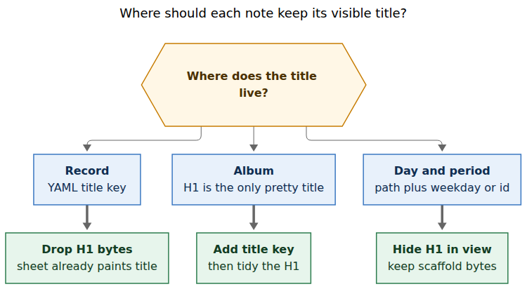
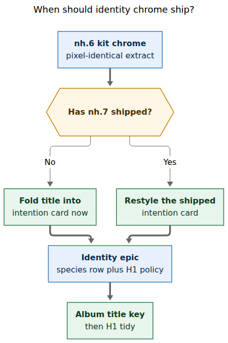

# Property-card identity and H1

> **Research query:** Once property cards are fully implemented, stop rendering the H1 in album notes and daily files in favor of rendering it in that note's schema card (as record notes should already do). Make it unmistakable from the title whether the open note is an album, a record, or a daily file. Lead the design. Critique the plan. Call out justified requirement adjustments. End with a recommended solution.

## Bottom line

**Do it. Fold the visible title into the in-note property card, and give every species a word-plus-glyph identity before you pick a color.** Do not treat this as a paint job on the shared kit, and do not drop every H1 the same way records did.

The request is right about the disease. Album notes, record notes, and (as soon as `bob-cli-nh` lands) daily notes will all open with the same 8px card, the same 2px left bar, and the same **area hue**. Eat the album and Smashburger the restaurant already share a wash. The H1 is the last cheap species signal, and on albums it is already duplicated in the crumb that ends on `Eat`. Putting the title into the card without a species mark makes the three notes *more* alike.

The request is wrong about three words.

1. The destination is the **property card** (the in-note panel). "Schema card" now names the album's `==` editor.
2. Daily files do not have a schema. They get an **intention card**. Week, quarter, and year notes get the same card and the same H1 problem.
3. Record notes could drop their H1 because `title:` already lives in YAML. Album pretty titles (`Eat`, `Eat & Drink`) live **only** in the H1. Daily weekday titles live in the H1 even though the date is in the path.

Ship identity chrome as a follow-up epic after the in-flight kit extract stays pixel-identical. Fold the daily title into the intention card if `bob-cli-nh.7` is still open; restyle it if that phase has already landed.

## Verdict: good idea, with a different title policy per species

This is the natural second half of two in-flight epics.

- `bob-cli-ms` / `bob-cli-ms.8` already moved the record title into the sheet, hid the filename inline title, and stopped writing `# Title` on new records. `bob records tidy` removes a redundant H1 whose text equals the YAML `title`. That is the precedent, and it is the right one for records.
- `bob-cli-nh` extracts a shared property-card kit from album, record, and bank, then paints an intention card on every canonical daily, week, quarter, and year note. Its kit-chrome phase is required to keep **pixels identical**. Its intention-card mockup still puts `# 2026-11-18 Wed` *above* the card.

The unification the user wants is therefore: one identity row on every property card, one hide for the rendered H1 and the inline title, and a species mark that survives the kit's shared border. The byte cleanup is a per-species follow-through, not a single tidy.

I would take this approach. I would not unique-color the whole card from the area ladder, would not CSS-hide album H1s forever without a `title:` key, and would not drop daily or period H1 bytes in the first epic.

## What is actually on screen today

### Records already did the title move

`plan:202611/record_card_title_and_proof.md` (bead `bob-cli-ms.8`) is explicit. The sheet's first row is a `div.bob-record-sheet-title` with `role="heading"` and `aria-level="1"`, styled from `--inline-title-*` with `--h1-*` fallbacks. The crumb (`Album › Noun`) sits on a muted second line. Bob writes records without an H1. `bob records tidy` removes a first-body H1 whose trimmed text equals `title:`. Source mode and fail-open still have the YAML `title` row.

The live plugin matches that plan. `242j-plugin-record-sheet-dom.js` paints the title row. `styles.css` hides `.inline-title` only under `.bob-record-sheet-hides-properties`, on the proven Live Preview and Reading paths. The remaining `bob-cli-ms.8.3` work is the real-Obsidian proof, not the title design.

### Albums still stack three names

`bob albums create` writes `# {title}` and **does not** store `title` in frontmatter (`src/native/albums/create.rs`). `parse_album_declaration` derives the pretty title through `derive_title`, which reads the first body H1, then an alias, then the humanized stem (`src/native/notebooks/scan.rs`). Owner catalogs, the album report, and the header model all consume that derived title.

The album card (`241v-plugin-album-header.js`) currently paints:

1. a crumb trail whose last span is the album title, `aria-current="page"`;
2. copy-capture and `⊞ Schema` actions;
3. the schema summary and chips.

It mounts **after** the first Reading-view `h1`. It does not hide `.inline-title`. So a healthy album such as `eat.md` can show, in one pane:

- Obsidian's filename inline title (`eat`);
- the authored H1 (`# Eat`);
- the card crumb that ends on `Eat`.

That is the duplication the user is seeing. It is worse than records were before `ms.8`, because albums have no YAML title to fall back on.

### Daily and period notes will join the family with their H1 still on top

Canonical dailies still open `# 2026-11-18` or `# 2026-11-18 Wed`. Period scaffolds write a long H1 (`# 2026-W45 · Nov 2 – 8`) plus a prev / parent / next wikilink line (`src/native/periods/scaffold.rs`). `plan:202611/period_intentions.md` places the intention card **below** that H1 and those nav lines, and it mounts the card only when at least one of `intentions`, `summary`, or `reflection` is nonempty. A blank morning therefore has no card and no in-card title at all.

After `nh`, a daily with intentions is: H1, nav, intention card, day strip, `^gtd`. That is the same "heading plus rounded card" silhouette as an album.

### The kit is about to make the silhouette identical on purpose

Album, record, and bank cards already share:

- `border-radius: 8px` (bank uses `0.5rem`, the same 8px);
- a 2px `border-inline-start` in `--bob-*-accent`;
- `data-root-hue="aqua|blue|…"` mapping onto `--bob-area-*`;
- UI-small interface type.

Record fill is 4% accent; album and bank are 8% and 14%. Those are cousin cards, not different species. `plan:202611/property_card_kit.md` then adds `.bob-property-card` and **one** `[data-root-hue]` ladder for `--bob-property-card-accent`, while forbidding pixel change. That extract is correct as a refactor. It is also why identity cannot ride the kit-chrome phase: the kit is required to preserve the look that already confuses album with record.

Eat the album and a restaurant in `eat/` share the **body** area hue. Color taken from `data-root-hue` cannot tell those two notes apart.



_Shared 8px chrome plus area hue make the three notes cousins. The H1 is the remaining species signal, and on albums the card crumb already repeats it._

Rendered size: 795.266 × 500 px; fit scale: 82.1%. Mermaid CLI 12.0.0.

## Critique of the request

### What is right

Folding the visible title into the card is the right product. Records already proved the pattern: one heading, page-title type, no `h1` element (so theme `h1` rules never double-count it), inline title hidden while the card is hide-eligible, Source mode fail-open. Albums and dailies should feel like the same family once that heading lives inside the card.

Species identity is the more important half. Without it, "put the H1 in the card" produces three untitled-looking sheets that differ only in the body below.

Doing this **after** property cards exist is also right. The kit (`nh.6.1`) and the record title work (`ms.8.1` / `ms.8.2`) are the substrate. Painting identity on three divergent hosts would fork the chrome the kit is extracting.

### What is confused

**"Schema card" is the wrong name for the destination.** The kit and the intentions plan already settled vocabulary: the in-note panel is the **property card** (album card, record card, bank card, intention card); `==` opens the **card editor**. The album Schema Card is the album's editor. Record notes never put their title on a Schema Card; they put it on the record sheet. Daily files never get a schema. If the follow-up epic says "render the H1 in the schema card," implementers will aim at the wrong surface.

**Daily files are the wrong exclusive partner for albums.** The intention card also mounts on week, quarter, and year notes. Those notes have even heavier H1s (`# 2026-Q4 · W40–W53 · Sep 28, 2026 – Jan 3, 2027`) and the same "heading plus card" problem. Leaving periods with an H1 while dailies lose one makes the period tree inconsistent. `all_time` stays out: the intentions plan already excludes it from the card.

**A unique card color cannot be the primary species signal.** Area hue is doing real work: it tells you which root parent you are in. Rebinding the whole wash to a species color throws that away, and a color-only species mark fails in forced-colors, for reduced vision, and in grayscale screenshots. The intentions plan already requires ownership by words and glyphs. Identity should too.

**Empty intention notes break a naive "title lives in the card" rule.** `nh` currently shows no card when all three fields are empty. If the H1 is gone and the card is gone, today's blank daily is untitled. Identity chrome has to mount even when the owned fields are empty.

**Album pretty titles have no second home.** Dropping `# Eat` the way records dropped `# Smashburger` loses `Eat & Drink` versus stem `eat_and_drink` in catalogs, reports, and Source mode. That is a contract hole, not a CSS task.

## Justified requirement adjustments

These change the request. Each one is required for the design to stay intuitive and reliable.

1. **Say "property card," never "schema card," for the in-note panel.** The title row belongs on the album card, the record card, and the intention card. The album Schema Card and the other `==` editors keep their own modal titles.

2. **Treat week, quarter, and year notes as first-class members of the daily case.** They share the intention card, the H1-plus-card silhouette, and the calendar identity. Exclude `all_time` and ordinary area, project, notebook, and bank-month notes.

3. **Always mount identity chrome** on album, record, daily, week, quarter, and year notes while the card family is hide-eligible. Intention *bands* still appear only when their fields have content. A blank day still shows `DAY` and the weekday title so `==` has a home.

4. **Give albums a YAML `title:` before anyone deletes album H1 bytes.** Default it to today's derived title (H1, else alias, else humanized stem). `bob albums create` writes it. Catalogs, `derive_title`, and the album card read it. Then tidy a redundant H1 whose text equals that key, matching records.

5. **Hide daily and period H1s in Reading and Live Preview; keep writing them.** The date heading is the fail-open name when the plugin is off, on mobile, and in Source mode. The weekday is not in the filename (`20261118.md`). Period titles are already in `aliases:` and `labels::title`, but the scaffold H1 is still the Source-mode heading. Byte-retire for days and periods is a later, optional tidy once identity chrome has lived in production. Records earned byte-retire because YAML already held the title.

6. **Species identity is a small-caps word plus a fixed glyph, with a species wash as backup.** Area hue becomes a crumb pip, not the card wash. Album emoji (`🍽️`) stays content identity for that album and its records; it is never the species icon (it would make Smashburger look like Eat).

7. **Do not fold this into `bob-cli-nh.6` kit chrome.** That phase's acceptance is pixel-identical album, record, and bank cards. Identity is a visible change. Keep the extract; ship identity as the next epic. If `nh.7` (intention card) has not landed when that epic is planned, fold the daily title row into `nh.7` so the card never ships with an H1 sitting on top of it.

8. **Bank cards get a species word, not an H1 move.** `bank.md` is an area note whose Setup card is already a different object. Bank month notes use `##` day headings as data, not as a duplicated page title.

9. **v1 may leave period and daily nav lines in the body.** Folding `‹ W44 · ↑ Q4 · W46 ›` into the card crumbs is the beautiful end state, matching the record walk rail. It is extra writer and fail-open work. Do not block identity on it. If nav is painted in the card in v1, hide the rendered nav paragraph the same way the H1 is hidden; do not duplicate it.

10. **The intention kicker (`DAILY INTENTIONS`) becomes a band label under the identity row.** It must not compete with `Wednesday, Nov 18, 2026` for the heading slot. The kicker names the owned fields. The identity row names the note.

## Recommended identity system

### One title row, four species

Every mounted property card opens with the same skeleton:

```text
[glyph]  SPECIES                         ⊞ Edit   ▾
Title in page-title type
crumb › trail with an area pip
[species body: schema chips, record fields, intention bands, …]
```

The title node is a `div` with `role="heading"` `aria-level="1"`, text-node only, using `--inline-title-*` / `--h1-*` exactly as the record sheet already does. Long titles wrap; at 375px the toolbar wraps under the title. No `h1` element.

| Kind | Glyph | Species word | Title text | Wash | Area pip |
| --- | --- | --- | --- | --- | --- |
| Album | 📇 | `ALBUM` | YAML `title:` (today's H1) | slate indigo, independent of area | on the owner crumb |
| Record | album emoji, else 📇 | `RECORD` | YAML `title:` | warm paper, 4% fill kept | on the album crumb |
| Day | 📅 | `DAY` | `Wed, Nov 18, 2026` | calendar cyan | on the week crumb |
| Week / quarter / year | 📅 | `WEEK` / `QUARTER` / `YEAR` | the period's existing label (`2026-W45 · Nov 2 – 8`) | same calendar family, one step deeper per scale | on the parent crumb |
| Bank Setup | existing bank mark | `BANK` | keep today's Setup heading | keep current | keep current |

Glyphs are taken from vocabulary Bob already uses: 📇 is the record-card plan's album crumb, 📅 is the calendar badge, 📓 already means notebook and stays off this family. Screen readers hear the species word and the heading; the glyph is `aria-hidden`.

Forced-colors and reduced-motion: the word and the title remain; the wash flattens to Canvas; the left bar uses CanvasText. Species is still readable.

### Color, used as a second voice

Add `data-card-kind="album|record|day|week|quarter|year|bank"` on `.bob-property-card`. `--bob-property-card-kind-accent` sets the wash and the 2px bar. `--bob-property-card-area-accent` (today's `data-root-hue`) paints a 6px pip on the crumb that names the owner, plus any existing root-parent chips. No circular variable mapping between the two.

Do not reuse `--bob-area-violet` as "the album color." An album whose owner is already violet would disappear into its pip. Pick kind tokens that are not members of the eight-hue area ladder (`styles.css` `--bob-area-blue` … `--bob-area-red`).

Suggested kind tokens (light, with a dark pair at implementation time):

- album: slate `#3F4A6B` (collection, cool, not area-violet `#6250d6`);
- record: ink-on-paper `#8A6A4B` at 4% fill (item sheet);
- day: calendar cyan `#1F7A8C` (walk PRE/POST already uses cyan as a bookend; this is the calendar family, not area-aqua `#1baf7a`);
- week / quarter / year: the same cyan, 8% / 12% / 16% fill so scale deepens without a new hue;
- bank: keep the current Setup accent.

A glance then reads **word, then title, then wash**. Eat and Smashburger can share a green pip and still disagree in the first 40px of the card.



_Species word, page title, then a kind wash. Area hue stays a crumb pip, so the Eat album and a restaurant in Eat remain distinct._

Rendered size: 401.438 × 1023 px; fit scale: 87.3%. Mermaid CLI 12.0.0.

### Hide the rendered H1, fail open everywhere else

When a card is hide-eligible (desktop, Reading or Live Preview, successful mount), hide:

- the view's `.inline-title`;
- the first body `h1` that is not inside a fence or embed.

Use the same proven direct paths the record sheet already pins (`.cm-editor > .cm-scroller > .cm-sizer` and `.markdown-preview-view > .markdown-preview-sizer > .mod-header`). Do not hide H1s inside embeds, hover previews, or Source mode. Teardown, mode switch, plugin disable, and a failed mount restore both. Mobile stays fail-open, as records already do.

Do **not** CSS-hide an album H1 as the permanent title home. That is a transition tactic only, until `title:` exists and tidy has run.

### Title homes, by species



_Records drop H1 bytes because YAML already holds the title. Albums need that key first. Days and periods hide the heading in view and keep the scaffold bytes._

Rendered size: 749.383 × 412 px; fit scale: 87.1%. Mermaid CLI 12.0.0.

**Record.** Already done in `ms.8`. The identity epic only adds the `RECORD` word, the kind wash, and the area pip. No second H1 pass.

**Album.** New bob-owned `title:` scalar, canonical key order `parent`, `type`, `summary`, optional `emoji`, **`title`**, `created`, then `record`. Create writes it. Update may rename it later (`bob-cli-n1` is record rename; album rename stays out of this epic unless it falls out of the same writer). `derive_title` prefers `title:`, then H1, then alias, then stem, so catalogs survive the transition. After the card paints from YAML, `bob albums tidy` (or an albums-sync step) removes a redundant first-body H1 whose text equals `title:`, with the same keep rules records use (differing H1, H1 after prose, fenced H1). Intro teaching lines and `## Records` stay.

**Day and period.** The card formats the heading from the path and the existing label helpers (`labels::title`, weekday of the daily date). The scaffold keeps `# …` and the nav wikilinks. Reading and Live Preview hide that H1 while the card is mounted. Source mode still has a human heading. A later epic may stop writing those H1s once this hide has lived through a release; it is not required to make the page beautiful.

### What the three notes should look like

Album `eat.md`:

```text
📇  ALBUM                                   ⊞ Schema  ▾
Eat
● body
🍽️  12 restaurants · 🔖 2 to try · grouped by location
Status *  ·  Location  ·  Category  ·  …
```

Record `eat/smashburger.md`:

```text
🍽️  RECORD                                  ⊞ Edit  ▾
Smashburger
● Eat › restaurant
status    💚 Liked
location  Clark
…
‹ Pho House     Eat · 3 of 104     Ramen Ya ›
```

Daily `2026/20261118.md`, after the morning ritual:

```text
📅  DAY                                     ⊞ Edit
Wed, Nov 18, 2026
‹ Tue · ↑ W47 · Thu ›
DAILY INTENTIONS
  ①  Add ≥30 records to the sase_blog_zettel album
  ②  Ship the record walk rail
SUMMARY · ✦ agent · Nov 19
  …
REFLECTION
  │ Tired all day; …
↑ W47 · Finish sase_blog_zettel album · …
```

The day strip, badges, and `^gtd` stay **below** the card. They are not identity. Period notes keep the stats strip and parts table below the card as well.

A collapsed card keeps the identity row plus one muted line (album: `12 restaurants`; record: chips plus field count, already specified; day: first intention or `no intentions yet`).

## Reliability rules

- **One heading.** After hide-eligible mount, the pane exposes exactly one `aria-level="1"`: the card title. The native H1 and inline title are `display: none`.
- **One title source per species,** as in the table above. Never parse the card title as Markdown. Wikilinks in daily intentions stay in the bands, not in the heading.
- **Fail open.** Source mode, mobile, embeds, hover previews, broken schema, missing capability, and plugin disable show native Properties, inline title, and authored H1.
- **Byte neutrality of paint.** Showing, collapsing, and hiding never rewrite the note. Writers (create, tidy, intention update) own bytes.
- **Hide selectors stay bounded.** Reuse `propertyCardOwnKeys` and the record sheet's direct-child paths. A new "hide the H1" rule that walks the whole preview will punch through embeds.
- **Empty days keep a card.** Identity chrome is not gated on intention content. `==` on a blank daily still opens the editor.
- **Catalogs keep pretty titles** after album H1 tidy, because they read `title:`.
- **Tests.** Light and dark, 375px and wide, expanded and collapsed, two panes of the same path, Source-mode fail-open, embed fail-open, empty daily, album with `Eat & Drink` in `title:` and no H1, record already without H1, period with a long H1 hidden. Pair screenshots by species, not only by "a card is present." A reviewer should name the species from the screenshot with the wash desaturated.

## Sequencing



_Keep the in-flight kit pixel-identical. Fold the daily title into the intention card if that phase is still open. Then one identity epic adds the species row and the H1 policy, with album `title:` last because it is a vault contract._

Rendered size: 449.484 × 676 px; fit scale: 100.0%. Mermaid CLI 12.0.0.

**Now (in flight, do not widen).**

- Finish `bob-cli-ms.8.3` (Obsidian proof of the record title and hide selectors). Identity depends on those selectors being real.
- Finish `bob-cli-nh.6.1` kit extract with **no visual change**. The shared host, ownership, and `.bob-property-card` class are the extension point. Add `data-card-kind` only if it has zero pixel effect; otherwise leave it to the identity epic.
- If `bob-cli-nh.7` is still being planned when this research is accepted, amend placement: the intention card includes the identity row and mounts on empty notes. If `nh.7` has already shipped with "below the H1," the identity epic restyles it.

**Next epic: Property-card identity** (bob-plugins first, then bob-cli for album `title:`).

Suggested phases:

1. **tokens** — `data-card-kind`, kind accents, species word and glyph, shared title-row helper on `.bob-property-card`. Record, album, and bank pixels change here on purpose. Snapshot light/dark at 375 and wide.
2. **hide-h1** — hide inline title and the first body H1 on hide-eligible album, daily, and period mounts, with the record hide as the template. Empty dailies mount identity chrome.
3. **intention-title** — identity row on the intention card; kicker becomes a band; `==` still opens on empty notes. Fold nav into crumbs only if it fits this phase without a writer.
4. **album-title-key** — bob-cli `title:` on albums, `derive_title` preference, create/update docs, then a tidy of redundant album H1s. Depends on phases 1–2 so the live vault never loses the pretty title.

Do not run album H1 tidy before the card reads `title:`. That is the `ms.8` ordering: sheet-title, then h1-retire.

**Later, optional.** Stop writing daily and period H1s; paint nav only as card crumbs and hide the markdown nav paragraph; notebook headers join the family (📓 already exists and is out of scope here).

## Alternatives I am not recommending

**Color-only unique cards.** Fast, pretty in a screenshot, and wrong the moment Eat's album and Eat's records share a hue. Also wrong for forced-colors.

**Keep the H1 and only restyle the card.** Leaves the triple name on albums (inline title, H1, crumb) and the double name on dailies. The user already asked to stop rendering that heading.

**CSS-hide album H1s and never add `title:`.** Source mode, grep, catalogs, and `derive_title` keep depending on a heading the Reading view pretends is gone. Records were able to drop the heading because YAML already held the title. Albums do not.

**Drop daily H1 bytes in the same tidy as albums.** The weekday is not in the path. Mobile and Source mode would show `20261118`. Keep the scaffold heading until a later epic is willing to own that fail-open story.

**Put the title in the `==` editor only.** The editor is not on screen. The confusion is the *note*, in Reading and Live Preview.

**One mega-card for album schema plus record values plus intentions.** Different writers, different hide sets, different fail-open rules. The kit already rejected this (and the declined `property-cards-own-their-rows` decision would have said the same).

**Sneak identity into kit chrome.** It would fail the pixel-identical gate or silently ship a visual change under a refactor bead.

## Recommended solution

Build a **property-card identity** epic on top of the kit, not inside it.

1. One shared title row: species glyph, small-caps species word, page-title heading, toolbar.
2. Kind wash from `data-card-kind`; area hue demoted to a crumb pip.
3. Hide the rendered H1 and the filename inline title while the card is hide-eligible.
4. Always mount that row on album, record, daily, week, quarter, and year notes.
5. Add album `title:` and only then tidy album H1s.
6. Leave daily and period H1 bytes in the scaffold; hide them in view.
7. Call the panel a property card. Put the date on the intention card, not on a Schema Card.

That is intuitive (the first line names the kind and the note), reliable (each species has a title home, paint never writes, fail-open keeps Source mode honest), and beautiful (one heading, no stacked names, three silhouettes that share a kit and still disagree at a glance).

The original request is a good idea. This is the version I would implement.
