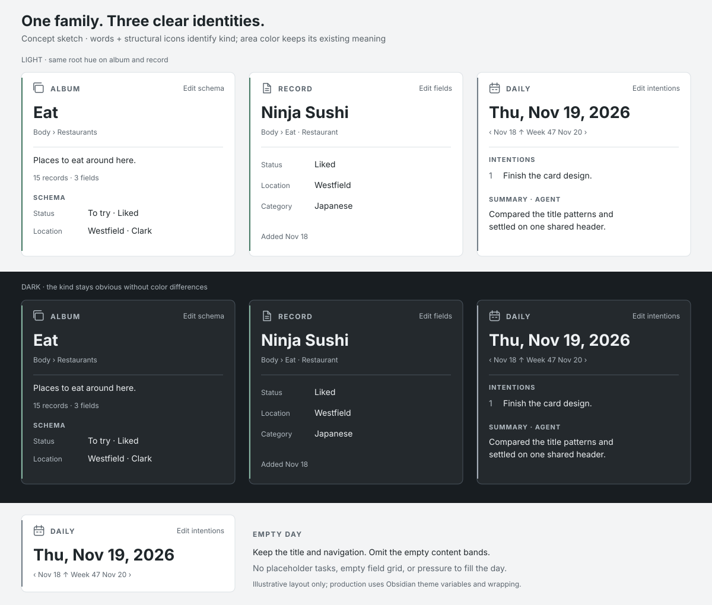

# Property cards: one title, unmistakable note identity

Independent design research by **cdx**, 2026-11-19. This report does not consult the other reports or researchers in the `research.5i` swarm. It recommends a follow-up after the property-card epics land; it does not implement or modify them.

**Recommendation:** Proceed, with a shared identity header inside the property-card family. Give each header a permanent **Album**, **Record**, or **Daily** label and a distinct structural icon. Move the visible title into that header, preserve existing area colors, and keep the title visible even when the card has no usable properties. For albums and dailies, preserve the underlying Markdown H1 and replace only its presentation. Do not extend the record H1-deletion migration to these notes.

*Figure 1. Proposed visual hierarchy, with invented example data. This is a design sketch, not an Obsidian screenshot or proof of implementation. Both collection and item retain the same area accent; their words and structural icons carry the distinction. The empty day retains only identity and navigation.*

## What the evidence establishes

I read `bob-cli-ms`, `bob-cli-ms.8`, and `bob-cli-nh` through audited bead reads, and `plan:202611/period_intentions.md` through `sase artifact read`. I inspected bob-cli at `5b4c26360efe9d90d20b8371ac53a05bef7492b6` and the opened bob-plugins checkout at `e2cdc8d6f60021169c4ca489bf09bb8173902848`. Those are research snapshots, not a claim that the running epics have finished. I also inspected the existing album Reading-view screenshot at `evidence/album-schema-finish-apply-final/shots/album-records-reading.png`; it visibly has a standalone “Eat” H1, an album header below it, and native Properties above both. That screenshot is historical evidence, not a new observation of the live vault.

| Finding | Evidence and consequence |
| --- | --- |
| Moving record titles into the card is already accepted work. | [bob-cli-ms](https://github.com/bobs-org/bob-cli--beads/blob/main/pages/bob-cli-ms/README.md), note 3, explicitly supersedes the earlier request for spacing beneath the H1. Its [child epic](https://github.com/bobs-org/bob-cli--beads/blob/main/pages/bob-cli-ms/bob-cli-ms.8.md) has completed title and H1-retirement phases, while real-Obsidian proof remained in progress at the read. Do not build a competing title feature. |
| Record source and album source differ. | Records use frontmatter `title`; `recordSheetModel` falls back to H1 then stem. Albums call `derive_title`, which prefers an early H1, then the first alias, then the humanized stem. `render_new_album` writes the title as an H1 without a duplicate `title:` property. Deleting an album H1 could silently change its displayed name elsewhere. |
| The daily card is not a schema editor. | [bob-cli-nh](https://github.com/bobs-org/bob-cli--beads/blob/main/pages/bob-cli-nh/README.md) and `plan:202611/period_intentions.md` define an intention card with intentions, summary, and reflection. Its content gate requires at least one nonempty field and well-formed values. Its current planned placement is below the H1 and navigation. Moving the title inside it requires an explicit change to that gate/placement contract. |
| The shared foundation is already planned. | The same plan specifies owned-key hiding, a `==` registry, a shared host lifecycle, and common chrome. Its extraction must be pixel-identical. At the inspected plugin commit, shared owned-key handling exists in `240b-plugin-property-card-ownership.js`; this report does not assume the rest is finished. Apply visual redesign after that behavior-preserving extraction. |
| Color already expresses another relationship. | Album and record surfaces both use `data-root-hue` and area-derived accents. Assigning a new whole-card color by species would either discard that relation or make one color channel mean two things. |
| The heading code has a trap for a naive refactor. | Album Reading mounting finds an H1 and inserts after it. Record Reading mounting reuses `albumHeaderReadingAnchor` but inserts before an authored legacy H1. The record title itself is already `role="heading" aria-level="1"`. Adding a literal H1 inside an album card without fixing anchor discovery could make a later mount mistake its own generated title, or an embedded note's heading, for the source anchor. |

Code references: [album title derivation](https://github.com/bobs-org/bob-cli/blob/5b4c26360efe9d90d20b8371ac53a05bef7492b6/src/native/albums/mod.rs), [shared title precedence](https://github.com/bobs-org/bob-cli/blob/5b4c26360efe9d90d20b8371ac53a05bef7492b6/src/native/notebooks/scan.rs), [album creation](https://github.com/bobs-org/bob-cli/blob/5b4c26360efe9d90d20b8371ac53a05bef7492b6/src/native/albums/create.rs), [album mounting](https://github.com/bobs-org/bob-plugins/blob/e2cdc8d6f60021169c4ca489bf09bb8173902848/plugins/bob-ledger-tools/src/241v-plugin-album-header.js), [record model](https://github.com/bobs-org/bob-plugins/blob/e2cdc8d6f60021169c4ca489bf09bb8173902848/plugins/bob-ledger-tools/src/242i-plugin-record-sheet-model.js), [record mounting](https://github.com/bobs-org/bob-plugins/blob/e2cdc8d6f60021169c4ca489bf09bb8173902848/plugins/bob-ledger-tools/src/242k-plugin-record-sheet.js), [shared ownership](https://github.com/bobs-org/bob-plugins/blob/e2cdc8d6f60021169c4ca489bf09bb8173902848/plugins/bob-ledger-tools/src/240b-plugin-property-card-ownership.js), [styles](https://github.com/bobs-org/bob-plugins/blob/e2cdc8d6f60021169c4ca489bf09bb8173902848/plugins/bob-ledger-tools/styles.css).

## Is the proposal a good idea?

Yes. It removes duplicate identity furniture and makes the top of a note answer three questions in a predictable order: **what kind of note is this, which note is it, and where does it belong?** It also gives the title a stable home as properties expand, collapse, or refresh.

The risk is treating this as “hide H1 and pick three colors.” Hiding can erase the only usable title when a card fails. Color can confuse note kind with area, status, or provenance. A large new banner can consume more space than the duplication it removes. The design should therefore optimize identity and reading hierarchy first, then decoration.

I would not create a universal editor or change the meaning of existing shortcuts. Album fields describe a collection's schema; record fields describe one item; daily intentions describe a period. A common header can make those differences clearer while their content and writers remain specialized.

I would also avoid leading with the album's record noun. “Restaurant” describes an item type; it does not tell Bryan whether he is editing the restaurant collection or looking at one restaurant. The visible words **Album** and **Record** must remain even when the noun or subject emoji is present.

## Proposed visual language

Use one compact hierarchy in every full-note card:

1. **Kind row:** a small structural icon and a readable kind label; a quiet, explicitly named editor action on the opposite side when space permits.
2. **Title:** the largest text in the card, aligned to one shared text edge, normal note-title weight, no truncation of the only title.
3. **Context:** a muted parent breadcrumb or calendar navigation line.
4. **Content:** the existing schema rows, record values, or intention bands, separated by space or one quiet divider.

| Kind | Structural icon concept | Required label | Main title | Secondary identity |
| --- | --- | --- | --- | --- |
| Album | Two overlapping sheets / collection stack | **Album** | `Eat` | Owner breadcrumb; restaurant noun, summary, and counts where already available |
| Record | One document / sheet | **Record** | `Ninja Sushi` | Parent album link and `Restaurant` noun |
| Daily | Calendar with bound top edge and grid | **Daily** | `Thu, Nov 19, 2026` | Existing previous / parent week / next navigation |

Use Obsidian's existing icon mechanism with distinct monochrome silhouettes, rather than platform-dependent emoji as the only structural cue. Retain an album's custom emoji as optional subject decoration. The same fork-and-knife emoji may legitimately appear on both the album and its restaurant records; it should not be asked to distinguish them.

Visible words are mandatory, not tooltips. W3C's guidance prohibits color as the sole carrier of meaning and explains why descriptive headings and labels improve orientation. The specific three icons and their arrangement are design judgments, not experimentally proven winners. [Use of Color](https://www.w3.org/WAI/WCAG22/Understanding/use-of-color.html), [Headings and Labels](https://www.w3.org/WAI/WCAG22/Understanding/headings-and-labels.html).

**Keep color disciplined.** Retain the existing root-area accent, preferably as the kit's 2 px start border and a very low-opacity surface tint. Daily notes can use a quiet theme-derived accent where no area applies. Do not introduce a second red/amber/green status language. The kind label and silhouette must distinguish all three in grayscale, with identical titles, or with all accents disabled. A decorative border need not carry meaning.

**Make it beautiful through proportion.** Reuse the approved 8 px radius and Obsidian typography variables; target roughly 16 px card padding, an 18–20 px icon, a 12–13 px medium-weight kind label, and the theme's existing title scale. These are starting proportions for visual review, not hard-coded production requirements. Avoid heavy shadows, gradients, ornamental covers, nested card boxes, or a dashboard-sized hero. Give breadcrumbs less visual weight than titles and editable values more than chrome.

At narrow widths, wrap actions below the heading before shrinking the title or hiding the type label. Keep the title and type in the collapsed state. Use content width, not only the application window width, to handle split panes. Verify 320 and 375 CSS px content widths and enlarged text without horizontal scrolling; 375 px is a narrow desktop pane test, not a promise of mobile support. [Reflow](https://www.w3.org/WAI/WCAG22/Understanding/reflow.html).

Use visible keyboard focus and comfortably padded actions, targeting at least 32 px hit boxes here. WCAG's AA minimum is 24 by 24 CSS px, with specified exceptions. Require 4.5:1 normal-text contrast, 3:1 large-text contrast, and 3:1 for meaningful control graphics; do not infer accessibility merely from using theme variables. [Target Size](https://www.w3.org/WAI/WCAG22/Understanding/target-size-minimum.html), [Text Contrast](https://www.w3.org/WAI/WCAG22/Understanding/contrast-minimum.html), [Non-text Contrast](https://www.w3.org/WAI/WCAG22/Understanding/non-text-contrast.html).

## Explicit adjustments to the requirements

**A1 — Move the rendered title, not the album/daily source data.** Interpret “stop rendering the H1 section” as replacing the title heading's presentation. Keep the H1 bytes in album and daily Markdown. Do not hide the content beneath the H1, subsequent headings, navigation, or the whole preamble. This deliberately differs from the already-approved record source migration because albums currently store their canonical human title there, while records store it in frontmatter.

**A2 — Require words and distinct icons; make type-specific colors unnecessary.** Keep the known area-color meaning. Color alone would not satisfy the requested unmistakable identity.

**A3 — Give empty days an identity header, without an empty intention form.** The `nh` “no fields, no card” rule becomes “no fields, no intention content.” A canonical daily note still shows its compact title and navigation header. The editor remains available through its existing entry points and one quiet Edit intentions action. Do not add empty Summary/Reflection bands, checklist placeholders, or an invitation that pressures Bryan to fill the day. This is an explicit change to `nh`, not something its implementers should silently assume.

**A4 — Keep title and property ownership separate.** A valid title can remain visible when a field is malformed or the writer is unavailable. An unavailable property card does not authorize hiding its native rows. Source mode, embeds, hover popovers, unsupported platforms, and failed title mounts retain native rendering. Preserve the user's existing Properties display preference rather than globally changing it.

**A5 — Distinguish note identity from editor purpose.** The page says Album / Record / Daily; the action says Edit schema / Edit fields / Edit intentions. Mirror the kind label and title in the corresponding modal header when practical, while keeping each editor's fields and key semantics. Do not call all three “schema cards” in product copy.

**A6 — Keep the initial scope bounded.** Apply the visible title takeover to albums, records, and canonical dailies. Make the component able to represent Week / Quarter / Year, but leave their H1 behavior, bank cards, and `all_time` unchanged until separately accepted. `nh` shares a renderer across days and periods, so gate the behavior explicitly by resolved note kind. Do not classify every `type: [[day]]` note as Daily; period scaffolds also use that type.

## Title ownership and failure behavior

A note needs one *presented title*, not necessarily one H1 node across its entire authored content. A later authored H1 is still content and must survive.

| Source | Display and takeover rule |
| --- | --- |
| Album | Keep bob's current H1 → first alias → humanized-stem resolution. Consume its report title; do not introduce a new competing `title:` property. Claim an H1 only when its exact source range is the title source. A report without adequate provenance may display a header but must not authorize speculative heading suppression. |
| Record | Preserve frontmatter `title` → H1 → stem and the existing conservative tidy behavior. A differing legacy H1 stays as authored content; the visual redesign does not broaden deletion. |
| Daily | Resolve the canonical day with `nh`'s day/subject logic. Present the existing title heading when recognized; when it is a standard date heading, use a consistent friendly date format. Preserve custom wording, with the canonical date as secondary text if needed. Without an H1, derive the title from the resolved day. Never use “Today” as the only identity. |

Keep the kind label outside the text title's stored value. Adding “Album” or an icon to a rendered header must not rename the note, alter capture routes, mutate aliases, change link targets, or write new metadata.

The title renderer should claim an exact heading range and native inline-title element **only after** it has mounted a replacement for the same note and view generation. If the renderer cannot prove the source heading, leave it visible. Hide the filename-derived inline title only in the same eligible scope; do not change Obsidian's global setting.

Separate three capabilities: `identityMounted`, `propertiesRepresented`, and `editable`. Their failure modes differ:

| State | Expected behavior |
| --- | --- |
| Healthy card | One visual title in the header; only covered native properties hidden; existing guarded editor available. |
| Empty daily fields | Title and navigation only; native fields not claimed merely because a header exists; intentions editor still opens. |
| Bad field or failed schema load | Keep an established identity header when trustworthy, show an honest diagnostic or existing fallback, and leave unrepresented native fields available. Never turn an unknown value into an empty one. |
| Old/missing writer | Reading remains possible; editing follows the existing capability refusal. No title disappearance. |
| Heading ambiguous or title mount fails | Preserve the original H1 and inline title according to the user's settings. A temporary duplicate is safer than losing the title or authored content. |
| Source, embed, hover, mobile, unload | Release this view's ownership and use native rendering; do not leak hiding to neighboring notes. |

Obsidian has user-controlled Visible/Hidden/Source Properties modes, and native Properties does not support nested structures or Markdown rendering. This supports the existing specialized-card approach and the need to preserve unclaimed fields, rather than globally switching Properties off. [Obsidian Properties](https://help.obsidian.md/Editing+and+formatting/Properties).

Preserving source headings is also an interoperability decision. Obsidian's Outline operates on note headings and its links support heading targets. A generated DOM heading is not proof that Outline, heading links, or exported Markdown still work. Keep metadata-cache heading identity and source locations, map in-app navigation to the visible replacement, and explicitly test `[[note#Title]]`, Outline jumps, selection, and exports. [Obsidian Outline](https://help.obsidian.md/Plugins/Outline), [Internal links](https://help.obsidian.md/Linking+notes+and+files/Internal+links).

## How I would implement the follow-up

This is a recommendation, not a submitted implementation plan or authorization to edit the running epics.

**Extend the kit after `nh` lands.** Add a shared identity-header renderer to `.bob-property-card` and the existing host. Its adapter input should carry note kind, display title, accessible title, source provenance/range where relevant, context links, existing actions, and independent content/editability states. Keep the album, record, and intention models. No new generic schema engine or universal modal is needed.

Use the existing generation-bound ownership pattern for title ownership, but keep title and property releases separate. A stale teardown from pane A or a previously opened file must not release a newer header in the same editor scope. Ownership is per live view and source identity, not a global CSS class on every matching file.

**Reading view:** locate the source heading using section/source metadata and strict root-scope checks. Build the header, attach it at the intended title location, then claim only that heading and the owning view's inline title. Prefer a generation-bound replacement slot so postprocessor reruns do not discover generated titles. Keep descendants, embeds, code blocks, and content after the heading out of the claim. Preserve heading-link navigation, rather than simply setting every matching H1 to `display:none`.

**Live Preview:** use CodeMirror decorations rather than mutating `.cm-line` DOM or document text. The existing hosts add widgets; suppressing/replacing a heading changes that contract. The official Obsidian guide recommends directly supplied state-field decorations when changes can affect the viewport layout, so evaluate a state-field replacement range rather than assuming the existing view-plugin widget path is sufficient. Use editor state for current source positions and invalidate on source/metadata revision changes. [Obsidian Decorations](https://docs.obsidian.md/Plugins/Editor/Decorations).

Specify what happens when a caret, Vim motion, search match, or selection enters the retained title line. My preference is to reveal the original title line temporarily and yield the duplicate title presentation while it is being edited, then restore the card on leaving. A hidden editable line that traps navigation is unacceptable. This interaction needs real-Obsidian proof; it is the main technical uncertainty in the render-only recommendation.

**Daily placement:** keep existing day navigation immediately below the title, and put intention bands below that in the same visual surface. Use the existing canonical day resolver and navigation sources; do not reconstruct dates from formatted header strings. Do not swallow or duplicate the parent-intentions context line, the `^gtd` row, or the day/stats strip. If moving navigation into the header proves unsafe, retain its source-backed rendering directly below the title slot and style the group as one surface; navigation reimplementation is not the goal.

**Record integration:** replace the current title-row chrome with the shared component, retain its level-1 heading semantics, and preserve collapsed-title behavior, subscription docking, field coverage, and the record walk rail. Reuse the existing plain-text title policy; never insert raw title values with `innerHTML`.

**Album integration:** show the album title once in the header, with the parent breadcrumb underneath. Do not repeat the current album's title at the end of that breadcrumb. Keep schema expansion and record index behavior intact. Do not add record-count fetching during rendering merely for the mockup's count line; use already available report values.

The header must remain present when details collapse. Do not broaden this task into changing default expansion, field order, freshness policies, writers, fingerprints, Undo, or card-editor shortcuts.

## Acceptance evidence I would require

| Area | Minimum proof |
| --- | --- |
| Identification | Album, record, and daily with the same example title are distinguishable in light, dark, grayscale, and with accents removed. Type labels remain visible when collapsed. A brief randomized recognition check with Bryan can validate the icon choices; this research has not performed one. |
| Title correctness | Default, custom, very long, Unicode, emoji, and markup-like titles; album alias/stem fallback; record frontmatter-only note; daily H1-less note; multiple H1s and H1 inside code, callout, or embed. Only the resolved title heading is replaced. |
| Empty/failing cases | Empty intentions, summary-only, reflection-only, malformed YAML/value, missing CLI, stale report, render exception, plugin disable, and Source switch all retain a usable title and appropriate native fields. |
| Lifecycle | Two panes of the same file in different modes; rapid album → record → daily → ordinary-note switching; note rename; stale async result; theme toggle; tab close; reload; plugin unload. No duplicate mounts or cross-pane hiding. |
| Navigation and source | Heading deep links, Outline jump, search hit, Vim movement, title-line selection/editing, undo, print/PDF, and ordinary Markdown export. H1 source bytes remain unchanged on album/daily opening, repainting, collapsing, and teardown. |
| Geometry | 320/375 px panes and large desktop panes; 200% text enlargement; full title wraps; actions retain focus visibility and adequate hit areas; no unexplained top gap or layout jump. |
| Existing behaviors | Album schema and record value editing, `==`, `=`, field selection, Undo, YAML excursion, record walk, `[n==r` / `==[r`, and subscription band still work with their existing semantics. |
| Performance | Opening/folding does not add CLI calls; no persistent broad observer loop; local header available without waiting for remote/report refresh. Compare cache-hit mount and redraw behavior with the landed kit baseline. |

Run the existing album, record, ownership, and intention tests appropriate to the final diff, plus targeted title-ownership tests. Then prove the DOM and navigation cases in real Obsidian, using the established CDP harnesses. The `ms` epic itself found that stubbed tests had not proven real native-Properties selectors; screenshots alone likewise cannot prove lifecycle cleanup. Archive representative light/dark/narrow screenshots and the behavioral test results together.

## Alternatives and tradeoffs

| Approach | Assessment |
| --- | --- |
| Three saturated card colors | Visually obvious at first, but conflicts with area hues and gives weak grayscale recognition. Reject as the primary identity system. |
| Icon-only kind | Compact, but album subject emoji and unfamiliar icons remain ambiguous. Reject without visible labels. |
| Keep H1 above every card | Lowest implementation risk and a useful fallback. Does not achieve the requested integrated title hierarchy; retain only if Live Preview/heading-navigation proof fails. |
| Delete all album/daily H1s and migrate to `title:` | Simpler rendered surface, but changes album title semantics, headings/links, scaffolds, and export behavior. Too much data migration for a visual follow-up. Reconsider only as a separate, audited source-format change. |
| Always mount a full intention form | Solves title absence but adds empty visual weight and conflicts with `nh`'s quiet empty-day rule. Use identity-only chrome instead. |
| Shared identity header with specialized bodies | Best balance: one recognizable family, clear note kinds, reliable empty states, and reuse of the already-planned kit. Costs careful source-heading ownership and Live Preview navigation tests. |

I did not inspect the live vault, change source, run product tests, or validate an interactive implementation. The precise end-state kit API and daily renderer must be rechecked after `ms` and `nh` land. The design sketch demonstrates composition only. The behavioral claims above are either anchored to inspected code/plans or explicitly proposed acceptance criteria.

## Recommended solution

Ship a focused **shared identity-header follow-up** after the property-card epics: **Album + collection icon, Record + document icon, Daily + calendar icon**, a single prominent title, restrained existing area accents, and the current specialized card bodies. Keep empty daily notes calm with only the identity/navigation header. Preserve album/daily H1 source and replace its presentation only while the corresponding header safely owns it; keep record source behavior as already approved. Make source-mode recovery, heading navigation, real-Obsidian lifecycle proof, and same-title grayscale recognition release requirements. This achieves the visual unity Bryan wants without turning a presentation improvement into a risky vault-format migration.
