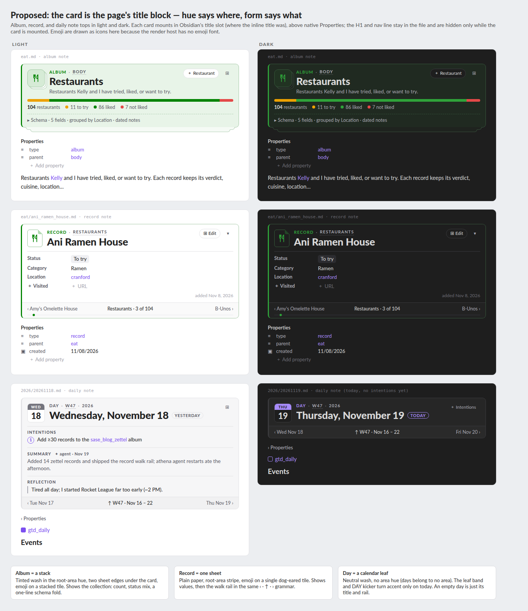
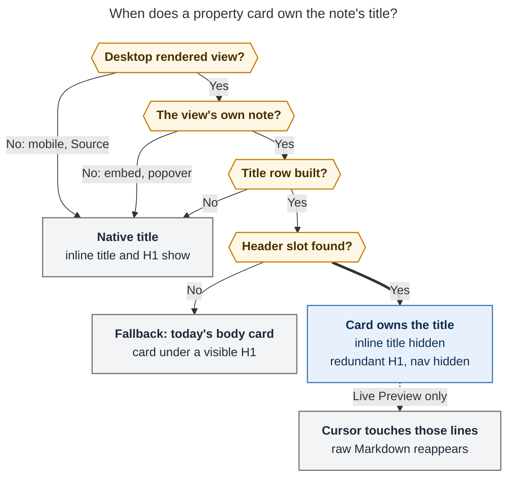

# Property cards as the note's title block: one title, and a clear species for each card

## Summary

The idea is good. Today a Bob note can show up to three titles stacked on top of each
other: Obsidian's filename inline title (`eat`, `20261118`), the Markdown H1
(`Restaurants`, `2026-11-18 Wed`), and a card that repeats some of the same identity.
Five card species (album header, record sheet, bank Setup, notebook header, and the
in-flight intention card) also use the same frame: an 8px radius, a 2px stripe in the
note's root-area hue, and a tinted wash. Collapsing the title into the card and giving
each species its own look fixes a real problem.

I would change four things about how the request is framed:

1. **"Stop rendering" should not mean "delete".** Records moved their title into
   frontmatter and deleted the H1 bytes. That worked because a record's title is a
   bob-owned schema field. Albums and daily notes should keep their H1 bytes. The card
   _owns_ them at render time and hides them only while it is cleanly mounted, the same
   way it already owns Properties rows. Zero bytes change, nothing in bob-cli changes, and
   every failure path (mobile, Source mode, embeds, popovers, an old plugin) still shows
   a title.
2. **Don't use card color for species.** In Bob, hue already says _where_: the root area
   or theme (`decisions:theme-hue-is-config-pin-exempt-area-hash`). An album and its
   records share an area, which is exactly why they look alike. Species should be
   carried by **form** (silhouette and material) and **words** (a small-caps kicker).
   Hue keeps its existing job.
3. **The title has to be the first thing on the page.** Today the record sheet mounts
   in the body, under Obsidian's Properties panel. The real-Obsidian screenshots from
   `bob-cli-ms.8.3` show `Properties · type · parent · created · lid · source_url · Add
   property` above "Bead Lifecycle". On a daily note that would put nine Properties
   rows above the date. The card should mount in Obsidian's **title slot**, where the
   inline title sits, above native Properties. Properties stays native, with Add
   property, as Bryan required in `bob-cli-ms.8.3.1.1`.
4. **Daily notes are one member of a family.** Week, quarter, and year notes get the
   same intention card and already use the same `‹ prev · ↑ parent · next ›` nav
   grammar as record walk lines. The redesign should cover them too, and should absorb
   each note's nav line into the card's rail. Otherwise a `prev · W47 · next` line
   would be left hanging above or below a card that already carries the title.

The recommended design, in one line: **the card is the note's title block. Hue says
where; form says what; words say both.** A mockup is in
[The design](#the-design), and the phased plan is in
[Recommended solution](#recommended-solution).

## What exists today

### Five cards, one frame

Every card in bob-ledger-tools uses the same chrome. Paths are relative to the
bob-plugins repo at `e2cdc8d`:

| Card | Selector (`plugins/bob-ledger-tools/styles.css`) | Frame |
| --- | --- | --- |
| Notebook header | `.bob-notebook-header` (line 8448) | 8px radius, 2px start border in area ink, grey wash |
| Album header | `.bob-album-header` (line 8535) | 8px radius, 2px start border in root hue, 8% hue wash |
| Bank Setup | `.bob-bank-setup` (line 9862) | 8px radius, 2px start border in bank accent, 8% wash |
| Record sheet | `.bob-record-sheet` (line 10997) | 8px radius, 2px start border in root hue, 4% hue wash |
| Intention card (planned) | the kit's `.bob-property-card` base (`period_intentions.md` kit item 4) | "8px radius, 2px accent start border, `color-mix` accent" |

The album header and the record sheet are the confusable pair Bryan named. They differ
only in wash strength (8% vs 4%). Both carry a root-hue stripe (an album and its records
share that hue). Both list the schema's fields as label-plus-chips rows: the album shows
chip rows with usage counts, and the record shows values. The `==` editors repeat the
problem. The Record Card's title is `<album emoji> <record title>` and the Schema Card's
is `<album emoji> <Noun>`, inside the same `bob-key-card` modal. The `=` climb from
Record Card to Schema Card keeps one frame while the subject changes from one record to
the whole album.

### Titles: three candidates per note, in the wrong order

- **Inline title.** Obsidian shows the filename above Properties by default.
  `~/bob/.obsidian/app.json` sets neither `showInlineTitle` nor `propertiesInDocument`,
  so both use their defaults (shown and visible). The vault's four CSS snippets don't
  hide the inline title. Only records hide it, through the record sheet's class
  (`styles.css` lines 10985–10986, `inline_title = hide` in `plan:202611/record_card.md`).
- **H1.**
  - _Records:_ there is no H1 since `bob-cli-ms.8.2`, and the sheet shows the frontmatter
    `title`.
  - _Albums:_ the H1 is the album's only title source. bob's
    `derive_title` (`src/native/notebooks/scan.rs:787`, used by
    `src/native/albums/mod.rs:123`) reads the H1, then the first alias, then the stem.
    `bob albums create` writes the H1. The plugin's `notebookHeaderNoteTitle`
    (`241e-plugin-notebook-header-model.js:164`) does the same for crumbs. Album titles
    differ from stems: `eat` → "Restaurants", `sase_blog_zettel` → "SASE Blog Zettel".
  - _Daily notes:_ the Templater template (`~/bob/_templates/daily.md`) writes
    `# YYYY-MM-DD ddd` and then the `[[…|prev]] · [[…|W47]] · [[…|next]]` nav line.
- **Card title.** Only the record sheet has one, in page-title styling
  (`.bob-record-sheet-title`, `styles.css` ~11036).

Placement makes it worse. The card mounts in the note body, and Obsidian draws
Properties above the body. So on a record the page reads: hidden inline title →
Properties (type, parent, created, legacy keys, Add property) → sheet with the title.
The latest athena walkthrough screenshot
(`record-sheet-live-light-wide`, `bob-cli-ms.8.3.1.1` evidence, 2026-11-18 22:17 run)
shows the title "Bead Lifecycle" halfway down the viewport, under a five-row Properties
block. The selective hide was deliberate: note #4 on `bob-cli-ms.8.3.1.1` calls the
earlier screenshots, in which the native Properties panel and Add property were absent,
a failure of "the new requirement". Native Properties have to stay. The fix is to put
the card above them, not to hide them.

### Daily notes are heterogeneous; period notes are uniform

A read-only scan of `~/bob` (canonical `YYYY/YYYYMMDD.md` paths, 1,195 notes) found:

| Year | First body line | Notes | Canonical `prev · W · next` nav line |
| --- | --- | --- | --- |
| 2023 | `# Day: 2023-07-19 Wed` | 164 | 0 |
| 2024 | `# day = 2024-01-01.Mon` / no H1 (`2024-01-20.Sat`) | 19 / 336 | 0 |
| 2025 | no H1 (`day::2025-01-01 Wed`, "Related notes:") | 365 | 0 |
| 2026 | no H1 (legacy shape) / `# 2026-11-18 Wed` | 136 / 175 | 160 |

Only about 175 daily notes, all from mid-2026 on, have today's H1, and 160 of them have
today's nav line. Two consequences:

- The day card must compute its title from the **path**, never from the H1.
- Deleting H1 bytes would mean a migration across a decade of differently shaped
  notes. It is a strong argument for hiding instead of deleting.

Period notes are bob-scaffolded and uniform. All 50 week notes, 5 quarter notes, and 2
current year notes open with an H1 (`# 2026-W47 · Nov 16 – 22`) and a nav line in the
record-walk grammar:
`[[2026/2026-W46|‹ W46]] · [[2026/2026-Q4|↑ 2026-Q4]] · [[2026/2026-W48|W48 ›]]`. The
legacy `2024.md` and `2025.md` have neither. Notice too that each daily note's first
`aliases` entry (`2026-11-18 Wed`) and each week's (`2026-W47 · Nov 16 – 22`) equal the
H1 text. That gives a clean, local test for "this H1 is redundant".

### What the in-flight epic `bob-cli-nh` will ship

`plan:202611/period_intentions.md` builds the kit (`bob-cli-nh.6`) and the intention card
(`bob-cli-nh.7`). Both are in progress right now. Three of its rules conflict with this
request:

- **Placement:** "Below the H1 and its navigation and child-link lines" (line 814).
- **Gate:** "At least one of the three fields is non-empty" (line 810) and "A note with
  none of the three fields shows no card" (line 247). If the card carries the day's
  title, it has to mount on every canonical day, empty or not.
- **Kicker:** `DAILY INTENTIONS` / `WEEKLY INTENTIONS · W47` (line 820). This names
  the content, not the note kind.

The kit's chrome extraction must be "pixel-identical" (line 789), so `bob-cli-nh`
deliberately doesn't change any look. That makes this work a clean follow-up: the first
epic allowed to change pixels, built on the kit.

## Critique: is this a good idea?

Yes. A note should have one title, and a card already holds the note's identity. Bryan
has asked for this twice (`bob-cli-ms` note #3, and now this request). The species
problem is real and gets worse as the family grows. Five problems are worth fixing
before building it.

**1. Copying the record approach would be the wrong generalization.** For records,
deleting the H1 was right: the title is a schema field in frontmatter, bob writes it,
and `bob records tidy` enforces it. Albums and days are different:

- **Title source.** An album's title lives only in its H1, and three readers depend on
  it (bob's `derive_title`, the album report's `title`, and plugin crumbs). A day's
  title is derived from its path, so the H1 is a fallback copy.
- **Writers.** Templater writes daily notes on every device, including mobile.
- **History.** 1,195 daily notes come in five shapes (table above).
- **Fail-open value.** With the bytes kept, mobile, Source mode, embeds
  (`![[2026/20261118]]`), hover popovers, the Outline pane, agents reading raw
  Markdown, and a disabled plugin all still see a title. Records lost that when their H1
  went: mobile now shows `ani_ramen_house`.

Render-time ownership gives the desktop experience Bryan asked for at none of that cost.
It is also reversible by toggling the plugin.

**2. Color is the wrong channel for species.** Bob's eight hues (`--bob-area-*`,
`styles.css` ~5490) are all assigned: they mean the root area or the Pomodoro theme
everywhere (cards, day strip, Mac capture, task marks). A species hue would collide
with an area hue (a blue "day" would look like a blue-area record) and would break the
one color rule Bob keeps. It would also fail the "never color alone" accessibility rule
the intention-card plan already adopts. Color can still help as **surface material**
(tinted, plain paper, or neutral wash) without inventing new hues.

**3. "In the card" isn't enough; the card has to come first.** If the H1 goes but the
card stays in the body, the page opens on the Properties panel. On a daily note that is
`parent, template, alt_file, type, created, date, aliases, tags, id`, nine rows above
the date. Moving the title into the card is only an improvement if the card is the top
of the page.

**4. The H1 has neighbors.** On days and periods the nav line follows the H1 directly.
Hiding the H1 and leaving `prev · W47 · next` orphaned looks broken. Records already
solved this with the walk rail, which the card absorbs (`242v-plugin-record-walk-rail.js`
lines 84–160 dock the sheet and rail into one replacement). Days and periods should use
the same rail.

**5. "Daily files" is too narrow.** Week, quarter, and year notes get the intention card
from `bob-cli-nh` and have identical title blocks. Leaving them with a visible H1 above a
card would split the period family's look in two.

## Adjustments to the requirements

Each of these departs from, or adds to, what was asked. They are called out so Bryan can
veto any of them.

| # | Adjustment | Why |
| --- | --- | --- |
| A1 | **Albums and daily/period notes keep their H1 bytes.** The card hides the redundant H1 at render time while it is cleanly mounted. Records stay as they are (already H1-less). | Fail-open titles everywhere the card isn't drawn; no migration, no bob-cli or Templater change, instantly reversible (critique 1). |
| A2 | **Species is shown by form and words, not hue.** Hue keeps meaning root area. | Avoids colliding with Bob's color language and stays accessible (critique 2). |
| A3 | **The card mounts in Obsidian's title slot,** above native Properties, replacing the inline title. If the slot can't be found, it falls back to today's body placement with the H1 left visible. | The title becomes the first thing on the page; native Properties and Add property stay (critique 3). |
| A4 | **The title block is the H1 plus its nav line,** and the nav line becomes the card's rail for days, weeks, quarters, and years, the same component as the record walk rail. | No orphaned nav line; one navigation idiom across the family (critique 4). |
| A5 | **Week, quarter, and year notes are in scope;** `all_time` stays excluded, as in `bob-cli-nh`. | One period family (critique 5). |
| A6 | **The day and period card always mounts** on canonical notes (title and rail). The intentions, summary, and reflection bands stay optional, with the gate and ghost rules `bob-cli-nh` already settled. | A title card can't disappear on an empty day. |
| A7 | **Album cards lead with the collection, not the schema.** Show the count and status mix; collapse the schema chip rows to one line by default (a session toggle, as the record sheet's collapse already is). The album card also shows and owns `summary` (as the subtitle) and `emoji` (in the tile). | Album and record then differ in _content shape_ (aggregate vs instance), not just chrome. Today's expanded field-chip rows are what make an album read like a record. |
| A8 | **The `==` card editors carry the same identity** (kicker and tile) in their modal headers. | The `=` climb from Record Card to Schema Card is where "which thing am I editing?" happens most. |

Two optional, low-stakes extras:

- **(O1)** Rename the species "intention card" to **day card** and **period card**,
  with "Intentions" as a band name, because the card now names the note, not its
  content.
- **(O2)** Align the daily template's nav line with the `‹ · ↑ · ›` grammar for new
  notes. The recognizer accepts both shapes either way.

## The design

### Principle

> **The card is the note's title block. Hue says where; form says what; words say
> both.**

It echoes the capture sigils rule (`decisions:capture-sigils-say-where-what-how`): each
channel carries one kind of meaning.



_Figure 1. A static mockup (HTML and CSS rendered in headless Chromium; Lato stands in
for the theme font, and an icon stands in for the 🍽️ emoji because the render host has no
emoji font). The left column shows light theme; the right column shows dark, with
today's empty daily note in the bottom slot. Each card sits where the inline title was,
above native Properties._

### One anatomy for every species

```text
┌─────────────────────────────────────────────────────────────────┐
│ [tile]  SPECIES · context                               [tools] │  ← kicker (small caps)
│         Title in page-title type                                │  ← role="heading" aria-level="1"
│         optional subtitle                                       │
│ ─────────────────────────────────────────────────────────────── │
│ bands: fields · stats · intentions · summary · reflection       │
├─────────────────────────────────────────────────────────────────┤
│ ‹ previous            ↑ parent · position             next ›    │  ← rail (when a nav/walk line exists)
└─────────────────────────────────────────────────────────────────┘
```

- **Kicker:** the first line, small caps, `SPECIES · context`. It is the one channel
  that is always present, and the card's accessible name starts with it:
  "Album: Restaurants", "Record: Ani Ramen House", "Day: Wednesday, November 18,
  2026".
- **Tile:** a 2.75em identity glyph left of the kicker and title. The tile's form
  changes by species.
- **Title:** keeps the record sheet's existing page-title variables
  (`--inline-title-*` with `--h1-*` fallbacks) and its `role="heading"` on a `div`, so
  theme `h1` rules never restyle it.
- **Tools:** stay at the inline end, as the record sheet's `⊞ Edit ▾` already does.
- **Rail:** docks to the bottom edge in one grammar everywhere: `‹ · ↑ · ›`.

### Species identity

| Species | Kicker | Tile (form) | Surface (material) | Stripe | Title source | Rail |
| --- | --- | --- | --- | --- | --- | --- |
| **Album** | `ALBUM · <owner crumb>` | album emoji on a **stacked** tile (two sheet edges behind it) | **tinted** wash (root hue ≈ 8–10%), plus two sheet edges under the whole card | root hue | album H1 (via metadataCache headings; equals bob's `derive_title`) | none |
| **Record** | `RECORD · <Album>` (album link) | album emoji on a **single dog-eared sheet** | **plain paper** (no wash), hairline border | root hue | frontmatter `title` (unchanged) | existing walk rail |
| **Day** | `DAY · W47 · 2026` | **calendar leaf**: weekday band over the day number | **neutral** wash (`--background-secondary`); no area hue | `--text-faint`; `--interactive-accent` on today | computed from the path: "Wednesday, November 18" plus a `today` / `yesterday` / `tomorrow` chip | `‹ Tue Nov 17 · ↑ W47 · Nov 16 – 22 · Thu Nov 19 ›` |
| **Week / Quarter / Year** | `WEEK · Q4 2026` · `QUARTER · 2026` · `YEAR · 53 weeks` | calendar leaf with `WEEK 47` / `2026 Q4` / `YEAR 26` | neutral wash | as for days, with accent on the current period | computed from the period id ("Nov 16 – 22", "Sep 28 – Dec 27", "2026") | existing `‹ · ↑ · ›` nav line |
| _Later: notebook, bank_ | `NOTEBOOK · <owner>` · `BANK · …` | bound-notebook tile · 🏦 ledger tile | to be decided when adopted | area ink | H1 (unchanged) | none |

How the three asked-for species separate at a glance:

- **Album vs record.** Two differences hold even when both share the green `body` hue.
  The album is a tinted stack with counts and a status-mix bar; the record is a single
  plain sheet with values and a walk rail. The kicker says ALBUM or RECORD in the same
  place, and the tiles differ (stacked vs single sheet).
- **Record vs day.** The day card has no area hue at all. It carries a calendar leaf
  that literally shows the date, and its bands are intentions, summary, and reflection
  rather than field rows.
- **Today vs any other day.** Only today's leaf band, kicker species word, and relative
  chip use the accent. That catches a common daily-note mistake: editing yesterday when
  you meant today.

A few detail rules:

- If an album has no `emoji`, the tile falls back to a Lucide icon through Obsidian's
  `setIcon` (`library` for albums, `file-text` for records). Check the names with
  `getIconIds()` at runtime, because Obsidian's bundled Lucide version lags upstream.
- Day titles are computed from the date, never parsed from the H1. ISO forms stay in
  the alias and the tooltip.
- The album card's status-mix bar uses only data the cached album report already
  carries: per-choice `count` on the field the `[!records]` callout groups by. No
  bob-cli change is needed.

### Where the card mounts: the title slot

Obsidian already gives each note a header region above the body:

- **Live Preview:** `.cm-editor > .cm-scroller > .cm-sizer > .inline-title`, then
  `.metadata-container`.
- **Reading:** `.markdown-preview-view > .markdown-preview-sizer > .mod-header >
  .inline-title`, then `.metadata-container`.

These are the exact paths the kit's ownership code already walks and the athena CDP
probes already proved (`propertyCardNativeContainer` in
`240b-plugin-property-card-ownership.js`; the CSS at `styles.css` lines 8530–8531 and
10981–10986). The card is inserted as a sibling right after the (now hidden)
`.inline-title` and before `.metadata-container`. So the page reads card → native
Properties → body, in both modes, with the same bookkeeping the kit host already has:

- ownership by path and data attribute;
- stray removal and remount on `file-open`, `layout-change`, and `metadataCache.changed`;
- teardown on unload;
- refusal in embeds and hover popovers.

Two new obligations come with the slot:

- **Reading view may re-render `.mod-header`.** A MutationObserver on the header
  re-inserts the card if Obsidian drops it, using the same owner-keyed node so it never
  double-mounts.
- **CodeMirror doesn't measure foreign nodes above `.cm-content`.** Like
  `.metadata-container`, the card sits outside the editor's height map. Call
  `view.requestMeasure()` after any card height change (collapse, a band appearing).

If either slot is missing (a future Obsidian DOM change), the card falls back to today's
body widget and the H1 stays visible. The worst outcome is today's layout, never a
missing title.

### Hiding the title block without touching bytes

The **title block** is a recognized, contiguous run at the top of the body:

- **Optional redundant H1:** the first non-blank body line outside fences, a level-1 ATX
  heading whose text equals the card's title source or the note's first `aliases`
  entry. Days and periods match on the alias; albums match on their own H1 (the album
  title is that H1). Records have none.
- **Blank lines** between the H1 and the nav line.
- **Optional nav line:** exactly three wikilinks joined by ` · `, whose targets resolve
  to the expected previous, parent, and next notes. Days accept both
  `[[YYYY/YYYYMMDD|prev]] · [[GGGG/GGGG-Www|W47]] · [[…|next]]` and the `‹ · ↑ · ›`
  form. Periods and records use `‹ · ↑ · ›`, with records going through the existing
  walk model.

Anything not recognized stays visible. On a 2025 note the card mounts, and
`day::2025-01-01 Wed` and "Related notes:" render as ordinary body text.

- **Live Preview:** a **StateField** provides `Decoration.replace({block: true})` over
  the title-block range. It has to be a StateField: CodeMirror rejects decorations that
  replace line breaks when a ViewPlugin supplies them (see Sources). When any selection
  touches the range, the decoration drops and the raw lines show. That is the same
  inclusive rule as `recordWalkSelectionTouches`
  (`242u-plugin-record-walk-rail-dom.js:10`), so Vim `k` into the H1, search hits, and
  clicks all reveal and edit normally.
- **Reading view:** the post-processor adds a hide class to the owning view's `el-h1`
  section and the nav paragraph's section. This mirrors how the walk rail replaces only
  its own paragraph in Reading view and restores it on unload.
- **Inline title:** a header-mounted card hides its view's `.inline-title`. This
  generalizes the record-only `bob-record-sheet-hides-properties` rule into a kit class.
  Renaming moves to the tab header or file explorer, as `inline_title = hide` already
  decided for records. For albums, losing the rename affordance is a plus: renaming
  `eat.md` would break the `@eat/` capture route.



_Figure 2. Title ownership fails open. The card hides the inline title and the
redundant H1 only when its title row is built and mounted in the view's own title slot.
Every other path shows today's native title. (Rendered with mermaid-cli 12.0.0 under the
research PDF config: 761 × 1134 px, 78.7% fit.)_

### Two kinds of ownership, kept separate

Today a record's inline-title hide rides on the same hide-eligibility as its Properties
rows: healthy schema, desktop, and the `record_values_v1` capability. The new design
splits them, because they fail for different reasons:

| Ownership | Depends on | Fails open to |
| --- | --- | --- |
| **Title** (inline title, redundant H1, nav line) | Local data only: path, metadataCache frontmatter and headings, and the parent chain. **The title row never waits for bob.** | Native inline title and H1 |
| **Rows** (owned Properties keys, per band) | That band's data. Album schema and counts come from the cached album report; records need `record_values_v1`; intention bands need well-formed values. | Native Properties rows for that band's keys |

This also removes a startup flash. Today an album header mounts only once the cached
report has the entry (`albumHeaderModel` returns `null` otherwise). With a local title
row, the album card mounts immediately and its stats and schema bands fill in when the
report arrives. A broken report shows a quiet band warning, not a missing card.

### Editors (`==`)

The modal headers use the same tile and kicker:

| Editor | Kicker | Title |
| --- | --- | --- |
| Record Card | single-sheet tile · `RECORD · Restaurants` | Ani Ramen House |
| Schema Card | stacked tile · `ALBUM SCHEMA · Restaurants` | Restaurant |
| Day editor | leaf · `DAY · W47` | Wednesday, November 18 |

The `=` climb from Record Card to Schema Card visibly swaps sheet → stack and RECORD →
ALBUM SCHEMA. The `[` / `]` sibling steps in the day editor swap the leaf's number.

### Accessibility, theming, and layout

- **Words carry species and state.** The kicker word, the `today` chip, and the
  aria-label all say it, so ownership is "carried by words and glyphs, never color
  alone" (the intention-card rule, applied to every species).
- **Theme variables only, checked in light and dark.** The stack edges, dog-ear, and
  leaf band use `color-mix` over `--background-*`, `--text-*`, and the root hue. Under
  `forced-colors: active`, borders become `CanvasText` and the leaf band becomes an
  outline.
- **375px or narrower:** tools wrap under the title, the tile shrinks to 2.25em, and
  the rail falls back to the walk rail's existing compact form (`‹ 3/104 ›`, or
  `‹ 18 ›` for days).
- **Static decoration.** The stack, dog-ear, and leaf have no motion. Collapse
  transitions honor `prefers-reduced-motion`, as the record sheet already does.
- **No `h1` elements.** The title is a `div` with `role="heading"` and
  `aria-level="1"`, so theme and Obsidian `h1` rules and the Outline are unaffected.
  The Outline still lists the real H1 from metadataCache, since the bytes remain.

### What does not change

- No vault bytes: album and daily H1s, nav lines, and Templater are untouched. O2 is
  optional.
- No bob-cli code, and no Bob Mac Capture changes (`decisions:mac-capture-is-a-thin-client`
  is unaffected).
- Mobile keeps today's look: no cards, so the H1 and nav line show. (Records on mobile
  still show their filename stem, a gap left by `bob-cli-ms.8`; see follow-ups.)
- Source mode, embeds, and hover popovers keep native rendering.
- `bob records tidy` keeps removing record H1s. Nothing starts removing album or daily
  H1s.

## Alternatives considered

| Alternative | Verdict |
| --- | --- |
| **Badge the H1** (prefix a species glyph and keep today's card under it) | Cheapest, but it keeps two stacked title surfaces and doesn't do what was asked. Rejected. |
| **Delete the H1 bytes, as records did** | Needs a 1,195-note migration across five shapes, a Templater change, and bob-cli `derive_title` and `albums create` changes (or a new album `title:` key). Mobile, embeds, popovers, and agents lose the title. Rejected for albums and days; kept for records. |
| **Keep the card in the body and hide the title block** (no title slot) | Workable, and it's the automatic fallback. But the title then sits under Properties, which on daily notes is nine rows. Second choice. |
| **Hide all of Properties under the card** (the original record design) | Bryan explicitly reversed this in `bob-cli-ms.8.3.1.1`: native Properties and Add property must stay. Rejected. |
| **CSS `order` to move Properties below the body** | Puts Properties at the end of long daily notes, where nobody will find it. Rejected. |
| **One hue per species** | Collides with the area and theme hue language and is not accessible alone (critique 2). Rejected. |
| **Lucide icons as the only species glyph** | Monochrome icons are too small a signal at a glance. Used only as the no-emoji fallback inside the tile. |

## Risks, and how to prove them early

1. **Title-slot DOM injection.** Obsidian owns `.cm-sizer` and `.mod-header`. Mitigations:
   - it uses the same paths the kit already depends on for Properties hiding;
   - a MutationObserver re-inserts the card if it is dropped;
   - an automatic fallback to body placement if a slot is missing;
   - a CDP probe pinned in a unit test (as `bob-cli-ms.8.3` did for the hide selectors).
2. **CodeMirror geometry.** Content outside `.cm-content` can make scroll and cursor
   math stale if its height changes without a measure. Mitigation:
   `requestMeasure()` on card resize, plus e2e checks of click-to-cursor and
   scroll-into-view below a tall card.
3. **Vim motions across the hidden range.** Mitigation: reveal-on-touch is already in
   production for walk lines. The e2e covers `gg`, `j`/`k` across the boundary, `/`
   search into the H1, and undo.
4. **Collision with `bob-cli-nh` while it is in flight.** Mitigation: don't reopen nh.
   Land it as planned; this epic then changes the gate, kicker, and placement in one
   place.
5. **The kit extraction must stay pixel-identical first.** Mitigation: this epic's first
   phase starts from nh.6's before/after baselines and records new ones deliberately.

## Sources and evidence

Read through audited interfaces (`sase bead read`, `sase artifact read`,
`sase memory read`). The bob-plugins checkout is at `e2cdc8d`.

- **Beads.**
  - `bob-cli-ms`: notes #1, #3, #10, and its reviewer decisions
    `inline_title = hide` and `decision_record = no`.
  - `bob-cli-ms.8`, `bob-cli-ms.8.3.1.1` (notes #1 and #4: screenshots and the
    selective-Properties requirement).
  - `bob-cli-nh`, `bob-cli-nh.6`, `bob-cli-nh.7` (both in progress).
- **Plans.**
  - `plan:202611/period_intentions.md`: lines 247, 789, 810, 814, 820 (kit and card).
  - `plan:202611/record_card_title_and_proof.md`: lines 168, 195, 213.
  - `plan:202611/record_card.md`: the `inline_title` decision and the original
    whole-block hide.
- **Prior research.** `research:202611/period_intentions_card/period_intentions_card.md`
  (intention-card display).
- **bob-plugins code.**
  - `plugins/bob-ledger-tools/styles.css`: lines 5490–5535 (hues), 8448, 8530–8531,
    8535, 9862, 10981–11043.
  - `src/240b-plugin-property-card-ownership.js` (native container paths).
  - `src/241u-plugin-album-header-model.js` and `src/241v-plugin-album-header.js`
    (album header anchors after the H1; the model is `null` without a report entry).
  - `src/241e-plugin-notebook-header-model.js:164` (title from the H1, then aliases).
  - `src/242v-plugin-record-walk-rail.js:84–160` (the dock replacement).
  - `src/242u-plugin-record-walk-rail-dom.js:10` (inclusive reveal).
  - `src/248m-plugin-schema-double-equals.js:250` (`registerPropertyCard`).
  - `docs/record-card.md`, `docs/albums.md`.
- **bob-cli code.** `src/native/notebooks/scan.rs:787` (`derive_title`),
  `src/native/albums/mod.rs:123`, `src/native/albums/create.rs` (album render writes
  `# Title`).
- **Vault (read-only scans).**
  - `~/bob/_templates/daily.md`, `~/bob/.obsidian/app.json`, `appearance.json`, and the
    Linter config (only `add-blank-line-after-yaml` is enabled, so no H1 rules fight
    either approach).
  - The six album notes and their H1s.
  - The daily and period shape counts above.
- **Screenshots.**
  - Athena real-Obsidian Record Card runs from 2026-11-18
    (`record-sheet-live-light-wide`, `record-card-schema-claim`).
  - Bryan's Mac capture screenshot of 2026-11-18 13:13, which shows the small-caps
    `HEADLINE` label idiom the kicker follows.
- **CodeMirror and Obsidian.**
  - [CodeMirror decoration example](https://codemirror.net/examples/decoration/):
    layout-changing decorations (block widgets, replaced line breaks) must be provided
    directly, not via plugins.
  - [CodeMirror forum: hiding/replacing lines](https://discuss.codemirror.net/t/hiding-replacing-lines-that-begin-with-a-certain-signifier/4473)
    and
    [Obsidian forum: custom block widget](https://forum.obsidian.md/t/how-to-create-custom-codemirror-block-widget/36132):
    use a StateField for multi-line replacements.
  - [Obsidian forum: metadata container position](https://forum.obsidian.md/t/the-position-of-the-metadata-container-is-a-bit-incorrect/97331):
    `.metadata-container` and `.cm-sizer` share the Live Preview header layout.

## Recommended solution

**Build one follow-up epic in bob-plugins, after `bob-cli-nh` lands, that turns every
property card into its note's title block.** It mounts in Obsidian's title slot above
native Properties. It hides the inline title, and the redundant H1 and nav line, at
render time only while cleanly mounted. Each species gets a kicker, a tile, and a
surface (stack, sheet, or calendar leaf), and hue keeps meaning the root area.

### Phases

| Phase | Size | Scope |
| --- | --- | --- |
| 0. Prerequisite | — | `bob-cli-nh.6` (kit) and `bob-cli-nh.7` (intention card) land as planned, with no scope change. Optionally, Bryan adds a note to nh.7 asking it to build the card header as a separable title row, which shortens phase 4. |
| 1. Title-slot proof | medium | On athena, CDP-probe inserting a node after `.inline-title` in Live Preview and Reading. Survive file switch in the same leaf, mode switch, frontmatter edits, Reading re-render, split panes, and plugin disable. Embeds and popovers stay untouched. Measure scroll and click accuracy with a 300px card. **Go/no-go:** if the slot fails, the epic proceeds with body placement (the fallback design) and the rest is unchanged. |
| 2. Kit: identity and title ownership | large | Add to `createPropertyCardHost`: header placement with body fallback; the title-block recognizer; the StateField block-replace with reveal; the Reading section hide; the generalized inline-title hide; the kicker, tile, and surface chrome on `.bob-property-card` (stack edges, dog-ear, calendar leaf, forced-colors and narrow rules). Extend `registerPropertyCard` with a species descriptor: `{kind, word, tile(), surface, titleRow(localCtx), titleBlock(doc)}`. Split title ownership from row ownership. |
| 3. Record and album adopt | large | Move the record sheet and walk rail into the header card; the kicker replaces the crumb line. Rebuild the album card: local title row; subtitle from `summary`; emoji tile; count line and status-mix bar; schema chips folded to one line by default; own `summary` and `emoji` (A7). Restyle the Record Card and Schema Card editor headers (A8). |
| 4. Day and period card | large | The card always mounts on canonical daily, week, quarter, and year notes. It shows the computed title, the relative chip, and the leaf, with nh's bands inside. Recognize both daily nav forms and the period `‹ · ↑ · ›` line, and make the rail from them. Legacy dailies get a card and keep their body untouched. Today accent follows Bob's day rollover tick (the record sheet's rollover logic). |
| 5. Proof, docs, deploy | medium | Add a `preview-property-cards.cjs` matrix (light, dark, 375px; album, record, today, past day, week, legacy daily, broken album report). Extend the record, album, and intention Obsidian e2e suites for title ownership, reveal, the fallback, and byte neutrality. Update `docs/record-card.md`, `docs/albums.md`, and `docs/intention-card.md` with a short shared "title block" section. Bump, gate, and `bob plugins sync`. |

### Decisions to put to Bryan, with my defaults

1. **Placement:** title slot above Properties (**default**) or body placement under
   Properties.
2. **Bytes:** keep album and daily H1s and hide them at render time (**default**), or
   delete them as records did.
3. **Day title format:**
   - "Wednesday, November 18" (**default**): the ISO date stays in the alias and the
     tooltip.
   - "Wed 18 Nov": the Mac capture panel's format.
   - "2026-11-18 Wed": the current H1.
4. **Period notes in scope** (**default yes**, A5).
5. **Album schema chips folded to one line by default** (**default yes**, A7), and the
   album card owns `summary` and `emoji` (**default yes**).
6. **Rename to day card / period card** (**default yes**, O1). This touches the
   glossary strand `bob-cli-nh.9` is adding, so it needs a memory decision.
7. **Daily template nav grammar `‹ · ↑ · ›` for new notes** (**default yes**, O2;
   optional).
8. **Decision record.** Record "cards own the title block at render time; title bytes
   stay" as a `decisions:` strand only if Bryan approves a memory edit.

### Follow-ups this design makes cheap

- The title row is local-only, so a later phase could draw it on **mobile**, giving
  records back a real title in place of the filename stem there.
- Notebook headers and bank cards can adopt the species descriptor without new
  machinery.
