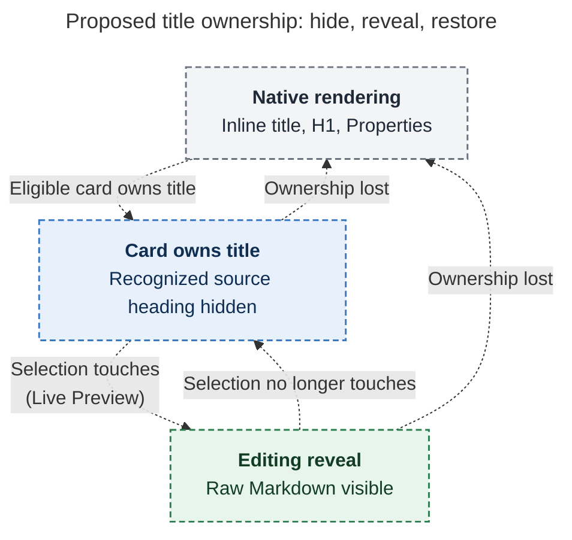
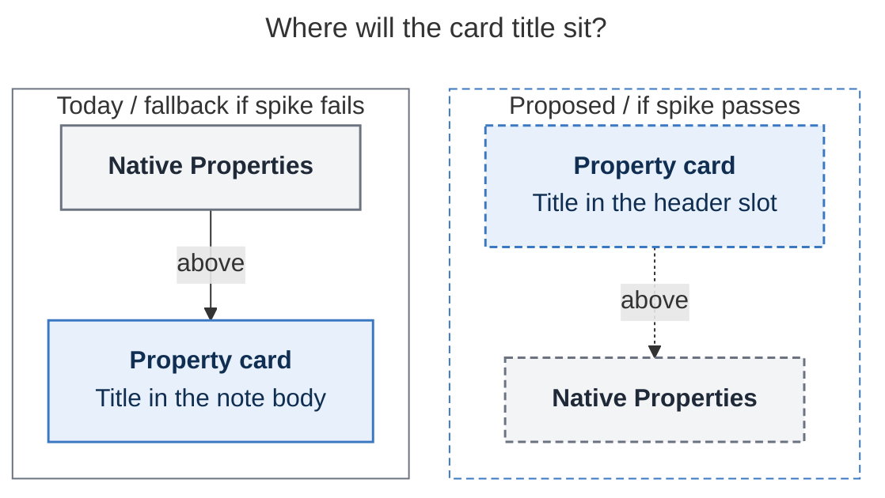

# Diagram proposals: Property cards as the note's title block: consolidated design and recommendation

Proposals for the swarm linker, not a report. Each diagram restates only what the source
report says.

```yaml
source: research:202611/property_card_title_block/property_card_title_block__final.md
producer: research.5i.image
check: "mmdc 12.0.0 with the PDF-mirroring config rendered 2 of 2 Mermaid diagrams; Puppeteer --no-sandbox; broken-input rejection verified"
```

## title-ownership

```yaml
anchor: |-
  embeds, popovers, Source mode, and mobile keep native rendering.
question: |-
  How does title ownership hide duplication without preventing editing or native fallback?
illustrates: |-
  The proposed title-ownership lifecycle reveals raw Markdown on selection-touch in Live Preview and restores native rendering through either loss-of-ownership path.
caption: Any loss of title ownership restores native rendering; selection-touch in Live Preview reveals raw Markdown for editing.
review: "496.654x566 px, fit 100.0%; question, label, arrow, source-trace and visual checks passed; 0 revisions"
```



## title-slot

```yaml
anchor: |-
  the record sheet mounts in the note body, **below** native Properties, and Bryan
question: |-
  What changes in page order if the title-slot spike succeeds, and what happens if it fails?
illustrates: |-
  The proposed title slot places the property card above native Properties only when reliable, while body placement remains the fallback.
caption: A reliable title slot puts the card above native Properties; failure keeps the existing body placement.
review: "567.094x361 px, fit 100.0%; question, label, arrow, source-trace and visual checks passed; 1 revision to put today on the left"
```


