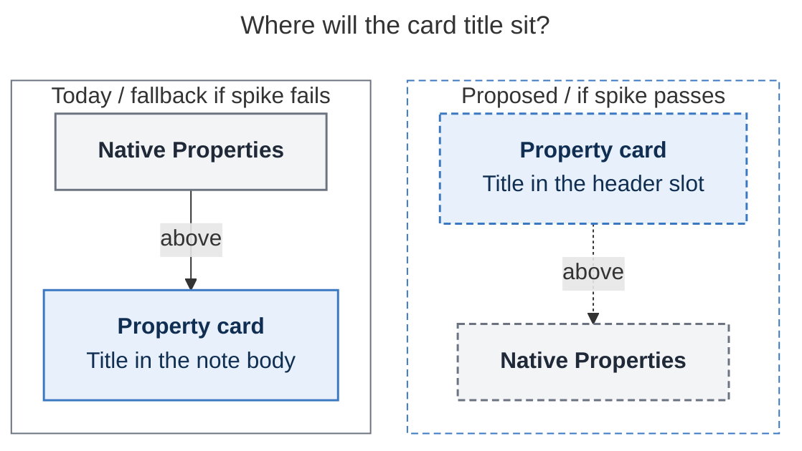
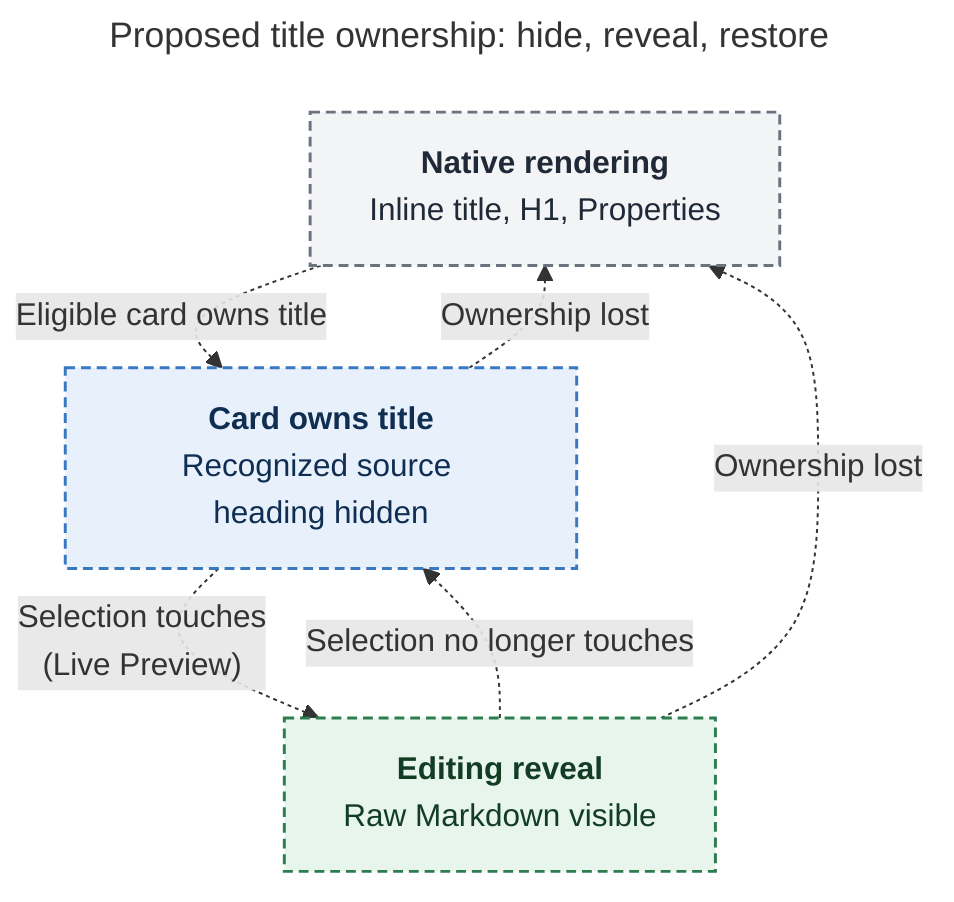

# Property cards as the note's title block: consolidated design and recommendation

> **Research query:** Once property cards are fully implemented, how should their look be
> improved and unified: stop rendering the H1 section in album notes and daily files in
> favor of rendering it in that note's schema card (as should already happen for record
> notes), and make it very clear from the title whether the user is looking at an album
> note, a record note, or a daily file (for example with a unique icon and/or card
> color), using the `bob-cli-ms` and `bob-cli-nh` epic beads as context? The design
> should be intuitive, reliable, and beautiful. Is this plan a good idea, would a
> different approach be better, which requirement adjustments are justified, and what is
> the recommended solution?


## Bottom line

**Do it.** All five researchers independently endorse the request, and the code agrees
with its diagnosis: after the in-flight kit extraction (`bob-cli-nh.6`), the album
card, record sheet, bank card, and intention card deliberately share one 8px-radius,
2px-accent-stripe, area-hue-washed chrome, while a note can stack up to three titles
(Obsidian's filename inline title, the Markdown H1, and card text that repeats the same
identity). Moving the one visible title into the card and giving each card species an
unmistakable identity is the natural second half of the two epics already running.

**But not literally as written.** Three corrections are unanimous or near-unanimous
across the reports and [survive verification](#lead-verification-notes):

1. **"Stop rendering the H1" must not mean "delete the H1" for albums and daily
   files.** Records could drop H1 bytes because frontmatter `title:` already held the
   title. Albums have **no** `title:` key — the body H1 is the title's only persisted
   home (`src/native/albums/create.rs:87` writes `# {title}` and the frontmatter block
   above it has no title key; `derive_title` in `src/native/notebooks/scan.rs:787` is
   H1 → first alias → humanized stem — all lead-verified). Daily notes are
   Templater-owned, number ~1,195 across five historical shapes, and carry the weekday
   only in the H1, not the filename. v1 hides at render time; bytes move later, per
   species, if at all (see [Resolution 1](#resolution-1-keeps-or-deletes-h1-bytes-per-species)).
2. **"Schema card" is the wrong destination name.** The settled vocabulary from the
   `nh` plan is: the in-note panel is the **property card** (album card, record
   card/sheet, bank card, intention card); `==` opens a **card editor** (the album's
   editor is the Schema Card). Record titles live on the record sheet, not a schema
   card, and daily files have no schema at all. An epic worded "render the H1 in the
   schema card" will aim implementers at the wrong surface.
3. **Color cannot be the primary species signal.** Hue already means *where* in Bob —
   the root area or theme (`decisions:theme-hue-is-config-pin-exempt-area-hash`), and
   an album shares its records' hue (`eat.md` and `eat/ani_ramen_house.md` are both
   green), which is precisely why they look alike today. Species must be carried by
   **[words and form](#resolution-2-keeps-area-hue-and-adds-one-temporal-accent)**,
   with color as reinforcement only.

The [recommended solution](#the-recommended-design) in one line: **the property card
becomes the note's title block — one kicker row (glyph + species word), one prominent
title, one docked nav rail — where hue keeps saying *where*, form says *what*, and words
say both** (cld's framing, adopted by the consolidation).

## What the five reports agree on

These points appear independently in at least four of five reports and are treated as
settled inputs, not open questions:

- **The duplication and confusion are real and about to get worse.** A healthy album
  today shows the filename inline title (`eat`), the authored H1 (`# Eat`), and a card
  crumb ending in `Eat`. After `nh`, dailies gain the same "heading plus rounded card"
  silhouette as albums and records.
- **Records are the precedent and stay as they are.** `ms.8` moved the record title
  into the sheet (`div` with `role="heading"` `aria-level="1"`, `--inline-title-*`
  typography), hid the inline title behind proven direct-child selectors
  (`styles.css:10981–10993`, lead-verified), writes new records H1-less, and tidies
  redundant H1s. No competing title feature should be built.
- **Ship identity as a follow-up epic, not inside `nh`.** The kit phase (`nh.6`) is
  gated on pixel-identical extraction; identity is a deliberate visual change. All `nh`
  phases are in flight today — do not widen them.
- **The daily/period card must always mount on canonical notes.** `nh`'s current gate
  ("no non-empty field, no card") would leave an H1-less empty daily titleless. gem
  measured 309 of 311 live 2026 dailies currently empty; this is the single most
  important requirement amendment (see [A3](#adjustments-to-the-requirements-explicitly-called-out)).
- **Week, quarter, and year notes belong in scope; `all_time` stays out.** Periods get
  the same intention card, have the same (heavier) H1-plus-nav sandwich
  (`src/native/periods/scaffold.rs:160–211`, lead-verified), and splitting the family's
  look would be worse than today. (cdx is the partial dissent — "make the component
  able, gate the rollout" — honored by gating period behavior by resolved note kind.)
- **Species identity = visible word + distinct glyph first; never color alone.**
  Satisfies the WCAG use-of-color and headings-and-labels guidance cdx cites, and
  survives grayscale, forced-colors, and theme changes.
- **Everything fails open.** Source mode, embeds, hover popovers, mobile, failed
  mounts, and plugin teardown restore native rendering (inline title, H1, Properties).
  Note: the `nh` reviewer explicitly **declined** recording a
  `property-cards-own-their-rows` decision, so fail-open is a plan-level contract, not
  settled memory — the identity epic must restate it in its own acceptance criteria.

## Resolved disagreements

### Resolution 1 keeps or deletes H1 bytes per species

The real split in the swarm. cdx and cld keep album/daily bytes indefinitely; grk
deletes album H1s after adding `title:` but keeps daily/period bytes; mus and gem
eventually delete all three behind dual-read windows.

**Resolution — three different answers because the three species have three different
title-ownership stories:**

| Species | v1 (identity epic) | Byte follow-through |
| --- | --- | --- |
| **Record** | Already H1-less; sheet gains only the kicker/species chrome | None — `ms.8` settled it |
| **Album** | Hide the H1 at render time while the card cleanly owns it | **Yes, gated and last:** add a bob-owned `title:` frontmatter key (backfilled from the H1), teach `derive_title` and the plugin's `notebookHeaderNoteTitle` to prefer it, then an `albums tidy`-style pass removes the now-redundant H1 — the exact `ms.8` ordering (sheet-title first, H1-retire second), on 6 bob-owned notes |
| **Daily / period** | Hide the H1 (and optionally the nav line, see A7) at render time | **No byte changes in this epic.** Title is computed from the path / `labels::title`, never parsed from the H1. A later, separately-accepted epic may stop *emitting* H1s in `_templates/daily.md` and `scaffold.rs` once the hide has lived through a release; rewriting ~1,195 heterogeneous, Templater-owned historical notes is never required for the visual goal |

Rationale: Bryan's request says "like we should already do for record notes," and for
albums the record pattern genuinely applies — the title becomes a bob-owned frontmatter
field, catalogs/crumbs/Source mode read it honestly, and tidy is cheap (6 notes).
cld's "keep the H1 as the canonical album store forever" alternative leaves Reading
view pretending a heading is gone that Source mode, grep, and `derive_title` still
depend on (grk's counter, adopted). For dailies the record pattern does *not* apply:
the authoritative title is the path, the weekday exists only in the H1 (mobile and
Source mode would regress to `20261119`), Templater writes on every device, and the
history is five shapes deep — mus's and gem's deletion plans are demoted to the
optional later epic they each already gated behind production soak.

### Resolution 2 keeps area hue and adds one temporal accent

grk proposes full kind-colored washes (album slate, record paper, day cyan) and demotes
the area hue to a crumb pip. The other four keep area hue as the card accent. The
consolidation sides with the majority: rebinding the wash would discard the one color
meaning Bob keeps everywhere (cards, day strip, Mac capture, task marks), and
album-vs-record cannot be color-separated anyway since they *share* a hue.

Two refinements survive from the minority positions because they fix verified defects:

- **The calendar family gets one dedicated non-area accent** (a cyan/teal
  `--bob-day-accent`). Dailies and periods have no root area —
  `pomodoroHomeResolve` returns null and today's fallback is `--interactive-accent`,
  which collides with violet-area notes (gem's finding). cld (neutral), grk (calendar
  cyan), and gem (temporal teal) all converge here; cyan also echoes the walk's
  PRE/POST bookend language. Week/quarter/year deepen the same accent's tint rather
  than adding hues.
- **Album vs record separate by *material*, not hue:** the album is the rich tinted
  "collection cover" (keep ~8% wash, slightly heavier header band is acceptable); the
  record is the quiet "paper sheet" (keep ~4% or lighter, hairline feel). That is form
  doing the work the request assigned to color — cld's and gem's designs agree almost
  exactly despite being independent.

Everything must remain distinguishable in grayscale and under `forced-colors: active`
with identical titles; the kicker word and glyph carry species on their own (cdx's
acceptance bar, adopted).

### Resolution 3 adopts a gated title slot with body fallback

Only cld raises this, but the evidence is concrete and the others simply missed it:
the record sheet mounts in the note body, **below** native Properties, and Bryan
explicitly required native Properties (with "Add property") to stay visible
(`bob-cli-ms.8.3.1.1` note #4). On a daily note that puts up to nine Properties rows
above the date. "Title in the card" is only the promised improvement if the card is
the first thing on the page. [The card-placement diagram](#figure-title-slot) shows
today's order, Properties above the card, against the proposed title slot that puts the
card first only when reliable, with body placement as fallback.

<div id="figure-title-slot">



_A reliable title slot puts the card above native Properties; failure keeps the existing body placement._

</div>

**Resolution:** make "mount the card in Obsidian's title slot" (as a sibling after the
hidden `.inline-title`, before `.metadata-container`, in both Live Preview's
`.cm-sizer` and Reading's `.mod-header`) the identity epic's **phase-1 go/no-go
spike**, proven by CDP on athena before anything else is built. Known risks and
mitigations (cld): a MutationObserver re-inserts on header re-render;
`view.requestMeasure()` after card height changes keeps CodeMirror scroll/cursor math
honest; if the slot cannot be made reliable, the epic proceeds with today's body
placement and every other part of this design is unchanged. The worst outcome is
today's layout, never a missing title.

### Resolution 4 picks the Live Preview hiding mechanism

cdx and cld independently converge: multi-line suppression (H1 + blanks + nav line)
needs a CodeMirror **StateField** supplying `Decoration.replace({block: true})` — the
existing view-plugin widget path cannot replace line breaks — with
**reveal-on-selection-touch** so a caret, Vim motion, or search hit into the hidden
range shows the raw Markdown for editing (the exact inclusive rule
`recordWalkSelectionTouches` already ships for walk lines). Reading view hides the
owning view's `el-h1` section and nav paragraph only, never inside embeds. This is the
main technical uncertainty after placement; it gets its own real-Obsidian proof
(Vim `gg`/`j`/`k` across the boundary, `/` search into the H1, undo, `[[note#heading]]`
links, Outline jumps).

## Adjustments to the requirements explicitly called out

Each changes or sharpens the request; Bryan can veto any individually.

- **A1 — Rename the destination.** The title row lives on each note's **property
  card** (album card, record sheet, intention card). "Schema card" keeps naming the
  album's `==` editor only.
- **A2 — Scope.** In: album, record, canonical daily, week, quarter, year. Out:
  `all_time`, notebook headers, bank-month notes, area/project notes. `bank.md`'s
  Setup card receives only the species kicker (word + glyph) so the family speaks one
  grammar — no H1 move, it has none.
- **A3 — Amend `nh`'s empty gate.** Identity chrome (kicker, title, nav rail) always
  mounts on canonical daily/period notes while hide-eligible; the intention/summary/
  reflection **bands** stay content-gated exactly as `nh` planned. An empty day shows
  a calm title-and-navigation header (plus at most one quiet "set intentions"
  affordance on open days — never on past days), and `==` still opens the editor.
  This is an explicit change to `nh`'s contract, not something implementers may
  assume.
- **A4 — Render-time ownership, not deletion, in v1** ([Resolution 1](#resolution-1-keeps-or-deletes-h1-bytes-per-species)).
  Showing, collapsing, or hiding never rewrites the note; only writers (create, tidy,
  intention update) own bytes.
- **A5 — Album `title:` before any album H1 removal**, as the epic's final, separately
  gated phase; daily/period bytes untouched in this epic ([Resolution 1](#resolution-1-keeps-or-deletes-h1-bytes-per-species)).
- **A6 — Species identity is kicker word + glyph + form; hue keeps meaning "where"**
  ([Resolution 2](#resolution-2-keeps-area-hue-and-adds-one-temporal-accent)). Glyphs
  use Obsidian's icon mechanism / a small inline SVG with `aria-hidden`, not platform
  emoji as the only cue; the album's own `emoji:` stays content decoration (it
  legitimately appears on both the album and its records, so it can never be the
  species mark). The accessible name leads with the species word ("Album:
  Restaurants").
- **A7 — Nav lines: keep bytes, dock the rail.** `bob-navigation-hotkeys` (`[n`/`]n`)
  parses the body's prev/parent/next wikilinks directly (gem), so the Markdown nav
  line stays. The beautiful end state renders it as the card's docked footer rail (the
  record walk rail's proven dock-and-reveal pattern) and hides the raw paragraph
  unless the cursor touches it. If the rail does not fit the phase, v1 may leave the
  nav line visible in the body below the card (grk's fallback) — never hidden without
  a rail, and never duplicated.
- **A8 — Card editors mirror the identity.** The `==` modals (Record Card, Schema
  Card, day/period editor) carry the same glyph and species word in their headers, so
  the `=` climb from record to album visibly changes species. Field semantics and
  keymaps are untouched.
- **A9 — Title ownership splits from row ownership.** The title row renders from
  local data only (path, metadataCache frontmatter/headings, parent chain) and never
  waits for a bob report; owned-Properties hiding and editability keep their existing
  per-band gates. This also fixes today's album-header mount flash (the card currently
  waits for the cached report) and leaves the door open to a later mobile title row —
  closing the gap `ms.8` left where mobile records show only the filename stem.

## The recommended design

One skeleton on every mounted property card:

```text
[glyph]  SPECIES · context                              actions  ▾   ← kicker row, UI-small
Title in page-title type                                             ← div, role="heading", aria-level="1"
muted context line (owner crumb with area pip · noun · counts)
──────────────────────────────────────────────────────────────────
species body: schema chips / record fields / intention bands
──────────────────────────────────────────────────────────────────
‹ previous            ↑ parent · position              next ›        ← docked rail where nav exists
```

| Species | Glyph concept | Kicker | Title source | Surface | Rail |
| --- | --- | --- | --- | --- | --- |
| **Album** | collection stack (two sheets) | `ALBUM` | `title:` once added; today H1 → alias → stem | rich area-hue tint ("collection cover") | none |
| **Record** | single document sheet | `RECORD · <noun>` | frontmatter `title:` (unchanged) | quiet paper, hairline, light tint | existing walk rail |
| **Day** | calendar leaf | `DAY` (plus a `today` accent) | computed from path: "Wed, Nov 18, 2026" | temporal accent (`--bob-day-accent`), no area hue | `‹ Tue · ↑ W47 · Thu ›` |
| **Week / Quarter / Year** | calendar leaf, range variant | `WEEK` / `QUARTER` / `YEAR` | `labels::title(id)` | same temporal accent, deeper tint per scale | existing `‹ · ↑ · ›` line as rail |
| **Bank** | existing bank mark | `BANK` | keep Setup heading | unchanged | none |

Rules that make it reliable and beautiful rather than merely decorated:

- **One heading.** While the card cleanly owns the title, the pane exposes exactly one
  `aria-level="1"` node — the card title. The native H1 and inline title are hidden via
  kit-level, direct-child, view-scoped selectors (generalizing the record pattern);
  embeds, popovers, Source mode, and mobile keep native rendering. The hide class
  drops on teardown, mode switch, failed mount, and plugin disable.
- **One title source per species, never parsed from the hidden H1** (table above).
  Day titles derive from the path so all five historical daily shapes work with zero
  file edits; a custom or unrecognized heading stays visible as authored content.
- **Typography and proportion over ornament.** Reuse the approved 8px radius, the
  record sheet's `--inline-title-*`/`--h1-*` title styling, Obsidian theme variables
  throughout, and target cdx's starting proportions (≈16px card padding, 18–20px
  glyph, 12–13px medium kicker). No shadows, gradients, hero banners, or nested card
  boxes. Long titles wrap; at ≤375px content width the toolbar wraps below the title
  and the rail collapses to its compact form; the species word never disappears.
- **Collapsed cards keep identity:** kicker + title + one muted summary line per
  species (album: record count; record: chips + field count; day: first intention or
  "no intentions yet").
- **Accessibility gates:** distinguishable in light, dark, grayscale, and
  forced-colors with identical titles; 4.5:1 text contrast; visible keyboard focus;
  glyphs `aria-hidden` with the species word as the accessible prefix.

[The title-ownership diagram](#figure-title-ownership) traces the proposed lifecycle: an
owning card hides the source heading, a Live Preview selection touch reveals raw
Markdown, and losing ownership restores native rendering.

<div id="figure-title-ownership">



_Any loss of title ownership restores native rendering; selection-touch in Live Preview reveals raw Markdown for editing._

</div>

## Sequencing

**Now (in flight — do not widen):** finish `ms.8.3` (its proven hide selectors are the
template) and land all of `nh` as planned, pixel-identical kit included. If `nh.7` has
not yet shipped the intention card's final placement when the identity epic is planned,
fold the title row and always-mount amendment into it then; otherwise the identity epic
restyles after landing.

**The property-card identity epic** (bob-plugins first; bob-cli only in the last
phase):

1. **Title-slot spike (go/no-go).** CDP-prove header-slot insertion in Live Preview
   and Reading across file switches, mode switches, splits, re-renders, and teardown;
   measure scroll/click accuracy under a tall card. Failure ⇒ body placement, design
   unchanged.
2. **Kit: identity tokens and title ownership.** `data-card-kind` on
   `.bob-property-card`; kicker/glyph/title-row helper; `--bob-day-accent`; the
   StateField block-replace with selection reveal; Reading section hide; generalized
   `bob-property-card-owns-title`; title/row ownership split
   ([A9](#adjustments-to-the-requirements-explicitly-called-out)); fix the dead
   `purple` rule. Pixels change here on purpose — snapshot light/dark at 375px and
   wide.
3. **Album and record adopt.** Record sheet gains the kicker only; album card gains
   the local title row (ends the report-wait flash), hides its H1 while owned, folds
   schema chips to one collapsed line by default, and the `==` editor headers adopt
   the identity (A8).
4. **Day and period adopt.** Always-mount on canonical notes
   ([A3](#adjustments-to-the-requirements-explicitly-called-out)); computed titles;
   docked nav rail with reveal-on-touch (A7); empty and legacy (Zorg-shape) dailies
   verified explicitly.
5. **Album `title:` and tidy (bob-cli, gated).** Add the key (create writes it,
   `derive_title` prefers it, plugin crumbs read it), backfill the 6 live albums, then
   remove redundant album H1s with record-tidy's conservative keep rules (differing
   text, H1 after prose, fenced — kept and reported). Runs only after phases 2–3 are
   live so the vault never loses a pretty title.
6. **Proof, docs, deploy.** Real-Obsidian e2e for title ownership, reveal, fallback,
   heading links, Outline, and byte neutrality; preview matrix (light/dark × narrow/
   wide × album/record/today/past-day/week/legacy-daily/broken-report); docs updates;
   `bob plugins sync`.

**Later, separately accepted:** stop emitting daily/period H1s in template and
scaffolds; notebook-header adoption; a mobile title row.

## Decisions for Bryan (consolidated defaults)

1. Title-slot mount above native Properties, with automatic body fallback — **default
   yes** ([Resolution 3](#resolution-3-adopts-a-gated-title-slot-with-body-fallback)).
2. Album `title:` key + H1 tidy as the gated final phase — **default yes**; veto
   leaves albums on permanent render-time hide (cld's position, workable but less
   honest in Source mode).
3. Daily/period H1 bytes stay in this epic — **default yes** (unanimous-after-
   resolution; mus/gem's deletion survives only as the later optional epic).
4. Day title format — **default "Wed, Nov 18, 2026"**; ISO stays in alias/tooltip.
5. Temporal accent for the calendar family — **default yes** (fixes the
   `--interactive-accent`/violet collision).
6. Rename "intention card" to day/period card in docs and glossary — **default yes**,
   needs a memory decision alongside `nh.9`'s glossary work.
7. A `decisions:` record ("property cards own the title block at render time; title
   bytes stay per species") — propose via `/sase_memory_write` after the epic is
   accepted; note the `nh` reviewer previously declined the adjacent
   `property-cards-own-their-rows` record, so ask rather than assume.

## How this consolidation was built

Lead consolidation of five independent research reports (`__cdx`, `__cld`, `__grk`,
`__mus`, `__gem`, siblings in this directory), 2026-11-19. The lead re-verified every
load-bearing claim the recommendation rests on against bob-cli (workspace master,
`5b4c2636` era), bob-plugins (`76fa3f9`), and audited reads of the `bob-cli-ms.8` and
`bob-cli-nh` epic beads. Status at consolidation time: `ms.8.1`/`ms.8.2` closed,
`ms.8.3` (real-Obsidian proof) in progress; all nine `bob-cli-nh` phases in progress.

### Lead verification notes

Beyond the agreements above, the lead confirmed these contested or single-source
claims:

- **Albums have no second title home.** `render_new_album` writes `parent`, `type`,
  `summary`, optional `emoji`, `created`, `record:`, then `# {title}` — no `title:`
  key, no aliases. gem's vault scan (5 of 6 live albums have titles `humanize_stem`
  cannot reconstruct: `eat`→"Restaurants", `tv`→"TV", `sase_blog_zettel`→"SASE Blog
  Zettel") is corroborated by cld's independent scan.
- **Period scaffolds emit the H1 and a three-wikilink nav line** (`[[…|‹ W46]] ·
  [[…|↑ 2026-Q4]] · [[…|W48 ›]]`), so the "orphaned nav line" problem gem and cld
  describe is real for periods as well as dailies.
- **The record hide is record-specific and selective.** The CSS hides only
  `.bob-record-sheet-owned-property` rows and the view's `.inline-title` under
  `.bob-record-sheet-hides-properties`, with explicit embed carve-outs. Generalizing
  this into the kit (a `bob-property-card-owns-title` scope class) is new work, not a
  copy-paste.
- **`styles.css:11500` is a dead rule** — `.bob-record-walk-rail[data-root-hue="purple"]`
  references `--bob-area-purple`, which does not exist (the ladder defines
  `--bob-area-violet`, and every JS hue list emits `violet`). gem's typo finding is
  confirmed; fix it in the restyle phase.
- **Bead statuses** ([above](#how-this-consolidation-was-built)) — sequencing in this
  report reflects them.

### Source reports

- `property_card_title_block__cdx.md` — identity-header concept, accessibility bars
  (WCAG cites), title-ownership failure matrix, acceptance-evidence catalog; light/dark
  concept sketch (SVG sibling).
- `property_card_title_block__cld.md` — title-slot placement proposal and evidence,
  vault shape census (1,195 dailies, five shapes), StateField mechanism, ownership
  split, species-as-material design; rendered mockup (PNG sibling).
- `property_card_title_block__grk.md` — sequencing (identity epic on top of the kit,
  album `title:` last), kind-token alternative (not adopted), vocabulary corrections;
  four Mermaid figures (PNG siblings).
- `property_card_title_block__mus.md` — migration-ownership split (bob vs Templater vs
  scaffold), dual-read windows, link/query safety, "beauty as hierarchy" spec.
- `property_card_title_block__gem.md` — empty-daily blackout quantified (309/311),
  album title non-reconstructibility (5/6), nav-hotkey dependency, temporal accent and
  silhouette system, `purple` typo, phased CSS contract.
