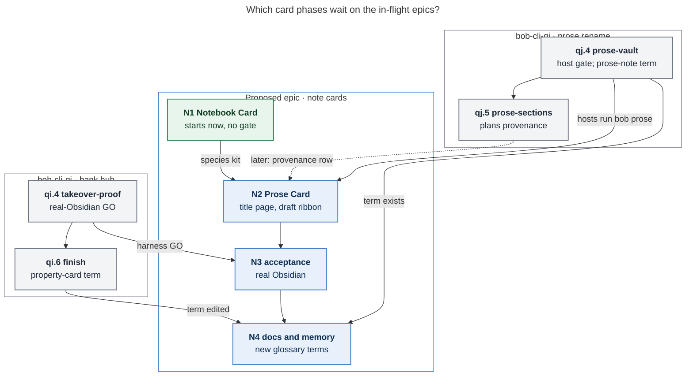

# Prose Cards and Notebook Cards: design, critique, and a parallel plan (cld)

Researcher: `cld` (one of five). Date: 2026-11-26. Base: bob-cli `478d5233`, bob-plugins
`86f5f340`, live vault `~/bob` (read-only).

## TL;DR

- **The idea is good, but the two halves are worth very different amounts today.** The
  **Notebook Card** pays off now. The vault has 39 notebooks. 25 of them carry seven zorg
  provenance keys each, which crowd the native Properties block, and 28 have no
  `created`. Notebooks also already have a separate, non-kit "linked notebook header"
  that a card should absorb. The **Prose Card** has one note to render today
  (`sase_blog_contents.md`). Its value is in the future: `bob-cli-qj.5` (prose-section
  extract/inline) will create many prose notes. So keep the Prose Card small and
  typographic, and land it after the rename.
- **Very little coordination is needed. Start the Notebook Card now.** The new cards add
  no bob-cli source, JSON contract, or wire kind. They reuse two read-only reports that
  already exist (`bob notebooks list -f json`, which the plugin already subscribes to,
  and `bob articles|prose list -f json`). Only four seams need ordering, and each is one
  bead dependency (see [the figure](#7-parallelism-is-coordination-even-needed)):
  1. The prose report call waits on the `qj.4` host gate.
  2. Real-Obsidian acceptance waits on the `qi.4` GO.
  3. Glossary edits wait on `qi.6`, which edits `property-card`.
  4. Glossary edits also wait on `qj.4`, which creates `prose-note`.
- **Design stance.** Both cards are ordinary members of the property-card family. They
  follow the "hue says where, form says what" rule, own the title slot, hide native
  Properties behind the existing `props_v1` fail-open gate, and use the same `-` `_`
  `==` `+` key family. They read cached metadata and shared reports, and never spawn bob
  or write while painting. The two cards share **one host** (like Area/Project share
  `249d`) and differ only in their model and DOM.
- **Requirement adjustments I'm calling out:** see [§3](#3-requirement-adjustments-called-out).
  The main ones:
  - The Notebook Card *replaces* the linked notebook header; it is not added beside it.
  - The Prose Card never consumes a body H1, because in a prose note an H1 is numbered
    section 1.
  - Add `summary:` as an optional prose "dek". Do *not* add a stored status or
    publication lifecycle: draft state is derived from bob's TODO stubs.
  - v1 adds no `prose` props wire kind, which respects `qj.2`'s rule.
  - `==` opens the Property Editor on `summary`. No new species editors.

## 1. What exists today (verified)

### 1.1 The property-card kit (bob-plugins `bob-ledger-tools`)

- **Species registry.** `src/240f-plugin-property-card-species.js` lists nine kinds:
  album, record, day, week, quarter, year, bank, area, and project. Each kind has a word,
  a tile form, an icon, and a `foldDefault`. The header comment states the visual law:
  *"Hue says where, form says what, and words say both. A species never gets a hue of its
  own."* The tile forms are CSS-only (`styles.css` ≈ L12850–12945): `stack` (album),
  `sheet` (record, folded corner), `leaf` (temporal), `plain` (bank), `field` (area),
  and `pennant` (project).
- **Whole-frontmatter ownership.** `240q-plugin-property-card-frontmatter-ownership.js`
  owns this.
  - It hard-codes the eligible kinds (`["album", …, "project"]`, ≈ L543) and a per-kind
    mount-source attribute (≈ L529–532).
  - Only area and project additionally need `props_contract_v1` (≈ L515–526). Everything
    else rides on `props_v1`.
  - The gate fails open on stale cache/source evidence, Source mode, embeds, hover,
    canvas, print, and mobile.
- **Shared pieces.** Title-slot adoption (`240k`), the foot and drawer (`240m`–`240r`),
  the fold kit (`240s`: `foldDefault: true` means open, and a problem signature forces
  open), and the `==` registry (`registerPropertyCard`, extensions after the built-ins)
  are all shared (`docs/develop/architecture.md` §Property-card extension API).
- **The closest analog is the Area/Project "home card"** (`249b`–`249f`). It is one host
  for two kinds, with a pure model, a DOM builder, report-backed live parts patched in
  place, and `==` opening the Property Editor on a setting.

### 1.2 Notebooks

- **Linked notebook header.** Notebooks already get this in Reading view and Live Preview
  (`241e`/`241f`/`241g`, ≈ 1,900 lines, from `bob-cli-j8.6.1.3`). It shows ancestry
  crumbs and child-notebook chips. It is **not** a property card: it owns no title, has no
  foot, and leaves native Properties visible.
- **Report.** The shared notebook report service (`241a-plugin-notebook-data.js`) already
  runs `bob notebooks list -f json`. It revalidates on `metadataCache.changed` with a
  300 ms debounce and serves `apiNotebookSubscribe`. A Notebook Card therefore needs
  **zero new bob calls**.
- **Report fields per notebook:** `title`, `summary`, `parent`, `parent_kind`, `owner`,
  `root`, `breadcrumb`, `children`, `notes`, `sections[{title, notes}]`, `last_note`,
  and `issues` (`docs/notebooks.md` §JSON). `bob notebooks list -f json` takes ≈ 0.5 s
  on the live vault.
- **bob props** already classifies notebooks as `note_kind: notebook`
  (`src/native/props/roles.rs:32`). `summary` is loose.
- **Live vault facts** (2026-11-26):

| Fact | Count | Design consequence |
| --- | --- | --- |
| Notebooks | 39 (13 roots, 7 with child notebooks) | Real, daily-use surface |
| Carry 7 zorg provenance keys (`generated_from_zorg`, `zorg_source`, …) | 25 / 39 | Native Properties is mostly noise, so hiding it is a real win |
| Missing `created:` | 28 / 39 | The foot must render a quiet "no created" state |
| `last_note` is null (no `[created::]` stamps) | 38 / 39 | Recency is optional; never headline it |
| Have a `summary` | 39 / 39 | The subtitle is almost always there |
| Findings | 13 `notebook_shape` warnings, 2 `notebook_duplicate_block_id` errors | The foot lint chip carries real signal |

### 1.3 Prose notes (fka article notes)

- **Engine.** `src/native/articles/` is being moved to `src/native/prose/` by `qj.1`.
  Notes are matched by `frontmatter_is_article`. In props they classify as
  `note_kind: note`, and `qj.2` explicitly says *"Add no new wire kind."*
- **Frontmatter.** The only authored option keys are `title` (an optional publication
  title, which defaults to the file name) and `section_numbers`. There is no `summary`
  today.
- **Data.** `bob articles list -f json` takes ≈ 0.1 s and returns, per note, `status`,
  `findings[]`, and `outline{title, numbering, words, preamble{words}, sections[{depth,
  number, title, words, stub, line}]}`. The human list already shows
  `SECTIONS · WORDS · TODO · FINDINGS · STATE`, which is exactly the card's readout.
- **Live vault: one prose note.** `sase_blog_contents.md` has:
  - 306 words, of which 190 are in the lede;
  - 14 sections, 13 of them TODO stubs (only §3 has words);
  - 4 `pseudo-footnote` warnings, which are Bryan's `[1]: TODO …` notes to himself;
  - no `title`, and no `summary`.
- **Bob Prose plugin (`bob-articles`).** It applies a runtime `.bob-article` look: serif
  body (`Iowan Old Style`, `Charter`, `Georgia`), a 40rem line width, and hanging
  section numbers. `qj` rule 4 freezes that class. The plugin keeps a per-note outline
  cache but exposes no runtime API to other plugins.

### 1.4 The in-flight epics, and what they touch

| Epic / phase | Repos and files touched | Overlap with card work |
| --- | --- | --- |
| `qi.4` takeover-proof | bob-plugins e2e scripts (`obsidian-frontmatter-takeover-e2e*.cjs`, `obsidian-home-cards-e2e.cjs`); repairs anywhere in the kit | Shares the kit (`240q`) and the harness |
| `qi.5` count-sweep | vault only | none |
| `qi.6` finish | passive-rendering fold test; docs sweep of `architecture.md`, `validation.md`, `property-editor.md`, `bob-ledger-tools.md`, `area-and-project-cards.md`; **memory `glossary:property-card`**, `bank-card`, `area-card`, `project-card`; deploy | Shared docs pages and the `property-card` strand |
| `qj.1`/`qj.2` | bob-cli `src/native/articles → prose`, CLI, catalog, `docs/articles.md → docs/prose.md` | Any bob-cli prose-engine edit, and the doc the Prose Card cites |
| `qj.3` | `bob-articles` (detection, copy, new **Toggle section numbers**), `bob-command-mode`, nav-hotkeys `208`, ledger-tools `242d` | Prose detection pattern; the toggle the card's numbering chip calls |
| `qj.4` | host gate (`bob prose` everywhere), vault cutover, plugin argv → `prose`, **memory `glossary:prose-note`** | The card's bob call and its glossary link target |
| `qj.5` | plans extract/inline with provenance fields | Defines the Prose Card's future provenance row |

The decisions roster has no record on property-card species. The records that do apply
are:

- `decisions:bob-cli-releases-ride-a-daily-train`
- `decisions:notebook-routes-write-notes` (notebooks stay bullet collections, and a prose
  note is never a notebook variant)
- `decisions:mac-capture-is-a-thin-client` (nothing for the Mac to do)
- `decisions:q-and-ctrl-bracket-mirror-esc` (any editor the cards open keeps the
  Esc/`q`/Ctrl+`[` close keys)
- `decisions:decision-rules-are-read-at-planning-time` (the planner must re-read the
  roster)

## 2. Is this a good idea? Critique

**Yes. Every typed Bob note with a durable identity should get the card.** The family
promise is one look and one key family: `-` drawer, `_` fold, `==` card editor, and `+`
Property Editor. Right now the promise breaks on exactly the two note types that are
growing:

- notebooks, through capture `%n` and zorg migration;
- prose notes, through the rename and soon section extraction.

The reasons it is good:

1. **Notebooks are the clearest win.** Native Properties on a migrated notebook is seven
   provenance keys plus parent/type/summary. The card shows only what matters (where it
   lives, what belongs here, how big it is, where its sections and children are) and
   puts the provenance in the `-` drawer. It also replaces a separate, older header with
   a kit member, which cuts surface count.
2. **Prose notes get a title page.** For authored writing the card works as front matter
   in the publishing sense: title, dek, and a quiet measure of the draft. It surfaces
   draft state that today exists only in `bob articles list` in a terminal.
3. **It extends the kit along a path that has already been taken.** The species registry,
   adopt/own glue, foot, fold, and `==` registry all exist. The Area/Project work showed
   that a two-species host works.

Where I push back:

- **Don't make the prose note feel like a dashboard.** Readers and writers live inside
  prose notes. A tall card full of chips above an essay is a regression. The Prose Card
  must be the quietest card in the family:
  - It has three lines (identity, title, dek) plus one measure line.
  - It shows the draft ribbon only while TODO stubs remain.
  - It uses the prose typeface and aligns with the 40rem text column.
- **Don't invent prose metadata to fill a card.** "Rich data" should be **derived**
  (words, sections, stubs, findings, inbound links) and not new frontmatter keys
  (`status`, `published`, `url`, `tags`). Bob's consistent preference is derived over
  stored. The prose rename moved away from genre-specific semantics, and a `published`
  lifecycle would bring them back. The one authored key worth adding is `summary:`,
  because every Bob collection type already uses it (area, notebook, album).
- **Prose has n = 1 today.** Building the Prose Card *during* `qj.3` would put two agents
  on prose-plugin surfaces for a single note. Sequence it after `qj.4`.
- **Single owner is the hard requirement.** The bank-hub saga (`bob-cli-pl`/`q6`, now
  `qi`) came from two cards owning one note. The new species must slot into one
  precedence order, and a test must prove that a note eligible for an earlier species
  never mounts a notebook or prose card.

**Would I take a different approach?** Mostly no, with four structural changes, folded
into §3 and §6:

- one shared "note card" host for both kinds;
- the notebook header absorbed, not duplicated;
- no bob-cli source changes in v1;
- the glossary work last.

The alternatives I rejected are in [§9](#9-alternatives-considered).

## 3. Requirement adjustments (called out)

| # | Adjustment | Why |
| --- | --- | --- |
| **R1** | The Notebook Card **replaces** the linked notebook header (`241e`–`241g`). Its crumbs and child chips move into the card, and the header code is deleted once the card ships. Embedded notebooks lose the crumb line, matching the family, where cards never render in embeds. | Two note-top surfaces on one note repeats the bank lesson. One owner. |
| **R2** | The Prose Card owns **only the inline title**, never a body heading. Its title is `title:` if present, else the file name verbatim. This matches bob's outline title and the Area card's file-name rule. | In a prose note every ATX heading, including `#`, is a numbered section (N1). Hiding a "title H1" would hide section 1. |
| **R3** | Add **`summary:`** as an optional one-line "dek" for prose notes. Document it in `docs/prose.md`. No finding, no requirement. | It gives the card a subtitle and gives a future `## Prose` host catalog (`qj.5` open question) a row summary, as notebooks and albums already have. |
| **R4** | **No stored lifecycle** (no `status`, `published`, or `url`) for prose. Draft progress is derived from bob's `stub` flags. | Derived beats stored, and the prose type is genre-free by decision. |
| **R5** | **No new props wire kind** for prose in v1. `bob props show` keeps `note_kind: note`, and the plugin classifies prose from frontmatter, accepting both `[[prose]]` and `[[article]]`, the same way `qj.3` does in the other plugins. | Respects `qj.2` ("Add no new wire kind"). Revisit only if a prose species editor needs card-owned keys. |
| **R6** | **`==` opens the Property Editor focused on `summary`** for both kinds. No new species editors in v1. | Keeps the key family honest without a new modal. It reuses the owned-scope path `notebookFocusSummaryProperty` already uses. |
| **R7** | Both cards gate on **`props_v1` only**, like album, record, bank, and temporal, never `props_contract_v1`. | Neither kind has a settings contract. |
| **R8** | The **Notebook chips** setting keeps governing catalogs only. The card always shows its readout. The setting's description drops "child-notebook chips in headers". | One fewer mode on the card. The readout is the card's purpose. |
| **R9** | Glossary: add **Prose Card** and **Notebook Card**, and update **Property Card** (the family list) and **Notebook** (a "not the Notebook Card" clause). Do this **after** `qi.6` and `qj.4` land their strands, under explicit memory decisions in the plan. | Avoids two agents editing `property-card` at once, and avoids linking `[[prose-note]]` before it exists. |

## 4. Design: the Notebook Card

### 4.1 The questions it answers, in priority order

1. **Where am I?** Crumbs: root area › … › parent notebook, with the root-hue pip.
2. **What belongs here?** The `summary:` scope line. A ghost asks for one when it is
   missing.
3. **How big is it, and how is it organized?** The note count and a **section index**:
   each `##` with its note count, clickable to jump there.
4. **What hangs below it?** Child notebooks with their counts.
5. **Is it healthy?** Bob's findings in the foot lint chip, for example duplicate block
   IDs and shape warnings.
6. **How do I add to it from elsewhere?** Its capture route, `@stem`, as a quiet copyable
   token.

Recency (`last_note`) appears only when present, since 38/39 notebooks have none today.
It is never a headline.

### 4.2 Anatomy (open state; real data from `about_abby.md`)

```text
╭──────────────────────────────────────────────────────────────────────╮
│ ┃▤┃  NOTEBOOK · ● Abby                                     12 notes  │
│ ┃ ┃  About Abby                                        5 § · 1d ago   │
│      Notes on being a good dad to Abby: health, baby care, school,    │
│      family life, and parental leave.                                 │
│      § Health 3   § Baby care 2   § School 1   § Family life 4   …    │
│ ───────────────────────────────────────────────────────────────────── │
│  Nov 2, 2026 · @about_abby · ▸ Properties · 5                         │
╰──────────────────────────────────────────────────────────────────────╯
```

On `vim.md`, the section row shows `§ coc.nvim 3`, a children row reads
`↳ Vim plugins 9`, and the foot shows no created date and `▸ Properties · 12`, because
the zorg keys sit in the drawer.

| Part | Source | Rule |
| --- | --- | --- |
| Tile | species `notebook`, new form **`bound`** | An accent spine on the leading edge (`box-shadow: inset 3px 0 0 var(--bob-property-card-accent)`) and lucide `notebook-tabs`, the same icon the pickers already use for notebooks. Neutral ink with no root. |
| Kicker | species word + crumbs | `NOTEBOOK · ● Root › … › Parent`. Reuses `notebookHeaderCrumbs`, minus `self`. At most 4 crumbs, the same as the home card. |
| Title | local first, then the report | Local: first H1 before the first bullet or `##`, else `aliases[0]`, else bob's `humanize_stem`. This is bob's `derive_title`, already mirrored in `241e`. The report's `title` replaces it when it arrives. The recognized H1 range hides, as on the album card. |
| Subtitle | frontmatter `summary` | 2-line clamp. Missing or blank shows the ghost `＋ Add a one-line summary`, which opens the Property Editor on `summary`. |
| Readout (right) | report `notes`, `sections.length`, `last_note` | `12 notes` in tabular numerals, then `5 § · 1d ago`. Each part is absent, never `0`, until the report arrives. |
| Section index (fold body) | report `sections[]` | A chip per `##` in document order. Click jumps to the heading. More than 8 shows `+N`. The row is hidden when there are no sections. |
| Children (fold body) | report `children` → entries | `↳ Title n` chips. Click opens the note, keeping modifier keys. |
| Foot | kit foot | `created` stamp (quiet when absent), route token `@stem` (click copies `@stem `), Properties drawer, and a lint chip that counts bob `issues` alongside local YAML lint, with codes in the tooltip. |

### 4.3 Behavior

- **Folding.** `foldDefault: true`, so details are open. `_` folds the section index and
  children. No fold problem signature is needed, because every finding lives in the foot.
- **Painting.** It paints at once from local metadata (title, summary, crumbs through
  `pomodoroHomeResolve`, which the header already uses). Report-backed parts patch in
  place on each `apiNotebookSubscribe` update. Painting never spawns bob or writes.
- **Order of rows.** Bob's report order is authoritative.

## 5. Design: the Prose Card

### 5.1 The questions it answers

1. **What is this?** The title, which is the publication title when set, and the dek
   (`summary`).
2. **Where does it belong?** Crumbs from `parent` with the root-hue pip.
3. **How long is it?** Words, an approximate reading time, and the section count.
4. **How far along is the draft?** The **draft ribbon**, shown only while stubs remain.
5. **Is it numbered, and is it formatted cleanly?** A `§ numbered` / `§ unnumbered` chip,
   and bob's findings in the foot.
6. **(After `qj.5`) Where did it come from?** A provenance line with *Inline back*.

### 5.2 Anatomy (drafting state; real data from `sase_blog_contents.md`)

```text
                 ┌─────────── aligned to the 40rem prose column ───────────┐
╭──────────────────────────────────────────────────────────────────────────╮
│  ╭───╮  PROSE · ● SASE › SASE blog                                       │
│  │ S │  sase_blog_contents                      ← serif, text-wrap:balance│
│  ╰───╯  ＋ Add a one-line summary                ← ghost; italic dek when set│
│         306 words · ≈ 2 min · 14 sections · § numbered                    │
│         ▮ ▯ ▯▯▯▯▯▯▯▯ ▯ ▮▯ ▯ ▯          1 of 14 sections written           │
│ ──────────────────────────────────────────────────────────────────────── │
│  Oct 15, 2026 · ⚠ 4 · ▸ Properties · 3                                    │
╰──────────────────────────────────────────────────────────────────────────╯
```

With `title: "Why I built SASE"` set, the title line reads *Why I built SASE* in the
prose heading face, and the tile's drop cap becomes **W**.

| Part | Source | Rule |
| --- | --- | --- |
| Tile | species `prose`, new form **`initial`** | A **drop cap**: the first letter of the title in the serif heading face, in accent ink on a faint tint, like the opening letter of a manuscript. It falls back to `¶` (lucide `pilcrow`) when the title starts with a non-letter. It is the only text-bearing tile besides `leaf`, and it is unmistakable next to `sheet` (record). |
| Kicker | species word + crumbs | `PROSE · ● Root › … › Parent`, from the shared home-hue resolver. Notes with no area ancestry use neutral ink. |
| Title | `title:` → file name | Local and immediate. It matches bob's `outline.title`. It owns the inline title only (R2). |
| Dek | `summary:` | Italic, muted, `text-wrap: pretty`, 2 lines. A missing value shows a ghost while the note is still drafting (any stub). A finished draft without a dek shows nothing, so the title page stays clean. |
| Measure line | report `outline.words`, `sections`, frontmatter `section_numbers` | `306 words · ≈ 2 min · 14 sections · § numbered`. Minutes are `ceil(words / 230)`, at least 1 (see §6.4). The `§` chip runs `bob-articles:toggle-section-numbers` (from `qj.3`) when that command exists, and is inert text otherwise. |
| Draft ribbon | report `preamble.words`, `sections[]{depth, stub, words, number, title, line}` | See 5.3. Hidden when no section is a stub. |
| Foot | kit foot | `created`, a findings chip (bob `findings`, warnings and above; codes and lines in the tooltip; click moves the cursor to the first finding), and the Properties drawer. |
| *(later)* Provenance | `qj.5` fields | `↰ from [[sase]] › Design notes · Inline back`. The slot is reserved in v1; `qj.5`'s child plan fills it. |

### 5.3 The draft ribbon

- **Segments.** One segment per section, in outline order, plus a leading **lede**
  segment when `preamble.words > 0`. Segments are equal width. Depth-1 sections start a
  group, and a 4px gap separates groups, so the ribbon reads as the outline's shape.
  Depth ≥ 2 segments are 70% height.
- **Encoding.** Filled in the accent means written (`stub: false`). A hairline outline
  means a TODO stub. The label on the right reads `1 of 14 sections written`.
- **Interaction.** Hovering shows `1.2 What is an "agent turn"? · TODO` or `· 412 words`.
  Clicking jumps to the heading's `line`. The container is `role="img"` with the label
  as its accessible name. Segments are not tab stops: the outline pane already provides
  keyboard navigation, and 40 tab stops would be hostile.
- **Scale.** Above 48 sections, segments aggregate per depth-1 group with a
  proportional fill.
- **Disappearance.** When no stub remains, the ribbon and its label are removed, and the
  card is a quiet title page: title, dek, and measure line.

### 5.4 Typography and look (the "beautiful" part)

- The card follows the `.bob-article` scope. Under `.bob-article.bob-article-serif`, the
  card title uses `--bob-article-heading-font`, and the dek uses the serif body face.
  The scoped CSS lives in ledger-tools `styles.css` and keys on the frozen
  `.bob-article` class, so no runtime API is needed.
- The card's inline size follows the prose sizer, so its edges line up with the 40rem
  text column: a title page, not a banner.
- The tint stays at the family's quiet level (4%, the same as record, not album/bank's
  8%). No pills sit in the title row.
- Light and dark both work because every color derives from
  `--bob-property-card-accent` and theme variables, as the kit already requires.

## 6. Shared architecture

### 6.1 One host, two species

Mirror the home card: a single `note-card` host adapter (kinds `notebook` and `prose`)
built on `createPropertyCardHost`, with per-kind pure models and DOM builders. Suggested
new fragments, all additive with names chosen to avoid churn neighbors:

- `249g-plugin-note-card-eligibility.js`
- `249h-plugin-notebook-card-model.js`
- `249i-plugin-notebook-card-dom.js`
- `249j-plugin-prose-card-model.js`
- `249k-plugin-prose-card-dom.js`
- `249l-plugin-note-card-host.js`
- `241ah-plugin-prose-data.js` (the prose report service)
- `374h-exports-note-card.js`

Kit edits are small and additive:

- `240f`: two species entries (`notebook`: `bound`, `notebook-tabs`, `foldDefault: true`;
  `prose`: `initial`, `pilcrow`, `foldDefault: true`).
- `240q`: two kinds in the eligible list and one mount-source attribute.
- `styles.css`: two tile forms.
- `==` registry: register both kinds after the built-ins and the intentions extension.
- `_`: `propertyCardRegisterFoldKind`.

Use `code` prefixes like `noteCard*`, `notebookCard*`, and `proseNoteCard*`. Bare
`prose*` would collide in grep with the existing `proseField` (S1–S15) namespace.

### 6.2 Eligibility and the single-owner precedence

A single exported function decides the species for a path and its frontmatter, in bob's
props order. Each later kind applies only if no earlier one matched:

1. `bank.md` path
2. album
3. record
4. area or project (home)
5. notebook
6. prose (types ⊆ {`prose`, `article`}; a mixed type is refused by the engine and gets
   no prose card)

Exclusions match the home card: `_templates/`, `done/`, `_conflicts/`, and the type
notes. A unit test enumerates every combination of two types and asserts exactly one
species, or none. This is the cheap guard against a repeat of the bank-hub double-owner
failure.

### 6.3 Data and refresh

| Kind | Local (paints immediately) | Report (patched in) | Refresh trigger |
| --- | --- | --- | --- |
| Notebook | title, summary, crumbs, created | `notes`, `sections`, `children`, `last_note`, `issues` | Existing `241a` service (`metadataCache.changed`, 300 ms debounce). **No new spawns.** |
| Prose | title, summary, crumbs, `section_numbers`, created | `outline.words`, `sections`, `preamble`, `findings`, `status` | New `241ah` service: `bob prose list -f json`, once at startup, then debounced on `changed` for prose paths only. It rejects any `schema_version` other than 1. |

- **Missing or stale data.** A missing or stale report hides only the report-backed
  parts, never showing them as zero. A failed report keeps the last good rows, exactly as
  the catalog cards do.
- **Live typing.** The prose report reflects saved bytes. Bob Prose formats on save and
  leave, so the card catches up within one save. That is acceptable for a title page. A
  later option is for `bob-articles` to publish its per-note outline (it already caches
  one) through a small `api.prose.outline(path)` for keystroke-fresh counts. Not v1.

### 6.4 Ownership of display values

Bob owns the counts. The reading-time figure is a plugin presentation of bob's `words`
(`ceil(words/230)`). That is a judgment call. If Bryan wants strict "bob owns every
value", add a growth-only `outline.reading_minutes` after `qj.2` (no `!`, and
`schema_version` stays 1). It is cheap either way.

### 6.5 Gates, skew, and passivity

- **Gates.** Desktop Live Preview and Reading only. `props_v1` confirmed for the current
  bob path. Source and cache agree. Editor routing works. Otherwise native Properties
  returns and the card stays or falls back to the body, per the kit.
- **New plugin, old bob.**
  - Notebook: every current bob already ships `notebooks list` and `props_v1`, so
    nothing changes.
  - Prose: before the `qj.4` gate, `bob prose` does not exist on some hosts. That is
    exactly why the prose report phase waits for the gate. After it, `prose list` is
    safe. The permanent alias `articles` remains a fallback if Bryan prefers not to wait,
    but the canonical call is cleaner.
- **New bob, old plugin.** Nothing changes.
- **Passivity.** Add both kinds to `qi.6`'s passive-rendering fold test: toggling folds
  many times produces zero vault writes and zero paint-triggered subprocesses.

## 7. Parallelism: is coordination even needed?

**Barely.** The card work shares no JSON contract, no bob-cli source, and no runtime
path with either epic. What it shares is files and memory strands, and only four
orderings matter.



*Figure 1. Only the Notebook Card starts with no gate. Every other arrow is one bead
dependency on a single in-flight phase. The dashed arrow is a later, optional follow-up.
`qj.4` already depends on `qj.2` and `qj.3`, so gating on `qj.4` covers the whole
rename. Rendered with mermaid-cli 12.0.0: 772 × 1108 px, 80.6% PDF fit.*

### 7.1 The seams

| Seam | Risk if ignored | Mechanism |
| --- | --- | --- |
| **S1 memory.** `qi.6` edits `glossary:property-card`, and `qj.4` creates `glossary:prose-note`. | Concurrent strand edits, or a dangling `[[prose-note]]` link. | N4 depends on `qi.6` and `qj.4`. Memory decisions sit in the new plan. |
| **S2 bob call.** `bob prose` exists only after `qj.2`, and on every host only after `qj.4`'s gate. | Old hosts get a failed prose report (fail-open, but a broken card). | N2 depends on `qj.4`. It calls the canonical `prose list` and needs no skew code. |
| **S3 shared kit and docs files.** The kit (`240f`, `240q`, `styles.css`, `fragments.json`, `manifest.json`, generated `main.js`) and the docs `qi.6` sweeps. | Textual conflicts. `main.js` always conflicts. | New fragments plus tiny additive kit edits. On rebase, rerun `npm run build` and never hand-merge `main.js`. N1 writes only its *own* doc page. Edits to shared plugin docs wait for N4, after `qi.6`. |
| **S4 harness.** `qi.4` is extending the takeover e2e scripts and screenshot matrix. | Two agents editing one harness mid-acceptance. | N3 depends on `qi.4`. It adds its own scenario file reusing `obsidian-frontmatter-takeover-e2e-lib.cjs`. |
| **S5 deploy.** Concurrent `bob plugins sync` of `bob-ledger-tools`. | Sync refuses to overwrite. | Already solved by the AGENTS.md refusal protocol (fetch, check upstream, never `-F`). |
| **S6 `qj.3` touches ledger-tools `242d`.** | A trivial textual overlap. | Covered by the N2 → `qj.4` ordering, since `qj.4` follows `qj.3`. |

**What does *not* need coordination:**

- `qi.5`, which is vault-only.
- `qj.1` and `qj.2` source, since the cards add no bob-cli code.
- The notebooks module in bob-cli, which neither epic touches.
- The Mac app (`decisions:mac-capture-is-a-thin-client`).

One soft courtesy: N1 should not land kit edits in the middle of one of `qi.4`'s
real-Obsidian runs. `qi.4` pins a SHA, so this is not a correctness issue, only noise.

One forward note belongs on `qj.5` as a planner hint: the prose-sections child plan
should render provenance in the Prose Card's reserved slot, with an *Inline back*
action. I did not edit any bead. That is for the lead or Bryan.

## 8. Glossary drafts (for N4, under explicit memory decisions)

**Prose Card** (aka prose title card)

> A [[property-card]] Bob Ledger Tools mounts as the title block of a [[prose-note]] in
> desktop Live Preview and Reading view: a drop-cap tile and a `PROSE` kicker with the
> parent's crumbs in the root hue, the publication title (`title:`, else the file name),
> and the optional one-line `summary:` as its dek. From bob's prose report it adds the
> word count, an approximate reading time, and the section count, plus a `§` numbering
> chip. While any section is still a TODO stub it shows the draft ribbon, one segment
> per section, filled once that section has words. The foot carries `created`, bob's
> findings, and the Properties drawer. It owns only the inline title, never a body
> heading, because prose headings are numbered sections. Painting never writes or
> spawns bob; uncertain evidence restores native Properties. Not the Bob Prose
> formatter, a section number, or a prose section. See
> `docs/reference/plugins/note-cards.md`.

**Notebook Card** (aka notebook title card; replaces the linked notebook header)

> A [[property-card]] Bob Ledger Tools mounts as the title block of a [[notebook]] in
> desktop Live Preview and Reading view: a bound tile and a `NOTEBOOK` kicker with the
> owner crumbs in the root hue, the notebook title (first H1, else first alias, else the
> humanized stem), and its `summary:`, with a ghost when one is missing. From the shared
> `bob notebooks list` report it adds the note count, a section index (each `##` with
> its note count, which jumps there), child notebooks, the last-note age when a note
> carries a `[created::]` date, and bob's contract findings in the foot, beside the
> `@stem` capture route and the Properties drawer. It replaced the linked notebook
> header. Not the `[!notebooks]` catalog card in an owner note, a notebook section, or a
> note bullet. See `docs/reference/plugins/note-cards.md`.

**Naming hazard.** "Notebook card" can be confused with the existing notebook *catalog*
card (`[!notebooks]`, `bob-cli-j8.6`). The "Album Card" glossary term already means the
catalog row plus the records index, *not* a title card. The new strand must carry the
"Not the `[!notebooks]` catalog card" clause, and the Property Card family list should
say "title cards" explicitly.

**Family edit (`glossary:property-card`).** Add the notebook and prose species to the
list. The `==` order becomes bank → album → record → day/period → area/project →
notebook → prose. Both gate on `props_v1` alone.

## 9. Alternatives considered

| Alternative | Verdict |
| --- | --- |
| Put the Prose Card in the `bob-articles` plugin | **Reject.** The ownership coordinator, title adoption, and foot are internal to ledger-tools. Two plugins owning note tops is the bank-hub failure mode. |
| One generic "any typed note" card | **Reject as a species. Adopt as an implementation.** Species identity (form says what) is the family's visual law. The shared host gives the code reuse. |
| Keep the notebook header and add the card beside it | **Reject.** Two headers stack, and title ownership conflicts. |
| A bob-side "card model" payload in `props show` | **Reject for now.** It is a large contract with no precedent. The per-kind reports already exist. |
| Add a `prose` props wire kind and a prose species editor (`==`) for `title`, `summary`, and `section_numbers` | **Defer.** It contradicts `qj.2`, and the Property Editor plus Toggle section numbers cover v1. |
| Just hide native Properties with CSS, with no card | **Reject.** It breaks the family invariant that ownership requires a mounted card and foot, and it loses recovery. |
| Wait to start anything until `qi` and `qj` finish | **Reject.** The Notebook Card has no dependency on either. |

## 10. Risks

- **Prose-card noise on the one real note.** The blog draft would carry `⚠ 4`
  permanently, because Bryan's `[1]: TODO` notes are `pseudo-footnote` warnings. Either
  that nudge is welcome, or bob should exempt TODO-destination pseudo-footnotes. That
  would be a small bob-side follow-up after `qj.2`, not v1.
- **Header retirement regressions.** The crumb and child behavior must carry over
  exactly, including the owner walk through sub-projects and notebook ancestors.
  Reusing `241e`'s pure model functions, not rewriting them, is the mitigation.
- **Kit hard-coded kind lists.** Each new species touches `240q`'s literal list. That is
  acceptable for two kinds. A later kit refactor to a registry should wait until after
  `qi` closes.
- **Fold or height drift beside other cards.** N3's screenshot matrix (light/dark ×
  narrow/wide × LP/Reading) for both species catches it.

## 11. Recommended solution

**One new epic, "Prose and notebook cards", with four phases, planned now. N1 starts
immediately. The rest is gated by bead dependencies on single `qi`/`qj` phases.**

1. **N1 `notebook-card`** (bob-plugins; no gate; medium-large)
   - Add the shared note-card host and eligibility/precedence function, with the
     exhaustive single-owner test.
   - Add the `notebook` species (`bound` tile), model, and DOM, reusing `241e`'s crumb
     and child functions and the existing `241a` report.
   - Title adoption with the H1 recognizer, the `props_v1` ownership gate, the foot with
     the `@stem` token and the bob-issues lint chip, `_` fold, and `==` → Property Editor
     on `summary`.
   - Retire `241e`–`241g` header rendering, and narrow the Notebook chips setting text.
   - Write its own `docs/note-cards.md` page.
   - Run unit tests, `npm run build:check`, and `npm test`, then `bob plugins sync` per
     the AGENTS.md protocol.
2. **N2 `prose-card`** (bob-plugins + bob-cli docs; **depends on `qj.4`**; medium)
   - Add the `241ah` prose report service (`bob prose list -f json`, schema 1).
   - Add the `prose` species (`initial` drop-cap tile) and the title-page model and DOM:
     dek, measure line, draft ribbon, the `§` chip calling Toggle section numbers, and
     findings in the foot.
   - Couple typography to `.bob-article-serif`, and reserve the provenance slot.
   - Document the optional `summary:` key in bob-cli `docs/prose.md`.
3. **N3 `acceptance`** (bob-plugins; **depends on N2 and `qi.4` GO**; medium)
   - Run real Obsidian in an isolated profile with a disposable vault, using a new
     scenario that reuses the takeover lib.
   - Cover single owner against every two-type combination, native recovery, capability
     states, split panes, Vim `k`/`gg` at body start, and passive rendering (add both
     kinds to `qi.6`'s fold test).
   - Capture the screenshot matrix for both species and record a verdict per image.
4. **N4 `docs-memory-deploy`** (both repos; **depends on N3, `qi.6`, and `qj.4`**; small)
   - Sweep the shared plugin docs: species count, property editor, validation matrix,
     `bob-ledger-tools.md`, notebook gestures, and a cross-link from Bob Prose.
   - Apply the accepted memory decisions: new `glossary:prose-card` and
     `glossary:notebook-card`, the `property-card` family list, and the `notebook` "not"
     clause.
   - Run `sase memory init`, `just docs-gen`, and `just docs-check`, then the final
     clean deploy.

**Decisions to put to Bryan in the plan:**

1. Retire the notebook header everywhere (recommended), or keep it for embeds only.
2. Add `summary:` as the prose dek (recommended yes).
3. Reading time: plugin-derived (recommended), or a bob `reading_minutes` field.
4. The draft ribbon shows only while stubs remain (recommended yes).
5. The memory decisions for each glossary strand. All default off; Bryan approves memory
   explicitly.

## Appendix: evidence

- `sase bead read bob-cli-qi`, `bob-cli-qj`, `qj.1`, `qj.3`, `qj.4`, `qi.4`, `qi.6`.
- `sase artifact read plan:202611/prose_note_type.md` and
  `plan:202611/bank_hub_demotion.md`.
- `sase artifact read research:202611/prose_rename_and_section_extraction/prose_rename_and_section_extraction.md`.
- `sase memory read glossary:property-card glossary:album-card glossary:record-card glossary:bank-card glossary:notebook glossary:day-and-period-card glossary:album-note`.
- `sase memory read roster:decisions`.
- bob-plugins sources:
  - `docs/develop/architecture.md`, `docs/area-and-project-cards.md`,
    `docs/notebook-gestures.md`, `docs/bob-articles.md`, `docs/record-card.md`,
    `docs/bob-ledger-tools.md`;
  - `plugins/bob-ledger-tools/src/{240f,240q,240s,241a,241e,241f,249b,249c}`;
  - `plugins/bob-articles/{main.js,styles.css}`.
- bob-cli sources: `src/native/props/roles.rs`, `docs/notebooks.md`, `docs/articles.md`.
- Live, read-only commands:
  - `bob articles list -f json` (≈ 0.1 s) and
    `bob articles outline sase_blog_contents -f json`;
  - `bob notebooks list -f json` (≈ 0.5 s) and `bob notebooks`;
  - `bob props show sase_blog_contents.md -f json`;
  - `grep` counts over `~/bob/*.md` for notebook frontmatter keys.
