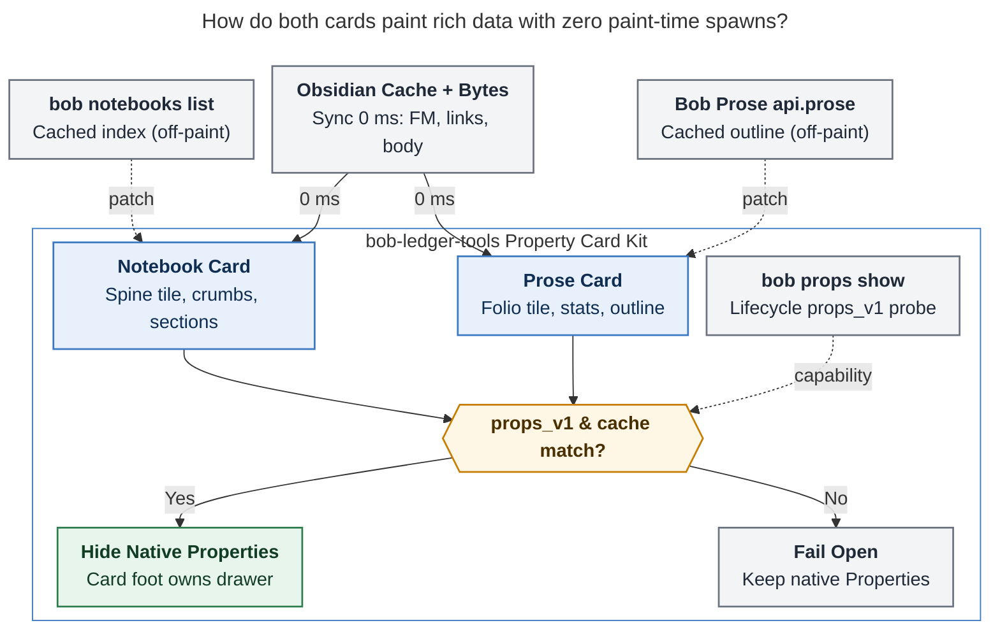
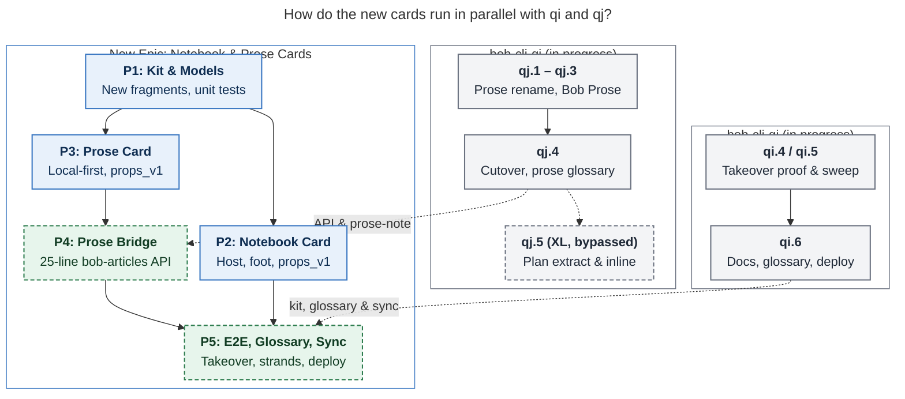

# Prose and Notebook Property Cards: Design, Critique, and Parallel Delivery Plan

- **Date:** 2026-11-26
- **Author:** Researcher `gem`
- **Repos Audited:** `bob-cli` (`HEAD 478d5233`), `bob-plugins` (`HEAD 86f5f340`), live Bob vault (`~/bob`, read-only audit)
- **Active Epics Audited:** `bob-cli-qi` (`plan:202611/bank_hub_demotion.md`), `bob-cli-qj` (`plan:202611/prose_note_type.md`)
- **Governing Memory Cited:** `glossary:property-card`, `glossary:notebook`, `glossary:album-card`, `glossary:record-card`, `glossary:bank-card`, `glossary:day-and-period-card`, `glossary:area-note`, `glossary:project-note`, `decisions:notebook-routes-write-notes`, `decisions:q-and-ctrl-bracket-mirror-esc`

---

## 1. Executive Summary & Bottom-Line Verdict

**Yes — build both Notebook Card and Prose Card now, in parallel with `bob-cli-qi` and `bob-cli-qj`, as two new species inside `bob-ledger-tools`'s Property Card Kit.**

The request is a strong architectural move, especially when tested against Bryan's actual vault:

1. **Notebook Card pays off immediately across 39 live notebooks.** An empirical audit of `~/bob` shows **25 of 39 notebooks (64%)** carry seven Zorg-importer derived frontmatter keys (`generated_from_zorg`, `zorg_*`). Today Obsidian displays that entire raw metadata wall at the top of every Zorg-era notebook, and `bob-ledger-tools` mounts a second `.bob-notebook-header` breadcrumb/chip banner underneath the H1. Replacing both with one calm, title-slot **Notebook Card** (with `-` Properties drawer and clickable section-jump chips) removes visual clutter while making notebooks genuinely navigable.
2. **Prose Card solves an imminent growth problem without bloating reading flow.** Only 1 live note (`sase_blog_contents.md`) carries `type: "[[article]]"` today, but `bob-cli-qj` is turning prose notes into a first-class owned note type — and `bob-cli-qj.5` (`bob prose extract`) is about to multiply them with provenance frontmatter (`parent`, `created`, `title`, `section_numbers`, extraction source fields). Designing Prose Card now — **editorial, quiet, folded by default (`Outline ▸`)**, hiding only `.inline-title` and never body H1s — ensures prose notes feel like clean essays rather than database forms while giving Bryan instant access to word count, reading time, interactive mini-TOC, findings, and the one-click `§ numbered / § off` toggle.
3. **Zero `bob-cli` Rust changes are needed for v1.** Both notebooks (`note_kind: "notebook"`) and prose/article notes (`note_kind: "note"`) **already report `"capabilities": ["props_v1"]`** from `bob props show`, which is the exact same whole-frontmatter ownership gate used by Album, Record, Day/Period, and Bank cards (`240q-plugin-property-card-frontmatter-ownership.js:518`). Leaving `bob-cli` untouched avoids colliding with `bob-cli-qj.1`/`qj.2` (which explicitly freezes `props/roles.rs`) and eliminates any wait on `bob-cli`'s daily release train.
4. **~80% of implementation can proceed immediately in parallel with `bob-cli-qi` and `bob-cli-qj`**, gated at only two narrow checkpoints:
   - **Gate 1 (`P4` depends on `bob-cli-qj.4`):** Adding a ~25-line read-only `api.prose` hook to `plugins/bob-articles/` so Prose Card reuses the live outline & findings that Bob Prose already fetches (zero extra `bob` subprocesses).
   - **Gate 2 (`P5` depends on `bob-cli-qi.6` and `bob-cli-qj.4` — explicitly NOT `qj.5`):** Extending shared E2E takeover/passive-rendering proofs, landing glossary updates (`glossary:notebook-card`, `glossary:prose-card`, `glossary:property-card`), and running `bob plugins sync` linearly so `.bob-deploy.json` stamps never collide.

The rest of this report critiques the plan honestly against vault and code evidence, calls out **seven justified adjustments (A1–A7)** to the original prompt's assumptions, presents the full visual/UX design and technical architecture, maps exact parallelism with `qi` and `qj`, drafts the two new glossary strands (plus the `property-card` update), and closes with a concrete 5-phase implementation recommendation.

---

## 2. Honest Critique & Live Vault Audit

### 2.1 Is This a Good Idea?

**Overall verdict: Strong yes for Notebook Card right now; qualified yes for Prose Card — provided Prose Card stays restrained and folded by default.**

| Dimension | Notebook Card | Prose Card |
| --- | --- | --- |
| **Immediate clutter removed** | **Very High.** Hides 7 `zorg_*` derived frontmatter keys on 25/39 notebooks (64%) and retires duplicate `.bob-notebook-header` chrome. | **Moderate today, High post-`qj.5`.** Hides `parent`/`type`/`created`/`title`/`section_numbers` (+ future extraction provenance) above prose bodies. |
| **Signal density from sparse frontmatter** | **High.** Breadcrumb ancestry, `@stem` capture route, note/section counts, child notebooks, clickable `##` section jump chips, and hard-error surfacing are all high-value and already computable locally/from cache. | **High if outline-centric, risky if noisy.** Word count, reading time, section/stub count, `§ numbered` toggle, findings count, and a folded mini-TOC add real editorial utility; forcing dense form chrome above an essay would ruin the reading feel. |
| **Risk of duplicating existing UI** | **Active hazard if unhandled.** `bob-ledger-tools` already renders `.bob-notebook-header` (`241e`–`241g`). Notebook Card MUST supersede it on desktop title-slot scopes. | **Low.** `bob-articles` (`Bob Prose`) renders no top header — only `.bob-article` typography, inline section-number badges, and hover gutters. |
| **Risk of breaking reading/writing ergonomics** | **Low** (same H1 adoption model as Area/Project). | **High if carelessly copied from Area/Project.** Prose notes allow H1 (`# 1. Section`) as a numbered section heading (`docs/articles.md` N3) and warn (`title-heading`) when a first heading repeats `title:`. Copying Area's H1-hiding recognizer would swallow real section headings! |

### 2.2 Live Vault Empirical Audit (`~/bob`)

All design decisions below are grounded in a read-only audit of Bryan's live vault (`bob notebooks list -f json`, `bob articles list -f json`, `bob props show`, and frontmatter/body inspection across every notebook and article note):

#### Notebooks (`39` total live notes)

| Metric | Observed Value | Design Implication |
| --- | --- | --- |
| Has `parent`, `summary`, `type: "[[notebook]]"` | **39 / 39 (100%)** | Breadcrumbs and subtitle are reliably populated on every existing notebook. |
| Has H1 in first 10 body lines | **39 / 39 (100%)** | Title-slot adoption (`propertyCardHomeTitleRecognizer` pattern) cleanly replaces both `.inline-title` and matching H1 with zero regressions. |
| Carries Zorg derived keys (`generated_from_zorg` + 6 `zorg_*` keys) | **25 / 39 (64%)** | Hiding native Properties behind `-` drawer delivers an immediate, dramatic cleanliness win on nearly two-thirds of notebooks. |
| Has `created:` frontmatter | **11 / 39 (28%)** | **28/39 Zorg-era notebooks omit `created:`.** The card foot MUST silence missing `created` (do not print `"no created date"` on 72% of notebooks!). |
| Has `template:` frontmatter | **9 / 39 (23%)** | Keep in `-` Properties drawer; no dedicated hero pill needed. |
| Parent kind distribution | **26 `area`, 12 `notebook`, 1 `project`** | Kicker must walk arbitrary `notebook → notebook → area/project` chains and resolve root area hue for the species accent. |
| Notebooks with child notebooks | **7 / 39** (`dev_tools`, `lang`, `linux`, `vim`, `vim_plugins`, `dog`, `meet`) | Child-notebook chips belong in the card body, content-gated (omitted when 0 children). |
| Notebooks with `##` sections | **15 / 39 (38%)**, max 6 sections (e.g., `about_abby.md` has 5) | Clickable `##` section-jump chips with per-section note counts are compact (<= 6 chips) and immediately useful. |
| Non-null `last_note` (`[created::YYYY-MM-DD]`) | **1 / 39 (2.6%)** (`about_abby`) | Zorg-imported bullets lack `[created::]` while new captures stamp it. **`last_note` MUST be content-gated** — never render `"—"` or `"no activity"` on 38/39 notes. |
| Soft `notebook_shape` warnings | **6 / 39** (1–5 findings; `vet_log` has 5) | Route soft warnings to the calm foot lint chip (`contractIssues`), keeping the hero clean. |
| Hard errors (`notebook_duplicate_block_id`) | **1 / 39** (`legacy_eat`, 2 errors) | Surface hard errors visibly as a compact warning pill in the card readout so structural defects aren't hidden in the foot. |

#### Prose / Article Notes (`1` live today, expanding under `bob-cli-qj`)

| Metric | Observed Value (`sase_blog_contents.md` + `_templates/new_article.md`) | Design Implication |
| --- | --- | --- |
| Frontmatter keys today | `parent: "[[sase_blog]]"`, `type: "[[article]]"`, `created: 2026-10-15T15:10:41-04:00` (no `summary`, no `title`, no `section_numbers`) | `title` must fall back cleanly (`title:` → first alias → raw stem without mangling acronyms like `sase_blog_contents`); `summary:` MUST be content-gated without a nagging ghost prompt. |
| First body heading | **No H1.** Starts with a 190-word preamble, then `## 1. What is SASE?` (`_templates/new_article.md` also has no H1). | Prose Card MUST hide **`.inline-title` ONLY** (`propertyCardNeverTitleRecognizer`), never body H1s. |
| Body stats | **306 words** (~2 min read), **14 sections** (**13 stubs**), **4 `pseudo-footnote` findings** | Compact readout (`306 words · ~2 min · 14 sections · 13 stubs`) + `⚠ 4 findings` + foldable mini-TOC gives high editorial value immediately. |
| `bob props show` capability | `note_kind: "note"`, `capabilities: ["props_v1"]` | Already qualifies for whole-frontmatter ownership with zero `bob-cli` Rust changes. |
| Upcoming `bob-cli-qj` additions | `type: "[[prose]]"`, `section_numbers: bool`, `bob prose adopt` (no `created:`), plus `qj.5` extraction provenance keys | Detect BOTH `[[prose]]` and `[[article]]` from day 1; silence missing `created`; design the `-` drawer to naturally absorb future `qj.5` provenance fields. |

### 2.3 Critique: Where the Naive Version of This Idea Would Go Wrong

If someone implemented the prompt literally without digging into `bob-plugins` and the vault, five subtle bugs would land:

1. **Swallowing body H1s on prose notes:** Using `propertyCardHomeTitleRecognizer` on prose notes would hide `# 1. Introduction` whenever a prose note uses H1 as its top section depth — violating `docs/articles.md` N3.
2. **Double headers on every notebook:** Leaving `.bob-notebook-header` (`241e`–`241g`) active alongside Notebook Card would paint two stacked breadcrumb + child-chip bars at the top of all 39 notebooks.
3. **"No created date" spam:** `240m-plugin-property-card-created.js:190` currently sets `const silent = temporal || kind === "area";`. Without adding `"notebook"` and `"prose"`, 28/39 live notebooks and every `bob prose adopt` note would display a distracting `"no created date"` label in the foot.
4. **Heavy card dominating an essay:** Putting a tall, saturated, always-expanded card above a `.bob-article` `40rem` serif reading column breaks the calm, book-like typography that `bob-articles/styles.css` carefully built.
5. **Broken "+ Add summary" click from host `## Notebooks` catalogs:** In `241d-plugin-notebook-catalog.js:730`, clicking `+ Add summary` opens the notebook and calls `notebookFocusSummaryProperty`, which delegates to `openPropertyEditor({ filePath, setting: "summary" })`. In `298z-plugin-property-editor-settings-entrypoints.js:102-119`, on a `props_v1`-only note without `props_contract_v1`, `openPropertyEditor` only matches *existing* frontmatter rows — if `summary:` is missing, it silently falls back to row 1 instead of opening an Add/Edit flow for `summary`!

---

## 3. Explicit Adjustments to Requirements (A1–A7)

Every adjustment below deviates from or sharpens an implicit assumption in the original prompt. Each is justified by vault/code evidence and called out explicitly for Bryan's approval:

| ID | Adjustment | Why It Is Justified | Alternative Rejected |
| --- | --- | --- | --- |
| **A1** | **Gate both cards on `props_v1` (zero `bob-cli` Rust changes in v1); do NOT register `==` on Notebook or Prose.** | Both note kinds already return `capabilities: ["props_v1"]` (same gate as Album, Record, Day/Period, and Bank). `bob-cli-qj.2` explicitly freezes `props/roles.rs`. Neither card needs a custom schema-arranger modal: `+` already opens the full Property Editor (1 keystroke), `-` toggles Properties, `_` folds, and summary / `§ numbered` are direct clicks — leaving Vim `==` reindent intact inside writing & bullet notes. *(Optional reversible tweak noted in Section 8 if Bryan prefers `==` → `+` on `summary`/`title`.)* | Adding `props_contract_v1` in Rust (`props/roles.rs`) — collides with `qj.2`, waits on daily release train, and adds unnecessary ceremony for notes with 1–2 user settings. |
| **A2** | **Host BOTH Notebook Card and Prose Card inside `bob-ledger-tools`, with a tiny ~25-line read-only `api.prose` seam in `bob-articles` (`Bob Prose`).** | All 9 existing cards and the entire Property Card Kit (`240b`–`240s`, `240q` coordinator, `styles.css`) are internal to `bob-ledger-tools` (not exported). Hosting Prose Card in `bob-ledger-tools` avoids exposing a fragile cross-plugin CodeMirror/DOM/WeakMap API, guarantees 0 ms local-first paint even if `bob-articles` is disabled, and avoids file conflicts while `qj.3`/`qj.4` rewrite `bob-articles`. | Putting Prose Card inside `bob-articles` — forces exporting the entire kit across plugins and directly collides with `qj.3`/`qj.4`. |
| **A3** | **Notebook Card supersedes `.bob-notebook-header` on desktop title-slot scopes.** | Prevents duplicate breadcrumbs and child-notebook chips on all 39 live notebooks. `.bob-notebook-header` remains as a clean graceful fallback only when Notebook Card does not mount (embeds, mobile, or title-slot failure). | Keeping `.bob-notebook-header` below the card — redundant UI clutter. |
| **A4** | **Prose Card hides `.inline-title` ONLY (never body H1) and defaults to FOLDED (`Outline ▸`, `foldDefault: false`).** | Preserves H1 sections (`# 1. Section`) per `docs/articles.md` N3, harmonizes with `.bob-article`'s `40rem` serif editorial column, and keeps the top of an essay to ~68–84px while making the full interactive mini-TOC + findings one click or `_` keypress away. | Hiding first H1 and expanding TOC by default — breaks H1 prose notes and pushes opening prose paragraphs below the fold. |
| **A5** | **Silence missing `created` in the card foot for both `notebook` and `prose` (`240m`), and content-gate sparse fields (`last_note`, `summary` on prose, stubs, backlinks, children, sections).** | 72% of notebooks omit `created:`, 97% lack `[created::]` bullets (`last_note`), and `bob prose adopt` does not stamp `created:`. Content-gating guarantees every visible token carries real information and never prints placeholder dashes or `"no created date"` noise. | Showing `"no created date"` / `"updated: —"` — visual noise on most live notes. |
| **A6** | **Use staged parallelism with `bob-cli-qi` and `bob-cli-qj`, explicitly bypassing `bob-cli-qj.5` (XL).** | ~80% of card work touches brand-new fragment files (`249g*`, `249h*`), detects both `[[prose]]` and `[[article]]`, and runs unit/render tests offline. Only the 25-line `bob-articles` bridge waits on `qj.4`, and final E2E/glossary/`bob plugins sync` waits on `qi.6` + `qj.4`. `qj.5` is an XL planning phase for extract/inline that does not block Prose Card at all (Prose Card's `-` drawer automatically folds future `qj.5` provenance keys). | Waiting for both `qi` and `qj` (including `qj.5`) to close — needlessly serializes weeks of independent work. |
| **A7** | **Update `glossary:property-card` alongside adding `glossary:notebook-card` and `glossary:prose-card`, routed through `/sase_memory_write` in the final integration phase.** | `glossary:property-card` enumerates the family species and title-ownership rules; leaving it stale after adding two species breaks SASE memory integrity. Landing all three strands after `qi.6` (which adds `area-card`, `project-card`, and updates `property-card`) and `qj.4` (which adds `glossary:prose-note`) avoids merge conflicts and broken wikilinks. | Editing `sase/memory/glossary/` mid-flight alongside `qi.6` and `qj.4` — guaranteed merge conflicts and dangling `[[prose-note]]` links. |

---

## 4. Visual & UX Design: Making Both Cards Intuitive, Reliable, and Beautiful

### 4.1 Position in the 11-Species Property Card Family

After `bob-cli-qi` lands Area Card and Project Card, adding Notebook Card and Prose Card brings the Property Card family to 11 cohesive species. Per `glossary:property-card` ("a species tile and kicker name it; hue does not"), each new species receives its own distinct Lucide glyph, distinct geometric tile form, and calibrated surface wash:

| Species | `data-card-kind` | Kicker Word | Lucide Icon | Tile Form (`data-tile-form`) | Hue / Wash | Title Ownership | Default Fold (`_`) | `==` Editor |
| --- | --- | --- | --- | --- | --- | --- | --- | --- |
| Area *(qi)* | `area` | `AREA` | `compass` | `ring` | Own area hue, 6% | `.inline-title` + H1 | Expanded | `+` contract |
| Project *(qi)* | `project` | `PROJECT` | `folder-kanban` | `rounded` | Root area hue, 6% | `.inline-title` + H1 | Expanded | `+` contract |
| Album | `album` | `ALBUM` | `layers` | `rounded` | Root/neutral, 5% | `.inline-title` + H1 | Expanded | Schema card |
| Record | `record` | `RECORD` | `file-text` | `cut` | Album/neutral, 5% | `.inline-title` + H1 | Expanded | Record sheet |
| Day / Week / Quarter / Year | `day`/`week`/… | `DAY`/`WEEK`/… | `calendar` | `pill` | Temporal neutral | `.inline-title` + H1/nav | Contextual | Intentions |
| Bank | `bank` | `BANK` | `landmark` | `shield` | Neutral | `.inline-title` + H1 | Folded if healthy | Setup panel |
| **Notebook *(new)*** | **`notebook`** | **`NOTEBOOK`** | **`notebook-tabs`** | **`spine`** | **Root area hue, 5% (0% if unowned)** | **`.inline-title` + matching first H1** | **Expanded (`true`)** | **Unregistered** (use `+` / click) |
| **Prose *(new)*** | **`prose`** | **`PROSE`** | **`feather`** | **`folio`** | **Root area hue, 3% (0% if unowned)** | **`.inline-title` ONLY (never H1!)** | **Folded (`false`)** | **Unregistered** (use `+` / click) |

#### Two New Distinct Tile Forms (`240j` + `styles.css`)

- **`spine` (Notebook Card):** A `32×32px` rounded-square tile (`border-radius: 7px`) with a crisp `4px` left vertical binding-spine accent bar (`box-shadow: inset 4px 0 0 var(--bob-card-accent)`), echoing a physical bound notebook. Uses `notebook-tabs`, matching `bob-navigation-hotkeys`'s existing notebook icon (`plugins/bob-navigation-hotkeys/src/010-requires-and-config.js`) for instant cross-surface muscle memory.
- **`folio` (Prose Card):** A refined editorial page tile (`32×32px`, `border-radius: 4px`, crisp `1px` top-and-bottom or left-margin hairline accent, softer background tint) holding the `feather` glyph. Together with a restrained **3% area wash** (half of Area/Project's 6%, or 0% warm paper when unparented), it marks Prose notes as calm reading documents rather than operational dashboards.

---

### 4.2 Notebook Card Design

#### What Data Actually Earns Its Pixels?

Evaluated against all 39 live notebooks in `~/bob`, every element on Notebook Card passes a strict "useful on real notes, silent when absent" test:

1. **Kicker & Clickable Ancestry Breadcrumbs:** `NOTEBOOK · [pip] Dev · Developer tools`
   - Walks `parent:` links up to the root Area/Project (max 4 visible crumbs, middle collapsed to `…` on deep chains). Each ancestor is a clickable note link (`app.workspace.openLinkText`). Root area's colored pip (`--bob-card-accent`) anchors visual identity without taking over the card.
2. **Hero Title:** First H1 → first `aliases` entry → humanized file stem. Clicking/cursoring into raw H1 in Live Preview reveals raw Markdown seamlessly (`240i`).
3. **Interactive Subtitle (`summary:`):** Renders `summary` prose directly under the title. Clicking opens Property Editor focused directly on `summary` (fixing the missing-key `298z` gap noted in Section 2.3). If absent, displays a quiet muted ghost affordance (`+ Add summary`, opacity 0.55, hidden in Reading mode).
4. **Top-Right Action Cluster:**
   - **Capture Route Copy Pill (`@dev_tools`):** Shows the exact `@<stem>` route (`decisions:notebook-routes-write-notes`). Clicking copies `@<stem> ` to clipboard with a subtle `Copied` flash (1.2s) so Bryan can immediately paste it into Capture or Bob Mac Capture!
   - **Fold Chevron (`_`)**: Expands/collapses the card body (`foldDefault: true`, persisted via `240s`).
5. **Compact Readout Line (inside collapsible body):**
   - `30 notes · 5 sections · updated Nov 25`
   - `N notes` (total bullets in notebook body); `M sections` omitted when `0`; `updated <Mon D>` omitted when `last_note` is null (38/39 Zorg-era notes stay spotless); if hard errors exist (`notebook_duplicate_block_id`, e.g., `legacy_eat`), appends a high-contrast clickable pill `✗ 2 errors` that jumps to the offending line!
6. **Child Notebooks Row (content-gated — only rendered on the 7/39 notebooks that have children):**
   - Clickable chips matching Bob's existing notebook chip style: `📓 Git 6`, `📓 Neovim 14`, sorted alphabetically.
7. **Section Jump Chips Row (content-gated — rendered on the 15/39 notebooks that have `##` sections):**
   - Compact pill chips for every `##` section heading in document order, showing heading name + direct bullet count (`Health 3`, `Baby care 2`, `Training 4`).
   - Clicking a chip scrolls and focuses that exact `##` heading in both Live Preview (CodeMirror line dispatch) and Reading view (heading DOM `scrollIntoView`), turning a long notebook like `about_abby.md` into an instant jump table!
   - Capped visually at 10 chips with a `+N more` inline toggle if a future notebook grows very large (live max today is 6).
8. **Standard Property Card Foot (`240o`–`240r`):**
   - Left: `created` date when present; **silently omitted** when absent (`240m`).
   - Middle: Calm foot lint chip (`⚠ N warnings`) fed by soft `notebook_shape` findings from `bob notebooks list` cache — never clutters the hero!
   - Right: `- Properties (9)` drawer toggle (folds `parent`, `type`, `summary`, `template`, and all 7 `zorg_*`/`generated_from_zorg` keys cleanly out of sight!) and `+` Property Editor button.

#### Notebook Card Wireframes

**Wide Desktop (`>= 480px`, e.g., `about_abby.md` with 5 sections & Zorg properties hidden):**

```text
┌──────────────────────────────────────────────────────────────────────────┐
│ ┌──┐  NOTEBOOK · ● Personal · Dog              [@about_abby ⧉]   [ ▾ ]  │
│ │▌📓│  About Abby                                                        │
│ └──┘  Veterinary, feeding, care routines, and notes for Abby.            │
│──────────────────────────────────────────────────────────────────────────│
│  30 notes · 5 sections · updated Nov 25                                  │
│                                                                          │
│  Sections   [Health 3] [Feeding 4] [Baby care 2] [Training 6] [Misc 15]  │
│──────────────────────────────────────────────────────────────────────────│
│  Created Oct 12, 2024                            Properties (9) -   +    │
└──────────────────────────────────────────────────────────────────────────┘
```

**Wide Desktop (`dev_tools.md` — parented under Area, has child notebooks, no `created:`, no `last_note`):**

```text
┌──────────────────────────────────────────────────────────────────────────┐
│ ┌──┐  NOTEBOOK · ● Dev                          [@dev_tools ⧉]   [ ▾ ]  │
│ │▌📓│  Developer Tools                                                   │
│ └──┘  Shell, terminal, CLI utilities, and local toolchain references.    │
│──────────────────────────────────────────────────────────────────────────│
│  18 notes · 3 child notebooks                                            │
│                                                                          │
│  Notebooks  [📓 Git 6] [📓 Shell 9] [📓 Tmux 3]                          │
│──────────────────────────────────────────────────────────────────────────│
│                                                  Properties (10) -  +    │
└──────────────────────────────────────────────────────────────────────────┘
```

**Narrow Pane (`< 420px`, CSS container query `@container bob-property-card (max-width: 420px)`):**

```text
┌─────────────────────────────────────┐
│ ┌──┐ NOTEBOOK · ● Personal · Dog    │
│ │▌📓│ About Abby                     │
│ └──┘ [@about_abby ⧉]         [ ▾ ]  │
│ Veterinary, feeding, and care...    │
│─────────────────────────────────────│
│ 30 notes · 5 sections · Nov 25      │
│ [Health 3] [Feeding 4] [Baby care 2]│
│ [Training 6] [Misc 15]              │
│─────────────────────────────────────│
│ Oct 12, 2024    Props (9) -    +    │
└─────────────────────────────────────┘
```

---

### 4.3 Prose Card Design

#### Design Philosophy: Editorial Restraint First

A Prose note is a *reading and writing* surface. `plugins/bob-articles/styles.css` explicitly tunes `.bob-article` to `--file-line-width: 40rem`, generous line-height, and optional serif typography (`.bob-article-serif`). Therefore Prose Card follows three strict visual rules:

1. **Quiet by default:** Folded on first open (`foldDefault: false`), showing only the title block + single readout strip (~72–88px total height). Opening a prose note lands straight on the opening paragraph.
2. **Typography harmony with `.bob-article`:** `.bob-property-card` uses `--font-interface` for small metadata chips and foot controls, while `.bob-property-card[data-card-kind="prose"] .bob-property-card-title` inherits `var(--bob-article-heading-font, var(--inline-title-font, var(--font-text, inherit)))` and adapts smoothly inside the `40rem` measure without breaking `.bob-article`'s container queries (since `.bob-property-card` defines its own `container: bob-property-card / inline-size`).
3. **Zero heading destruction:** Uses `propertyCardNeverTitleRecognizer("prose")` (`240i-plugin-property-card-title-ownership.js`), which adds `bob-property-card-owns-title` to hide Obsidian's `.inline-title` while **never** hiding any Markdown heading (`#`, `##`, …) in the note body.

#### What Data Earns Its Pixels on Prose Card?

1. **Kicker & Ancestry:** `PROSE · [pip] Dev · SASE Blog` (walks `parent:` chain across prose, project, or area notes; degrades cleanly to bare `PROSE` for standalone unparented prose notes).
2. **Hero Title:** `title:` frontmatter → first `aliases` entry → **verbatim file stem** (NOT title-cased blindly, so stems like `sase_blog_contents` stay truthful until the author sets `title:`).
3. **Content-Gated Subtitle (`summary:`):** Rendered calmly beneath the title only when `summary:` is non-empty (clicking opens Property Editor on `summary`). No `+ Add summary` ghost prompt — prose notes often open directly with an introductory paragraph and shouldn't nag the writer.
4. **Top-Right Action Cluster:**
   - **Section-Numbering Status & Toggle Pill (`§ numbered` / `§ off`):**
     - Reflects `section_numbers` frontmatter (defaults to `true` when omitted, matching `bob-cli-qj.2`).
     - Shows a subtle amber dot (`§ numbered •`) when live `api.prose` reports `stale === true` (stale numbering waiting for format).
     - Clicking invokes `app.commands.executeCommandById("bob-articles:toggle-section-numbers")` (landed in `bob-cli-qj.3`) — guarded safely if `bob-articles` is disabled (renders read-only pill with tooltip).
   - **Outline Fold Toggle (`Outline ▸` / `Outline ▾`, hotkey `_`):**
     - Defaults to **folded (`false`)** so essays breathe; expands to reveal the interactive mini-TOC and findings list.
5. **Single Calm Editorial Readout Strip (always visible below the title, even when folded):**
   - `306 words · ~2 min · 14 sections · 13 stubs · 3 backlinks` + `⚠ 4 findings`
   - **Word count & reading time:** Computed in 0 ms locally from stripped body bytes (`Math.max(1, Math.round(words / 220))` min, excluding frontmatter and fenced code noise; `< 1 min` or `~N min`).
   - **Sections & stubs:** `N sections` omitted when `0`; `K stubs` (sections with 0 prose words before the next heading, e.g., 13/14 in `sase_blog_contents.md`!) omitted when `0` — immediately shows drafting progress on an outline-in-progress!
   - **Backlinks (`N backlinks`):** Count of vault notes resolving a link to this prose note via `app.metadataCache.resolvedLinks` (0 ms, sync). Omitted when `0`.
   - **Findings pill (`⚠ 4 findings`):** Clickable pill that auto-expands the `_` body and scrolls to the Findings sub-list; omitted when `0`.
   - **Refusal notice (rare, error-only):** If `api.prose` reports `refused` (e.g., note contains `#task` or mixed type so `bob prose format` skipped it), shows a single calm inline warning line explaining why formatting is paused.
6. **Collapsible `_` Body — Interactive Mini-TOC + Findings:**
   - **Mini-TOC:** Document-order list of headings (`depth 1–4`, indented `12px × (depth - 1)`), showing computed section number (`1`, `1.1`, … when `section_numbers !== false`), clickable heading text (jumps to line in LP or Reading), and right-aligned subtle word count (`84w`) or muted `stub` badge. Scrollable container capped at `max-height: 14rem` so a 40-section essay never pushes the document off-screen when expanded.
   - **Findings sub-list (only when findings > 0):** Compact list of `bob prose` findings (`L42 · pseudo-footnote · ...`), each clickable to jump straight to that line in the editor!
7. **Standard Property Card Foot (`240o`–`240r`):**
   - Left: `created` date when present; **silently omitted** when absent (`bob prose adopt` notes stay clean).
   - Right: `- Properties (N)` drawer toggle (cleanly folds `parent`, `type`, `title`, `section_numbers`, `created`, `summary`, and future `qj.5` extraction provenance fields) and `+` Property Editor button.

#### Prose Card Wireframes

**Wide Desktop — Default Folded State (`sase_blog_contents.md`, calm ~78px height):**

```text
┌──────────────────────────────────────────────────────────────────────────┐
│ ┌──┐  PROSE · ● Dev · SASE Blog           [§ numbered]  [Outline ▸]     │
│ │🪶│  sase_blog_contents                                                 │
│ └──┘  306 words · ~2 min · 14 sections · 13 stubs · ⚠ 4 findings        │
│──────────────────────────────────────────────────────────────────────────│
│  Created Oct 15, 2026                            Properties (3) -   +    │
└──────────────────────────────────────────────────────────────────────────┘
```

**Wide Desktop — Expanded (`_` or clicking `Outline ▸` / `⚠ 4 findings`):**

```text
┌──────────────────────────────────────────────────────────────────────────┐
│ ┌──┐  PROSE · ● Dev · SASE Blog           [§ numbered]  [Outline ▾]     │
│ │🪶│  sase_blog_contents                                                 │
│ └──┘  306 words · ~2 min · 14 sections · 13 stubs · ⚠ 4 findings        │
│──────────────────────────────────────────────────────────────────────────│
│  Outline                                                                 │
│    1    What is SASE?                                            116w    │
│    2    Why Structured Agentic Engineering?                      stub    │
│      2.1  Where ad-hoc prompting breaks down                     stub    │
│    3    Memory Webs & Decisions                                  stub    │
│    … (scrollable, max-height 14rem)                                      │
│                                                                          │
│  Findings (4)                                                            │
│    ⚠ L18  pseudo-footnote — use markdown footnote syntax [^1]            │
│    ⚠ L24  pseudo-footnote — use markdown footnote syntax [^2]            │
│──────────────────────────────────────────────────────────────────────────│
│  Created Oct 15, 2026                            Properties (3) -   +    │
└──────────────────────────────────────────────────────────────────────────┘
```

**Narrow Pane (`< 420px`, Folded):**

```text
┌─────────────────────────────────────┐
│ ┌──┐ PROSE · ● Dev · SASE Blog      │
│ │🪶│ sase_blog_contents             │
│ └──┘ [§ numbered]     [Outline ▸]   │
│ 306 words · ~2 min · 14 sec · ⚠ 4   │
│─────────────────────────────────────│
│ Oct 15, 2026    Props (3) -    +    │
└─────────────────────────────────────┘
```

---

### 4.4 Keyboard, Interaction, Fail-Open, Mobile & Embed Matrix

| Context / Trigger | Notebook Card | Prose Card |
| --- | --- | --- |
| **Desktop Live Preview (valid source, cache match, `props_v1`)** | Mounts in title slot, hides `.inline-title` + matching H1, hides native Properties, suppresses `.bob-notebook-header`. | Mounts in title slot, hides `.inline-title` ONLY (never H1), hides native Properties. |
| **Desktop Reading View (same gate)** | Mounts in title slot, hides `.inline-title` + matching H1, hides native Properties, suppresses `.bob-notebook-header`. | Mounts in title slot, hides `.inline-title` ONLY, hides native Properties. |
| **Source Mode** | Does not mount; native Markdown + YAML shown untouched. | Does not mount; native Markdown + YAML shown untouched. |
| **Transcluded Embeds / Hover Popovers** | Does not mount (falls back to native/compact `.bob-notebook-header` if enabled). | Does not mount (renders pure embedded prose cleanly). |
| **Mobile (`Platform.isMobile`)** | Read-only fail-open: native Properties never hidden; `.bob-notebook-header` fallback applies. | Read-only fail-open: native Properties never hidden; `.bob-article` reading CSS unaffected. |
| **`props_v1` unconfirmed / source-cache mismatch / mount failure** | **Fail-open** via `240q`: native Properties immediately restored; card still renders passive info or yields cleanly. | **Fail-open** via `240q`: native Properties immediately restored; card never orphans edits. |
| **Vim Normal `+`** | Opens Property Editor (`298m`) on current note. | Opens Property Editor (`298m`) on current note. |
| **Vim Normal `-`** | Toggles Properties drawer in card foot (`240p`). | Toggles Properties drawer in card foot (`240p`). |
| **Vim Normal `_`** | Toggles collapsible body (metrics + children + section chips). | Toggles collapsible body (interactive mini-TOC + findings). |
| **Vim Normal `==`** | Unregistered (preserves Vim reindent). | Unregistered (preserves Vim reindent). |
| **Cursor / selection on H1 in LP** | Reveals raw `# Heading` line while cursor intersects it (`240i`). | N/A — body H1s are never hidden. |
| **`Add file property` command** | Routes to Property Editor Add mode on owned notes (`240q`). | Routes to Property Editor Add mode on owned notes (`240q`). |
| **File Properties sidebar** | Stays native Obsidian (per `glossary:property-card`). | Stays native Obsidian (per `glossary:property-card`). |

---

## 5. Architecture & Passive-Rendering Data Flow

### 5.1 Why Both Cards Belong in `bob-ledger-tools`

Inspecting `plugins/bob-ledger-tools/src/` (`457` fragments) and `plugins/bob-articles/src/` (`6` fragments) settles plugin ownership decisively:

- **Every existing property card lives inside `bob-ledger-tools`**: Area/Project (`249b`–`249f`), Album (`241u`–`241z`), Record (`241r`–`241t`), Day/Period (`240*`), Bank (`248*`).
- **The Property Card Kit is internal and unexported**: `374-exports-property-card.js` only exposes test/internal hooks, NOT a stable public cross-plugin mount/ownership SDK. Exporting `240b`–`240s` (CodeMirror 6 `StateField`/`ViewPlugin` slots, Reading post-processors, WeakMap host registries, `240q` frontmatter-ownership coordinator, foot drawer state, and `styles.css` tokens) across plugin boundaries would create a brittle version-skew surface between two separately synced plugins.
- **Notebook data is ALREADY cached in `bob-ledger-tools`** (`241a-plugin-notebook-data.js` and `175-plugin-notebooks-api.js`).
- **Prose data only needs a tiny ~25-line read-only seam from `bob-articles` (`Bob Prose`)**:
  - `bob-articles` ALREADY runs `bob prose outline` / `bob prose format` off-paint on active/modified prose notes (`025`, `030`, `035`) and holds the exact parsed outline, stale status, refusal reason, and findings in memory.
  - Exposing `plugin.api.prose = { version: 1, planFor(filePath), subscribe(listener) }` on `bob-articles` lets `bob-ledger-tools`'s Prose Card subscribe passively and patch richer findings/stale/refusal data into the already-painted card — **zero extra `bob` subprocess spawns**!
  - And if `bob-articles` is disabled or hasn't cached the note yet, Prose Card **still paints in 0 ms** from local Obsidian `metadataCache` + note source bytes (word count, reading time, local heading scan, stub count, backlinks, `section_numbers` frontmatter).

### 5.2 Passive-Rendering & Ownership Data Flow

**Invariant (from `glossary:property-card` and `bob-cli-qi.6`):** Painting a card reads cached metadata and confirmed source bytes, and **never spawns `bob` or writes the vault on the paint path**.



**Figure 1:** Passive-rendering and fail-open ownership architecture. Both cards paint synchronously in 0 ms from Obsidian's metadata cache and confirmed note bytes; background services (`bob notebooks list` and Bob Prose's `api.prose`) emit events that patch richer counts/findings in place without blocking paint; the lifecycle-confirmed `props_v1` probe gates whole-frontmatter ownership in `240q`.

### 5.3 Exact Module Map & Small Kit Fixes

Because `bob-ledger-tools` bundles fragments in `src/fragments.json` order and `249b`–`249f` host Area/Project ("home") cards (while `241h*` is already taken by bank decode), placing the new cards in **`249g*`** (Notebook) and **`249h*`** (Prose) keeps diffs completely isolated from `qi`'s active edits:

| Layer | Files | Responsibility |
| --- | --- | --- |
| **Tiny shared kit extensions** | `240f-plugin-property-card-species.js`, `240j-plugin-property-card-identity-badge.js`, `240m-plugin-property-card-created.js`, `240s-plugin-property-card-fold.js`, `298z-plugin-property-editor-settings-entrypoints.js`, `styles.css` | Register `"notebook"` (`spine`, `notebook-tabs`, `foldDefault: true`) and `"prose"` (`folio`, `feather`, `foldDefault: false`); add `"notebook"` & `"prose"` to `silent` missing `created` in `240m`; fix missing-key handling in `298z` so clicking `+ Add summary` opens Add/Edit for `summary` even on `props_v1`-only notes without `summary:`; add `.bob-property-card[data-card-kind="notebook"|"prose"]` CSS tokens & responsive `@container` rules. |
| **Notebook Card (`249g*`)** | `249ga-plugin-notebook-card-model.js`<br>`249gb-plugin-notebook-card-dom.js`<br>`249gc-plugin-notebook-card-foot.js`<br>`249gd-plugin-notebook-card-host.js`<br>`249ge-plugin-notebook-card-live.js` | Pure view-model (sync local parse of H1, `##` sections + bullet counts, parent chain, root area hue + optional merge with `241a` `notebooksData` cache for child notebooks, `last_note`, hard errors, soft `contractIssues`); DOM renderer (title block, `@stem` copy chip, child chips, clickable `##` section jump chips); `props_v1` ownership & foot adapter; LP + Reading hosts; lifecycle wiring in `170-plugin-lifecycle.js` / teardown. |
| **Legacy header suppression** | `241f-plugin-notebook-header.js`, `241g-plugin-notebook-header-live.js` | Skip mounting `.bob-notebook-header` when Notebook Card owns the desktop non-embed title slot; keep as fallback on mobile/embeds/failed slot. |
| **Prose Card (`249h*`)** | `249ha-plugin-prose-card-model.js`<br>`249hb-plugin-prose-card-dom.js`<br>`249hc-plugin-prose-card-foot.js`<br>`249hd-plugin-prose-card-host.js`<br>`249he-plugin-prose-card-live.js` | Note detector accepting BOTH `[[prose]]` and `[[article]]` from day 1; pure sync scanner (word count, reading time, heading tree, stub count, `section_numbers` effective state, `resolvedLinks` backlink count, parent chain, root area hue) + optional merge with `bob-articles.api.prose` (findings, `stale`, `refused`, authoritative numbering); DOM renderer (quiet editorial header, `§ numbered` click-through, folded `Outline ▸` mini-TOC + clickable findings); `.inline-title`-only ownership (`propertyCardNeverTitleRecognizer("prose")`); `props_v1` foot adapter; LP + Reading hosts. |
| **Bob Prose passive seam *(Gate 1)*** | `plugins/bob-articles/src/030-*.js` + `050-*.js` *(exact post-`qj.4` filenames)* | ~25 lines exposing read-only `plugin.api.prose = { version: 1, planFor(path), subscribe(fn) }` backed by the outline/findings cache `bob-articles` already maintains. Zero new `bob` CLI invocations. |
| **Shared visual harness** | `scripts/preview-title-block.cjs` | Add `notebook` and `prose` fixtures (wide + narrow, folded + expanded, Zorg-derived properties hidden) for deterministic visual review. |

---

## 6. Parallel Execution & Coordination with `bob-cli-qi` and `bob-cli-qj`

### 6.1 Active State of Both Epics (Audited Live)

- **`bob-cli-qi` (Bank Hub Demotion + Area/Project Property Cards):**
  - `qi.1`–`qi.3` are **CLOSED**.
  - `qi.4` (real-Obsidian takeover proof & visual screenshots), `qi.5` (vault project-count sweep), and `qi.6` (passive-rendering proof, docs sweep, approved memory updates to `glossary:property-card` / `glossary:bank-card` / `glossary:area-card` / `glossary:project-card` / `decisions:bank-hub`, and clean `bob plugins sync`) are **IN_PROGRESS**.
- **`bob-cli-qj` (Prose Note Type Rename & Evolution):**
  - `qj.1` (Rust `articles/` → `prose/`), `qj.2` (`bob prose` CLI + `--section-numbers` + frozen `props/roles.rs`), `qj.3` (`bob-articles` → "Bob Prose", `toggle-section-numbers`, 4 plugins + deploy), `qj.4` (host-currency gate, live vault cutover, canonical `bob prose` plugin calls, `glossary:prose-note`, `decisions:prose-notes-are-owned-prose`), and `qj.5` (**XL planning phase** for `bob prose extract` / `inline`) are **IN_PROGRESS**.

### 6.2 File & Surface Collision Matrix

| Surface | Touched by `bob-cli-qi` | Touched by `bob-cli-qj` | Touched by New Epic | Coordination Rule |
| --- | --- | --- | --- | --- |
| `bob-cli` Rust (`src/native/**`) | None left (`qi.1`–`qi.3` closed) | Heavy (`qj.1`, `qj.2`) | **NONE (0 files!)** | Zero conflict by design (`props_v1` already live). |
| `plugins/bob-ledger-tools/src/249g*`, `249h*` | No | No | **New files** | **Zero conflict** — develop & unit-test immediately in parallel! |
| `plugins/bob-ledger-tools/src/240{f,j,m,s}`, `298z`, `170*`, `fragments.json`, `styles.css` | Light/tail edits in `qi.4`/`qi.6` | No | Small additive edits | Low-risk rebase if `qi.4`/`qi.6` touches `styles.css` or `fragments.json`; keep edits strictly additive and grouped cleanly. |
| `plugins/bob-articles/**` | No | Heavy (`qj.3`, `qj.4`) | ~25-line `api.prose` seam only (`P4`) | **Hard Gate 1:** `P4` waits for `bob-cli-qj.4` to close. Zero edits to `bob-articles` before then. |
| `scripts/obsidian-frontmatter-takeover-e2e.cjs` & passive-rendering proof | Active in `qi.4` & `qi.6` | No | Extend fixtures for Notebook & Prose (`P5`) | **Hard Gate 2:** `P5` waits for `bob-cli-qi.6` to close. |
| `sase/memory/glossary/` (`property-card`, `notebook-card`, `prose-card`) | `qi.6` edits `property-card`, adds `area-card`, `project-card` | `qj.4` adds `prose-note` | Updates `property-card`, adds `notebook-card` & `prose-card` (`P5`) | **Hard Gate 2:** `P5` waits for BOTH `qi.6` and `qj.4` so links to `[[prose-note]]`, `[[area-card]]`, `[[project-card]]` resolve cleanly with zero conflicts. |
| `bob plugins sync` & `~/bob/.obsidian/plugins/*/.bob-deploy.json` | `qi.6` runs clean sync | `qj.3` & `qj.4` run sync | Final deploy (`P5`) | **Serialize deploy:** Never run `bob plugins sync` from P1–P3; test in isolated disposable vaults until `P5` runs after `qi.6` and `qj.4`. |
| `bob-cli-qj.5` (XL extract/inline plan) | No | In progress (XL) | **Bypassed completely** | Prose Card needs nothing from `qj.5`; its `-` drawer automatically accommodates future extraction provenance keys. |

### 6.3 Parallel Execution Topology



**Figure 2:** Staged parallel execution graph across `bob-cli-qi`, `bob-cli-qj`, and the proposed Notebook & Prose Cards epic. Phases `P1`, `P2`, and `P3` execute immediately with zero cross-epic blockers; only `P4` waits for `qj.4`, and `P5` waits for `qi.6` (and `qj.4` via `P4`), completely bypassing `qj.5`.

### 6.4 Does Coordination Even Need a Sync Lock Between Agents?

**No heavy coordination protocol is needed — just clean SASE bead dependencies (`sase bead dep`) and two discipline rules:**

1. **Dual-type detection from line 1 of `P1`/`P3`:** Prose Card matches `type` against BOTH `[[prose]]` and `[[article]]`, so it works identically before, during, and after `qj.4`'s vault cutover.
2. **No `bob plugins sync` and no `~/bob` edits during `P1`–`P3`:** `bob-plugins` tracks deployment state in `.bob-deploy.json` and refuses clobbering out-of-sync builds. All `P1`–`P3` verification runs against `npm test`, `scripts/preview-title-block.cjs`, and disposable test vaults — leaving `~/bob` cleanly owned by `qi.6` and `qj.4` until `P5` runs its single serialized sync.

---

## 7. Draft Glossary Strands & Memory Governance

Per `/sase_memory_write`, memory files under `sase/memory/glossary/` are NOT edited during research and require explicit user approval in the implementation plan before landing in `P5` (after `qi.6` and `qj.4`). Below are ready-to-review draft strands matching the exact style, density, and cross-linking conventions of `sase/memory/glossary/`.

### 7.1 Draft `sase/memory/glossary/notebook-card.md`

```markdown
---
title: Notebook Card
aliases:
  - notebook card
---

A [[property-card]] at the top of a [[notebook]], rendered in the desktop Live Preview and
Reading title slot by `bob-ledger-tools`. Identified by its `NOTEBOOK` kicker, `spine`
`notebook-tabs` species tile, and root area hue (neutral when unowned), it replaces
Obsidian's inline title and matching opening H1, supersedes the legacy notebook header bar
on desktop title-slot scopes, and hides native Properties only while source/cache
evidence, confirmed `props_v1`, and Property Editor routing agree; uncertain evidence,
Source mode, embeds, and mobile fail open to native Properties. Under the title and
clickable `summary` subtitle, it displays clickable parent breadcrumbs, a one-click copy
badge for the notebook's `@stem` capture route, total note count, content-gated `##`
section count and latest note date, hard duplicate-ID errors when present, child-notebook
chips, and clickable `##` section jump chips. Soft shape warnings route calmly to the foot
lint chip; missing `created` stays silent, `-` toggles the Properties drawer (folding
derived Zorg importer keys), `_` folds the body (expanded by default), `+` opens Property
Editor, and `==` stays unregistered. Painting reads cached metadata, confirmed source, and
the shared off-paint notebook cache, never spawning `bob` or writing the vault. Distinct
from a host note's `## Notebooks` catalog. See `docs/notebooks.md` and
`docs/reference/plugins/bob-ledger-tools.md`.
```

### 7.2 Draft `sase/memory/glossary/prose-card.md`

```markdown
---
title: Prose Card
aliases:
  - prose card
---

A [[property-card]] at the top of a [[prose-note]], rendered in the desktop Live Preview
and Reading title slot by `bob-ledger-tools` with optional passive live data from Bob
Prose. Identified by its `PROSE` kicker, editorial `folio` `feather` species tile, and
quiet root-area wash (paper-neutral when unparented), it hides Obsidian's inline title
only — never hiding body H1 headings, which may be numbered prose sections — and hides
native Properties only while source/cache evidence, confirmed `props_v1`, and Property
Editor routing agree; uncertain evidence, Source mode, embeds, and mobile fail open. Its
header pairs clickable parent breadcrumbs and an optional `summary` subtitle with a
`§ numbered` / `§ off` toggle pill (showing a stale indicator when formatting lags), an
`Outline` fold toggle (`_`, folded by default for calm reading), and a single readout
strip of word count, reading time, section and stub counts, backlinks, and clickable
findings count. Expanding the body reveals a scrollable interactive mini-TOC with
per-section word counts or `stub` badges and line-jumping findings (plus any formatter
refusal banner). Missing `created` stays silent, `-` toggles the Properties drawer, `+`
opens Property Editor, and `==` stays unregistered. Painting reads local metadata, source
bytes, and Bob Prose's read-only off-paint cache, never spawning `bob` or writing the
vault. Distinct from Bob Prose's inline section-number badges and hover gutters. See
`docs/prose.md` and `docs/reference/plugins/bob-articles.md`.
```

### 7.3 Required Coordinated Update to `sase/memory/glossary/property-card.md` (in `P5`)

Once `bob-cli-qi.6` (which adds Area Card and Project Card) and `bob-cli-qj.4` (which adds `glossary:prose-note`) have closed, `P5` updates `glossary:property-card` cleanly:

1. Extend the opening species roster to include **notebook** and **prose** cards alongside area, project, album, record, day, period, and bank cards.
2. Note in the title-ownership sentence that **prose cards hide only the inline title and never body H1 headings**.
3. Note in the keybinding sentence that **`==` opens a species editor only on species that register one** (notebook and prose cards leave `==` unregistered and use `+`, `-`, `_`, and direct controls).
4. Run `sase memory init` (and `just docs-gen` if needed) so `AGENTS.md` and generated glossary rosters reflect both new terms cleanly.

---

## 8. Recommended Solution & Next Steps

### 8.1 Recommended 5-Phase Epic Blueprint

Create a dedicated epic in `bob-cli` / `bob-plugins` with **5 tightly scoped phases** (no workspace paths assumed; ready to refine via `/sase_plan`):

1. **`P1` — Shared Property Card Kit Extensions & Pure Models *(starts immediately, parallel with `qi` + `qj`)*:**
   - Register `notebook` (`spine`, `notebook-tabs`, `foldDefault: true`) and `prose` (`folio`, `feather`, `foldDefault: false`) in `240f`, `240j`, `240s`, and `styles.css`.
   - Silence missing `created` for `notebook` and `prose` in `240m`.
   - Fix `298z` missing-key routing so `+ Add summary` / `notebookFocusSummaryProperty` opens an add/edit flow for `summary` on `props_v1`-only notes lacking `summary:`.
   - Build pure unit-tested view models (`249ga`, `249ha`) with dual `[[prose]]`/`[[article]]` detection, local word/stub/heading/backlink parsing, and `scripts/preview-title-block.cjs` fixtures for visual review.
2. **`P2` — Notebook Card Host, Ownership & Legacy Header Supersession *(starts immediately after `P1`)*:**
   - Implement `249gb`–`249ge` (DOM, `@stem` copy pill, child chips, clickable `##` section jump chips, `props_v1` foot/ownership, Live Preview + Reading hosts) and register lifecycle hooks.
   - Suppress `.bob-notebook-header` (`241f`, `241g`) on desktop title-slot scopes while preserving it as fallback on mobile/embeds/failed mounts.
   - Verify with unit tests, visual preview renders, and a disposable test vault containing Zorg-era notebooks, multi-section notebooks, child notebooks, and `legacy_eat`-style duplicate-ID errors.
3. **`P3` — Prose Card Local-First Host & Ownership *(starts immediately after `P1`, parallel with `P2`)*:**
   - Implement `249hb`–`249he` (editorial `folio` header, `.bob-article` `40rem` serif/heading typography harmony, `.inline-title`-only `propertyCardNeverTitleRecognizer("prose")`, folded-by-default interactive mini-TOC, `§ numbered` click-through, `props_v1` foot/ownership, Live Preview + Reading hosts).
   - Verify local-first 0 ms paint with `bob-articles` disabled AND enabled, including prose notes using H1 sections (`# 1. Section`), preamble-first notes (`sase_blog_contents.md` shape), unparented notes, and malformed-frontmatter fail-open tests.
4. **`P4` — Bob Prose Passive `api.prose` Bridge *(depends on `P3` AND `bob-cli-qj.4`)*:**
   - Add the ~25-line read-only `plugin.api.prose` (`version: 1`, `planFor(path)`, `subscribe(fn)`) to `plugins/bob-articles/` backed by its existing off-paint outline cache.
   - Wire `249he` to subscribe passively and patch authoritative section numbers, `stale` dot, `findings` list with line-jump click handlers, and `refused` notices with zero extra `bob` subprocess spawns.
5. **`P5` — Takeover & Passive Proofs, Docs, Glossary Strands & Deploy *(depends on `P2`, `P4`, `bob-cli-qi.6`, and `bob-cli-qj.4`; bypasses `qj.5`)*:**
   - Extend real-Obsidian takeover E2E and passive-rendering proof suites (`obsidian-frontmatter-takeover-e2e.cjs`) to cover both Notebook Card and Prose Card (including fail-open recovery and zero paint-time `bob` spawns).
   - Update plugin & user docs (`docs/notebooks.md`, `docs/prose.md`, `docs/reference/plugins/bob-ledger-tools.md`, `docs/reference/plugins/property-editor.md`, `docs/develop/plugins/architecture.md`).
   - Land approved `glossary:notebook-card`, `glossary:prose-card`, and the `glossary:property-card` update via `/sase_memory_write` + `sase memory init`.
   - Run `bob plugins sync` once cleanly and visually verify on live `~/bob` notebooks (`about_abby.md`, `dev_tools.md`, `legacy_eat.md`) and prose notes (`sase_blog_contents.md`).

### 8.2 Four Crisp Design Decisions to Confirm Before `/sase_plan`

Every item below has a concrete recommended default already woven into the design above, but is easy to flip before coding starts:

1. **`==` keybinding on Notebook & Prose:** Keep `==` unregistered (recommended — preserves Vim `==` reindent; `+` opens Property Editor in 1 keystroke), OR wire `==` to open Property Editor pre-focused on `summary` (Notebook) / `title` (Prose)?
2. **Prose Card default fold state (`_`):** Folded by default (`Outline ▸`, recommended — protects serene essay reading), OR expanded by default?
3. **Notebook `@stem` copy badge:** Keep one-click `@stem` copy pill in the top-right action cluster (recommended — reinforces `decisions:notebook-routes-write-notes` capture workflow), OR omit to minimize top-right chrome?
4. **Prose Card `title` fallback when `title:` is unset:** Preserve raw filename stem verbatim (recommended — avoids mangling acronyms like `sase_blog_contents`), OR humanize underscores to spaces?
