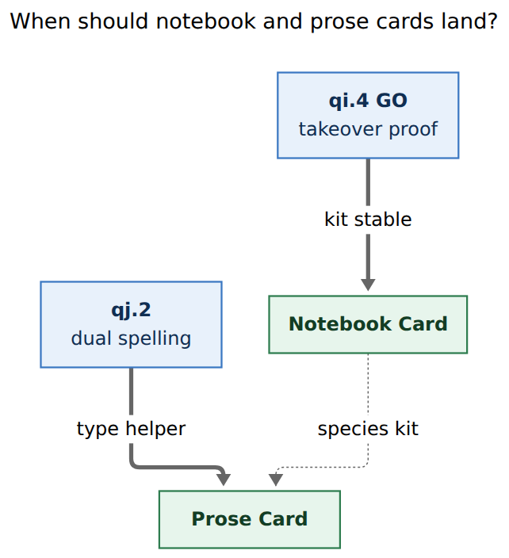
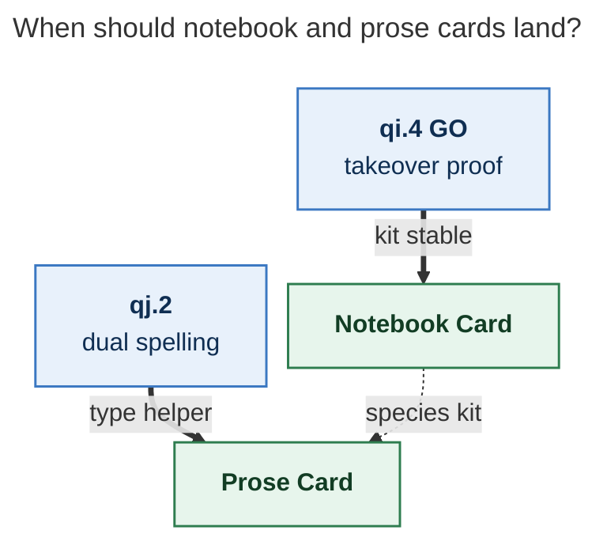
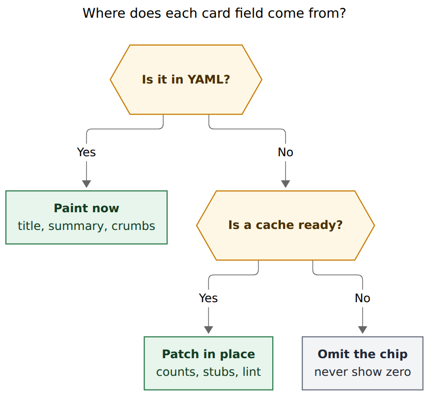
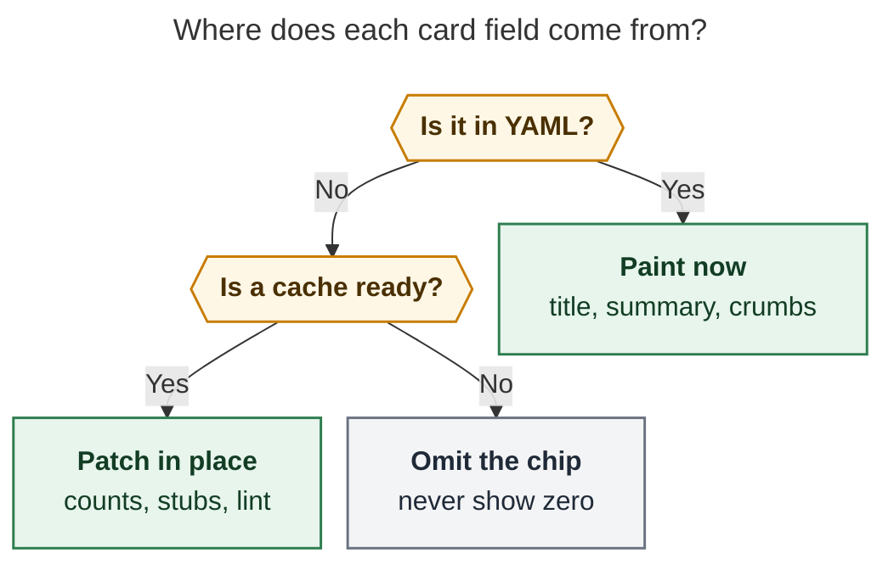
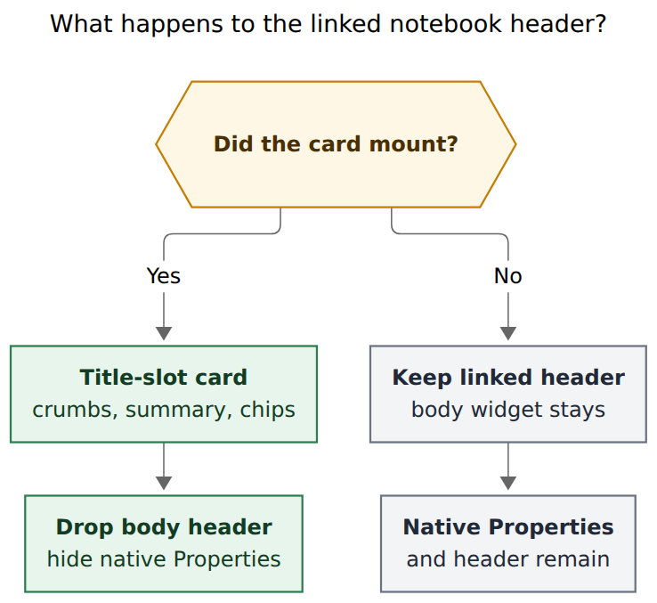
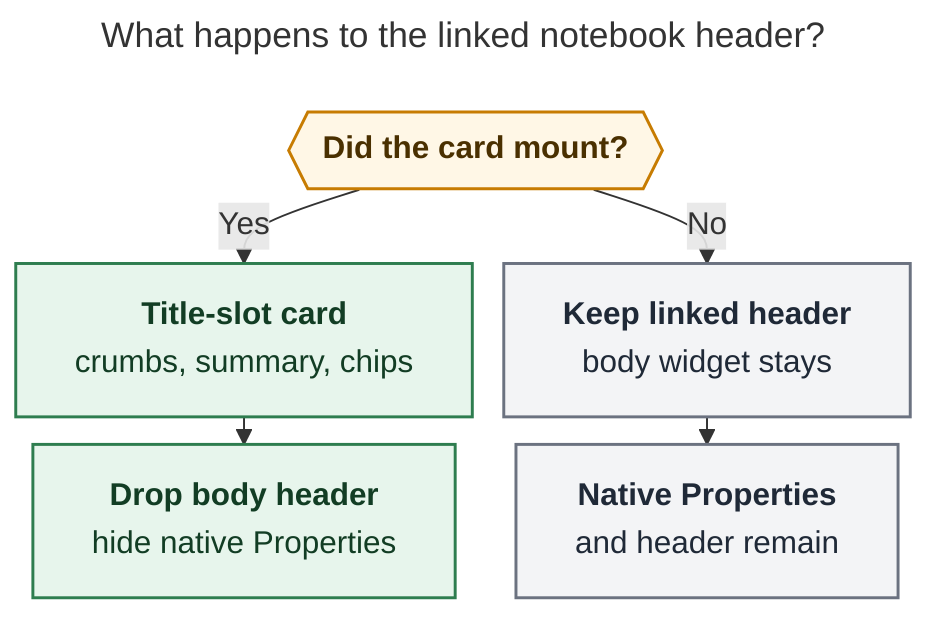

# Prose and notebook property cards

> **Research query:** How should Bob start rendering property cards at the top of
> prose notes (formerly article notes) and notebooks so they behave like the rest of
> the card family — native Properties hidden, rich useful data, glossary terms for
> "prose card" and "notebook card" — while landing in parallel with the in-progress
> `bob-cli-qi` and `bob-cli-qj` epics? Is this a good idea, would a different approach
> be better, which requirement adjustments are justified, and what is the recommended
> solution?

Researcher `grk`. Independent of the other swarm reports. Live measurements from bob
0.6.0 against `~/bob` on 2026-11-26. Code anchors from this workspace plus
bob-plugins master opened through `sase repo open`.

## Bottom line

**Do it, as a sibling epic, not as a patch on qi or qj.** Notebook cards are the
overdue completion of the family. Prose cards are the same grammar on a type that
is still being renamed and that today has one live note.

The product in one paragraph: **two new species (`notebook`, `prose`) on the existing
title-block kit.** Each typed note opens on a compact identity card — glyph, kicker,
parent crumb, one title, one subtitle, sparse chips, shared foot — painted from
confirmed source plus already-cached reports. Native Properties hide behind the same
`props_v1` takeover gate the rest of the family uses. The existing linked notebook
header is absorbed, not stacked. Painting never starts bob. `==` opens a small
species editor (notebook: summary; prose: title and numbering). `+` stays the
Property Editor. Do not invent a dashboard, a nested schema, or new frontmatter keys
to fill the chrome.

Coordination is real and cheap: **do not edit qi or qj.** Wait for `qi.4` GO before
touching the kit, then ship the Notebook Card in parallel with the qj rename. Wait
for `qj.2`'s dual-spelling helper before the Prose Card. Update
`glossary:property-card` after `qi.6` writes the area/project sentence, rather than
racing it.

## Critique of the plan

This is a good idea. I would take it, with the adjustments below. The alternative I
would refuse is "keep native Properties and grow the linked notebook header into a
one-off dashboard." Album notes already made that migration (header → title-slot
card). Notebooks are stuck halfway: they have a body widget and a catalog, and they
still show five YAML rows. Prose notes have hanging section numbers and a status
bar, and they still show YAML. The family grammar already paid for takeover, the
foot, `==` / `-` / `_` / `+`, and fail-open. These two types should join it.

Four instincts in the request would make the feature worse if taken literally.

**1. Implementing "in parallel with qi and qj" does not mean editing those epics.**
qi still owns the takeover kit and the property-card glossary. qj still owns the
type name and the dual-spelling predicate. Piggybacking a tenth species onto
`qi.4`'s screenshot matrix, or adding `NoteKind::Article` while `qj.1` is renaming
the engine, is how the bank/area hybrid happened. Coordination is a bead dependency
and a shared helper, not a merged phase.

**2. "Just a summary?" undersells notebooks and oversells prose.** Live notebooks
already carry `parent`, `template`, `type`, `summary`, and `created`. All 39 have a
summary. Live prose (`sase_blog_contents.md`) carries only `parent`, `type`, and
`created` — no `title`, no `section_numbers`, no `summary`. The rich data is
already computed: `bob notebooks list` (counts, sections, breadcrumb, children,
issues) and `bob articles list` / outline (words, numbering, stubs, findings).
Paint that. Do not invent YAML to decorate a card.

**3. A card that stacks on the linked notebook header will look like two titles.**
`241f-plugin-notebook-header.js` already paints ancestry crumbs and child chips as
a body widget under the H1. Album cards absorbed the old album header. The
Notebook Card must do the same: title-slot chrome, then drop `.bob-notebook-header`
on a successful mount.

**4. A dashboard card will fight the note.** The body of a notebook is the notes.
The body of a prose note is the writing, already decorated with hanging section
numbers. The card answers "what is this file, where does it sit, how big is it?"
in about five lines. Catalogs stay in the owner note (`qi` already listed "moving
`## Notebooks` catalogs into the cards" as out of scope). Outline, Tasks, and
hanging numbers stay in the body.

The rest of the family is already the right shape: fail-open title ownership, one
writer per key, painting that never spawns bob, hue meaning *where*, words and form
meaning *what*. These notes should join that family.

## Live evidence

Measured 2026-11-26 with bob 0.6.0.

| Kind | Live count | Frontmatter today | Report-backed data already on disk |
| --- | --- | --- | --- |
| Notebook | **39** (13 roots, 828 notes, 12 nested, 7 with children) | `parent`, `template`, `type`, `summary`, `created`. All 39 have a summary. `type` is identity; every other key is **loose**. | `bob notebooks list`: title, summary, parent/owner/root, breadcrumb, children, note count, section counts, `last_note`, issues. Plugin already subscribes via `apiNotebookSubscribe`. |
| Prose (article) | **1** (`sase_blog_contents.md`) | `parent: [[sase_blog]]`, `type: [[article]]`, `created`. No `title`, no `section_numbers`, no `summary`. `bob props show` reports **`note_kind: note`**. | Outline: 306 words, 14 sections, numbering on, 13 stubs, 4 `pseudo-footnote` findings. `bob-articles` already caches this per path for hanging numbers and the status bar. |

Further notebook facts that change the chrome:

- **Age is sparse.** `last_note` is set on 1 of 39 notebooks. An age chip as the
  hero metric would read as empty almost everywhere. Counts are always present
  (median 9 notes, max 145, none empty).
- **Warnings are real, not card-worthy as banners.** 13 `notebook_shape`, 2
  `notebook_duplicate_block_id`. Put them on the foot lint chip, the way area
  cards already do.
- **The takeover kit already special-cases notebooks.**
  `notebookFocusSummaryProperty` routes Add/focus of `summary` through the
  Property Editor *only when the card actually owns the note*. The mount is the
  missing half of that path.

Further prose facts:

- **qj.1 is byte-identical.** It will not add `NoteKind::Prose`. Today's
  `note_kind: note` classification stays until a later `feat(props)!`.
- **The one live note is a stubby outline.** A "13 stubs" chip is the most useful
  sentence that card can say today. After `qj.5` extract/inline, many more prose
  notes will exist; the card should be ready before that ships.
- **Hanging section numbers and the `§` status bar stay.** They are body
  decoration and cursor context. The card does not duplicate them.

## Governing decisions

Cited as `decisions:<keyword>` from `sase memory read roster:decisions`:

- `decisions:notebook-routes-write-notes` — a notebook is a bullet collection, never
  an area, never a prose note. The card must not grow Ready caps, Tasks, or
  checkboxes. The rejected "sub-areas" alternative is why notebooks exist.
- `decisions:bob-cli-releases-ride-a-daily-train` — classifying today's article as
  `note_kind: prose` is a JSON contract break (`bob props show` currently says
  `note`). Mark that commit `!`. Never touch `Cargo.toml` / `CHANGELOG.md`.
- `decisions:mac-capture-is-a-thin-client` — no Mac work. Capture already refuses
  tasks into notebooks; qj does not change Mac.
- `decisions:q-and-ctrl-bracket-mirror-esc` — any species editor `==` opens keeps
  Esc / `q` / Ctrl+`[`.
- `decisions:decision-rules-are-read-at-planning-time` — the planner for this
  sibling epic rereads the roster; qi and qj already locked their own memory
  decisions.

qi's own out-of-scope line applies: do not move `## Albums` / `## Notebooks`
catalogs into cards. qj's dual-spelling rule applies: the Prose Card matches
`[[prose]]` and `[[article]]` through one helper; writers emit `[[prose]]`; the
kicker word is `PROSE`, never `ARTICLE`.

## Parallelism with qi and qj

**Coordination is needed. Merging into those epics is not.**

`bob-cli-qi` (bank hub, then finish the card epics) is in progress. Phases 1–3
are closed. `qi.4` is in progress on real-Obsidian takeover and the family
screenshot matrix, and it just repaired a bank Live Preview crash in
`248c-plugin-bank-setup-hosts.js`. `qi.6` (blocked on `qi.4`) owns the
`glossary:property-card` family list plus new `glossary:area-card` /
`glossary:project-card` strands. Its screenshot matrix is bank, album, record,
area, inbox, project.

`bob-cli-qj` (rename article → prose) is in progress. `qj.1` renames the Rust
engine with byte-identical output. `qj.2` adds the permanent dual-spelling
predicate. `qj.3` changes plugin display names and commands under unchanged ids,
and touches `242d-plugin-album-entrypoints.js` (the `article` non-record type).
`qj.4` does the vault cutover and `glossary:prose-note`. `qj.5` only *plans*
extract/inline.

Shared files if anyone implements cards now: `propertyCardSpecies` (`240f`),
title-slot / takeover (`240q` / `240r`), `==` registry, frontmatter-ownership
e2e, and `glossary:property-card`. Those are exactly the files `qi.4` is
proving and `qi.6` is documenting.

<div id="figure-sequencing">



**Caption.** Notebook cards wait until `qi.4` proves the title-slot kit.
Prose cards wait until `qj.2` exposes one type helper for `[[prose]]` and
`[[article]]`. The dashed line is a shared kit, not a blocker: the Prose Card
can add its own species entry if it lands first.

Rendered size: 427 × 470 px; fit scale: 100%. Mermaid CLI 12.0.0.

</div>



**What not to do**

- Do not add phases to `plan:202611/bank_hub_demotion.md` or
  `plan:202611/prose_note_type.md`. Their memory decisions are closed lists.
- Do not add `notebook` / `prose` to `qi.4`'s screenshot matrix. That phase
  cannot close until GO on the current family; growing it mid-flight repeats
  the pl/q6 cancel pattern.
- Do not introduce `NoteKind::Article` while `qj.1` is renaming identifiers.
- Do not race `qi.6` on `glossary:property-card`. Let qi write area/project
  into the family list, then this epic adds notebook and prose.

**What to do**

- Author a **new epic** with two phases (Notebook Card, then Prose Card).
- Hard dep: Notebook Card on `bob-cli-qi.4` (or the closed qi epic).
- Hard dep: Prose Card on `bob-cli-qj.2`.
- Soft dep: glossary family-list edit on `bob-cli-qi.6`.
- Soft dep: `PROSE` kicker copy on `bob-cli-qj.3` (the matcher can land on
  both spellings earlier; the visible word should say PROSE).
- Notebook Card **can and should overlap qj.1–qj.3**. That is the actual
  parallelism: notebooks are not being renamed.

`bob-cli-p2` (ledger-tools re-running `notebooks list` ~97 times per burst with
no backoff) is a load-bearing warning. New cards reuse `apiNotebookSubscribe`
and the bob-articles outline map. They never spawn bob from paint, fold, or
resize.

## Adjusted requirements

Each row changes or sharpens the request. Defaults are what I would ship.

| # | Request as written | Adjustment | Default |
|---|---|---|---|
| A1 | Property cards on prose notes and notebooks | Yes. Two species on the title-block kit, two adapters, shared chrome. | yes |
| A2 | Implement in parallel with qi and qj | Sibling epic. Notebook Card after `qi.4` GO, overlapping qj. Prose Card after `qj.2`. No edits to those plans. | yes |
| A3 | Act like other property cards; hide native Properties | Same takeover gate: desktop LP/Reading, valid source = cache, confirmed `props_v1`, editor routing. Fail-open restores native Properties and, for notebooks, the linked header. File Properties sidebar stays native. | yes |
| A4 | Rich useful data, even though frontmatter is thin | Derive from existing reports. Do **not** add `summary` to prose, stored `word_count`, tags, or a status field. | yes |
| A5 | Excellent glossary terms for "prose card" and "notebook card" | New strands, plus a later `glossary:property-card` family-list update after `qi.6`. Link `glossary:prose-note` once qj writes it. | yes |
| A6 | Lead the design: intuitive, reliable, beautiful | Compact five-line identity. Species is form + word; hue is the owner's root. `_` folds; `-` drawer; `==` species editor; `+` Property Editor. | yes |
| A7 | *(implied)* Keep the linked notebook header | **Absorb it.** A mounted card drops `.bob-notebook-header`. Failed mounts keep it. | yes |
| A8 | *(implied)* New CLI group | No `bob notebooks card`. Extend `bob props` roles. Prose classification is `feat(props)!:` `note_kind: prose` using qj's helper. | yes |
| A9 | *(implied)* Settings contract like area/project | v1 stays on `props_v1`. Notebook `summary` becomes card-owned. Notebook `parent` becomes identity (crumbs, not a settings stage). Prose `title` / `section_numbers` become card-owned when present. No `props_contract_v1` until a Lives-under consequence preview is actually needed. | yes |
| A10 | One epic that ships both types together | Two phases, notebook first. Prose can slip if qj slips; 39 notebooks should not wait on one article. | yes |

## The recommended design

### Shared chrome

Both cards are kit title-block cards. Target ~5 lines. Collapse (`_`) keeps
kicker, title, and foot.

```text
┌──────────────────────────────────────────────────────────────┐
│ [book]  NOTEBOOK · abby                              ⊞  ==   │
│ About Abby                                                   │
│ Notes on being a good dad to Abby: health, baby care, …      │
│ 12 notes · 0 §                              @about_abby      │
│ Git  Java  …   (child chips, only when children exist)       │
│──────────────────────────────────────────────────────────────│
│ ▸ Properties · 5                              created Nov 2  │
└──────────────────────────────────────────────────────────────┘

┌──────────────────────────────────────────────────────────────┐
│ [page]  PROSE · sase_blog                            ⊞  ==   │
│ sase_blog_contents                                           │
│ 306 words · 14 sections · numbered                           │
│ 13 stubs                                                     │
│──────────────────────────────────────────────────────────────│
│ ▸ Properties · 3                              created Oct 15 │
└──────────────────────────────────────────────────────────────┘
```

- **Kicker:** `NOTEBOOK` / `PROSE` plus parent crumbs from the local `parent:`
  chain (real links; Mod-click new tab; ellipsis past ~5 ancestors, matching
  the current header's `NOTEBOOK_HEADER_MAX_CRUMBS`). Top-level owner pip uses
  the existing root-hue resolver. The current note is omitted from the crumb
  trail; it is the heading.
- **Title:** one `role="heading"` node. Notebook title rule already exists
  (first H1 before bullet/`##` → first alias → humanized stem). Prose title
  is `title:` if present, else the first body H1, else the stem. Bytes never
  change. Matching first-body H1 hides at render time; a Live Preview cursor
  reveals it.
- **Subtitle:** notebook `summary:` (wrap to two lines; all 39 have one;
  absent shows a `＋ Add summary` ghost, never a nag). Prose has no subtitle
  in v1.
- **Chips:** content-gated, never zero-filled. Clicking a chip that names an
  editable key opens `==` or `+` on that key.
- **Material:** notebook ~8% owner-hue wash (a collection, like an area);
  prose ~4% (a document, like a record). No new hues. Species is the tile
  form and the kicker word. Amber only for lint. `forced-colors`, reduced
  motion, 4.5:1, ~420 px stacking — same as pf §7.
- **Tiles:** add `book` (notebook, lucide `book-open`, already the catalog's
  📓 meaning) and `page` (prose, lucide `scroll-text`). Distinct from album
  `stack`, record `sheet`, area `field`, project `pennant`. Final pick belongs
  to the screenshot pass.
- **Mount:** typed `[[notebook]]` and `[[prose]]`/`[[article]]` only, via the
  existing classifiers plus qj's dual-spelling helper. Skip templates,
  `done/`, `_conflicts/`, embeds, popovers, canvas, print, mobile. Fail-open
  in the same frame.
- **Keys:** `-` drawer, `_` own section, `==` species editor, `+` Property
  Editor. Same family as bank/area/album.

<div id="figure-data">



**Caption.** YAML-backed fields (title, summary, crumbs, numbering key) paint
from confirmed source immediately. Report-backed chips (counts, stubs, lint)
patch in place from a cache and stay omitted when that cache is missing.
Painting never starts bob and never writes the vault.

Rendered size: 582 × 538 px; fit scale: 100%. Mermaid CLI 12.0.0.

</div>



### Notebook Card

Closest analog: **Album Card**, not Area Card. A notebook is a task-free
collection under an owner, with a generated catalog on that owner and a
local header that already knows crumbs and children.

**Show**

| Slot | Source | Notes |
| --- | --- | --- |
| Tile + `NOTEBOOK` | species kit | `book` / `book-open` |
| Owner crumbs | local `parent:` plus cached report for titles | Reuse `notebookHeaderCrumbs`; drop the self crumb |
| Title | existing notebook title rule | Hide matching H1 |
| Summary subtitle | local `summary:` | Ghost `＋ Add summary` when blank; `==` focuses it |
| `N notes · M §` | cached `bob notebooks list` | Always defined; never paint `0 notes` from a missing report |
| Age | `last_note` vs today | Optional; 1/39 today. Tooltip "Last note", never "last edited" |
| Child chips | report `children` | Content-gated; this is the current header's second row |
| Quiet `@stem` | file stem | Capture route; right-aligned, not a button that writes |
| Foot lint | report `issues` | Count + tooltip; click opens `+` when a key is implicated |
| `created` | foot stamp | Same formatter as the rest of the family |

**Hide from the card, keep in the drawer:** `template`, unknown keys, `type`.

**Absorb the linked header.** On a successful title-slot mount, do not paint
`.bob-notebook-header` in that view. Keep the header code as the fail-open
fallback so Source, mobile, embeds, and a lost slot still show crumbs.

<div id="figure-absorb">



**Caption.** A mounted Notebook Card owns crumbs, summary, and child chips in
the title slot and drops the body header. If the card does not mount, the
linked header and native Properties stay.

Rendered size: 492 × 452 px; fit scale: 100%. Mermaid CLI 12.0.0.

</div>



**`==` on a notebook** opens the Property Editor focused on `summary`, which is
the path `notebookFocusSummaryProperty` already takes once ownership is real.
Do not build a second modal. Parent stays identity in v1: shown as crumbs,
edited from `+` or YAML. Reparenting rewrites owner catalogs; that is tree
surgery, and the area Lives-under stage can be reused later if the generic
editor feels thin.

**Roles to add** in `src/native/props/roles.rs` (notebook already has
`NoteKind::Notebook`):

- `parent` → identity (establishes the collection's home, like album `parent`)
- `summary` → card (`owner: notebook`, `editor: ==`)
- `template` / `created` stay loose (foot and drawer)

No settings contract in v1. `props_v1` is already confirmed on live notebooks.

### Prose Card

Closest analog: **Day/Period Card's identity stack** plus the Record Card's
"title from local metadata before any report." The distinctive data is the
outline, which `bob-articles` already caches.

**Show**

| Slot | Source | Notes |
| --- | --- | --- |
| Tile + `PROSE` | species kit | `page` / `scroll-text`. Never `ARTICLE`. |
| Owner crumb | local `parent:` | One hop is enough; the live note's parent is `sase_blog` |
| Title | `title:` else H1 else stem | Live note has no `title:`; stem/H1 is fine |
| `N words · M sections` | cached outline | Clients must not recompute (`docs/articles.md`). Omit if no cache. |
| `numbered` / `unnumbered` | outline `numbering` or local `section_numbers` | Chip, not a second status bar |
| `N stubs` | outline sections with `stub` | Content-gated; 13 on the live note |
| Findings | outline/list `findings` | Foot lint, not a banner. The live note's four `pseudo-footnote` warnings belong there. |
| `created` | foot stamp | |

**Do not show:** hanging section numbers (body), the `§` status bar (cursor),
a fake summary, stored word counts, extract provenance (that is `qj.5`). Leave
a content-gated provenance line in the design so extract can fill `origin
parent · heading` later without a layout rewrite.

**`==` on a prose note** opens a two-field editor: optional publication
`title`, and the numbering toggle. qj.3 is already adding **Toggle section
numbers**; the card editor should dispatch that write through `bob prose`
(legacy `bob articles`) rather than inventing a third toggle. `+` still opens
the generic Property Editor.

**Roles to add** after `qj.2`:

- New `NoteKind::Prose`, resolved through the dual-spelling helper
  (`[[prose]]` or `[[article]]`, mixed-type still refused). This is
  `feat(props)!:` because `bob props show sase_blog_contents.md` today reports
  `note_kind: note`.
- `parent` → identity
- `title` → card (`owner: prose`, `editor: ==`) when present
- `section_numbers` → card (`editor: ==`)
- `type` stays identity

**Data path.** Add a versioned read API on `bob-articles` (soon Bob Prose)
that returns the in-memory outline map. Ledger-tools subscribes; it does not
spawn `bob prose outline` on paint. If the plugin is missing, the card still
paints identity from local YAML and omits word/section chips.

Matcher must treat both spellings as the same type, including the
`242d` non-record set qj.3 will update. Tests cover `[[prose]]`,
`[[article]]`, and a mixed-type refusal.

### Reliability rules (non-negotiable)

1. **Zero paint spawns, zero paint writes.** Same as album, record, area,
   project, bank. Fold, collapse, and resize are paint.
2. **Fail-open in the same frame.** Lost slot, source/cache mismatch, missing
   `props_v1`, Source, embed, hover, canvas, print, mobile, unload → native
   Properties (and the notebook header) return.
3. **Confirmed source beats cache.** Stale YAML never paints a summary the
   current file does not contain (area/project cards already learned this).
4. **Missing report ≠ zero.** No `0 notes`, no `0 words`, no `0 stubs`.
5. **One writer per key.** `bob props update` for YAML; `bob notebooks sync`
   only when a parent/summary write requires a catalog refresh; `bob prose`
   for numbering. Never `processFrontMatter`.
6. **Two panes of one note:** one card per view, generation-bound handles,
   no duplicate feet. qi.4 is proving this now; reuse its tests.
7. **Word-token invariant** on prose stays with `bob prose format`. The card
   never reformats.

### Beauty

Beauty here is *family resemblance plus a calm first screenful*.

- One visible title. The inline title and a matching H1 hide; nothing is
  deleted.
- Species is a silhouette and a word, never a color. Notebooks pick up the
  owner's hue the way the current header already does; prose does too, so a
  blog child of `sase_blog` reads as part of that home.
- Folded height should match a folded album / area card. qi.4 is reviewing
  that family already; the new species copy those metrics rather than
  inventing a taller stack.
- Child chips wrap; they never force a horizontal scroller. The current
  header already does this at 0.85 em pills.
- Dark and light, narrow split (~420 px) and wide. Screenshot those four
  before calling the visual pass done.

## Glossary terms

User-requested, so a later plan's memory decisions default **on**. Drafts:

**Notebook Card** (`glossary:notebook-card`)

> A [[property-card]] Bob Ledger Tools paints in the title slot of a
> [[notebook]] in desktop Reading view and Live Preview, replacing in-document
> native Properties when the card and foot mount, valid source matches the
> cache, `props_v1` is confirmed, and editor routing is ready. A book tile and
> a `NOTEBOOK` kicker naming the owner trail lead the title. The summary is
> the subtitle; cached `bob notebooks list` counts, optional age, and child
> chips patch in place. A successful mount absorbs the linked notebook header.
> `==` focuses `summary`. Painting never starts bob or writes the vault.
> See `docs/notebooks.md` and `docs/reference/plugins/area-and-project-cards.md`
> (family chrome).

**Prose Card** (`glossary:prose-card`)

> A [[property-card]] Bob Ledger Tools paints in the title slot of a
> [[prose-note]] (legacy `[[article]]`) in desktop Reading view and Live
> Preview, replacing in-document native Properties when the card and foot
> mount under the same gate as the rest of the family. A page tile and a
> `PROSE` kicker naming the parent lead the title. Cached outline chips
> (words, sections, numbering, stubs) patch in place and stay omitted when
> no outline is ready. Hanging section numbers stay in the body. `==` edits
> `title` and numbering. Painting never starts bob or writes the vault.
> See `docs/prose.md` (today `docs/articles.md`).

Also update `glossary:property-card` after `qi.6`: add notebook and prose to
the species list, after area/project and before extensions. Do not edit
`glossary:prose-note` (qj owns it) except to link the card from it once both
exist.

No new decision record is required for v1 unless Bryan wants "the linked
notebook header is absorbed by the Notebook Card" written down. I would
default that decision **off** and let the glossary strand carry the rule.

## Implementation sketch

One sibling epic, two phases. bob-cli is primary; bob-plugins via
`sase repo open`.

**Phase `notebook-card`** (after `qi.4` GO; overlaps qj)

1. Props roles: notebook `parent` identity, `summary` card-owned.
2. Species kit: `notebook` / tile `book` / icon `book-open` / `foldDefault: true`.
3. Adapter: title-slot + title ownership + foot + takeover, painted from
   local YAML + `apiNotebookSubscribe`.
4. Absorb `.bob-notebook-header` when the card owns the view; keep the
   widget as fail-open.
5. `==` → Property Editor on `summary` (existing `notebookFocusSummaryProperty`).
6. Tests: unit (model, species, absorb), ownership, offline e2e, then
   real-Obsidian on a disposable vault. Extend the passive-rendering proof
   so fold/refresh of a notebook card starts zero bob processes.
7. Docs: a short `docs/reference/plugins/notebook-card.md` (or a section
   beside albums). `just docs-gen` / `docs-check`.

**Phase `prose-card`** (after `qj.2`; prefers `qj.3` for visible names)

1. `NoteKind::Prose` through the dual-spelling helper. `feat(props)!:`.
2. Species kit: `prose` / tile `page` / icon `scroll-text`.
3. Adapter + outline-cache API from bob-articles / Bob Prose.
4. `==` → title + numbering, writing through `bob prose`.
5. Tests for both type spellings, mixed-type refusal, missing outline,
   and takeover. Screenshot the one live note plus a fixture with
   `section_numbers: false` and a stub-free outline.
6. Docs under the renamed prose pages qj leaves behind.

**Phase `memory-and-family`** (after `qi.6` glossary, or last if qi is
already closed)

1. Add `glossary:notebook-card` and `glossary:prose-card`.
2. Update `glossary:property-card` species list.
3. `sase memory init`, `just docs-gen`, `just docs-check`.
4. `bob plugins sync` from clean master; no `-F`.

Land agent: one card per eligible note, native Properties hidden on
takeover, header gone on notebooks, zero paint spawns, dual spelling, docs
and glossary match.

## Alternatives considered

| Alternative | Why it loses |
| --- | --- |
| Keep native Properties; restyle YAML | The family already hides YAML on every other typed note. Notebooks and prose would remain the odd files. |
| Grow the linked notebook header in place | A body widget under the H1 cannot own the title slot or native Properties. Album already left this pattern. |
| One "writing" adapter for both types | They share a parent and little else. Notebooks have a catalog report and children; prose has an outline cache and numbering. Two adapters, one kit. |
| Wait for extract (`qj.5`) before any prose card | Extract will mint notes that should open on a card. Build the card on the dual-spelling helper, leave a provenance slot, do not block on extract. |
| Put catalogs / outlines on the card | Duplicates the body, goes stale, and qi already scoped catalogs out. |
| `props_contract_v1` settings for notebooks | Only summary and parent are authored. A full settings contract is how bank grew AREA SETTINGS. |
| Implement inside qi.6 / qj.3 | Closed memory lists, live takeover repairs, screenshot matrix already in flight. |
| Ref cards in the same epic | Reference notes have a reading-task embed and a different identity rule. Out of scope. |

## Risks

- **`qi.4` slips.** Notebook cards wait. They do not start against a kit
  that is still crashing Live Preview ownership.
- **`qj.2` slips.** Notebook cards still ship. Prose waits. That is the
  point of two phases.
- **Outline-cache API.** If bob-articles cannot export its map, identity
  still paints; chips stay omitted. Do not spawn `bob prose outline` as a
  consolation prize (`p2`).
- **Header absorption bugs.** Two chrome stacks, or a missing fallback in
  Source mode. Test both the mounted and the fail-open path.
- **`note_kind: prose` contract break.** Hosts on an older bob fail-open to
  native Properties, which is correct. Mark `!` and wait for the train.
- **One live prose note.** Visual pass uses fixtures as well as
  `sase_blog_contents.md`, or the stubby outline will overfit the design.

## Recommended solution

Ship a **sibling epic** "Prose and notebook property cards":

1. **Notebook Card first**, after `qi.4` GO, overlapping qj. Absorb the
   linked header. Card-own `summary`. Reuse `apiNotebookSubscribe`. Hide
   native Properties through the existing takeover.
2. **Prose Card second**, after `qj.2`. Dual-spelling matcher. Classify as
   `note_kind: prose` (`!`). Chips from the bob-articles outline cache.
   Kicker word `PROSE`. Leave a content-gated provenance slot for extract.
3. **Glossary last**, after `qi.6`: `glossary:notebook-card`,
   `glossary:prose-card`, and the family-list sentence on
   `glossary:property-card`.

Do not merge this into qi or qj. Do not invent frontmatter. Do not spawn bob
on paint. Do not stack a card on the notebook header. That is the design I
would lead.

## Sources

- Live vault, 2026-11-26: `bob notebooks list -f json` (39 notebooks, 828
  notes, 13 shape warnings, 2 duplicate-id errors, `last_note` on 1/39);
  `bob articles list -f json` / `bob articles outline` (1 note, 306 words,
  14 sections, 13 stubs, 4 findings); `bob props show about_abby.md` /
  `sase_blog_contents.md`.
- `plan:202611/bank_hub_demotion.md` (`bob-cli-qi`);
  `plan:202611/prose_note_type.md` (`bob-cli-qj`).
- `research:202611/area_project_property_cards/area_project_property_cards.md`;
  `research:202611/property_card_title_block/property_card_title_block.md`.
- `docs/articles.md`, `docs/notebooks.md`,
  `docs/develop/plugins/architecture.md`,
  `docs/reference/plugins/area-and-project-cards.md`,
  `docs/reference/plugins/albums.md`.
- bob-plugins: `240f-plugin-property-card-species.js` (nine species today);
  `241b` / `241d` / `241e` / `241f` notebook catalog and header;
  `notebookFocusSummaryProperty` in `241d`;
  `249c` / `249d` home cards;
  `242d` album entrypoints (article as a non-record type).
- bob-cli: `src/native/props/roles.rs` (`NoteKind` has Notebook, not Article;
  article classifies as `Note`); `src/native/props/contract/settings.rs`
  (settings only for area/project).
- Beads: `bob-cli-qi`, `bob-cli-qi.4`, `bob-cli-qj`, `bob-cli-qj.1`,
  `bob-cli-qj.3`; `bob-cli-p2` (report-spawn backoff).
- Memory: `glossary:property-card`, `glossary:notebook`,
  `glossary:record-card`, `glossary:album-card`,
  `glossary:day-and-period-card`;
  `decisions:notebook-routes-write-notes`,
  `decisions:bob-cli-releases-ride-a-daily-train`,
  `decisions:mac-capture-is-a-thin-client`,
  `decisions:q-and-ctrl-bracket-mirror-esc`.
