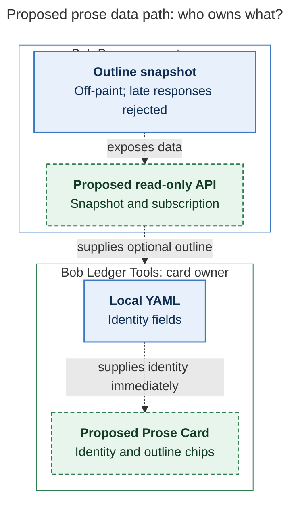
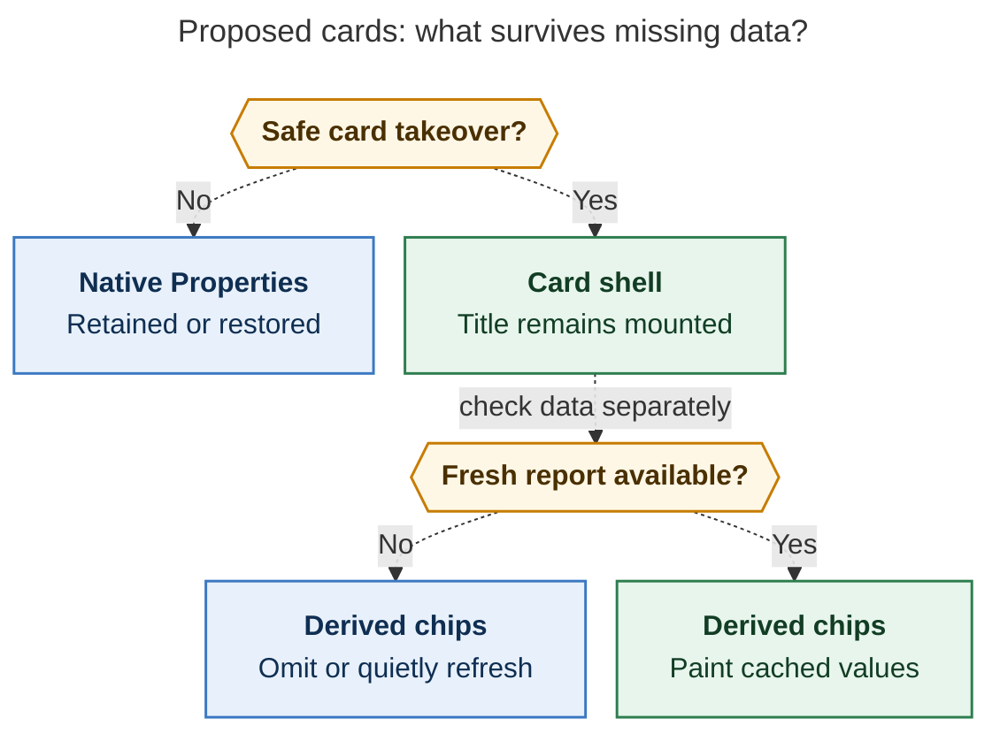

# Diagram proposals: Prose and Notebook Title Cards

Proposals for the swarm linker, not a report. Each diagram restates only what the source
report says.

```yaml
source: research:202611/prose_and_notebook_title_cards/prose_and_notebook_title_cards__final.md
producer: research.6k.image
check: "mmdc 12.0.0 with the PDF-mirroring config and Puppeteer --no-sandbox rendered 2 of 2 Mermaid diagrams"
```

## prose-data-ownership

```yaml
anchor: |-
  The provider owns request bounding and
question: |-
  Who supplies prose identity and outline data, and who owns requests?
illustrates: |-
  The read-only api.prose seam lets the Prose Card paint local YAML identity and Bob Prose's outline snapshot while the provider owns request bounding and rejects late responses.
caption: Local identity paints immediately; optional outline snapshots come from Bob Prose, which owns requests and rejects late responses.
review: 408.062x814 px, fit 100.0%; question, source-trace and visual checks passed; 2 revisions
```



## takeover-versus-data-freshness

```yaml
anchor: |-
  a stale count hides or quietly updates; it never unmounts the
question: |-
  When do native Properties return, and when do only derived metrics disappear?
illustrates: |-
  Separating card-shell validity from derived-number freshness restores native Properties when takeover is unsafe while unavailable derived values leave a valid title mounted.
caption: Unsafe takeover restores native Properties; unavailable derived data leaves a valid card shell mounted.
review: 575.426x738 px, fit 100.0%; question, source-trace and visual checks passed; 0 revisions
```


